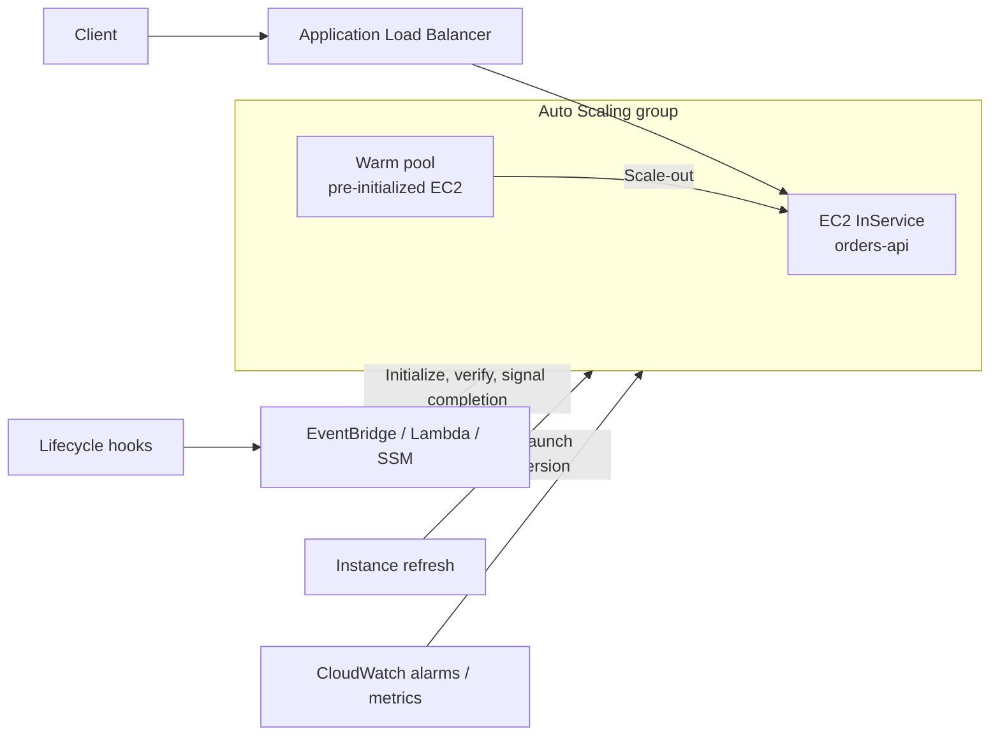
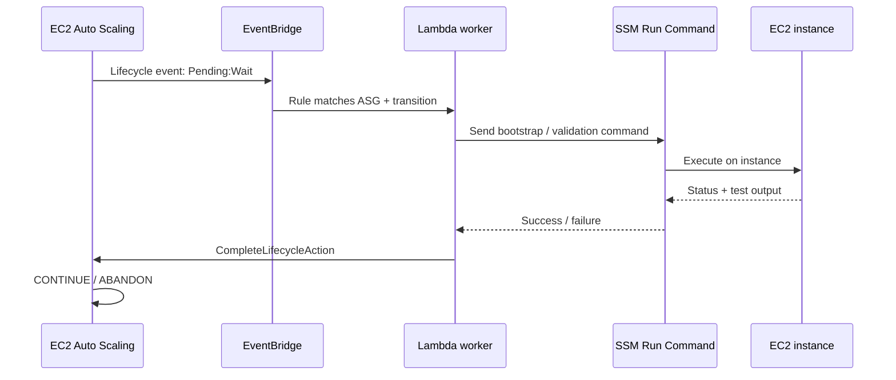
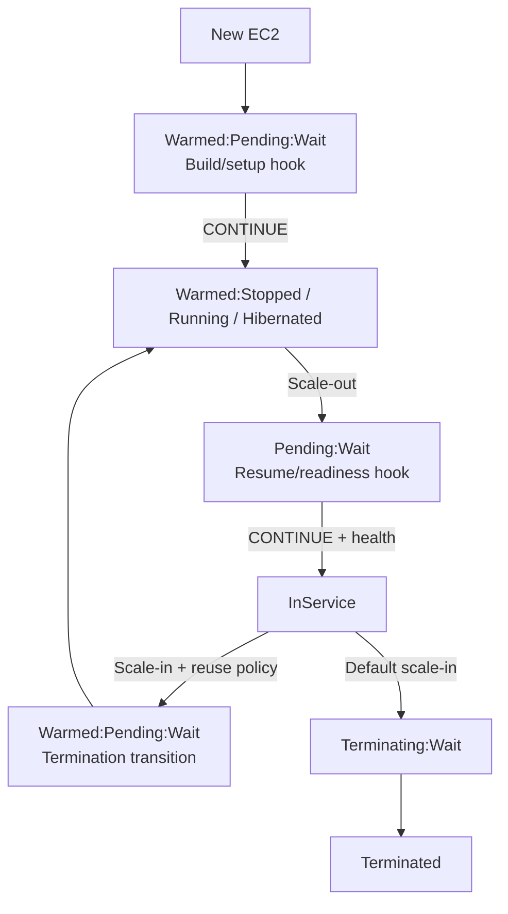
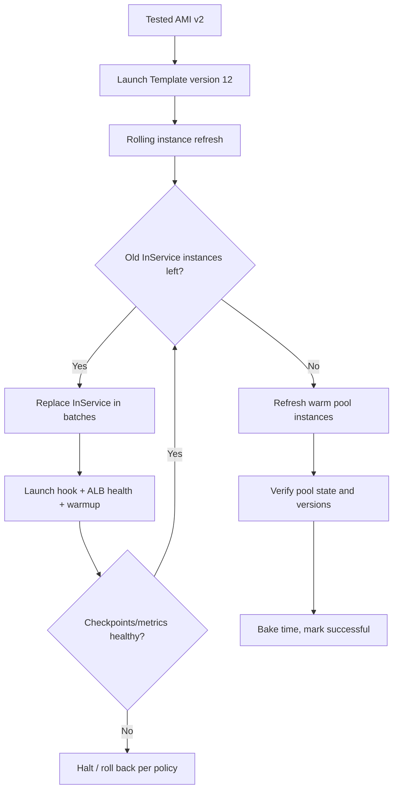

# Warm Pools, Lifecycle Hooks, and Instance Refreshes in EC2 Auto Scaling

> **Chapter:** Load Balancing and Scaling  
> **Module:** `CLOUD_PROVIDERS_AWS`  
> **Context:** Designing a Java application running on EC2 behind an Application Load Balancer (ALB), using an Auto Scaling group (ASG) to meet demand, initialize instances safely, roll out new AMIs, and optimize cost as fleet size fluctuates.

## Learning Objectives

After this lesson, learners will be able to:

1. Distinguish **warm pools**, **lifecycle hooks**, **instance warmup**, **health check grace period**, and **instance refreshes**.
2. Explain how warm pools pre-initialize EC2 instances across `Stopped`, `Hibernated`, and `Running` states, weighing benefits against costs.
3. Design lifecycle hooks for **launch**, **terminate**, and warm pool entry/exit; handle `Pending:Wait`, `Warmed:Pending:Wait`, and `CONTINUE`/`ABANDON` outcomes.
4. Use Amazon EventBridge, Lambda, or AWS Systems Manager (SSM) to run initialization tasks and complete lifecycle actions on time.
5. Run batched **instance refreshes** using `MinHealthyPercentage`, `MaxHealthyPercentage`, `InstanceWarmup`, checkpoints, bake time, skip matching, and rollback.
6. Combine warm pools + lifecycle hooks + instance refreshes to update applications while protecting service levels, resilience, and cost.
7. Inspect state and diagnose failures via AWS CLI, Auto Scaling activity history, ELB target health, CloudWatch, and CloudTrail.

## 1. Three Mechanisms Solving Three Different Problems

An Auto Scaling group can automatically launch or terminate instances based on `MinSize`, `MaxSize`, `DesiredCapacity`, and scaling policies. Yet simply adding hosts automatically is not enough to ensure an application is ready to serve traffic.

For example, `orders-api` running Spring Boot on EC2 needs:

- Several minutes to boot the OS, fetch configuration, run checks, and warm connection pools.
- To receive traffic from the ALB only once genuinely ready.
- Rolling replacement of a vulnerable AMI while preserving required serving capacity.
- Avoiding keeping excessive idle hosts running purely in reserve for a traffic surge.

Three key features address these distinct problems:

| Feature | Core Problem | How It Works | Operational Question |
|---|---|---|---|
| **Warm pool** | Scale-out lags due to slow EC2/app initialization | Maintains a pool of pre-initialized instances alongside the ASG | "Do we have hosts ready fast when traffic spikes?" |
| **Lifecycle hook** | Instances enter/leave service before finishing required tasks | Pauses instances in a wait state to allow automated handling | "Have setup, checks, or cleanup finished before transitioning?" |
| **Instance refresh** | Running instances retain old config/AMI | Updates the fleet in batches toward the desired configuration, monitoring health and warmup | "How do we roll out a new AMI across the entire ASG cleanly?" |

These concepts are related yet not interchangeable. A warm pool does not make an app ready on its own; a lifecycle hook does not create spare capacity; an instance refresh does not guarantee a release is safe without testing.

### 1.1 Prerequisites to Know

- **Auto Scaling group (ASG):** manages a fleet of EC2 instances via desired capacity, scale-out/in policies, health checks, and instance replacement.
- **Launch Template:** defines AMI, instance type, IAM instance profile, security groups, user data, and launch settings. Manage with traceable versions.
- **Application Load Balancer (ALB):** routes HTTP/HTTPS to healthy targets, supporting health checks and deregistration delay.
- **CloudWatch:** metrics and alarms for scaling, health, latency, errors, and cost tracking.
- **EventBridge:** receives lifecycle/refresh events to trigger automation; handlers must tolerate duplicate or out-of-order delivery.

Illustrative architecture:



> The arrow from the warm pool to `InService` represents an instance state transition inside the ASG, not an action ALB manages directly. Instances sitting in the warm pool are not yet serving application targets.

## 2. What Is a Warm Pool?

A **warm pool** is a set of pre-initialized EC2 instances maintained by the ASG **alongside the active serving fleet**. When scale-out is needed, the ASG can pull an existing instance from the warm pool rather than booting a brand-new EC2 instance from scratch.

The biggest gains appear when **cold starts** are slow, such as:

- Installing OS packages and Java runtimes or downloading large artifacts.
- Downloading ML/reference datasets or populating disk caches.
- Running configuration/file verification or registering management agents.
- Heavy application initialization requiring many steps before serving traffic.

A warm pool does not accelerate everything. If every instance entering service still has to download fresh multi-minute datasets at runtime, the benefit shrinks. If EC2/app startup is already very fast, a warm pool may add unnecessary cost.

### 2.1 Do Not Confuse EC2 State with Auto Scaling Lifecycle State

| Entity | Example States | Meaning |
|---|---|---|
| EC2 instance | `running`, `stopped` | Compute state of the EC2 VM |
| ASG serving instance | `Pending`, `Pending:Wait`, `InService`, `Terminating` | Lifecycle phase orchestrated by Auto Scaling |
| Warm pool instance | `Warmed:Pending`, `Warmed:Pending:Wait`, `Warmed:Stopped`, `Warmed:Running`, `Warmed:Hibernated` | Preparing or waiting inside the warm pool |
| Instance refresh | `Pending`, `InProgress`, `Successful`, `Failed`, `Cancelled`... | Status of the **update campaign**, not an EC2 state |

An instance in `Warmed:Stopped` consumes no application CPU, yet remains a warm pool resource that the ASG can start again during scale-out.

### 2.2 Three Warm Pool States and Their Costs

| `PoolState` | What Happens | Pros | Costs and Constraints |
|---|---|---|---|
| `Stopped` | EC2 stops; EBS preserves prepared disk data | Saves compute while waiting; faster than reinstalling from scratch | Still billed for EBS and other billable resources; requires EBS-backed root |
| `Hibernated` | Saves RAM contents to root EBS, then stops | Can restore memory state; fast for compatible workloads | Requires hibernation support, sufficient EBS, valid config; billed for EBS including RAM image |
| `Running` | EC2 stays running inside the warm pool | Nearly zero VM boot delay | Continues accruing full EC2 compute charges; easy to waste idle spend |

For many Java apps, **`Stopped` is a sensible starting choice** when heavy bootstrapping writes results to disk. Use hibernation only after verifying EC2 instance support, OS compatibility, root EBS encryption, RAM sizing, and application stability across resume. Use `Running` when ultra-fast response is mandatory and continuous compute cost is acceptable.

Stopped or hibernated EC2 instances are not completely free: EBS volumes, public IPv4/Elastic IP charges under current pricing, snapshots, logs, and auxiliary resources still accrue bills. An unmonitored warm pool can inflate spend.

### 2.3 Sizing the Warm Pool

Suppose an ASG has:

```text
MinSize         = 2
DesiredCapacity = 4
MaxSize         = 12
```

Without a separate warm pool cap, the initial size is typically calculated as:

```text
Warm pool capacity ≈ MaxSize - DesiredCapacity
                   = 12 - 4 = 8
```

When this gap is large, consider setting `MaxGroupPreparedCapacity` to cap the **combined total of active + prepared instances**.

Example:

```text
ASG DesiredCapacity       = 4
ASG MaxSize               = 12
MaxGroupPreparedCapacity  = 7

Initial target warm pool ≈ 7 - 4 = 3
```

The warm pool's `MinSize` sets its minimum reserve. The ASG adjusts the warm pool dynamically based on desired capacity, min size, prepared capacity, and system conditions. Never treat the simple subtraction above as a guarantee that exactly N hosts exist at all times: instances may be pending, transitioning, replacing, or blocked by AZ capacity.

Specifically, **ASG `MinSize`** is separate from **warm pool `MinSize`**. Warm pool instances are not `InService` and do not serve the load balancer.

### 2.4 What Happens During a Traffic Spike?

1. A scaling policy raises the ASG's `DesiredCapacity`.
2. If an eligible instance is waiting in the warm pool, the ASG claims it and starts/resumes it if needed.
3. A configured lifecycle hook can hold the instance at `Pending:Wait` while running post-resume checks.
4. Once hooks complete and ASG/ALB health checks pass, the instance enters `InService` and takes traffic.
5. Auto Scaling replenishes the warm pool according to configured bounds and conditions.

**If the pool is exhausted**, the ASG launches brand-new instances directly into the group, incurring a **cold start**. Size burst capacity, pool refill time, EC2 quotas, and Region/AZ capacity accordingly; warm pools do not guarantee cold starts never happen.

### 2.5 Instance Reuse on Scale-In

Normally, when load drops, the ASG **terminates** serving instances and may launch fresh ones to refill the warm pool. If you enable:

```text
InstanceReusePolicy.ReuseOnScaleIn = true
```

the ASG can return serving instances back to the warm pool instead of terminating them. Before reusing instances, address:

- Draining connections and completing in-flight requests.
- Cleaning up sessions, job state, temp files, and logs/secrets per policy.
- Refreshing short-lived credentials upon restart.
- Checking whether returned instances run **an older AMI or app version**.
- Ensuring stale runtime state or old network sockets do not cause errors after resume.

Reuse saves re-provisioning time and effort, but increases your responsibility for keeping instances clean and consistent.

## 3. Lifecycle Hooks: Holding Instances in a Wait State

A **lifecycle hook** lets an ASG pause an instance at a specific lifecycle transition so an external task completes before the instance moves on.

Two key lifecycle transitions:

```text
autoscaling:EC2_INSTANCE_LAUNCHING
autoscaling:EC2_INSTANCE_TERMINATING
```

In a standard setup **without a warm pool**:


Common tasks performed in hooks:

| Hook | Common Tasks | Expected Outcome |
|---|---|---|
| **Launch** | Configure app, register agents, fetch config, prime cache, smoke-test health | Prevent instances from entering service before ready |
| **Terminate** | Drain jobs, save checkpoints, flush logs, notify external registry | Finish cleanup before termination or return to pool |
| **Warm pool enter** | Install packages, copy datasets, run long bootstrap | Finish heavy setup before stop/hibernate |
| **Warm pool exit** | Check services after resume, warm caches, verify version | Ready for `InService` after warm start |

### 3.1 How Long Does a Hook Wait and Who Completes It?

When a hook triggers, the instance enters `*:Wait`. AWS emits a lifecycle event; automation picks it up, performs its work, and calls:

```text
CompleteLifecycleAction(result = CONTINUE | ABANDON)
```

**`CONTINUE`:** allows the lifecycle to advance, subject to any remaining hooks and health checks. **`ABANDON`:** on a launch hook, can cause the ASG to terminate and replace the instance; on a termination hook, terminates immediately and skips remaining hooks. Never mistake `ABANDON` for an automatic release rollback feature.

If completion is not reported before the deadline, the hook uses its configured **default result**. The default heartbeat timeout is **3600 seconds (1 hour)**; when creating a hook, choose a value within AWS-supported bounds. For long tasks, call `RecordLifecycleActionHeartbeat` periodically to extend the wait. Total wait time is still capped by a **global timeout equal to the lesser of 48 hours or 100 times the heartbeat timeout**.

**Design clear failure modes:**

- Mandatory bootstrap launch hook: generally favor `ABANDON` so uninitialized hosts do not enter service.
- Termination hook: both `CONTINUE` and `ABANDON` lead to termination, though `ABANDON` can skip other hooks. For critical cleanup, build safeguards beyond the hook alone.
- Failed events or tasks: log, alert, and ensure timeouts never result in "unready instance promoted to active service."

### 3.2 A Lifecycle Hook Is Not a Health Check

A hook completing with `CONTINUE` means only that your custom orchestration step reported done. The instance still needs:

- EC2 status checks.
- Auto Scaling health checks (EC2 or ELB per configuration).
- ALB target group health checks (e.g., Spring Boot `/actuator/health/readiness`).
- Business metrics, request latency/error rate checks, and database/cache reachability.

Never have a script merely check `pgrep java` and report ready before database migrations finish, dependencies connect, or ports open.

### 3.3 EventBridge, Lambda, and Systems Manager

A common workflow:



In real deployments, an SSM command may outlast Lambda's maximum execution limit. You can decouple **command dispatch** from **result handling** via EventBridge, Step Functions, SQS, or another worker instead of blocking Lambda synchronously. Event handlers must handle **duplicate deliveries**, retries, and timeouts, correlating via lifecycle action token, instance ID, ASG name, and hook name.

Grant least-privilege IAM permissions per role: the worker role may call `autoscaling:CompleteLifecycleAction`, `autoscaling:RecordLifecycleActionHeartbeat`, and `ssm:SendCommand` scoped to target resources; the EC2 instance profile holds SSM permissions plus only the AWS services the app needs. Never place AWS access keys in user data.

## 4. Lifecycle Hooks with Warm Pools: The Most Common Trap

With a warm pool, instances can pass through **`Warmed:Pending:Wait`** in addition to `Pending:Wait`.

### 4.1 A Launch Hook Can Fire Twice

When `autoscaling:EC2_INSTANCE_LAUNCHING` is configured:

1. **First time** when a new instance launches into the warm pool: it can pause at `Warmed:Pending:Wait`.
2. After bootstrapping completes, the instance enters its pool state (`Warmed:Stopped`, `Warmed:Running`, or `Warmed:Hibernated`).
3. **Second time** when scale-out pulls the instance from the warm pool into the ASG: the hook can pause at `Pending:Wait`.
4. After post-resume readiness checks pass, the instance enters `InService`.

Therefore, handlers must distinguish **entering the pool** from **entering active service** via lifecycle state/context. Never re-run slow provisioning or non-idempotent operations on both phases.



The diagram shows the flow with hooks active; without hooks, `*:Wait` states are skipped.

### 4.2 Why Does User Data Often Get Cut Off Mid-Run?

AWS can **stop or hibernate an instance immediately after placing it into a warm pool** without waiting for user data to finish. In Linux cloud-init, user data normally runs **only on the first boot**. If a script takes 5 minutes to download large files while the instance stops after 2 minutes, that script may not re-run when scaled out later.

As a result, the instance enters `InService` missing artifacts or config—and ASG may still mark it healthy if using EC2-only health checks.

How to prevent this:

- Use a launch lifecycle hook to hold at `Warmed:Pending:Wait`, calling `CONTINUE` only after bootstrapping truly finishes.
- "Bake" heavy dependencies into the **AMI** via EC2 Image Builder to shrink bootstrap time.
- Where appropriate, configure cloud-init/user data to run per boot, keeping scripts idempotent and distinguishing initial setup from resume.
- When entering service, verify **readiness** directly rather than trusting a "user data ran" marker file on disk.

### 4.3 Termination Hooks and Reuse Policy

If the ASG **does not reuse** instances, a termination hook pauses instances at `Terminating:Wait` for draining/flushing before termination. With `ReuseOnScaleIn=true`, hooks for `autoscaling:EC2_INSTANCE_TERMINATING` can fire at `Warmed:Pending:Wait` as instances return to the pool.

Never write automation assuming "a termination lifecycle event always means the EC2 instance is being destroyed." Inspect warm pool context, choose whether to retain sessions/caches, and run the right cleanup steps.

### 4.4 Lifecycle Hooks vs. Default Instance Warmup vs. Health Check Grace Period

| Setting | When Does It Act? | Purpose | Replaces a Hook? |
|---|---|---|---|
| **Lifecycle hook heartbeat timeout** | While instance waits in `*:Wait` | Window for custom action with heartbeats and completion | It *is* the business synchronization mechanism |
| **Health check grace period** | As instance enters `InService` | Prevents premature unhealthy replacement during startup | No. Does not enforce bootstrap completion |
| **Default instance warmup** | After instance enters `InService` | Waits before including instance metrics in scaling math | No. Instance may already be receiving traffic |
| **ALB health check** | Once target is registered/probed | Determines if target is eligible to receive traffic | Does not replace custom hooks |
| **Warm pool** | Before instance is needed in `InService` | Keeps pre-initialized instances ready | Does not guarantee app readiness |

These timers can overlap; do not sum them together as a single "startup timeout."

## 5. Instance Refresh: Controlled Updates for Running EC2 Instances

When you update a Launch Template to point to a new AMI, **already-running EC2 instances do not automatically swap** AMIs or OS versions. **Instance refresh** updates the fleet via controlled replacement campaigns or supported root-volume replacement strategies.

Common use cases:

- Applying OS patches or Java runtime updates via a new golden AMI.
- Changing user data versions, agents, launch config, or instance types.
- Migrating to a new Launch Template.
- Standardizing a fleet running mixed instance versions.

### 5.1 Rolling Instance Refresh

This is the **default strategy**. The ASG replaces instances in batches while respecting required healthy capacity levels. For an ASG behind an ALB:

1. Specify the desired configuration (Launch Template version/AMI, instance types, etc.).
2. Start the refresh with minimum/maximum healthy percentages.
3. The ASG replaces old EC2 instances with new ones in waves (or launch-first when configured to maintain capacity).
4. Lifecycle hooks, health checks, and instance warmup execute for each wave.
5. The next batch proceeds only after active checks and gates clear.
6. With a warm pool present, the ASG updates **`InService` instances first**, then **warm pool instances**.

**Do not** assume editing a Launch Template without running a refresh automatically updates the warm pool. Idle instances in the pool may still hold old AMIs/app versions.

### 5.2 Replace Root Volume: Special Case

AWS also supports **instance refresh with the Replace Root Volume strategy** under specific conditions. Instead of terminating the whole instance, it replaces the **root EBS volume** from the target AMI while preserving ENIs, non-root EBS volumes, and instance identity per service behavior.

Key prerequisites include using a compatible **mixed instances policy**, overrides containing `ImageId`, an AMI with a single root volume, and other AWS constraints. **Do not use Replace Root Volume on an ASG with a warm pool**: this combination is currently unsupported. In this lesson, the warm pool + instance refresh pattern uses **Rolling**.

When using root volume replacement, applications still need to handle reboots, health checks, and backing up root-disk state; do not treat it as a zero-disruption upgrade at the application layer.

## 6. Key Options for Rolling Instance Refresh

### 6.1 Minimum and Maximum Healthy Percentages

- **`MinHealthyPercentage`:** percentage of desired capacity that must stay healthy/InService per ASG calculations during replacement.
- **`MaxHealthyPercentage`:** maximum capacity percentage permitted during refresh, creating room for **launch-before-terminate** when needed.

Example ASG with `DesiredCapacity=10`:

| Illustrative Setting | Operational Meaning | Trade-Off |
|---|---|---|
| `MinHealthyPercentage=90`, `MaxHealthyPercentage=100` | Can temporarily drop to ~90% healthy capacity during rolling waves | Less spare headroom; risk of higher latency |
| `MinHealthyPercentage=100`, `MaxHealthyPercentage=110` | Launches new instance(s) before terminating old ones if quotas/capacity allow | Requires extra temporary spend and quota |
| `MinHealthyPercentage=100`, `MaxHealthyPercentage=100` | Keeps serving count at 100%, replacing sequentially per orchestration | Can be slower, wait for capacity, or hit quota limits |

Actual instance counts depend on **rounding and capacity units** in the ASG (especially mixed instances / weighted capacities), group min/max limits, health, and availability. Percentages are not an SLA guaranteeing zero failed user requests.

Check **EC2 vCPU quotas, instance supply, subnet IP space, target groups**, and cost before asking an ASG to temporarily surge capacity.

### 6.2 Instance Warmup and Health Checks

**`InstanceWarmup`** is the wait time after a new instance enters `InService` and passes health checks before the refresh advances to the next batch. It is distinct from time spent inside a lifecycle hook at `Pending:Wait`.

For instance, if Spring Boot needs 3 minutes after process start to warm caches and connection pools, you might pick 180 seconds based on measurements. Yet if a broken readiness endpoint returns 200 prematurely, raising warmup alone will not fix readiness.

**`HealthCheckGracePeriod`** is configured on the ASG, not as an alias for `InstanceWarmup`. It delays ASG health-failure replacement right after an instance enters `InService` and must be coordinated with ALB health checks and lifecycle hooks.

### 6.3 Skip Matching

`SkipMatching=true` skips instances whose configuration already matches the desired configuration per AWS criteria, avoiding redundant replacements. However:

- It **cannot detect** code changes dynamically downloaded by user data scripts from a repository.
- If the AMI ID and Launch Template version stay identical while a new artifact sits at a fixed URL, instances may be **skipped** even though they run stale code.
- Certain mixed-instance / attribute-based selection configurations have limits on `SkipMatching` and `DesiredConfiguration`; check AWS docs before enabling.

For reliable releases, build **immutable** AMIs/Launch Template versions or explicitly versioned artifacts. If code changes without changing deployment metadata, adjust refresh strategy accordingly—such as disabling skip matching.

### 6.4 Checkpoints

`CheckpointPercentages` splits a refresh into stages so operations can verify health after set replacement milestones—such as **10% → 50% → 100%**. After each checkpoint, the refresh pauses for `CheckpointDelay` or configured orchestration time.

What to inspect at checkpoints:

- ALB 5xx / target 5xx, p95/p99 latency, and error rates.
- Java/GC errors, memory, CPU, thread pools, and database connections.
- Business flows: order creation, authentication, writes, and event queues.
- Comparing new vs. old instances across logs, metrics, versions, and traffic.

Checkpoints **do not replace canary routing** if you need to test a tiny traffic slice or specific user cohort; they are pause gates during fleet replacement.

### 6.5 Bake Time and Rollback

**`BakeTime`** is a final observation window **at the end of the refresh campaign**, after all replacements complete, to keep monitoring health before marking the refresh successful. It differs from per-batch `InstanceWarmup`.

AWS supports **automatic rollback** on eligible configurations if the refresh fails or configured CloudWatch alarms enter `ALARM`. Auto-rollback is not guaranteed on by default everywhere. When rolling back, AWS restores the previous ASG/instance configuration via service mechanics; this **does not automatically roll back database schemas, transactions, or external data**.

**Launch Template version note:** to ensure clean automatic rollback and auditability under service rules, prefer explicit version numbers like `"12"` over `$Latest`/`$Default` in desired configurations.

### 6.6 Scale-In Protection, Standby, and Limits

Instances marked **protected from scale-in**, in `Standby`, or unhealthy can block refresh progress; AWS offers handling options (`Refresh`, `Ignore`, or `Wait` depending on the setting) and fails after timeouts if blocked.

If a scale-out happens mid-refresh, new instances generally launch using the refresh's **desired configuration**, even though the ASG's permanent config updates only once the refresh succeeds.

A refresh can take a long time due to bootstrap/hooks/warmup, fleet size, quotas, or capacity shortages. Set operational deadlines and alerts rather than watching completion percentage alone.

## 7. How Warm Pools + Lifecycle Hooks + Instance Refreshes Work Together

### 7.1 Before Deployment

ASG `orders-api-asg` runs Launch Template `orders-api-lt:11` with Java app v1. `DesiredCapacity=4`, `MaxSize=12`. The warm pool holds 3 `Warmed:Stopped` instances with Java already bootstrapped.

When traffic spikes:

1. ASG claims EC2 instances from the pool.
2. The launch lifecycle hook runs **post-restart readiness checks**.
3. Once complete, ALB health checks confirm target readiness.
4. Instances enter `InService` per ASG orchestration.
5. Normal scaling policies continue managing capacity.

### 7.2 When Releasing a New AMI

The team builds and tests AMI v2, publishes Launch Template version **12** pointing to it, and starts a **Rolling instance refresh**.



Key takeaways:

- `InService` instances are replaced **before** warm pool instances.
- Mid-refresh, the warm pool may contain mixed AMI versions. Never judge a release finished just by counting instances in the pool.
- With a warm pool present, **never choose Replace Root Volume**, as AWS does not support that combination.
- Lifecycle hooks can hold new instances in wait states for checks. If a hook fails and sends `ABANDON`, the ASG launches a replacement; repeated failures can stall or fail the refresh.
- Declare success only once both the fleet and warm pool (per refresh scope), health checks, and business metrics pass criteria.

### 7.3 During Rollback

If v2 causes rising business errors:

1. Cancel rollout progression or trigger rollback via supported mechanisms.
2. Identify the known-good v1 configuration (AMI and Launch Template version 11).
3. Revert the ASG to the approved version and replace affected instances.
4. Inspect the **warm pool** for remaining v2/v1 instances and align them per rollout/rollback policy.
5. Verify app and data state (backward-compatible DB migrations, queues, sessions).
6. Preserve failure evidence, fix the component/Image Builder pipeline, and ship a patched release.

**Merely changing the Launch Template version does not revert running instances back to the old AMI.** Instance refresh/rollback swaps the fleet per policy, while off-EC2 data requires its own recovery plan.

## 8. Calculating Trade-Offs: Cutting Scale-Out Latency with Warm Pools

Suppose a Java app has:

```text
Cold EC2 + OS boot               45 seconds
Install agents + download JAR    90 seconds
Initialize Spring Boot           75 seconds
Populate initial cache           30 seconds
------------------------------------------
Illustrative cold start         240 seconds
```

If the AMI already bundles agents/artifacts and the warm pool holds `Stopped` instances post-bootstrap, scaling out from the pool may take only VM resume, readiness checks, and ALB registration. **AWS makes no fixed guarantee on exact seconds**: measure end-to-end from scale-out trigger until targets are genuinely healthy and serving requests.

Suppose the system needs **3 extra instances within 2 minutes**. With a 4-minute cold start, raising desired capacity only after CPU spikes arrives too late. Options:

- Maintain a warm pool of at least 3 instances.
- Pair target tracking with predictive or scheduled scaling ahead of regular peaks.
- Optimize AMI/User Data to cut boot latency.
- Measure `TimeToInService`, ELB healthy time, and application latency.

### 8.1 Do Not Assume Warm Pools Are Automatically Cheaper

A `Running` warm pool still bills EC2 compute. With `Stopped` or `Hibernated`, EBS charges scale with pool size, plus potential snapshot, log, and IPv4 charges. An oversized warm pool can cost more than the latency reduction is worth.

Before enabling, compare:

| Option | Pros | Trade-Offs |
|---|---|---|
| No warm pool; standard scale-out | Simple, minimal idle resources | Slow cold starts during bursts |
| Warm pool `Stopped` | Pre-staged disk/software with minimal idle compute cost | Still incurs VM start time and EBS charges |
| Warm pool `Hibernated` | Preserves RAM state where supported | Hibernation constraints, RAM-image EBS storage, resume testing |
| Warm pool `Running` | Fastest readiness | Continuous EC2 compute charges |
| Optimized AMI + small warm pool | Cuts bootstrap time while bounding pool spend | Requires image pipeline and testing |
| Scheduled scaling | Pre-provisions capacity ahead of known loads | Does not react to unexpected spikes |

## 9. AWS CLI: Inspecting Current Configuration

Examples use AWS CLI v2. Replace sample names (`orders-api-asg`, `orders-api-lt`) and dummy IDs with real values. Commands in this section are **read-only**.

### 9.1 Verify Account and Region

```bash
aws sts get-caller-identity
aws configure get region
```

When working across multiple accounts/Regions, pass `--profile` and `--region` explicitly rather than guessing from hostnames or ASG names.

### 9.2 Inspect ASG and Instance Lifecycle States

```bash
aws autoscaling describe-auto-scaling-groups \
  --auto-scaling-group-names orders-api-asg \
  --region ap-southeast-1 \
  --query 'AutoScalingGroups[].{Name:AutoScalingGroupName,Min:MinSize,Desired:DesiredCapacity,Max:MaxSize,LaunchTemplate:LaunchTemplate,Instances:Instances[].{Id:InstanceId,Lifecycle:LifecycleState,Health:HealthStatus}}' \
  --output json
```

Inspect `DesiredCapacity` and `LifecycleState` to separate active serving instances from instances waiting to join. With mixed instances policies, the Launch Template reference sits under the mixed instances structure rather than the top-level `LaunchTemplate` field.

### 9.3 Inspect the Warm Pool

```bash
aws autoscaling describe-warm-pool \
  --auto-scaling-group-name orders-api-asg \
  --region ap-southeast-1 \
  --output json
```

Key fields: `WarmPoolConfiguration.PoolState`, `MinSize`, `MaxGroupPreparedCapacity`, `InstanceReusePolicy`, and `Instances[].LifecycleState`. If the group lacks a warm pool, read the returned error message rather than assuming the ASG does not exist.

### 9.4 List Lifecycle Hooks

```bash
aws autoscaling describe-lifecycle-hooks \
  --auto-scaling-group-name orders-api-asg \
  --region ap-southeast-1 \
  --query 'LifecycleHooks[].{Name:LifecycleHookName,Transition:LifecycleTransition,Timeout:HeartbeatTimeout,Default:DefaultResult}' \
  --output table
```

Verify hook names, transitions, timeouts, and default results match application needs. When hooks time out, logs/metrics must show whether unbootstrapped instances entered service.

### 9.5 Inspect Instance Refreshes and Scaling Activities

```bash
aws autoscaling describe-instance-refreshes \
  --auto-scaling-group-name orders-api-asg \
  --region ap-southeast-1 \
  --query 'InstanceRefreshes[].{Id:InstanceRefreshId,Status:Status,Percentage:PercentageComplete,ToUpdate:InstancesToUpdate,Reason:StatusReason}' \
  --output table

aws autoscaling describe-scaling-activities \
  --auto-scaling-group-name orders-api-asg \
  --region ap-southeast-1 \
  --max-items 20 \
  --query 'Activities[].{Time:StartTime,Status:StatusCode,Reason:Description}' \
  --output table
```

When a refresh stalls, read `StatusReason` and scaling activities to spot capacity, IAM, AMI, lifecycle hook, or health check errors.

## 10. AWS CLI: Creating a Warm Pool and Lifecycle Hook (Mutating Examples)

> **Run only in a test account or under an approved change procedure.** These commands modify the ASG and can create EC2 instances, EBS volumes, and new charges. Ensure proper IAM permissions, a valid launch template, EC2 quotas, and configured SGs/VPCs.

### 10.1 Configure a `Stopped` Warm Pool

```bash
aws autoscaling put-warm-pool \
  --auto-scaling-group-name orders-api-asg \
  --pool-state Stopped \
  --min-size 2 \
  --max-group-prepared-capacity 8 \
  --instance-reuse-policy ReuseOnScaleIn=true \
  --region ap-southeast-1
```

In this example, the pool keeps **at least 2** reserve instances when eligible, caps combined prepared capacity at 8, and enables returning instances to the pool on scale-in. The value `8` only makes sense if aligned with real `DesiredCapacity` and ASG demands—do not copy blindly.

### 10.2 Create a Launch Lifecycle Hook

```bash
aws autoscaling put-lifecycle-hook \
  --auto-scaling-group-name orders-api-asg \
  --lifecycle-hook-name bootstrap-readiness \
  --lifecycle-transition autoscaling:EC2_INSTANCE_LAUNCHING \
  --heartbeat-timeout 900 \
  --default-result ABANDON \
  --region ap-southeast-1
```

This hook holds instances in `*:Wait` for up to 900 seconds per heartbeat interval; automation must call complete when finished. Without a callback, `ABANDON` prevents promoting an unverified instance into service. With an active warm pool, this launch hook can trigger at **two moments**: entering the pool and exiting to service.

`put-lifecycle-hook` only registers the hook; it **does not create** Lambda/SSM automation or application checks. If using EventBridge, define the rule and target separately.

### 10.3 Send Heartbeats and Complete the Action

Once the worker receives the lifecycle event with the **instance ID**, ASG name, and hook name:

```bash
# While bootstrap is still running
aws autoscaling record-lifecycle-action-heartbeat \
  --auto-scaling-group-name orders-api-asg \
  --lifecycle-hook-name bootstrap-readiness \
  --instance-id i-0123456789abcdef0 \
  --region ap-southeast-1

# Once all readiness checks pass
aws autoscaling complete-lifecycle-action \
  --auto-scaling-group-name orders-api-asg \
  --lifecycle-hook-name bootstrap-readiness \
  --instance-id i-0123456789abcdef0 \
  --lifecycle-action-result CONTINUE \
  --region ap-southeast-1
```

When the same instance/hook undergoes multiple lifecycle actions over time (especially with warm pools), pass the **exact event lifecycle action token** where provided and supported by the API to avoid completing a stale action. Bootstrap tasks must verify the right event context rather than calling `CONTINUE` blindly upon event receipt.

On unrecoverable errors before hook expiration, automation can call `ABANDON` for launch actions as designed. For terminate actions, manage irreversible cleanup steps separately.

### 10.4 Inspect Target Health at the ALB

```bash
aws elbv2 describe-target-health \
  --target-group-arn arn:aws:elasticloadbalancing:ap-southeast-1:123456789012:targetgroup/orders-api/0123456789abcdef \
  --region ap-southeast-1 \
  --output json
```

The ARN above is illustrative. Inspect `TargetHealth.State` and `Reason`. An instance entering `InService` in ASG and becoming healthy in ALB are related, yet never rely on a single field to judge full application health.

## 11. AWS CLI: Deploying via Rolling Instance Refresh

Assume Launch Template `orders-api-lt` has tested version `12` with a new AMI. The example below chooses:

- At least 100% of desired capacity kept healthy.
- Temporary surge up to 110% during the update.
- 180-second warmup.
- Checkpoints at 10%, 50%, 100%, waiting 600 seconds at checkpoints.
- Skip instances already matching the version.
- Auto-rollback enabled, 300-second bake time.

```bash
aws autoscaling start-instance-refresh \
  --auto-scaling-group-name orders-api-asg \
  --strategy Rolling \
  --desired-configuration '{"LaunchTemplate":{"LaunchTemplateName":"orders-api-lt","Version":"12"}}' \
  --preferences '{"MinHealthyPercentage":100,"MaxHealthyPercentage":110,"InstanceWarmup":180,"CheckpointPercentages":[10,50,100],"CheckpointDelay":600,"SkipMatching":true,"AutoRollback":true,"BakeTime":300}' \
  --region ap-southeast-1
```

Returns `InstanceRefreshId`. The inline JSON above illustrates **Bash** quoting; **PowerShell/Windows** escaping differs. Save JSON to files and pass `--desired-configuration file://desired-configuration.json` and `--preferences file://refresh-preferences.json` per CLI conventions to avoid quoting errors.

**Do not copy these exact flags blindly to every ASG:** values may be invalid or unsupported depending on policies, mixed instances, attribute-based instance selection, launch template version/rollback rules, warm pools, and maintenance policies. Check your existing ASG config, AWS docs, and test in staging.

### 11.1 Monitor and Handle Stalled Refreshes

```bash
aws autoscaling describe-instance-refreshes \
  --auto-scaling-group-name orders-api-asg \
  --instance-refresh-ids 01234567-89ab-cdef-0123-456789abcdef \
  --region ap-southeast-1
```

Replace the dummy ID with the ID returned by your run. On failure, first determine whether the refresh is blocked on a lifecycle hook, health check, quota/capacity, checkpoint, or desired configuration.

### 11.2 Cancel and Rollback Are Not the Same

```bash
# Halt further instance replacements (does not revert already-updated instances)
aws autoscaling cancel-instance-refresh \
  --auto-scaling-group-name orders-api-asg \
  --region ap-southeast-1

# Trigger rollback per supported options and refresh state
aws autoscaling rollback-instance-refresh \
  --auto-scaling-group-name orders-api-asg \
  --region ap-southeast-1
```

**`Cancel`** stops future replacements without reverting the fleet to the old AMI. **`Rollback`** instructs AWS to run a campaign restoring the previous configuration where supported, which takes time and capacity. For backward-incompatible database migrations, rolling back EC2 **does not revert schemas or data**.

## 12. Designing a Readiness Hook for a Java Application

Suppose `orders-api` exposes:

```text
GET /actuator/health/liveness
GET /actuator/health/readiness
```

- **Liveness:** process is alive and eligible for restart if stuck in an unrecoverable state.
- **Readiness:** app is ready to serve business requests (critical dependencies, config, migrations/seeds, listeners, thread pools).
- **ALB target group health check:** use an appropriate readiness path returning 200 accurately while avoiding deep dependency checks that trigger cascading failures.

You can structure a bootstrap controller as follows:

```text
onLifecycleEvent(event):
    require event.asg == "orders-api-asg"
    require event.hook == "bootstrap-readiness"
    require event.transition == EC2_INSTANCE_LAUNCHING

    if event.lifecycleState == "Warmed:Pending:Wait":
        ensureBaseDependenciesInstalled()
        verifyArtifactChecksum()
        verifySystemdUnitsPresent()
        complete(event.token, CONTINUE)

    else if event.lifecycleState == "Pending:Wait":
        waitForServiceStarted()
        checkReadinessEndpointLocally()
        verifyExpectedApplicationVersion()
        complete(event.token, CONTINUE)

    else:
        logAndIgnoreUnexpectedState()

onTransientFailure:
    heartbeat(event.token) while within bounded deadline
    retryWithBackoff()

onPermanentFailure:
    complete(event.token, ABANDON)
    alertOperations()
```

This is **architectural pseudocode**, not deployable Lambda code. Parse real event schemas from AWS and enforce:

- **Idempotency:** EventBridge can redeliver events; handlers may run more than once.
- **Deadlines:** never retry indefinitely past the global timeout.
- **Observability:** log correlation ID, hook name, ASG, instance ID, AMI/app version, lifecycle state, and outcome.
- **Access control:** allow only the intended worker role to invoke lifecycle APIs; avoid wildcard permissions.
- **Secret hygiene:** fetch credentials at runtime via IAM roles / Secrets Manager / SSM Parameter Store; never bake secrets into AMIs.
- **Fallback:** if automation fails, ensure the hook's default result matches operational risk tolerance.

### 12.1 Why Two Bootstrap Phases?

The **warm pool enter** phase can:

- Install Corretto 21, configure OS settings, and create directories.
- Download approved artifacts onto EBS and verify hashes/signatures.
- Pre-compute static datasets or populate on-disk caches.
- Install the CloudWatch Agent and SSM agent per AMI baseline.

The **warm pool exit** phase can:

- Start/restart the systemd service and wait for `readiness=UP`.
- Fetch the latest config/environment settings from trusted sources.
- Verify newly issued tokens/secrets are valid.
- Initialize connection pools and volatile caches.
- Confirm AMI/artifact version matches the desired configuration before taking live traffic.

Avoid starting full workloads or opening long-lived database sessions far ahead of active service if sessions will expire while the instance sits `Stopped`.

## 13. Monitoring Warm Pool and Instance Refresh Effectiveness

### 13.1 Key Signals to Track

| Group | Metrics / Signals | What to Learn |
|---|---|---|
| **Scale-out** | Time from desired capacity increase to ALB target healthy | Did the warm pool actually reduce scale-out latency? |
| **Warm pool** | Counts of `Warmed:Stopped/Running/Hibernated`, pool exhaustion events | Is the pool sized and refilled fast enough? |
| **Bootstrap** | `Pending:Wait` counts, timeouts, `CONTINUE`/`ABANDON`, phase durations | Which setup step is slow or failing? |
| **Fleet consistency** | AMI ID, Launch Template version, app build SHA per instance | Are any hosts stuck on old versions? |
| **Refresh** | `PercentageComplete`, `StatusReason`, checkpoint/bake state, instances left | Is the rollout advancing cleanly? |
| **Application** | ALB `TargetResponseTime`, `HTTPCode_Target_5XX_Count`, errors, p95/p99 latency | Are customers impacted? |
| **Capacity** | EC2 quotas, remaining subnet IPs, target group healthy counts | Is there headroom for launch-before-terminate? |
| **Cost** | Running/stopped EC2, EBS, IPv4, logs, ALB, NAT Gateway | Are pools/refreshes staying within budget? |

Combine **CloudWatch alarms**, EventBridge refresh events, Auto Scaling activity logs, EC2 status checks, and application logs. To chart warm pool CloudWatch metrics, enable the corresponding ASG group metrics collection—never assume all metrics appear automatically.

### 13.2 Pre-Production Validation

A thorough test suite runs all of these:

1. **Cold start baseline:** without warm pool, measure `T_scaleout → T_ALB_healthy`.
2. **Warm start:** identical AMI/app version with a `Stopped` warm pool, measured under simulated load.
3. **Pool exhausted:** request a scale-out exceeding warm pool size.
4. **Broken bootstrap:** deliberately fail readiness in staging; verify `ABANDON` and alerts.
5. **Instance refresh:** roll AMI v1 → v2; verify checkpoints and fleet consistency.
6. **Rollback:** inject a controlled failure and confirm return to the approved version.
7. **AZ outage / capacity:** evaluate warm pool and EC2 quota shortages.

Use empirical measurements from your target environment to tune pool size, timeouts, and warmup—never copy sample numbers blindly.

## 14. Diagnosing Common Incidents

| Symptom | Possible Causes | Where to Check |
|---|---|---|
| Warm pool has instances, yet scale-out is still slow | App still downloads data after resume; pool in `Stopped`; hook checks run slowly | Time each phase: stop/start, bootstrap, `Pending:Wait`, ALB healthy |
| Instances enter pool missing packages | User data cut off by stop/hibernate | Use launch lifecycle hook, image baking, and completion markers |
| One launch hook fires twice | Instance enters **and** exits warm pool | Separate `Warmed:Pending:Wait` from `Pending:Wait`; make handler idempotent |
| Instances keep terminating repeatedly | Launch hook timeout + default `ABANDON`; failing app health | Check EventBridge/SSM/Lambda logs, hook timeout, ALB health |
| ASG shows many instances stuck in `Pending:Wait` | Lost callback, wrong token, or hung bootstrap task | Check lifecycle events, credentials, permissions, and deadlines |
| Reused warm pool instances keep stale state | `ReuseOnScaleIn` enabled without cleanup | Implement shutdown/drain and re-init on warm pool exit |
| Refresh hits 100%, yet app breaks | Health endpoint ignores business logic; missing bake/checkpoints | Add smoke/business metrics and CloudWatch alarms |
| Refresh stalls at 50% | Checkpoint delay, scale-in protection/standby, quota, unhealthy hosts | Inspect `StatusReason`, refresh preferences, and scaling activities |
| Refresh skips old instances | Skip matching sees config "matching" while dynamic downloads didn't change LT | Pin AMI/artifact versions or disable skip matching by design |
| Cannot use Replace Root Volume | ASG has a warm pool, or incompatible mixed-instance/AMI setup | Switch to Rolling or adjust architecture per AWS constraints |
| Costs jump after enabling pool | `Running` pool, oversized pool, idle EBS/IPv4 | Audit Cost Explorer, warm pool state/capacity, idle resources |
| ALB targets healthy, yet users see errors | Overly simplistic readiness; incompatible session/state/DB | Check business logic and app/database version compatibility |

### 14.1 Short Investigation Sequence

1. Confirm Account, Region, ASG, Launch Template version, and actual AMI.
2. Isolate whether the failure sits in **warm pool capacity**, **lifecycle hook wait**, **ALB readiness**, or **instance refresh**.
3. Run `describe-warm-pool`, `describe-lifecycle-hooks`, `describe-instance-refreshes`, and inspect scaling activities.
4. Check EventBridge/worker logs to see whether `CONTINUE` or `ABANDON` was sent, plus timeouts/retries.
5. Compare versions/configs between `InService` instances and `Warmed:*` instances.
6. Check CloudWatch and ALB target health; check EC2 quotas, subnet IPs, and AZ supply.
7. Confirm the fix with a controlled scale-out and a small refresh in staging.

## 15. Security, Availability, and Cost Control

### 15.1 Security in Automated Bootstrapping

Lifecycle handlers can start, configure, and transition EC2 instances; scope handler IAM tightly. For Java bootstrapping:

- Pull artifacts from S3/private repositories using scoped IAM permissions.
- Verify artifact version and integrity checksums before `CONTINUE`.
- Use SSM Session Manager / Run Command instead of opening SSH/22 to the Internet.
- Never place access keys, database passwords, or OAuth secrets in user data, AMIs, or logs.
- Restrict which roles can call `CompleteLifecycleAction`, `RecordLifecycleActionHeartbeat`, and `SendCommand`, auditing via CloudTrail.
- Record release events and test evidence; never disable health checks just to turn a refresh "green."

### 15.2 Resilience When an AZ Fails

A warm pool does not turn a single-AZ design into multi-AZ. The ASG must specify subnets across multiple AZs, pair with appropriate ALB cross-zone settings, externalize shared state off EC2, and plan capacity headroom.

If AZ-A runs out of EC2 launch supply, warm pool instances in other AZs can help, though still bounded by capacity placement and ASG settings. For high availability, ensure workloads run across multiple AZs with resilient session stores, database failover, health routing, and AZ capacity buffers. Warm pools are only one piece of scaling resilience.

### 15.3 Budgeting for Refreshes

When a rolling refresh uses launch-before-terminate, running instance counts **temporarily exceed desired capacity**. Combined with `Running` warm pools or EBS for `Stopped` instances, spend rises during rollouts.

Best practices:

1. Estimate peak concurrent running instances during refreshes.
2. Check vCPU quotas and free subnet IP addresses.
3. Use AWS Budgets, Cost Explorer, environment/ASG tags, and capacity metrics.
4. Set sensible retention policies for AMIs, EBS snapshots, and CloudWatch logs.
5. Prune retired AMIs/instances while keeping rollback images for your required window.

## 16. Self-Check Exercises

**Exercise 1 — Choosing the Right Tool.** A Java app takes 4 minutes to boot. During traffic spikes, users experience timeouts before the ASG finishes launching new hosts. Which feature pre-stages EC2 instances? Do you also need a lifecycle hook, and why?

**Exercise 2 — Pool Size.** An ASG has desired capacity 6 and max size 20. If you create a warm pool without setting `MaxGroupPreparedCapacity`, what is the default initial warm pool size per the formula? If you set `MaxGroupPreparedCapacity=9`, roughly how large is it?

**Exercise 3 — User Data.** A new EC2 instance enters a warm pool with a 3-minute script installing Java 21. After 30 seconds the instance stops; when started later, Java is incomplete. Explain why and suggest at least two fixes.

**Exercise 4 — Hook Firing Twice.** A handler receives launch events for the same instance ID at `Warmed:Pending:Wait` and later at `Pending:Wait`. Why? Which tasks belong in each phase?

**Exercise 5 — Timeouts and Failure.** A launch hook has `HeartbeatTimeout=300` and `DefaultResult=ABANDON`. If the worker fails to report completion within 300 seconds, what happens? Can sending periodic heartbeats keep an instance waiting forever?

**Exercise 6 — Instance Refresh.** An ASG has desired 10, and the team wants to keep at least 10 healthy instances continuously while upgrading AMI v1 → v2. Which minimum/maximum healthy percentage pair fits, and what cost/quota factors apply?

**Exercise 7 — Skip Matching.** EC2 user data downloads `latest.jar`. The JAR changes while the AMI and Launch Template version stay the same. With `SkipMatching=true`, why might a refresh skip instances still running old code?

**Exercise 8 — Warm Pools During Refresh.** After a refresh, all `InService` instances run AMI v2, yet several `Warmed:Stopped` instances still hold v1. Is the whole fleet synchronized? Which instance refresh strategy cannot be used when an ASG has a warm pool?

**Exercise 9 — Rollback.** A v2 release spikes database errors. Does switching the Launch Template back to v1 automatically revert running instances? Does rolling back EC2 automatically undo schema migrations?

<details>
<summary>Suggested Answers</summary>

1. A warm pool cuts cold starts using pre-initialized instances; a lifecycle hook holds instances until bootstrapping/readiness genuinely finish.
2. Initial formula: 20 − 6 = 14; with prepared cap 9, roughly 9 − 6 = 3, assuming no other constraints.
3. ASG stopped the VM before user data finished, and cloud-init normally skips first-boot scripts on subsequent boots. Use a launch lifecycle hook, bake into the AMI, or make per-boot user data idempotent.
4. The hook fires once entering the pool and again when leaving the pool for `InService`. Phase 1 installs base packages/verifies checksums; phase 2 checks post-resume readiness.
5. After timeout, `ABANDON` causes the ASG to terminate the incomplete instance. Heartbeats extend individual intervals, yet are still bounded by a global timeout equal to the lesser of 48 hours or 100× the heartbeat timeout.
6. For example, min 100% and max 110% (or higher allowed), provided quotas and capacity support launch-before-terminate.
7. Skip matching inspects AWS-tracked Launch Template/configuration attributes and cannot see changed contents of dynamically downloaded files. Version artifacts/AMIs explicitly or disable skip matching per policy.
8. Not yet. A rolling refresh updates warm pool instances after `InService` instances; Replace Root Volume is unsupported with warm pools.
9. No. You must run a refresh/rollback campaign across the fleet. Database schemas and data require separate compatibility and recovery plans.

</details>

## 17. Pre-Production Checklist

- [ ] Measured actual cold-start, warm-start, and `T_scaleout → T_ALB_healthy` times.
- [ ] Confirmed ASG min/desired/max, multi-AZ subnets, EC2 quotas, and capacity.
- [ ] Selected `PoolState` and pool size balancing burst needs against costs.
- [ ] Added a launch hook if bootstrapping could be interrupted by stop/hibernate.
- [ ] Handler distinguishes `Warmed:Pending:Wait` from `Pending:Wait` with idempotency and timeouts.
- [ ] Configured appropriate `CONTINUE`/`ABANDON`, heartbeat timeouts, global deadlines, and retries.
- [ ] Versioned and least-privilege-scoped user data, AMIs, artifacts, and secrets.
- [ ] Configured ALB readiness/health checks, ASG health grace period, and instance warmup per their distinct roles.
- [ ] Instance refresh targets an **explicit Launch Template version** with suitable healthy capacity bounds.
- [ ] Verified checkpoints, bake time, skip matching, and rollback / CloudWatch alarms as needed.
- [ ] With warm pools, confirmed rolling refresh covers both `InService` and `Warmed:*` instances.
- [ ] Drilled capacity shortages, hook failures, pool exhaustion, rollbacks, AZ outages, and scale-in reuse.
- [ ] Monitored errors/lifecycle events, App/ALB metrics, and idle pool EBS/EC2 costs.
- [ ] Verified recovery for off-EC2 state, especially database/schema migrations.

## Official AWS Documentation

- [Amazon EC2 Auto Scaling — Decrease latency using warm pools](https://docs.aws.amazon.com/autoscaling/ec2/userguide/ec2-auto-scaling-warm-pools.html)
- [Amazon EC2 Auto Scaling — Create a warm pool](https://docs.aws.amazon.com/autoscaling/ec2/userguide/creating-warm-pool.html)
- [Amazon EC2 Auto Scaling — Lifecycle hooks](https://docs.aws.amazon.com/autoscaling/ec2/userguide/lifecycle-hooks.html)
- [Amazon EC2 Auto Scaling — Use lifecycle hooks with a warm pool](https://docs.aws.amazon.com/autoscaling/ec2/userguide/warm-pool-instance-lifecycle.html)
- [Amazon EC2 Auto Scaling — Add lifecycle hooks](https://docs.aws.amazon.com/autoscaling/ec2/userguide/adding-lifecycle-hooks.html)
- [Amazon EC2 Auto Scaling — Complete a lifecycle action](https://docs.aws.amazon.com/autoscaling/ec2/userguide/completing-lifecycle-hooks.html)
- [Amazon EC2 Auto Scaling — Instance refresh overview](https://docs.aws.amazon.com/autoscaling/ec2/userguide/instance-refresh-overview.html)
- [Amazon EC2 Auto Scaling — Start an instance refresh](https://docs.aws.amazon.com/autoscaling/ec2/userguide/start-instance-refresh.html)
- [Amazon EC2 Auto Scaling — Replace root volumes during instance refresh](https://docs.aws.amazon.com/autoscaling/ec2/userguide/replace-root-volume.html)
- [Amazon EC2 Auto Scaling — Roll back an instance refresh](https://docs.aws.amazon.com/autoscaling/ec2/userguide/instance-refresh-rollback.html)
- [Amazon EC2 Auto Scaling — Set default instance warmup](https://docs.aws.amazon.com/autoscaling/ec2/userguide/ec2-auto-scaling-default-instance-warmup.html)
- [Amazon EC2 Auto Scaling — AWS CLI commands](https://docs.aws.amazon.com/cli/latest/reference/autoscaling/index.html)

> **Key takeaway:** **Warm pools** shorten scale-out latency using pre-initialized EC2 instances; **lifecycle hooks** ensure initialization or cleanup finishes before state transitions; **instance refreshes** roll out new AMIs/configurations across the fleet in controlled batches. True effectiveness depends on readiness, quotas, ALB health, IAM, monitoring, rollback, and cost management across the full lifecycle.
