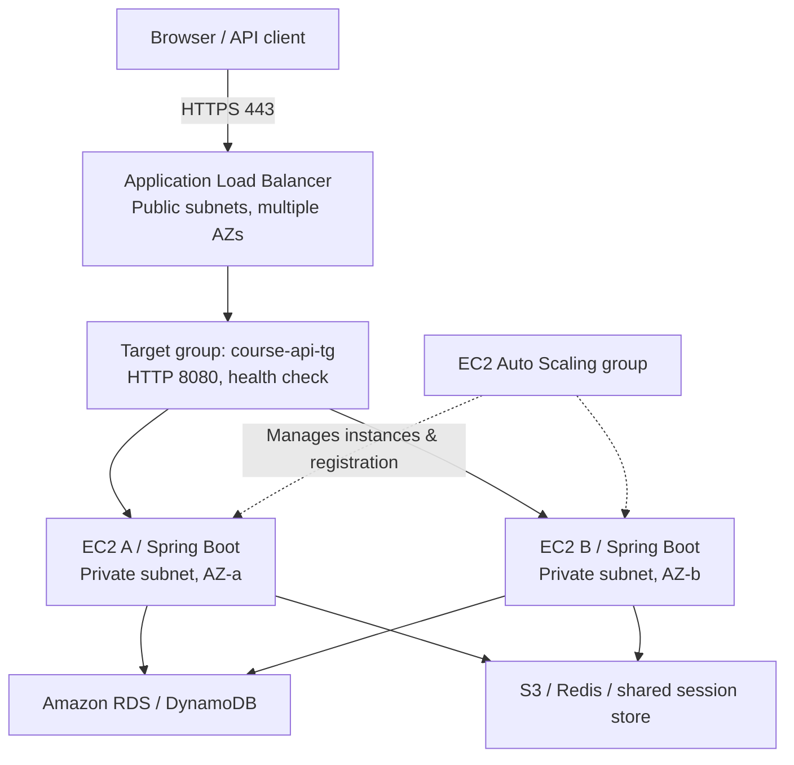
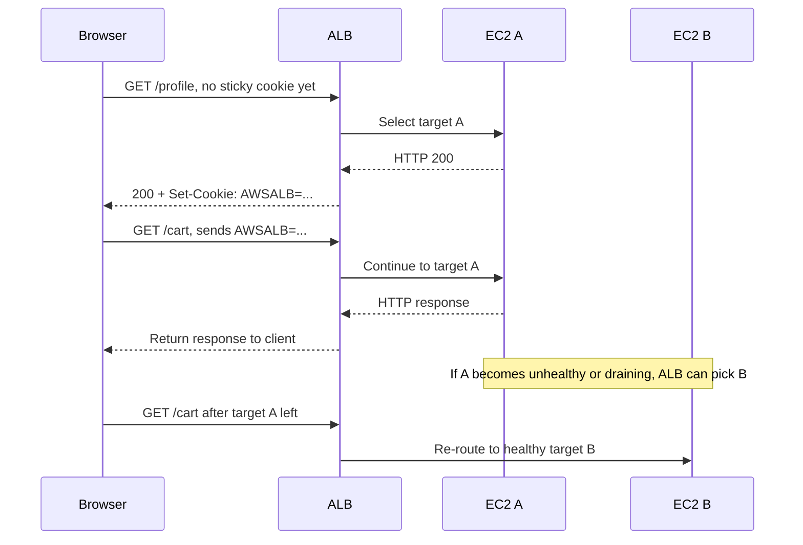
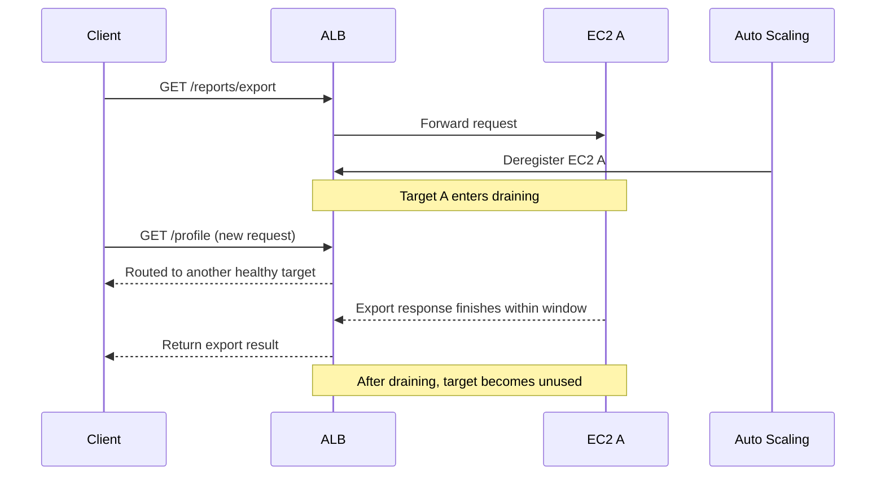
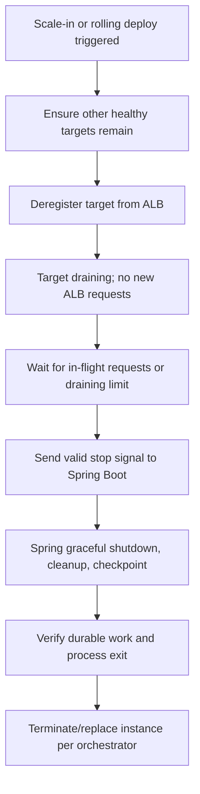
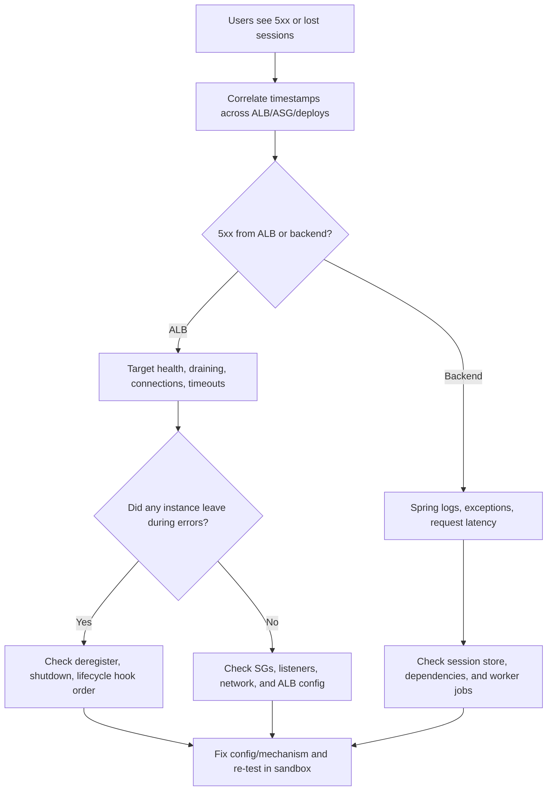

# Sticky Sessions, Connection Draining, and Graceful Shutdown

> **Module:** CLOUD_PROVIDERS_AWS  
> **Chapter:** Load Balancing and Scaling  
> **Focus:** Application Load Balancer (ALB), target groups, Amazon EC2 Auto Scaling, session affinity, and controlled termination of instances and Java Spring Boot applications.  
> **Context:** Applications distributed across multiple Availability Zones (AZs) where instances are replaced during version deployments, scale-in events, or incident recovery.

## 1. Why Must These Three Concepts Be Learned Together?

A Java/Spring Boot system serves users through an **Application Load Balancer** backed by two EC2 instances in private subnets. Learners sign in, start exporting a report, and send a request taking tens of seconds. At that moment, **Auto Scaling** decides to scale in one instance due to low load, or operations rolls out a new version.

If the process is killed or the instance is terminated immediately:

- An in-flight HTTP request gets cut off and the user receives a 502/5xx error.
- Login sessions stored in the terminated instance's RAM disappear when the user's next request lands on another host.
- A background task stops halfway without persisting its result.
- Operators struggle to separate load-balancer errors, timeouts, lost session state, and application bugs.

The three mechanisms solve three different sides of the problem:

| Mechanism | Question It Solves | Primary Components |
|---|---|---|
| **Sticky session / session affinity** | Are consecutive requests from one client routed preferentially to the same backend? | ALB, client cookies, target group |
| **Connection draining / deregistration delay** | When removing a backend from rotation, do in-flight requests get a chance to finish? | ALB and target group |
| **Graceful shutdown** | When a process must stop, does it stop accepting new work and finish active work? | Spring Boot, JVM, OS/systemd, orchestration |

**Key point:** Sticky sessions do not replace durable session storage; draining does not tell Spring Boot to finish background threads on its own; and Spring Boot graceful shutdown does not stop ALB from sending new requests to a target still registered as healthy.

### Learning Outcomes

After this lesson, learners will be able to:

1. Distinguish ALB's **duration-based** and **application-based stickiness** and identify the associated cookies.
2. Explain the limits of sticky sessions in auto-scaling, multi-AZ architectures.
3. Configure and observe `deregistration_delay.timeout_seconds` on ALB target groups.
4. Design the **deregister → drain → shutdown → terminate** sequence and identify which steps Auto Scaling handles during scale-in.
5. Configure Spring Boot graceful shutdown, readiness/health probes, and systemd stop timeouts.
6. Test safely via AWS Console/CLI, `curl`, CloudWatch, and ALB access logs.
7. Identify limitations around WebSockets, long polling, long-running jobs, and data recovery plans.
8. Evaluate impacts on availability, security, cost control, and operations.

## 2. Baseline Architecture: ALB, Target Group, and Auto Scaling

Reference architecture:



- The **ALB listener** receives HTTP/HTTPS connections and picks a forwarding action.
- The **target group** holds backends registered by instance ID or IP, along with health check, stickiness, and deregistration delay settings.
- The **EC2 Auto Scaling group (ASG)** launches/replaces/terminates EC2 instances per launch template and scaling policies, and automatically registers/deregisters instances with attached target groups.
- The **Spring Boot application** must define when it is genuinely ready to serve requests, handle errors, and shut down cleanly.
- **Shared data stores** such as RDS, DynamoDB, S3, or Redis allow another instance to continue work after an old instance leaves the fleet.

Running example values used throughout this lesson:

```text
Region:              ap-southeast-1
Illustrative acct:   123456789012
VPC:                 10.20.0.0/16
ALB:                 course-alb
Target group:        course-api-tg
Target port:         8080
Health path:         /actuator/health/readiness
Auto Scaling group:  course-api-asg
EC2 instances:       i-0123456789abcdef0, i-0fedcba9876543210
```

Account IDs, names, and ARNs in this document are **training placeholders**, not references to real user resources.

### 2.1. Normal Target Selection Sequence

When stickiness is off, ALB selects a backend for each HTTP request using the target group's **routing algorithm** (typically `round_robin` by default, with other supported options). When stickiness is on, the initial selection uses that algorithm while subsequent requests carrying a valid cookie are routed preferentially to the same backend.

**Do not confuse:** An HTTP keep-alive connection, a TCP connection, an HTTP request, and a user session are distinct concepts. Sticky sessions govern **target selection across multiple HTTP requests**, not merely keeping a single TCP socket open.

## 3. What Are Sticky Sessions and How Do They Work?

**Sticky sessions** (*session affinity*) let ALB pin HTTP requests from a single client to the same target for a configured duration. ALB uses **HTTP cookies** to track that selection.

Example of a user sending three requests:



ALB cookie values are encrypted; applications neither need to nor should attempt to decode their contents.

### 3.1. Duration-Based Stickiness: ALB-Generated Cookies

When using a **load balancer generated cookie**:

- ALB issues the `AWSALB` cookie after choosing a backend.
- The client must store and return the cookie on subsequent requests to maintain affinity.
- Target group attribute `stickiness.type=lb_cookie` enables this mode.
- Attribute `stickiness.lb_cookie.duration_seconds` sets the stickiness window; AWS supports **1–604800 seconds (7 days)**.
- ALB refreshes cookie stickiness duration as requests are served; distinguish the configured stickiness duration from technical cookie expiration attributes.
- Under compatible browser/CORS setups, ALB also issues `AWSALBCORS` carrying target selection metadata to satisfy cookie-attribute requirements.

Example setting **5-minute (300-second)** stickiness for a test environment:

```text
stickiness.enabled = true
stickiness.type = lb_cookie
stickiness.lb_cookie.duration_seconds = 300
```

If a client clears cookies, the cookie expires, the user switches browsers, or the old backend turns unhealthy, ALB can pick a different backend. Sticky sessions **do not promise pinning to the same EC2 instance through host failures**.

### 3.2. Application-Based Stickiness: App-Issued Cookies

An alternative is **application-based stickiness**:

1. The backend application emits a cookie, e.g., `COURSE_AFFINITY`.
2. The target group sets `stickiness.type=app_cookie` and `stickiness.app_cookie.cookie_name=COURSE_AFFINITY`.
3. When ALB observes the valid configured app cookie, ALB generates its own accompanying tracking cookies (such as `AWSALBAPP-0`).
4. Clients must return **both the app cookie and the related ALB cookies** to preserve stickiness.
5. Duration is configured on the target group via `stickiness.app_cookie.duration_seconds`.

**Never use** names starting with `AWSALB`, `AWSALBAPP`, or `AWSALBTG` for custom application cookies—those prefixes are reserved by AWS.

Application-based stickiness helps when an app already manages its own session-lifecycle cookie and wants ALB affinity tied to that cookie. It **does not replace** login sessions or application authentication; ALB only routes requests.

### 3.3. Distinguishing Common Cookies

| Cookie | Issued By | Used For |
|---|---|---|
| `AWSALB` | ALB | Duration-based stickiness **to a target** in a target group. |
| `AWSALBCORS` | ALB | Variant supporting certain cross-origin scenarios. |
| `AWSALBAPP-0` (may shard) | ALB | Application-based stickiness at the target group. |
| `AWSALBTG` / `AWSALBTGCORS` | ALB | Stickiness on **listener rules with weighted target groups** to keep the chosen **target group**. |
| `JSESSIONID` | Servlet container / web framework | Identifies the app's HTTP session; does not replicate session state to other backends. |
| `COURSE_AFFINITY` | Example application | Custom app cookie when configuring `app_cookie`. |

**Two distinct levels of stickiness:** With a listener forwarding to multiple weighted target groups, you may need **target group stickiness** on the listener rule (e.g., `AWSALBTG`) as well as **target stickiness** inside the target group (e.g., `AWSALB`). They do not substitute for one another. Application-based stickiness carries constraints when combined with weighted target groups; validate actual behavior before pairing them.

### 3.4. Key Conditions and Limitations

- ALB stickiness requires clients that store and resend cookies; API clients ignoring cookies will not retain affinity across requests.
- AWS does not support target stickiness when **cross-zone load balancing is disabled** on the target group; check cross-zone settings.
- The **`weighted_random`** algorithm cannot be combined with target-group sticky sessions.
- ALB does not support sticky sessions when **target optimizer** is enabled.
- For WebSockets, once the backend accepts HTTP 101 Upgrade, **the established WebSocket connection stays pinned to that target**; post-upgrade, cookie stickiness no longer governs individual WebSocket messages.
- When a target deregisters and enters `draining`, ALB can send **new requests from clients holding old cookies** to another healthy target.
- Chaining multiple ALBs, CORS rules, and browser cookie policies can introduce subtle differences; always test with real browsers/clients.

**Note:** These details describe **Application Load Balancer**. Network Load Balancer (NLB) uses source-IP-based stickiness and connection-level draining that behave differently from ALB—do not assume ALB cookie/HTTP semantics apply to NLB.

## 4. Are Sticky Sessions a Safe Session Storage Solution?

**No.** Stickiness only steers HTTP requests toward a preferred backend. It never replicates in-memory data from instance A to instance B.

Suppose a Spring Boot app stores HTTP sessions **in memory**:

```text
User #17 logs in on EC2 A
Session data (in-memory) exists only on A
ALB sets cookie -> subsequent requests usually return to A
EC2 A terminates or becomes unhealthy
ALB routes to EC2 B -> B lacks the old session data
User #17 loses their session or must log in again
```

To improve availability, consider:

| Session Model | Pros | Limitations |
|---|---|---|
| **In-memory session + sticky session** | Easy setup, minimal components. | Sessions lost on target failure; scale-in/redeploys disrupt users. |
| **Spring Session + Redis/ElastiCache** | Shared sessions across instances; seamless failover. | Adds network/Redis dependency, TTL tuning, HA setup, and cost. |
| **Session data in a suitable database** | Durable by design; readable from any node. | Must evaluate I/O, latency, schema, and scaling limits. |
| **Stateless auth (proper tokens) + shared state** | Removes affinity requirements; easy horizontal scaling. | Requires token security, expiry/revocation, and multi-step state handling. |

**Design recommendation:** For REST APIs that scale out and in frequently, prefer **stateless applications** or a **shared session store** whenever session state must persist across hosts. Use sticky sessions only when workloads genuinely benefit from affinity and handle target loss gracefully.

### 4.1. Sticky Sessions Can Skew Load

When scaling from 2 targets to 6, existing users continue hitting the original 2 targets while their cookies remain valid. This leaves older instances handling more load even though new backends are healthy.

Mitigations:

1. Keep stickiness duration as short as business logic allows.
2. Monitor requests/CPU/latency **per target**, not just target group totals.
3. Reduce reliance on in-memory sessions.
4. Plan rebalancing during rollouts without unexpectedly forcing all users to re-authenticate.

**Never assume "sticky = even distribution"** when designing Auto Scaling. Affinity inherently reduces perfectly uniform load balancing.

## 5. What Is Connection Draining?

**Connection draining** allows a target leaving a target group to **finish in-flight requests** within a bounded waiting window.

In ALB, this window is configured via the attribute:

```text
deregistration_delay.timeout_seconds
```

- Default value: **300 seconds**.
- Valid range for ALB target groups: **0–3600 seconds**.
- Once deregistration starts, the target enters **`draining`**.
- ALB stops sending new HTTP requests to the draining target while letting already-forwarded requests finish.
- Once complete, the target transitions to **`unused`**.
- When no in-flight requests or active connections remain, ALB can finish draining early in processing terms, though the Console may still display `draining` until the configured timer elapses.

**Do not interpret a 300-second timeout as "ALB always keeps the target alive for exactly 300 seconds."** It is an upper bound for draining, not a mandatory delay for idle targets.

### 5.1. Illustrative Timeline

An API report export takes ~25 seconds. The target group sets `deregistration_delay.timeout_seconds=90`:



If a request takes longer than 90 seconds, there is **no guarantee** it will complete. If the Java process crashes or the host terminates before sending the response, ALB cannot rescue the request either. Thus draining must coordinate with **graceful shutdown and orchestration**.

### 5.2. What Draining Does Not Guarantee

- Does not preserve session data stored on a deleted backend.
- Does not keep a crashed process serving requests.
- Does not checkpoint background tasks or prevent duplicate submissions.
- Does not magically preserve multi-hour WebSocket or gRPC streams.
- Does not fix application bugs, deadlocks, or client HTTP timeouts.
- Does not guarantee "zero downtime" if zero healthy targets remain, too many targets rotate at once, or security groups break.

### 5.3. Draining vs. Failed Health Checks

| State | Meaning |
|---|---|
| Target `healthy` | ALB observes the target passing health checks and eligible for traffic. |
| Target `unhealthy` | Health checks fail; ALB applies health-based routing rules. |
| Target `draining` | Target is **deregistering**, finishing existing requests within the timeout. |
| Target `unused` | No longer active in the target group under current state. |

Forcing all targets to fail health checks is **not equivalent** to proper draining. ALB exhibits **fail-open** behavior in some scenarios when all targets are unhealthy and may keep routing to them; never rely on "returning 503 on health checks guarantees zero traffic" to stop a service.

## 6. Graceful Shutdown in Java / Spring Boot

**Graceful shutdown** lets an application process:

1. Stop accepting new requests via its embedded web server.
2. Give in-flight requests a chance to finish.
3. Close resources and application beans within a wait window.
4. Exit cleanly on shutdown signal.

In current Spring Boot releases, graceful shutdown is supported across common embedded web servers and **enabled by default in newer versions**. Where explicit configuration is needed or on older versions, configure it explicitly and check documentation for your exact Spring Boot release.

### 6.1. Spring Boot Configuration

Example `application.yml`:

```yaml
server:
  port: 8080
  shutdown: graceful

spring:
  lifecycle:
    timeout-per-shutdown-phase: 90s

management:
  endpoint:
    health:
      probes:
        enabled: true
```

- `server.shutdown=graceful` enables controlled shutdown.
- `spring.lifecycle.timeout-per-shutdown-phase=90s` sets the wait window per shutdown phase under Spring's lifecycle model.
- `management.endpoint.health.probes.enabled=true` enables Spring Boot Actuator health probes when Actuator is on the classpath and properly exposed.
- `/actuator/health/readiness` reflects service readiness when Actuator is configured appropriately.
- Never assume every request gets **exactly 90 seconds**, because actual shutdown duration depends on web server internals, OS signals, process managers, and system resources.

**Spring Boot version note:** Default settings and supported web servers vary across versions. Always check docs matching your packaged version rather than copying snippets blindly from a lab.

### 6.2. `SIGTERM`, `SIGKILL`, and the JVM

On Linux:

- **SIGTERM** is a termination signal the JVM/app can catch via shutdown hooks and lifecycle callbacks.
- **SIGKILL** kills the process immediately; the app gets zero chance to run shutdown logic.
- Running `systemctl stop ...` initiates systemd's controlled stop cycle and forces termination only after timeout.
- Launching Java through a shell wrapper that swallows or fails to forward signals can prevent the JVM from receiving `SIGTERM` properly.

**Consequence:** Spring Boot graceful shutdown works only if the runtime environment delivers the right signal and gives the JVM enough time to finish.

### 6.3. Example systemd Unit for EC2

Illustrative unit file `/etc/systemd/system/course-api.service`:

```ini
[Unit]
Description=Course API Spring Boot application
After=network-online.target
Wants=network-online.target

[Service]
Type=simple
User=course-api
WorkingDirectory=/opt/course-api
ExecStart=/usr/bin/java -jar /opt/course-api/course-api.jar
KillSignal=SIGTERM
TimeoutStopSec=150
Restart=on-failure
Environment=SPRING_PROFILES_ACTIVE=prod

[Install]
WantedBy=multi-user.target
```

In this example:

- systemd runs the Java process directly so it receives signals cleanly.
- `TimeoutStopSec=150` gives the OS a 150-second window before escalating to force-kill.
- User `course-api` needs read access to the JAR, write access to required log/temp directories, and a least-privilege AWS role if calling AWS APIs.
- Restarting or stopping the systemd service **does not automatically deregister** the target from ALB. Stopping the process while ALB still routes requests to it will cause errors.

**Never copy a unit file onto a production host and restart immediately.** Roll out via a controlled deployment workflow with health checks, target draining, and monitoring.

### 6.4. Shutdown Hooks and Background Tasks

Spring Boot shuts down `SmartLifecycle` beans in phase order; resources such as connection pools, message consumers, and thread pools must close cleanly in sequence.

For long-running work:

- Jobs lasting minutes or hours should persist **checkpoints** to S3, DynamoDB, RDS, or another durable store.
- SQS consumers must stop polling new messages, finish active messages within visibility timeout, and delete/acknowledge only upon durable completion.
- Background scheduled tasks need flags/locks preventing new runs once shutdown begins; never assume web-server graceful shutdown covers `@Scheduled` threads automatically.
- Database writes and transactions need idempotency so retries do not create duplicate side effects.

**Never rely on a crude "`Thread.sleep(120000)` inside `@PreDestroy`" hack** as a draining strategy. Track actual in-flight work, align timeouts, and confirm when it is genuinely safe to exit.

## 7. Combining All Three Mechanisms into a Safe Shutdown Workflow

Desired flow when taking an EC2 instance out of service:



This diagram illustrates **logical design responsibilities**. In Auto Scaling or other orchestrators, deregistration, lifecycle hooks, and shutdown steps may **interleave** according to service mechanics; do not assume every business check happens automatically without configuration.

### 7.1. Comparing Shutdown Scenarios

| Scenario | Primary Orchestrator | What to Verify |
|---|---|---|
| Planned maintenance on a standalone EC2 | Operator / automation | Deregister → wait drain → stop service → verify → EC2 action |
| Scale-in on ASG attached to target group | Amazon EC2 Auto Scaling + ALB | ASG deregisters target automatically; align drain time and lifecycle hooks for extra cleanup |
| Instance Refresh / rolling deploy | Auto Scaling or deployment tool | Minimum healthy capacity, instance warmup, readiness, draining, rollout order |
| ECS service behind ALB | ECS deployment/draining + ALB, container stop timeout | ECS task lifecycle, target group, and app signal handling |
| Sudden host crash or OOM kill | No draining window available | High availability, retries, idempotency, and data recovery |
| Long-running background worker without HTTP | Queue / job coordinator | Never rely solely on ALB draining to tell when worker jobs are done |

### 7.2. Scale-In: What Does ASG Do?

When an Auto Scaling group is linked to Elastic Load Balancing:

1. ASG selects an instance to terminate per its termination policy.
2. ASG initiates **deregistration** of the instance from the load balancer.
3. ALB lets **in-flight requests** finish up to the deregistration delay limit.
4. If a **termination lifecycle hook** exists, ASG holds the instance at `Terminating:Wait` so automation/apps can run extra cleanup.
5. Once the hook completes or times out, ASG proceeds and terminates the instance.

Because ASG manages registration/deregistration automatically, **never manually call `deregister-targets` on ASG-managed targets** in production. Use supported scaling/deployment workflows and observe target states.

### 7.3. Lifecycle Hooks for Controlled Cleanup

A lifecycle hook lets extra logic run before an instance terminates, such as:

- Stopping SQS polling or scheduler pickups.
- Writing checkpoints/offsets to durable storage.
- Flushing buffered logs.
- Waiting for active tasks to finish within RTO/timeout limits.
- Calling `CompleteLifecycleAction` so ASG proceeds to terminate.

Example creating a termination hook on an existing ASG:

```bash
aws autoscaling put-lifecycle-hook \
  --auto-scaling-group-name course-api-asg \
  --lifecycle-hook-name course-api-termination-hook \
  --lifecycle-transition autoscaling:EC2_INSTANCE_TERMINATING \
  --heartbeat-timeout 180 \
  --default-result CONTINUE \
  --region ap-southeast-1
```

When ASG emits the lifecycle event, an **EventBridge rule / Lambda / SQS consumer or on-host agent** must receive it and execute verified cleanup. **Creating a hook alone does not run any cleanup script.**

After cleanup completes, an authorized controller calls:

```bash
aws autoscaling complete-lifecycle-action \
  --auto-scaling-group-name course-api-asg \
  --lifecycle-hook-name course-api-termination-hook \
  --instance-id i-0123456789abcdef0 \
  --lifecycle-action-result CONTINUE \
  --region ap-southeast-1
```

Never call `CONTINUE` before cleanup genuinely finishes. If a long job needs more time, the controller can send heartbeats via `record-lifecycle-action-heartbeat` within workflow and global limits. Avoid extending indefinitely or forgetting hooks, which stalls scale-in.

### 7.4. Scale-In Protection and Long-Running Tasks

For jobs lasting hours, a 180-second termination hook is not enough. Consider **instance scale-in protection** while critical jobs run, provided you:

- Clear protection once the job finishes.
- Limit how many instances are protected so the ASG can still scale in overall.
- Keep checkpoints and retries in case the underlying host fails—protection does not prevent hardware failure.
- Account for extra cost from keeping instances alive longer.

For multi-hour batch processing, **SQS + idempotent workers** or a dedicated batch/orchestration platform is far more natural than keeping HTTP requests open for hours.

## 8. Sizing Timeouts Properly

No single `deregistration_delay.timeout_seconds` value fits every application. Ground timeouts in workload latency data, task durations, platform limits, and retry behavior.

### 8.1. Illustrative Timing Plan

Suppose a system has:

- Most HTTP requests finishing under **3 seconds**.
- Report-export APIs finishing in **20–40 seconds**.
- Multi-minute batch jobs offloaded out of HTTP requests.
- Rolling deploys keeping healthy backends in both AZs.

An illustrative starting plan **for testing** (not an SLA):

| Component | Illustrative Value | Purpose |
|---|---:|---|
| ALB deregistration delay | 120 seconds | Gives slower requests time to finish. |
| Spring Boot graceful shutdown phase timeout | 90 seconds | Gives web server and lifecycle beans time to wind down. |
| systemd `TimeoutStopSec` | 150 seconds | Prevents premature `SIGKILL` during shutdown. |
| ASG termination lifecycle hook timeout | 180 seconds | Covers extra cleanup/checkpointing beyond draining. |
| Client HTTP timeout | Aligned with API SLO | Avoids hanging forever or aggressive duplicate retries. |

**Do not sum the numbers in this table into a single "guaranteed total window."** AWS deregistration, OS signal delivery, ASG/deployment limits, and app shutdown overlap. Measure the full lifecycle end-to-end in a production-like environment.

### 8.2. Consequences of Setting Timeouts Too Short or Too Long

| Misconfiguration | Consequence |
|---|---|
| Draining 0–5s for 30s requests | Cuts off requests mid-flight and spikes 5xx errors. |
| Draining tens of minutes for millisecond APIs | Slows deployments/scale-in and wastes compute capacity. |
| Long Spring timeout but short systemd timeout | JVM gets `SIGKILL` before graceful shutdown finishes. |
| Lifecycle hook timeout shorter than cleanup | ASG terminates the instance before cleanup finishes. |
| Ultra-short client timeout with immediate retry | Old request may still run; non-idempotent APIs create duplicates. |
| Unstable health checks during scale-out | New backends get marked unhealthy or take traffic before warmup. |

**Principle:** Measure p95/p99 latency, max valid request duration, and acceptable wait times. Test tail latency, flaky networks, and sudden backend kills to validate behavior.

## 9. Configuring ALB in the AWS Console

Practice on an existing **ALB + target group** in a sandbox—no need to rebuild an entire VPC just to explore attributes.

### 9.1. Enable Sticky Sessions (Duration-Based)

1. Open **EC2 Console → Load Balancing → Target Groups**.
2. Select target group `course-api-tg` and open **Attributes → Edit**.
3. Under **Target selection configuration / Stickiness**, turn on stickiness.
4. Choose **Load balancer generated cookie**.
5. Set **Stickiness duration = 300 seconds** for the lab.
6. Verify routing algorithm and cross-zone compatibility; do not pick `weighted_random` if using stickiness.
7. Save and reopen the target group to confirm saved attributes.
8. Use a browser or `curl` with a cookie jar to observe affinity across requests.

For **application-based cookies**, switch the type to Application-based, enter the exact cookie name emitted by your app, and set the duration. Enable in the lab only when the backend actively sets that cookie.

### 9.2. Set Deregistration Delay

1. Still in the target group, open **Attributes → Edit**.
2. Under **Target deregistration management**, locate **Deregistration delay**.
3. Set a test value such as **120 seconds** within AWS-supported bounds.
4. Save and confirm the updated attribute.
5. On the **Targets** tab, observe target state transitions during a controlled deregistration or sandbox scale-in.

**Never test scale-in when only one healthy target remains** if your goal is verifying zero-disruption draining. Keep another healthy target ready before taking a node out of rotation.

### 9.3. Configure Health Checks

In the target group:

- Protocol: HTTP (or HTTPS if backend TLS is configured).
- Port: matching traffic port (e.g., 8080).
- Path: `/actuator/health/readiness` if Spring Boot exposes it internally.
- Success matcher: 200 or approved code range.
- Interval, timeout, healthy/unhealthy thresholds: sized for startup time and failure detection speed.

**Illustrative** values: interval 15 seconds, timeout 5 seconds, unhealthy threshold 3, healthy threshold 2. Tune to real conditions; failing health checks alone do not prove the instance crashed.

The target's security group must allow the **ALB security group** on the app port. Avoid exposing management/Actuator ports directly to the Internet.

## 10. AWS CLI: Inspecting and Modifying Target Group Attributes

### 10.1. Inspect Current Configuration

First verify your AWS identity and Region, then inspect the target group:

```bash
aws sts get-caller-identity

aws elbv2 describe-target-groups \
  --names course-api-tg \
  --region ap-southeast-1

aws elbv2 describe-target-group-attributes \
  --target-group-arn arn:aws:elasticloadbalancing:ap-southeast-1:123456789012:targetgroup/course-api-tg/0123456789abcdef \
  --region ap-southeast-1
```

**Do not run mutating commands** until you confirm the exact account, Region, and target group ARN.

### 10.2. Enable 5-Minute Duration-Based Stickiness

```bash
aws elbv2 modify-target-group-attributes \
  --target-group-arn arn:aws:elasticloadbalancing:ap-southeast-1:123456789012:targetgroup/course-api-tg/0123456789abcdef \
  --attributes \
    Key=stickiness.enabled,Value=true \
    Key=stickiness.type,Value=lb_cookie \
    Key=stickiness.lb_cookie.duration_seconds,Value=300 \
  --region ap-southeast-1
```

This command applies to an **ALB target group** and requires `elasticloadbalancing:ModifyTargetGroupAttributes`. AWS rejects incompatible attribute combinations with routing/cross-zone settings. Never pass these cookie stickiness keys to an NLB target group.

### 10.3. Set Deregistration Delay

```bash
aws elbv2 modify-target-group-attributes \
  --target-group-arn arn:aws:elasticloadbalancing:ap-southeast-1:123456789012:targetgroup/course-api-tg/0123456789abcdef \
  --attributes Key=deregistration_delay.timeout_seconds,Value=120 \
  --region ap-southeast-1
```

Read the attributes back to verify. Updating attributes **does not deregister any targets by itself**.

### 10.4. Check Target Health States

```bash
aws elbv2 describe-target-health \
  --target-group-arn arn:aws:elasticloadbalancing:ap-southeast-1:123456789012:targetgroup/course-api-tg/0123456789abcdef \
  --region ap-southeast-1
```

Common states include `healthy`, `unhealthy`, `initial`, `draining`, and `unused`. For failures, inspect `Reason` and `Description` in the response.

### 10.5. Test Manual Deregistration on a Standalone Sandbox Target

Run this **only** on a test target **not actively managed by an ASG** or inside a controlled test workflow:

```bash
aws elbv2 deregister-targets \
  --target-group-arn arn:aws:elasticloadbalancing:ap-southeast-1:123456789012:targetgroup/course-api-tg/0123456789abcdef \
  --targets Id=i-0123456789abcdef0 \
  --region ap-southeast-1
```

Watch `describe-target-health` transition through `draining` to `unused`. Afterward, if the test target should return to service, re-register it with `register-targets` and wait for `healthy`; never leave the environment short on capacity.

### 10.6. Configuring via Infrastructure as Code

Example **AWS CloudFormation TargetGroup** snippet:

```yaml
Resources:
  CourseApiTargetGroup:
    Type: AWS::ElasticLoadBalancingV2::TargetGroup
    Properties:
      TargetType: instance
      VpcId: vpc-0123456789abcdef0
      Protocol: HTTP
      Port: 8080
      HealthCheckPath: /actuator/health/readiness
      HealthCheckProtocol: HTTP
      TargetGroupAttributes:
        - Key: stickiness.enabled
          Value: "true"
        - Key: stickiness.type
          Value: lb_cookie
        - Key: stickiness.lb_cookie.duration_seconds
          Value: "300"
        - Key: deregistration_delay.timeout_seconds
          Value: "120"
```

This is an **illustrative resource fragment**, not a complete CloudFormation template; a full template requires VPC, listener/ALB, subnets, and deployment permissions. In production, manage these attributes in IaC so Console edits are not overwritten on the next deploy.

## 11. Spring Boot Lab: Observing Sticky Cookies and Long Requests

For clear observation, deploy a test app across **two separate instances**. Give each instance a distinct label, such as environment variables `APP_INSTANCE_LABEL=course-api-a` and `APP_INSTANCE_LABEL=course-api-b`.

### 11.1. Endpoints Returning Current Node and Local Session Counter

**Lab** controller code (Spring Web + Servlet API):

```java
package com.example.courseapi;

import jakarta.servlet.http.HttpSession;
import java.util.Map;
import org.springframework.http.ResponseEntity;
import org.springframework.web.bind.annotation.GetMapping;
import org.springframework.web.bind.annotation.RestController;

@RestController
public class LabController {
    private final String node = System.getenv()
        .getOrDefault("APP_INSTANCE_LABEL", "unknown-node");

    @GetMapping("/lab/node")
    public ResponseEntity<Map<String, String>> node() {
        return ResponseEntity.ok()
            .header("X-Lab-Node", node)
            .body(Map.of("node", node));
    }

    @GetMapping("/lab/session-count")
    public Map<String, Object> sessionCount(HttpSession session) {
        Integer current = (Integer) session.getAttribute("counter");
        int next = (current == null ? 0 : current) + 1;
        session.setAttribute("counter", next);
        return Map.of("node", node, "counter", next);
    }

    @GetMapping("/lab/slow")
    public Map<String, Object> slowRequest() throws InterruptedException {
        Thread.sleep(20_000); // Illustrates a slow request in a lab environment only
        return Map.of("node", node, "result", "completed");
    }
}
```

**Example caveats:** `Thread.sleep` blocks a request thread for 20 seconds and is not how heavy work should be handled in production. `HttpSession` uses in-memory storage here specifically to demonstrate state loss; real apps should favor Spring Session/Redis or stateless designs. On Spring Boot 2 using older Servlet APIs, replace `jakarta.servlet` with `javax.servlet`.

Never expose lab endpoints publicly in production; node labels and artificial slow endpoints are strictly for verification. Always serve over HTTPS with a valid certificate at the ALB.

### 11.2. Test Stickiness with a Cookie Jar

Use your sandbox ALB's real DNS, replacing `course-alb.example.com` with your managed hostname:

```bash
# First call captures ALB cookie into cookies.txt.
curl -sS -D - -o /dev/null \
  -c cookies.txt \
  https://course-alb.example.com/lab/node

# Subsequent calls send the saved cookie and update the cookie jar.
curl -sS -D - -o /dev/null \
  -b cookies.txt -c cookies.txt \
  https://course-alb.example.com/lab/node

curl -sS -D - -o /dev/null \
  -b cookies.txt -c cookies.txt \
  https://course-alb.example.com/lab/node
```

Inspect `X-Lab-Node` and `Set-Cookie`. With stickiness active, repeated calls sharing the same cookie jar consistently return the same node. **Do not treat 2–3 requests as quantitative load-distribution proof**; compare against requests without cookies across multiple independent clients.

Test the session counter:

```bash
curl -sS -b cookies.txt -c cookies.txt \
  https://course-alb.example.com/lab/session-count

curl -sS -b cookies.txt -c cookies.txt \
  https://course-alb.example.com/lab/session-count
```

While hitting the same target with the session cookie intact, the counter increments. Once that target leaves without a shared session store, the counter resets on the new backend—illustrating **session loss**, not an ALB authentication bug.

### 11.3. Test Connection Draining with a Slow Request

Run this on a **test target in a group with at least one other healthy target**:

1. Set ALB deregistration delay = 120 seconds.
2. Start a request to `/lab/slow`, which runs for 20 seconds.
3. While it is still running, trigger deregistration of the target serving that request via an authorized workflow.
4. Confirm the target transitions to `draining`; send a new request and confirm the other healthy backend serves it.
5. Confirm the original slow request finishes successfully within the draining window.
6. Once zero active requests remain, send `SIGTERM` to Spring Boot per test procedure.
7. Check logs to confirm graceful shutdown ran and the process exited cleanly.

**Your test must verify which node received the slow request**, e.g., via session cookies or node labels. Without knowing which target handled the request, the test cannot prove draining worked.

### 11.4. Test Graceful Shutdown Independently

On a test instance already **removed from the target group** or safely isolated:

```bash
# Inspect lab service status.
sudo systemctl status course-api.service

# Stop service via systemd; JVM receives SIGTERM per unit config.
sudo systemctl stop course-api.service

# Inspect shutdown logs.
sudo journalctl -u course-api.service -n 100 --no-pager
```

Never run `stop` directly on a live production target taking traffic. If Spring Boot enters graceful shutdown while ALB still forwards new requests to it, app-only settings cannot prevent errors—ALB draining and orchestration must lead.

## 12. Readiness, Liveness, and Health Checks

**Health checks mean more than "the JVM process is running."** An app might accept TCP connections while still loading data, disconnected from the database, or unable to handle requests.

### 12.1. Distinguishing Signals

| Signal | Question | Recommended Usage |
|---|---|---|
| **Liveness** | Is the process deadlocked or in need of a restart? | Avoid coupling tightly to external dependencies so transient outages don't trigger mass restarts. |
| **Readiness** | Is the instance ready to accept new HTTP requests? | Use for ALB health checks when endpoint and logic fit. |
| **ALB target health** | Does ALB see the target passing protocol/path/threshold checks? | Governs routing eligibility and load-balancing state. |
| **ASG EC2/ELB health** | Should the instance be replaced per ASG policy? | Governs instance lifecycle and self-healing. |

In Spring Boot Actuator, once probes and exposure are enabled properly, `/actuator/health/liveness` and `/actuator/health/readiness` expose those two states separately.

### 12.2. Health Checks During Scale-Out

- New instance boots, JVM starts, config loads, and critical dependencies connect.
- Readiness stays down until the app is genuinely ready to serve.
- ALB health checks observe the target and begin routing only once marked healthy, subject to routing rules.
- Tune **ASG health check grace period** and **instance warmup / slow start** appropriately to avoid premature replacements or sudden cold-target overload.

**Do not confuse:** Auto Scaling's `health check grace period`, `ALB health check interval/threshold`, and `target group slow start duration` are **three separate settings**.

### 12.3. Health Checks During Scale-In

Do not flip readiness to `REFUSING_TRAFFIC` and immediately kill the JVM while ALB is still sending requests. A well-orchestrated sequence:

1. Confirms remaining targets are healthy.
2. Stops sending new requests to the departing target (via deregistration / orchestrator).
3. Waits for in-flight requests and tasks to finish.
4. Stops the application using a graceful-shutdown-compatible signal.

If your app exposes an internal "draining" state, keep it aligned with ALB status and health checks so the entire target group does not simultaneously go unhealthy.

## 13. WebSockets, Long Polling, Streaming, and Background Work

Short requests and long-lived connections have very different operational needs.

### 13.1. WebSockets

Once a client upgrades to WebSocket, the chosen backend holds that connection open long-term. Sticky cookies do not route individual messages post-upgrade; the open connection stays tied to its target.

To roll deployments without breaking hours-long WebSocket connections, relying solely on the default 300-second `deregistration_delay.timeout_seconds` is rarely sufficient. Plan for:

- Client reconnection with backoff and subscription/state recovery.
- Storing necessary session/subscription state in a shared store or rebuilding it cleanly.
- Sending clean protocol-level close frames before stopping the backend.
- Connection-age limits, staged handoffs, or blue/green strategies where appropriate.

### 13.2. Long Polling, Server-Sent Events, and gRPC Streaming

- Align **client timeouts**, **ALB idle timeout**, application response timeouts, and draining windows.
- For SSE, support automatic reconnect and `Last-Event-ID` resumption if required.
- For gRPC streaming, verify ALB support and timeouts; never assume cookie stickiness behaves identically to HTTP/1.1 browser sessions.
- For HTTP requests running minutes, convert them into **async jobs**: return `202 Accepted` + job ID, execute via queue/worker, and let clients poll status.

### 13.3. Background Tasks Need Checkpoints and Idempotency

Finishing an **HTTP response** does not guarantee a background thread persisted its work. Upon termination:

1. Stop accepting new jobs.
2. Wait for active tasks or write checkpoints.
3. ACK/delete queue messages only after results are durably stored.
4. Use idempotency keys to handle retries safely.
5. Ensure another node can resume from the queue/checkpoint.

Keep processing state in SQS, DynamoDB, RDS, S3, or a dedicated coordinator—never solely in the departing instance's RAM.

## 14. Observing and Diagnosing 5xx Errors During Scale-In

To prove your setup works, measure both the ALB side and the application side.

### 14.1. Useful CloudWatch Metrics

| Metric / Source | What to Observe |
|---|---|
| `HealthyHostCount` / `UnHealthyHostCount` | Healthy/unhealthy target counts per target group and AZ. |
| `HTTPCode_ELB_5XX_Count` | 5xx errors generated by ALB itself. |
| `HTTPCode_Target_5XX_Count` | 5xx errors returned by backends. |
| `TargetResponseTime` | Request processing latency at targets. |
| `TargetConnectionErrorCount` | Connection failures from ALB to targets. |
| `RequestCount` | Total requests observed at ALB. |
| ASG Activity History / desired capacity | Scale-out, scale-in, and instance replacement events. |
| Spring Boot metrics/logs | In-flight requests, timeouts, shutdown events, active jobs, sessions. |

Select the **exact dimensions** in CloudWatch and align timestamps and time zones; never compare only total request counts before/after a deploy. With multiple target groups, filter by both `LoadBalancer` and `TargetGroup`.

### 14.2. ALB Access Logs

With ALB access logging to S3 enabled with proper permissions, you can inspect:

- Exact request timestamps.
- Target IP/port and target HTTP status.
- ELB status code and target status code.
- Request/target processing durations and timeout signatures.
- User agent and request paths where access policies allow.
- Correlation between 502/503/504 spikes and target health changes or instance terminations.

Access logs carry **delivery latency, S3 costs, and potentially sensitive URL data**. Lock down buckets, set lifecycle/retention rules, and never put tokens or secrets in API query strings.

### 14.3. CloudTrail and Deployment Timelines

CloudTrail helps trace administrative changes such as:

- Modifying target group attributes.
- Calling register/deregister target APIs.
- Updating Auto Scaling groups or lifecycle hooks.
- Editing security groups, listeners, or policies.

Correlate audit logs with deployment/ASG events to see **who changed what, when, and how system state reacted**. Do not expect every internal control-plane action orchestrated automatically by AWS to appear as a direct human API call.

### 14.4. Failure Analysis Table

| Symptom | Possible Causes | Where to Check |
|---|---|---|
| Requests get 502 right as an instance stops | Java killed or closed sockets before ALB finished requests. | Spring/systemd logs, deregistration state, shutdown timing. |
| Requests get 503 during deploys | No eligible healthy targets or unusable target group/listener. | `describe-target-health`, listener rules, health checks, ASG capacity. |
| Requests time out / 504 | Slow backend processing, idle/response timeouts, or network issues. | `TargetResponseTime`, app logs, ALB access logs, networking. |
| Login sessions lost on scale-in | Sessions lived only in old target's memory. | Is Redis/shared session store used? Are cookies sent properly? |
| Severe load skew after scale-out | Sticky cookies keep existing clients on original targets. | Per-target requests/CPU, stickiness duration, session model. |
| Stickiness does not stick | Client drops cookies, cross-zone disabled, incompatible algorithm, wrong app cookie name. | `Set-Cookie`/`Cookie` headers, target group attributes, CORS/browser rules. |
| Target stays in `draining` for a long time | Configured deregistration delay, active requests, or UI display waiting out timer. | Timestamps, target state, active requests, target group attributes. |
| Graceful app still loses background jobs | Spring web shutdown does not automatically checkpoint worker/SQS jobs. | Job lifecycle, consumer shutdown, checkpoints, queue retries. |
| Zero traffic yet ALB marks unhealthy | Health path/port fails, wrong SG/NACL/endpoint, or startup incomplete. | Local curl of health endpoint, target health reason, SGs. |
| Scale-in stalls unexpectedly | Uncompleted termination hook, huge timeout, or long draining window. | ASG Activity History, lifecycle events/heartbeats, target state. |

### 14.5. Post-Deploy Incident Triage Workflow



## 15. Security, Availability, and Cost

### 15.1. Security

- Terminate HTTPS at ALB using managed certificates (e.g., AWS Certificate Manager) and an appropriate TLS policy.
- Allow only the ALB security group to reach backend ports on EC2; avoid exposing app ports directly to the Internet unnecessarily.
- Protect application cookies with `Secure`, `HttpOnly`, and appropriate `SameSite` flags; never treat ALB cookies as authentication tokens.
- Restrict IAM permissions for modifying listeners, target groups, ASGs, security groups, and lifecycle hooks.
- Never log `JSESSIONID` or sensitive fields into public logs/monitoring.
- If using Redis / a shared session store, enforce network isolation, auth/encryption, key rotation, and scoped app access.
- Restrict read access to access logs/CloudWatch since records may include user data or internal business paths.

### 15.2. Resilience

- Maintain **multi-AZ capacity** with more than one healthy target during rolling deploys.
- Tune minimum healthy percentage and instance warmup for ASG Instance Refresh.
- Keep readiness reflective of true app health without letting transient dependency blips restart the entire fleet.
- Use canary/blue-green strategies for major changes; monitor error rates before advancing rollouts.
- Design client retries and idempotency for POST/PUT operations with side effects.
- Externalize sessions and critical business state out of instance memory.
- Plan for **non-drainable** failures such as sudden host crashes or AZ outages.

### 15.3. Cost

All three mechanisms affect cost in different ways:

| Component | Cost or Trade-Off |
|---|---|
| ALB | ALB hourly charges plus Load Balancer Capacity Units (LCUs) by usage; routing/cookie settings shape traffic profile. |
| EC2 / ASG | Keeping instances alive longer for draining/cleanup extends compute billing and slows scale-in. |
| Redis / ElastiCache or session store | Adds service spend, yet boosts availability and decouples sessions from individual nodes. |
| CloudWatch / ALB access logs | Ingestion, storage, query scans, and retention vary by service and config. |
| Long-running HTTP jobs | Tie up connections/threads longer, often requiring larger fleets. |
| SQS + async workers | Separate queue/worker costs, yet stronger resilience, retries, and independent scaling. |

**Never slash draining time solely to shave a few minutes off an EC2 bill** at the expense of 5xx SLO breaches or lost business transactions. Conversely, setting a one-hour draining delay for millisecond APIs makes little sense without long-lived work.

## 16. Capstone Exercise: Scaling In While Learners Still Export Reports

**Scenario:** An online learning platform uses an ALB with a target group of three Spring Boot EC2 instances across two Availability Zones. Users connect over HTTPS; some sessions live in memory, and report-export APIs take up to 35 seconds. The ASG scales in during off-peak hours. The team wants to minimize HTTP 5xx errors and avoid dropping in-flight report exports.

### 16.1. Requirements

1. Diagram ALB → target group → three EC2 instances, including RDS and a shared session store.
2. Contrast **sticky sessions**, **connection draining**, and **graceful shutdown** for a request started just before scale-in.
3. Configure 300-second duration-based stickiness and explain the role of the `AWSALB` cookie.
4. Explain why in-memory sessions can be lost when an instance exits; propose Redis/Spring Session or stateless design.
5. Choose a test deregistration delay (e.g., 120 seconds) based on the 35-second max request, stating your buffer and assumptions.
6. Write Spring Boot graceful shutdown configuration with phase timeouts and propose a matching systemd timeout.
7. Build a **scale-in sequence** combining ASG deregistration and a termination lifecycle hook, specifying what cleanup the hook runs.
8. Practice in a sandbox using `describe-target-group-attributes`, `describe-target-health`, and a cookie jar—never terminate instances serving real customers.
9. While a target is `draining`, predict the path of **a new request carrying an old sticky cookie** vs. **an already in-flight request**.
10. Design an abrupt-failure test: kill one target, observe health/5xx, and explain why draining cannot save a dead process.
11. Pick at least three CloudWatch metrics, one ALB log source, and one application log source to prove effectiveness.
12. Propose refactoring long report exports to **SQS jobs + checkpoints + idempotency** instead of multi-minute HTTP requests.
13. Evaluate cost impacts across EC2, ALB, session stores, and logs when tuning drain and session durations.

### 16.2. Success Criteria

A strong solution will:

- Clearly separate target-selection cookies from application session data.
- Never assume ALB prevents session loss when an EC2 instance terminates.
- Accurately explain `draining`, `unused`, the 0–3600s range, and the 300s default.
- Coordinate the full ALB → Spring → OS/ASG sequence rather than tweaking a single timeout.
- Handle in-flight HTTP requests and background jobs separately.
- Measure HTTP 5xx, target health, and latency before and after changes.
- Avoid widening IAM permissions or security groups just to debug failures.
- Include a recovery plan for hosts that crash without draining.

### 16.3. Self-Check Questions

**1. Does ALB sticky session mean ALB stores HTTP sessions inside the load balancer?**  
No. ALB only routes requests by cookie; session data remains managed by the application or an external session store.

**2. Which cookie does ALB typically use for duration-based target stickiness?**  
`AWSALB` (plus `AWSALBCORS` in relevant CORS scenarios).

**3. Can a target group combine sticky sessions with the `weighted_random` algorithm?**  
No. ALB does not support that combination.

**4. What is ALB's default wait time when deregistering a target?**  
300 seconds; configurable between 0–3600 seconds on eligible ALB target groups.

**5. When a target is `draining`, do new requests from a client holding that target's sticky cookie always keep going to it?**  
No. New requests can be routed to another healthy target while the old target deregisters.

**6. Does Spring Boot graceful shutdown replace deregistration delay?**  
No. The app should only begin stopping once the load balancer has stopped sending new traffic to it.

**7. Does sending `SIGKILL` let the JVM run all shutdown hooks?**  
No. `SIGKILL` terminates the process immediately without running shutdown logic.

**8. If an ASG has a termination lifecycle hook, does creating the hook automatically run a cleanup script?**  
No. A consumer/automation must receive the lifecycle event and call complete when cleanup finishes.

**9. Is having every target return HTTP 503 on health checks a safe way to stop receiving traffic?**  
No. ALB can fail open; use proper orchestration and keep healthy targets available.

**10. Why can a long-lived WebSocket connection not be fully protected by sticky cookies alone?**  
Because post-upgrade the connection is bound to one target and drops if that target dies; clients need reconnection and state recovery.

## 17. Official References

Always cross-check AWS and Spring Boot docs for your exact version, Region, and load balancer type:

- [Application Load Balancers — Edit target group attributes (stickiness, deregistration delay)](https://docs.aws.amazon.com/elasticloadbalancing/latest/application/edit-target-group-attributes.html)
- [Application Load Balancers — Target groups and attributes](https://docs.aws.amazon.com/elasticloadbalancing/latest/application/load-balancer-target-groups.html)
- [Application Load Balancers — Register and deregister targets](https://docs.aws.amazon.com/elasticloadbalancing/latest/application/target-group-register-targets.html)
- [Application Load Balancers — Listener rule actions and weighted target group stickiness](https://docs.aws.amazon.com/elasticloadbalancing/latest/application/rule-action-types.html)
- [Application Load Balancers — Health checks for targets](https://docs.aws.amazon.com/elasticloadbalancing/latest/application/target-group-health-checks.html)
- [Application Load Balancers — Access logs](https://docs.aws.amazon.com/elasticloadbalancing/latest/application/load-balancer-access-logs.html)
- [Application Load Balancers — CloudWatch metrics](https://docs.aws.amazon.com/elasticloadbalancing/latest/application/load-balancer-cloudwatch-metrics.html)
- [Amazon EC2 Auto Scaling — Instance lifecycle](https://docs.aws.amazon.com/autoscaling/ec2/userguide/ec2-auto-scaling-lifecycle.html)
- [Amazon EC2 Auto Scaling — How lifecycle hooks work](https://docs.aws.amazon.com/autoscaling/ec2/userguide/lifecycle-hooks-overview.html)
- [Amazon EC2 Auto Scaling — Completing lifecycle hooks](https://docs.aws.amazon.com/autoscaling/ec2/userguide/completing-lifecycle-hooks.html)
- [Amazon EC2 Auto Scaling — Graceful instance termination](https://docs.aws.amazon.com/autoscaling/ec2/userguide/gracefully-handle-instance-termination.html)
- [Spring Boot Reference — Graceful shutdown](https://docs.spring.io/spring-boot/reference/web/graceful-shutdown.html)
- [Spring Boot Reference — Kubernetes probes and application availability](https://docs.spring.io/spring-boot/reference/actuator/endpoints.html#actuator.endpoints.kubernetes-probes)
- [Spring Session — Redis-backed HTTP sessions](https://docs.spring.io/spring-session/reference/guides/boot-redis.html)

> **Key takeaway:** Sticky sessions improve affinity without making session state durable. ALB draining gives in-flight requests a window to finish as backends leave a target group. Spring Boot graceful shutdown lets the process exit cleanly. A safely scalable AWS system requires **traffic orchestration, externalized application state, failure recovery, and verification via metrics/logs**—never a single cookie or timeout alone.
