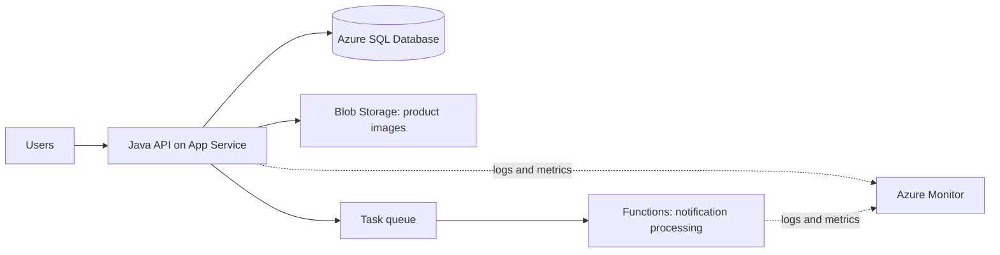

# What is Azure and Cloud Service Models

> Chapter: Azure Fundamentals

Microsoft Azure is Microsoft's cloud computing platform, providing resources and services to build, deploy, and operate applications. Instead of purchasing and operating entire servers themselves, organizations can rent compute, storage, network, and data services, then adjust them according to demand.

The first thing to understand is not memorizing the names of many services, but determining **what problem you need to solve, how much control you want, and which parts of operations you will be responsible for**. The three models—IaaS, PaaS, and SaaS—help answer those questions.

## 1. Objectives and Running Scenario

After this lesson, you will be able to:

- Explain what Azure provides and how the cloud differs from operating on-premises infrastructure.
- Distinguish IaaS, PaaS, and SaaS based on management boundaries and responsibilities.
- Identify the fundamental roles of a subscription, resource group, and Microsoft Entra ID.
- Distinguish service models from public cloud, private cloud, and hybrid cloud.
- Propose an appropriate model for each component of an application, along with the rationale and remaining work required.

The running example is a team developing a sales system in Java. The system has an API for processing orders, a database, storage for product images, and a notification-sending job. Initially, traffic is small; during promotional campaigns, traffic increases sharply. The team needs to deploy quickly while still protecting customer data and controlling costs.

## 2. What Problems Does Cloud Computing Solve?

### 2.1. From Owning Hardware to Consuming Services

When operating on-premises infrastructure, organizations typically have to prepare physical space, power, networking, servers, storage devices, and maintenance staff. Scaling up may require procurement and installation before applications can use the resources.

With Azure, the team can request resources through the management portal, command-line tools, APIs, or infrastructure as code. Microsoft operates the underlying physical infrastructure; the amount of work the team must do above it depends on the chosen service.

For example, renting a virtual machine gives the team a machine to run applications without buying a physical server. However, the team still needs to manage the operating system and software on the virtual machine. Choosing a managed application hosting platform can further reduce that workload.

### 2.2. Characteristics to Understand

| Characteristic | Practical meaning | What should not be assumed |
| --- | --- | --- |
| On-demand provisioning | Resources can be requested when needed via an interface or API | Every request succeeds immediately; quotas and capacity limits still apply |
| Network access | Services are accessed over network connections with appropriate authentication mechanisms | All resources must be exposed publicly to the Internet |
| Shared resources at the infrastructure layer | The provider organizes infrastructure to serve multiple customers with isolation mechanisms | Customers have access to each other's data |
| Elasticity | Capacity can be increased or decreased according to load if the service and design support it | Every application scales automatically without configuration |
| Measured usage | Resource usage is recorded for management and billing according to the service's mechanism | Every type of charge only occurs when someone sends a request |

**Scalability** is the ability to expand capacity to meet load. **Elasticity** emphasizes adjusting capacity up and down in response to demand fluctuations. A system may scale manually without yet having an automatic elasticity mechanism.

### 2.3. Benefits Come with Design Decisions

The cloud shortens infrastructure preparation time and provides many shared services. Even so, reliability, security, and cost still depend on how services are selected and configured.

For the sales system, creating more API instances only helps if a load balancer can distribute requests, the application handles state appropriately, and the database can withstand the corresponding load. Scaling the compute tier does not automatically solve every bottleneck.

## 3. Where Does Azure Fit in Application Architecture?

### 3.1. Foundational Service Categories

| Need | Example Azure service or component | Initial design question |
| --- | --- | --- |
| Running applications | Azure Virtual Machines, Azure App Service, Azure Functions | Do you need to manage the machine or just deploy application code? |
| Network connectivity and isolation | Azure Virtual Network | Which components need to communicate with each other, and over what path? |
| Storing files and objects | Azure Blob Storage | Who is allowed to read and write images and documents? |
| Storing relational data | Azure SQL Database | What data model, performance, and recovery capabilities are needed? |
| Identity management | Microsoft Entra ID | Which user or application is authenticated? |
| Operational observability | Azure Monitor | Which metrics, logs, and alerts should be tracked? |
| Cost tracking | Microsoft Cost Management | Which environment, team, and workload do the costs belong to? |

This list is a conceptual map, not a requirement to use every service. A small application can start with a few components and add more as justifiable needs arise.

### 3.2. Subscription, Resource Group, and Resource

These three concepts help you understand where resources are organized:

- **Subscription** is a key scope for organizing Azure usage, managing access, policies, and tracking costs. How billing is issued is also tied to the organization's agreements and billing structure.
- **Resource group** is a logical container for managing a set of related resources, typically grouped by application, environment, or lifecycle.
- **Resource** is an object that is created and managed, such as a virtual machine, a storage account, or an application on a managed platform.

The example below illustrates logical organization only, not deployment commands:

```text
Subscription: sales-team
├── Resource group: sales-dev
│   ├── API application for development environment
│   ├── Development database service
│   └── Test image storage resource
└── Resource group: sales-prod
    ├── API application for production environment
    ├── Production database service
    └── Product image storage resource
```

A resource group is not a private network and does not replace data protection boundaries. Resources in the same resource group do not automatically gain access to one another. Resources in different resource groups can still communicate if networking and permissions allow it.

### 3.3. Microsoft Entra ID and Access Permissions

Microsoft Entra ID provides identity capabilities, helping authenticate users and applications. A tenant is an Entra ID identity directory scope; a tenant is not synonymous with a subscription. One tenant can be associated with multiple subscriptions.

Two questions must be distinguished:

1. **Authentication:** who is the identity attempting to access?
2. **Authorization:** what is that identity allowed to do on which resources?

Azure RBAC is a role-based authorization mechanism across Azure resource scopes. Permissions to manage a resource and permissions to read data inside the service can be separate permissions. For example, having permission to view a storage account's configuration does not automatically mean having permission to download every object inside it.

At an introductory level, remember: **a subscription organizes usage scope, a resource group organizes resources, and identities and roles control access**. These three elements are related but solve different problems.

### 3.4. Region and Availability Zone

**Region** is an Azure deployment area containing data center infrastructure. Deployment location affects latency, data requirements, available services, and cost.

**Availability zone** refers to physically separated groups of data centers within a supported region, with independent power, cooling, and networking infrastructure. Using multiple zones can help reduce the impact of localized failures, but the application must use appropriate services and configurations.

A region is not a resource group. A resource group's metadata location does not require all resources in the group to be in the same region. Creating a resource group also does not automatically create a multi-zone or multi-region architecture.

## 4. IaaS: Renting Infrastructure, Managing Software Above It

### 4.1. What is IaaS?

**Infrastructure as a Service — IaaS** provides infrastructure resources such as virtual machines, storage, and networking. The provider manages physical facilities, physical hardware, and the virtualization layer; the customer manages the guest operating system, runtime, applications, and data for the resources they use.

A typical example on Azure is **Azure Virtual Machines**. You choose the machine configuration, operating system, and related settings, then install software to run the application.

### 4.2. Example with a Java Application

The sales team creates a Linux virtual machine, installs the JDK, deploys the Java application onto the machine, and configures the running process. The team has deep customization control but is responsible for many tasks:

- Updating the guest operating system and JDK, and managing software packages.
- Configuring administrative access and restricting network connections.
- Managing application configuration, secrets, and service accounts.
- Collecting logs, setting up alerts, and handling process crashes.
- Designing appropriate backup, recovery, scaling, and availability.

### 4.3. When Should It Be Considered?

IaaS is suitable when operating system control is needed, there are dependencies on specialized software, or a legacy system needs to be migrated without major architectural changes yet. It is also useful when operational requirements mandate machine-level configuration.

In return, high control brings significant operational effort. Moving a server from a server room to an Azure virtual machine changes where the infrastructure is located, but it does not automatically turn the application into a fault-tolerant or elastic system.

## 5. PaaS: Deploying Applications on a Managed Platform

### 5.1. What is PaaS?

**Platform as a Service — PaaS** provides a platform to deploy applications or consume a capability such as a database. The provider manages more infrastructure and platform components compared to IaaS. The customer focuses on source code, data, configuration, access permissions, and operational requirements of the application.

Representative examples are **Azure App Service** for web/API applications and **Azure SQL Database** for a managed relational database.

### 5.2. Example with a Java Application

Instead of creating a virtual machine, installing the JDK, and configuring processes, the team selects an appropriate App Service configuration to deploy the Java API. The team still needs to verify the supported runtime and how their application is packaged.

Order data can be placed in Azure SQL Database. Microsoft operates the managed database platform, while the team remains responsible for designing tables, queries, data permissions, and meeting application requirements.

Tasks that still need to be done include:

- Verifying compatibility between the application and the runtime version.
- Configuring connections, identities, and secret provisioning.
- Setting network access restrictions aligned with the architecture.
- Selecting compute capacity, configuring scaling, and observing load.
- Setting up alerts, testing recovery, and managing application changes.

### 5.3. Benefits and Limitations

PaaS reduces machine management work and lets the team spend more time on business logic. In return, the application must adapt to the platform's capabilities and constraints: runtime, deployment model, state storage, networking, and scaling mechanisms.

For example, if the API stores user sessions or uploaded images only on the local disk of a single instance, scaling out to multiple instances can cause inconsistent behavior. The team needs to choose appropriate places to store state and files rather than assuming all instances share local data.

**Being managed does not mean it is already configured correctly for your needs.** The platform may provide backups or recovery features, but the team still needs to understand protection scope, retention periods, and how recovery meets business requirements.

## 6. SaaS: Using Complete Software

### 6.1. What is SaaS?

**Software as a Service — SaaS** delivers complete software to users. The provider manages the application and the underlying technical layers. The customer uses the features, configures business settings, and administers data, users, and access permissions within the scope permitted by the product.

Microsoft 365 is a familiar SaaS example in the Microsoft ecosystem. Note the distinction: **Microsoft 365 is not an Azure resource for you to deploy your Java code**; it is an example to help understand the complete software delivery model.

### 6.2. Customer Responsibilities in SaaS

Not managing servers does not mean having zero responsibilities. The organization still needs to:

- Manage users, groups, and permissions to use features.
- Set access policies and protect accounts.
- Classify data entered into the product.
- Configure sharing, retention, data export, and integrations as needed.
- Understand service limits, terms of use, and how to handle business incidents.

### 6.3. When Should It Be Considered?

SaaS is suitable when the need is already met by a complete product and the organization does not need to build all of that software itself. For the sales team, using a SaaS collaboration tool can make more sense than writing an online meeting and document-sharing system from scratch.

Conversely, if the team needs to build a custom order API, the question of deploying the API usually leads to IaaS, PaaS, or another suitable platform form. Running an application of yours on Azure also does not automatically make it SaaS; SaaS also refers to how you deliver complete software to customers.

## 7. Comparing Models by Responsibility Boundaries

The table below is a generalized model for learning. Exact boundaries always depend on the specific service and how you deploy it.

| Layer or task | On-premises | IaaS | PaaS | SaaS |
| --- | --- | --- | --- | --- |
| Data center and physical hardware | Customer | Provider | Provider | Provider |
| Virtualization layer provided by the service | Customer if used | Provider | Provider | Provider |
| Operating system serving the workload | Customer | Customer manages guest OS | Provider manages platform; customer within deployment scope | Provider |
| Runtime and middleware | Customer | Customer | Usually managed by platform; customer remains responsible for self-packaged components | Provider |
| Application code and versions | Customer | Customer | Customer | Provider manages product |
| Organization data and access permissions | Customer | Customer | Customer | Customer remains responsible within usage scope |
| Configuration aligned with business needs | Customer | Customer | Customer | Customer within product scope |

### 7.1. Shared Responsibility Is Not an Equal Split

The **shared responsibility** model defines that the provider and the customer are responsible for different layers. The workload is not necessarily split evenly, and a single ratio cannot be applied across all services.

The shifting boundary can be pictured as follows:

```text
IaaS: you manage OS → runtime → application → data
PaaS: you focus on application → data → platform usage configuration
SaaS: you focus on data → users → product usage configuration
```

In all three models, the customer still needs to control data and identities within their scope of responsibility. An infrastructure provider cannot decide for you which employees are allowed to view the customer list.

### 7.2. Examples of Incidents Caused by Misunderstanding Boundaries

Suppose the team uses a managed storage service to hold invoices. The service has infrastructure protection mechanisms, but the team configures public read access for data that should remain private. The issue lies in the customer's configuration and access permission decisions.

Similarly, an application hosting platform may automatically maintain the underlying operating system, yet an authorization bug in the Java API can still allow a user to read another person's orders. Choosing PaaS does not eliminate the requirement for application security testing.

## 8. Where Do Serverless and Containers Fit?

### 8.1. Serverless Does Not Mean No Servers

Serverless is a way of consuming compute capacity with a high level of abstraction, where the provider manages server infrastructure and many provisioning and operational aspects. Servers still exist; the development team simply does not manage them directly as with virtual machines.

**Azure Functions** is a common example for event-driven code processing. In the sales system, a job that sends notifications or processes new files may fit this organization style.

Execution conditions, scaling behavior, and billing mechanisms of the specific deployment option must be reviewed. It should not be assumed that every serverless service bills strictly per request, always scales down to zero, or has zero startup time.

In this lesson, IaaS, PaaS, and SaaS are the three primary service models for comparing responsibilities. Serverless describes an additional way of delivering and operating a platform; there is no need to treat it as a fixed tier replacing those three models.

### 8.2. Containers Are a Way to Package and Run Applications

Containers package an application along with its required dependencies. Containers do not by themselves determine whether a service is IaaS, PaaS, or SaaS:

- Running containers on virtual machines still leaves significant machine-layer responsibilities with the team.
- Running containers on a managed platform can reduce infrastructure management work.
- Delivering a complete product to users can be SaaS even if the product uses containers internally.

If you package the runtime or libraries inside an image yourself, you need to manage vulnerabilities and updates for those components. A provider managing the host servers will not automatically patch every dependency inside your image.

## 9. Public, Private, and Hybrid Cloud Are a Different Classification Axis

IaaS, PaaS, and SaaS answer the question of **which layer the customer receives the service at**. Public cloud, private cloud, and hybrid cloud describe **how cloud infrastructure is deployed and combined**.

| Deployment model | Meaning | Conceptual example |
| --- | --- | --- |
| Public cloud | Cloud capacity provided by a vendor to multiple customers with isolation mechanisms | An enterprise uses Azure services in a public cloud environment |
| Private cloud | Cloud infrastructure dedicated to a single organization | An organization operates a private cloud environment with self-service and resource management |
| Hybrid cloud | Combining a private or on-premises environment with public cloud in an interconnected architecture | An API running on Azure connects to an internal system over a controlled connection |
| Multicloud | Using services from multiple cloud providers | Two workloads use two different cloud platforms |

Public cloud does not mean public data. An application on Azure can use a private network and restrict access. Private cloud also does not mean simply having a server sitting in an office; it also requires the characteristics and management mechanisms of a cloud environment.

Hybrid cloud and multicloud are not synonymous. An enterprise can use Azure alongside an on-premises system without using a second public cloud provider. Conversely, using two public clouds is not enough to describe how they integrate with each other.

## 10. Applying to the Java Sales System

### 10.1. Two Options for the Same Need

| Component | IaaS-oriented option | Managed-platform-oriented option |
| --- | --- | --- |
| Java API | Virtual machine where the team installs the OS and application runtime | App Service with a suitable deployment method and runtime |
| Order data | Self-install and operate a database on a virtual machine | Azure SQL Database if suited to requirements and compatibility |
| Product images | Team self-manages a file storage solution on rented infrastructure | Blob Storage with clearly designed access permissions |
| Background jobs | Processes installed, monitored, and scaled by the team | Functions for tasks fitting an event-driven model |

These are comparison options, not a mandatory blueprint. A real-world system might combine virtual machines with a managed database and object storage. Each component should be chosen based on its own constraints.

### 10.2. Illustrative Architecture



The diagram only shows component roles and logical flows. It does not yet fully describe networking, authentication, authorization, backup, or availability. A production-ready architecture needs to add those decisions.

For notification sending, a queue can decouple order intake from notification processing speed. The team still must design retry mechanisms and duplicate handling. Moving the task into a function does not automatically guarantee each notification is sent exactly once.

### 10.3. Step-by-Step Decision-Making Approach

1. **Identify requirements:** traffic volume, acceptable latency, data to protect, and desired recovery time.
2. **List dependencies:** Java version, libraries, database, components requiring OS-level privileges.
3. **Choose control level:** which parts truly require machine management, and which parts can be handed off to a managed platform.
4. **Check suitability:** runtime, networking, deployment region, scaling approach, integrations, and service limits.
5. **Estimate effort and cost:** including operations, monitoring, backup, and incident handling.
6. **Test within a bounded scope:** verify deployment, data access, and behavior under changing load before scaling up.

For a small team with a platform-compatible Java API and no need for OS customization, PaaS is an option worth evaluating. If the application depends deeply on specialized software at the OS layer, IaaS may be a better fit initially.

## 11. Cost, Safety, and Operations from the Start

### 11.1. Cost Is Not Just the Price of Running the App

You can use the following mental formula to list cost components; this is not an Azure pricing formula:

```text
Total cost to consider
  = compute + storage + data transfer + accompanying services
  + observability and backup + operational effort
```

IaaS may require the team to spend extra time patching the OS and handling on-call operations. PaaS can reduce that work, though it still incurs charges based on capacity and features used. SaaS may charge per user or by another product-specific mechanism.

Therefore, there is no fixed price ranking where IaaS is always cheaper than PaaS or serverless is always cheapest. Comparisons must be made under the same requirements and expected usage levels.

For learning environments, clearly track created resources, monitor usage, and clean up afterward. Stopping an application or machine does not guarantee all associated resources stop incurring charges; disks, backups, or other resources may still remain.

### 11.2. Security Is Part of Service Selection

Whichever model you choose, identify which data is sensitive, who gets access, and how the application obtains permissions. Avoid placing secrets in source code; use identity and secret-management mechanisms appropriate to the service.

Permissions should be restricted to what is needed to perform the work. An API that only needs to read product images should not receive administrative rights over the entire subscription. Smaller permission boundaries help limit impact when bugs or credential leaks occur.

### 11.3. Availability Does Not Replace Backup

**Availability** keeps a service running when a component fails. **Backup and recovery** restore data or state when needed. The two goals are related but do not replace each other.

For example, having multiple API instances cannot restore order data accidentally deleted by the application. A managed database service still needs its recovery capabilities configured and tested according to the team's requirements.

## 12. Common Misconceptions

| Statement | Correct understanding |
| --- | --- |
| Azure is just a place to rent virtual machines | Azure also provides application platforms, data, identity, networking, and many other services |
| Choosing PaaS means no more operations | The team still operates the application, manages data, configuration, access, and monitors the service |
| SaaS is the name for every application running on the cloud | SaaS is a model for delivering complete software to end users |
| IaaS, PaaS, and SaaS are three quality tiers | They divide control and responsibility, not rank good versus bad |
| Enabling autoscale means every tier scales automatically | Each tier has its own capabilities, configuration, and bottlenecks |
| Public cloud means all data is public | Access depends on identity design, networking, and data configuration |
| A resource group is an isolated network zone | It is a logical container for organizing and managing resources |
| Using the cloud is automatically cheap and secure | Outcomes depend on service selection, design, and operational practices |

## 13. Applied Exercises and Self-Check

### 13.1. Classification Exercise

For each scenario, choose a service model and state at least two responsibilities that remain with the customer:

1. You need to run a legacy application that must install a specialized component into the operating system.
2. You have a platform-compatible Java API and want to reduce machine management work.
3. The enterprise needs a complete collaboration product for employees.

**Suggested answers:**

1. Consider IaaS. The customer manages the guest OS, runtime, application, data, and access permissions.
2. Consider PaaS. The customer manages application code, data, configuration, and access permission usage; verify that the platform meets practical requirements.
3. Consider SaaS. The customer administers users, data sharing, and product usage configuration.

### 13.2. Mini Design Exercise

Describe an approach for the sales system consisting of the Java API, order data, product images, and notification job. For each component, note:

- Primary needs and specific conditions.
- Expected service model or type.
- What the provider manages and what the team still must do.
- One risk to verify before going into production.

A reasonable answer might combine App Service, Azure SQL Database, Blob Storage, and event-driven jobs. The quality of the answer lies in explaining suitability, responsibility boundaries, and risks rather than merely listing product names.

### 13.3. Self-Check Questions

**Is a subscription a tenant?** No. A subscription is a scope for using and managing Azure resources; a tenant is an identity directory scope. They are linked in a relationship but are not synonymous.

**Can you deploy code with authorization bugs using PaaS?** Yes. The platform manages many technical layers, but internal application logic and access permissions still must be designed properly.

**Should you choose one model for the entire system?** Not required. Different components have different needs and can use different appropriate models.

**Does serverless mean no system monitoring is needed?** No. You still have to observe errors, execution time, load, costs, and impact on dependent services.

**What should you remember when evaluating a new Azure service?** Identify which need the service solves, how much control it provides, which work it hands off to the provider, and which responsibilities remain with the team.
