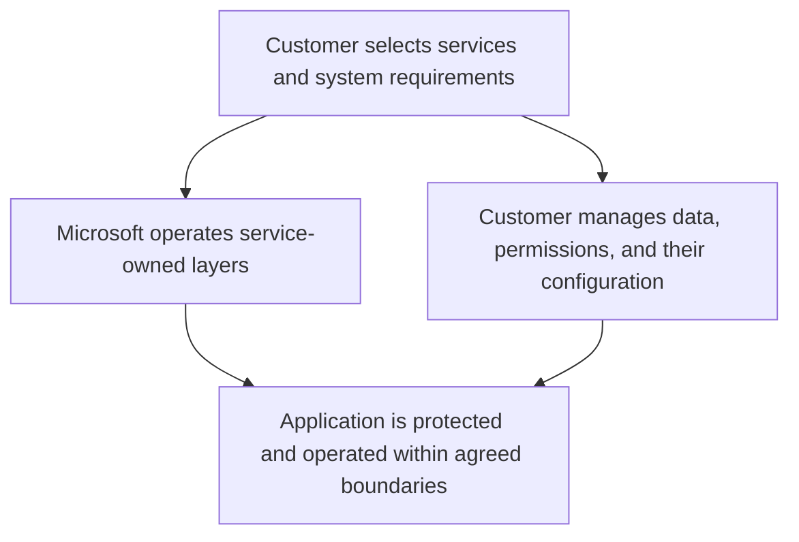
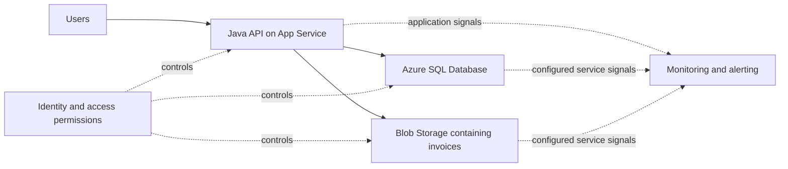

# Shared Responsibility Model on Azure

## 1. Why Understand Responsibilities Before Creating Resources?

An application running on Azure uses multiple layers: data centers, physical servers, networking, compute platforms, operating systems, application code, identities, and data. Microsoft and the organization using Azure jointly participate in protecting and operating those layers. The **shared responsibility model** defines which party manages which part, rather than assuming that moving an application to the cloud means transferring all responsibility to the provider.

Within the Azure ecosystem, this division directly affects how subscriptions, resource groups, Microsoft Entra ID, virtual networks, compute services, storage, and data are organized. It also determines who must deploy changes, receive alerts, verify backups, handle incidents, and control costs.

For example, Microsoft can protect storage hardware but does not know whether a container holding an enterprise's invoices is permitted to be public. Microsoft can operate the database platform but cannot automatically determine which tables an application account should be allowed to read. Those decisions belong to the system and data owner.

After this lesson, you should be able to:

- Explain the boundary between Microsoft's responsibilities and the customer's responsibilities.
- Distinguish responsibilities when using IaaS, PaaS, and SaaS.
- Apply the model to Virtual Machines, App Service, Azure SQL Database, Storage, and Microsoft Entra ID.
- Assign owners for identity, configuration, data, monitoring, recovery, and cost.
- Identify missing tasks when a team claims a system is already managed by Azure.

## 2. Two Sides of the Model

### 2.1. Microsoft Protects and Operates the Service Delivery Infrastructure

Across all public cloud service models, Microsoft is responsible for the physical infrastructure it operates to deliver services. These tasks include securing data center facilities, operating physical servers, physical network infrastructure, and platform components within the scope of the service.

When the customer chooses a more highly managed service, Microsoft also takes over additional operational layers, such as the underlying platform operating system or the database engine. The exact scope depends on the service and deployment approach; the responsibilities of one service cannot be generalized to every other service on Azure.

A commonly used phrase is **security of the cloud**: protecting the platform that Microsoft provides.

### 2.2. Customers Protect What They Put Into and Configure on Azure

The customer is the organization or individual using Azure. The customer must still determine what data is stored, who gets access, what the application is allowed to do, which configurations are appropriate, and which risks are acceptable.

Frequently occurring responsibilities include:

- Classifying data and defining usage purposes and retention requirements.
- Managing user accounts, application identities, and access permissions.
- Securing endpoint devices managed by the organization.
- Selecting service configurations, network connections, and how applications are exposed.
- Managing source code, dependencies, and secrets in the application parts they control.
- Defining availability requirements, recovery capabilities, and compliance evidence for the system.

The corresponding phrase is **security in the cloud**: protecting the resources, applications, and data that the customer deploys or uses.

These two phrases are helpful memory aids but do not replace reading the scope documentation for each service. A layer such as networking or identity may include both Microsoft-operated components and configurations that the customer is responsible for.

### 2.3. Shared Does Not Mean Doing Everything Together

A shared responsibility typically consists of multiple distinct tasks with clear boundaries and handoff points.

For example, regarding identity:

- Microsoft operates the Microsoft Entra ID platform.
- The organization manages account lifecycles, groups, access permissions, sign-in policies, and configurations within the tenant under its authority.
- Users and administrative teams must follow processes to protect accounts, handle compromised credentials, and revoke access when needed.

Saying that identity is a shared responsibility is not enough. An operational plan must specify who configures, who approves, who monitors, and who handles alerts.



## 3. Responsibilities Shift Across IaaS, PaaS, and SaaS

### 3.1. IaaS: Customer Manages Many Software Layers

**Infrastructure as a Service — IaaS** provides infrastructure resources such as virtual machines, virtual networks, and disks. Azure Virtual Machines is a typical example.

Microsoft operates the physical infrastructure and the platform's virtualization layer. The customer manages the guest operating system inside the virtual machine, software installed inside it, applications, accounts, and configuration of their resources.

If a team installs a database management system onto a VM themselves, the team must also manage patching, configuration, and operations for that software. Running the software on Azure does not automatically turn it into a managed database service.

IaaS is suitable when deep control is needed, though control comes with a larger operational obligation.

### 3.2. PaaS: Microsoft Manages More of the Application Platform

**Platform as a Service — PaaS** provides a platform for customers to deploy applications or use capabilities such as a database without having to operate the entire underlying operating system themselves. Azure App Service and Azure SQL Database are common examples.

With a Java application running on App Service using a platform-provided runtime, Microsoft manages the infrastructure and the service's platform layers. The development team still manages the Java code, dependencies packaged with the application, application settings, access permissions, and data.

If deploying with a custom container, the team must also manage the contents of its image, including packages and libraries placed inside the image. Having the platform run the container does not mean the platform automatically fixes every vulnerability inside a customer-provided image.

PaaS reduces infrastructure workload but still requires secure development practices and configuration management.

### 3.3. SaaS: Provider Operates the Complete Application

**Software as a Service — SaaS** provides a complete application for users to consume. Microsoft 365 is an example to help visualize the SaaS model in the Microsoft ecosystem; it is not a virtual machine or an App Service resource that a customer deploys themselves inside an Azure subscription.

The provider manages the application and the platform delivering that application. The customer must still administer users, the data they put in, sharing behavior, tenant configuration, and organization-owned endpoint devices.

If a user shares a sensitive document with the wrong audience, the fact that the provider operates the software does not remove the organization's responsibility for governing sharing.

### 3.4. High-Level Responsibility Matrix

The table below illustrates the general division pattern and does not replace service-specific scope documentation.

| Layer or task | IaaS | PaaS | SaaS |
| --- | --- | --- | --- |
| Data center, physical servers, and physical networking | Microsoft | Microsoft | Provider |
| Virtualization layer and provider-operated infrastructure platform | Microsoft | Microsoft | Provider |
| Guest OS or platform OS | Customer manages OS inside VM | Microsoft manages OS layer of the service | Provider |
| Runtime, middleware, or data engine | Customer for self-installed software | Microsoft for platform components; customer for self-supplied components | Provider for supplied application components |
| Application code and customer-deployed dependencies | Customer | Customer | Customer still manages extensions, integrations, or custom-written components if any |
| Data, classification, and decisions on who can access | Customer | Customer | Customer |
| Identity and permission configuration | Microsoft operates platform; customer administers identities and permissions | Microsoft operates platform; customer administers identities and permissions | Provider operates platform; customer administers within provided scope |
| Networking and service access paths | Customer manages their network configuration | Shared depending on service and connectivity mode | Provider manages service network; customer manages provided access options |
| Customer-managed endpoint devices | Customer | Customer | Customer |

Key takeaway: **the more managed the service, the less the customer has to operate lower layers; responsibility for data and access decisions remains**.

## 4. Applying to Azure Governance Structure

### 4.1. A Subscription Is a Governance Scope That Needs an Owner

A subscription helps organize resources and serves as an important scope for assigning permissions, applying policies, and tracking costs. Microsoft operates Azure services; the organization must still decide who can create resources, who approves permissions, and who monitors costs within the subscription.

An application can be well protected at the source code level yet still face risk if too many people hold broad administrative permissions at the subscription level. Permission inheritance down to lower scopes must be accounted for when evaluating who can actually modify the system.

### 4.2. A Resource Group Organizes Resources, It Does Not Automatically Isolate Everything

A resource group is a place to group related resources for lifecycle management and for applying permissions or policies at a shared scope. It does not automatically create a private network, does not automatically block traffic between applications, and does not automatically ensure that only project members can read data.

To restrict access, the team must design appropriate mechanisms: access permissions, network configuration, application authentication, and data-level permissions. Placing two applications into two different resource groups is not enough to conclude they are securely isolated.

### 4.3. Distinguish Authentication, Authorization, and Scope of Operations

Three questions should be kept separate:

1. **Authentication:** who is the user or application?
2. **Authorization:** what actions is that identity allowed to perform on which objects?
3. **Scope:** does the permission apply at the tenant, subscription, resource group, resource, or inside application data?

Azure RBAC is used to manage permissions for Azure resources and certain data permissions depending on service capabilities. Microsoft Entra ID administrative roles serve a different scope from Azure RBAC roles. Tenant administration and subscription administration should not be treated as the same type of permission.

Also distinguish the **management plane** from the **data plane**:

- Management plane: creating resources, changing configurations, setting up connections, or managing service properties.
- Data plane: reading blobs, writing database records, or performing operations on service data.

A role may have permission to manage a resource without directly granting permission to read its data. However, someone with strong administrative permissions may have the ability to alter permissions or settings that affect data. Therefore, risk assessment must look at both direct permission paths and the ability to change configuration.

## 5. Examples by Service Category

### 5.1. Azure Virtual Machines: A Running VM Does Not Mean Securely Operated

Suppose a team creates a Linux VM, installs Java, and runs an order-processing API.

Microsoft is responsible for the infrastructure and virtualization layer belonging to the service. The team must manage:

- Updating the guest OS and packages installed in the VM.
- Java version, web server, dependencies, and application code.
- Operating system accounts, login keys, and administrative privileges.
- Open ports, network rules, host firewall, and administrative access channels.
- Logs, alerts, disk capacity, backups, and recovery plans.

The team may use Azure tools to assist with updates or monitoring. Using tools does not remove the responsibility for defining scope, configuring, verifying results, and handling update failures.

If a Java library in the application has a vulnerability, the team must update the dependency, test it, and redeploy. You cannot wait for Microsoft to automatically fix code or application packages built by the team.

### 5.2. Azure App Service: Less Server Operations, Still Own the Application

When moving the Java API to App Service, the team no longer manages the platform's host OS the way they would manage a VM. Even so, the following tasks remain on the customer side:

- Choosing the appropriate deployment configuration and runtime from service-supported options.
- Tracking compatibility, changes, and version lifecycles required for the application.
- Patching dependencies packaged inside the application or team-built images.
- Authenticating users, enforcing permissions in each feature, and validating input.
- Managing configuration, secrets, application identity, and connections to data services.
- Designing scaling, load testing, error tracking, and recovery after failed deployments.

An access control bug allowing user A to read user B's orders is an application logic bug. Having App Service manage the platform does not automatically fix this bug.

### 5.3. Azure SQL Database: Managed Data Engine, Content Still Needs an Owner

Azure SQL Database manages many tasks at the service layer and database engine level. Customers do not manage the host OS as they would when installing SQL Server onto a VM themselves.

Customers must still:

- Design schemas, queries, indexes, and application migrations.
- Manage users, data permissions, and authentication methods.
- Control network connection paths to the database.
- Classify data, establish retention rules, and handle sensitive data.
- Define recovery requirements, review the service's backup mechanisms, and configure the parts they are allowed to control.
- Practice recovery to verify whether the application can use the data after restoration.

If an application concatenates query strings from input data and creates a SQL injection vulnerability, the issue belongs to the customer's code and query design. Microsoft managing the database engine does not guarantee every query sent by the application is safe.

### 5.4. Azure Storage: Data Durability and Public Access Are Two Different Issues

Microsoft operates the storage infrastructure and service-level mechanisms. The customer must decide how to use Storage for specific data:

- Which files are public, and which files are accessible only after authentication.
- Which identities are allowed to read, write, or delete data.
- How to restrict permissions and lifetimes for delegated access mechanisms, such as SAS when used.
- Network configuration, authentication methods, and appropriate data protection options.
- Retention policies, data deletion, and recovery options for accidental operations.

A stored object can be persisted durably yet still be exposed if access permissions are overly broad. Conversely, proper authorization does not automatically prevent an application from accidentally deleting data. These two types of risks require different measures.

### 5.5. Microsoft Entra ID and Managed Identity: Fewer Secrets, Still Must Limit Permissions

Microsoft Entra ID provides the identity platform. The organization is responsible for administering accounts, groups, permissions, and policies within its tenant.

Managed identity helps certain Azure resources authenticate to other services without the application having to store and rotate a traditional password or access key itself. However, the team must still assign the right permissions to that identity and manage which resources are allowed to use it.

If the API's managed identity only needs to read one image container, granting write permissions or broad permissions across many resources increases blast radius if the API is compromised. Managed identity solves part of the credential problem; it does not replace the principle of least privilege.

### 5.6. Virtual Network and Private Connectivity: Infrastructure Available, Design Still Customer's

Microsoft operates the physical network infrastructure. The customer designs the logical network and connectivity settings within the scope of the services used: address space, subnets, routes, network rules, connections between networks, and service access paths.

A service supporting private endpoints does not mean the resource is properly configured just because a private endpoint exists. The team must also examine DNS, traffic routing, how the application connects, data access permissions, and corresponding public access settings.

Private connectivity helps control network paths; the application still needs authentication and authorization when operating on data.

## 6. Responsibilities That Do Not Vanish When Choosing Managed Services

### 6.1. Data and Encryption Keys

The customer must know what data the system stores, who has read access, and how long data is kept. Platform encryption mechanisms are one part of data protection, but encryption does not fix misconfigured permissions or an application returning sensitive data to the wrong person.

If choosing customer-controlled key management options, the team must manage key permissions, key lifecycles, and the impact when a key is no longer usable. This is an additional operational responsibility to weigh against system requirements.

### 6.2. Backups, Recovery, and Availability

Three concepts should be distinguished:

| Concept | Goal | Example question the customer must answer |
| --- | --- | --- |
| Availability | Maintain ability to serve during faults | Does the application continue serving if one component stops working? |
| Backup | Have data copies to restore under the chosen mechanism | Is there a copy prior to the accidental deletion? |
| Disaster / incident recovery | Bring the system back to a usable state | Who restores, in what sequence, and how are results verified? |

Replicating data for fault tolerance does not necessarily protect against accidental deletion, because erroneous changes can be replicated as well. Having backups also does not prove the application can recover within the time the business requires.

Customers need to set targets for:

- **RPO — Recovery Point Objective:** acceptable data loss in terms of time, for example tolerating at most 15 minutes of data loss.
- **RTO — Recovery Time Objective:** target time to restore service capability after an incident, for example needing to be operational again within 60 minutes.

The numbers above are hypothetical business requirements, not guarantees from an Azure service. To achieve them, the team must choose the corresponding architecture, configuration, and recovery testing.

### 6.3. Monitoring and Incident Response

Microsoft is responsible for monitoring and handling platform components within the scope it operates. Customers still need to observe signals related to their own system: application errors, anomalous access, capacity exhaustion, slow queries, or administrative permission changes.

A useful monitoring chain includes:

1. Collecting the right logs and metrics.
2. Setting alert conditions aligned with real impact.
3. Routing alerts to a team capable of acting on them.
4. Having playbooks for diagnosis, recovery, and coordination when incidents exceed the team's scope.
5. Learning from incidents and fixing the configuration, code, or process that caused them.

Enabling log collection without anyone receiving and handling alerts still leaves a responsibility gap. Logs can also contain sensitive data, so read permissions and retention periods must be controlled.

### 6.4. Compliance and Cost Management

Provider compliance attestations help evaluate the platform. The customer must still assess requirements applicable to its own data and processes, choose services, configure them, and collect necessary evidence. Using Azure alone cannot be cited to conclude that the entire application meets every organizational requirement.

Cost is an operational area that needs an owner. The customer chooses capacity, configuration, uptime, scaling behavior, and data or log retention duration. Microsoft provides metering and service billing mechanisms; the organization must monitor usage and make optimization decisions.

Budget alerts should not be treated as a mechanism that guarantees all resources automatically stop when hitting a threshold. If the organization needs automated responses, it must design the action, execution permissions, and the action's impact on the application.

## 7. Running Scenario: Order Management Application

### 7.1. Context

An enterprise deploys a system consisting of:

- A Java API on Azure App Service.
- Order data on Azure SQL Database.
- Invoice files on Azure Blob Storage.
- Microsoft Entra ID serving the system's appropriate identity needs.
- Managed identity for supported and configured service connections.
- Azure Monitor with observability data the team chooses to collect.

The infrastructure team manages the subscription, resource groups, and shared configurations. The application team manages the API. The data owner approves reading and retaining order information.



The diagram describes functional relationships; actual connection settings, DNS, and authentication methods must be designed specifically for the system.

### 7.2. Customer-Side Responsibility Assignment Table

| Task | Primary responsible team | Evidence of completion |
| --- | --- | --- |
| Approving permissions at subscription and resource group levels | Platform administration team | Permission list, approvers, and review schedule exist |
| Configuring access paths to SQL and Storage | Platform team coordinating with application team | Valid connectivity tests and denied-path tests exist |
| Fixing API bugs and updating Java dependencies | Application team | New builds, test runs, and deployment results exist |
| Determining who is allowed to view invoices | Data owner coordinating with application team | Access rules and business-role checks exist |
| Administering managed identity permissions | Access governance team per organizational process | Appropriate permission scope and audit evidence exist |
| Defining RPO, RTO, and practicing recovery | System owner coordinating with data and platform teams | Agreed targets and recovery drill records exist |
| Receiving alerts and handling application errors | On-call operations team | Test alerts reach recipients and response runbooks exist |
| Tracking resource costs | Subscription owner or delegate | Usage reports, alert thresholds, and follow-up actions exist |

This is an illustrative assignment. Team names can vary, but every task needs a clear single point of contact. The table only assigns the customer side; Microsoft-operated platform parts still follow the scope of each service.

### 7.3. Three Incidents and How to Identify the Handling Party

**Incident A: a user is able to read someone else's invoice.**

The team checks permissions at the API, how file download links are generated, and permissions on Storage. If the root cause is the API failing to verify invoice ownership or issuing overly broad access links, the customer must fix the logic and configuration. Simultaneously, restrict access, review logs, and determine what data was accessed.

**Incident B: an error in the underlying compute platform beneath App Service.**

Microsoft handles the platform component belonging to the service. The customer still checks application health, determines business impact, and executes its designed service continuity plan. Do not assume every HTTP error is caused by the platform; application code, configuration, and dependent services must also be examined.

**Incident C: an application migration accidentally deletes order data.**

The application and data teams stop the erroneous action, determine the point in time to restore to, and use the appropriate recovery mechanism. After restoration, the team must verify consistency, API connectivity, and any intervening business changes. Having service-level backups does not replace the decision and recovery verification process.

In all three cases, effective response starts with containing impact and gathering evidence. Clarifying responsibility boundaries helps assign handling work and should not become a reason to delay actions within the team's control.

## 8. How to Build a Responsibility Map for a Resource

The following six-step process can be used when selecting or changing a service.

### Step 1: Identify the Exact Service and Deployment Model

Specify whether the application runs on a VM or App Service, uses a platform runtime or a custom container, and whether the database is Azure SQL Database or self-installed software. Simply noting "runs on Azure" is not enough to determine responsibilities.

### Step 2: List Layers and Assets to Protect

List the operating system, runtime, code, dependencies, identities, secrets, networking, data, logs, and connections to other services. Include elements outside Azure such as administrative devices and the organization's CI/CD system.

### Step 3: Separate Managed Service Parts from Customer-Controlled Parts

For each layer, determine who can modify it and who performs maintenance. Items involving both parties should be split into concrete tasks.

For example, do not write generically "database security: Microsoft." Split it into operating the data engine, managing users, table permissions, connection configuration, query code, and recovery according to business requirements.

### Step 4: Assign Owners on the Organization Side

Each task needs an execution point of contact, someone who decides on major changes, and a destination for alerts. Avoid assigning a single item to multiple teams without designating a coordinating team.

### Step 5: Define Verification Methods and Evidence

A configuration only has meaning when it can be verified. For example:

- A read-only identity cannot write or delete data.
- A user cannot read another account's documents through the API.
- Test alerts are delivered to the right on-call responder.
- A restored copy can be read by the application and meets agreed targets.

### Step 6: Review When Architecture Changes

Moving from a VM to PaaS, changing deployment style, adding private connectivity, or adding a managed identity all alter parts of responsibility. The map must be updated alongside the architecture rather than only drafted at project start.

Short record template for an item:

```text
Resource: Order API on App Service
Item: Java dependencies packaged with the application
Microsoft portion: operates the App Service platform within service scope
Customer portion: monitors, updates, tests, and deploys dependencies
Owner: application team
Verification method: inspect dependencies in the deployed build
On failure: assess impact, update, and deploy according to process
```

## 9. Common Misconceptions

| Misconception | Correct understanding | Required action |
| --- | --- | --- |
| Moving an application to Azure means Microsoft handles all security | Responsibility varies by service layer | Create a responsibility map for the actual architecture |
| PaaS means the team no longer has to patch anything | Code, dependencies, and self-supplied images still need maintenance | Track components included in deployments |
| Creating a separate resource group isolates data | Resource groups do not automatically create network barriers or business permissions | Configure appropriate permissions, connectivity, and authentication |
| Encryption makes data leaks impossible | Authorized identities can still read data according to their permissions | Review authorization and data-return logic |
| Managed identity automatically makes access secure | An identity can still be granted overly broad permissions | Apply least privilege and verify scope |
| Having a private endpoint blocks all public access | Still depends on service access configuration, DNS, and network paths | Test all actual access paths |
| Having backups guarantees recovery meets requirements | Requires procedures, permissions, configuration, and recovery testing | Practice recovery and measure actual duration |
| Enabling monitoring means someone is handling issues | Collecting signals and responding are two different tasks | Test alert channels and response owners |
| Provider certifications mean the app meets every requirement | Customer configurations and processes still must be evaluated | Collect evidence for the organization's system |

## 10. Self-Practice Exercises

### Exercise 1: Classify Responsibilities for VMs

A team runs a Java API and PostgreSQL on two VMs. Assign the following tasks: protecting the data center, patching Linux, updating Java libraries, updating PostgreSQL, managing login keys, opening network ports, and verifying backups.

**Reference hint:** Microsoft protects the physical infrastructure of the service. The customer team manages the guest OS, self-installed software, application, credentials, access configuration, and backup strategy within the scope of its system. If using additional managed services, specify which tasks those services take over.

### Exercise 2: Moving to PaaS

Suppose the API moves from a VM to App Service using a platform runtime, and the database moves to Azure SQL Database. Identify the infrastructure tasks the team no longer performs directly and the responsibilities that remain.

**Reference hint:** the team no longer manages the host OS of those services themselves or operates the Azure SQL Database engine the way a VM installation requires. The team still owns Java code, application dependencies, schema, queries, permissions, connection configuration, data, and recovery requirements.

### Exercise 3: Find Responsibility Gaps

A team says: "Storage is encrypted, SQL has backups, and Azure Monitor collects logs, so the system is secure enough." List at least four missing questions.

**Reference hint:** who can read the data, who can change permissions, who receives alerts, has restoration been tested, does the API enforce business permissions, and who decides data or log retention periods? Platform features only solve part of the protection and operations chain.

### Exercise 4: Build Your Own Map for a Small App

Choose an architecture with an API on App Service, data on Azure SQL Database, and files on Blob Storage. Create a five-column table: item, Microsoft portion, customer portion, owner, and verification method. Fill in at least items for identity, application code, network connectivity, data, recovery, and alerting.

The result must identify an actionable person or team for every customer-side task. If a row only says "shared" without specifying what each side does, split that row into more concrete tasks.

## 11. Key Takeaways

On Azure, Microsoft operates the platform layers within the scope of each service, while the customer is responsible for data, access decisions, and the components they deploy or configure. IaaS, PaaS, and SaaS shift the operational boundary, but they do not eliminate customer-side governance needs.

The way to apply the model is to move from a specific service to specific tasks: determine which layer is managed by whom, designate an owner, and verify evidence. A well-operated architecture connects decisions on subscriptions, resource groups, identity, networking, compute, storage, and data with processes for deployment, monitoring, protection, recovery, and cost control.
