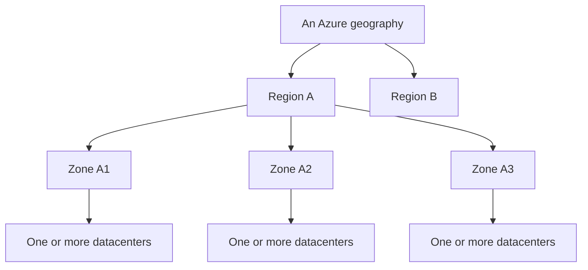
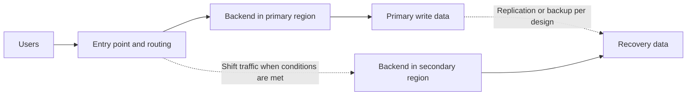

# Region, Geography, and Deployment Location Selection

## Objectives and Context

In the **Azure Fundamentals** chapter of the **CLOUD_PROVIDERS_AZURE** module, choosing a deployment location is the decision that connects infrastructure to application needs. An application may use Microsoft Entra ID for authentication, virtual networks for connectivity, compute services to run business logic, and storage services to hold data. Those components need a unified location plan to meet performance, recovery, data protection, and cost requirements.

After this lesson, you will be able to distinguish geography, region, and availability zone; identify the conditions that must be verified before choosing a region; and articulate the rationale for choosing a primary region along with a recovery strategy. The focus is on how to make decisions for a concrete system rather than memorizing a list of locations.

## 1. What Do Geography and Region Describe?

**Azure geography** is an Azure geographic boundary used as a data residency boundary. A geography can contain one or more regions.

**Azure region** is a collection of physical infrastructure consisting of data centers and interconnected networking within an area. Every region belongs to a geography. For region-scoped resources, selecting a region determines where the service is deployed. See the definitions in [Microsoft's Azure regions overview](https://learn.microsoft.com/en-us/azure/reliability/regions-overview).

Three questions must be distinguished during design:

| Question | Related concept | Example entry in the decision |
| --- | --- | --- |
| Within which geographic scope is data permitted to reside? | Geography and service-level data commitments | Use only locations approved by the organization |
| Where will the backend and primary data run? | Region | Choose a primary region for the transaction flow |
| How are instances distributed within a region? | Availability zone | Distribute components that need zone fault tolerance |

Geography is an Azure term; its scope should not be inferred merely from the name of a continent or country. Consult the official mapping.

For example, the Azure list records **Southeast Asia** located in Singapore with code `southeastasia` and geography **Asia Pacific**; **East Asia** is located in Hong Kong with code `eastasia` and the same geography. Thus, a region name is not synonymous with a country name. These examples are taken from the [Azure regions list](https://learn.microsoft.com/en-us/azure/reliability/regions-list); the list should be re-checked when planning a deployment.

### Display Name and Code Used in Configuration

The Portal usually displays human-readable names, while the Azure CLI and Infrastructure as Code usually use region codes. In this example:

```text
Display name: Southeast Asia
Region code:  southeastasia
```

When documenting architectural decisions, record both the name and the code so readers can cross-reference them with configurations. Do not convert a name into a code by simply removing spaces, because naming must be confirmed from Azure.

## 2. Availability Zones Reside Inside a Region

**Availability zone** is a group of one or more physically separated data centers within a region, with independent power, cooling, and networking infrastructure. Not every region supports zones.

A **zonal** resource is pinned to a specific zone. With **zone-redundant**, the service distributes or replicates components across multiple zones; how it is enabled and the scope of protection depend on the service. See the [availability zones overview](https://learn.microsoft.com/en-us/azure/reliability/availability-zones-overview).

The diagram below illustrates the conceptual relationship and does not depict the zone count or layout of an actual region:



Design example: two API instances placed in two zones that both depend on a single data component without a corresponding fault-tolerance strategy can still experience transaction flow disruption. Therefore, when stating "the application tolerates a single zone failure," examine the entire request path from entry point to data and dependencies.

## 3. Region Pairs Do Not Replace Recovery Design

Some Azure regions are linked into a **region pair**, usually within the same geography, though with exceptions. Many regions do not have a pair. Some services use pairs for geo-replication mechanisms; for instance, Azure Storage GRS can replicate to the paired region.

Choosing a region with a pair does not automatically create an application copy, HA, or failover. Multi-region architectures are also not necessarily restricted to pairs, though individual service features may have their own rules. See [Azure region pairs and nonpaired regions](https://learn.microsoft.com/en-us/azure/reliability/regions-paired).

When designing a secondary region, answer specifically:

- By what mechanism is the data replica formed?
- Are sufficient backend capacity, network configuration, certificates, and access permissions already in place to run there?
- Who decides to shift traffic, and based on which signals?
- After switching over, which system is permitted to accept writes?
- What is the procedure for failing traffic back to the primary region and reconciling newly generated data?

If these questions cannot be answered yet, "having a region pair" is only a property of the location, not an application recovery plan.

## 4. Region, Resource Group, and Global Services

A resource group is a unit for organizing resources. A resource group's location field determines where the group's metadata is stored; resources inside the group can reside in different regions. Therefore, a group's location is not a mechanism forcing all resources inside it to be in the same place. This behavior is described in the [resource group management guide](https://learn.microsoft.com/en-us/azure/azure-resource-manager/management/manage-resource-groups-portal).

A deployment diagram should document the location of each component instead of only documenting the resource group's location:

| Component in an illustrative design | Information to document |
| --- | --- |
| Resource group | Metadata location and management purpose |
| Backend API | Primary serving region and how instances are distributed |
| Transactional data | Primary write region, replicas, and backup storage location |
| Network connectivity | Endpoints, paths to data, and on-premises systems |
| Monitoring | Where logs are sent, data contained in logs, and retention duration |
| Global components | Service scope and relationship to regional backends |

Azure also has global services, such as Microsoft Entra ID, Azure DNS, and Traffic Manager, which do not require choosing a region in the way a VM does. This classification is noted in the [regions documentation for Azure Virtual Machines](https://learn.microsoft.com/en-us/azure/virtual-machines/regions).

"Global service" is not proof that all application data can be stored anywhere. For a sign-in-then-order flow, identity data, order data, and access logs still need to be documented separately.

## 5. Separate Mandatory Conditions from Optimization Criteria

Region selection should occur in two steps.

**The first step is feasibility filtering.** Eliminate candidates that do not satisfy the workload's mandatory conditions.

**The second step is comparing the remaining candidates.** Use measurements and estimates to choose the better-fitting option.

Microsoft recommends checking data residency, latency, service catalog, pricing, zones, and deployment limits when [selecting an Azure region](https://learn.microsoft.com/en-us/azure/cloud-adoption-framework/ready/azure-setup-guide/regions).

### Mandatory Conditions

Conditions must be expressed as verifiable criteria, for example:

- Order data and replicas may only be stored in the approved set of locations.
- The database service must have the exact required features and service tier.
- The architecture must satisfy the agreed recovery objectives.
- The subscription has region access and quotas aligned with the plan.
- Traffic from the backend to on-premises systems must satisfy the project's connectivity requirements.

A candidate that fails a mandatory condition must not be brought back merely because of low price or proximity to users.

### Optimization Criteria

These criteria help compare feasible options:

| Criterion | Evidence to collect |
| --- | --- |
| User experience | p50 and p95 latency and error rates from user groups |
| Inter-component interaction | API call duration, database queries, and file transfers |
| Cost | Estimates using identical traffic, configuration, and data retention |
| Operability | Measured recovery time, level of automation, and team capability |
| Growth headroom | Quotas, alternative SKU options, and scaling plans |

p50 is the level that roughly half of measurements do not exceed; p95 is the level that roughly 95% of measurements do not exceed. p95 helps surface slow experiences that an average value can hide.

## 6. Map Data Flows Before Choosing a Location

The question "where is the database?" does not cover all data in a system. A project should map data pathways to avoid missing copies created by operations or integrations.

The table below is a sample analysis for an ordering application, not a default Azure specification:

| Data group | Origin | Copies to inventory | Decisions to record |
| --- | --- | --- | --- |
| Customer profiles | Registration API | Database, cache, exported reports | Storage location and access permissions |
| Orders | Transaction API | Database, replicas, backups | Primary write location and recovery strategy |
| Attachments | User uploads | Storage, redundant replicas | Storage region and replication mechanism |
| Application logs | Backend | Monitoring platform, archive store | Whether sensitive data is present |
| Analytics data | Business pipeline | Analytics warehouse, test environments | Data movement and anonymization rules |

In this example, if the project chooses a primary region in an approved location but exports reports containing customer information to an unapproved location, the location plan remains inconsistent.

Also distinguish **data residency** from **access control**. An appropriate location does not automatically configure Microsoft Entra ID permissions, encryption, key management, or operational authorization. Deployment records must document both where data resides and which principals are allowed to use it.

For single-country restriction requirements, verify the country of each chosen location; two regions sharing a geography is not sufficient to prove they are in the same country.

## 7. Measure Latency Along Business Flows

Distance on a map provides data to build a candidate list. Performance decisions must be based on measurements representative of how users interact with the application.

An ordering flow might consist of:

```text
User device
    -> application entry point
    -> backend API
    -> inventory lookup
    -> write order
    -> call payment service
    -> response
```

To make a rough estimate of the network portion of sequential calls, you can use:

```text
Approximate network time = sum of RTTs of sequential round-trips
```

RTT is round-trip time. The formula above is a simplified model; it does not yet account for processing time, queue wait time, connection establishment, or parallel branches.

Hypothetical example: the backend calls the database sequentially 12 times. If each round-trip has an RTT of 25 ms instead of 2 ms, the network difference according to the model is:

```text
12 × (25 - 2) = 276 ms
```

This is an illustrative calculation, not an Azure network measurement. It shows why placing an API close to users while keeping transactional data far away can degrade response time.

A measurement plan should hold the application version, dataset, and load scenario constant; sample across multiple ISPs and times of day; and compare p95, error rates, and per-hop timings. Clearly state whether a measurement is from user to application or between two components to avoid comparing mismatched scopes.

## 8. Verify Services, SKUs, Quotas, and Capacity

A region appearing in the location list does not confirm that every required configuration can be deployed there.

For a concrete project, create a requirements checklist:

| Planned component | Verification level to pass |
| --- | --- |
| Virtual machines | Exact VM family, size, zones, and disk requirements |
| Application hosting service | Exact runtime, service tier, and scaling features |
| Database | Exact engine, version, HA, and replica options |
| Storage | Exact account kind, features, and redundancy mechanisms |
| Networking | Sufficient connectivity options and IP addressing for business flows |

**SKU** is a product variant or configuration tier. During verification, record the exact SKU rather than just checking off the service name.

For VMs, **quota** is the subscription limit, whereas **capacity** is the actual compute resources available in a region or zone. Azure evaluates these two separately. Having enough quota can still result in allocation failures. vCPU quotas also include a total regional limit and a per-VM-family limit. See the [vCPU quotas documentation](https://learn.microsoft.com/en-us/azure/virtual-machines/quotas).

Hypothetical quota calculation: a project needs 6 VMs, each with 4 vCPUs. Initial demand is 24 vCPUs. If the total regional quota remaining is 40 vCPUs but the VM family quota remaining is only 16 vCPUs, the plan is not feasible with that family. Even if both limits are sufficient, the deployment team still needs to address real-world capacity risk for the target configuration.

For the recovery region, calculate the capacity needed to absorb load during an incident. A plan that only tests a single small VM in the secondary region does not prove the entire system can be provisioned within the target time.

## 9. Choose Architecture by Failure Scope

In recovery design, distinguish normal operational goals from losing a component, losing a zone, or losing a region.

Two commonly used terms are:

- **RTO — Recovery Time Objective:** target time to restore service after a disruption.
- **RPO — Recovery Point Objective:** target acceptable data loss measured in time upon recovery.

Example project-defined targets: an RTO of 60 minutes and an RPO of 15 minutes. In that case, procedures must demonstrate the ability to recover within 60 minutes and bound unrecovered data within the 15-minute target. Those are workload objectives, not built-in guarantees from selecting a region.

| Architectural option | What the design team must prove |
| --- | --- |
| Single instance in one region | Downtime is acceptable and the environment can be rebuilt |
| Distributed across multiple zones | Business flows continue working when one zone is lost |
| Primary region and standby secondary region | Data, backend, and traffic can be recovered within RTO/RPO |
| Multiple regions serving simultaneously | Appropriate routing, data write, and conflict-handling rules exist |

This table is a way to analyze goals and does not assert that a specific service supports every option.

In an active-passive design, only the primary region serves normal business load, while the secondary region stays ready at the chosen level. In active-active, multiple regions serve concurrently. Active-active requires clearly defining write ownership, synchronization mechanisms, and how to handle network partitions between regions.

Replication also does not replace every role of backup. With a design that replicates changes to a secondary copy, an accidental deletion can be replicated too. Recovery plans must account for data errors and operator mistakes, not just infrastructure loss.

## 10. Calculate the Cost of the Whole Option

To compare regions fairly, keep configuration and load assumptions identical. An estimate looking only at the price of one VM overlooks most architectural cost drivers.

Estimates can be structured using the model:

```text
Total estimated cost
  = compute
  + storage and data operations
  + data transfer
  + networking and routing
  + backup
  + monitoring
  + standby resources
  + operational effort
```

The items in this expression are cost categories for inventorying, not an Azure billing formula. Unit prices and calculation rules must be checked against each product's pricing table.

Hypothetical example: an option reduces backend compute cost by picking another location, yet must frequently transfer large datasets between the backend and database. The project team must add the extra traffic and processing time before concluding that option is cheaper.

For the secondary region, explicitly state which resources run continuously, which are provisioned only during recovery, and the expected provisioning time. Reducing standby resources can lower ongoing cost but make RTO harder to achieve.

## 11. Example: Selecting a Location for an Application Serving Users in Vietnam

Suppose a team is building an order management application with the following requirements:

- The application primarily serves users in Vietnam.
- The transaction backend needs p95 latency under 350 ms under the project's load scenario.
- Data and all copies reside only in locations approved by the organization.
- Recovery objectives upon region loss are an RTO of 60 minutes and an RPO of 15 minutes.
- The team prefers the simplest configuration that satisfies requirements.

The requirements, scores, and numbers below are **hypothetical for learning how to make decisions**; they are not benchmarks, price quotes, or confirmation of actual Azure deployment availability.

### 11.1. Filter Before Scoring

The team evaluates Southeast Asia, East Asia, and a third candidate. For the hypothetical problem, the verification results are:

| Mandatory condition | Southeast Asia | East Asia | Third candidate |
| --- | --- | --- | --- |
| Organization-approved location | Pass | Pass | Fail |
| Required service configurations available | Pass | Pass | Not checked |
| Quotas for planned scale | Pass | Pass | Not checked |
| Strategy exists to meet recovery targets | Conditional pass | Conditional pass | Not checked |

The third candidate is eliminated because it fails the location condition. "Conditional pass" means the team has identified a strategy to test, though it has not yet proven RTO/RPO through a drill.

### 11.2. Compare Feasible Candidates

The team converts survey findings into a 1–5 scale, where higher scores indicate better fit. Weights chosen for this problem:

| Criterion | Weight | Southeast Asia | East Asia |
| --- | --- | --- | --- |
| Performance per team measurements | 45% | 5 | 4 |
| Cost per estimate under identical configuration | 30% | 3 | 4 |
| Operational convenience | 25% | 4 | 4 |

Calculation:

```text
Southeast Asia = 0.45 × 5 + 0.30 × 3 + 0.25 × 4 = 4.15
East Asia      = 0.45 × 4 + 0.30 × 4 + 0.25 × 4 = 4.00
```

Under that set of assumptions, Southeast Asia is the primary candidate. A 0.15-point gap is quite small, so the team needs to check whether the conclusion changes if weights are adjusted or if actual prices and load differ from estimates.

An appropriate decision record might read:

> Select Southeast Asia as the primary region based on the surveyed assumptions. Include East Asia in the recovery region verification plan. Prior to operations, complete verification of service configurations, data replica rules, recovery quotas, and an RTO/RPO drill. Re-evaluate when user distribution, data requirements, or required services change.

This is a conclusion from a hypothetical scenario, not a default recommendation for every application in Vietnam.

### 11.3. Tie the Decision to the Request Path

The diagram below depicts an architectural idea to verify and does not claim that a specific Azure service has already been configured:



What must be verified is whether both the backend and data in the secondary region form a complete serving flow. Shifting ingress traffic while the secondary backend lacks permission to read data still fails to restore business operations.

## 12. Illustrative Survey Using the Azure CLI

The commands below are for learners to run themselves in an environment with the Azure CLI installed, signed in, and pointed to the right subscription. They only read information and do not create resources. Results depend on the subscription and query time.

### 12.1. Inspect Context and Region Names

```powershell
az account show --query "{subscription:name,id:id,tenant:tenantId}" --output table

az account list-locations --query "[].{code:name,display:displayName}" --output table
```

Cross-reference the `southeastasia` and `eastasia` codes in the output rather than guessing from display names. The `az account list-locations` command lists regions supported for the current subscription; this list is not a per-service feature matrix. See the [az account reference](https://learn.microsoft.com/en-us/cli/azure/account?view=azure-cli-latest#az-account-list-locations).

### 12.2. Survey VM SKUs and Quotas

```powershell
az vm list-skus --location southeastasia --resource-type virtualMachines --all --output json

az vm list-usage --location southeastasia --output table
```

In the SKU output, examine the SKU name, associated zones, and `restrictions` entries. The `--all` option includes restricted SKUs in the output for inspection; a SKU appearing does not mean the subscription can use it.

`az vm list-usage` reports compute usage and quotas by region. Neither command confirms real-time physical capacity for a future allocation. Refer to syntax and semantics in [az vm list-skus](https://learn.microsoft.com/en-us/cli/azure/vm?view=azure-cli-latest#az-vm-list-skus) and [az vm list-usage](https://learn.microsoft.com/en-us/cli/azure/vm?view=azure-cli-latest#az-vm-list-usage).

For data services or application platforms, continue checking the documentation and configuration of those specific services. Do not use VM survey results to draw conclusions about all Azure products.

### 12.3. Save Results as Decision Evidence

A useful survey record should include:

- Execution date and the surveyed subscription or environment.
- Regions, SKUs, and features under consideration.
- Current quotas alongside the scale required during normal operations and recovery.
- Unverified conditions, owners, and review dates.
- Application measurement results and cost assumptions with versions.

This evidence helps the deployment team know under what conditions a conclusion remains valid.

## 13. Put Location Choices into Configuration and Operations

After selecting a region, express that choice in deployment parameters instead of letting each person pick manually in the Portal. The example below is only an illustrative configuration object for discussion; it does not create resources:

```json
{
  "primaryLocation": "southeastasia",
  "recoveryLocation": "eastasia",
  "workload": "orders",
  "environment": "production"
}
```

Declaring `recoveryLocation` does not stand up a secondary backend or replicate data. Actual templates and pipelines must deploy the corresponding components using the configuration options supported by each service.

The operational plan should tie location to concrete activities:

| Activity | Expected outcome |
| --- | --- |
| Deployment | Location parameters match the approved decision |
| Observability | Signals distinguish application errors, dependency errors, and regional-scope errors |
| Backup | Know which copies can be used for recovery and where they reside |
| Recovery | Measured completion time and post-switchover data state |
| Cost control | Separate primary, standby, and data-transfer costs |
| Requirement changes | Know when the region choice must be reviewed |

For example: when expanding to a new user group, re-measure the business flow from that group. When changing databases, re-verify recovery capability in the secondary region. A location decision must be reviewed whenever underlying assumptions change.

## 14. Mistakes to Avoid

| Mistake | How to handle in design |
| --- | --- |
| Assuming region name gives exact country and data scope | Look up location, geography, and service commitments |
| Assuming resource group location determines all resource locations | Record the location of each resource and each copy |
| Assuming having zones means the app tolerates zone failures | Verify the entire flow and configuration of every component |
| Assuming a region pair means a complete DR system exists | Define data, backend, routing, and recovery procedures |
| Assuming region has a service means all needed SKUs exist | Check exact configurations and restrictions |
| Assuming sufficient quota guarantees allocation succeeds | Separately examine capacity risk and fallback options |
| Assuming closest region always makes the app fastest | Measure the business flow including dependencies |
| Assuming one data replica equals backup for all failures | Design recovery for both infrastructure faults and data errors |
| Assuming a high total score compensates for failing a mandatory condition | Eliminate unfeasible candidates before scoring |

## 15. Minimum Profile for a Region Decision

A complete decision should enable others to build a deployment plan and know its limitations. The following template can be used:

```text
Workload:
User groups and dependent systems:
Permitted location scope:
Primary region, region code, and geography:
Required services, SKUs, and features:
Intra-region fault tolerance approach:
Recovery region or strategy:
Replication, backup mechanisms, and replica storage locations:
Target RTO/RPO and drill results:
Performance evidence:
Quotas and capacity plan:
Cost estimate with load assumptions:
Reasons for eliminating other candidates:
Conditions requiring re-evaluation:
```

Through this framework, "choosing a region" becomes an evidence-backed decision: the location fits the data, the request path satisfies user experience, the services are deployable, and the operations team has a matching recovery plan and budget.
