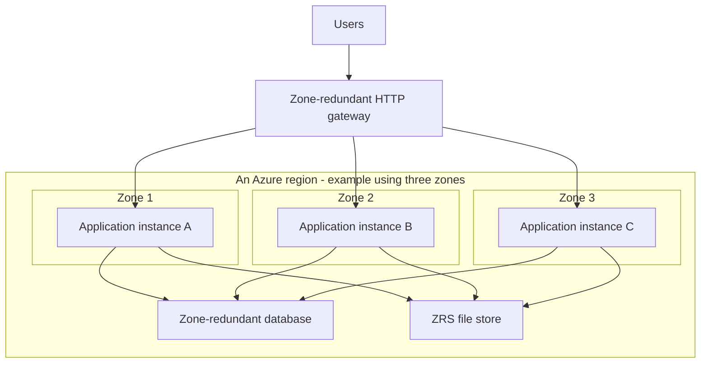

# Availability Zones and Resource Distribution Design

In the **Azure Fundamentals** chapter, Availability Zones help answer a key design question: if an infrastructure zone inside a region stops working, can the application's critical business flow keep running?

An application with multiple virtual machines can still go down completely if all of them sit in one zone, depend on a single standalone database, or pass through a single network appliance. Resource distribution design must examine request paths, where state is held, spare capacity, and how failover happens during an incident.

This lesson uses the context of an ordering application on Microsoft Azure. Zone decisions connect with subscriptions, resource groups, virtual networks, compute, storage, data, security, monitoring, and cost to form an operable architecture.

## Learning Objectives

After this lesson, you will be able to:

- Distinguish region, Availability Zone, availability set, and deployment types with zone support.
- Identify which resources require manual distribution and which have Azure-managed redundancy mechanisms.
- Design a request path to avoid single-zone dependencies.
- Calculate remaining capacity when losing one zone and explain the limits of autoscale.
- Build a testing, monitoring, and recovery plan aligned with business objectives.

## 1. What Is an Availability Zone?

An **Availability Zone**, or **zone** for short, is a logical group of one or more physically separated data centers within an Azure region. Zones have independent power, cooling, and networking infrastructure to limit a localized failure from affecting every copy of a service at once.

A **region** is a geographic area containing Azure data centers. Zones within the same region can be used to place copies of applications and data into distinct fault domains. The number of zones and how a service uses them depend on the region and the service; do not assume every region always has exactly three zones. See [Microsoft's Availability Zones overview](https://learn.microsoft.com/en-us/azure/reliability/availability-zones-overview).

In this lesson's example, assume the chosen region supports three zones that the application needs to use:

```text
Selected region
├── Zone 1: application instances and associated infrastructure
├── Zone 2: application instances and associated infrastructure
└── Zone 3: application instances and associated infrastructure
```

This diagram illustrates three resource placement scopes. It does not mean each zone contains only one data center or that every Azure resource type can be placed into all three zones.

### Zones Are Fault Domains

A **fault domain** is a set of components that can be affected simultaneously by a shared failure. If two virtual machines share the power infrastructure of one zone, they are not independent with respect to a failure of that zone.

For example, increasing from one to five instances in the same zone helps handle more load and can reduce the impact of a single instance failure. To tolerate the loss of a zone, you need resources and serving capability in another zone, along with a mechanism to route requests there.

### Zone Numbers Are Logical Identifiers Within a Subscription

When configuring resources, you often see values such as `1`, `2`, `3`. These are logical zone identifiers. The mapping between logical zones and physical zones can differ between subscriptions. Therefore, `zone 1` in subscription A does not automatically correspond to the same physical location as `zone 1` in subscription B. Designs that need to coordinate placement across multiple subscriptions must verify the mapping provided by Azure. See [physical and logical availability zones](https://learn.microsoft.com/en-us/azure/availability-zones/az-overview).

## 2. Distinguish Protection Scopes

| Concept | Primary role | Limitation to understand |
| --- | --- | --- |
| Region | Choose the geographic deployment scope | Choosing a region alone does not determine whether resources have zone redundancy |
| Availability Zone | Separate replicas across physical fault domains within a region | Can still be affected by region-wide incidents or shared application bugs |
| Availability set | Distribute VMs across fault domains and update domains in this model | Does not provide a guarantee of distributing VMs across multiple Availability Zones |
| Multi-region deployment | Add recovery scope outside the primary region | Requires handling routing, data, access permissions, and operations across regions |
| Backup | Retain data recovery points per policy | Requires restoration time; does not directly provide live serving capacity |

A **fault domain** groups components that may share underlying failure infrastructure, while an **update domain** relates to groups updated or maintained together within an availability set. These two concepts help explain VM-level protection but do not replace choosing zones.

Availability Zones primarily support intra-region availability. A disaster recovery plan must still account for full-region outages, administrative errors, data corruption, and loss of access. The guide on [using regions and Availability Zones](https://learn.microsoft.com/en-us/azure/well-architected/design-guides/regions-availability-zones) distinguishes deployment options across these failure scopes.

## 3. Three Resource Placement Models to Recognize

### 3.1. Zonal: Resource Pinned to One Zone

A **zonal** resource is placed in a specific zone. For example, a VM pinned to zone 1 runs in that zone. An individual VM does not run simultaneously across multiple zones.

You can create multiple zonal VMs in different zones to build a redundant application tier. In that case, design responsibilities still include traffic distribution, data synchronization if any, failure detection, and instance lifecycle management. See [Azure Virtual Machines reliability](https://learn.microsoft.com/en-us/azure/reliability/reliability-virtual-machines).

### 3.2. Zone-Redundant: Redundant Across Multiple Zones

With a **zone-redundant** resource, the Azure service provides a mechanism to spread components or replicas across multiple zones. The degree of automation, usage conditions, and failover behavior depend on each service.

For example, a storage account using ZRS represents choosing data redundancy across zones. With a database service, you may need to enable the zone redundancy option on a specific supported configuration. Calling something PaaS is not enough to conclude the resource already has this configuration.

### 3.3. Regional or Nonzonal: No Zone Distribution Guarantee

A resource whose location is at the region level without specifying zones may be called **regional** or **nonzonal** in service documentation. This terminology does not by itself prove the resource tolerates losing a zone.

You must read the behavior of the specific resource type. One service may provide built-in redundancy, whereas another requires explicit configuration.

| Deployment type | Deployer's decision | Question that must be answered |
| --- | --- | --- |
| Zonal | Choose a zone for each resource | Where is the serving copy located when this zone goes down? |
| Zone-redundant | Choose the appropriate configuration, tier, and instance count | What does Azure handle automatically and what must the application handle? |
| Regional/nonzonal | Choose a region, possibly without zone properties | What does service documentation guarantee when a zone has an outage? |

Two practical consequences:

- A resource group's `location` is used for the resource group's metadata; it does not automatically force all child resources into one zone.
- A tag like `zone=1` is for management and does not replace the service's resource placement property.

## 4. Start from Business Requirements and Critical Flows

Suppose the ordering application needs to continue accepting orders when a zone is lost. Before picking VMs or storage, define:

1. **Critical flows:** signing in, browsing items, creating orders, and recording payment results.
2. **SLO:** measurable target for the application, such as the success rate of order-creation requests over a time window.
3. **RTO:** target time to restore the required service level after an incident.
4. **RPO:** maximum age of recent data the business accepts losing upon recovery.
5. **Permitted degradation level:** can product recommendations or reporting be paused to prioritize order creation?

Objectives must state the failure scope. RPO for losing one zone can differ from RPO for losing an entire region. A database's RTO is also not yet the RTO of the order-creation flow, because the application still needs to reconnect, fetch configuration, and respond to users.

An **SLA** is a conditional service commitment from the provider. An **SLO** is a target you set and measure for your system. Do not directly equate a single resource's SLA with the availability of the entire application.

A useful design statement is:

> When any one of the three chosen zones is lost, the system sustains the order-creation flow at the defined peak load within the agreed latency and error-rate limits.

This statement leads to testable verification of distribution, data, routing, and capacity.

## 5. Illustrative Architecture for the Ordering Application

Assume the chosen region and service configurations support the deployment requirements. One option consists of:

- An HTTP gateway configured for zone redundancy with appropriate health probes.
- Three groups of application instances, one group per zone.
- A database with zone redundancy enabled on a supported configuration.
- A file store using ZRS where appropriate for the data type and service.
- Secret access, identity, and monitoring mechanisms evaluated within the same business flow.



The diagram focuses on failure scope and does not show the complete network and security design. The database and storage blocks represent logical service endpoints; they do not mean the user must create three separate endpoints.

When implementing, choose the right service for each function. For example, Azure Application Gateway fits the HTTP gateway need of this architecture when using a zone-supported configuration. Azure Load Balancer provides transport-layer load balancing and does not replace all HTTP routing features. Azure's [VM baseline architecture](https://learn.microsoft.com/en-us/azure/architecture/virtual-machines/baseline) illustrates how gateway, compute, and dependencies work together.

### Reading the Architecture Layer by Layer

| Layer | Planned placement | Risks to address |
| --- | --- | --- |
| Traffic ingress | Gateway, frontend, and IP resources capable of surviving zone loss per supported configuration | A single frontend or forwarding appliance becomes a bottleneck for the entire entry path |
| Application | Instances across multiple zones, all capable of serving | Session state stored only on the failed machine |
| Transactional data | Cross-zone HA configuration of the chosen service | Connections drop during failover; application retries cause duplicate orders |
| Files and objects | Appropriate redundancy, such as ZRS | Access permissions or DNS prevent the application from reading data even though data still exists |
| Outbound connectivity | Egress paths and network appliances evaluated by fault domain | Losing connectivity to a payment partner even while the web tier remains alive |
| Operations | Telemetry and required intervention permissions in place | Knowing VMs are running without knowing customers are failing to place orders |

You cannot conclude the entire architecture tolerates zone loss simply because the compute tier is spread out.

## 6. Network Design Does Not Mean Creating One Subnet per Zone

Azure Virtual Networks and subnets span the Availability Zones of a region. You can place VMs in different zones within the same subnet. Creating separate subnets per zone is not required to achieve physical distribution. See [Azure Virtual Network reliability](https://learn.microsoft.com/en-us/azure/reliability/reliability-virtual-network).

Divide subnets by function, security policy, and service requirements, for example:

```text
Application VNet
├── Subnet for gateway
├── Subnet for application tier
└── Subnet for private endpoints when required by design
```

A subnet containing three VMs does not tell you those three VMs are in three zones. Each resource's zone property is the fact that must be verified.

Components placed inside a VNet also have their own behavior. For example, traffic may pass through a network virtual appliance, firewall, gateway, or DNS server you manage. If that required component only operates in one zone, VNet resilience does not solve that single-zone dependency.

### Health Probes Must Reflect Ability to Serve

An open TCP port only proves a process is accepting connections. An application can still return errors for every order-creation request because it cannot reach data.

Design should distinguish:

- **Liveness:** whether the process is still alive so the platform can decide if a restart is needed.
- **Readiness:** whether the instance can accept the kind of requests the router is about to send it.
- **Business check:** whether a representative request completes end-to-end through the system.

Readiness checks must verify the right scope and use timeouts. If every non-essential dependency is included in the probe, an outage in a product recommendation service could knock every instance out of rotation. Conversely, a probe that always returns success will keep sending customers to an instance unable to serve.

Removing a backend from traffic distribution also does not guarantee all open connections are transferred intact. Clients and applications must handle dropped connections.

## 7. Design the Application Tier So Another Instance Can Take Over

### Avoid Keeping Critical State on a Single Instance

Instances should be interchangeable in the serving path. Data such as orders, payment progress, and business state must be stored in a data layer with appropriate protection mechanisms.

For example, if a shopping cart lives only in memory on a VM in zone 1, routing traffic to zone 2 can cause the user to lose their cart. Sticky sessions can keep a user on one instance under normal conditions, but they do not replicate state for when that instance is lost.

Caches also need classification. Losing a cache may be acceptable if source data remains intact and the system has enough capacity to rebuild it. If a cache holds unique data, it is effectively a critical storage component and needs matching protection design.

### Bounded Retries and Idempotent Operations

During failover, a request can time out after the operation has already been recorded. Blindly resending an order-creation request can create two orders.

One design-level approach:

```text
Client sends request with unique business key
→ Application checks or records the key within an appropriate transaction
→ If the key already has a result, return that result
→ If not yet present, process and store the result consistently
```

Ensure deduplication handles concurrent arriving requests rather than merely checking first and writing later without constraints.

Retries should:

- Only apply to appropriate transient errors.
- Have a maximum attempt count, overall timeout, and exponential backoff with jitter.
- Respect the limits of dependent services.
- Combine with idempotency or reconciliation mechanisms for operations with side effects.

Configuration errors, missing permissions, or invalid input usually require fixing the root cause. Retrying continuously in those cases only adds load.

### Choosing Active-Active or Active-Passive

**Active-active** allows multiple instance groups to serve concurrently. Losing one zone reduces capacity, and the system routes traffic to the remaining groups.

**Active-passive** keeps a standby group ready to take over. You must determine whether the standby group is already running or must be provisioned, whether data stays sufficiently up to date, who triggers takeover, and how long it takes.

In both models, an extra copy existing on a diagram is not enough: that copy must have the right software version, configuration, access permissions, and serving capacity.

## 8. Calculate Capacity When One Zone Is Lost

Even distribution of resources only matters if the remaining portion can handle the required load.

Let:

- `P` be the peak load that must be served.
- `C_i` be the verified capacity of the application group in zone `i`, within acceptable latency and error-rate limits.

To tolerate losing any single zone, the capacity condition to evaluate is:

```text
Total capacity across all zones - capacity of the largest zone >= P
```

This is a planning condition and does not yet prove the system meets its SLO. The database, gateway, connection pools, and external services must also withstand the new load distribution.

### Three-Zone Example

Suppose peak load is `900 requests/sec`. Each zone has an application group able to handle `600 requests/sec` under appropriate test conditions.

| Scenario | Remaining capacity | Load to serve | Modeled utilization |
| --- | --- | --- | --- |
| All three zones active | 1,800 requests/sec | 900 requests/sec | 50% |
| One zone lost | 1,200 requests/sec | 900 requests/sec | 75% |
| Two zones lost | 600 requests/sec | 900 requests/sec | Insufficient capacity |

These numbers are calculation examples, not specifications of an Azure SKU. Actual capacity must be measured with the application's request patterns, data sizes, and limits.

If each zone only had `450 requests/sec`, losing one zone leaves exactly `900 requests/sec`. The model has zero headroom for traffic spikes, uneven distribution, or connection warm-up time.

Skewed distribution also creates risk. Three groups with capacities of `900, 300, 300` total `1,500`; yet losing the largest group leaves only `600`, failing to meet the `900` load.

### Autoscale Is Not Instant Capacity

Adding instances can require detecting a threshold breach, provisioning, starting the application, and warming caches. During a broad incident, provisioning requests can also fail due to insufficient available capacity.

**Quota** is the permitted usage limit, whereas **capacity** is the platform resources actually available to allocate at that moment. Having quota does not guarantee allocation succeeds. For critical workloads, consider pre-provisioned capacity, alternative SKUs, or eligible Capacity Reservations prepared in advance. See the [capacity resilience guide](https://learn.microsoft.com/en-us/azure/well-architected/design-guides/capacity-resilience).

## 9. Distribute Data and Understand Failover Properly

### 9.1. Object Storage with ZRS

With current ZRS configuration on an eligible storage account type, Azure Storage synchronously replicates data across three or more Availability Zones in the primary region. LRS replicates data within a single data center location and does not provide the same cross-zone protection scope. GZRS combines ZRS in the primary region with asynchronous replication to the secondary region. See [Azure Storage redundancy options](https://learn.microsoft.com/en-us/azure/storage/common/storage-redundancy).

Three questions must be distinguished:

1. Where is data replicated to?
2. During an incident, which endpoint can still read or write, and under what conditions?
3. If data is deleted or modified incorrectly, can a previous version be restored?

Redundancy serves infrastructure fault tolerance. It does not automatically create recovery history for every kind of operator error. Backup, versioning, or soft delete mechanisms must be chosen based on the service and data needs.

### 9.2. Managed Databases

With Azure SQL Database, zone redundancy requires the right service tier, region, and supported configuration. The service manages failover at the database tier, though the application must still handle transient connection errors and interrupted in-flight requests. See [Azure SQL Database reliability](https://learn.microsoft.com/en-us/azure/reliability/reliability-sql-database).

Do not create three independent databases in three zones and assume they form a consistent data cluster. Replication models, write ownership, fault detection, and primary election must be handled by the product's HA mechanism or cluster design.

Even when the database mechanism protects committed transactions in a zone-loss scenario, the application may not receive the acknowledgment response. Therefore, deduplication and reconciliation logic remain necessary.

### 9.3. Managed Disks and VMs Are Two Different Scopes

Managed disks using ZRS protect data replicas across zones per service-supported capabilities. That does not cause a single VM to keep running simultaneously in another zone. Recovery design must also account for compute, disk attachment, networking, and application startup order. See [Azure Disk Storage reliability](https://learn.microsoft.com/en-us/azure/reliability/reliability-storage-disk).

If you operate a database yourself on VMs, you must design replication, failover, quorum, and fencing appropriate for the product. Fencing prevents a node that no longer holds leadership from continuing to write, avoiding two independent primaries writing at once.

Theoretical example: a majority-consensus cluster with three voters, one voter per zone, retains two votes when one zone is lost. This illustrates quorum, not a default configuration applicable to every database. Real clusters may include witnesses, non-voting replicas, and different rules.

## 10. Verify Support Before Deploying

Support must be checked across the combination:

```text
Subscription + Region + Service Type + SKU/Tier + Feature + Zone
```

A region supporting Availability Zones does not mean all SKUs are available in every zone. A service supporting zone redundancy may also require a specific configuration or resource tier.

Before finalizing a design, have answers for these points:

- Does the subscription have permission and quota to create enough resources?
- Do the service and SKU support the desired zone model in that region?
- Is there enough capacity for initial deployment, instance replacement, and scaling when needed?
- Can the existing configuration be changed in place, or does it require creating new resources and migrating?
- Are there constraints involving disks, IPs, private endpoints, or network appliances?
- Do backups and recovery align with where data is permitted to be stored?

Store these decisions in the deployment configuration and operational documentation of the application project so operators understand why each option was chosen.

### Verification Examples with the Azure CLI

The commands below are read-only examples for learners to apply in an environment signed into the right subscription. They do not deploy or modify resources.

```powershell
# Check the currently selected subscription.
az account show --query "{Subscription:name,Id:id,Tenant:tenantId}" --output json

# List declared locations and zones of VMs in the resource group.
az vm list --resource-group "<resource-group>" --query "[].{Name:name,Region:location,Zones:zones}" --output json

# Check the redundancy SKU of a storage account.
az storage account show --resource-group "<resource-group>" --name "<storage-account>" --query "{Name:name,Region:location,Redundancy:sku.name}" --output json
```

An empty `zones` result on a VM does not prove the VM spans all zones. For platform-managed resources, also check the properties and documentation of that exact service. Configuration verification results must also be cross-checked against measured serving capability.

## 11. Express Decisions in Infrastructure as Code

Infrastructure as Code makes resource placement reviewable and reproducible. Zone decisions should live in appropriate deployment parameters or properties rather than appearing only in resource names.

The Bicep example below declares a GPv2 storage account using ZRS:

```bicep
param location string
param storageAccountName string

resource orderFiles 'Microsoft.Storage/storageAccounts@2023-05-01' = {
  name: storageAccountName
  location: location
  kind: 'StorageV2'
  sku: {
    name: 'Standard_ZRS'
  }
  properties: {
    minimumTlsVersion: 'TLS1_2'
    supportsHttpsTrafficOnly: true
    allowBlobPublicAccess: false
    allowSharedKeyAccess: false
    publicNetworkAccess: 'Disabled'
  }
}
```

The storage account name must satisfy the service's naming and uniqueness rules. The region must support this configuration. This snippet only expresses the storage selection and some access policies; for the application to use it, private connectivity, DNS, and appropriate data permissions are also needed. Security toggles do not automatically grant permissions to the application.

The point to notice is that `Standard_ZRS` expresses the service's redundancy mechanism; the snippet does not manually create three independent storage accounts.

For the VM tier, the deployment plan can be represented as follows:

| Instance group | Declared zone | Role | Expected capacity |
| --- | --- | --- | --- |
| app-a | 1 | Serves normal traffic | Measured in load testing |
| app-b | 2 | Serves normal traffic | Measured in load testing |
| app-c | 3 | Serves normal traffic | Measured in load testing |

Virtual Machine Scale Sets can help manage groups of instances; zone configuration and distribution behavior must be chosen according to the usage model. Whether using individual VMs or a scale set, acceptance testing must verify actual instance placement and behavior when one group is missing.

## 12. What Happens When a Zone Has an Outage?

Consider zone 1 being lost in the illustrative architecture:

1. Some in-flight requests on instance A may fail or time out.
2. Health probes detect A is unavailable; the routing layer adjusts eligible backends receiving traffic.
3. Instances B and C absorb the remaining load. Dropped connections must be handled by the client or application.
4. The database and storage perform fault-tolerance mechanisms corresponding to the chosen configuration.
5. The application reconnects, handles bounded retries, and prevents duplicate order creation.
6. Operators monitor order-creation flows, remaining capacity, latency, and dependency errors.

This is a sequence for reasoning about responsibilities, not a guarantee that every service completes steps in the exact same order or within a fixed timeframe.

A system can experience three different types of degradation:

| Symptom | Hypothesis to check | Design mitigation |
| --- | --- | --- |
| Requests still go to failed instances | Probes or routing do not reflect serving health | Review probe thresholds, endpoints, and connection behavior |
| Remaining instances are overloaded | Insufficient capacity after zone loss or retry storm | Add headroom, cap retries, prioritize critical flows |
| Instances are healthy but cannot create orders | Data dependency, DNS, secrets, or external partner is failing | Verify the full flow and fault tolerance of dependencies |

After the zone recovers, do not immediately send full traffic back. Ensure instances are on the right version, have completed necessary synchronization, pass readiness checks, and have sufficient capacity. For self-managed data clusters, prevent a node holding stale data from rejoining as primary against cluster rules.

## 13. Monitor and Operate by Failure Scope

Monitoring should combine an infrastructure view with business outcomes:

- Order-creation success rate and p95/p99 latency of critical flows.
- Count of ready instances, backend health status, and distribution by zone when available.
- CPU, memory, queues, connection counts, and remaining capacity of surviving groups.
- Database connection errors, storage access latency, and retry counts.
- Signs of duplicate processing, unreconciled payment states, and backlog size.
- Relevant notifications from Azure Service Health and Resource Health when appropriate.

Include instance identifier, deployment group, and zone in application telemetry when a reliable way exists to collect them. Do not infer zone from machine names. Also do not assume every Azure service metric includes a zone dimension.

A concise runbook should specify:

1. How to identify the scope of impact using multiple signals.
2. Who is authorized to perform each recovery action.
3. Conditions for pausing deployments or disabling non-critical features.
4. How to verify business flows after switchover.
5. Conditions for returning recovered resources to service.

### Security Is a Dependency of Resilience

Instances in standby or surviving zones still need valid identities and permissions. Managed identity and Azure RBAC can be used to manage resource access, while also verifying the specific data permissions the application needs.

If a takeover procedure forces operators to retrieve a password stored only on the lost machine, the recovery design is incomplete. Likewise, secret retrieval, token refresh, DNS resolution, and identity service access must be examined against application behavior rather than assuming zones automatically solve every security dependency.

### Software Deployments Can Cause Simultaneous Failures Too

A faulty release rolled out to all zones at once can render the entire application unavailable. Deploy in waves, verify metrics before expanding, and maintain rollback compatibility with data schemas.

Physical distribution reduces shared infrastructure faults; deployment discipline reduces shared software and configuration faults.

## 14. Validate Design with Controlled Drills

The goal of a drill is to prove application behavior within a chosen scope. In an appropriate test environment, you can simulate all application instances in one zone becoming unavailable and observe the remaining system.

Stopping a process or removing a backend pool is not equivalent to a real zone outage. That test exercises part of routing and capacity mechanisms. Losing a zone can also affect data, networking, and multiple services simultaneously, so clearly record what was tested and what still lacks evidence.

### Illustrative Drill Plan

| Item | Content to define |
| --- | --- |
| Hypothesis | Losing the application group in any single zone maintains order creation within target limits |
| Load | Representative of peak load and realistic request mix |
| Scope | One test environment, one defined instance group |
| Observations | Error rate, latency, load distribution, retries, data state, and duplicate orders |
| Stop condition | Exceeding error threshold or impact outside permitted scope |
| Recovery | Restore instance group, verify readiness, then ramp load back up |
| Evidence | Timeline, charts, logs, and limitations of the test |

Do not test only the zone with the fewest instances. Test sequentially the cases that could remove the most capacity or dependencies.

For managed data services, use the failover and fault-tolerance tests supported by the service. Do not infer platform behavior from a test that did not affect that component.

Results should answer:

- How long did the system take to detect and stabilize?
- Did it meet the SLO under load after losing one zone?
- Were there requests that succeeded in data persistence while the client received an error?
- Were there duplicate orders, state discrepancies, or requests needing reconciliation?
- Did the recovery plan require unautomated manual steps or missing permissions?

## 15. Balance Reliability, Performance, and Cost

Cross-zone redundancy can require additional instances, eligible service tiers, storage capacity, and network capabilities. There is no universal cost increase percentage across all services.

When estimating, consider:

- Cost of running resources needed to maintain capacity after losing a zone.
- Cost of HA configurations, storage, and networking components.
- Applicable charges for data transfer based on the services and paths used.
- Latency impact, especially for synchronous writes or chatty multi-round-trip communication.
- Effort for monitoring, drills, and operating the recovery strategy.

Do not assume all cross-zone data transfers are billed the same way. Pricing and applicability terms must be checked at deployment time.

On performance, measure both normal state and zone-loss state. For example, losing a cache can sharply increase database load even while user requests/sec remain unchanged.

On cost optimization, you can prioritize redundancy for critical flows, shed secondary features during incidents, and pick appropriate managed services. Any cost-saving decision must clearly state its impact on RTO, RPO, and serving capacity.

## 16. Common Design Mistakes

| Statement or practice | Problem | How to correct the thinking |
| --- | --- | --- |
| Creating multiple VMs without choosing zones | Does not guarantee distribution across desired fault domains | Declare and verify placement by zone |
| Adding a zone tag to a resource | Tags do not control deployment placement | Use service-supported properties or options |
| Creating separate subnets and assuming zones are separated | Azure subnets span across zones | Check the resources inside the subnet |
| Distributing compute while leaving data as a single point of failure | Processing path still has a single dependency | Evaluate data and all mandatory dependencies |
| Using a ZRS disk and assuming the VM automatically has HA | Compute and data have different mechanisms | Design application takeover capability too |
| Relying solely on autoscale during an outage | Provisioning and startup take time, and capacity may be unavailable | Prepare pre-allocated capacity and fallback options |
| Replicating data and skipping backups | Erroneous operations can propagate to replicas | Add data recovery policies |
| Using the same zone number across two subscriptions without checking | Logical zones may map differently | Verify placement when architecture needs physical alignment |
| Measuring only CPU and VM count | Living infrastructure does not prove business success | Monitor and test end-to-end flows |
| Treating multi-zone as a plan for losing the entire region | Protection scope does not cover larger outages | Build a DR plan against separate targets |

## 17. Self-Check Your Understanding

Use the ordering application architecture to explain the following scenarios:

1. Do three VMs in the same zone behind a load balancer tolerate the loss of that zone? Which components need to change?
2. Three application groups across three zones share one database without zone protection. What happens when the zone containing the database goes down?
3. Total capacity is 1,500 requests/sec, split into 900, 300, and 300. Why does this fail to meet a requirement of serving 900 requests/sec when any single zone is lost?
4. A client times out after sending a payment request. Why does a successful failover still not eliminate the risk of duplicate payment?
5. What does a drill that only stops application instances prove, and what does it leave unproven?

A compelling resource distribution plan must connect **fault domains, request paths, data state, remaining capacity, and operational evidence**. When those pieces align, Availability Zones become a verifiable part of fault-tolerant design.
