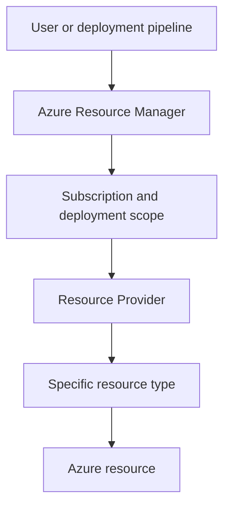

# Resource Provider, Resource Type, and Resource ID

When deploying an application on Microsoft Azure, we typically create multiple resources such as virtual machines, virtual networks, storage accounts, databases, and web services. Azure Resource Manager (ARM) needs to know which service each resource belongs to, what structure it has, and which management scope it resides in. Three concepts—**Resource Provider**, **resource type**, and **Resource ID**—answer those questions.

This lesson is part of the **Azure Fundamentals** chapter of the `CLOUD_PROVIDERS_AZURE` module. The module introduces the Azure ecosystem from subscriptions, resource groups, and Microsoft Entra ID to networking, compute, storage, and data; it also guides deployment, monitoring, security, and cost control for application architectures. Mastering how Azure identifies and manages resources will help you read configurations, assign permissions, automate deployments, and troubleshoot errors more accurately.

## Learning Objectives

After this lesson, you will be able to:

- Explain the role of Resource Providers and provider namespaces in Azure Resource Manager.
- Distinguish provider namespace, resource type, resource name, `kind`, `sku`, and API version.
- Describe how to register a Resource Provider at the subscription level and check registration status.
- Read the Resource ID structure of resource group-level resources, subscription-level resources, child resources, and extension resources.
- Look up Resource IDs using the Azure CLI and use IDs in Bicep or administrative operations.

## 1. Where Does a Resource Provider Sit in the Azure Model?

Azure Resource Manager is the unified management layer (control plane) that receives requests to create, read, update, or delete resources. When you deploy a virtual machine, ARM routes the request to the Resource Provider responsible for that resource type. The provider performs management operations, validates configuration, and coordinates with Azure infrastructure to provision the resource.

The management flow can be pictured as follows:



For example, when creating a virtual machine, ARM forwards the request to the `Microsoft.Compute` provider, and the provider handles the `virtualMachines` resource type. When creating a virtual network, the request goes to `Microsoft.Network` and the `virtualNetworks` resource type.

A Resource Provider supplies management operations for a group of services. Providers typically publish metadata about resource types, API versions, supported regions, and management operations. The identifying name of a provider is called the **provider namespace**.

| Provider namespace | Example resource type | Common resources |
|---|---|---|
| `Microsoft.Compute` | `virtualMachines` | Virtual machines, virtual machine scale sets |
| `Microsoft.Network` | `virtualNetworks` | Virtual networks, subnets, network interfaces, public IPs |
| `Microsoft.Storage` | `storageAccounts` | Storage accounts, blob services, containers |
| `Microsoft.Web` | `sites` | App Service and web apps |
| `Microsoft.KeyVault` | `vaults` | Key Vault |
| `Microsoft.Sql` | `servers`, `databases` | Logical SQL servers and Azure SQL databases |
| `Microsoft.Insights` | `components`, `diagnosticSettings` | Application Insights and monitoring configurations |

Namespace names typically follow the pattern `Microsoft.<ServiceName>`. This is the identifier within Azure Resource Manager and does not necessarily match the display name on the Azure Portal.

## 2. Registering a Resource Provider

A subscription must register a provider namespace before using the resource types managed by that provider. Registration informs Azure that the subscription intends to use the corresponding namespace and allows management operations belonging to that namespace to run within the subscription.

Key points to remember:

- Registration is performed at the **subscription level**, not per individual resource group.
- One provider namespace can supply multiple resource types. For example, `Microsoft.Network` manages many kinds of network resources.
- Azure may automatically register certain providers during some deployment workflows. However, when encountering registration errors, check the actual status instead of assuming the provider is ready.
- Registering a provider does not itself create resources, does not grant data access permissions, and does not replace RBAC configuration.
- The person performing registration needs permission to register providers (`Microsoft.Resources/subscriptions/providers/register/action`). Roles such as Owner and Contributor typically include this permission; in enterprise environments, actual permissions also depend on role assignments and organizational policies.

### Checking the Active Subscription

Before registering, confirm that the Azure CLI is pointing to the right subscription:

```bash
az account show --output table
```

If you need to switch subscriptions, use the assigned subscription ID or name:

```bash
az account set --subscription "<subscription-id-or-name>"
```

Check the status of a provider:

```bash
az provider show \
  --namespace Microsoft.Storage \
  --query registrationState \
  --output tsv
```

Common states include `NotRegistered`, `Registering`, `Registered`, and `Unregistering`. If the state is `NotRegistered`, you can request registration:

```bash
az provider register --namespace Microsoft.Storage
```

The registration command may return before the process finishes. Re-check the status until the provider reaches `Registered`:

```bash
az provider show \
  --namespace Microsoft.Storage \
  --query registrationState \
  --output tsv
```

To view unregistered namespaces in the subscription:

```bash
az provider list \
  --query "[?registrationState=='NotRegistered'].namespace" \
  --output table
```

There is no need to register every provider in bulk. Register only the namespaces required for your workload, following your organization's procedures and permissions.

### Viewing Resource Types Supported by a Provider

Provider metadata helps confirm which resource types a namespace contains and which API versions or locations each type supports. For example:

```bash
az provider show \
  --namespace Microsoft.Network \
  --query "resourceTypes[].{type:resourceType,locations:locations,apiVersions:apiVersions}" \
  --output table
```

This information is useful when picking an API version or investigating deployment errors. A registered provider does not mean every resource type, SKU, or feature is available in every region. Subscription quotas, Azure Policy rules, and service-specific limits can still affect deployments.

## 3. Distinguish Provider Namespace and Resource Type

A resource type is typically written in the form:

```text
<provider-namespace>/<resource-type>
```

Examples:

```text
Microsoft.Compute/virtualMachines
Microsoft.Network/virtualNetworks
Microsoft.Storage/storageAccounts
Microsoft.Web/sites
```

In `Microsoft.Storage/storageAccounts`, `Microsoft.Storage` is the provider namespace and `storageAccounts` is the resource type. A concrete **resource** is an instance of that type, such as the storage account `stappdata01` in the resource group `rg-app-prod`.

| Component | Meaning | Example |
|---|---|---|
| Provider namespace | Service group managing resources | `Microsoft.Storage` |
| Resource type | Resource type provided by the provider | `storageAccounts` |
| Resource name | Name of an instance within the applicable scope | `stappdata01` |
| `kind` | Classification or variant of certain resource types | `StorageV2` |
| `sku` | Service tier, performance level, or redundancy model | `Standard_GRS` |
| API version | Management contract version used for a request or template | `2023-05-01` |

These values are related to one another, but they are not interchangeable. For instance, `Microsoft.Storage/storageAccounts` identifies the resource type; `StorageV2` describes the storage account kind; `Standard_GRS` selects the SKU; and the API version determines the schema and behavior of the management API at call time.

The API version is **not** part of the Resource ID. When calling the ARM REST API, the Resource ID identifies the resource while `api-version` is passed separately in the query string:

```http
GET https://management.azure.com/subscriptions/<subscription-id>/resourceGroups/rg-app-prod/providers/Microsoft.Storage/storageAccounts/stappdata01?api-version=2023-05-01
```

The API version in this example only illustrates the parameter's placement. In real deployments, choose a version still supported by the provider that matches the properties you need to use.

### Nested Resource Types (Child Resources)

Some resources have child resources. In that case, the resource type contains multiple hierarchical segments separated by `/`.

For example, a subnet belonging to a virtual network:

```text
Resource type: Microsoft.Network/virtualNetworks/subnets
Resource name: vnet-prod/app
```

The corresponding Resource ID has the form:

```text
/subscriptions/<subscription-id>/resourceGroups/rg-network-prod/providers/Microsoft.Network/virtualNetworks/vnet-prod/subnets/app
```

After `providers/Microsoft.Network`, the type-and-name segment pairs are `virtualNetworks/vnet-prod` and `subnets/app`, respectively. For child resources, the name in templates or deployment commands usually contains both the parent name and the child name separated by `/`.

Another example is a container in the blob service of a storage account:

```text
Resource type: Microsoft.Storage/storageAccounts/blobServices/containers
Resource name: stappdata01/default/logs
```

Do not confuse a child resource with a separate resource group. A child resource has a hierarchical relationship with its parent resource, and the Resource ID reflects that relationship.

## 4. What Is a Resource ID?

A **Resource ID** is the full identifier that Azure Resource Manager uses to pinpoint a resource within a management scope. The ID tells you which subscription and resource group the resource belongs to, which provider namespace manages it, what resource type it has, and what its name is.

For a typical resource deployed inside a resource group, the general structure is:

```text
/subscriptions/{subscription-id}/resourceGroups/{resource-group-name}/providers/{provider-namespace}/{resource-type}/{resource-name}
```

Illustrative example:

```text
/subscriptions/00000000-0000-0000-0000-000000000000/resourceGroups/rg-app-prod/providers/Microsoft.Storage/storageAccounts/stappdata01
```

Reading from left to right:

1. `/subscriptions/...` identifies the subscription that owns the resource.
2. `/resourceGroups/rg-app-prod` identifies the resource group containing the resource.
3. `/providers/Microsoft.Storage` identifies the provider namespace.
4. `/storageAccounts/stappdata01` identifies the resource type and instance name.

A Resource ID is not a display name, a data access URL, or a service network address. For example, a storage account's Resource ID differs from a blob endpoint such as `https://<storage-account>.blob.core.windows.net/`. Resource IDs are used for the control plane; service endpoints and data-plane permissions are managed through the respective service's mechanisms.

### Resource IDs Depend on Scope

Not every resource resides inside a resource group. The ID structure changes depending on deployment scope:

| Scope | Example identifier or structure |
|---|---|
| Management group | `/providers/Microsoft.Management/managementGroups/{management-group-id}` |
| Subscription | `/subscriptions/{subscription-id}` |
| Resource group | `/subscriptions/{subscription-id}/resourceGroups/{resource-group-name}` |
| Resource | Full ID of the resource, usually containing `/providers/{namespace}/{type}/{name}` |
| Extension resource | ID of the target scope or resource, appended with `/providers/{extension-namespace}/{extension-type}/{extension-name}` |

For example, a policy assignment at the subscription level can have an ID like:

```text
/subscriptions/<subscription-id>/providers/Microsoft.Authorization/policyAssignments/require-tags
```

A role assignment attached directly to a storage account can have an ID like:

```text
/subscriptions/<subscription-id>/resourceGroups/rg-app-prod/providers/Microsoft.Storage/storageAccounts/stappdata01/providers/Microsoft.Authorization/roleAssignments/<assignment-guid>
```

In the second example, the role assignment is an **extension resource**: it extends the scope of the storage account by attaching authorization metadata to that resource. Other extension resource types can target a subscription, resource group, or specific resource scope.

### Key Characteristics of Resource IDs

- A Resource ID is an identifier path in Azure Resource Manager, typically starting with `/`.
- The ID contains the scope, provider namespace, resource type, and resource name matching the resource kind.
- Resource names follow provider-specific rules. Some names must be globally unique, while others only need to be unique within their scope.
- A Resource ID does not contain the API version, SKU, or credentials.
- Azure Resource Manager handles Resource IDs in a case-insensitive manner. When storing or displaying an ID, preserve the exact value returned by Azure for easier cross-referencing.
- For child resources and extension resources, an ID may contain multiple `/providers/` segments or multiple type/name pairs. Do not split strings manually under the assumption that all IDs have the same length.

## 5. Looking Up Resource IDs with the Azure CLI

The Azure CLI can list resources and return the `id` field. This is a reliable way to obtain the exact ID rather than concatenating strings by hand.

List resources in a resource group:

```bash
az resource list \
  --resource-group rg-app-prod \
  --query "[].{name:name,type:type,id:id}" \
  --output table
```

Filter by resource type:

```bash
az resource list \
  --resource-group rg-app-prod \
  --resource-type Microsoft.Storage/storageAccounts \
  --output table
```

Once you have the Resource ID, you can query the resource directly:

```bash
az resource show --ids \
  "/subscriptions/<subscription-id>/resourceGroups/rg-app-prod/providers/Microsoft.Storage/storageAccounts/stappdata01" \
  --output json
```

Output typically includes fields such as `id`, `name`, `type`, `location`, `sku`, or `properties`, depending on the resource type. The `id` field is the value you should reuse for operations that need to reference that exact resource.

## 6. Using Resource IDs in Bicep and Infrastructure Deployments

In Infrastructure as Code, referencing resources by ID links components together without manually building paths. Bicep provides the `.id` property on resource symbols as well as scope-specific ID construction functions.

Example declaring a storage account and outputting its Resource ID:

```bicep
targetScope = 'resourceGroup'

param storageName string
param location string = resourceGroup().location

resource storage 'Microsoft.Storage/storageAccounts@2023-05-01' = {
  name: storageName
  location: location
  sku: {
    name: 'Standard_LRS'
  }
  kind: 'StorageV2'
  properties: {
    minimumTlsVersion: 'TLS1_2'
  }
}

output storageResourceId string = storage.id
```

In this example:

- `Microsoft.Storage/storageAccounts` is the resource type.
- `storageName` is the instance name passed in at deployment time.
- `@2023-05-01` is the API version of the resource declaration.
- `storage.id` is the full Resource ID after Bicep resolves the scope, subscription, and resource group.

If you need to construct an ID to reference a resource not declared in the same file, you can use the functions matching each scope:

```bicep
// Resource in the current resource group
var storageId = resourceId('Microsoft.Storage/storageAccounts', 'stappdata01')

// Resource in another resource group within the current subscription
var networkId = resourceId('rg-network-prod', 'Microsoft.Network/virtualNetworks', 'vnet-prod')

// Resource at subscription scope
var roleDefinitionId = subscriptionResourceId('Microsoft.Authorization/roleDefinitions', '<role-definition-guid>')
```

Other commonly used functions include `managementGroupResourceId()` and `tenantResourceId()` for their respective scopes, as well as `extensionResourceId()` to build an ID for an extension resource attached to a target scope or resource. Choose the function matching the resource's exact scope. If a resource is already declared as a resource symbol, prefer using the `.id` property to reduce string-assembly mistakes.

## 7. Distinguish Provider Registration, Permission, and Support Errors

When a deployment fails, determine which layer the error belongs to before changing configuration.

| Error symptom | Possible cause | What to check |
|---|---|---|
| `MissingSubscriptionRegistration` | Provider namespace is not registered in the subscription | Check `az provider show`, then register the namespace if authorized |
| `NoRegisteredProviderFound` | Namespace is unregistered, or the requested type/API version/region is unsupported | Check provider state, resource type, API version, and location in metadata |
| `AuthorizationFailed` | Account lacks permission to perform the operation at the target scope | Check role assignments, scope, and required control-plane permissions |
| `InvalidResourceType` | Resource type is misspelled, nonexistent, or unavailable in the deployment context | Verify exact provider namespace and resource type |
| Quota or SKU error | Subscription, region, or service does not meet the required limit or SKU | Check quotas, SKUs, and supported regions |

For example, if you encounter `MissingSubscriptionRegistration` when deploying a storage account, first verify the active subscription using `az account show`, then check `Microsoft.Storage`. If the provider is `NotRegistered`, register the provider, wait for its state to become `Registered`, and retry. If the provider is already registered and the error persists, inspect the API version, resource type, and location; registering a provider does not resolve those constraints.

Similarly, `AuthorizationFailed` does not mean the provider is unregistered. A subscription may already have `Microsoft.Network` registered while the deployer still lacks permission to create a virtual network in the target resource group. In that case, check Azure RBAC and the granted scope.

## 8. End-to-End Practice Workflow

Suppose a development team is preparing to deploy an application with a storage account in resource group `rg-app-prod` under subscription `sub-prod`.

1. Select the right subscription in the Azure CLI and confirm with `az account show`.
2. Check the status of `Microsoft.Storage`; register it if unregistered and the account holds appropriate permissions.
3. Look up the `storageAccounts` resource type, supported API versions, and supported regions.
4. Deploy the storage account using Bicep or an ARM template, declaring the right resource type, API version, `kind`, and `sku`.
5. Retrieve the Resource ID from the `storage.id` output or the `id` field in Azure CLI output.
6. Use that Resource ID when configuring role assignments, diagnostic settings, or references from other deployment components.
7. If an error occurs, distinguish provider registration issues from RBAC, API version, region, SKU, or quota issues.

This workflow applies similarly to `Microsoft.Compute`, `Microsoft.Network`, `Microsoft.KeyVault`, `Microsoft.Web`, and other providers. Substitute the namespace, resource type, and properties according to the service being deployed.

## 9. Self-Check

**Question 1.** In the string `Microsoft.Network/virtualNetworks`, which part is the provider namespace?

**Answer:** `Microsoft.Network` is the provider namespace; `virtualNetworks` is the resource type.

**Question 2.** Does registering `Microsoft.Storage` automatically create a storage account in a resource group?

**Answer:** No. Registration only enables the subscription to use resource types belonging to that provider under Azure's model. To get a storage account, you still have to deploy a resource instance.

**Question 3.** Is `api-version` part of the Resource ID?

**Answer:** No. The Resource ID identifies the resource; the API version is passed separately in the request or declared separately in the template.

**Question 4.** How does a subnet's Resource ID express its relationship with a virtual network?

**Answer:** The ID contains both the type/name segment of the virtual network and that of the subnet, for example `.../virtualNetworks/vnet-prod/subnets/app`.

**Question 5.** The provider is already in the `Registered` state, yet `AuthorizationFailed` still occurs. What should be checked?

**Answer:** Check Azure RBAC, role assignments, scope, and permissions to perform the operation. A provider's registration status does not grant resource management permissions to a user.

## Conclusion

The Resource Provider identifies the service group handling management operations; the resource type defines the structure of a kind of resource; and the Resource ID pinpoints the exact instance and scope of a resource in Azure. Understanding these three concepts clearly lets you check provider registration, read metadata, analyze deployment errors, and link resources consistently in the Azure CLI, ARM templates, or Bicep. This is essential groundwork before diving into networking, compute, storage, data, security, and operations on Microsoft Azure.
