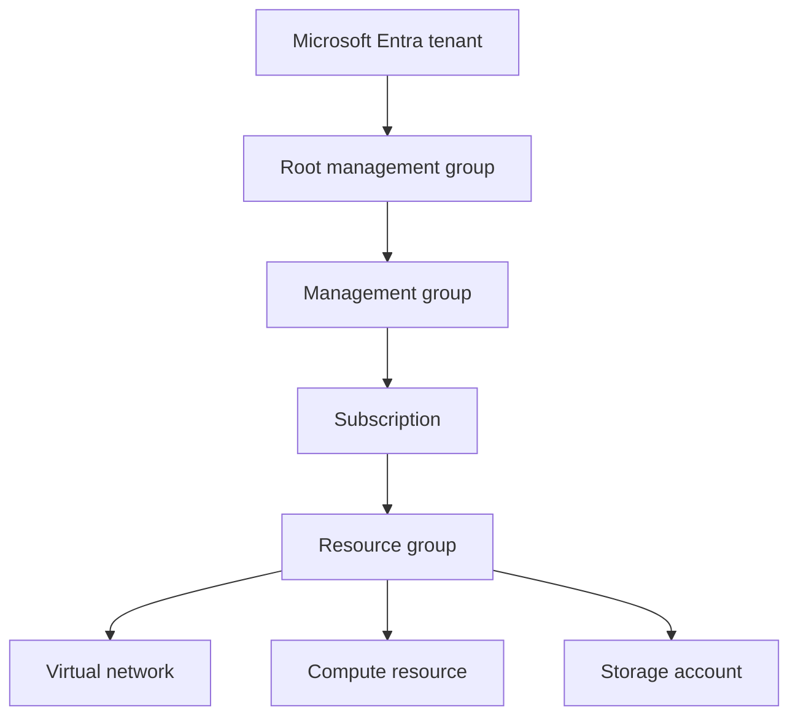
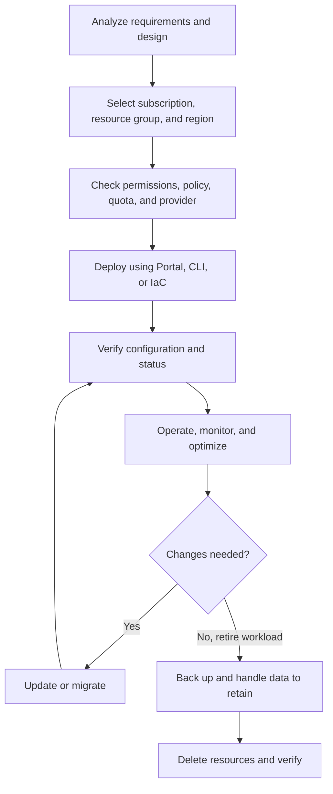

# Azure Resource Manager and Resource Lifecycle

Azure Resource Manager (ARM) is the unified management layer of Microsoft Azure. When creating virtual machines, virtual networks, storage accounts, or databases, all management operations pass through ARM. Understanding ARM helps you know where resources are organized, how permissions are applied, what a deployment changes, and what is required to operate or remove resources safely.

In this lesson, we use an ordering application as an example. The application includes a virtual network, compute service, storage account, and database. The goal is to manage these components per environment, deploy reproducibly, and control permissions, changes, and costs.

After this lesson, you will be able to:

- Explain the role of ARM and distinguish the management plane from the data plane.
- Read the hierarchy of tenant, management group, subscription, resource group, and resource.
- Understand resource IDs, resource providers, and the scope of RBAC, Azure Policy, and resource locks.
- Deploy resources using the Azure CLI and Bicep, preview changes, and verify outcomes.
- Plan operations for creating, updating, moving, protecting, monitoring, and deleting resources.

## 1. What Is Azure Resource Manager?

ARM is Azure's resource management and deployment service. You can view ARM as the orchestration gateway for administrative operations. The Azure Portal, Azure CLI, Azure PowerShell, SDKs, and Infrastructure as Code (IaC) tools all send management requests to ARM. As a result, different tools share the same resource model, access control, and deployment engine.

A management request typically flows through these steps:

1. A user or workload signs in and obtains a token from Microsoft Entra ID.
2. ARM authenticates the identity, checks Azure RBAC permissions and applicable policies for the request scope.
3. ARM forwards the request to the corresponding resource provider.
4. The resource provider performs the operation on that resource type and returns the result to ARM.
5. Management activity is recorded so it can be audited in the Azure Activity Log.

A resource provider is the component that exposes operations for a family of resources. For example:

| Resource provider | Example resource types |
|---|---|
| `Microsoft.Compute` | Virtual machine, disk, virtual machine scale set |
| `Microsoft.Network` | Virtual network, subnet, network interface, load balancer |
| `Microsoft.Storage` | Storage account |
| `Microsoft.Sql` | Azure SQL server and database |
| `Microsoft.KeyVault` | Key vault |

Resource type names generally take the form `namespace/resourceType`, such as `Microsoft.Compute/virtualMachines`. Some types have child resources, such as a subnet inside a virtual network.

### Management Plane and Data Plane

These two concepts are easily confused:

| Plane | What does it manage? | Examples |
|---|---|---|
| Management plane | Lifecycle and configuration of Azure resources | Create a storage account, change SKU, configure networking, delete a database |
| Data plane | Data or operations inside a service | Read/write blobs, query SQL records, retrieve secrets from Key Vault |

For example, permission to create or configure a storage account does not automatically mean permission to read every blob inside that account. Management-plane and data-plane permissions can be granted through separate roles. When designing security, determine whether a user needs to administer the resource or access the service's data.

## 2. Hierarchy Structure and Management Scopes

Azure organizes resources across multiple levels. Each level creates a scope for grouping, assigning permissions, and applying policies.



A tenant has a root management group. Below the root there can be multiple management groups; each management group contains child management groups or subscriptions. A subscription contains resource groups, and a resource group contains resources.

### Role of Each Level

- **Microsoft Entra tenant:** the organization's identity boundary, containing users, groups, applications, and workload identities. The management group hierarchy is anchored to one tenant.
- **Management group:** groups multiple subscriptions for governance by organizational unit, environment, or compliance requirement. For instance, you might have `Production` and `NonProduction` groups.
- **Subscription:** a critical management and billing boundary. A subscription contains resource groups, has its own limits/quotas, and is commonly used to separate workloads or environments.
- **Resource group:** groups resources that share a related lifecycle or operational purpose. When deleting a resource group, Azure prompts to delete the resources inside that group.
- **Resource:** a specific service or component, such as a virtual network, virtual machine, storage account, or database.

It is unnecessary to create one resource group per resource. Group components that share a lifecycle, management permissions, and operational practices. For example, components of the ordering app in a test environment can live in `rg-orders-dev`; the production environment should have its own group and administrative permissions.

### Is a Resource Group Tied to One Azure Region?

A resource group has a location property to store metadata about the resource group itself. However, resources inside a resource group can reside in different regions, provided the service and configuration support it. A resource group's location does not automatically dictate the location of every resource inside it.

For example, a resource group whose metadata sits in `Southeast Asia` can still hold a resource deployed in another region. When creating each resource, specify the region that matches latency, availability, data compliance, and SKU availability requirements.

### How Does Scope Affect Permissions and Policies?

Azure RBAC allows assigning roles at scopes such as management group, subscription, resource group, or resource. A role assignment at a parent level is generally inherited down to child levels. Therefore, granting broad permissions at the management group or subscription level can grant permissions across a vast number of resources.

Azure Policy can also be assigned at these scopes to govern configuration, for instance allowing deployments only in certain regions or requiring resources to carry an `environment` tag. Resource locks can be placed at the subscription, resource group, or resource level to restrict deletion or modification.

Tags are key-value metadata pairs commonly used to record owner, application, environment, or cost center. Tags on a resource group do not automatically appear on child resources. If you need tag inheritance or enforcement, use appropriate Azure Policy definitions and verify whether the resource type supports tags.

## 3. Resource IDs and Resource Providers

Every resource in Azure has a resource ID identifying its position in the management system. A typical resource ID looks like:

```text
/subscriptions/{subscriptionId}/resourceGroups/{resourceGroupName}/providers/{providerNamespace}/{resourceType}/{resourceName}
```

Example:

```text
/subscriptions/00000000-0000-0000-0000-000000000000/resourceGroups/rg-orders-dev/providers/Microsoft.Storage/storageAccounts/stordersdev001
```

Resource IDs frequently appear in CLI outputs, role assignment configurations, templates, logs, and cross-resource references. For child resources, the ID includes additional segments showing the path from the parent resource, for example:

```text
/subscriptions/{subscriptionId}/resourceGroups/{resourceGroupName}/providers/Microsoft.Network/virtualNetworks/{vnetName}/subnets/{subnetName}
```

A resource provider needs to be registered on a subscription before the subscription can perform certain operations under that namespace. Many providers register automatically when needed, though in some cases you must register them manually. You can check and register with the Azure CLI:

```bash
# Check provider registration state
az provider show \
  --namespace Microsoft.Compute \
  --query registrationState \
  --output tsv

# Register provider if subscription is not yet registered
az provider register --namespace Microsoft.Compute
```

Replace `Microsoft.Compute` with the namespace your workload requires, such as `Microsoft.Network` or `Microsoft.Storage`. After submitting a registration request, re-check the status before deploying if resource creation still reports the provider is not ready.

## 4. Lifecycle of an Azure Resource

The resource lifecycle is not just creating and deleting. A sound operational process includes design, deployment, updates, protection, monitoring, and retirement.



### 4.1. Plan Before Creating

Before deploying, answer the following questions:

- Which subscription does the resource belong to? Who is responsible and who pays?
- Which application, environment, and lifecycle does the resource belong to? Should it share a resource group?
- Which region meets latency, data residency, recovery, and SKU requirements?
- Which roles are needed at each scope? Should the workload use a managed identity instead of static secrets?
- Does Azure Policy restrict regions, SKU types, public access, or mandatory tags?
- Are quotas sufficient and is the resource provider registered?
- Does the resource name follow organizational conventions and the service's naming constraints?

For example, a naming convention might use `rg-orders-dev-sea` for the orders application's resource group in dev. Actual names must follow each service's limits; a storage account, for instance, requires a service-wide unique name using only lowercase letters and digits, 3 to 24 characters long.

### 4.2. Create a Resource Group

Sign in to the Azure CLI, select the right subscription, and create a resource group:

```bash
az login

# View currently selected subscription
az account show --output table

# Select target subscription by ID or name
az account set --subscription "<subscription-id>"

# Create resource group
az group create \
  --name rg-orders-dev \
  --location southeastasia \
  --tags environment=dev application=orders owner=team-orders
```

Verify the active subscription before running create or delete commands. In environments with multiple subscriptions, picking the wrong subscription can put resources in the wrong place or cause cleanup actions to affect the wrong workload.

### 4.3. Deploy with Bicep

Bicep is Azure's declarative infrastructure language. You describe the desired state of resources; Azure deploys that description through ARM. Bicep compiles down to ARM JSON templates, though its syntax is usually more concise and easier to structure than raw JSON.

Create a `main.bicep` file:

```bicep
@description('Storage account name: 3-24 characters, lowercase letters and numbers')
@minLength(3)
@maxLength(24)
param storageAccountName string

@description('Deployment environment code')
param environment string = 'dev'

param location string = resourceGroup().location

resource storageAccount 'Microsoft.Storage/storageAccounts@2023-05-01' = {
  name: storageAccountName
  location: location
  kind: 'StorageV2'
  sku: {
    name: 'Standard_LRS'
  }
  tags: {
    application: 'orders'
    environment: environment
    managedBy: 'bicep'
  }
  properties: {
    supportsHttpsTrafficOnly: true
    minimumTlsVersion: 'TLS1_2'
    allowBlobPublicAccess: false
  }
}

output storageAccountId string = storageAccount.id
```

In this example, `resourceGroup().location` uses the resource group's location as the default for the storage account. Security properties are declared directly in code so the desired configuration can be reviewed and deployed reproducibly. The storage account name must be unused across Azure Storage.

Preview changes, then deploy:

```bash
# Preview planned changes before applying
az deployment group what-if \
  --resource-group rg-orders-dev \
  --template-file main.bicep \
  --parameters storageAccountName=stordersdev001 environment=dev

# Deploy at resource group scope
az deployment group create \
  --name deploy-orders-dev \
  --resource-group rg-orders-dev \
  --template-file main.bicep \
  --parameters storageAccountName=stordersdev001 environment=dev
```

`what-if` lets you inspect which resources will be created, modified, or deleted according to the deployment plan before applying it. Read the output, verify names, scopes, and sensitive configurations, and only then run the deployment command.

### 4.4. Understand Updates and Declarative Behavior

With ARM deployments in incremental mode (the default mode of many deployment commands), resources declared in the template are created or updated; other resources in the resource group not mentioned in the template remain untouched.

This does not mean a template sends only a few changed properties. When a resource is redeclared, its configuration is applied according to the template description. If a property is omitted, the resource provider may revert that property to its default value. Therefore, maintain a complete description of the desired resource state and preview changes before deploying.

Declarative definitions allow the same configuration to be deployed across multiple environments using different parameters. For example, the same `main.bicep` can deploy to dev and staging while names, SKUs, regions, or environment-specific settings are passed via parameters. Keep Bicep and parameter files free of secrets in version control; retrieve secrets from Key Vault or an appropriate secret-management mechanism.

When you need to remove a resource, clarify whether that resource is managed by a template or deployment stack and choose a controlled deletion procedure. Do not assume simply deleting a line from a template automatically deletes every corresponding resource across all deployment modes.

### 4.5. Post-Deployment Verification

After deploying, verify the resource group and resource ID:

```bash
az group show --name rg-orders-dev --output table

az resource list \
  --resource-group rg-orders-dev \
  --output table

az storage account show \
  --name stordersdev001 \
  --resource-group rg-orders-dev \
  --query "{id:id,location:location,sku:sku.name,httpsOnly:enableHttpsTrafficOnly}" \
  --output json
```

The `provisioningState` status is commonly provided by resource providers to describe creation or update progress, though exact fields and values depend on the resource type. A successful deployment also does not prove the application works correctly: verify connectivity, data-plane permissions, health checks, and service logs.

### 4.6. Moving Resources

Azure supports moving certain resource types between resource groups or subscriptions. Moving can be useful when reorganizing environments or administrative boundaries, though not every resource type supports it.

Before moving, you need to:

1. Check whether the resource type and source/destination scope pair support moving.
2. Check dependent resources, such as a NIC referencing a subnet or services referencing other resources.
3. Check requirements around tenant, subscription, region, and resource state per service rules.
4. Prepare to update configurations referencing the old resource ID, role assignments, policies, and monitoring tools if needed.
5. Schedule a maintenance window and test the application after the move.

When a resource moves to another resource group, its resource ID changes because the path contains the resource group name. Some services impose extra conditions or do not support moving. If moving is unsupported, the right approach may be creating a new resource and migrating data/configuration according to service guidance.

### 4.7. Protecting Resources with Locks

Resource locks help reduce the risk of accidental operations on critical resources. Two common lock types are:

| Lock type | Effect |
|---|---|
| `CanNotDelete` | Allows reading and updating, but blocks deleting resources within the lock scope |
| `ReadOnly` | Blocks management operations that can modify the resource; some read operations remain allowed |

Example placing a delete-protection lock on a production resource group:

```bash
az lock create \
  --name protect-orders-prod \
  --lock-type CanNotDelete \
  --resource-group rg-orders-prod

az lock list --resource-group rg-orders-prod --output table
```

A lock at a parent scope is inherited down to child resources. A lock is a safeguard for management-plane operations; it does not replace RBAC, Azure Policy, backups, or data-plane access control. Anyone with sufficient permissions to manage locks can still remove a lock before executing a blocked action, so restrict lock-management permissions and monitor lock changes.

When you genuinely need to delete a locked resource group, verify the change request, remove the specific lock at the relevant scope, carry out the approved action, and restore the lock if resources still require protection.

### 4.8. Monitoring and Cost Control

ARM manages operations on resources; Azure provides additional services for operational tracking:

- **Azure Activity Log:** records management-plane events such as creating, updating, and deleting resources as well as administrative configuration changes. Use this log to investigate who performed an action, when, and with what outcome.
- **Azure Monitor:** collects metrics and logs to track workload health, performance, and activity. Resources need appropriate diagnostic settings configured to send logs to storage or analysis destinations.
- **Azure Resource Graph:** queries inventory across multiple subscriptions to find resources by type, location, tag, or properties.
- **Azure Cost Management:** analyzes costs by subscription, resource group, resource, and tags when tag data is supported.

Tags such as `application`, `environment`, `owner`, and `costCenter` help allocate costs and identify responsible owners. However, tags are not automatically inherited and are not a spending-blocking mechanism. Azure Budgets can send alerts when thresholds are reached; a budget by itself does not automatically stop all resources or guarantee costs cannot exceed the threshold.

## 5. Deleting Resources and End of Lifecycle

Deleting a resource group is an operation with wide impact: Azure will trigger deletion of the resources inside that resource group. Before deleting, verify:

- Is the resource group truly the environment or workload to retire?
- Are there data, snapshots, backups, logs, or secrets that must be retained?
- Which resources are currently referenced by other workloads?
- Does the service have soft delete, retention, or separate purge mechanisms?
- Are any resource locks protecting the resource group or child resources?
- Is there a requirement to preserve evidence, logs, or configurations for auditing?

List resources before deleting:

```bash
az resource list \
  --resource-group rg-orders-dev \
  --query "[].{name:name,type:type,location:location,id:id}" \
  --output table
```

Run the delete command only after confirming the right subscription and resource group, backing up data that must be kept, and obtaining approval per organizational process:

```bash
az group delete --name rg-orders-dev --yes --no-wait
```

`--no-wait` causes the CLI to return without waiting for the entire deletion process to finish. Check status afterward; deletion can take time or be blocked by dependencies, locks, or resource-provider-specific rules. Some data may remain in a retention period or require a separate purge operation per service policy.

## 6. Tracking Deployments and Troubleshooting Errors

When a deployment fails, the CLI error message sometimes states only a high-level summary. Inspect the deployment and detailed operations to learn which resource failed, what error the provider returned, and whether the cause lies in permissions, policy, quota, or the template.

```bash
# List recent deployments in the resource group
az deployment group list \
  --resource-group rg-orders-dev \
  --output table

# View details of deployment operations
az deployment operation group list \
  --name deploy-orders-dev \
  --resource-group rg-orders-dev \
  --output jsonc

# View recent management activities in the resource group
az monitor activity-log list \
  --resource-group rg-orders-dev \
  --max-events 10 \
  --output table
```

Some common errors:

| Symptom | Possible cause | What to check |
|---|---|---|
| `AuthorizationFailed` | Identity lacks role or role is assigned at wrong scope | Check the active account, role assignments, and scope; check both management and data-plane permissions |
| Unregistered provider | Resource provider namespace is not in Registered state | Use `az provider show`, then register provider if needed |
| `RequestDisallowedByPolicy` | Configuration violates Azure Policy | View policy assignments and policy details at applicable scope; fix rejected region, SKU, tag, or setting |
| `InvalidTemplate` or `DeploymentFailed` | Syntax error in template, unsuitable API version, invalid parameter, or provider error | View detailed deployment operations and inspect template/parameters |
| Location or SKU unavailable | Service/SKU is not offered in current region or subscription | Check region, SKU, quotas, and subscription restrictions |
| Cannot delete resource | Lock, dependency, or service-specific condition exists | Check locks, referencing resources, and provider messages |
| Cannot move resource | Resource type or current configuration does not support moving | Check move guidance for the exact resource provider; consider recreating and migrating data |

When investigating, retain the deployment name, resource ID, timestamp, and correlation ID if provided in the error message. This information helps correlate logs across ARM, resource providers, and support systems.

## 7. Design Example for the Ordering Application

Suppose an organization has two environments, dev and production. An initial design could look like this:

| Component | Dev | Production | Organizational rationale |
|---|---|---|---|
| Subscription | `sub-apps-dev` | `sub-apps-prod` | Separate permissions, quotas, costs, and environmental policies |
| Resource group | `rg-orders-dev` | `rg-orders-prod` | Group resources by application lifecycle and environment |
| Resources | VNet, compute, storage, database | VNet, compute, storage, database | Each resource has its own region, SKU, and configuration |
| Permissions | Development team has appropriate access in dev | Operations team has restricted access in production | Reduce blast radius from accidental operations |
| Protection | Locks as needed | `CanNotDelete` on critical resources | Reduce risk of unintended deletion |
| Tracking | Tags, Activity Log, Monitor, budget | Tags, Activity Log, Monitor, budget, and operational alerts | Track changes, reliability, and cost |

Production deployment workflows should use the same Bicep code tested in dev, passing reviewed production parameters. Before deploying, review `what-if`, confirm subscription and scope, check policy/quotas, then monitor deployment and post-deployment health checks.

## 8. Mistakes to Avoid

1. **Assuming a resource group is a region containing resources only in that region.** A resource group's location stores metadata; resources inside can reside in other regions.
2. **Assuming permission to create a resource grants permission to read data inside it.** Management plane and data plane have separate permission systems.
3. **Assuming tags are automatically inherited.** Tags do not automatically cascade from resource group to resources; policy is required if you want to enforce that rule.
4. **Assuming an incremental template deletes resources removed from the file.** Resources no longer mentioned typically remain in the resource group; an explicit deletion procedure is required.
5. **Assuming every resource can be moved.** Movability depends on the resource provider, resource type, dependencies, and source/destination scopes.
6. **Assuming locks replace RBAC or backups.** Locks only add a safeguard for management operations; combine with least privilege, backups, and monitoring.
7. **Assuming a successful deployment means the application is ready.** Also verify connectivity, data access permissions, health checks, and application logs.

## 9. Practice Exercises

1. Draw a scope diagram for an organization with dev and production subscriptions. Organize resource groups by application and explain why resources in the same group share a lifecycle.
2. Create a test resource group using the Azure CLI. Attach `application`, `environment`, and `owner` tags; then use `az group show` to verify.
3. Use Bicep to deploy a storage account requiring HTTPS and disabling blob public access. Run `what-if` first, deploy afterward, then verify configuration with the CLI.
4. Create a `CanNotDelete` lock on the test resource group. Observe how deletion is blocked, then remove the lock and delete the resource group only after verifying no data needs to be kept.
5. Inspect a recent deployment, read its detailed operations, and describe how to distinguish permission, policy, quota, and template errors.

## 10. References

- [Azure Resource Manager overview](https://learn.microsoft.com/azure/azure-resource-manager/management/overview)
- [Azure resource groups](https://learn.microsoft.com/azure/azure-resource-manager/management/manage-resource-groups-portal)
- [Bicep overview](https://learn.microsoft.com/azure/azure-resource-manager/bicep/overview)
- [Move Azure resources to a new resource group or subscription](https://learn.microsoft.com/azure/azure-resource-manager/management/move-resource-group-and-subscription)
- [Lock resources to prevent unexpected changes](https://learn.microsoft.com/azure/azure-resource-manager/management/lock-resources)
- [Apply tags to your Azure resources](https://learn.microsoft.com/azure/azure-resource-manager/management/tag-resources)
