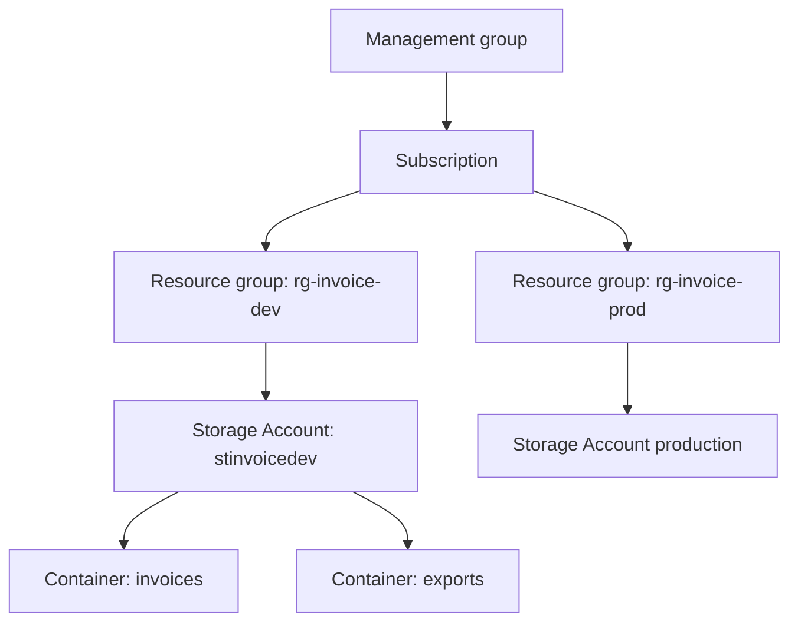

# Control Plane, Data Plane, and Authorization Scope

In the **Azure Fundamentals** chapter of the **CLOUD_PROVIDERS_AZURE** module, this lesson explains how to separate infrastructure management permissions from data usage permissions. This is the foundation for assigning permissions to operators, deployment pipelines, and applications working with subscriptions, resource groups, Microsoft Entra ID, networking, compute services, and storage.

Consider an application that receives invoices: the pipeline needs to deploy a Storage Account, the application needs to write files into a container, and reconciliation staff only need to read the invoices. These three needs involve the same resource yet require different permissions. Granting administrative permissions over the entire subscription to all three principals would create a blast radius larger than needed.

After this lesson, you will be able to:

- Classify a request into the control plane or data plane.
- Describe permissions using three components: principal, role, and scope.
- Select an appropriate permission scope, accounting for inherited permissions.
- Recognize indirect access paths via keys and configuration.
- Verify management permissions, data permissions, and network paths as separate layers.

## 1. Two Planes of an Azure Resource

**Control plane**, also called management plane, handles resource management. **Data plane** handles consuming the functionality the resource provides.

In the Azure public cloud, management requests go through Azure Resource Manager, commonly abbreviated as ARM, at `https://management.azure.com`. Data requests go to the service's endpoint, such as `https://<account>.blob.core.windows.net`. Because they have separate serving paths, the data plane can continue operating when the control plane has an outage; this does not guarantee every outage is isolated. [Source: Control plane and data plane](https://learn.microsoft.com/en-us/azure/azure-resource-manager/management/control-plane-and-data-plane).

| Operation | Plane | Distinction to note |
| --- | --- | --- |
| Create a Storage Account or change account configuration | Control plane | Manages the Azure resource |
| Download a blob's contents | Data plane | Consumes data inside the account |
| Create a Key Vault or edit vault tags | Control plane | Manages the vault |
| Read a secret's value | Data plane | Consumes data inside the vault |

The tool name does not determine the plane. The Azure Portal, CLI, and SDKs can all issue both types of requests. When analyzing an operation, identify the API being called, the endpoint, and the action that must be permitted.

A write operation can still belong to the control plane: updating tags writes resource configuration. A read operation can belong to the data plane: downloading an invoice reads business data. Classifying by the semantics of the resource and API avoids inferring from verbs like "read", "write", or "delete" alone.

## 2. Authentication, Authorization, and the Actual Caller

**Authentication** answers "who is calling?". **Authorization** answers "what is that principal allowed to do?". With Key Vault, both planes use Microsoft Entra ID for authentication yet check access permissions per plane. A valid token can still lack sufficient permissions to carry out a request. [Source: Key Vault access model](https://learn.microsoft.com/en-us/azure/key-vault/general/rbac-guide#key-vault-access-model-overview).

Azure RBAC can assign roles to a user, group, service principal, or managed identity. A role assignment combines **principal + role definition + scope**. [Source: Azure RBAC](https://learn.microsoft.com/en-us/azure/role-based-access-control/overview).

Design example for the invoice application:

| Principal | Need | Expected permission |
| --- | --- | --- |
| Operations team | View configuration to support the application | Management read permissions in the responsible environment |
| Pipeline identity | Deploy infrastructure | Required management permissions in the application resource group |
| Application's managed identity | Read and write invoices | Data permissions on the invoices container |
| Reconciliation team | Read invoices | Data read permissions on the invoices container |
| Access governance team | Grant and revoke roles | Permission to manage role assignments at the assigned scope |

When a developer signs in on a personal workstation, the principal is that person's account. When the application runs on Azure using a managed identity, the principal is the application's identity. A successful test under a developer account does not prove the application has been granted the right permissions.

Also distinguish **Azure RBAC roles** from **Microsoft Entra roles**. Azure RBAC manages permissions on Azure resources; Entra roles manage directory objects such as users, groups, and applications. Global Administrator does not automatically equal Owner on every subscription. Elevating a Global Administrator's resource-management access is a separate mechanism. [Source: Azure roles and Microsoft Entra roles](https://learn.microsoft.com/en-us/azure/role-based-access-control/rbac-and-directory-admin-roles).

## 3. Scope Defines Where Permissions Take Effect

Azure RBAC has four main scope levels: management group, subscription, resource group, and resource. Permissions assigned at a parent level are inherited down to child levels. Service-supported child resources can provide more granular scopes, such as a container inside a Storage Account. [Source: Scope in Azure RBAC](https://learn.microsoft.com/en-us/azure/role-based-access-control/scope-overview).



Examples of corresponding resource IDs:

```text
/subscriptions/<subscription-id>

/subscriptions/<subscription-id>/resourceGroups/rg-invoice-dev

/subscriptions/<subscription-id>/resourceGroups/rg-invoice-dev/providers/Microsoft.Storage/storageAccounts/stinvoicedev

/subscriptions/<subscription-id>/resourceGroups/rg-invoice-dev/providers/Microsoft.Storage/storageAccounts/stinvoicedev/blobServices/default/containers/invoices
```

The scope path represents the resource's location in the management hierarchy, not a URL for downloading blobs.

In the diagram above:

- Assigning permissions on `rg-invoice-dev` can affect child resources of that group.
- Assigning permissions on container `invoices` does not automatically extend to sibling container `exports`.
- Permissions on the development resource group do not automatically propagate to the production resource group.
- If a principal already has broad permissions from the subscription, adding a narrow role on a container does not make the broad permissions disappear.

For example, if the reconciliation team only needs to view invoices, the `invoices` container scope fits better than the subscription scope. However, the conclusion "can only view invoices" is only true after verifying the principal does not receive broader permissions through a group or a parent-scope assignment.

Do not use group names, tags like `environment=dev`, or naming conventions as a substitute for verifying scope. In this design, the development/production boundary must be enforced through actual resource structure and assignments.

## 4. Roles Define Which Operations Are Permitted

In a role definition:

| Field | Meaning |
| --- | --- |
| `Actions` | Control-plane operation permissions |
| `NotActions` | Actions excluded from that role's `Actions` |
| `DataActions` | Data-plane permissions for services integrated with Azure RBAC |
| `NotDataActions` | Actions excluded from that role's `DataActions` |
| `AssignableScopes` | Where the role can be assigned, not yet a grant of permission |

`NotActions` is not a global prohibition. Another role can still grant an action that was excluded. Deny assignments are a separate mechanism that must be considered when evaluating effective permissions. [Source: Azure role definitions](https://learn.microsoft.com/en-us/azure/role-based-access-control/role-definitions).

Reasoning example:

```text
Role A: allows reading Storage Account configuration.
Role B: allows reading blobs in container invoices.

Having A and B:
- Read configuration per A's scope.
- Read blobs per B's scope.
- Do not infer blob write permission simply from having both roles.
```

A single role can contain both management permissions and data permissions. Therefore, when selecting a role, inspect its permission definition rather than relying solely on names containing "Reader", "Contributor", or "Data".

## 5. Choose Roles Based on Job Requirements

Common management roles have different functional scopes:

| Role | Primary capability | Usage in the example |
| --- | --- | --- |
| Reader | View resources and management configuration | Support team observing the environment |
| Contributor | Manage resources, cannot assign Azure RBAC roles | Infrastructure deployment pipeline |
| Owner | Manage resources and assign roles | Broadly responsible administration |
| Role Based Access Control Administrator | Manage Azure RBAC access permissions | Access administration team |

These capabilities must be evaluated within the scope of the assignment and any applicable constraints. [Source: Fundamental Azure roles](https://learn.microsoft.com/en-us/azure/role-based-access-control/rbac-and-directory-admin-roles#azure-roles).

For Blob Storage:

| Role | Typical data permissions |
| --- | --- |
| Storage Blob Data Reader | Read containers and blobs |
| Storage Blob Data Contributor | Read, write, and delete containers and blobs |
| Storage Account Contributor | Manage the Storage Account; includes permission to retrieve account keys |

Storage Blob Data Contributor includes delete permissions. If the requirement is only "append new invoices", evaluate whether this role is too broad before choosing a custom role. [Source: Built-in roles for Storage](https://learn.microsoft.com/en-us/azure/role-based-access-control/built-in-roles/storage).

For Key Vault, **Key Vault Contributor** manages the vault but does not directly grant permission to read secret values under the RBAC model. **Key Vault Secrets User** allows reading secret contents; **Key Vault Reader** only reads appropriate metadata and does not read secret values. [Source: Built-in roles for Security](https://learn.microsoft.com/en-us/azure/role-based-access-control/built-in-roles/security).

A defensible way to select permissions is to write out the requirement sentence first: "the application's managed identity needs to read blobs in the development invoices container." Select the role and scope from that sentence. Avoid starting with "grant Contributor for now" and planning to narrow it down later.

## 6. Management Permissions Can Create Indirect Data Access Paths

### 6.1. Storage Account and Account Keys

Lacking blob-read `DataActions` is not enough to prove a principal cannot reach the data. With Blob Storage, the `Microsoft.Storage/storageAccounts/listkeys/action` permission allows retrieving account keys. Roles such as Contributor or Storage Account Contributor may include this permission. If Shared Key is accepted, anyone holding the key can use key-based authentication to access data. [Source: Blob access permissions in Azure Portal](https://learn.microsoft.com/en-us/azure/storage/blobs/authorize-data-operations-portal).

Example of two access paths that must be evaluated independently:

```text
Path A:
Principal -> Entra token -> data role check -> blob

Path B:
Principal -> listKeys permission on control plane
          -> obtain account key -> Shared Key -> blob
```

A design that only checks Path A will miss Path B.

For suitable workloads, you can switch to Entra ID and disable Shared Key after evaluating active clients. When Shared Key is disabled, account SAS and service SAS are rejected; user delegation SAS for Blob uses a different mechanism and may still be accepted under appropriate permissions. [Source: Prevent Shared Key authorization](https://learn.microsoft.com/en-us/azure/storage/common/shared-key-authorization-prevent).

Also examine operators' configuration-change permissions. If a principal can re-enable key-based authentication or alter access settings, disabling Shared Key at a single point in time does not create durable separation of duties.

### 6.2. Key Vault and the Legacy Access Policy Model

Key Vault supports an Azure RBAC data-plane authorization model as well as the legacy access policy model. With access policies, anyone holding sufficient vault management permissions, including `Microsoft.KeyVault/vaults/write`, can configure a policy to grant themselves data access. Always check which model is enabled on the vault before concluding that a Contributor cannot reach secrets. Microsoft recommends using the RBAC model for new deployments. [Source: Key Vault access policy — legacy](https://learn.microsoft.com/en-us/azure/key-vault/general/assign-access-policy).

### 6.3. Applying to Responsibility Design

From the two examples above, a design principle follows: whoever has permission to alter authorization mechanisms or modify the application's runtime environment can affect data access paths.

In the invoice system, separately evaluate permissions for infrastructure deployment, permissions to modify application code/configuration, permissions to assign roles, and permissions to read data. A clean role assignment table does not reflect all access paths if a pipeline can still replace the running application with code that uses that application's identity.

## 7. Access Permissions Also Depend on Networking and Governance Rules

### 7.1. Network Connectivity and Data Permissions

With Azure Storage, a client inside an allowed network source must still satisfy authorization requirements. Being permitted by the firewall does not automatically grant blob read access. Conversely, a principal with the right data role can still fail when the network path is blocked. [Source: Storage network security](https://learn.microsoft.com/en-us/azure/storage/common/storage-network-security).

Key Vault likewise separates network access from secret permissions. Being able to manage the vault via ARM does not prove the machine running the application has a valid network path to the vault's data endpoint. [Source: Key Vault network security](https://learn.microsoft.com/en-us/azure/key-vault/general/network-security).

In the example, an application holding Storage Blob Data Contributor on `invoices` can still fail to access data if DNS or routing to a private endpoint is misconfigured. Adding Owner does not fix that network path cause.

### 7.2. Resource Locks

Management locks apply to control-plane operations and do not directly lock data-plane operations. Placing `CanNotDelete` on a Storage Account helps prevent resource deletion through ARM, but does not stop a principal with data permissions from deleting blobs. An operation such as retrieving account keys may be blocked by a `ReadOnly` lock because it is a management operation. [Source: Resource locks](https://learn.microsoft.com/en-us/azure/azure-resource-manager/management/lock-resources).

Therefore, protecting the account from accidental deletion and protecting invoices from accidental deletion are two requirements that need separate appropriate controls.

### 7.3. Azure Policy

Azure Policy evaluates governance rules, such as restricting regions or requiring configurations aligned with organizational standards. A request with sufficient RBAC can still be denied by an enforced policy. Policy also does not replace roles that grant data read permissions. You must inspect the specific policy's definition, effect, and supported scope. [Source: Azure Policy](https://learn.microsoft.com/en-us/azure/governance/policy/overview).

For the invoice application, you can set the requirement "deploy only in approved regions" alongside "only the reconciliation team may read invoices." The two requirements address two different concerns.

## 8. Practice: Separating Account Viewing and Blob Reading

### 8.1. Prerequisites and Objective

The following example uses **PowerShell with the Azure CLI**, operating on existing development resources. The commands are practice material for learners to run in their own environment.

Prerequisites:

- A Storage Account with an `invoices` container and at least one sample blob.
- A dedicated test user with no broad roles or other inherited permissions.
- An administrator authorized to create role assignments at the required scope.
- Network path from the test machine to the Blob endpoint permitted.
- Do not pass account keys, connection strings, or SAS tokens into commands testing Entra ID permissions.

The goal is to grant the test user Reader on the account and Storage Blob Data Reader on the specific container. Reader serves viewing the management resource; the data role serves reading blobs.

### 8.2. Create Two Assignments Under an Admin Identity

Replace all placeholder values before running:

```powershell
$subscriptionId = "<subscription-id>"
$resourceGroup = "rg-invoice-dev"
$storageName = "<storage-account-name>"
$containerName = "invoices"
$testUserObjectId = "<object-id-of-test-user>"

az login
az account set --subscription $subscriptionId

$storageId = "/subscriptions/$subscriptionId/resourceGroups/$resourceGroup/providers/Microsoft.Storage/storageAccounts/$storageName"
$containerScope = "$storageId/blobServices/default/containers/$containerName"

az role assignment create --assignee-object-id $testUserObjectId --assignee-principal-type User --role "Reader" --scope $storageId

az role assignment create --assignee-object-id $testUserObjectId --assignee-principal-type User --role "Storage Blob Data Reader" --scope $containerScope

az role assignment list --assignee $testUserObjectId --scope $containerScope --include-inherited --all --query "[].{Role:roleDefinitionName,Scope:scope,Principal:principalId}" --output table
```

The `az role assignment create` command actually modifies access permissions. The caller must hold appropriate `Microsoft.Authorization/roleAssignments/write` permissions. The object ID parameter in this example is the **test user's** object ID; when assigning to a service principal or managed identity, use the corresponding object ID and principal type. [Source: Azure CLI role assignment](https://learn.microsoft.com/en-us/cli/azure/role/assignment?view=azure-cli-latest).

The listing above is one input for inspecting assignments, not complete proof of all effective permissions through groups, conditions, or other access mechanisms.

### 8.3. Switch to the Test Account

Use a separate CLI session or sign out of the admin account and sign in as the test user. Re-declare resource variables in the new session if needed.

```powershell
az logout
az login
az account set --subscription $subscriptionId

# Management request: view Storage Account configuration.
az storage account show --name $storageName --resource-group $resourceGroup --query "{name:name,location:location,id:id}" --output json

# Data request: list blobs using the signed-in Entra account.
az storage blob list --account-name $storageName --container-name $containerName --auth-mode login --query "[].name" --output table
```

`--auth-mode login` selects the Entra login path for blob operations. Specifying the authentication mode ensures the test reflects the signed-in account's permissions instead of accidentally testing with a cached key. [Source: Azure CLI storage blob](https://learn.microsoft.com/en-us/cli/azure/storage/blob?view=azure-cli-latest).

If using the Azure Portal to browse blobs with Entra ID, both management permissions to navigate and an appropriate data role are required. Reader alone does not allow reading blob contents. [Source: Assign an Azure role for Blob data access](https://learn.microsoft.com/en-us/azure/storage/common/storage-auth-aad-rbac-portal).

### 8.4. Interpret Results Layer by Layer

| Test in prepared environment | Expected outcome |
| --- | --- |
| View account configuration with Reader granted | Succeeds |
| List or read blobs in `invoices` | Succeeds |
| Write or delete blobs using a user with only Data Reader | Denied |
| Read blobs in sibling container `exports` without permission | Denied |
| Read production data without permission | Denied |

These expectations assume the container does not allow public access and the user has no additional permissions from other sources. Testing must demonstrate both the ability to perform legitimate work and being blocked outside scope.

There is no need to test write or delete on real data. When testing those actions, use development sample resources with reproducible data.

## 9. Diagnose Access Errors in Order

When an application or user receives an error, collect **principal, endpoint, operation, resource ID, timestamp, and request ID/correlation ID** before changing permissions.

A diagnostic flow you can apply to the invoice example:

1. **Verify identity.** Which user, pipeline, or managed identity originated the request? Could there be a tenant mismatch or an accidental admin sign-in?
2. **Verify plane.** Did the failure happen when viewing the account through ARM or when calling the Blob endpoint?
3. **Verify authentication method.** Did the test use an Entra token, account key, or SAS?
4. **Verify action and scope.** Does the role permit the called operation, and does the assignment cover the exact container?
5. **Check additional permissions and restrictions.** Inspect direct assignments, group memberships, inheritance, conditions, and any deny assignments.
6. **Check assignment timing.** RBAC changes can take time to propagate; refresh the session/token as appropriate and retry.
7. **Check network path and service configuration.** Are DNS, private endpoints, firewalls, and the permission model aligned?

Do not resolve errors by escalating to Owner before identifying which layer is denying access. Right after RBAC changes, an immediate retry may not yet reflect the new state. [Source: Troubleshoot Azure RBAC](https://learn.microsoft.com/en-us/azure/role-based-access-control/troubleshooting).

A 403 error should be read alongside the service's detailed error code. For the same symptom of "cannot access," a missing data role and a blocked network path require different fixes.

## 10. Choose the Right Log Sources for Observability

**Activity Log** serves for observing management operations such as deploying or modifying resources. It does not record every data read request and is not a complete log of every authentication/authorization denial rejected by ARM before an operation begins. Therefore, not seeing an event in Activity Log is not enough to conclude the request never happened. [Source: Activity Log](https://learn.microsoft.com/en-us/azure/azure-monitor/fundamentals/activity-log).

**Resource logs** provide service-specific details for operations inside a resource. You must configure diagnostic settings and the appropriate log categories; log contents and destinations depend on the service. Do not assume blob reads are already stored in Log Analytics merely because the account appears in Activity Log. [Source: Resource logs](https://learn.microsoft.com/en-us/azure/azure-monitor/logs/resource-logs).

In the invoice system, observability design should answer two separate questions:

- Who changed the configuration or permissions of the Storage Account?
- Which principal accessed data, called which operation, and received which result?

When retaining logs longer or collecting additional log categories, factor in ingestion, storage, and query costs. Recorded information should be sufficient for investigation while avoiding placing invoice contents, secrets, tokens, or account keys into application logs.

## 11. Apply into an Operable Authorization Design

For the invoice application, a starting plan is:

| Component | Recommended role and scope | What to verify |
| --- | --- | --- |
| Development pipeline | Infrastructure management permissions in development resource group | Can it retrieve keys, alter the app, or change access mechanisms? |
| Application | Appropriate data role on the invoices container | Does it truly need delete or only read/write? |
| Reconciliation team | Data Reader on the invoices container | Are there other permissions inherited from subscription or groups? |
| Support team | Reader on resources needing observation | Do they need to view business data? |
| Access governance team | Permission to manage assignments at the assigned scope | Can they grant themselves permissions beyond their responsibility? |

This is a design plan for the illustrative scenario and must be tailored to system requirements. If the entire application sits in a resource group shared by many teams' resources, the resource group scope may be broader than the pipeline's responsibility. If one account is shared across many data types, the account scope may be broader than the application's need.

When handing over permissions, document the principal ID, role, scope, rationale, business owner, and revocation criteria. For every requirement, identify both the management path and the data path, verify inherited permission sources, and test under the actual runtime identity.

Resource deployment capability, data usage capability, and role assignment capability are three related responsibilities that must be described clearly. Identifying the right plane, action, and scope makes Azure deployments more consistent, speeds up troubleshooting, and limits impact when an identity is misused.
