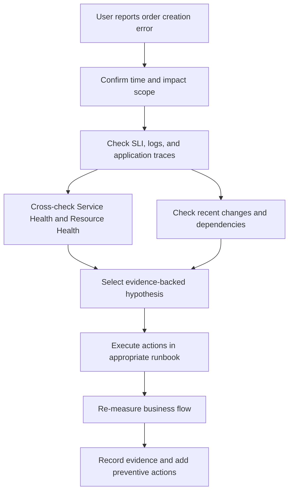

# Reading Azure Documentation, SLAs, and Service Status

> Chapter: Azure Fundamentals

When using Azure, you need to answer three distinct questions: **how a service is used**, **what the provider commits to**, and **what issue the system is currently experiencing**. Technical documentation, service level agreements, and service health information provide each of those types of evidence, respectively. Reading the right source helps you choose services, deploy applications, and investigate incidents without mistaking a sample tutorial for an operational commitment.

In this lesson, all percentages used in calculations are **hypothetical numbers for learning purposes**, not the current SLA figures of any Azure service. When making decisions for a production system, open the exact documentation and terms applicable to the relevant service, configuration, and timeframe.

## 1. Objectives and Real-World Scenario

After this lesson, you will be able to:

- Select the right documentation type to learn concepts, perform procedures, or look up parameters.
- Verify applicability scope: service, SKU, operating system, region, version, and feature state.
- Distinguish SLA, SLO, SLI, RTO, and RPO; read availability percentages together with their accompanying conditions.
- Distinguish Azure Status, Service Health, Resource Health, and application monitoring signals.
- Gather evidence and organize troubleshooting steps when an application running on Azure fails.

The running scenario is a sales API written in Java, running on Azure App Service, storing order data in Azure SQL Database and product images in Blob Storage. The team needs to read documentation to deploy correctly, set operational targets, and identify root causes when users cannot create orders.

Three questions must be kept separate:

| Question | Where to start | Expected output |
| --- | --- | --- |
| How do we deploy the Java API under the planned configuration? | Technical documentation for the service | Applicable steps, prerequisites, and limits |
| What commitments does the service make for the chosen configuration? | SLA and applicable terms | Measurement scope, eligibility conditions, and remedies if unmet |
| Why are users encountering errors? | Application monitoring combined with Azure health sources | Impact scope, timeline, and evidence-backed hypotheses |

## 2. Finding and Reading Technical Documentation with Purpose

### 2.1. Start from the Service Name and a Concrete Question

The [Azure documentation portal on Microsoft Learn](https://learn.microsoft.com/en-us/azure/) is the entry point for finding product documentation, code samples, and architectural guidance.

Instead of searching generically for "Azure Java," write a scoped question: "How should our team's JAR-packaged Java application be deployed to App Service Linux?" or "When the API opens many database connections, where do we check limits?"

Suggested search workflow:

1. Identify the exact product name, such as App Service or Azure Functions.
2. Add the task or symptom: Java deployment, private connectivity, authentication error, connection limits.
3. Open the official result and check the title, applicability scope, and last-updated date.
4. Read the table of contents to jump to the section answering the question, while also reading prerequisites and related notes.
5. Follow links to limits, security, or reliability whenever a decision requires more than a single guide page.

Community articles can help spot an investigation lead, but parameter names, support conditions, and conclusions about commitments must be verified against the appropriate official source.

### 2.2. Recognize Documentation Types

The labels below are common in technical documentation; some services may organize their tables of contents differently:

| Content type | Question typically answered | How to use |
| --- | --- | --- |
| Overview | What problem does the service solve? | Read to confirm it is the right product for your search |
| Concepts | How do components work and relate to each other? | Read before making architectural decisions |
| Quickstart | How do I get a working example? | Use to learn the minimal flow; check the example's assumptions |
| Tutorial | How do I complete a multi-step scenario? | Track the resources and dependencies created at each step |
| How-to guide | How do I perform a specific task? | Use once you understand the context and need to accomplish one task |
| Reference | What are the parameter names, data fields, and return types? | Verify exact tool or API versions |
| Troubleshooting | What are the causes and checks for this symptom? | Match against evidence collected from your own environment |
| Limits, quotas, support | What are the limits and usage conditions? | Read before finalizing configuration and expected load |

This is a taxonomy for organizing reading, not a mandatory sequence. When troubleshooting, you can start from Troubleshooting and return to Concepts to understand the root cause.

### 2.3. Read Prerequisites Before Copying Steps

For example, the [Java quickstart on App Service](https://learn.microsoft.com/en-us/azure/app-service/quickstart-java) illustrates deploying a Java web application with one specific packaging method and environment. That is a starting point for learning the procedure; you still must compare your actual application against the guide's assumptions.

Before applying any sample, answer:

- Does the doc use Linux or Windows, a built-in runtime or a custom container?
- Do the sample app and the real app share the same packaging and startup mechanism?
- Which tools does the doc use, and which versions does it require?
- Does the account need permissions at the subscription, resource group, or specific resource level?
- Do the steps create billable resources or open public network access?
- After testing, which resources remain and need to be managed?

A successfully completed quickstart only shows that the sample scenario works under those matching conditions. It does not prove the application meets security, recovery, or real load requirements.

### 2.4. Distinguish Different Types of Versions

Multiple versions can appear simultaneously in a single guide:

| Version type | Conceptual example | Why check it |
| --- | --- | --- |
| Application runtime | Java or application server version | Code and libraries must be compatible |
| SDK | Library version called by code | Programming APIs can differ across versions |
| Deployment tooling | CLI or plugin version | Option names and behavior may change |
| Resource management API | API version value in requests or IaC templates | Accepted properties depend on the API |
| Documentation | Last-updated date and content branch | An older example may not match the current environment |

You cannot infer the runtime version solely from the management API version. When a parameter is rejected, inspect the exact layer raising the error instead of upgrading everything at once.

## 3. Determine Whether Documentation Applies to Your Configuration

### 3.1. Write a Short Configuration Profile

Before cross-referencing documentation, write down the configuration under evaluation. The example below is a study note template, not a deployment configuration:

```text
Workload: Java sales API
API hosting service: Azure App Service
Environment: test
OS/packaging method: to be confirmed
Runtime: to be confirmed
SKU or service plan: to be confirmed
Region: to be confirmed
Networking and access identity: to be confirmed
Dependencies: database, object storage, identity system
```

Cells marked "to be confirmed" indicate missing information, not places to guess. For instance, a feature appearing in an overview doc does not mean every SKU can use that feature.

### 3.2. Conditions Often Overlooked

- **Region:** is the service or a specific capability offered at the intended deployment location?
- **SKU or tier:** do scaling, redundancy, networking, and limits apply to the chosen plan?
- **Cloud environment:** does the page describe public Azure or a separately scoped cloud environment?
- **Feature state:** is the feature generally available or still in preview; what are its support and usage terms?
- **Access permissions:** does the operator hold sufficient permissions and has the app been granted required data permissions?
- **Limits and quotas:** which limits are fixed, and which can be requested for adjustment?
- **Lifecycle:** are there deprecation notices, replacements, or breaking changes?

Do not apply a blanket rule assuming all previews share identical terms. Check the terms and support scope of the exact feature being evaluated.

### 3.3. Record Verifiable Conclusions

Each conclusion should carry its source and scope. For example:

```text
Question: Does the planned configuration meet the API deployment requirements?
Documentation page: official link read
Date read and page updated date: record each separately
Scope: service, SKU, region, OS, version
Mandatory conditions: list confirmed conditions
Missing items: list items needing further verification
Conclusion: suitable / insufficient data / unsuitable for specific reason
```

The date you read a page does not replace the effective date of terms. Newly updated documentation also does not automatically apply to all older versions or legacy resources.

## 4. SLA, SLO, and SLI Answer Different Questions

### 4.1. Definitions and Examples

| Concept | Meaning | Example in this lesson |
| --- | --- | --- |
| SLA — Service Level Agreement | Service level agreement between provider and customer | Terms of a service regarding availability levels within a defined scope |
| SLO — Service Level Objective | Concrete quality target for a workload or business flow | Team sets a target rate for successful order creation over a measurement period |
| SLI — Service Level Indicator | Measured metric used to evaluate the target | Number of successful valid order-creation requests divided by total observed valid requests |
| RTO — Recovery Time Objective | Maximum acceptable downtime per recovery objective | Team needs to restore the order-creation flow within an agreed timeframe |
| RPO — Recovery Point Objective | Maximum acceptable data loss, expressed in time | Team determines how many minutes of data loss are acceptable |

Microsoft distinguishes these concepts in its [guide to defining reliability metrics](https://learn.microsoft.com/en-us/azure/well-architected/reliability/metrics). For real systems, set targets based on business flows and measure from the experience users need.

### 4.2. Measure the Right Business Flow

For example, an endpoint returning HTTP 200 to "is the process running?" does not prove users can create orders. The Java process can be running while the database connection is broken.

You can define a hypothetical SLI as follows:

```text
Order creation SLI
  = number of valid order-creation requests completed within latency threshold
    / total number of observed valid order-creation requests
```

You must further define what constitutes a valid, successful, and timely request. A request rejected due to invalid input is not necessarily an availability error; conversely, returning a success code without persisting the order is still a business failure.

A request-based measurement window also differs from a time-based window. A brief outage during peak hours can affect far more transactions than a longer outage during off-peak hours.

### 4.3. An SLA Is Not Maximum Recovery Time

A periodic availability percentage does not tell you how long each individual incident will take to fix. RTO is the system's recovery objective; support response time is a separate commitment if specified in a support plan. Do not use any one of these numbers as a substitute for the other two concepts.

## 5. Read an SLA Together with Scope and Conditions

### 5.1. Find the Right Document

The [Microsoft Online Services SLA page](https://www.microsoft.com/licensing/docs/view/Service-Level-Agreements-SLA-for-Online-Services) provides current and archived documents, including uptime and connectivity commitments for Microsoft online services.

When evaluating an Azure service, identify the document version, timeframe, and agreement relevant to your case. A product marketing page can help locate a starting point; conclusions about commitments must rely on the applicable terms.

Do not use the SLA percentage of a similarly named product, a different configuration, or an old article to draw conclusions for a running resource.

### 5.2. SLA Reading Checklist

| Item to find | Question that must be answered |
| --- | --- |
| Service identifier | Which product or capability do the terms refer to? |
| Measurement target | Does it measure a resource, an endpoint, an operation, or a deployment configuration? |
| Configuration conditions | Which SKU, instance count, redundancy, or resource distribution is required? |
| Availability definition | What events count as unavailable according to the document? |
| Measurement period and formula | Is it measured monthly, per request, or by another specified method? |
| Exclusions | Which causes or time windows are handled separately? |
| Responsibility boundaries | Which factors belong to the platform, customer configuration, or external systems? |
| Remedy when unmet | Is there a service credit or other remedy, and under what conditions? |
| Documentation requirements | What evidence, procedure, submission channel, and deadline are needed? |
| Version and effective date | Which document is in effect for the case under evaluation? |

This is a checklist of questions for reading, not a claim that all services share the same terms. If an answer has not been found yet, note "unconfirmed" and continue verifying.

Service credits, if specified and approved, are a remedy under the service terms. Do not assume they are cash refunds, compensation for all business damages, or automatic payouts whenever an application encounters errors.

### 5.3. Convert Percentages to Time to Understand Scale

Suppose a measurement period has 30 days and a learning model treats every minute in the period as equally weighted:

```text
Total time = 30 × 24 × 60 = 43,200 minutes
Time outside target = total time × (1 − target ratio)
```

| Hypothetical percentage | Equivalent time in a 30-day period |
| --- | --- |
| 99.9% | 43.2 minutes, i.e. 43 minutes 12 seconds |
| 99.95% | 21.6 minutes, i.e. 21 minutes 36 seconds |
| 99.99% | 4.32 minutes, i.e. 4 minutes 19.2 seconds |

This table helps give a feel for the difference between percentages. It does not replace a service's SLA formula: measurement periods can differ, unavailability criteria have specific definitions, and some services use metrics different from this simple time-based model.

Do not interpret 43.2 minutes as a quota for scheduled downtime, a cap on a single outage, or a promise that every incident will be shorter than that duration.

### 5.4. Error Budgets Belong to Team Targets

Suppose the team chooses a time-based SLO of 99.9% for a 30-day period. Under the model above, the corresponding time outside target is 43.2 minutes. The team can use this error budget to track reliability burn and weigh risk when deploying changes.

An error budget does not automatically become a legal term of Azure. If an SLO is measured by successful request rate, the error budget must be calculated in matching requests; do not convert straight into minutes without a suitable model.

## 6. From Per-Service SLAs to Application Reliability

### 6.1. Multiple Dependencies Can Lower Flow Availability

Suppose an order-creation request only succeeds when both the API and the database are available. In a simplified model, if two components have independent availability:

```text
A_flow ≈ A_API × A_DB

Assumptions: A_API = 0.9995 and A_DB = 0.9995
A_flow ≈ 0.9995 × 0.9995
       = 0.99900025
       = 99.900025%
```

This calculation shows that two components sharing a percentage do not make the combined flow achieve that percentage by default. Yet this result is only a learning model, not a contractually binding composite SLA.

Limitations of the model must be noted clearly:

- Both numbers are hypothetical component availabilities over the same period and measurement method.
- Real incidents can be correlated due to shared region, network, identity, or configuration.
- Other dependencies such as DNS, user connectivity, and external services are not yet included in the calculation.
- Two separate SLAs may use different definitions and measurement criteria, so you cannot simply multiply published percentages and treat the product as an actual commitment.
- Fallback mechanisms, caching, or asynchronous processing can alter the conditions under which a business flow succeeds.

### 6.2. Choose Measurement Boundaries Based on What Users Need

If secondary images fail to load while users can still place orders, the team must decide whether that is experience degradation or an order-creation SLO failure. If notifications send slowly while orders are saved properly, notification latency may warrant its own SLO.

Splitting flows this way helps prioritize correctly. Do not lump every feature into a single green light, nor treat every secondary failure as equivalent to a full-service outage.

Fault tolerance depends on design, configuration, and operations alongside the capabilities Azure provides. The [Azure reliability overview](https://learn.microsoft.com/en-us/azure/reliability/overview) presents the roles of both the platform and the workload.

## 7. Choose the Right Service Status Source

### 7.1. Four Information Layers to Combine

| Source | Scope answered | How to use in investigation |
| --- | --- | --- |
| Azure Status | Public information on broad-impact incidents | Check general context, especially when personalized channels are hard to reach |
| Service Health | Service events, maintenance, and advisories affecting the customer's Azure environment | Cross-check service, subscription, region, and impact window |
| Resource Health | Health of a specific supported resource | Inspect the exact resource in use and its related health history |
| Application monitoring | Metrics, logs, traces, and user-flow synthetic checks | Confirm real user impact and fault location inside the application |

The first three sources are introduced by Microsoft in the [Service Health overview](https://learn.microsoft.com/en-us/azure/service-health/overview). The application layer must be designed specifically to measure what users can actually accomplish.

### 7.2. Azure Status: Public Information

From the [Azure Status guide](https://learn.microsoft.com/en-us/azure/service-health/azure-status-overview), you can reach the current public status page. This page communicates broad-impact incidents and certain situations requiring public notice.

Therefore, seeing no incident on the public status page is not enough to conclude your resources are operating normally. Continue checking personalized sources and application telemetry.

When reading a notice, pay attention to affected services, regions, update timestamps, and impact descriptions. A headline naming a service you use is not enough to prove that exact event caused your application's error.

### 7.3. Service Health: Environment-Specific Events

Service Health helps track service incidents, planned maintenance, and relevant advisories. When viewing it, select the right subscription and relevant scope. The [Service Health FAQ](https://learn.microsoft.com/en-us/azure/service-health/service-health-faq) explains how this source differs from the public status page and Resource Health.

A systematic way to read it:

1. Check filters before concluding no events exist.
2. Read the listed services and regions, comparing against resources your application uses.
3. Compare the impact start time with your team's logs and alerts.
4. Record the tracking ID, update timestamp, and actionable guidance if provided.
5. Follow subsequent updates while continuing to verify user experience.

This is a suggested investigation workflow. An overlapping event in time is correlational evidence; you still must verify request paths and dependencies to confirm causation.

### 7.4. Resource Health: Health of a Single Resource

[Resource Health](https://learn.microsoft.com/en-us/azure/service-health/resource-health-overview) uses service signals to evaluate an individual resource. Documented states include:

| State | Basic interpretation |
| --- | --- |
| Available | No events affecting resource health detected by service signals |
| Unavailable | Detected an ongoing event affecting health, potentially platform-related or non-platform-related |
| Degraded | Resource remains usable but shows degradation per the resource type's criteria |
| Unknown | Insufficient recent information to determine resource state |

Support availability and evaluation criteria depend on resource type. Unknown does not automatically prove the resource is broken; Available likewise does not confirm all business logic in the application works properly.

### 7.5. Application Monitoring: Checking What the Platform Does Not Know

An API can return errors due to database connection exhaustion, misconfigured permissions, code bugs, or external service issues. Those causes must be inspected with appropriate signals:

- Success rate and latency of each critical flow.
- Error logs and distributed traces linking requests to dependency calls.
- Resource utilization and connection metrics.
- Synthetic test results from perspectives close to users.
- Deployment, configuration, permission, or certificate changes prior to the error timestamp.

Do not treat platform status and application logs as mutually exclusive pieces of evidence. They observe different layers and help narrow hypotheses when placed on the same timeline.

## 8. Troubleshooting Workflow When the Java API Fails

### 8.1. Start from Observable Impact

Suppose users report being unable to create orders. The suggested workflow below does not require changing configuration right away:



### 8.2. Collect Minimum Facts

| Fact | Example recording | Why it helps |
| --- | --- | --- |
| Impact start and end time | Timestamp with explicit timezone | Correlates with notices and logs |
| Resource and environment | Resource ID, subscription, region, environment | Avoids investigating the wrong resource |
| Affected flow | Order creation fails, product browsing still works | Establishes priority and scope |
| Symptoms | Status codes, exception types, latency | Points to the layer needing inspection |
| Correlation ID | Request ID or trace ID if available | Traces the processing chain |
| Recent changes | Deployment version, permission or network changes | Surfaces change-related hypotheses |
| Platform events | Tracking ID and relevant summary | Links to provider information |

Do not put passwords, tokens, access keys, or unnecessary customer data into incident notes. When providing logs to support, filter information according to investigation requirements and organizational procedures.

### 8.3. Normalize Timestamps

Azure and operational tools may display timestamps differently. Always record the timezone explicitly and align on a single common timeline when comparing.

Hypothetical example:

```text
Observation timestamp: 2026-01-15T09:00:00+07:00
Same timestamp UTC:    2026-01-15T02:00:00Z
```

If a chart shows errors starting at 09:00 Vietnam time and a notice states 02:00 UTC, those two timestamps match. If timezone information is omitted, you can misjudge correlation.

### 8.4. Scenario A: No Matching Platform Event

Suppose Service Health has no event matching your scope and Resource Health detects no issues, yet API traces show authentication failures when calling the database.

The logical next step is checking the application's identity and connection configuration, recent permission changes, and detailed error messages. Platform status is one clue, not a reason to dismiss user reports.

In this situation, automatically restarting every resource may fail to fix access permissions and can destroy useful evidence. Choose actions based on the hypothesis under test.

### 8.5. Scenario B: Matching Service Event Exists

Suppose Service Health reports an incident on the database service in the relevant region and the timing matches the API's connection errors.

The team records the event tracking ID, cross-checks resources, monitors updates, and executes mitigations prepared in its runbook. Depending on design, mitigations may include shedding non-essential features, limiting retries, or switching to a pre-tested fallback option.

Do not perform failover merely because you see an incident notice. Evaluate switchover conditions, decision authority, data consistency, and RTO/RPO impact. An unprepared recovery action can make the situation worse.

### 8.6. Confirm Recovery Using User Flows

When a platform notice updates to mitigated, re-verify the API from a business perspective: does order creation succeed, is data accurate, and do background jobs drain the backlog?

Seeing errors drop for a few minutes is not enough to declare the whole system stable. Continue monitoring for a window suited to your load cycle, while checking lingering signs such as growing queues, exhausted connections, or transactions needing reconciliation.

## 9. Proactively Receive Notifications and Assign Handling

### 9.1. Combine Platform Alerts with Application Alerts

Do not wait to open status pages until users have already reported errors. The team needs designated owners to read notifications, assess impact, and act when necessary.

Azure supports [creating Service Health alerts](https://learn.microsoft.com/en-us/azure/service-health/alerts-activity-log-service-notifications-portal) by scope and notification type. Configuration requires proper permissions and notification channels; Service Health alerts do not replace Resource Health alerts or application quality alerts.

Different alert layers serve different goals:

- **Service events:** know when relevant platform notices exist.
- **Resource health:** know when a specific resource has a detected state change.
- **Application SLIs:** know when business flow success rate or latency falls short of expectations.
- **Capacity and dependencies:** spot load trends, limits, or backlogs before major impact occurs.

### 9.2. Design the Receiving and Action Workflow

For each alert, specify:

1. Monitored resource scope and environment.
2. Signal or event type triggering the alert.
3. Recipient person or team, plus escalation path when needed.
4. First diagnostic check and link to the runbook.
5. How to confirm the alert has been resolved.
6. How to test periodically that notification channels still work.

Not every signal needs to page an on-call engineer immediately. An upcoming maintenance notice typically requires scheduling; a continuous failure on an active order-creation flow may demand immediate response. Classifying by impact keeps alerts valuable.

## 10. From Incidents to Improving Documentation and Architecture

After reducing impact, the team should organize facts into a record reusable next time:

```text
Affected flow and resources
Timeline: detected → confirmed → mitigated → recovered
Evidence: metrics, traces, event IDs, and related changes
Confirmed root cause and open hypotheses
Mitigation actions taken and observed results
Preventive actions: owner, target, and verification method
```

Distinguish **symptoms**, **mitigations**, and **root causes**. "Restarting cleared the error" describes the outcome of an action; it does not explain why the error happened.

If a claim under an SLA needs to be evaluated, keep evidence of the resources, configuration, time windows, and relevant events, then follow the procedure in the applicable terms. Do not declare an SLA breach solely based on a spike in HTTP 500 responses.

The team must also update runbooks when old guidance proves inaccurate. A useful runbook specifies how to confirm scope, conditions for executing actions, and how to measure outcomes; it is not just a list of commands.

## 11. Practice Reading Documentation Without Creating Resources

### 11.1. Exercise Preparation

Pick a service in the illustrative architecture, such as App Service. The goal is to build a reading dossier and identify missing information. You do not need to deploy an application or create alerts to complete this exercise.

### 11.2. Execution Steps

1. Open the official documentation page for the service on Microsoft Learn.
2. Find an overview page, a guide suited to a Java application, and a page on limits or reliability.
3. Clearly note the environment, runtime, and configuration the guide refers to.
4. Locate the link to the SLA; identify what conditions must be met before drawing conclusions for the planned configuration.
5. Read how to view Service Health and Resource Health; note which scopes these two sources observe.
6. Propose one SLI for the order-creation flow and two types of evidence to collect when errors occur.
7. List confirmed points and points needing further verification, along with source links.

### 11.3. Output Template

| Item | Content to fill in |
| --- | --- |
| Technical question | Specific task or decision needing support |
| Scope | Service, region, SKU, OS, runtime |
| Sources | Official URLs, date read, and last-updated date if present |
| Documentation prerequisites | Required permissions, dependencies, limits, and settings |
| SLA scope | Measurement target, period, and configuration conditions found |
| Unconfirmed items | Missing conditions, uncreated resources, or insufficient data |
| Application SLI | Numerator, denominator, and measurement window definitions |
| Failure scenario | Symptoms, sources to inspect, and evidence to collect |

A good output might be "insufficient data to determine SLA because SKU has not been chosen." Conditional conclusions that clearly state what is missing are more trustworthy than a percentage copied without scope.

## 12. Common Misconceptions

| Statement | Correct understanding |
| --- | --- |
| A quickstart is a production-ready architecture | It is a scoped example with assumptions; real-world requirements still must be evaluated |
| A feature in documentation works in every configuration | Must cross-check region, SKU, version, and accompanying conditions |
| One service's SLA is the whole application's SLO | Flow SLOs must account for user experience and dependencies |
| Availability percentage tells you the max time to fix an outage | Periodic percentage differs from recovery targets and support response times |
| No incident on the public status page means the app is fine | Must check personalized sources, resource health, and application signals |
| Resource Health Available proves business logic works | Resource health does not cover all logic bugs and dependencies |
| An Azure event at the same hour proves the root cause | Must check impact scope and evidence from the actual flow |
| Meeting an SLA is enough, no recovery plan needed | Operational targets require both fault tolerance and recovery per requirements |

## 13. Self-Check Questions and Suggested Answers

**1. A sample doc uses a different configuration from your planned one. Can it be applied verbatim?**

Do not jump to that conclusion. Verify prerequisites, runtime, OS, SKU, and configuration-dependent steps. Identify which parts apply and which parts require a different guide.

**2. Under a simple time model, how much time in a 30-day period corresponds to a hypothetical 99.95% target?**

43,200 × 0.0005 = 21.6 minutes. This calculation is for learning how conversions work; when evaluating a real SLA, use the definitions and formula in the applicable terms.

**3. Both the API and the database have a hypothetical 99.95% rate. Does the flow automatically achieve 99.95%?**

That cannot be concluded. Under a serial and independent dependency model, the product of both rates is 99.900025%. In real systems, you must also consider correlated failures, other dependencies, and recovery design.

**4. Users cannot create orders, yet the Azure Status page shows no notice. What should you do?**

Confirm symptoms and timing; inspect SLIs, logs, traces, and dependencies; cross-check Service Health, Resource Health, and recent changes. Do not ignore an incident just because the public page shows no event.

**5. Resource Health showing Unknown means the resource is definitely down, right?**

No. That state indicates insufficient information to evaluate; check the resource and application signals before concluding.

**6. When can you state that an outage falls within SLA claim scope?**

After verifying the exact applicable terms, configuration conditions, outage definitions, and supporting evidence. Whether a remedy is granted still follows the corresponding submission procedure and evaluation outcome.

**7. Which facts should be recorded immediately when an incident begins?**

Affected flow, timestamp with timezone, resource and environment, symptoms, request correlation IDs, recent changes, and platform event IDs if any. These facts aid investigation and later verification of conclusions.

**8. After the platform reports mitigation, what confirms the application has recovered?**

Business flow measurement results, data accuracy, and the status of background jobs. Platform notices are an input for cross-checking; the team must still observe its own system.
