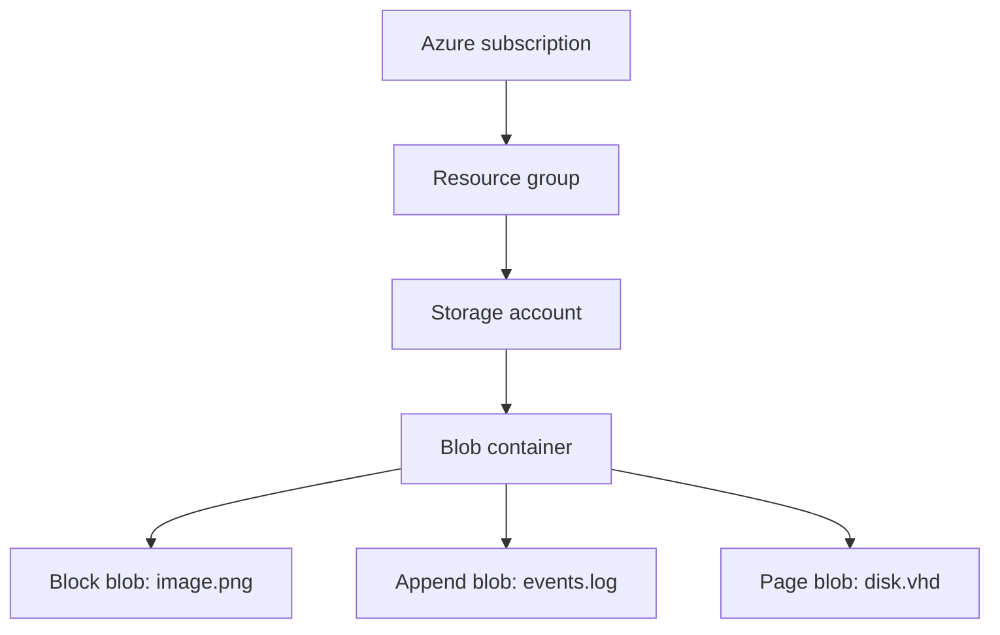
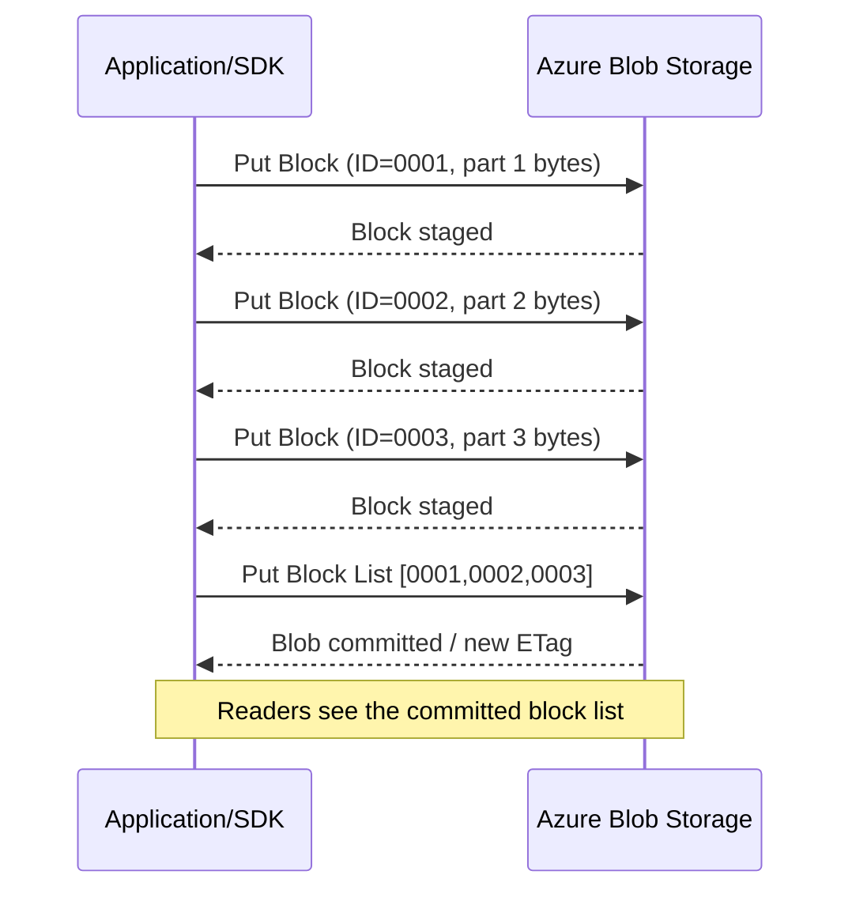
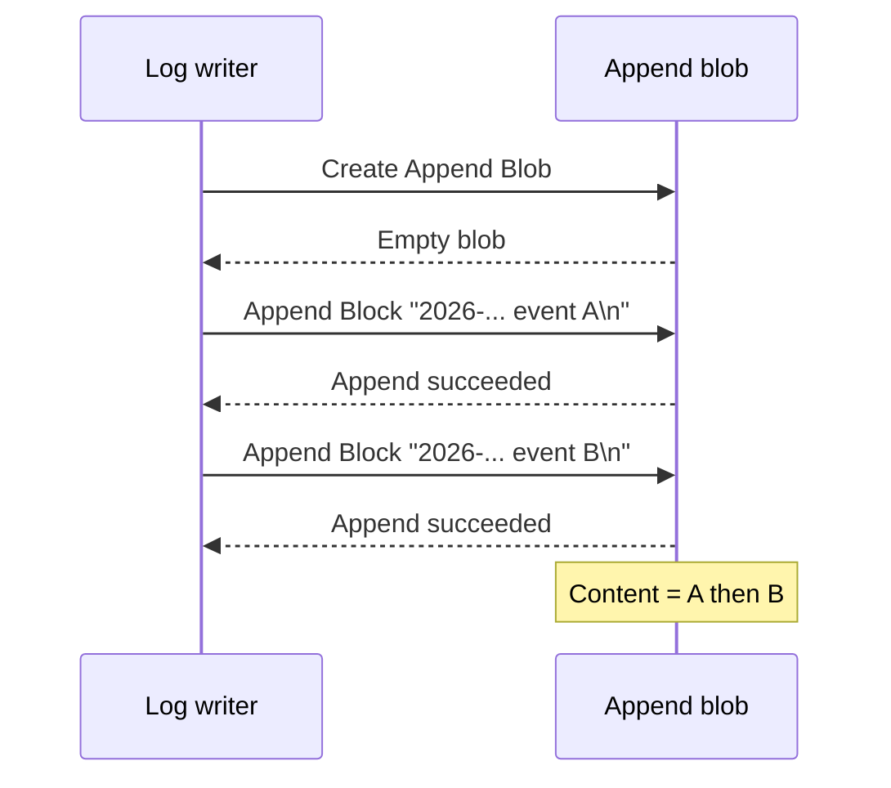
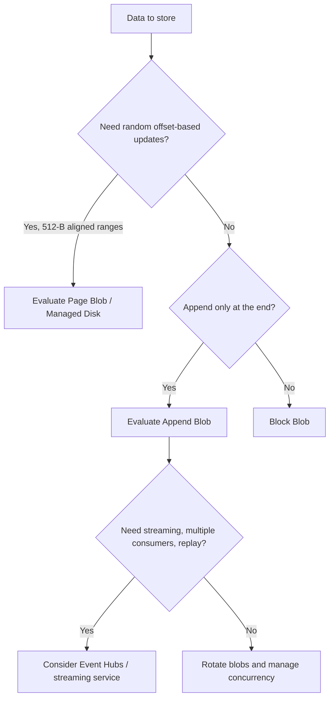
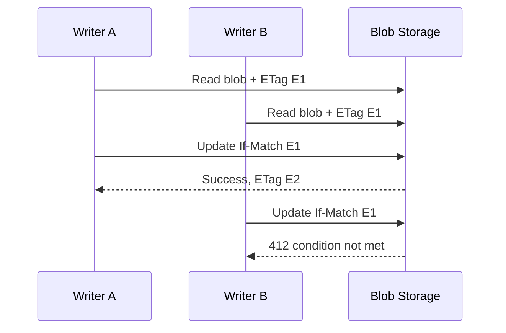
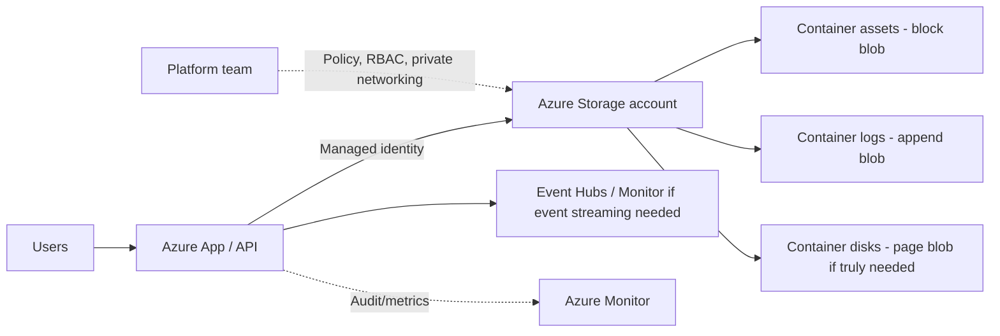

# Block Blobs, Append Blobs, and Page Blobs

When building an application on Microsoft Azure, development teams often need to store very different types of data: product images for users to download, logs that are continuously appended, and virtual-disk-style data where specific byte ranges can be overwritten. **Azure Blob Storage** provides three primary blob types — **block blobs, append blobs, and page blobs** — to handle these access patterns. All three are storage objects inside containers, yet they differ significantly in how they are written, updated, limited, and applied.

This lesson belongs to the **Object Storage with Blob Storage** chapter of the **CLOUD_PROVIDERS_AZURE** module. The content places Blob Storage within a complete Azure architecture: storage accounts are managed under subscriptions and resource groups; applications use Microsoft Entra ID identities or managed identities for access; and virtual networks, private endpoints, data authorization, monitoring, and cost all influence the design. The goal is not merely to memorize the definitions of the three blob types, but to **choose the right type, invoke the right operations, and predict behavior during failures or concurrent writes**.

After this lesson, you will be able to:

- Distinguish the purpose and write models of block, append, and page blobs.
- Explain `Put Block`/`Put Block List`, `Append Block`, and `Put Page` operations.
- Select the appropriate blob type for images, documents, backups, append-only logs, and virtual disk data.
- Design concurrency control, retries, authorization, and network connectivity appropriately.
- Create and interact with all three blob types using the Azure SDK in a controlled hands-on exercise.
- Identify common misconceptions regarding access tiers, immutability, size limits, and pricing.

## 1. The Big Picture of Azure Blob Storage

A **Blob (Binary Large Object)** is an object for storing unstructured or semi-structured data, such as image files, JSON files, videos, logs, or binary payloads. By storing them in Azure Blob Storage, you generally do not need to deploy and self-manage a file server.

Basic organizational hierarchy:



- **Storage account** provides the namespace and related configurations such as redundancy, network policies, encryption, and monitoring.
- **Container** groups blobs, serves as an organizational scope, and can serve as an appropriate scope for data permissions.
- **Blob** has a name, content, blob type, properties, and corresponding metadata.
- Blob names can include `/` characters to simulate directory structures in a flat namespace; this does not turn Blob Storage into a standard POSIX filesystem. If **hierarchical namespace** (Azure Data Lake Storage Gen2) is enabled, you must also understand the rules and APIs of that namespace model.

An access URL typically looks like:

```text
https://<storage-account>.blob.core.windows.net/<container>/<blob-name>
```

The URL is a resource address, **not proof that anyone can read the data**. Access rights depend on account/container settings, network policies, and the authentication/authorization mechanisms used.

### Three Questions Before Choosing a Blob Type

1. Will the file be **uploaded once and then read**, or will it be **written to incrementally** throughout its lifecycle?
2. Does the application need to **overwrite arbitrary byte ranges** without replacing the entire content?
3. Does the data type and access pattern truly fit **object storage**, or does it need a queue service, log streaming, database, file share, or managed disk?

If the file is mostly immutable or replaced as a complete object, start by considering a **block blob**. If records are only appended to the end, consider an **append blob**. If you need writes by **offset** across a fixed-size byte space, evaluate a **page blob**.

## 2. Quick Comparison of the Three Blob Types

| Criterion | Block blob | Append blob | Page blob |
|---|---|---|---|
| Data model | Sequence of blocks forming a single object | Sequence of blocks that can only be appended | Array of bytes organized into pages |
| Typical write operations | `Put Blob`, `Put Block`, `Put Block List` | Create append blob, then `Append Block` | Create page blob, `Put Page` by offset |
| Writing to the middle of content | Cannot overwrite a single range in place directly; requires committing a new block list or replacing the object | No; the primary operation is appending to the **end** | Yes; updates/clears aligned page ranges |
| Multi-part upload of large files | Well suited; blocks can be uploaded in parallel then committed | Sequential additions at the end position; requires concurrency handling | Writes page-aligned ranges |
| Typical use cases | Images, videos, packages, documents, backups, application data | Append-only logs, time-ordered record streams | VHDs and data requiring offset-based access |
| Key rules | Uncommitted blocks are separate from committed blocks | Not an infinite streaming system; appending does not edit/delete old records | Page offsets and lengths must be multiples of **512 bytes** |
| Per-blob access tiers | Common and supported depending on account/tier | Do not assume identical blob-level tier support as block blobs | Has its own storage and pricing model, especially Premium Page Blobs |

**There is no single "fastest blob" for every scenario.** Performance depends on storage account type, request pattern, concurrent request count, write payload size, network latency, permissions, and service limits.

A blob's **type is fixed at creation**. You cannot simply change a property to convert an append blob into a page blob. When a type change is needed, you typically must create a target blob of the appropriate type and copy/convert the content through a supported process, then verify names, permissions, metadata, and integrity.

## 3. Block Blobs: The Default Choice for Most Files

**Block blobs** fit data that is uploaded as an object and subsequently read, downloaded, copied, or replaced with a new version. They are especially useful for large files because the service allows splitting content into **blocks** and publishing only a committed block list.

### 3.1. How Writes Work: `Put Blob` and `Put Block`

There are two basic approaches:

- **`Put Blob`:** uploads the entire content of a blob in a single request, suitable when the file is small enough within the request size limits of the API version and SDK.
- **`Put Block` + `Put Block List`:** uploads chunks with block IDs, then commits the block list in the desired order. Azure SDKs typically choose the chunking strategy automatically when uploading large files.

Sequence of a multi-part upload:



**Staging blocks does not commit the blob.** When only `Put Block` is called, blocks exist in an **uncommitted** state and do not yet produce a published content version visible to readers. `Put Block List` defines the order of blocks that compose the committed content; this is an important boundary for observable consistency.

When updating an existing blob, staging new blocks **does not immediately alter the current content clients are reading**. Once the new list is successfully committed, new read requests see the published content; for applications requiring consistent reads across multiple range requests, manage ETag or version ID to avoid mixing data from two different versions.

### 3.2. Block IDs and Limits

- Each block is identified by a **block ID**; IDs for the same blob must meet API format/length requirements and are typically Base64-encoded in REST calls.
- The committed block list has a maximum count limit (commonly **50,000 committed blocks**). Maximum block size depends on the API version and service conditions; consequently, the maximum block blob size also varies by version.
- Uncommitted blocks should not be treated as long-term storage; the service has cleanup rules and separate limits for uncommitted blocks.
- Overwriting or committing block lists can consume many transactions; balance block size and concurrency against capacity, RAM, bandwidth, and actual throughput.

Rather than hardcoding a single maximum capacity figure from an old guide, check the **limits for the exact service version** used by your SDK/REST API before designing uploads for very large datasets.

### 3.3. Example: Uploading a 10 GiB Backup File

Suppose an application splits a 10 GiB backup file into 8 MiB chunks:

```text
10 GiB = 10 x 1,024 MiB = 10,240 MiB
10,240 MiB / 8 MiB = 1,280 parts
```

The application or SDK uploads chunks with controlled concurrency, retries individual chunks on transient errors, and commits the block list in the exact order. You must verify ETag, size, and application-level checksums/hashes when data integrity is critical. For vital backups, merely seeing an HTTP success after upload is insufficient; practice downloading and restoring.

### 3.4. Operations to Distinguish

| Operation | Practical meaning |
|---|---|
| `Upload` via SDK | May choose `Put Blob` or multi-block upload depending on size/configuration |
| `Put Block` | Stages a portion of content |
| `Put Block List` | Commits the ordered block list and creates published content |
| `Get Blob` / `Get Blob Properties` | Downloads content or reads properties/ETag |
| `Get Block List` | Inspects committed/uncommitted blocks per API conditions |
| Create snapshot/version | Preserves a record of a content state per enabled/supported features |

A block blob can be **range-read** if the application only needs part of a file. However, supporting range reads does not mean you can call `Put Page` into the middle of a block blob: the two blob types have different write protocols.

### 3.5. When to Choose Block Blobs?

Block blobs are usually the first choice for:

- Images, PDF documents, videos, JSON, report export files.
- Build artifacts and packages uploaded for distribution.
- Backup files, application snapshots, or analytics datasets stored as objects.
- Static web assets and user-uploaded files.

If an application modifies portions of a file very frequently, evaluate whether rewriting a block blob object or changing the design to a database/managed disk/file service is more efficient. Avoid using a block blob like a random-access disk receiving thousands of tiny byte edits per second.

## 4. Append Blobs: Appending Data Only to the End

**Append blobs** are optimized for *append-only at the end* access patterns: create the blob once, then add data blocks in chronological or processing order. The signature API is **`Append Block`**.



Example contents of `order-events.log`:

```text
2026-11-20T09:00:01Z order-created orderId=101
2026-11-20T09:00:02Z payment-authorized orderId=101
2026-11-20T09:00:03Z order-confirmed orderId=101
```

### 4.1. Key Properties

- The typical workflow is **creating an empty blob then appending blocks**. Each successful append concatenates data to the end.
- You cannot use `Put Page` to edit a region in the middle of an append blob. To modify older records, you must redesign the data or create a new object.
- Append blobs have a **block count limit (commonly 50,000)** and a per-`Append Block` size limit depending on the REST API/SDK version. Do not treat them as infinitely growing logs.
- An append blob **does not automatically generate timestamps, sequence numbers, or application record boundaries**. The application must handle formatting, newlines/JSON Lines, UTF-8 encoding, and event IDs.
- Appending data **does not mean the data is WORM/immutable**. Accounts with sufficient permissions can still delete or replace the blob depending on policies. For compliance guarantees, configure supported **immutability policies/legal holds** and verify compatible append behavior.

### 4.2. Multiple Writers and Ordering

When two services write to the same append blob concurrently, do not assume each client always knows the exact end offset when sending its request. Appends are executed service-side, and arrival order across concurrent requests can differ from the order events occurred in the application.

Several mechanisms help manage conflicts:

- **Append position condition:** only append if the current blob length matches the client's expected position. If it no longer matches, the request is rejected conditionally; the client re-reads state and decides whether to retry.
- **Max size condition:** do not append beyond a desired maximum size threshold.
- **Lease or application-layer single-writer pattern:** useful when a stream must maintain strict ordering.
- **Idempotency key/sequence number:** helps detect retried requests, since a timeout after sending does not always tell you whether the previous append was accepted by the service.

**Example:** writers A and B both observe a blob length of 1,024 bytes. If both send an append with a position condition of 1,024, one request may succeed first; the other fails the condition and must handle the conflict. This is safer than both assuming they can write at the same offset.

### 4.3. Avoiding the Duplicate-Data Retry Trap

Suppose an application sends a block containing event 101 and loses network connectivity before receiving a response. Two possibilities exist:

1. The request did not succeed: a retry is necessary.
2. The append succeeded, but the response was lost: blind retry can append event 101 a **second time**.

Therefore, if the system requires exactly-once business processing, record event IDs with deduplication logic or use a queue/log platform built for those semantics. An append blob alone **does not guarantee exactly-once event processing**.

### 4.4. Log Lifecycle: Rotation and Archiving

Append blobs are ill-suited for a single log file growing forever. You can partition by hour/day, service, and tenant:

```text
logs/orders/2026/11/20/09/events.log
logs/orders/2026/11/20/10/events.log
logs/payments/2026/11/20/09/events.log
```

Naming conventions help bound file sizes, simplify permissions, and manage retention. Evaluate lifecycle/tiering capabilities by **blob type** and account features before planning to "move all append blobs to Archive": not all blob types support the same access tiers or tier transition behaviors as block blobs.

### 4.5. When Should You Choose Another Service?

- For moderate-volume append-only audit logs, append blobs can be a good fit.
- For **event streaming with multiple producers, consumer groups, offsets, and partition replay**, consider **Azure Event Hubs** or another streaming system.
- For application logs requiring near-real-time search, alerting, and statistical queries, consider **Azure Monitor / Log Analytics** rather than writing custom queries over a large append blob.
- For data needing record updates, indexed queries, or multi-row transactions, consider a database instead of an append blob.

## 5. Page Blobs: Reading and Writing by Byte Range

A **page blob** is organized as a byte space whose logical capacity is declared upon creation, allowing updates to **aligned byte ranges** without re-uploading the entire object. The alignment unit of a page blob is **512 bytes**; the signature write operation is **`Put Page`** by offset. This model fits virtual hard disk (VHD) data or offset-based I/O workloads.

```text
Page blob with logical size 4,096 bytes

Offset (bytes):   0     512    1024   1536   2048   2560   3072   3584
                +------+------+------+------+------+------+------+------+
Pages:          |  A   |  A   | empty| empty|  B   |  B   | empty| empty|
                +------+------+------+------+------+------+------+------+

Put Page(offset=0,    length=1024): writes A into the first two pages
Put Page(offset=2048, length=1024): writes B into pages 5 and 6
Clear Page(offset=2048, length=512): frees/clears content of page 5
```

### 5.1. Write Constraints

- You must **create a page blob with a predefined logical size**, which must be a multiple of 512 bytes and within service limits.
- For `Put Page`, **both offset and length must be aligned to 512-byte boundaries**. For example, writing 700 bytes starting at offset 100 is invalid; you must align to proper boundaries or implement a controlled read-modify-write pattern.
- Operations can **overwrite existing pages/ranges**, unlike append blobs.
- You can **clear pages** so a range no longer holds written data; reading unallocated/cleared ranges returns zero bytes according to service semantics.
- Maximum object size and maximum size per page request depend on API version and storage account kind; verify current limits for large workloads.

Page blobs can use **sparse allocation**: you do not have to populate the entire logical byte range to represent a virtual disk volume. However, **capacity billing depends on Standard/Premium tiers, account type, and service pricing policies**; never assume a 1 TiB logical file is billed for only a few pages across every SKU.

### 5.2. Virtual Disk Data Example

Suppose software maintains a VHD with frequent sector updates at specific offsets. Storing it as a block blob and regenerating the entire block list on every small change may be unsuitable. A page blob allows updating smaller ranges directly.

**Distinction from Azure Managed Disks:** Modern Azure VMs typically use **managed disks**, where Azure manages lifecycle and storage abstraction. Do not build new VM systems by manually creating page blobs and treating them as managed disks. Page blobs are historically tied to **unmanaged VHDs** and still have niche use cases, but production VM disks should generally use appropriate managed disks.

### 5.3. Page Blobs Are Not File Shares

Page blobs provide byte-range update operations, which do not turn them into a file system with directories, file locks, POSIX semantics, and SMB shares. If multiple machines need to mount and share files over SMB/NFS, evaluate **Azure Files** or a suitable file service. If an application needs block-device random I/O, evaluate **managed disks** or specialized storage.

## 6. Viewing the Same Requirement Under Three Write Models

Suppose a video management system has three data groups:

| Data | Update pattern | Preferred blob type | Why |
|---|---|---|---|
| Uploaded videos | Split large files into parts, commit on completion | **Block blob** | Parallel upload, object replacement, and range reads |
| Video access logs | Each event appends a new line | **Append blob** if throughput/semantics fit | Simple tail appends, hourly/daily rotation |
| Specialized virtual disk images | Update byte ranges at specific offsets | **Page blob** in suitable scenarios | Supports random writes on 512-byte pages |

**Quick selection flow:**



This diagram is directional, not a rigid rule. For analytics logs, a system might write **batch Parquet files as block blobs** instead of append blobs to optimize query performance. For multi-record transactional data, a database usually fits better than all three blob types.

## 7. Consistency and Concurrency Control

Azure Blob Storage provides a strong consistency model for object operations under its service contract. Even so, **single-blob consistency does not automatically resolve business conflicts when multiple clients update concurrently** or execute a multi-blob workflow. You must design conditional writes instead of letting every client overwrite freely.

### 7.1. ETag and Optimistic Concurrency

An ETag is a resource state version identifier returned by the service. A client can:

1. Read the blob and record its current ETag.
2. Prepare new data or a new block list.
3. Write with an `If-Match` condition containing the previously read ETag.
4. If the blob was modified by another client in the meantime, the operation is rejected with a precondition-failed error; the client re-reads and decides whether to merge or retry.



Do not blindly use `overwrite=True` if business rules cannot tolerate lost updates. For **create-only** operations under a unique name, `If-None-Match: *` prevents accidentally overwriting an existing resource. SDKs typically expose parameters for these conditions.

### 7.2. When to Use a Lease?

A **blob lease** is a conditional access coordination mechanism. When a client holds an active lease, write operations protected by the lease must supply the lease ID per service rules; other clients cannot freely modify the content without the lease.

Leases are useful for single-writer models or locking during processing. However, you must manage renewals, expirations, recovery if a client crashes, and contention handling. **Leases do not turn Blob Storage into a multi-object database transaction**; your design must handle application-level completion or rollback.

### 7.3. Conflict Comparison by Blob Type

| Type | Multi-writer risk | Strategy |
|---|---|---|
| Block blob | Client B commits a block list after Client A, creating an unintended version | ETag/conditional writes; single writer owns the object; appropriate versioning |
| Append blob | Requests arrive out of event order; retries produce duplicate records | Append-position condition, sequence numbers, event IDs, single-writer or deduplication |
| Page blob | Two clients edit overlapping pages/ranges and clobber each other's data | Partition range ownership, ETag/lease, application-level synchronization protocol |

**Snapshots and versioning are not locking mechanisms.** They can help detect or recover older versions in supported scenarios, but you still need concurrency rules for updates.

## 8. Safe Hands-On Lab: Choosing a Storage Account and Authenticating

To observe all three blob types, you need a storage account that supports the corresponding operations and a test container. The examples below use **standard general-purpose v2 (`StorageV2`)** in a lab environment. Do not extrapolate standard account performance/tiering characteristics to premium page blobs or specialized account types.

### 8.1. Prerequisites

Requirements:

- An Azure subscription authorized to create or use a test storage account.
- Appropriate permissions on the resource group, plus the **Storage Blob Data Contributor** role or equivalent data permissions at the right scope to create/write blobs.
- Azure CLI and Python 3 if running the SDK examples.
- A valid storage account name, unique across Azure's public namespace; account, container, and content strictly for lab use.

In this example, shell variables can be declared as:

```bash
az login
SUBSCRIPTION_ID="<subscription-id-lab>"
RG="rg-blob-types-lab"
LOCATION="southeastasia"
ACCOUNT="<globally-unique-storage-account>"
CONTAINER="blob-types-lab"

az account set --subscription "$SUBSCRIPTION_ID"
az account show --query "{id:id, name:name, tenantId:tenantId}" -o table
```

Values inside `<...>` are placeholders; **do not run them verbatim**. Only create a new resource group in an authorized subscription, avoiding production subscriptions by mistake:

```bash
az group create --name "$RG" --location "$LOCATION"

az storage account create \
  --resource-group "$RG" \
  --name "$ACCOUNT" \
  --location "$LOCATION" \
  --sku Standard_LRS \
  --kind StorageV2 \
  --https-only true \
  --min-tls-version TLS1_2 \
  --allow-blob-public-access false
```

`Standard_LRS` in the lab keeps things simple and limits cost; it is **not a default production recommendation**. In real deployments, evaluate redundancy options (LRS/ZRS/GRS/GZRS and supported variants), RPO/RTO, and data requirements. Security choices such as disabling shared-key authorization, default-deny networking, or private endpoints should follow organizational baselines; avoid altering an existing account without checking dependent applications.

Create a private container using Microsoft Entra credentials:

```bash
az storage container create \
  --account-name "$ACCOUNT" \
  --name "$CONTAINER" \
  --auth-mode login
```

If you encounter `AuthorizationPermissionMismatch`, inspect **data plane roles**, assigned scope, RBAC propagation time, and user tenant/subscription. Management-plane `Contributor` does not automatically grant read/write access to blob contents using Entra tokens. Creating a storage account also **does not automatically grant** data plane roles to the creator in all organizational models.

### 8.2. Upload a Block Blob with Azure CLI

Prepare a test file locally or in Cloud Shell:

```bash
printf 'OrderId,Status\n101,Created\n102,Paid\n' > orders.csv

az storage blob upload \
  --account-name "$ACCOUNT" \
  --container-name "$CONTAINER" \
  --name "datasets/orders.csv" \
  --file "orders.csv" \
  --type block \
  --auth-mode login \
  --overwrite false
```

Here `--type block` declares the blob type. `--overwrite false` prevents the lab from unintentionally replacing an existing blob on re-runs. Depending on your Azure CLI version, `--overwrite` may accept boolean flags accordingly; check `az storage blob upload --help` in your CLI environment before automating.

Inspect the uploaded blob:

```bash
az storage blob show \
  --account-name "$ACCOUNT" \
  --container-name "$CONTAINER" \
  --name "datasets/orders.csv" \
  --auth-mode login \
  --query "{name:name, properties:properties}" \
  --output json
```

The output lets you observe object properties such as ETag, size, and blob type. **There is no need to enable public access or issue a public SAS** just to inspect it.

## 9. Azure SDK: Working with All Three Blob Types

Azure SDKs help applications handle uploads, retries, authentication, and complex REST calls. The Python examples below illustrate usage against an **existing lab storage account and container**. These snippets were **not executed during lesson creation**; learners must ensure permissions, install packages, and run in an authorized environment.

### 9.1. Preparing Libraries and Identity

```bash
python -m pip install azure-identity azure-storage-blob
```

`DefaultAzureCredential` is a solid practice for code running both locally and on Azure. Locally, it can use credentials from supported developer tools; on Azure resources with **managed identity**, it acquires tokens without storing client secrets in source code.

~~~python
import os
from azure.identity import DefaultAzureCredential
from azure.storage.blob import (
    AppendBlobClient,
    BlobServiceClient,
    PageBlobClient,
)

account = os.environ["AZURE_STORAGE_ACCOUNT"]
container = "blob-types-lab"
account_url = f"https://{account}.blob.core.windows.net"

credential = DefaultAzureCredential()
service = BlobServiceClient(
    account_url=account_url,
    credential=credential,
)
~~~

Before running, set the `AZURE_STORAGE_ACCOUNT` environment variable to the **storage account name**, not a connection string containing keys. The executing identity needs appropriate Blob Data permissions, the account must permit network traffic from the host, and the container must already exist.

### 9.2. Block Blob: Upload and Replace Content

~~~python
block = service.get_blob_client(
    container=container,
    blob="documents/readme.txt",
)

payload = "User guide document version 1\n".encode("utf-8")
block.upload_blob(payload, overwrite=False)

downloaded = block.download_blob().readall()
print(downloaded.decode("utf-8"))
~~~

`upload_blob` typically creates a **block blob** by default in standard scenarios; the SDK selects an upload strategy suited to file size. `overwrite=False` rejects writes if the object already exists. For updates in production with multiple writers, do not simply switch to `overwrite=True`: use ETag conditions or versioning to prevent lost updates.

When uploading large files, you can open the file in `rb` mode and pass the stream:

~~~python
with open("archive.zip", "rb") as stream:
    service.get_blob_client(
        container=container,
        blob="backups/archive.zip",
    ).upload_blob(stream, overwrite=False)
~~~

The SDK exposes settings to tune block size, concurrency, and retries; test against actual bandwidth, memory, file sizes, and storage account limits. Do not manually split files into millions of tiny blocks when the SDK already provides multipart upload.

### 9.3. Append Blob: Create and Append Two Blocks

~~~python
append = AppendBlobClient(
    account_url=account_url,
    container_name=container,
    blob_name="logs/orders-2026-11-20.log",
    credential=credential,
)

append.create_append_blob()
append.append_block(b"2026-11-20T09:00:01Z order=101 created\n")
append.append_block(b"2026-11-20T09:00:02Z order=101 paid\n")

print(append.download_blob().readall().decode("utf-8"))
~~~

`create_append_blob` is an object creation call: **do not re-run it on an existing blob name with data without protective conditions**, because recreating it can replace/reinitialize content depending on API semantics and settings. Before re-running, use a new name or SDK-supported create-only/conditional requests; explicitly decide whether to **continue appending** or **recreate** in your lab environment. Each `append_block` call must respect the service version's block size limits; this API is not for editing existing blocks.

This sample intentionally uses a **single writer**, because multi-writer production apps need append-position conditions, event IDs, and retry handling as covered in Section 4.

### 9.4. Page Blob: Create, Write, and Clear a 512-Byte Region

~~~python
page = PageBlobClient(
    account_url=account_url,
    container_name=container,
    blob_name="pages/demo.bin",
    credential=credential,
)

# Logical size is 4 KiB = 4096 bytes, divisible by 512.
page.create_page_blob(size=4096)

# Write 512 bytes starting at offset 0.
page.upload_page(b"A" * 512, offset=0, length=512)

# Write 1024 bytes at offset 2048; both parameters are 512-byte aligned.
page.upload_page(b"B" * 1024, offset=2048, length=1024)

# Clear the first page in 512-byte units.
page.clear_page(offset=0, length=512)

content = page.download_blob().readall()
print(len(content), content[2048:2052])
~~~

Because the example cleared the first page, bytes in that range follow page blob "empty/zero" semantics. The range at offset 2048 still holds the written `B` bytes unless modified elsewhere.

**Important:** do not run against the same object name repeatedly without handling the existing-object case. For page blobs, `create_page_blob` must create an object of the right type and size; re-running when the blob already exists may alter it or fail depending on parameters/conditions. To test concurrent writes, use a dedicated test blob and protective conditions.

### 9.5. What Happens Behind the SDK?

| SDK call | Blob type | Abstracted REST operation group |
|---|---|---|
| `block.upload_blob(...)` | Block blob | `Put Blob` or `Put Block` + `Put Block List` |
| `append.create_append_blob()` | Append blob | Create object with `x-ms-blob-type: AppendBlob` |
| `append.append_block(...)` | Append blob | `Append Block` |
| `page.create_page_blob(size=...)` | Page blob | Create object with `x-ms-blob-type: PageBlob` and size |
| `page.upload_page(...)` | Page blob | `Put Page` at specified range |
| `page.clear_page(...)` | Page blob | `Put Page` with appropriate clear option |

Read the **exact package-version SDK documentation** when upgrading or deploying large systems. Despite shared conceptual names, syntax, condition parameters, API versions, size limits, and retry modes can differ across Python, Java, .NET, or JavaScript SDKs.

## 10. Distinguishing Append Blobs from Data Lake "Append" APIs

In **Azure Data Lake Storage Gen2** with hierarchical namespace enabled, applications can use APIs like **Path Create**, **Path Update/Append**, and **Flush** to write files. The operation name "append" in Data Lake **does not mean the file is necessarily an Azure Append Blob type**.

| Concept | Meaning |
|---|---|
| Azure Append Blob | A distinct **blob type** using the `Append Block` operation |
| ADLS Gen2 append/flush | A **file content update protocol** in the hierarchical namespace model |
| Append to log (business meaning) | How an application adds records to the end; may use append blobs, batched block blobs, or a streaming service |

This confusion frequently causes design mistakes when migrating Spark/Hadoop apps using `abfss://` to the Blob SDK. With ADLS Gen2, verify which blob types and operations are permitted in accounts with hierarchical namespace enabled; do not assume `AppendBlobClient`/`PageBlobClient` examples apply identically to all ADLS Gen2 resources.

## 11. Security Design for the Three Blob Types

A blob's type **does not determine who is allowed to access it**. An append blob holding audit logs can still be exposed if a container accidentally enables public access or a broad credential is compromised.

### 11.1. Authentication and Authorization

For apps running on Azure App Service, Functions, or supported VMs, prefer **managed identity** and Microsoft Entra ID tokens. Grant permissions at the narrowest scope—such as the specific container needed rather than the entire storage account—when the permission model supports it.

| Role/mechanism | Practical purpose | Warning |
|---|---|---|
| **Storage Blob Data Reader** | Read blob contents within granted scope | Does not grant write access |
| **Storage Blob Data Contributor** | Read/write and manage blob data per role permissions | Powerful role; do not grant to read-only apps |
| **Storage Blob Data Owner** | Broad data permissions; can manage ACLs in supported hierarchical namespace environments | Does not grant Azure RBAC role assignments by default; govern tightly |
| **Azure RBAC management role** | Administer account resource, policies, networking | Distinguish **control plane** from **data plane** permissions |
| **SAS** | Grant scoped access by permissions, target object, duration, and supported conditions | Protect URLs/tokens; prefer user delegation SAS when feasible |
| **Storage account key** | Shared-key authentication | Very broad privileges; minimize reliance, store and rotate strictly |

SAS is not a "zero-security-management" solution: anyone holding a valid SAS can usually use it within its permissions, lifetime, and conditions. Avoid logging signed SAS URLs, sharing them publicly, or committing them to source code.

### 11.2. Restricting Network Access

- For workloads using VNets, consider **Private Endpoints** and private DNS for the Blob endpoint to keep traffic on private networks.
- Check **public network access** separately; creating a private endpoint **does not always automatically disable** the public endpoint.
- If apps only connect over private networks, verify DNS and routing from the actual runtime environment: an endpoint resolving to a private IP on an admin workstation does not prove App Service/AKS resolves it the same way.
- Enforce HTTPS/TLS, apply IP/network rules where appropriate, and keep Microsoft Entra/RBAC active at the data plane even behind a private endpoint.
- Never assume creating a subnet or VNet peering grants permission to read blobs: networking and authentication are two separate layers.

### 11.3. Encryption, Deletion Protection, and Compliance

Azure Storage supports encryption at rest according to service capabilities; stricter requirements may call for customer-managed keys or tighter key management policies. For critical data:

1. Choose **soft delete**, snapshots/versioning, or backup strategies matching the **blob type and account type**.
2. Consider **immutability policies** or **legal holds** for non-modifiable/non-deletable retention mandates.
3. Test how retention policies impact delete, update, and append operations.
4. Enable logging/auditing per compliance obligations and protect log access.
5. Document retention periods and authorized data destruction procedures.

**Append-only as an operation style differs from immutable/WORM.** An append-only API does not stop someone from deleting the blob if they have permissions and no retention policy blocks it. Conversely, a retention policy can block seemingly valid modifications; test policies thoroughly before applying them to production.

## 12. Access Tiers, Account Types, and Data Availability

A common misconception is that **all blobs can move identically between Hot, Cool, Cold, and Archive**. On Azure, access tier support depends on blob type, storage account type, namespace features, and service version.

### 12.1. Access Tiers for Block Blobs

In supported accounts and regions, block blobs typically offer access tiers to balance capacity charges against transaction/retrieval costs:

| Tier | Typical access pattern | Considerations |
|---|---|---|
| **Hot** | Frequent reads/writes | Storage price per unit capacity is usually higher than colder tiers, but access is convenient |
| **Cool** | Infrequently accessed data | Retrieval fees, minimum retention periods, or early deletion charges may apply |
| **Cold** | Very rarely accessed data that still needs online availability | Depends on account/region support and billing policies |
| **Archive** | Long-term archival data, rarely needing immediate reads | Offline state; requires rehydration before reading content, with associated latency and fees |

Archive **is not** a content store capable of serving immediate interactive responses to applications. Moving reports viewed every minute by users into Archive will disrupt user experience. Moreover, picking a colder tier does not exempt you from managing permissions, encryption, versioning, or retention.

### 12.2. Append Blobs and Page Blobs Have Distinct Constraints

Do not assume you can run `Set Blob Tier` on an append blob or page blob the same way as a block blob. Blob-level tiering and lifecycle capabilities in standard accounts typically center on **block blobs**; **page blobs**—especially **premium page blobs**—follow different billing and performance/capacity models.

If you need long-term, rarely read log storage, you can:

1. Append to short-lived objects during active collection.
2. Once a log window closes, batch-convert or export data into **block blobs** if appropriate.
3. Then apply supported lifecycle/tier policies to the target block blobs.

This is a **custom pipeline design**, not an automatic blob-type conversion feature. Account for immutability, checksums, metadata, record ordering, permissions, and retention obligations during conversion.

### 12.3. Choosing Redundancy

| Option | High-level meaning | What to evaluate |
|---|---|---|
| **LRS** | Replicated within a single location per service model | Lower cost usually comes with a narrower fault domain |
| **ZRS** | Synchronously replicated across availability zones in a supported region | Suitable when zone-level fault tolerance is required |
| **GRS / RA-GRS** | Adds replicas in a secondary region; certain variants permit secondary reads | Cross-region replication can be **asynchronous**, so assess potential data loss in disasters |
| **GZRS / RA-GZRS** | Combines primary availability zones with secondary-region replicas where supported | Availability and pricing depend on account, region, and tier |

Storage account redundancy **does not automatically replace backups or protect against accidental deletion**. If an application deletes a blob with valid credentials, the logical deletion is replicated across copies. Combine redundancy with soft delete, versioning/snapshots, immutability, or backups suited to the blob type. For cross-region failover, plan **RPO/RTO** and verify how applications resolve endpoints after failover.

## 13. Performance and Cost Optimization by Write Model

Total cost typically consists of **stored capacity**, **operation counts**, **data read/written and egress**, **replication**, plus companion services such as private endpoints, log ingestion, keys, or monitoring depending on architecture. Pricing varies across regions, accounts, tiers, and time, so consult official pricing and Cost Management for your actual subscription before estimating budgets.

| Usage pattern | Performance/cost risk | Improvement |
|---|---|---|
| Large block blobs uploaded in parts | Too many tiny blocks → excessive requests, metadata/transactions, and overhead | Choose proper block size/concurrency, use SDK upload manager |
| Frequently replaced block blobs | Numerous commits, versions/snapshots consuming capacity | Move rapidly mutating data to a database or log/batch format |
| Append blobs with one tiny record per request | High transaction count and easily hitting request/throughput limits | Batch records sensibly, rotate periodically, handle retries and duplicates |
| Multi-writer append blobs | Ordering contention, duplicate appends on timeouts | Single writer/queue, conditional append, idempotency |
| Page blobs with heavy random writes | High page request volume, lock/concurrency contention, and SKU costs | Coalesce aligned page writes where sensible, test IOPS and throughput |
| Rarely read data sitting in Hot tier | Suboptimal capacity cost | Lifecycle rules for block blobs, evaluate tiers and minimum retention |
| Immediately needed data placed in Archive | Slow rehydration and unexpected fees | Classify data by SLA; archive only with a recovery plan |

### Example Transaction Calculation for Append Logs

A service generates **240,000 records/day**, averaging 200 bytes per record:

- Sending **1 append request per record**: roughly 240,000 write requests/day.
- Batching **100 records per append request**: roughly 2,400 write requests/day, excluding auxiliary management calls.
- Raw content volume in both cases is nearly identical, yet transaction counts and networking pressure differ dramatically.

Batching must respect append block limits, acceptable latency, crash recovery, and deduplication rules; do not buffer events in memory indefinitely just to save transactions. For multi-producer/multi-consumer streaming needs, a queue/streaming architecture may make more sense than manually batching append blobs.

### Considerations When Optimizing Large Files

For block blobs, optimization goes beyond raising concurrency: a 500 GiB upload can bottleneck on client bandwidth, checksum CPU, network limits, account quotas, or request retries. You should:

1. Measure real throughput/latency across different block sizes and concurrency levels.
2. Use retries with exponential backoff/jitter for transient errors and cap total duration.
3. Verify integrity using SDK mechanisms and application-level checksums/manifests when critical.
4. Use clear object naming strategies to avoid multiple clients writing the same blob.
5. Watch `Transactions`, `Ingress`, `Egress`, `SuccessE2ELatency`, and error status metrics per service capabilities.

## 14. Monitoring and Operating Blob Storage

A running application needs to know **whether data was written successfully**, **which version was read**, **whether permission or throttling errors occurred**, and **what drove cost increases**.

### 14.1. Observability Data Sources

| Source | Questions it answers |
|---|---|
| **Azure Monitor metrics** | How are request counts, ingress/egress volume, latency, errors, and availability trending? |
| **Storage diagnostic/resource logs** | Which operations failed, were denied, or experienced high latency? |
| **Azure Activity Log** | Who changed account settings, network rules, policies, or administrative configurations? |
| **Application telemetry** | Which upload belongs to which order, what is the correlation ID, and how many retries occurred? |
| **Azure Cost Management** | Are capacity, read/write transactions, egress, or retention charges exceeding budget? |
| **Defender for Storage / security tools** | Are there indicators of anomalous behavior when protection features are enabled? |

Creating a Log Analytics workspace **does not mean** all storage logs are collected automatically. You must configure diagnostic settings, metric alerts, or corresponding log sources. Application logs should record blob names or necessary correlation IDs, while **never logging SAS tokens, storage account keys, or private data**.

### 14.2. Metrics by Blob Type

| Type | Useful indicators |
|---|---|
| Block blob | Upload success rate, bytes uploaded, commit duration, retry count, checksum errors |
| Append blob | Queued events waiting to write, duplicate events, append conflicts, request count, rotated blob count |
| Page blob | I/O latency, range request count, alignment errors, capacity usage/cost by SKU |
| All | 403/404/409/412 responses, latency, 5xx errors, network charges, capacity, and access paths |

A `403` error can stem from RBAC/SAS or network policies; simply increasing retry counts will not fix it. A `412` error from an ETag condition may be a **valid business conflict** requiring handling, not a platform outage.

### 14.3. Failed Upload Troubleshooting Runbook

1. **Establish context:** subscription, account, container, blob name, blob type, client/SDK version, timestamp, operation ID.
2. **Read detailed error codes:** HTTP status and Storage error code; distinguish auth, precondition, type mismatch, quota, network, and transient service errors.
3. **Check identity/networking:** Is the token for the right tenant? Is the Blob Data role assigned at the right scope? Are Private DNS and endpoints working?
4. **Inspect the object:** Does the blob already exist? Is it the right blob type? Are leases, immutability, retention, or versioning affecting it?
5. **Inspect the operation:** Was the block list committed? Did an append retry duplicate data? Is the PageBlob offset divisible by 512?
6. **Verify recovery:** retry conditionally when safe, re-read ETag/size/checksum or event count; never overwrite blindly.
7. **Post-incident improvement:** add metrics/alerts, idempotency, and tests so the failure does not recur.

## 15. Common Errors and Investigation

| Symptom | Possible Cause | Appropriate Resolution |
|---|---|---|
| `BlobAlreadyExists` or 409 | Blob name already created; script re-run | Use unique names, check create/overwrite conditions |
| `InvalidBlobType` | Calling `Put Page` on a block blob or `Append Block` on the wrong type | Read object properties, use the matching API or create a new object |
| `AuthorizationPermissionMismatch`/403 | Missing data plane permissions, wrong principal/scope, or access policy | Check Entra RBAC, token/SAS, network policies |
| `ConditionNotMet`/412 | ETag, append position, lease, or write condition mismatch | Re-read state, resolve conflict per business logic |
| `InvalidRange` or alignment error | Page blob write with offset/length not a multiple of 512 | Align range, recalculate length and offset |
| Block uploads finished but readers don't see new file | Only blocks staged, `Put Block List` not committed | Inspect block list and commit operation |
| Logs contain duplicate events | Append retried after previous response was lost | Attach event IDs, deduplicate, control retries |
| Archive data cannot be downloaded immediately | Object is offline/needs rehydration | Plan rehydration and read SLAs |
| Timeouts calling via Private Endpoint | Misconfigured DNS/routing/private endpoint | Check resolved IP, peering/VNet integration, NSGs, firewall |
| Costs rise despite flat file count | Versions/snapshots, transactions, tier retrievals, or retention | Review cost breakdown by category, policies, lifecycle, and write patterns |

It is essential to **distinguish data errors, operation errors, and connectivity errors**. Recreating a storage account or changing every role assignment is usually unnecessary to fix a request with an unaligned page offset.

## 16. Architecture Scenario: E-Commerce Application

Suppose an organization has three data sources:

1. **Product images and invoice files:** ranging from a few KB to several GB; uploaded and downloaded frequently, updated via new versions.
2. **Access logs and operational events:** high volume of new records with no need to edit old records; subject to retention and incident investigation.
3. **Virtual disk data for legacy software:** offset-based range reads/writes, not immutable files.

Proposed design:



**Image flow:** the application generates a safe object name (e.g., based on product ID and content hash), uploads a block blob, stores metadata/references in the database, and serves users via appropriate CDN/SAS or proxy policies. If the file changes, create a new version or perform a controlled update.

**Log flow:** the service batches records, appends to hourly files, and records event IDs for deduplication. If instant search or multiple subscribers are needed, push events to an appropriate telemetry/streaming platform and periodically export batches to block blobs for retention and analytics.

**Virtual disk flow:** before choosing page blobs, evaluate whether migrating to Azure Managed Disks is possible. If a legacy app genuinely requires a VHD page blob, design access, alignment, and write conditions strictly; never share a single data region across uncoordinated writers.

### Pre-Production Deployment Checklist

- Has each data group been assigned the **right blob type**, storage account, and redundancy model?
- Are **naming conventions, maximum sizes, and rotation/lifecycle policies** defined?
- Does the application use **managed identity/least-privilege RBAC** instead of hardcoded credentials?
- Are containers accidentally exposed publicly? Have Private Endpoints/DNS been tested?
- Are ETag/append-position/lease conditions and deduplication mechanisms in place?
- Does sensitive data have supported retention, soft delete/versioning/immutability?
- Are metrics/alerts configured for 403/409/412 errors, upload failures, latency, and cost?
- Have downloads/restores, regional failovers against RPO/RTO, and safe deletion workflows been tested?

## 17. Self-Assessment Exercise

**Prompt:** An online training platform stores published videos, login audit logs, and a virtual disk image required by a legacy component that edits 512-byte ranges. The company also wants to retain logs for 5 years for auditing, allow two workers to write events concurrently, prevent lost updates, and keep keys/SAS tokens from leaking.

Complete the following:

1. Choose the blob type for **videos, logs, and virtual disk**, explaining the write operations and key limits of each.
2. Diagram the large-video upload sequence using `Put Block` and `Put Block List`; explain what happens if the app crashes before commit.
3. Propose an hourly/daily log blob naming scheme and explain how to handle two concurrent append writers.
4. State the risk of retrying an `Append Block` after a timeout; design an appropriate event ID/deduplication strategy.
5. A page blob has a size of 8,192 bytes. Check whether **`offset=1,024, length=1,536`** is valid for alignment; compare it with **`offset=1,000, length=1,536`**.
6. Propose an RBAC model so the API can only upload to the assets container and a log job can only write to the logs container.
7. Design private network connectivity from the Azure workload to Blob Storage; state what type of address DNS must resolve to and why a private endpoint does not replace RBAC.
8. Build a long-term log retention plan considering immutability, blob types, and lifecycle capabilities; do not assume append blobs can be archived directly like block blobs.
9. Select at least five metrics/logs to monitor and two cost-related alerts.
10. Describe how to verify content integrity after upload and recover when a user accidentally deletes a file.

### Reference Solution Approach

| Data | Initial choice | Key controls |
|---|---|---|
| Published videos | Block blob | Multipart upload/commit, hashing, CDN/SAS or backend proxy per policy, lifecycle |
| Line-by-line audit logs | Append blob or batched block blobs if appropriate | Event IDs, conditional append, rotation, proper retention/immutability |
| Virtual disk image needing random writes | Page blob if use case truly fits; prefer managed disk when feasible | 512-byte multiple offsets and lengths, lease/ETag, backups |

In Question 5, `1,024 = 2 × 512` and `1,536 = 3 × 512`: valid for **alignment** and within the 8,192-byte size. Offset `1,000` is not divisible by 512 and is therefore invalid for offset-based `Put Page` operations. A real request must also satisfy request limits, blob state, write permissions, and concurrency conditions.

The exercise is mastered when the learner not only classifies correctly, but also predicts **behavior during interrupted uploads, duplicate retries, update conflicts, and permission failures**.

## 18. Lab Cleanup and Cost Check

After experimenting, inventory the blobs/containers in the **exact lab storage account** before deleting. If the resource group was created exclusively for the lab and holds no shared resources, preview first:

```bash
az resource list --resource-group "$RG" --output table

az storage blob list \
  --account-name "$ACCOUNT" \
  --container-name "$CONTAINER" \
  --auth-mode login \
  --output table

# Only delete the entire resource group after confirming it contains
# no production or shared resources whatsoever.
# az group delete --name "$RG" --yes
```

Deleting a resource group is a destructive operation. If an account has retention policies or legal holds, deletion may be blocked or require special handling; **do not attempt to bypass compliance policies**. Confirm storage, transaction, egress, and associated connectivity/monitoring charges incurred. Budget alerts are notifications only, not hard spending caps.

## 19. Key Takeaways

- **Block blobs:** best suited for most files and large objects; support staging multiple blocks then **committing the block list**. Uploading uncommitted blocks does not publish data to readers.
- **Append blobs:** designed for **appending to the end of an object**; suitable for certain logs, but not a streaming platform, does not automatically guarantee exactly-once delivery, and does not automatically provide compliance immutability.
- **Page blobs:** support updating **512-byte aligned ranges**; fit certain disk-like data use cases, but do not replace filesystems or Azure Managed Disks.
- **Security/concurrency:** blob type does not govern access permissions; use Microsoft Entra/managed identity, RBAC, Private Endpoints where appropriate, ETag/lease/conditional appends, and safe retry patterns.
- **Operations:** verify access tier/feature support per blob type, track transactions and capacity, design retention/recovery, and test against realistic workloads.

Choosing the right blob type is not merely a performance optimization. It is a decision about the **write contract, recoverability, multi-writer safety, and long-term cost** of your entire Azure application architecture.
