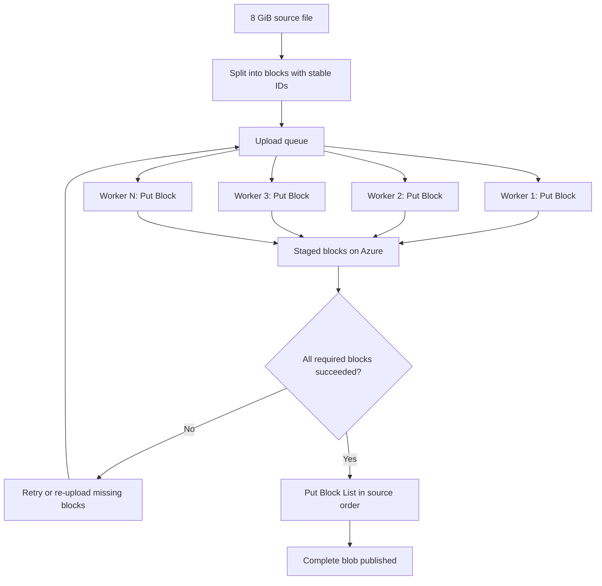

# Uploading Large Files with Blocks and Parallel Transfers

An application may need to upload objects several gigabytes in size to Azure Blob Storage: database backups, videos, VM images, long-term archival log files, or analytics datasets. If the entire file is sent in a single request and the connection drops near the end, the application may have to retransmit a massive amount of data. On unstable networks or when saturating multiple concurrent connections, transferring in **blocks** is generally more suitable.

**Block blobs** support splitting data into chunks, uploading chunks independently, and publishing the complete blob version with a commit operation. Azure SDKs and AzCopy can orchestrate parallel upload requests, automatically retry failed parts, and avoid starting over from scratch.

In the `CLOUD_PROVIDERS_AZURE` module, you explore Azure from subscriptions, resource groups, and Microsoft Entra ID to virtual networking, compute, storage, data, deployment, monitoring, security, and cost. This lesson belongs to the **Object Storage with Blob Storage** chapter and guides you through the block blob mechanism, hands-on large file uploads, performance tuning, and safe operations.

## 1. Learning Objectives

After this lesson, you will be able to:

- Explain the difference between a single-shot upload and a multi-block upload.
- Describe the **Put Block → Put Block List** cycle, the role of block IDs, and commit ordering.
- Calculate block counts from file size and choose appropriate block sizes and concurrency levels.
- Upload large files using **AzCopy** and **Azure Storage SDK for Java** with Microsoft Entra ID.
- Understand retry mechanisms, resume behavior, write conditions, integrity verification, and avoiding unintended overwrites.
- Distinguish errors caused by data permissions, networking, throttling, service limits, and application configuration.
- Monitor upload progress, request costs, bandwidth, and client memory usage.

## 2. What Is a Block Blob?

Azure Blob Storage is an object storage service. Its three main blob types are **block blobs**, **append blobs**, and **page blobs**, each organizing data differently. **Block blobs** are the common choice for files, media, documents, and backups uploaded in parts.

| Blob type | Common usage | Key characteristic |
|---|---|---|
| **Block blob** | Files, videos, backups, application data | Supports uploading blocks then committing a block list |
| **Append blob** | Certain sequential write streams, append-only logs | Designed for appending data to the end |
| **Page blob** | Page-range update workloads, such as VHDs | Supports reading/writing by page range |

With a block blob, each **block** is a data chunk with an ID. Azure receives blocks through separate requests. When the client submits a list of block IDs in the desired order, the service commits them as the blob's content.

Two foundational REST operations:

1. **Put Block:** uploads a single block associated with a `block ID` on the target blob. Before commit, the block is in an **uncommitted** state.
2. **Put Block List:** sends the list of block IDs in the desired assembly order. The blob is created or updated to reflect the committed blocks in that list.

A high-level SDK can execute these operations automatically; developers typically only supply the file, block size, and maximum concurrent requests.

### Parallel Upload Diagram



**Parallelism during Put Block does not determine content order.** The order of blocks in **Put Block List** determines the final assembly order. Therefore, block 20 can finish uploading before block 3 and the destination file will still match the source once the original order is committed.

## 3. Comparing Single-Request Upload vs. Multi-Block Upload

| Criterion | Single-request upload | Multi-block upload |
|---|---|---|
| Transfer method | Sends entire payload in one operation, subject to REST API limits | Splits into multiple Put Block calls, finalized with Put Block List |
| Mid-transfer failure | May require resending the entire payload | Can retry failed blocks without re-sending already staged blocks |
| Concurrency | One single request | Multiple concurrent requests possible |
| Memory control | Depends on how the client reads data | Can stream block by block, bounding in-flight block count |
| Best fit | Small files, stable networks, simple clients | Large files, optimizing throughput or resilient retries |
| Complexity | Low | Higher if manually managing block IDs, queues, and commits |

Not every file needs manual block splitting. SDKs typically define a **single-upload threshold**: for small files, the SDK may use one request; for large files, it automatically uses blocks and parallel transfers per configuration. Simply calling a method named `uploadFromFile` does not mean it always transfers the entire file in one request.

## 4. Block Limits and Calculating Block Counts

Azure Blob Storage enforces limits on the **number of committed blocks in a block blob** and the **maximum size per block**. These limits depend on the REST API version and service capabilities used by the client. With modern API versions, a block blob supports up to **50,000 committed blocks**, and maximum block size can reach **4,000 MiB** with compatible API versions. Consult the Azure Storage limits documentation for your specific SDK when designing very large file pipelines.

The required number of blocks is calculated as:

\[
N = \left\lceil\frac{\text{File size (bytes)}}{\text{Block size (bytes)}}\right\rceil
\]

### Example with an 8 GiB File

Suppose a file is **8 GiB = 8,192 MiB**. Options:

| Block size | Estimated block count | Notes |
|---|---:|---|
| 4 MiB | 2,048 | Many requests, each lightweight |
| 8 MiB | 1,024 | Balanced request count and memory |
| 16 MiB | 512 | Fewer requests, larger payload per request |
| 64 MiB | 128 | Fewest requests; higher memory usage during parallel uploads |

All options stay well under the 50,000 committed-block limit. To design a block size large enough for the maximum expected file size, ensure:

\[
\text{Block size} \geq \left\lceil\frac{\text{Maximum file size}}{50,000}\right\rceil
\]

At the same time, block size must not exceed API/SKU limits and must fit client resources. If an application hardcodes 4 MiB blocks, the block count limit can prevent committing an ultra-large file even if Storage supports larger total blob sizes.

## 5. Choosing Concurrency and Block Size

**Concurrency** is the number of upload operations allowed in flight simultaneously. For example, concurrency of 8 means the client can have up to 8 active Put Block requests at once, depending on SDK scheduling.

Upload throughput depends on many factors: disk read speed, uplink bandwidth, network latency, client limits, CPU, Storage service capacity, concurrent request count, and throttling conditions.

A rough estimate for buffer memory holding in-flight blocks:

\[
\text{Buffer memory} \approx \text{Block size} \times \text{Concurrency}
\]

For example, 16 MiB × 8 requests = **roughly 128 MiB** of in-flight data. This is only a directional estimate: SDKs may allocate additional buffers, streams, queues, and overhead. Do not treat this formula as a strict peak memory guarantee.

### Impact of Parameters

| Change | Potential benefit | Risk/cost |
|---|---|---|
| Increase block size | Fewer requests and lower per-byte request overhead | Larger retry unit on error, larger buffers |
| Decrease block size | Fewer bytes retried on error, easier memory control | More Put Block requests and higher overhead |
| Increase concurrency | Saturates high-latency links, raises throughput up to a point | Higher RAM, CPU, sockets, and throttling risk |
| Decrease concurrency | Lower resource usage and often greater stability | May underutilize available bandwidth |
| Increase timeout conditionally | Helps valid requests on slow links | May mask failures; slows retry detection and completion |

**Sensible tuning workflow:**

1. Measure baseline speed with moderate block size and concurrency.
2. Increment concurrency gradually while monitoring actual throughput, RAM, CPU, `429`/`503` errors, and latency.
3. If request counts are too high, consider increasing block size within API and memory limits.
4. Stop increasing concurrency when speed plateaus or error rates/resource consumption rise noticeably.
5. Record tuned profiles per real environment: workstation, Azure VM, cross-region links, or corporate networks.

No single block size and concurrency setting is optimal for every network path or every file.

## 6. Preparing the Hands-On Environment

Example parameters used:

| Component | Illustrative value |
|---|---|
| Storage account | `stuploadlab01` |
| Container | `large-files` |
| Source file | `./backup-large.tar` |
| Target blob | `backups/backup-large.tar` |
| Identity | User or managed identity with data permissions |
| Role | **Storage Blob Data Contributor** at appropriate scope |
| Test settings | 16 MiB/block, 8 concurrent requests |

The account name must be an actual globally unique existing account; the name above is illustrative. The container must exist before uploading. The source file must reside on local disk or a filesystem readable by the tool. Upload operations can incur storage, transaction, and data transfer costs; practice only in an authorized subscription.

### Permissions and Networking

**Microsoft Entra ID** authenticates the user/managed identity; **Azure RBAC data plane** decides whether that identity can write blobs. For uploads, the commonly used role is **Storage Blob Data Contributor** at the storage account or container scope.

Having only Reader or Contributor on the management plane does not guarantee OAuth blob uploads will succeed. Conversely, certain administrative roles can retrieve storage account keys when Shared Key is enabled; distinguish the actual access path when auditing permissions.

If the account enforces firewalls, private endpoints, or private DNS, the host running AzCopy/SDK must be able to reach the **blob endpoint** as architected. Having the right RBAC role while blocked by network rules will still produce access errors.

## 7. Uploading Large Files with AzCopy

**AzCopy v10** is a command-line utility optimized for transferring data to and from Azure Storage. It supports splitting data into multiple requests, parallel transfers, and persisting job plans to resume interrupted transfers under supported conditions.

### Step 1. Sign in and verify permissions

On a machine with AzCopy and a Microsoft Entra account granted **Storage Blob Data Contributor**, run:

```bash
azcopy login
```

This login command uses your Entra identity for Storage requests. When running on VMs/App Service with managed identities or automation environments, use an identity login method supported by AzCopy; verify the identity type and permissions of that principal.

### Step 2. Upload the file

```bash
azcopy copy "./backup-large.tar" \
  "https://stuploadlab01.blob.core.windows.net/large-files/backups/backup-large.tar" \
  --overwrite=false
```

The destination is a blob URL, **requiring no SAS** when AzCopy uses compatible Microsoft Entra authorization and the identity has sufficient permissions. `--overwrite=false` prevents overwriting an existing blob; verify your environment's overwrite policy before running against important data.

### Step 3. Tune concurrency and block size

In Bash/Linux, you can set concurrency for **a single run** via environment variable:

```bash
AZCOPY_CONCURRENCY_VALUE=8 azcopy copy "./backup-large.tar" \
  "https://stuploadlab01.blob.core.windows.net/large-files/backups/backup-large.tar" \
  --overwrite=false \
  --block-size-mb 16
```

In PowerShell, setting environment variables uses different syntax:

```powershell
$env:AZCOPY_CONCURRENCY_VALUE = "8"
azcopy copy ".\backup-large.tar" `
  "https://stuploadlab01.blob.core.windows.net/large-files/backups/backup-large.tar" `
  --overwrite=false `
  --block-size-mb 16
```

Meaning:

- `AZCOPY_CONCURRENCY_VALUE` controls how many concurrent requests AzCopy schedules.
- `--block-size-mb` configures block size in MiB for supported scenarios and AzCopy versions.
- AzCopy also applies auto-tuning algorithms and internal limits; passed flags do not guarantee a fixed connection count or throughput.

Before tuning production transfers, run `azcopy copy --help` to check the exact flags supported by your **installed AzCopy version**.

### Step 4. Inspect jobs and resume after interruption

```bash
# List jobs recorded locally by AzCopy
azcopy jobs list

# Inspect details of a job after obtaining its job ID from the output
azcopy jobs show "<job-id>"

# Attempt to resume an interrupted job while its job plan is still available
azcopy jobs resume "<job-id>"
```

AzCopy relies on job plan files and logs stored on the **machine that started the job**. If the job plan was deleted, you switched machines, or the auth/token is no longer valid, `jobs resume` may not work as expected. Test resume behavior in your actual environment rather than assuming any machine can resume a job.

**Do not store access tokens, active SAS URLs, or account keys in shared logs.** Redact credentials and sensitive data when sharing error output.

## 8. Parallel Uploads with Azure Storage SDK for Java

For Java applications, **Azure Storage Blob SDK v12** supports uploading directly from a file. The SDK automatically splits the file into blocks, dispatches parallel requests, retries transient errors, and commits the blob. You configure transfer parameters instead of spawning threads and managing block IDs manually.

Required build dependencies:

- `com.azure:azure-storage-blob` — Blob Storage client.
- `com.azure:azure-identity` — authentication with Microsoft Entra ID, including managed identities.

Choose compatible dependency versions via your project's BOM/dependency management process. The example below omits hardcoded version numbers since you should match your project's SDK baseline.

### Sample Java Code

```java
import com.azure.core.util.Context;
import com.azure.identity.DefaultAzureCredentialBuilder;
import com.azure.storage.blob.BlobClient;
import com.azure.storage.blob.BlobClientBuilder;
import com.azure.storage.blob.models.BlobHttpHeaders;
import com.azure.storage.blob.models.BlobRequestConditions;
import com.azure.storage.blob.options.BlobUploadFromFileOptions;
import com.azure.storage.common.ParallelTransferOptions;

import java.nio.file.Files;
import java.nio.file.Path;

public class LargeBlobUpload {
    public static void main(String[] args) throws Exception {
        String accountName = "stuploadlab01";
        String containerName = "large-files";
        String blobName = "backups/backup-large.tar";
        Path source = Path.of("./backup-large.tar");

        if (!Files.isRegularFile(source)) {
            throw new IllegalArgumentException("File not found: " + source);
        }

        BlobClient blobClient = new BlobClientBuilder()
                .endpoint("https://" + accountName + ".blob.core.windows.net")
                .containerName(containerName)
                .blobName(blobName)
                .credential(new DefaultAzureCredentialBuilder().build())
                .buildClient();

        ParallelTransferOptions parallelOptions = new ParallelTransferOptions()
                .setBlockSizeLong(16L * 1024 * 1024) // 16 MiB
                .setMaxConcurrency(8);

        BlobUploadFromFileOptions uploadOptions =
                new BlobUploadFromFileOptions(source.toString())
                        .setParallelTransferOptions(parallelOptions)
                        .setHeaders(new BlobHttpHeaders()
                                .setContentType("application/octet-stream"))
                        // Create only if no blob with this name exists yet.
                        .setRequestConditions(
                                new BlobRequestConditions().setIfNoneMatch("*"));

        blobClient.uploadFromFileWithResponse(uploadOptions, null, Context.NONE);

        long localSize = Files.size(source);
        long remoteSize = blobClient.getProperties().getBlobSize();
        if (localSize != remoteSize) {
            throw new IllegalStateException("Blob size mismatch");
        }

        System.out.println("Upload completed: " + blobName
                + " (" + remoteSize + " bytes)");
    }
}
```

**Explanation of design choices in the code:**

1. `DefaultAzureCredential` picks the appropriate credential source for the environment: developer account locally, or managed identity when configured in Azure. You must assign data roles to the **exact principal**.
2. `BlobUploadFromFileOptions` takes a file path, avoiding reading the entire file into a single byte array in application memory.
3. `ParallelTransferOptions` sets a 16 MiB block size and concurrency of 8. The SDK applies the appropriate upload strategy based on file size and transfer thresholds.
4. The `If-None-Match: *` condition prevents committing over an existing blob. In production, also design versioning, retry, and naming-conflict policies.
5. Comparing `localSize` and `remoteSize` is a basic post-upload check, **not proof that every byte matches**. When high integrity is required, use checksums/hashes and an appropriate verification process.

When multiple application instances upload to the same blob name, decide explicitly whether one upload may overwrite another. Use unique blob names, ETag conditions, leases, or another coordination mechanism. Simply raising upload concurrency **within one file** does not synchronize two separate processes writing to the same blob.

## 9. Controlling Put Block and Put Block List Manually

For specialized requirements such as block-level checkpointing or uploading from a custom stream source, you can use **BlockBlobClient** or low-level REST APIs. However, complexity increases: developers must maintain deterministic IDs, stage all blocks, and commit the right list.

### Block ID Design Principles

- Each block has a `block ID` encoded as a Base64 string per API rules.
- All block IDs within the same blob must conform to uniform length and formatting requirements of the API.
- Generate IDs **deterministically by position** (e.g., sequence 000001, 000002...) so re-uploading a block reuses the exact same ID.
- Never use request **completion order** to determine commit order.

For example, before Base64 encoding:

```text
block-000001 -> [byte 0 ... blockSize-1]
block-000002 -> [byte blockSize ... 2*blockSize-1]
block-000003 -> [byte 2*blockSize ... 3*blockSize-1]
...
```

Suppose three blocks finish staging in actual order **3, 1, 2**. The client still commits the list **[1, 2, 3]** so the blob content matches the source file.

### Coordination Pseudocode

```text
blockSize = 16 MiB
concurrency = 8
blocks = splitFileByRange(sourcePath, blockSize)

for each block:
    block.id = base64(fixedWidthIndex(block.index))

parallelMap(blocks, maxWorkers=concurrency):
    retryTransientErrorsWithBackoff():
        putBlock(blobUrl, block.id, readFileRange(block.offset, block.length))
    checkpoint(block.id, block.offset, block.length, success)

if any block missing:
    failWithoutCommitting()

orderedIds = blocks.sortByIndex().map(block.id)
putBlockList(blobUrl, orderedIds, conditionalWritePolicy)

verifyBlobMetadataAndIntegrity()
```

This is pseudocode explaining the algorithm, not a directly runnable program. A real implementation must handle stream/file channels, tokens, timeouts, response statuses, request conditions, safe checkpointing, and error handling.

### What Happens When Commit Fails?

- **Put Block succeeded:** the block is staged, though not necessarily visible in readable blob content.
- **Put Block List not sent or failed:** a new blob may not exist yet as a complete blob; for an existing blob, the previously committed version generally continues to be served.
- **Put Block List succeeded:** Azure publishes the block list in the submitted order.
- **Commit request timed out:** the client cannot assume commit failed; inspect the target blob/ETag/size or metadata before retrying to avoid unintended writes.

Uncommitted blocks that are never committed may be garbage-collected by the service under internal lifecycle rules. Never rely on them as long-term backups or assume client checkpoints stay valid forever.

## 10. Retries, Resume, and Idempotency

Real-world networks experience timeouts, TCP resets, throttling, or uploader host restarts. Large-file upload designs must distinguish **retryable errors** from **errors that require halting and fixing configuration**.

| Error/condition | Handling approach |
|---|---|
| Timeout, mid-transfer connection drop | Retry the block request with the same block ID and data, or let the SDK handle it |
| HTTP `429 Too Many Requests`, `503 Server Busy` | Use exponential backoff, jitter, respect `Retry-After` if present; reduce concurrency if throttling persists |
| HTTP `401 Unauthorized` | Check token, tenant, credential; refresh token per SDK flow |
| HTTP `403 AuthorizationPermissionMismatch` | Check Blob Data Contributor role, scope, identity; do not endlessly retry missing permissions |
| HTTP `403` due to network/firewall | Check Storage firewall, private endpoint, DNS, routing |
| HTTP `409` or `412` with write conditions | Check lease, ETag, existing blob, and concurrent conflicts |
| Block size exceeds API limit | Reduce block size or use compatible API/SDK version |
| Source data modified during upload | Abort or restart from a fixed snapshot/file version to avoid stitching blocks from different source versions |

**Block-level idempotency:** with a deterministic block ID, retrying `Put Block` re-stages the same data; the last write for that ID determines its uncommitted content. Thus, ensure data for a given ID does not change between retries.

**Blob-level idempotency:** committing to the same blob name can overwrite or create a new version. Use **ETag/conditional headers**, blob versioning, or upload-session-specific blob names to prevent two jobs from clobbering the same target.

**Resume is more than remembering bytes sent.** If building a custom client, you must track which blocks are staged, their source offsets, block IDs, ordering, and commit status. Some high-level SDKs only retry within a single method call; cross-process resume must be verified or implemented explicitly. AzCopy provides a job-plan mechanism for resuming jobs.

## 11. Post-Upload Integrity Verification

A successful upload response means Azure accepted the operation. For sensitive data or critical backups, additional verification is warranted.

**Verification levels:**

1. **Commit status:** the upload/`Put Block List` request succeeded and the target blob exists.
2. **Size:** the blob's byte count matches the source file.
3. **ETag and Last-Modified:** recorded to track the committed version; ETag is not a content checksum.
4. **Per-request checksums:** the SDK or protocol can use MD5/CRC64 at the request level where supported; this protects request transit, not automatically the entire composite blob.
5. **End-to-end hash:** when high integrity is required, compute SHA-256 on the source file and verify at the destination through a controlled download/re-read or application check. Metadata storing a source hash is only meaningful when cross-checked by independent computation.

### Checking Blob Metadata with Azure CLI

```bash
az login
az account set --subscription "<subscription-id>"

az storage blob show \
  --account-name "stuploadlab01" \
  --container-name "large-files" \
  --name "backups/backup-large.tar" \
  --auth-mode login \
  --query "{size:properties.contentLength,etag:properties.etag,lastModified:properties.lastModified}" \
  --output json
```

This command **only reads metadata**; it does not verify every byte. It requires a data role permitting blob/metadata reads. Comparing hashes against real data takes extra time and read bandwidth; avoid downloading multi-gigabyte files to a workstation just for verification if operational workflows support a more efficient verification path.

## 12. Security and Governance for Large Uploads

Block uploads must follow the same security controls as any other data write operation:

- **Prefer Microsoft Entra ID/managed identity** for Azure-hosted apps with the `Storage Blob Data Contributor` role at the required scope.
- **Protect credentials:** never place account keys, SAS URLs, or bearer tokens in source code, shared command history, or public logs.
- **Use HTTPS:** validate Storage endpoints and TLS certificates; never disable certificate verification to work around transfer errors.
- **Restrict permissions and networking:** verify Storage firewalls, private endpoints, private DNS, routing, and uploader identity permissions.
- **Protect destinations:** consider blob versioning, soft delete, immutability, and write conditions for valuable or regulated data.
- **Isolate pipelines by environment:** prevent dev workloads from accidentally uploading to production containers; use separate accounts/containers/identities as needed.
- **Observe traffic:** collect appropriate metrics/request logs, set alerts for throttling, failures, and capacity; retain operational evidence as required.
- **Never commit incomplete data:** commit only after every required block has uploaded and passed checks.

If issuing a SAS for external clients to upload directly, generate tokens with **minimal scope and duration**, consider user delegation SAS for Blobs, restrict to required write permissions, and prevent clients from overwriting unauthorized blob names. A SAS is a credential; an exposed URL can be used until it expires or is revoked via supported mechanisms.

## 13. Performance, Monitoring, and Cost

Large uploads consume multiple resource dimensions:

| Factor | Measured via | Meaning |
|---|---|---|
| Throughput | MiB/s or GiB/min from client | Effective transfer rate |
| Completion time | Job wall clock, AzCopy/app logs | Upload SLA |
| Request count | Storage metrics/diagnostics if configured | Many requests can raise transaction fees |
| Retry rate, `429`, `503` | App/Storage logs | Signal of throttling or unstable network |
| Uploader CPU and RAM | OS/VM/container metrics | Excessive concurrency can bottleneck the client |
| Network throughput/latency | Network metrics and client measurements | Identifies bandwidth caps and latency |
| Blob capacity, versions, tier | Azure portal/Storage metrics | Storage and retention costs |

Unit pricing depends on storage account, region, tier, request type, capacity, and data transfer policies. Numerous Put Block requests increase operation counts; larger block sizes reduce request counts at the expense of higher retry costs and memory usage. In Azure, **ingress** generally has different pricing rules than **egress**, yet you must check actual pricing tables, intermediate services, and cross-region links.

**Keep lab costs controlled:** use test files without real data, monitor Azure Cost Management, and avoid leaving verbose diagnostics enabled long-term unnecessarily. When deleting lab files, verify whether blob versioning, snapshots, soft delete, or retention policies retain data and continue incurring charges.

## 14. Real-World Scenario: Uploading an 8 GiB Backup

Every night, a service produces an approximately **8 GiB** backup file to upload to the `backups` container. The uploader VM has good bandwidth but experiences occasional brief network drops.

**Initial proposed design:**

1. Write the complete backup to a temporary path; begin uploading only once the file is no longer being written to.
2. Construct blob names with date/time or job ID, such as `nightly/2026-11-20/backup.tar`, so two jobs cannot overwrite each other.
3. Use a managed identity granted `Storage Blob Data Contributor` scoped strictly to the `backups` container.
4. Start testing with a **16 MiB** block size and concurrency **8**. For 8 GiB, the client creates around **512 blocks**; in-flight data buffers require roughly **128 MiB** assuming one block per worker, excluding SDK overhead.
5. Rely on SDK/AzCopy retries for transient errors; monitor throughput, RAM, retry counts, and completion time.
6. Mark the backup **ready for restore** only after commit succeeds and metadata/checksum checks pass per backup policy.
7. Record blob name, size, ETag, checksum, and job status in the backup catalog; apply appropriate retention/versioning.
8. Run **restore drills** to confirm backups are genuinely usable. Never treat upload success alone as proof of recoverability.

Suppose a single connection achieves only 20 MiB/s while multiple independent requests can run concurrently; reasonable concurrency can boost throughput. However, if the VM's total uplink cap is 20 MiB/s, raising concurrency from 8 to 64 cannot exceed physical link limits and may worsen performance due to overhead.

## 15. Self-Check Exercises

**Question 1.** An 8 GiB file is split into 32 MiB blocks. How many blocks are needed, and which operation determines the final content order?

*Hint:* `8192 / 32 = 256` blocks. The order in `Put Block List` determines the blob content.

**Question 2.** Two block uploads fail after 510 other blocks have staged successfully. Must you re-upload the entire file?

*Hint:* Usually no. Retry the failed blocks with stable block IDs and payloads, then commit the complete block list.

**Question 3.** Why can raising concurrency from 8 to 64 actually increase total upload time?

*Hint:* RAM/CPU contention, sockets, bandwidth saturation, throttling, and retries; throughput is not guaranteed to scale linearly.

**Question 4.** An application has Azure RBAC Reader on the storage account, calls the Azure SDK with a Microsoft Entra token, and receives `403` on upload. What permission should be granted?

*Hint:* A data-plane role with write permission such as `Storage Blob Data Contributor` on the container/account, after verifying identity, scope, and network access.

**Question 5.** The upload reports success and the blob has the exact byte count. Is that sufficient to confirm the backup is definitely restorable?

*Hint:* No. You need appropriate hash/integrity checks and restore drills.

## 16. Pre-Production Checklist

- [ ] Selected **block blobs** and verified block/blob limits for the API/SDK version in use.
- [ ] Identified maximum file size and calculated block count under the chosen configuration.
- [ ] Source file is immutable/stable and not modified during upload.
- [ ] Block IDs and commit ordering are properly handled by the SDK or custom logic.
- [ ] Block size and concurrency benchmarked on real network paths while monitoring RAM/CPU.
- [ ] Bounded retries with backoff configured, distinguishing transient errors from auth/config errors.
- [ ] Resume/checkpoint mechanism designed if recovery across process restarts is required.
- [ ] Overwrite policy, multi-uploader coordination, and blob versioning/ETags configured where appropriate.
- [ ] Principal holds Blob Data Contributor at the required scope; static account keys avoided in favor of managed identity where possible.
- [ ] Storage firewall, private endpoint, DNS, TLS, and network routing verified.
- [ ] Size, commit status, metadata, and hash/restore verified as required.
- [ ] Metrics/logs, error alerts, request/capacity cost projections, and retention configured.

## Conclusion

Uploading large files to Azure Blob Storage is most effective when you understand **block blobs**, how **Put Block** stages data, and how **Put Block List** publishes the blob in exact order. Use AzCopy or Azure SDKs to handle block splitting, parallelism, retries, and client resource management; drop down to manual block-level control only for specialized requirements. A reliable upload pipeline must also enforce proper identities and permissions, prevent unintended overwrites, verify integrity, monitor throughput, and control operational costs.
