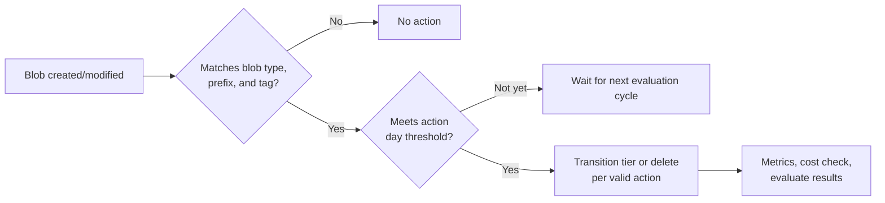
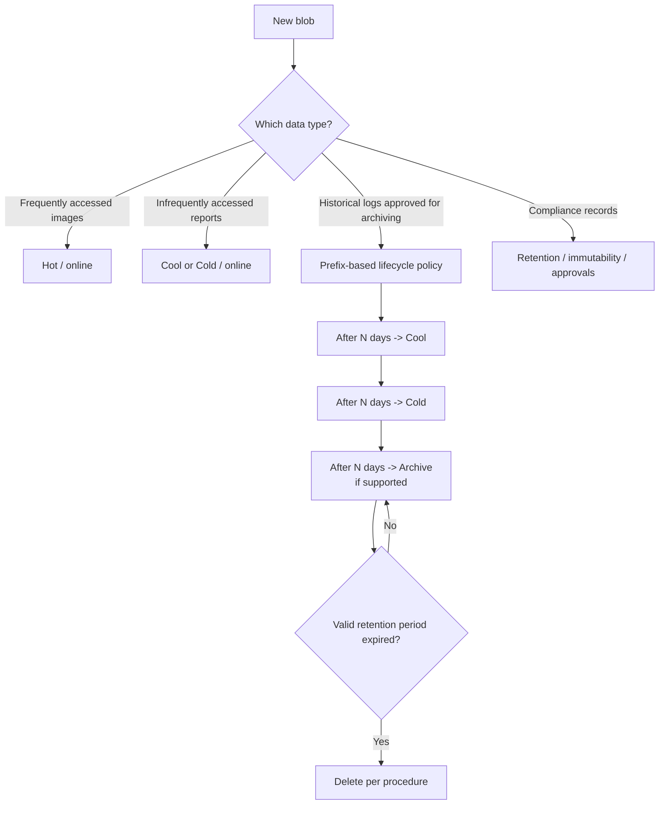
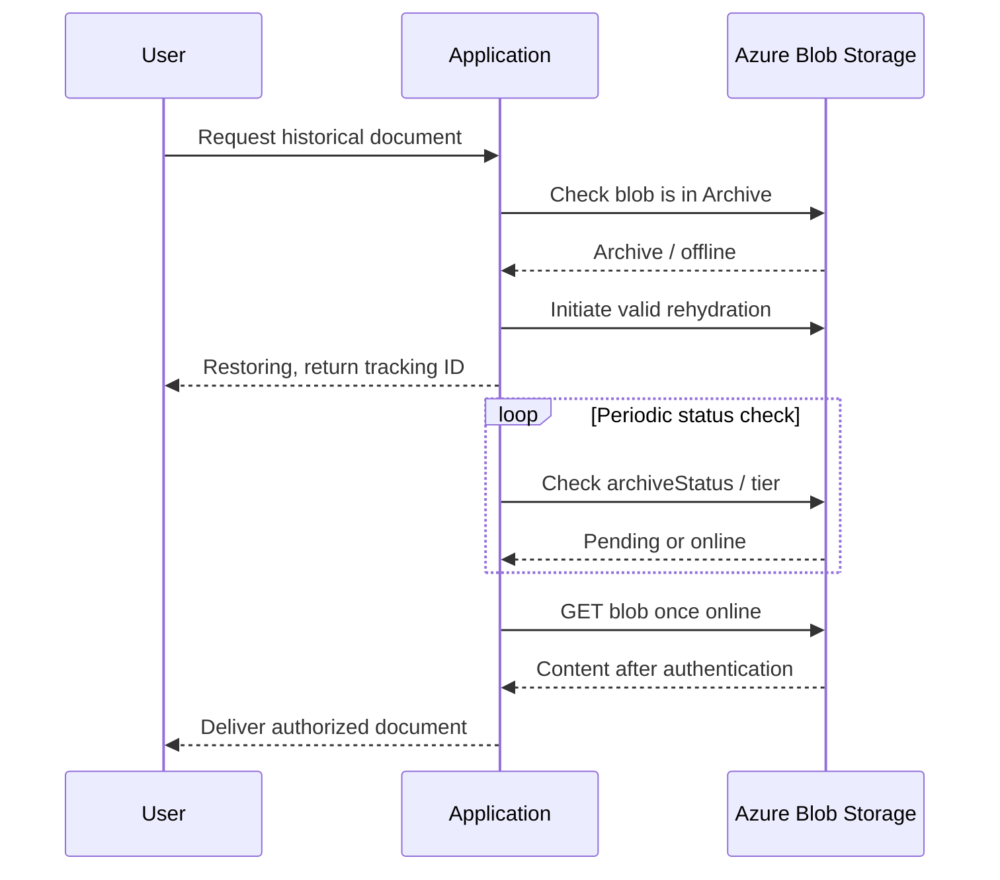

# Choosing Access Tiers and Lifecycle Management Rules

A system on Azure might store product images downloaded thousands of times a day, reports viewed only a few times a month, and old data exports that almost nobody ever opens again. If every object is placed in the same storage tier, the organization may overpay for capacity or incur unnecessary retrieval charges. **Azure Blob Storage access tiers** help balance storage cost against access frequency and acceptable retrieval time; **lifecycle management** automates tier transitions or data deletion under controlled policies.

This lesson belongs to the **Object Storage with Blob Storage** chapter of the **CLOUD_PROVIDERS_AZURE** module. The module explores Microsoft Azure from subscriptions, resource groups, and Microsoft Entra ID to virtual networking, compute, storage, and data, while deploying, monitoring, securing, and controlling costs for application architectures. For Blob Storage, choosing a tier must be tied to **business requirements, access permissions, availability, and total cost over the data's lifecycle**, rather than looking solely at storage price per GB.

After this lesson, you will be able to:

- Distinguish the **Hot, Cool, Cold, and Archive** access tiers.
- Analyze storage, transaction, retrieval, data transfer, minimum retention, and rehydration costs.
- Choose tiers based on read frequency and required access latency, not merely blob age.
- Understand the scope and basic syntax of lifecycle management policies.
- Write tier-transition or deletion rules using appropriate prefixes, blob types, and day thresholds.
- Build a testing, deployment, and monitoring plan to avoid accidental deletion or archiving critical active data.

## 1. What Are Access Tiers?

An access tier is an option that optimizes how **a blob object** is stored and billed based on expected usage frequency. For supported account types and block blobs, the tier can be set at the blob level; in some accounts, blobs without an explicit tier inherit the account's default access tier.

Each tier involves a trade-off:

- Tiers meant for frequent access have **higher capacity costs** but generally **lower read/retrieval costs**.
- Tiers for infrequently read data have **lower capacity costs**, while transactions, retrievals, or tier transitions can be more expensive.
- **Archive** is for data that does not need immediate reads; to read its contents, you typically must perform **rehydration** back to a supported online tier.

Tiers do not turn a blob into an independent backup, do not replace data access permissions, and do not eliminate the need to design redundancy (LRS, ZRS, GRS, etc.) per account capabilities.

### 1.1. Comparison Table: Hot, Cool, Cold, and Archive

| Criterion | Hot | Cool | Cold | Archive |
|---|---|---|---|---|
| Typical purpose | Frequently accessed data | Infrequently accessed data that must remain online | Very rarely accessed data that must be readable online | Long-term storage with no immediate retrieval requirement |
| Access state | **Online** | **Online** | **Online** | **Offline** for blob content |
| Immediate read capability | Yes, subject to service/network/permission conditions | Yes | Yes | No; requires rehydration/copying to a supported online tier |
| Relative storage cost | Usually highest | Lower than Hot | Lower than Cool | Usually lowest |
| Retrieval/transaction cost | Usually lower | Usually higher than Hot | Usually higher than Cool | Dedicated retrieval/rehydration and transaction fees apply |
| Minimum retention duration to avoid early deletion fee | No minimum equivalent to Cool/Cold/Archive | **30 days** | **90 days** | **180 days** |
| Examples | Active product images, newly uploaded files | Last month's reports | Old logs rarely queried | Historical records restored only on request |

The comparisons above are directional only. Actual billing depends on region, redundancy, account type, capacity, operation types, and current Azure pricing. **Do not equate Cold with Archive**: Cold is still an online tier, whereas Archive requires time to bring content back online.

### 1.2. Why Does Minimum Retention Matter?

Suppose a blob is moved to **Cool** and deleted just 5 days later. Because Cool has a typical minimum retention period of 30 days, the account may incur an **early deletion fee** for the remaining period. The same principle applies to Cold (90 days) and Archive (180 days); changing tiers before the minimum duration elapses can also trigger the corresponding charge.

Example:

```text
Day 0  : Blob enters Cool
Day 5  : Application deletes Blob
Cool minimum: 30 days
=> May be billed an amount equivalent to the remaining retention days.
```

Distinguish the **tier's minimum retention billing rule** from the **days since last modification used in lifecycle policies**. These are two separate measurements serving different purposes; do not assume reaching a lifecycle threshold automatically prevents early deletion fees in the current tier.

## 2. Choosing Tiers Based on Real Lifecycles

### 2.1. Data Requiring Fast Response

Web applications with product images, newly uploaded documents, or user data queried frequently should start in **Hot** if read rates are high or hard to predict. Every retrieval must be factored into total cost, because a storage-cheap tier can become expensive under heavy reads.

**Example:** a 1 MB product image downloaded 20,000 times per day. Moving it to Cool simply because it was uploaded three months ago can increase retrieval and transaction costs.

### 2.2. Infrequently Read Data That Must Be Available Immediately

Monthly reports, finalized statements, or rarely queried logs can fit **Cool** or **Cold**, provided the service, account, and workload support them. Both remain online tiers, so authorized clients can read data through the API without waiting through an extended rehydration process like Archive.

**Example:** prior-quarter report data read by auditors only a few times a year, yet contracts require immediate download on demand. Cold may be worth evaluating over Archive if access times must stay very short.

### 2.3. Long-Term Data That Can Tolerate Wait Times

Historical records kept for legal mandates or forensic logs can fit **Archive** when:

1. There is a clear retention policy.
2. Retrieval probability is very low.
3. The business accepts a restore-request workflow and waiting for rehydration.
4. Rehydration/retrieval costs have been accounted for.
5. Archive support is confirmed for the current **account kind, blob type, region, and redundancy**.

For Archive blobs, content cannot be read directly via a standard GET operation prior to rehydration. Rehydration can take many hours depending on size, priority, and service capacity. Do not use Archive for files that an API must return to customers within seconds.

### 2.4. There Is No Universal "Archive After N Days" Rule for All Data

Data age is a **signal**, not the sole criterion. A 2-year-old contract might still be downloaded constantly; a log file generated yesterday might never need to be read. Before picking a tier, answer:

- Is the data read steadily, seasonally, or unpredictably?
- Is the acceptable read SLA in seconds/minutes or many hours?
- Can older data or another copy be served instead?
- Is the blob updated frequently or effectively immutable?
- During an incident, which data categories must be recovered first?
- What is the legal/contractual retention duration?
- Do versioning, soft delete, or immutability policies affect the lifecycle?

## 3. Calculating Total Cost Instead of Looking Only at GB/Month

A reference cost model:

```text
Estimated total cost =
    storage capacity cost by tier and redundancy
  + transaction fees (read/write/list, tier transitions, etc.)
  + data retrieval fees from corresponding tiers
  + Archive rehydration fees (if applicable)
  + outbound data transfer fees per applicable pricing
  + early deletion / early tier-change fees (if triggered)
  + costs of replicas, versions, snapshots, or associated logs
```

### 3.1. Simple Quantitative Exercise

Suppose a team has **1,000 GB** of documents. To illustrate the method without quoting real pricing tables, we define **hypothetical cost units**:

| Variable | Hot | Cool |
|---|---:|---:|
| Storing 1 GB for one month | 2 units | 1 unit |
| Retrieval fee per GB read | 0 units | 0.5 units |

If **100 GB** are read that month (excluding transactions and other fees):

- Hot: `1,000 × 2 = 2,000` units.
- Cool: `1,000 × 1 + 100 × 0.5 = 1,050` units.

If **3,000 GB** are read (the same files read repeatedly):

- Hot: `1,000 × 2 = 2,000` units.
- Cool: `1,000 × 1 + 3,000 × 0.5 = 2,500` units.

In this hypothetical model, Cool wins when reads are low, while Hot wins when reads are high. In reality, you must add transaction rates, capacity tiers, minimum retention periods, operation billing, and network charges. **These numbers only teach the calculation method; they are not Azure prices**.

### 3.2. Why Can Archive Sometimes Be Expensive?

Archive lowers capacity fees for rarely accessed data, yet can increase total cost if:

- Large volumes must be rehydrated after a short time.
- Blobs are moved or deleted before minimum retention expires.
- Archives must be thawed repeatedly for unscheduled audits.
- Separate Hot/Cool copies must be maintained to serve fast-read needs.
- Application workflows must add queues, state tracking, notifications, and wait-time handling.

Therefore, cost analysis must cover the **entire data lifecycle**, not just compare Archive and Hot storage rates at a single point in time.

## 4. Default Account Access Tier and Per-Blob Tiers

In supported Blob Storage accounts, the storage account's **default access tier** is typically **Hot or Cool**. An individual blob can have an explicitly assigned tier; when no explicit tier is set and the account kind supports inheritance, the blob inherits the account's default tier.

Key things to note:

- The account-level default tier is not an automatic access-frequency measurement mechanism.
- Changing a blob's tier can incur transaction fees and reset/trigger minimum retention requirements.
- Online blobs (Hot/Cool/Cold) are accessible via Blob APIs if permissions and networking permit; Archive requires rehydration.
- Availability of **Cold/Archive**, supported blob types, tier operations, and redundancy can vary by account kind and service capabilities.
- **Tiering is storage optimization, not backup**. If a blob is deleted, having another tier does not guarantee a recoverable copy.

Distinguish **changing the tier of a single blob** from **changing the default access tier of the storage account**. The two operations differ in blast radius, billing impact, and support conditions. When changing an account default, identify which blobs currently inherit the default rather than assuming existing blobs remain unaffected.

## 5. What Is Lifecycle Management?

**Blob lifecycle management** uses *rules* to automatically execute actions on blobs matching defined conditions. It is an Azure Storage feature configurable on supported storage accounts. A rule typically includes:

1. **Name and status**: `name` and `enabled`.
2. **Policy type**: `type: "Lifecycle"`.
3. **Filters**: blob types, blob name prefixes, and/or blob index tags if supported.
4. **Actions**: transition base blobs to Cool, Cold, or Archive; delete blobs; and manage snapshots/versions using supported actions.
5. **Age conditions**: such as days since last modification, days since last access when last-access tracking is enabled, or days since creation for snapshots/versions.



Lifecycle management executes **asynchronously on a periodic schedule**, not as a timer firing at the exact second a threshold is crossed. Do not design business deadlines assuming a blob will transition or be deleted at exactly 00:00 on day N. Observe actual execution behavior and service exceptions.

### 5.1. Filtering Mechanisms: Prefix, Blob Type, and Blob Index Tags

| Component | Example | Meaning |
|---|---|---|
| `blobTypes` | `["blockBlob"]` | Applies only to listed blob types |
| `prefixMatch` | `["logs/diagnostic/"]` | Selects blobs whose path starts with that container/prefix |
| `blobIndexMatch` | `{"name":"DataClass","op":"==","value":"Internal"}` | Selects by blob index tag if supported by account/feature |

**Warning:** `prefixMatch` does not support glob/regex syntax; the container name is part of the prefix value. Blob index tags are distinct from standard blob metadata. Do not assume rules can filter on arbitrary metadata or express complex business predicates.

Use structured prefixes—for example, distinguishing `logs/diagnostic/` from `logs/security/`. An overly broad prefix can accidentally transition or delete data that must be preserved.

### 5.2. Time Conditions and Last Access Tracking

Common conditions:

- `daysAfterModificationGreaterThan`: based on the base blob's last modification time; suitable for data unchanged after creation.
- `daysAfterLastAccessTimeGreaterThan`: based on last access time, **usable only when last access time tracking is configured and supported**.
- `daysAfterCreationGreaterThan`: used in supported snapshot or version actions, measured from the related object's creation time.

**Do not equate a single HTTP read with an immediate lifecycle timestamp update.** Last access time tracking has specific support conditions, update mechanisms, and latency; verify account/SDK behavior and accept that policies are not designed to react instantaneously to every read.

For instance, if old data is immutable and rarely accessed, a **last modified** condition is straightforward. If very old documents are still read regularly, consider **last access** tracking or business filters to avoid automatically archiving them, while factoring in the cost and operational limits of access tracking.

## 6. Complete Lifecycle Policy Example for Diagnostic Logs

Suppose a Storage Account stores diagnostic logs under the `logs/diagnostic/` prefix. The business has **approved** retaining these logs for up to roughly 400 days and accepts rehydration wait times for very old logs. We want:

- After **30 days** from last modification: move to **Cool**.
- After **90 days**: move to **Cold**.
- After **180 days**: move to **Archive** if supported by the account.
- After **400 days**: **delete**, but only when aligned with retention and compliance mandates.

This illustrates threshold configuration, **not a universal recommendation**. The intervals between thresholds were chosen to reduce early deletion fee risk as objects progress through Cool → Cold → Archive; you must still verify actual execution and when blobs enter each tier.

### 6.1. Illustrative Policy JSON

```json
{
  "rules": [
    {
      "name": "diagnostic-logs-retention",
      "enabled": true,
      "type": "Lifecycle",
      "definition": {
        "filters": {
          "blobTypes": ["blockBlob"],
          "prefixMatch": ["logs/diagnostic/"]
        },
        "actions": {
          "baseBlob": {
            "tierToCool": {
              "daysAfterModificationGreaterThan": 30
            },
            "tierToCold": {
              "daysAfterModificationGreaterThan": 90
            },
            "tierToArchive": {
              "daysAfterModificationGreaterThan": 180
            },
            "delete": {
              "daysAfterModificationGreaterThan": 400
            }
          }
        }
      }
    }
  ]
}
```

Explanation:

1. `rules` is the list of lifecycle rules on the account.
2. `enabled: true` marks the rule active for evaluation.
3. `blobTypes: ["blockBlob"]` scopes it to block blobs.
4. `prefixMatch` targets blobs under **container `logs`, prefix `diagnostic/`**, not the whole account.
5. `baseBlob` defines actions on the current/base blob; snapshots or previous versions are not automatically handled identically.
6. Thresholds mark when blobs become **eligible** for transition or deletion; they do not guarantee exact execution timing or that every account supports all four actions.

For a rule to run cleanly, the account must support every tier/operation; if the region, redundancy, blob type, or another feature does not support Archive/Cold, **adapt the design** instead of forcing the policy as-is. Never deploy a rule containing `delete` against production data before confirming retention and recovery procedures.

### 6.2. Why Not Use the Same Rule for Product Images?

Product images downloaded many times a day can have a **last modified** timestamp far in the past. Based on age alone, the policy above would move images to Archive and break direct website reads. Therefore, separate containers or prefixes by lifecycle policy:

```text
images/products/              -> Online data, keep in Hot/Cool as needed
reports/monthly/              -> Consider Cool or Cold, fast reads still needed
logs/diagnostic/              -> Approved 30/90/180/400-day rule
contracts/legal/              -> Follow retention policy, no auto-deletion
```

This categorization can reflect business owners, SLAs, and retention regulations. Do not share one policy merely because datasets live in the same Storage Account.

## 7. Rules for Snapshots and Previous Versions

If an application enables **Blob versioning** or uses **snapshots**, older versions can keep consuming capacity even after the base blob changes tiers or is deleted. Lifecycle management provides dedicated actions for these objects where supported.

Example illustrating a rule targeting **previous versions** only, leaving the base blob untouched:

```json
{
  "rules": [
    {
      "name": "old-invoice-draft-versions",
      "enabled": true,
      "type": "Lifecycle",
      "definition": {
        "filters": {
          "blobTypes": ["blockBlob"],
          "prefixMatch": ["drafts/invoices/"]
        },
        "actions": {
          "version": {
            "delete": {
              "daysAfterCreationGreaterThan": 180
            }
          }
        }
      }
    }
  ]
}
```

**Note:** this second example demonstrates a standalone action structure, not a file to blindly merge with the previous section's policy. Before using it, verify the account type and supported versioning/soft-delete features. When managing base blobs, snapshots, and versions together, explicitly design retention for each group; `snapshot` and `version` blocks only support actions and conditions permitted by Storage.

When recovery from overwrites or accidental deletion is required, check:

- Are **Blob soft delete** and **container soft delete** enabled? Are retention periods appropriate?
- Are **versioning/snapshots** enabled? Do old versions also have an appropriate cleanup policy?
- Does the data have **immutability policies, legal holds**, or compliance obligations preventing deletion?
- Could a lifecycle rule eliminate recovery capability **before** the desired business window expires?

Lifecycle deletion is a destructive data operation. Never treat a lifecycle policy as a backup strategy or a "permanent recycle bin".

## 8. Azure CLI Hands-On: Inspecting Tiers and Policies

This section provides **read-only** commands to gather evidence before altering configurations. Examples use Bash and an authenticated Azure CLI session. Appropriate control-plane permissions are required, plus valid data-plane permissions when inspecting a specific blob.

### 8.1. Check Account Kind and Default Tier

```bash
az account show \
  --query "{subscription:name,subscriptionId:id,tenantId:tenantId}" \
  -o table

RG="rg-blob-lab"
ACCOUNT="stbloblab"

az storage account show \
  --resource-group "$RG" \
  --name "$ACCOUNT" \
  --query "{name:name,kind:kind,sku:sku.name,defaultAccessTier:accessTier,location:location}" \
  -o json
```

The output confirms account kind, redundancy, region, and default access tier. When changing policies, do not rely solely on the default `accessTier`: individual blobs may carry different explicit tiers.

### 8.2. Check a Blob's Tier

```bash
az storage blob show \
  --account-name "$ACCOUNT" \
  --container-name "reports" \
  --name "monthly/report-2026-01.csv" \
  --auth-mode login \
  --query "{name:name,tier:properties.blobTier,tierInferred:properties.blobTierInferred,lastModified:properties.lastModified}" \
  -o json
```

With `--auth-mode login`, the current identity needs an appropriate data-plane role, such as `Storage Blob Data Reader`, and must not be blocked by firewall/network policies. A `403` error says nothing about the tier; check authorization and network routing.

### 8.3. View the Current Lifecycle Management Policy

```bash
az storage account management-policy show \
  --resource-group "$RG" \
  --account-name "$ACCOUNT" \
  -o json
```

If no policy is configured on the account, the command may return an error or report none found; that is not proof that no other lifecycle actions exist (such as application jobs deleting blobs). Check automation, pipelines, and data governance rules as well.

### 8.4. Controlled Policy Deployment

In a lab or approved environment, an operator can create a JSON file based on Section 6, **adjust the scope and remove unwanted actions**, and apply it:

```bash
az storage account management-policy create \
  --resource-group "$RG" \
  --account-name "$ACCOUNT" \
  --policy @policy.json
```

This is a **state-changing command** with the risk of deleting or re-tiering data; run it only after verifying the target account, valid JSON, prefix scope, approval permissions, and rollback plan. In this lesson's walkthrough, we **do not execute** this command. When updating an existing policy, inspect current rules first so you do not overwrite another team's configuration.

## 9. Lifecycle Design for an E-Commerce System

Consider a system storing four object groups:

| Data group | Access pattern | Read SLA | Suggested decision |
|---|---|---|---|
| Active product images | High daily reads | Immediate online read | Usually keep Hot, consider caching/CDN |
| Prior month's financial reports | Low reads, occasional audits | Immediate read | Evaluate Cool or Cold |
| Application logs older than 6 months | Rarely needed | Can wait hours if needed | Consider Archive if permitted |
| Legal records subject to retention | Rarely read but must stay intact | Per contract | Tier per SLA, combine with immutability/retention |

Assume the application uses Blob Storage, App Service/Functions, managed identity, and Application Insights for monitoring.

### 9.1. Connecting Data Age to Cost



It is vital to **combine business metadata and naming structure** in your design rather than trying to base every decision solely on last-modified timestamps. Data under legal retention must be excluded from delete rules until retention obligations expire.

### 9.2. Example Retention Calculation to Avoid Early Deletion Fees

For immutable diagnostic logs, the milestones in Section 6 create these intervals:

```text
Create/last mod  30 days       90 days       180 days           400 days
     |              |              |              |                  |
     v              v              v              v                  v
    Hot  ------->  Cool  ------->  Cold  ------->  Archive  ------->  Delete
                    60 days        90 days           220 days
```

These illustrative intervals meet or exceed the respective Cool/Cold/Archive minimum retention thresholds, **provided transitions occur at expected milestones and blobs are not modified or moved out-of-band**. In practice, lifecycle runs asynchronously and blobs may be tiered manually, so monitor actual tier entry dates and charges.

### 9.3. Avoiding the "Unreadable Invoice" Incident

If a system moves customer invoices to Archive immediately after 180 days, the invoice download API cannot serve files immediately when customers open their history page. There are three design approaches:

1. **Keep invoices online** if contracts require instant access; evaluate Cold instead of Archive.
2. **Design a restore-request workflow**: persist request state, submit a rehydration job, notify the user of wait times, poll job completion, and deliver the file once ready.
3. **Layer the data**: keep frequently accessed/summary copies online and archive historical originals if legal and accuracy requirements allow.

Every option must protect data permissions, avoid exposing long-lived SAS URLs, and reconcile state during rehydration/recovery.

## 10. Operational Realities: Rehydration, Recovery, and Security

### 10.1. Rehydrating from Archive

When Archive content is needed, you can re-tier the blob or copy it to a new blob in an online tier, as supported by the service. Duration and cost depend on size, priority level, and Azure pricing rules.



Do not build synchronous APIs holding an HTTP request open for hours. Use background jobs/queues with persisted state, controlled retries, and timeout notifications. If archived files are frequently thawed, re-evaluate the tier choice.

### 10.2. Archive Is Not an Accidental-Deletion Backup

Lifecycle, replication, backup, and retention solve different problems:

- **Tiering** optimizes a blob's cost/access profile.
- **Replication** protects against infrastructure faults within the chosen redundancy scope.
- **Soft delete/versioning** assists recovery after accidental deletion or overwrite under configured rules.
- **Backups** and independent copies carry separate retention/recovery rules.
- **Immutability/legal hold** addresses data preservation mandates.

If lifecycle deletes a blob and no valid recovery copy remains, having once stored it in Archive **does not create a copy to get back**. Verify restore tests and retention policies before enabling delete actions.

### 10.3. Permissions and Networking Still Apply Across Every Tier

Moving Hot → Cold or Archive does not automatically make a blob more public or more private. Clients still need appropriate Blob data-plane permissions and HTTPS connectivity matching the account's network controls. For Azure-hosted apps, prefer managed identities and least-privilege roles; for SAS, constrain permissions/lifetimes and keep token URLs out of logs.

Private Link/Private Endpoints, firewalls, public network access settings, and Azure RBAC continue to govern tier changes and rehydration. A `403` error when reading Cold data indicates a permission/network failure, not an offline tier.

## 11. Testing, Deploying, and Monitoring Policies

### 11.1. Safe Rollout Process

1. **Inventory data**: total capacity, blob types, prefixes, last modified times, access frequency, and data age.
2. **Approve retention**: document owners, legal requirements, minimum retention, and data excluded from auto-deletion.
3. **Estimate costs**: model storage, read volume, retrieval, transactions, rehydration, and early deletion fees.
4. **Scope rules narrowly**: start with a clear test prefix rather than the entire account.
5. **Test in a lab**: use disposable dummy data and verify account support for actions and permissions.
6. **Observe impact**: cross-check actual tiers, app read behavior, cost metrics, and operational logs.
7. **Deploy with controls**: manage policies via IaC/code review, use maintenance windows, and keep previous policy versions.
8. **Monitor long-term**: review rules whenever products evolve, containers are added, or retention commitments change.

Lifecycle does not provide a built-in "dry run" proving exactly which blobs will be affected. You can inventory/prefix-filter sample data to **pre-estimate** eligible objects, then observe real behavior at small scale.

### 11.2. Metrics to Monitor

| Metric / signal | Meaning |
|---|---|
| Capacity by tier | Confirms data layers distribute as designed |
| Blob count, data age, prefix distribution | Spots abnormal container growth or unmanaged objects |
| Transaction, retrieval, and rehydration charges | Detects misoptimization when cold tiers receive heavy reads |
| Early deletion charges | Detects transitions/deletions before minimum retention |
| `404`/`403` error rates and read latency | Separates unavailable data from permission errors or accidental deletion |
| Actual rehydration duration | Measures whether business SLAs are being violated |
| Restore test results | Proves recoverability rather than relying solely on policy |
| Management policy change history | Audits who modified rules, when, and why |

Azure Monitor, Storage metrics, Azure Cost Management, and Activity Logs can provide these views depending on configuration. Not every lifecycle event emits the same granularity across all accounts; choose appropriate telemetry sources and understand observability limits.

### 11.3. Common Issues and Troubleshooting

| Symptom | Possible Cause | What to Check |
|---|---|---|
| Blob did not change tier immediately at day 30 | Lifecycle runs periodically/asynchronously | Verify rule is enabled, timing, blob type, job status, and allow reasonable evaluation time |
| No blobs match the rule | Wrong `prefixMatch` or `blobTypes` | Verify actual container/prefix, blob names, and case sensitivity |
| Rule cannot use Archive | Account kind, redundancy, region, or feature unsupported | Review service/tier limits; adapt design accordingly |
| Archive blob cannot be read immediately | Archive is an offline tier | Implement rehydration and wait-time handling |
| Costs rise after moving to Cool/Cold | High retrievals, heavy transactions, early deletion fees | Analyze usage by tier and actual access patterns |
| Still-needed blob got deleted | Overly broad delete policy or uncontrolled retention | Pause/narrow the rule, check soft delete/versions/backups and incident workflow |
| Blob not deleted despite reaching age | Immutability, legal hold, unsupported state/feature, or rule hasn't run | Check retention/locks, scope, and evaluation timing |
| App reports `403` after tier change | Network/data-plane/SAS or auth changed | Check identity, roles, firewall; do not blame the tier immediately |
| Capacity remains high after deleting base blob | Versions, snapshots, or soft-deleted data still retained | Check retention and dedicated policies for secondary objects |

## 12. Design Principles to Remember

- **Choose tiers by read needs and SLA**, not solely by creation or last-modified date.
- **Hot/Cool/Cold are online; Archive is offline** and requires rehydration before reading content.
- **Total cost** includes capacity, transactions, retrieval, data transfer, rehydration, and early deletion fees.
- **Minimum retention** is a billing constraint, distinct from lifecycle policy age conditions.
- **Prefixes and blob index tags** should mirror business classification; verify actual rule scope.
- **Never apply delete actions** to data with retention obligations before completing review.
- **Lifecycle runs periodically**, with no guarantee of executing at the exact instant a threshold passes.
- **Replicas, soft delete, versioning, backups, and immutability** are separate layers.
- **Access permissions and networking** must be enforced across storage, tier transitions, and rehydration.
- **Testing restores and measuring actual costs** matters more than having a valid-looking policy JSON.

## 13. Self-Check Questions

1. Why might a 200-day-old blob read 20,000 times per day be unsuitable for Archive?
2. How do Hot, Cool, Cold, and Archive differ in terms of online read capability?
3. What are the typical minimum retention periods for Cool, Cold, and Archive? What happens if a blob is deleted early?
4. A 1 TB dataset is read multiple times a month. What cost components must you add beyond the GB/month rate?
5. Which blobs does `prefixMatch: ["logs/diagnostic/"]` select? Is it a regex?
6. What is the difference between `daysAfterModificationGreaterThan` and `daysAfterLastAccessTimeGreaterThan`? Which condition requires additional feature configuration?
7. A policy specifies moving to Archive after 180 days. Why might a user still see a file in Cool right after day 180 passes?
8. How do you ensure lifecycle does not automatically delete contracts under a legal hold or retention mandate?
9. Why must Blob versioning and soft delete be evaluated separately from base blob delete actions?
10. A customer requests immediate download of an invoice stored in Archive. How should the application respond and orchestrate rehydration?
11. When accessing a Cold blob returns `403`, why should you not conclude the data has been archived?
12. When updating a rule, what checks help reduce the risk of accidentally applying it to the entire production account?

## Conclusion

Choosing access tiers in Azure Blob Storage is an exercise in balancing **access frequency, acceptable latency, retention duration, and total cost**. Hot suits frequently read data; Cool and Cold fit infrequently read data that must stay online; Archive serves rarely accessed data where rehydration wait times are acceptable. Lifecycle management automates tier transitions or deletions by blob type, prefix/tag, and time conditions, yet must be rolled out with strict controls because premature transitions or deletions can incur fees or destroy needed data. Combine data classification, retention, versioning/soft delete, backups, data permissions, cost monitoring, and restore testing to build Blob Storage architectures that are both cost-efficient and aligned with Azure application requirements.
