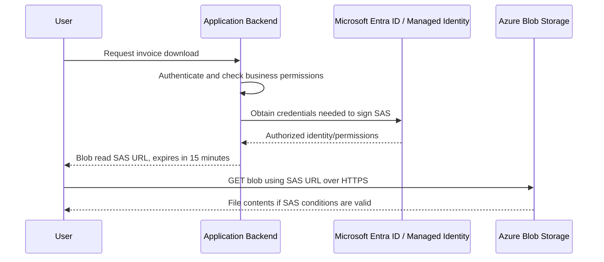
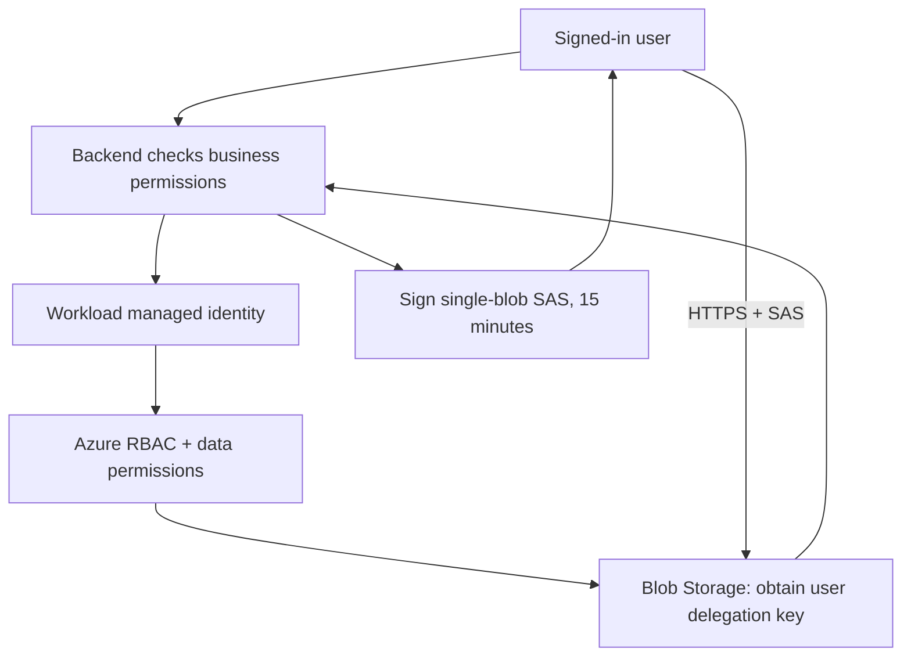
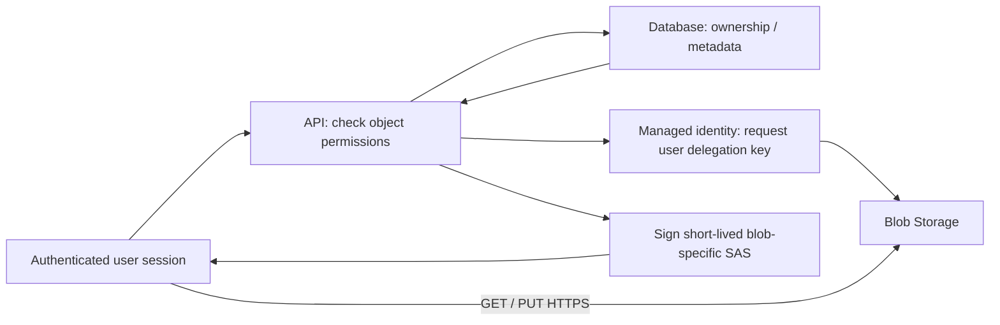

# Accessing Files with Time-Limited SAS

In an application deployed on Microsoft Azure, users may need to download a PDF invoice, upload a profile picture, or share a file with a partner for a few minutes. Making Blob Storage publicly readable exposes sensitive data. Giving every downloader an Azure account or the storage account key grants overly broad permissions that are very hard to revoke. **Shared Access Signatures (SAS)** solve part of this problem by granting **scoped access to Azure Storage resources**, typically via a signed URL valid only for a specified time window.

This lesson belongs to the **Object Storage with Blob Storage** chapter in the Microsoft Azure ecosystem. It covers how to choose SAS types, set permissions and lifetimes, generate upload/download links, protect SAS tokens in applications, troubleshoot errors, and accurately understand revocation limits. Examples use Azure Blob Storage, Microsoft Entra ID, Azure CLI, Azure RBAC, and private networking where needed.

## Learning Objectives

After this lesson, you will be able to:

1. Explain what a SAS is and why a URL containing a SAS must be treated as a secret.
2. Distinguish **user delegation SAS**, **service SAS**, and **account SAS**.
3. Understand the resource, permission, expiry, protocol, and signature fields in a SAS token.
4. Generate a read-only **user delegation SAS** for a single blob valid for 15 minutes using Azure CLI.
5. Design a backend SAS-issuing flow so users can download from or upload directly to Blob Storage.
6. Understand the differences among **expiration**, **key revocation**, **stored access policies**, and **resource deletion/permission changes**.
7. Diagnose SAS access errors and reduce leakage risks via logs, browsers, proxies, or network configurations.

## 1. What Is a SAS and What Problem Does It Solve?

A **Shared Access Signature** is a set of parameters signed with an appropriate key, allowing a client to perform granted operations on Azure Storage resources. For Blob Storage, a SAS is typically appended to the URL's query string:

```text
https://<storage-account>.blob.core.windows.net/<container>/<blob>?<sas-query-string>
```

A SAS URL allows a client to access resources according to the permissions encoded in the signature, **without giving the client the account key or its own Entra ID access token**. This is a **capability URL** model: anyone holding a valid URL can exercise the permissions encoded in the token, provided all other Azure Storage conditions are also met.

For example, a sales company wants a customer to download invoice `invoices/invoice-1025.pdf` within 15 minutes. The backend authenticates the user and verifies the invoice belongs to them, then creates a SAS allowing read access to that exact blob. The customer uses the link to download, and after expiration, Azure Storage no longer accepts the old signature.



Conceptual diagram: for a user delegation SAS, the backend uses an appropriately privileged Entra ID identity to request a **user delegation key** from Blob Storage, then signs the SAS with that key. Microsoft Entra ID does not directly sign each Blob SAS URL. The browser receives the URL, **never the signing key**.

### What SAS Does and Does Not Do

- **Can do:** constrain operations, target resources, time window, protocol, and optionally source IP ranges in appropriate scenarios.
- **Cannot do:** authenticate individual users once the URL is issued; anyone holding the URL can use its permissions if conditions are satisfied.
- **Cannot do:** automatically limit downloads to a single use; multiple valid GETs can occur before expiration.
- **Does not replace:** backend business authorization, network firewalls, malware scanning, TLS encryption, Azure RBAC, or monitoring workflows.

**A SAS is scoped delegated access, not a license to make data public.** A blob in a private container remains readable with a valid SAS; conversely, disabling anonymous public access does not block requests authorized via SAS.

## 2. Three SAS Types and When to Use Them

Azure Storage supports different SAS mechanisms. Your choice depends on the service type, signing key source, and required scope.

| SAS type | Key/authority used for signing | Typical scope | Key notes |
|---|---|---|---|
| **User delegation SAS** | **User delegation key** issued by Blob Storage after the caller authenticates via Microsoft Entra ID. | Supported blobs or containers in Blob Storage/ADLS Gen2. | **Preferred whenever possible**; requires neither distributing nor using the storage account key to sign. |
| **Service SAS** | Storage account key (**Shared Key**). | A resource within one Storage service, e.g., blob/container. | Can bind to a **stored access policy** for supported resource/service types. |
| **Account SAS** | Storage account key (**Shared Key**). | Broader scope: one or more specified Storage services, resource types, and operations. | Easy to over-privilege; stored access policies do not apply as in service SAS. |

### 2.1. User Delegation SAS: Preferred Choice for Blob Storage

A user delegation SAS relies on a Microsoft Entra ID identity (user, service principal, or managed identity) combined with Azure RBAC permissions, instead of requiring the app to hold a long-lived account key. For Azure-hosted apps, the backend can use a **managed identity** to obtain a user delegation key, keeping secrets out of source code.

Key requirements:

1. The identity is allowed to request a user delegation key via the `Microsoft.Storage/storageAccounts/blobServices/generateUserDelegationKey/action` action at the **storage account scope or higher** per role assignment.
2. The identity holds data permissions matching the operations being delegated, per Blob Storage's authorization model.
3. The SAS is signed for the exact resource, permissions, time window, and protocol.
4. Storage account settings, firewalls/private endpoints, and additional policies continue to be enforced when clients send requests.

Built-in roles like **Storage Blob Data Contributor** work for scenarios needing blob read/write; **Storage Blob Delegator** grants permission only to obtain a user delegation key and must be paired with appropriate data permissions when designing access. Do not assume `Reader` on the resource group automatically suffices to generate a user delegation SAS or read blob contents.

**Time limit:** a user delegation key has a maximum lifetime of **7 days**. A user delegation SAS remains valid only within the lifetime of its corresponding user delegation key; even if the SAS specifies a later expiry, it cannot outlive the key. For sharing a file with a customer, use a short lifetime like 5–15 minutes rather than the full 7 days simply because the system allows it.

### 2.2. Service SAS: When an Account-Key Model Is Required

A service SAS is signed using the storage account key and targets resources in a single service. For Blob Storage, you can generate a SAS for a blob or container. In some setups, a service SAS references a **stored access policy** defined on the container; administrators can modify or delete that policy to affect all SAS tokens bound to it.

The drawback is that the signing application must access the account key or a signing component authorized to use it. An account key grants far broader power than a single SAS URL and must be guarded strictly. If an organization **disables Shared Key authorization** on the storage account, key-based SAS mechanisms like service SAS and account SAS cannot be used under that policy; choose user delegation SAS or another supported mechanism instead.

### 2.3. Account SAS: Broad Scope Requiring Caution

An account SAS can authorize operations across multiple services and resource types in a storage account based on its signature parameters. For example, a single token can span numerous container/blob operations instead of just one file. This makes least privilege difficult when your goal is merely "let a customer read one invoice."

**Practical rule:** for downloading or uploading a specific Blob file, prefer a **user delegation SAS scoped to that exact blob**. Evaluate service/account SAS only when the workload genuinely requires them and you have reviewed permission scope, key storage, Shared Key policy, and revocation plans.

## 3. Structure of a SAS URL

An illustrative URL (the signature below is a placeholder, not a usable token):

```text
https://stappdemo.blob.core.windows.net/invoices/invoice-1025.pdf
  ?sv=<service-version>
  &sr=b
  &sp=r
  &st=<utc-start-time>
  &se=<utc-expiry-time>
  &spr=https
  &sig=<url-encoded-signature>
```

**In real usage, the URL must be on a single line** and generated by a trusted SDK/CLI; never manually concatenate signatures or alter parameter ordering/encoding arbitrarily. Exact parameters depend on the SAS type and Storage API version. A user delegation SAS also carries delegation-key fields such as `skoid`, `sktid`, `skt`, `ske`, `sks`, and `skv`.

| Field | Typical meaning | Notes |
|---|---|---|
| `sv` | Storage service version used to interpret the SAS. | Not the expiration time. |
| `sr` | **Signed resource**, e.g., `b` for blob, `c` for container in corresponding scenarios. | Choose the narrowest scope. |
| `sp` | **Signed permissions**, e.g., `r` read, `w` write, `c` create, `d` delete per supported SAS/resource type. | Never grant `w`/`d` when only downloads are needed. |
| `st` | Start time (UTC), optional in some SAS generation methods. | Setting it right at current time risks clock skew. |
| `se` | Expiry time (UTC). | Keep short, matching download/task duration. |
| `spr` | Allowed protocol, constrainable to `https`. | Combine with Secure Transfer Required on the account. |
| `sip` | Allowed source IP range when applied. | Account for NAT/proxies, networking, and real traffic paths. |
| `sig` | Cryptographic signature authenticating the token. | Sensitive secret; never share or log. |
| `si` | ID of a stored access policy if a service SAS uses one. | Does not apply to all SAS types. |

A SAS acts like a pass specifying **scope** (resource), **allowed actions** (permissions), **validity window** (time), and **constraints** (protocol/IP). For example, `sp=r&sr=b` fits downloading a specific file far better than `sp=rwd` across an entire container.

### 3.1. Expiration and System Clocks

SAS timestamps use UTC. Use tooling that formats UTC timestamps exactly as Azure Storage expects. If you set `st` to the exact issuance instant, a few minutes of clock skew between systems can cause a **SAS not yet valid** error. When you do not need to lock an exact start window, omit `st` where supported by the API/tool or backdate the start by a few minutes within policy bounds.

In many cases, setting only a short expiry suffices. Never take local time and append `Z` without converting to UTC. If an application transfers large files over slow connections, size the expiry just enough to start and complete the operation per service behavior—avoid creating multi-day SAS tokens out of fear of timeouts.

### 3.2. Least Privilege per Operation

| Need | Suggested scope | Suggested permissions | Warning |
|---|---|---|---|
| User downloads one invoice | Single blob | `r` | Avoid granting permission to list the entire container. |
| User uploads a file they are creating | Single non-existent target blob | `c`/`w` per operation API, often `cw` for BlockBlob upload | Do not grant `d` or container listing. |
| Staff need to list and download a document set | Container or separate per-blob URLs as needed | Appropriate list/read permissions | Weigh data sensitivity before issuing container SAS. |
| Delete a file | Single blob or narrow scope | `d` only when truly needed | Prefer having the backend authenticate and perform audited deletions rather than handing delete SAS to clients. |

**SAS permissions must match the specific operation.** Uploads using `PUT Blob`, `Put Block`, or `Put Block List` carry specific permission requirements; test with your real client/API. Never guess that `r` allows writes or that `w` covers every way to create a new blob.

## 4. Designing Permissions with Microsoft Entra ID and Azure RBAC

Before issuing a SAS, the backend needs an appropriate identity and permissions to request a delegation key. In a cloud-native architecture:



These are **two distinct** authorization layers:

1. **Business authorization in the API:** User A can view their own invoices, but must never pass an arbitrary blob name to access User B's documents.
2. **Authorization in Azure Storage:** an issued SAS must restrict resource/operations/lifetime, and requests remain subject to Storage controls.

The backend must never trust a client-supplied blob name without verifying ownership in the database. For instance, `/download?blob=customers/another-user/passport.pdf` must be rejected if the caller is unauthorized, **before** signing any SAS.

### 4.1. Permission to Request a User Delegation Key

To request a user delegation key, the principal needs the action:

```text
Microsoft.Storage/storageAccounts/blobServices/generateUserDelegationKey/action
```

This action must be effective at the **storage account scope or higher**. If the app also interacts with blobs directly, verify appropriate data-plane permissions at the data scope. In strict environments, you can use a dedicated role to obtain delegation keys and separate data-plane roles to limit accessible data; evaluate policies against the service's authorization contract.

A SAS itself does not require the end client to hold an Azure RBAC role assignment. However, **the creator of a user delegation SAS and the delegated permissions** are governed by the signing identity and Azure Storage's authorization model. Do not confuse the right to generate a SAS with granting every client subscription-level Azure RBAC roles.

### 4.2. Using Managed Identity Instead of Long-Lived Secrets

In Azure App Service, Functions, VMs, or supported workloads, administrators can enable a managed identity and assign the right roles. The application uses the Azure Identity SDK to acquire tokens, request a user delegation key, and sign SAS tokens—eliminating account keys from environment variables or repositories.

**Managed identity does not grant permissions by itself:** after enabling the identity, assign the exact role and scope on Storage, allow for role propagation time, and test the operation. If an app spans multiple resources, separate identities or scopes to contain blast radius if one service is compromised.

## 5. Hands-On: Creating a 15-Minute Read-Only User Delegation SAS for a Blob

This example uses **Azure Cloud Shell (Bash)** or a Linux host with Azure CLI, GNU `date`, and `curl`. You need an existing storage account, container, and blob; your lab account needs **data plane** permissions plus permission to generate user delegation keys. Run these CLI steps only against your own test resources.

### 5.1. Prepare the environment

```bash
az login
az account list --output table
az account set --subscription "<subscription-id>"

ACCOUNT="<storage-account-name>"
CONTAINER="private-documents"
BLOB="invoice-1025.pdf"
```

In Cloud Shell, your already-authenticated session may not need `az login` again. `ACCOUNT` must be a real storage account name, and `CONTAINER` must exist and contain `invoice-1025.pdf` (or substitute your test filename).

### 5.2. Verify Blob read permissions with Entra ID

```bash
az storage blob show \
  --account-name "$ACCOUNT" \
  --container-name "$CONTAINER" \
  --name "$BLOB" \
  --auth-mode login \
  --query "{name:name,contentLength:properties.contentLength}" \
  --output json
```

This command requires appropriate data read permissions. If you receive `403`, do not fall back to the account key for convenience: inspect role assignments, scope, storage network restrictions, and the active CLI identity. **Having permission to read a blob does not automatically grant permission to request a user delegation key** if the role is only scoped to the container.

### 5.3. Compute UTC expiry and generate read-only SAS

Use an expiry 15 minutes from now and omit `st` to reduce clock-skew risk in this example:

```bash
EXPIRY="$(date -u -d '+15 minutes' '+%Y-%m-%dT%H:%MZ')"

SIGNED_URL="$(az storage blob generate-sas \
  --account-name "$ACCOUNT" \
  --container-name "$CONTAINER" \
  --name "$BLOB" \
  --permissions r \
  --expiry "$EXPIRY" \
  --https-only \
  --auth-mode login \
  --as-user \
  --full-uri \
  --output tsv)"
```

Parameter breakdown:

- `--permissions r`: allows reading the blob only.
- `--expiry`: expiration timestamp (UTC), computed dynamically so a past date is never used.
- `--https-only`: enforces HTTPS transport.
- `--auth-mode login --as-user`: uses your Microsoft Entra ID login session and generates a **user delegation SAS**, without using the account key.
- `--full-uri`: returns the complete URI including the SAS query string.

**Never run `echo "$SIGNED_URL"` into CI/CD logs, recorded terminals, or support tickets.** An environment variable holding the full SAS URL is a bearer credential while active. The output should only be returned to the authorized client over a secure channel.

### 5.4. Download the file using the SAS URL

```bash
curl --fail --silent --show-error \
  --output "./downloaded-invoice.pdf" \
  "$SIGNED_URL"

unset SIGNED_URL
```

If this succeeds, the client downloads the blob **without** passing an account key or Entra ID Authorization header. `curl` connects over HTTPS, keeping the URL inside double quotes so `&` characters in the query string are not interpreted by the shell as background commands.

**Note:** this example uses Azure Cloud Shell Bash/GNU `date`. On macOS/BSD, `date -d` syntax may not be supported; replace with equivalent UTC computation or use an SDK to generate the UTC datetime. Unsetting the shell variable does not revoke an already-issued SAS.

### 5.5. Common Errors

- `AuthorizationPermissionMismatch`: the signing identity lacked required permissions or the signature omitted the needed operation—e.g., downloading without `r`.
- `AuthenticationFailed`: invalid token/signature, corrupted during copy/paste, or malformed timestamps.
- `AuthorizationFailure`: account firewalls, endpoint/network restrictions, or supplemental policies may be blocking the request.
- `ResourceNotFound`/`BlobNotFound`: wrong account/container/blob name, or the blob was deleted.
- `403` after 15 minutes: likely an expired SAS; inspect the XML/response error code and verify clocks instead of assuming every HTTP 403 is the same.

When debugging, log only **request ID, HTTP status, error code, sanitized resource path, and timestamp**; never log the raw URL containing `sig`.

## 6. Example: Uploading a File with a Time-Limited SAS

For a "customer uploads profile photo" feature, the backend can issue a SAS targeting a **specific destination blob** such as `uploads/user-42/photo-unique-id.jpg`, rather than granting arbitrary write access to the entire container.

Secure upload pattern:

1. Client signs in to the API using the application's authentication flow.
2. API checks permissions, quotas, expected format, and generates a **unique blob name** so clients cannot overwrite someone else's file.
3. API issues a short-lived SAS with **create/write** permissions matching the upload API.
4. Client sends `PUT Blob` directly to Azure Blob Storage using the SAS URL.
5. API verifies the blob exists, checks size and content type, and scans contents if required by policy **before** promoting the file to trusted processing pipelines.

CLI example generating an upload URL for a new blob:

```bash
ACCOUNT="<storage-account-name>"
CONTAINER="uploads"
BLOB="user-42/photo-unique-id.jpg"
EXPIRY="$(date -u -d '+10 minutes' '+%Y-%m-%dT%H:%MZ')"

UPLOAD_URL="$(az storage blob generate-sas \
  --account-name "$ACCOUNT" \
  --container-name "$CONTAINER" \
  --name "$BLOB" \
  --permissions cw \
  --expiry "$EXPIRY" \
  --https-only \
  --as-user \
  --auth-mode login \
  --full-uri \
  --output tsv)"
```

Then the client calls the Blob REST API `PUT` to create a new block blob:

```bash
curl --fail --silent --show-error \
  --request PUT \
  --header "x-ms-blob-type: BlockBlob" \
  --header "Content-Type: image/jpeg" \
  --data-binary "@./photo.jpg" \
  "$UPLOAD_URL"

unset UPLOAD_URL
```

`c` grants create and `w` grants write, fitting many block blob upload scenarios. **Verify exact required permissions against the REST operation or SDK in use.** If the client performs multi-part block uploads (`Put Block`/`Put Block List`), check size limits, operation sequence, and corresponding permissions.

Do not include `d` (delete) or `l` (list) permissions when only uploading a single file. A write-only URL also does not guarantee the file itself is safe: the backend must still enforce **authorization and content validation**, potentially using a staging container, size caps, and malware scanning as required.

### 6.1. CORS When Uploading Directly from a Browser

When browser JavaScript calls Azure Blob Storage from a different origin than the website, **Cross-Origin Resource Sharing (CORS)** can block the request even if the SAS is valid. Configure CORS on the Blob service to allow the exact origins, methods, and headers the client uses (such as `PUT` and `x-ms-blob-type`).

CORS is a browser policy; **it is not an authorization mechanism replacing SAS**. Never open `*` for all origins just to work around CORS errors when the application has specific security requirements.

## 7. Designing a Backend SAS Issuer for Your Application

Clients should not mint their own SAS tokens. In a secure architecture, the backend or a dedicated link-issuing service acts as the **SAS issuer**. Clients receive URLs only after the backend authenticates and authorizes the request.



### Pseudocode for Issuing an Invoice Download Link

```text
function issueDownloadUrl(authenticatedUser, invoiceId):
    invoice = database.findInvoice(invoiceId)
    if invoice is null:
        return 404
    if not canReadInvoice(authenticatedUser, invoice):
        return 403

    blob = invoice.storageBlobName  // Retrieved from trusted storage
    delegationKey = blobService.getUserDelegationKey(
        managedIdentity,
        duration = shortKeyLifetime
    )

    sas = signUserDelegationSas(
        container = invoice.container,
        blobName = blob,
        permissions = READ_ONLY,
        expiresUtc = nowUtc() + 15 minutes,
        protocol = HTTPS_ONLY,
        delegationKey = delegationKey
    )

    audit('issued-download-link', authenticatedUser.id, invoiceId)
    return { url: blobUrl(blob) + '?' + sas, expiresAt: expiresUtc }
```

This pseudocode illustrates the business flow, not language-specific SDK syntax. In production, use the official Azure Storage SDK to generate user delegation SAS tokens and encode URLs properly, while **never writing SAS tokens or delegation keys to audit logs**. You may cache the user delegation key within its granted lifetime to avoid requesting a key on every call, provided the key is protected and its lifetime is bounded.

### 7.1. Enforcing Resource Scope

Never let clients submit arbitrary paths and immediately receive a SAS. The backend should look up the mapping between business ID and blob path in a trusted database, verifying tenant/organization ID and ownership. If multiple customers share a container, structured prefixes aid organization, yet **naming prefixes are not authorization boundaries**: SAS issuance must target the exact authorized blob or scope.

### 7.2. Avoiding Overly Broad or Long-Lived URLs

For invoices, profile photos, or confidential files, the backend should issue short-lived per-action links. If a user needs multiple files, consider having the backend prepare a temporary ZIP or issue individual per-blob URLs rather than issuing a container-wide SAS without per-document checks.

### 7.3. Frontend URL Handling Design

- Receive SAS URLs only over **HTTPS** from an authenticated API.
- Do not persist SAS URLs in long-term local storage or pass them to third-party analytics.
- Keep SAS URLs out of access logs, crash reports, breadcrumbs, and session-replay tools.
- Avoid routing downloads through intermediate pages that might leak URLs in `Referer`; apply an appropriate Referrer-Policy for browser flows.
- For highly sensitive files, consider **authenticated backend streaming/proxying** instead of direct SAS if per-download control or instant revocation is required.

## 8. Expiration and Revoking SAS: Understanding the Exact Limits

**Natural expiration** is the simplest way to limit exposure. However, scenarios arise where a link must be invalidated before expiration—for instance, discovering an email containing a SAS was sent to the wrong recipient.

| Mechanism | User delegation SAS | Service SAS | Account SAS |
|---|---|---|---|
| Wait for `se` expiration | Yes | Yes | Yes |
| Stored access policy | **Not applicable** | **Yes in supported scenarios** | **Not applicable** |
| Revoke user delegation keys on storage account | Invalidates related SAS tokens per service behavior, broad impact | No | No |
| Rotate storage account signing key | Does not revoke user delegation SAS | Yes, but breaks all SAS/apps signed with the rotated key | Yes, but breaks all SAS/apps signed with the rotated key |
| Instant single-URL revocation button | No universal token-level mechanism | Only manageable indirectly via policy or keys when designed appropriately | No universal token-level mechanism |

### 8.1. Revoking User Delegation SAS

User delegation SAS tokens do not reference stored access policies. You can invoke the storage account's **revoke user delegation keys** capability to invalidate SAS tokens signed with those keys, per service behavior. This is a **broad-impact** operation that can break many other apps or valid links, not a "cancel one URL" button. Check admin permissions, blast radius, propagation delay, and plans to reissue valid links before executing.

Do not assume removing a role assignment or blocking the SAS creator **immediately invalidates every already-issued SAS**. During incident response, verify key state, caching, and remaining lifetimes; design proactive revocation up front if business rules require it.

### 8.2. Revoking Service SAS via Stored Access Policy

In Blob **service SAS** models supporting container-level stored access policies, the SAS references a policy ID (`si`). Updating or deleting that policy affects all SAS tokens referencing it, enabling batch link management. This is not a capability of user delegation SAS or account SAS. Factor in policy count limits, shared blast radius, and propagation latency.

If a service SAS was signed ad-hoc with inline expiry/permissions and **does not reference a policy**, deleting an unrelated policy will not revoke that URL.

### 8.3. Rotating Account Keys

Regenerating a storage account key invalidates SAS tokens signed with the old key. However, other applications, automation, or jobs may also rely on that account key; unscheduled rotation can cause widespread outages. Prefer Entra ID identities, managed identities, and user delegation SAS to minimize reliance on Shared Keys.

### 8.4. When Instant Per-Link Revocation Is Required

If business SLAs mandate instant user-level link cancellation or strict single-use downloads, **a standalone SAS is usually insufficient**. Consider:

- Having the backend verify session and permissions on every request and proxy/stream the file.
- Having the backend track link records and validate a one-time business token before issuing a very short-lived SAS.
- Combining blob permission changes, controlled object move/deletion, or ultra-short token lifetimes while assessing impact on legitimate clients.

SAS expiration and whether a client already downloaded the file are also distinct events. Once a file is downloaded to a device, **revoking the SAS does not delete the already-downloaded copy**.

## 9. Additional Security Layers When Using SAS

### 9.1. HTTPS and Network Scope

Always use HTTPS and specify `spr=https` when generating SAS tokens where supported. Enable **Secure transfer required** on the storage account to prevent HTTP transmission of tokens or data. For internal systems, combine Private Endpoints, firewalls, and network rules; **a SAS does not bypass network restrictions** enforced on the storage account.

If restricting a SAS with `sip`, keep in mind that Azure Storage may see the IP of a NAT gateway or proxy rather than the device's LAN IP. Traffic traversing a Private Endpoint has different routing behavior than the public endpoint; test actual IP conditions. Avoid rigidly enforcing client IP restrictions if users frequently switch networks or connect through CDNs/proxies.

### 9.2. Never Expose Account Keys to the Frontend

Account keys grant sweeping privileges and allow signing arbitrary SAS tokens. Never place account keys, key-bearing connection strings, or user delegation keys into JavaScript, mobile apps, repositories, tickets, or API responses. **The frontend should only ever see a tightly scoped SAS**; the backend must retain signing authority using a least-privilege identity.

### 9.3. Protecting SAS Against Leakage Through Other Systems

Because a SAS lives in the query string, it is easily saved unintentionally into:

- Reverse-proxy access logs, CDN logs, or APM traces.
- URL analytics, error telemetry, or crash reporting.
- Browser history, screenshots, emails, or chat apps.
- HTTP `Referer` headers during uncontrolled navigation flows.

Configure redaction for `sig` and SAS parameters, strip query strings in logs, and set tight log retention. Never paste an active SAS URL into documentation or public tests.

### 9.4. Guarding Against Malicious Uploads

A write-enabled SAS lets clients upload data to the signed scope, but does not guarantee the payload is a clean image or PDF. Never trust client-supplied `Content-Type`; verify magic bytes/format, file size, business validity, and scan for malware where required. Consider using a staging container and promoting files to production areas only after checks pass.

## 10. Monitoring, Auditing, and Cost

To operate SAS safely, you need to know who the API **delegated access to**, when, and for which object. Azure Storage logs the SAS request, yet often cannot know which business user held the URL; therefore, pair Storage telemetry with backend auditing.

| Telemetry source | What to record | What NOT to record |
|---|---|---|
| **Backend audit** | User ID, document ID, action, scope, expiry, request/correlation ID. | Full SAS URL, delegation key, or account key. |
| **Storage diagnostics/logs** | Timestamp, operation, outcome, status code, sanitized resource path, and request ID per config. | SAS signature or full query string in broadly accessible logs. |
| **Azure Monitor / Defender** | 403/404 rates, anomalous traffic, download/upload spikes, risk signals as supported. | Unnecessary personal data or secrets. |
| **Cost Management** | Stored capacity, transaction counts, egress volume, cost by tier and region. | Tokens inside financial systems. |

SAS issuance itself is generally not billed as a separate per-token product, yet **data read/write operations, capacity, bandwidth/egress, and Storage features still incur costs**. An exposed URL can be replayed repeatedly, creating both data exposure and higher bills. Cap lifetimes, scope, and volumes at the application layer, and monitor abnormal download spikes.

## 11. Systematic Troubleshooting

When a SAS URL fails, **never** "fix" it by turning on anonymous public access or sending the account key to the client. Troubleshoot layer by layer.

| Symptom | Common cause | Resolution |
|---|---|---|
| `403 AuthenticationFailed` | Altered signature, broken URL encoding, wrong key, incompatible version. | Regenerate token via SDK/CLI, keep query string intact, verify UTC times. |
| `403` before `se` expires | `st` in the future due to clock skew; wrong permissions; network restriction; account policy. | Inspect actual error code, check `st`/`se`, `sp`, `spr`, firewall, and Shared Key policy. |
| `403` after expiration | SAS expired or user delegation key expired. | Re-authenticate user and issue a fresh SAS; never edit query params on an old token. |
| `404 BlobNotFound` | Wrong blob/container name, bad URL encoding, or deleted object. | Compare exact blob path and check existence using an authorized admin identity. |
| Upload gets `403` while download works | SAS only grants `r`, missing create/write for the upload method. | Grant minimum required permissions for the upload operation and retry. |
| Browser reports CORS error, CLI works | Blob service CORS does not allow the origin/method/header. | Configure narrow CORS rules; do not broaden SAS permissions. |
| Works from Azure VM, fails from laptop | Storage firewall, Private Endpoint/DNS, routing, or `sip` IP mismatch. | Check public/private endpoint resolution and source IP seen by Storage. |
| Link truncated or split at `&` | Pasted through chat/email, HTML escaping, or unquoted shell URL. | Use SDK-returned URL, encode cleanly, wrap in quotes in shell commands. |
| Service SAS still works after editing another policy | SAS is not bound to that policy or changes haven't propagated. | Inspect `si` and the exact referenced policy. |

### Step-by-Step Verification Process

1. Verify the URL targets the right **account → container → blob** without truncation or double-encoding.
2. Inspect `sp` (permissions), `sr` (resource), `se`, and `st` in UTC; never expose `sig`.
3. Identify the SAS type: user delegation, service, or account; apply the matching signing/revocation logic.
4. Read the HTTP status and Storage **error code**, recording the request ID for log correlation.
5. Check Shared Key access policy, RBAC/data-plane permissions, and user delegation key state at creation time.
6. Check network firewalls, Private Endpoints, DNS, HTTPS/TLS, and source IP constraints.
7. If browsers fail while `curl` succeeds, inspect **CORS** and request headers.
8. After fixing, test with a very short-lived fresh SAS in an authorized environment without leaking old tokens.

## 12. Common Misconceptions

- **"Anyone with a SAS URL is guaranteed access."** False: the URL must still be within its validity window, hold the right permissions, have a valid signature, and pass network/account restrictions.
- **"A SAS is a user's login account."** False: a SAS is a bearer capability token; the backend must handle business authentication and authorization before issuing it.
- **"Setting `se` guarantees a single download."** False: a SAS can generally be reused repeatedly until expiration; there is no built-in one-time-use default.
- **"User delegation SAS uses stored access policies."** False: stored access policies apply to certain service SAS scenarios, not user delegation SAS.
- **"Removing the SAS creator's RBAC role instantly kills all old links."** Never assume this; inspect delegation key state, remaining lifetime, and key revocation.
- **"Rotating a storage account key revokes without affecting anyone else."** False: it breaks other clients using that key and any SAS signed with it.
- **"Disabling public blob access blocks all SAS tokens."** False: blocking anonymous public access does not block properly authorized SAS requests.
- **"Allowing CORS is enough to secure blobs."** False: CORS is a browser-enforced policy; you still need SAS/RBAC and network policies.
- **"HTTPS is only needed for the API; the SAS can travel over HTTP."** False: a SAS token over HTTP can be intercepted in transit; enforce HTTPS and end-to-end token protection.

## 13. Case Study Exercise

A hospital stores medical test results in a private container on Azure Blob Storage. Users sign in to the app, may only download their own files, and links must expire after 10 minutes. The system must minimize storage-account compromise risk, prevent clients from listing containers, and audit every link issuance.

**Proposed design:**

1. User authenticates at the API. The API receives the file ID and verifies ownership and permissions per app policy.
2. The API uses a managed identity with least-privilege Azure RBAC to obtain a **user delegation key** and sign a SAS for that exact blob.
3. Set `sp=r`, `sr=b`, `se=UTC now + 10 minutes`, `spr=https`; omit `l`, `w`, and `d`.
4. The API returns the URL over HTTPS and logs user ID/document ID/expiry to audit logs while **never logging the SAS URL**.
5. Azure Blob Storage still permits requests only according to Storage authentication, firewalls/private access, and configured policies.
6. If **individual links** must be revocable immediately, switch to backend request verification/file streaming or add a business authorization layer; never promise user delegation SAS has a per-URL kill switch.
7. Set up monitoring for anomalous downloads and test expiry errors, wrong permissions, broken network paths, and repeated downloads.

**Self-check questions:**

1. Why prefer a user delegation SAS over an account SAS for a short-lived file download link?
2. In a SAS URL, what do `sp=r`, `sr=b`, and `se` represent?
3. Why must the backend verify the requester's permissions before signing a SAS?
4. Why can a newly minted SAS URL fail immediately due to clock skew?
5. When a URL is accidentally shared, what action can revoke a service SAS bound to a stored access policy? Why doesn't that work for a user delegation SAS?
6. Does a SAS with `se` set 15 minutes out guarantee a client can download the file only once?

**Suggested answers:** User delegation SAS reduces reliance on account keys; `sp` defines permissions, `sr` resource scope, and `se` expiry; the backend enforces ownership; clock skew can make `st` appear in the future; editing/deleting a stored access policy only affects service SAS tokens referencing it; and a SAS can be reused until expiration or invalidated by other conditions.

## 14. Pre-Production Checklist

- [ ] Identified which files need sharing, lifetimes, and minimum permissions per operation.
- [ ] Preferred **user delegation SAS** when working with Blob Storage in supported environments.
- [ ] Backend authenticates users, enforces ownership, and never blindly accepts client-supplied blob paths.
- [ ] SAS signing identity uses managed identity/Entra ID; delegation-key and data permissions are scoped appropriately.
- [ ] Storage account keys, delegation keys, and overly broad SAS URLs are never sent to the frontend.
- [ ] SAS tokens constrain exact blob, needed permissions, short UTC expiry, and HTTPS-only.
- [ ] Evaluated impacts of Storage firewalls, Private Endpoints, DNS, TLS, and source IP constraints.
- [ ] Configured redaction for SAS/query strings in logs, APM, browser telemetry, and support tools.
- [ ] Uploads validate content, size, filenames, and prevent unauthorized overwrites.
- [ ] Tested real client uploads/downloads, CORS, 403/404 error paths, and expiration boundaries.
- [ ] Documented and tested a **revocation** plan for the chosen SAS type, including key rotation blast radius.
- [ ] Enabled anomalous access monitoring, link issuance auditing, and Blob operations/egress cost tracking.

## Conclusion

**Shared Access Signatures (SAS)** enable granting access to Azure Blob Storage files scoped by **resource, permissions, and lifetime** without handing out account keys to uploaders or downloaders. For cloud-native apps, a **user delegation SAS** backed by Microsoft Entra ID, managed identities, and Azure RBAC is the preferred choice where supported; service SAS and account SAS require strict Shared Key governance. An active SAS URL is live access authority, so issue it only after business authorization checks, scope it to the exact blob, enforce HTTPS, keep lifetimes short, keep it out of logs, and prepare a revocation plan suited to the SAS type. Combining these practices with Blob Storage networking, monitoring, and cost controls keeps file sharing convenient without over-exposing permissions.
