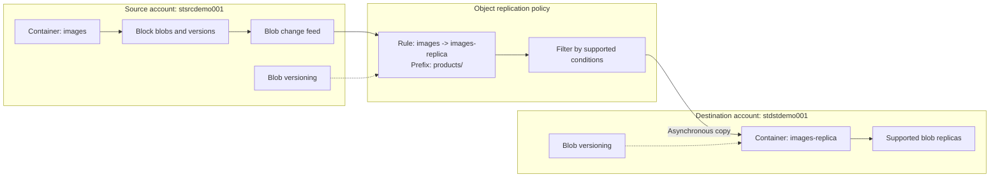
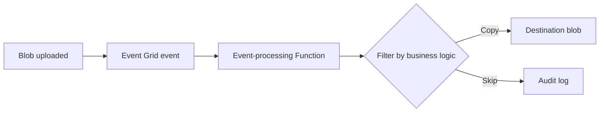
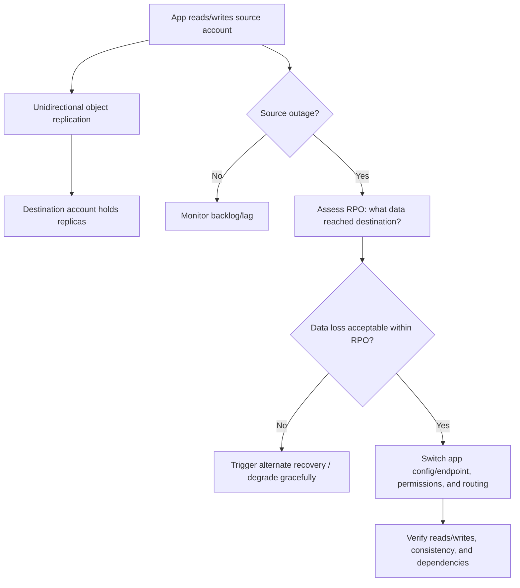
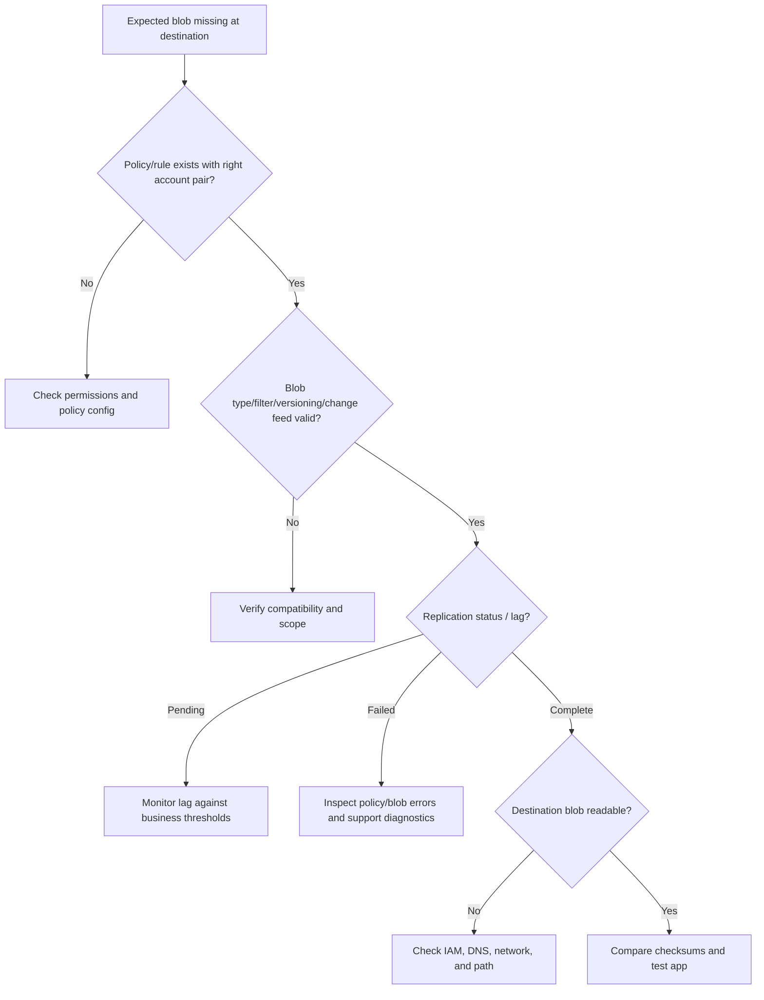

# Object Replication and Cross-Account Data Copying

An enterprise stores product images in Azure Blob Storage in a primary region. The analytics team needs a copy of that data in another storage account; meanwhile, the operations team wants data staged in a standby region in case of regional outages. For a one-time copy, file transfer tools suffice; however, when objects are continuously added or updated, the organization must decide **when to replicate, under which rules, how much latency is acceptable, and how to recover when replication fails**.

**Object replication** is an Azure Blob Storage feature that **asynchronously copies supported block blobs from a container in a source storage account to a container in a destination storage account** according to a policy. It is an important option, though not the only option, for moving data between accounts.

This lesson belongs to the **Object Storage with Blob Storage** chapter in the `CLOUD_PROVIDERS_AZURE` module. Along the Azure learning path—from subscriptions, resource groups, and Microsoft Entra ID to virtual networking, compute, storage, data, security, monitoring, and cost—you will learn to pick the right copying mechanism, govern related resources, and build reliable operations.

## Learning Objectives

After this lesson, you will be able to:

- Explain what object replication is, why it is **asynchronous**, and how it differs from manual copying or geo-redundancy.
- Distinguish **source account**, **destination account**, containers, replication policies, replication rules, and filter conditions.
- Identify common prerequisites such as **Blob versioning on both source and destination**, **Blob change feed on source**, account/blob types, and feature compatibility.
- Design a unidirectional replication policy by container/prefix, monitor status, and measure replication lag.
- Choose among **Object replication**, **AzCopy**, **Azure Data Factory**, SDK-based apps, and built-in redundancy (LRS/ZRS/GRS/GZRS).
- Analyze limitations around deletions, consistency, authorization, networking, costs, and failover/failback.
- Walk through an illustrative hands-on exercise and build a pre-production verification evidence checklist.

## 1. Distinguishing Different Kinds of "Replication" in Azure Storage

The word "replication" can refer to very different mechanisms:

| Mechanism | Unit/scope | Who controls it? | When to choose it? |
|---|---|---|---|
| **LRS/ZRS/GRS/GZRS** | Data replicas per storage account redundancy level | Azure executes per account redundancy configuration | Increase durability against hardware/zone/region faults per feature |
| **Blob Object replication** | Block blobs from source account container to destination account container | Customer declares policy; Azure replicates asynchronously | Sync supported changes to an independent account |
| **AzCopy** | Selected blobs/files between supported endpoints | Operator or scheduled job invokes CLI | One-off transfers, batch jobs, high-volume bulk copies |
| **Azure Data Factory Copy activity** | Supported sources/destinations and pipelines | Scheduled/triggered pipelines with monitoring | ETL, format conversion, or multi-source orchestration |
| **SDK / REST API / custom app** | Individual objects or batches per app logic | Application code | Complex business rules, fine-grained control, and event-driven handling |
| **Backup, versioning, soft delete, immutability** | Data history and protection/recovery capabilities | Data protection policies | Recover from deletions/overwrites and meet retention; not replaced by copying alone |

**Major distinction:** replicas maintained by redundancy options like GRS are not an independent storage account you can freely name, permission, and edit like a separate account. With object replication, **source and destination are separate accounts**, each with its own governance, networking, RBAC, and billing.

### Questions to Ask Before Choosing a Solution

1. Do you need a **one-time copy** or **continuous replication as data changes**?
2. Is the data **block blobs**, append blobs, page blobs, Azure Files, queues, or tables?
3. Do you need **container/prefix filtering** or timestamp-based object selection?
4. What replication latency is acceptable? Do you need a strict RPO commitment?
5. Must the destination be **independent of the source** across subscriptions, regions, admin teams, or access policies?
6. Do you need **delete synchronization**, schema/metadata transformation, or bidirectional writes?
7. How will you automate verification, alerting, completeness checks, and recovery planning?

If you only upload a folder of blobs to another account at month-end, AzCopy is usually simpler than maintaining a continuous policy. If you need automatic replication of new/updated block blobs under supported rules, object replication is a strong candidate.

## 2. How Object Replication Works

Object replication operates between a **source storage account** and a **destination storage account** via a **replication policy**. A policy can contain **rules** mapping a source container to a destination container with supported filters.



High-level steps:

1. An application creates or updates a **block blob** in the source container.
2. Blob Storage records changes via the tracking mechanism used by the feature; the **change feed** at the source plays a central role.
3. The object replication policy evaluates rules and filters to determine eligible blobs.
4. The service asynchronously copies eligible objects to the mapped container in the destination account.
5. Operators monitor replication status, verify destination blobs, and handle lag or ineligible objects.

**Asynchronous** means writes to the source complete before the replica arrives at the destination. There is a window between accounts where the source holds new data that has not yet appeared at the destination. **Never assume instant replication, zero RPO, or a fixed second count** without explicit commitments and real measurements.

### Unidirectional, Not a General Two-Way Sync Mechanism

A policy defines a **source → destination** flow. It does not automatically propagate destination changes back to the source, resolve concurrent bidirectional writes, or provide application conflict resolution.

Example: from `stsrcdemo001/images` to `stdstdemo001/images-replica`. If users need to modify data in the destination account and send updates back to the source, a separate workflow is required—including write permissions, conflict rules, and compatibility checks. Never turn a unidirectional setup into active-active merely by adding a reverse policy without evaluating loop risks, overwrites, and service limits.

## 3. Source, Destination, Policy, and Rules

### Source Account

The source account holds the original blobs. It must meet prerequisites for account kind, Blob versioning, change feed, and supported features. Replicable changes are those supported by object replication, not every event or data type inside a storage account.

### Destination Account

The destination is an independent account containing target containers for replicas. Applications or analytics teams can read replicas according to their permissions and actual data state. The destination account maintains its own **RBAC, firewalls, private endpoints, encryption keys, redundancy, and lifecycle policies**; these settings are not automatically copied from the source.

### Policy and Rules

A replication policy defines an account pair and a set of rules. Each rule typically specifies:

- **Source container:** e.g., `images`.
- **Destination container:** e.g., `images-replica`.
- **Prefix filter** (if used): replicates only blobs whose names start with the specified prefix, e.g., `products/`.
- **Creation time filter** if permitted by feature and API: controls which objects are evaluated based on time.

Illustrative **logical model** (not raw JSON for direct API calls):

```yaml
sourceAccount: stsrcdemo001
destinationAccount: stdstdemo001
rules:
  - sourceContainer: images
    destinationContainer: images-replica
    prefixMatch:
      - products/
  - sourceContainer: reports
    destinationContainer: reports-copy
    prefixMatch:
      - 2026/
```

For the first rule, `images/products/shirt-01.jpg` is in scope, whereas `images/internal/tmp.txt` is excluded. For the second rule, `reports/2026/january.csv` is evaluated, while `reports/2025/december.csv` falls outside the prefix.

**Do not confuse prefix filters with ACLs.** Prefixes determine which objects enter replication; they do not replace Blob data access permissions. Container naming rules and current limits on rule counts, prefix counts, or creation-time filters must be checked against service limits at deployment time.

## 4. Prerequisites Before Creating Object Replication

Not every storage account supports object replication. Pre-configuration checklist:

| Prerequisite group | What to verify | Why it matters |
|---|---|---|
| Account kind | Source/destination are storage account types supporting object replication | The feature does not apply to every account kind |
| Blob type | Target dataset consists of supported **block blobs** | Do not treat page/append blobs, Azure Files, queues, or tables as targets |
| **Blob versioning** | Enabled on **both source and destination** per feature requirements | The service relies on versions to track and copy changes |
| **Blob change feed** | Enabled on **source** | Change tracking drives replication |
| HNS/ADLS Gen2 | Check compatibility; do not assume object replication works on HNS accounts | Blob API and DFS/HNS have distinct feature support |
| Containers | Source and destination containers must exist with valid names and mappings | Rules map between containers |
| Access tier and blob state | Verify block blob/tier support, especially archived data | Not all blobs in every tier replicate identically |
| Tenant policies | If accounts span tenants, verify cross-tenant replication settings and security rules | Organizational policy may block it |
| Admin permissions | Configurator holds rights to manage policies and related settings | Avoid over-privileged accounts when creating policies |
| Networking and security | Check storage networking, CMK, and active integration constraints | Never assume the destination inherits source settings |

### What Roles Do Blob Versioning and Change Feed Play?

**Blob versioning** preserves versions when block blobs change in supported scenarios. For object replication, versioning provides the foundational mechanism for tracking and replicating blob mutations. It also incurs version storage costs when data is frequently overwritten.

**Blob change feed** maintains records of change events for supported blobs. Object replication consumes this change stream at the source to determine what needs copying. Change feed incurs storage costs and needs an appropriate retention strategy if other systems also consume it.

Neither feature **replicates data on its own** without a replication policy. Conversely, a policy cannot operate properly simply by naming two accounts while skipping versioning/change feed prerequisites.

### Limitations to Recognize Early

- Object replication targets **block blobs**; it does not replicate Azure Files shares, Queue messages, Table entities, or arbitrary volumes/disks.
- Accounts with **hierarchical namespace (ADLS Gen2)** and certain specialized Blob features have compatibility constraints. During planning, consult current support documentation instead of assuming classic Blob features apply identically to HNS.
- **Blob snapshots** and certain metadata/tags or version attributes may not transfer to the destination exactly as expected; verify every business-critical attribute.
- **Archive-tier blobs** and specific tier/feature combinations carry constraints. Verify rehydration requirements or alternative copy workflows.
- **Immutability policies**, lifecycle management, encryption, and network configs can affect setup or usability. Do not expect every source policy to mirror automatically at the destination.
- If you must copy non-Blob sources, convert formats, or transform schemas, evaluate another pipeline/tool.

## 5. How Object Replication Differs from GRS and RA-GRS

This pair of concepts is frequently confused during disaster recovery (DR) design.

### Single-Account Geo-Redundancy

When an account uses **GRS/GZRS**, Azure maintains secondary-region replicas under service-managed redundancy. **RA-GRS/RA-GZRS** can allow reading from the secondary endpoint under supported conditions. Users do not administer an independent destination account with its own name and permissions as in object replication.

### Cross-Account Object Replication

With object replication, customers create **two separate storage accounts**, potentially in different regions, with container mappings. Each account has independent redundancy, IAM, networking, and lifecycle settings. Replicas arrive at the destination per rules with asynchronous lag.

| Aspect | GRS / RA-GRS | Object replication |
|---|---|---|
| Managed resource | Single storage account with secondary-region replica mechanism | Two distinct storage accounts |
| Data selection rules | Determined by service redundancy model | Defined by policy/rules for eligible block blobs |
| Target address | Secondary endpoint / failover capability per redundancy model | Endpoint of independent destination account |
| Secondary reads | Depends on redundancy SKU and feature state | Uses destination account and appropriate data permissions |
| Customizing IAM, firewall, region/tier | Tied to the single account's redundancy features | Independently configured on each account |
| Synchronization | Azure-managed, with asynchronous geo-replication characteristics | Asynchronous per policy |
| Replicates all data types | Within the account's redundancy scope | Scoped to object replication features, primarily block blobs |
| DR approach | Account failover/read-secondary where supported | Switch app to destination account, update permissions/endpoints and data plan |

**Neither mechanism alone solves backup and accidental-deletion recovery.** Replicas can reflect corrupted or wrongly overwritten data; data protection still requires retention, backups/versioning/soft delete, and tested restore procedures.

## 6. Consistency, Latency, and Pre-Existing Data

### Eventual Consistency Between Source and Destination

Example:

```text
10:00  Application uploads images/products/a.jpg to source.
10:00  Upload succeeds; source clients can read the new blob.
10:01  Destination app queries: may not see the new version yet.
10:03  Replication completes: eligible replica appears at destination.
```

The minute timestamps above are **illustrative only**, not an SLA or guaranteed RPO. Actual lag depends on blob counts and sizes, system load, backlog, deployment regions, and policy state.

If business logic requires "immediately readable at the destination right after upload," object replication is **not a synchronous transaction commit protocol**. Adjust the architecture: read from source until replication completion is verified, use an acknowledged copy workflow, or adopt a different consistency pattern.

### Does It Replicate All Older Blobs?

Do not assume years of pre-existing data will automatically replicate simply because you just enabled a policy. **Policy creation time, versioning/change feed activation time, and minimum creation time filters** can affect which blobs are processed. Some setup flows offer options around minimum creation time or change scope; verify exact support and behavior at policy creation time.

For projects **migrating terabytes of historical data**, consider this workflow:

1. Inventory the legacy dataset, object counts/sizes, and required objects.
2. Copy historical data via **AzCopy** or a suitable pipeline if object replication does not cover that baseline under your policy.
3. Use object replication for ongoing changes under supported conditions.
4. Verify completeness with independent manifests, object counts, byte totals, and checksums—never rely merely on "policy is enabled."
5. Cut over read/write workloads to the destination only after reconciling status and validating RPO/RTO.

### Deletions and Overwrites: Do Not Guess from the Word "Replication"

Object replication is **not a bidirectional filesystem folder sync tool**. Do not assume deleting a source blob automatically deletes the destination replica. Behavior for deletes, versions, soft delete, and replicable properties must be verified against the active feature and policy rules.

For systems subject to GDPR or personal data erasure mandates, design a **deletion workflow covering both source and destination** (plus retained backups/versions) and log execution evidence. Never rely on object replication to enforce data erasure requests.

## 7. Designing Container Mappings and Prefix Filters

Suppose an application has two source containers:

```text
stsrcdemo001
├── images
│   ├── products/2026/shirt-01.jpg
│   ├── products/2026/shirt-02.jpg
│   └── internal/tmp/test.png
└── reports
    ├── 2026/november.csv
    └── 2025/december.csv
```

Requirement: the analytics team at the destination account only needs **product images** and **reports from 2026 onward**.

Design:

| Rule | Source container | Destination container | Prefix filter |
|---|---|---|---|
| 1 | `images` | `images-replica` | `products/` |
| 2 | `reports` | `reports-copy` | `2026/` |

Expected outcome:

```text
stdstdemo001
├── images-replica
│   ├── products/2026/shirt-01.jpg
│   └── products/2026/shirt-02.jpg
└── reports-copy
    └── 2026/november.csv
```

**Prefix filters only match names.** They do not understand "year 2026" as a date attribute unless blobs are named following that convention. A blob named `reports/2026-old.csv` could also match a `2026` prefix under looser naming; design prefixes with clear delimiters like `2026/`.

Assign **one owner and one purpose** to each destination container. Sharing a destination container across both live app serving and analytics can create conflicts over permissions, lifecycle rules, and latency expectations.

## 8. Creating an Object Replication Policy via Azure Portal

Illustrative scenario:

- Source: `stsrcdemo001`, container `images`.
- Destination: `stdstdemo001`, container `images-replica`.
- Target: block blobs under prefix `products/`.
- Goal: **asynchronous, unidirectional** replicas for analytics or DR with acceptable lag.

### Step 1. Verify scope and permissions

In Azure Portal, verify the **tenant, subscription, and resource group** of both accounts. Confirm both accounts are supported kinds and the operator holds permissions to configure Blob management features. If different teams own the two accounts, obtain destination team approval and avoid altering production settings without a change plan.

### Step 2. Enable prerequisite features

Verify **Blob versioning** on **source and destination**, and **Blob change feed** on **source**. In the Portal, these typically reside under the storage account's **Data protection** section. If an account uses HNS or an incompatible feature, stop and evaluate an alternative copy mechanism.

Do not enable versioning/change feed while ignoring storage costs from version history, retention, and churn. Plan lifecycle management for historical versions per retention requirements.

### Step 3. Prepare the destination container

Create or verify the `images-replica` container in the destination account. Destination containers and data must have their own permissions, network controls, and retention policies. Never make a container public on the grounds that "the replica is just for testing."

### Step 4. Create the replication policy

Open **Object replication** under data management in the storage account per the current Portal UI. Select source/destination accounts and create a mapping rule:

```text
Source account:       stsrcdemo001
Source container:     images
Destination account:  stdstdemo001
Destination container:images-replica
Blob prefix:          products/
Direction:            Source -> Destination
```

Confirm the policy appears properly on both sides per service workflow and inspect rule status. Portal workflows may require actions or approvals on both source and destination depending on account deployment and tenant setup; never assume permissions on one subscription grant access across all accounts.

### Step 5. Test with a new block blob

Once the policy is active, write a test block blob to `images/products/lab-test.txt` at the source using an identity with valid data permissions. Verify at the destination:

- Does `images-replica/products/lab-test.txt` appear?
- Do content, byte size, and checksum match the input?
- Are blobs outside the `products/` prefix excluded from replication?
- How much latency elapsed between source write completion and destination readability?

Never use real sensitive data for testing if the destination environment is not approved for that data classification and storage location.

### Step 6. Record evidence before sign-off

Document the policy ID, source/destination account IDs, container mappings, filters, timestamps, versioning/change feed settings, operator identity, logs, and completion timing for at least one test run. Schedule periodic drift checks if the workload requires completeness guarantees.

## 9. Inspecting Configuration with Azure CLI

The examples below use Azure CLI and assume **read permissions on management configuration** for both accounts. They **do not create policies themselves**; policy creation should follow your environment's approval workflow. Replace placeholders with real resources.

### 9.1 Sign in and select subscription

```bash
az login
az account set --subscription "<subscription-id>"

az account show \
  --query "{subscription:id,tenant:tenantId,name:name}" \
  --output json
```

If source and destination reside in different subscriptions, run `az account set` before each query and verify the exact tenant/subscription. Never let scripts silently target a similarly named account in another environment.

### 9.2 Check account kind and HNS

```bash
az storage account show \
  --resource-group "rg-blob-source" \
  --name "stsrcdemo001" \
  --query "{id:id,kind:kind,sku:sku.name,location:location,hns:isHnsEnabled}" \
  --output json

az storage account show \
  --resource-group "rg-blob-destination" \
  --name "stdstdemo001" \
  --query "{id:id,kind:kind,sku:sku.name,location:location,hns:isHnsEnabled}" \
  --output json
```

### 9.3 Check Blob versioning and change feed

```bash
az storage account blob-service-properties show \
  --resource-group "rg-blob-source" \
  --account-name "stsrcdemo001" \
  --query "{versioning:isVersioningEnabled,changeFeed:changeFeed}" \
  --output json

az storage account blob-service-properties show \
  --resource-group "rg-blob-destination" \
  --account-name "stdstdemo001" \
  --query "{versioning:isVersioningEnabled,changeFeed:changeFeed}" \
  --output json
```

Verify: `isVersioningEnabled` should satisfy requirements on both accounts; `changeFeed.enabled` must be enabled on the source. Never check only those two flags at the destination and conclude all prerequisites are met: account kind, blob type, region/tenant rules, and other constraints still need checking.

### 9.4 List configured policies

Azure CLI versions supporting Object Replication management typically provide:

```bash
az storage account or-policy list \
  --resource-group "rg-blob-source" \
  --account-name "stsrcdemo001" \
  --output json
```

Inspect the policy ID, source/destination pair, and rules. If your current CLI version lacks that command group, check `az storage account or-policy -h`, update the CLI, or manage via Portal/ARM APIs rather than guessing write syntax.

### 9.5 Read blobs via Entra ID to verify replicas

The checking identity needs data permissions, such as `Storage Blob Data Reader`, scoped appropriately on each account.

```bash
az storage blob list \
  --account-name "stsrcdemo001" \
  --container-name "images" \
  --auth-mode login \
  --query "[].{name:name,size:properties.contentLength}" \
  --output table

az storage blob list \
  --account-name "stdstdemo001" \
  --container-name "images-replica" \
  --auth-mode login \
  --query "[].{name:name,size:properties.contentLength}" \
  --output table
```

Listing names/sizes is only a preliminary check; to validate critical data, also compare **content checksums**, expected versions, filter scope, and observation timestamps. **Never rely solely on comparing ETags across two accounts as a hash proving identical content.**

## 10. AzCopy: Batch Copying Data Between Accounts

**AzCopy** is a command-line utility specialized for high-volume data transfers to and between supported storage endpoints. It fits when you need to:

- Copy historical data once before enabling object replication for new changes.
- Execute a migration campaign with an explicit cutover date.
- Control batch jobs, logs, and transfer outcomes.
- Copy datasets incompatible with object replication due to blob/account/feature constraints.

### Example: Copying a Container

In an environment with AzCopy and appropriate data permissions, sign in with Microsoft Entra ID:

```bash
azcopy login

azcopy copy \
  "https://stsrcdemo001.blob.core.windows.net/images/*" \
  "https://stdstdemo001.blob.core.windows.net/images-replica" \
  --recursive=true
```

This example assumes **the destination container already exists** and the signed-in identity holds source-read and destination-write permissions. Different OSes and shells handle wildcards and quoting differently; use syntax supported by AzCopy in your environment. You may use SAS where permitted, but **never print SAS tokens to logs, commit them to Git, or paste raw SAS URLs into tickets**.

### How Do Object Replication and AzCopy Differ?

| Question | Object replication | AzCopy |
|---|---|---|
| Who triggers copies? | The service, based on policies and supported blob mutations | Users, scripts, CI jobs, or schedules |
| Frequency | Continuous asynchronous | Per job execution |
| Scope | Policy/rules over supported block blobs | Paths and copy options supported by the CLI |
| Data transformation | Not an ETL transformation engine | Primarily copying; not an ETL transformation engine |
| Historical copy | Subject to conditions/filters and feature support | Well suited for controlled bulk copies |
| Monitoring | Policy/blob status and associated logs/metrics | Job output, transfer logs, and job status |
| Access | Service policy; admins need management rights | Identity/SAS with source read and destination write |

### Caution with AzCopy Sync and Deletions

AzCopy provides a `sync` operation that compares source and destination and synchronizes under supported conditions. **Sync is not Object replication**: it depends on scheduled runs and includes optional **destination deletion**. Never enable delete flags merely to "keep two folders identical" when the destination serves backups, legal retention, or DR.

For critical workflows, retain input manifests, transfer logs, success/failure counts, and run post-copy validation. A successful copy job does not prove an application is failover-ready if databases, permissions, connection strings, and networking are missing.

## 11. Azure Data Factory and Event-Driven Copy Patterns

### When to Use Azure Data Factory

**Azure Data Factory Copy activity** fits when orchestrating:

- Scheduled or event-triggered copies.
- Extracting data from Blob, databases, or other sources.
- Format conversions or pipeline processing steps where supported.
- Structured pipeline run monitoring, retries, alerts, and error tracing.

Example: JSON lands in account A's `landing` container, and every night a pipeline converts a subset to Parquet in account B. Object replication **does not convert JSON to Parquet**; ADF or another data-processing engine is the right tool.

### When Building Custom Event-Driven Applications

An architecture can use Event Grid + Azure Functions to react to blob changes, then copy or transform objects using custom logic:



Event-driven architectures must handle **at-least-once delivery, duplicate events, out-of-order events, retries, idempotency, and dead-lettering**. It offers greater flexibility than replication policies at the cost of extra code and operational overhead.

## 12. Security, Permissions, and Governance Across Two Accounts

Having two independent accounts is a governance advantage, while introducing two separate security perimeters.

### Separating Policy Administration from Data Access

- **Control plane:** permission to create/read/edit Object replication policies and modify account configurations. Requires Azure RBAC roles with appropriate management actions at the account scope.
- **Data plane:** permission to read/write blobs during testing or when running AzCopy, SDKs, or apps—for example, `Storage Blob Data Reader` at source and `Storage Blob Data Contributor` at destination for batch copy operators, as needed.
- **Azure-managed Object replication engine:** do not assume it uses account keys or SAS tokens held by your application. Configure policies and service prerequisites per documentation instead of supplying app secrets to a process that does not use them.

Never grant subscription-wide `Owner` just to view a policy. Source and destination administration teams should agree on permission boundaries, accountability, and policy revocation procedures.

### Tenants, Subscriptions, and Networking

Source and destination may span organizational boundaries where supported, though you must check **cross-tenant replication** policies, account types, and admin permissions on both sides. If cross-tenant replication is required, never assume the feature is enabled by default or permitted by organizational policy.

**Private Endpoints** provide client connectivity to the data plane. Source and destination accounts have independent DNS, firewalls, private endpoints, and network rules; **Object replication does not clone network configurations**. Operations teams must verify connectivity from **destination-reading apps**, even when service-level replication succeeds.

### Encryption and Data Governance

Each account maintains its own encryption settings and customer-managed keys (CMKs) where supported. If the destination uses CMK, destination key permissions and key recovery capabilities must meet requirements. Never assume copying blobs copies Key Vault configs, role assignments, RBAC, retention, or network rules from the source.

For data subject to residency controls, verify the destination account's **physical region**. A "cross-region DR" goal can conflict with regulations requiring data to remain within one jurisdiction; evaluate compliance before configuring.

## 13. Monitoring Status and Verifying Data

### Statuses to Monitor

Depending on the API/SDK/Portal view used, a blob's object replication status indicates whether replication completed, is pending, or failed per policy/rule. When auditing, verify:

- Policy and rules still exist with the right accounts, containers, and mappings.
- Whether the blob **matches filter criteria**.
- Whether the expected version or change is **eligible** for replication.
- Whether tooling reports replication status as pending, complete, or failed per supported indicators.
- Whether the destination replica exists with matching content, size, checksum, and business-critical metadata.
- How much time elapsed between source write and destination completion.

Do not base readiness alerts merely on "a new file appeared at destination," because small files may replicate quickly while large files or other rules lag behind.

### Metrics for RPO

**Recovery Point Objective (RPO)** is the maximum acceptable time-based data loss during failover. For asynchronous replication, you can measure:

```text
Replication lag for an eligible blob
  = Timestamp corresponding blob/version verified at destination
    - Timestamp source mutation completed
```

This is an empirical measurement, not a fixed SLA property. For continuous write workloads, track lag distributions (e.g., p50/p95/p99), percentage of blobs pending over intervals, failure counts, and age of the oldest unreplicated record.

### Never Verify by ETag Alone

Two replicas in separate accounts can have different ETags or system metadata because each resource is created/updated independently. To verify content equality, use:

1. Manifests listing expected blob names and versions.
2. Exact byte sizes.
3. Trusted application content hashes/checksums; note not every blob carries a client-supplied Content-MD5.
4. Read/download tests from the exact network path and identity used during failover.
5. Random sampling and full audits when high accuracy is required.

### Auditing and Alerting

Monitor Azure Activity Log for account/policy changes, plus appropriate diagnostics and storage metrics on both source and destination. Alert when:

- Policies are deleted or rules change unexpectedly.
- Versioning/change feed or source prerequisites become invalid.
- Replication lag exceeds business thresholds.
- Capacity, version counts, logs, or traffic spike anomalously.
- Destination loses access or fails recovery validation during drills.

## 14. Failover and Failback Planning

Object replication **does not automatically repoint application endpoints** from source to destination during a primary region outage. Effective DR requires an application-level runbook.



### Pre-Drill Checklist

- Does the destination hold sufficient data up to the approved **cutover point**?
- Does the application target the destination account hostname with matching identities/secrets?
- Do NSGs, firewalls, private endpoints, DNS, and routing from standby compute permit access to the destination?
- Do companion backends (databases, queues, caches, file shares, Key Vault) have coordinated DR plans?
- When switching from **read-only** to **write** at the destination (if required), how will reverse synchronization be handled?
- Are writes blocked at the old source to prevent **split-brain** and data conflicts?
- Once the source recovers, how will you **reconcile** and cut back—including checksums, manifests, and cutback approvals?

**Failback must be designed explicitly.** Never assume creating a reverse destination→source rule suffices to "merge" all destination edits back to the source without data loss. You must halt/coordinate writes, establish source of truth, and resolve duplicates/conflicts.

## 15. Cost and Performance of Replication Strategies

Total cost extends well beyond source blob capacity:

| Component | Why it costs money |
|---|---|
| Destination storage account | Stores replicated data and corresponding versions |
| Versioning | Each update can generate additional retained versions |
| Change feed | Writes/retains change event records at source |
| Replication/copy operations | Copy and read/write transactions billed per service pricing rules |
| Egress/inter-region transfer | Cross-region replication can incur data transfer charges |
| Redundancy | Each account has its own SKU and redundancy multiplier |
| Diagnostics and monitoring | Log Analytics, storage logs, alerting, retention, and audit tooling |
| Recovery and DR drills | Compute, networking, engineering effort, app testing, and temporary copies |

If a 500 MB blob is overwritten frequently, versioning and replication can significantly multiply retained capacity and transfer volume. Pricing varies by region, SKU, and features; use current pricing sheets and subscription Azure Cost Management to model budgets.

Balance cost reductions against data integrity and recoverability:

- Filter only business-required containers and prefixes.
- Apply lifecycle policies to obsolete versions after reconciling audit and recovery requirements.
- Avoid replicating unnecessary test/temp/log files.
- Monitor data churn volume, not just static total capacity.
- Pick destination redundancy aligned with real availability/DR goals.
- Cap diagnostic retention without disabling logs needed for incident forensics.

## 16. Hands-On Lab: Replicating Product Images to Another Account

This lab uses two **hypothetical** accounts:

| Component | Illustrative value |
|---|---|
| Source account | `stsrcdemo001` |
| Source container | `images` |
| Destination account | `stdstdemo001` |
| Destination container | `images-replica` |
| Rule prefix | `products/` |
| In-scope blob | `products/lab-test.txt` |
| Out-of-scope blob | `internal/lab-private.txt` |
| Objective | Verify asynchronous unidirectional replication and prefix filtering |

### Part A. Pre-change design

1. Confirm both accounts are supported kinds and comply with data policies.
2. Confirm `Blob versioning` on both accounts and `Blob change feed` on the source.
3. Confirm no HNS/tier/feature conflicts, and validate rule prefixes/retention.
4. Assign source/destination admins, policy admin permissions, and data verification permissions.
5. Define test payloads, observation window, acceptance criteria, and rollback plan.

### Part B. Configure the rule in a sandbox

In the Portal, create policy `images → images-replica` with prefix `products/`. Verify the rule appears in the relevant management blades. If resources span tenants/subscriptions, verify cross-tenant replication policies and destination team permissions.

### Part C. Upload and observe

Using tooling or SDKs with valid data permissions on the test account:

```bash
az storage blob upload \
  --account-name "stsrcdemo001" \
  --container-name "images" \
  --name "products/lab-test.txt" \
  --file "./lab-test.txt" \
  --auth-mode login
```

This command targets a **block blob by default as typical for file uploads**, assuming `./lab-test.txt` exists locally and the container is created. Some upload tools/SDKs expose explicit blob-type flags; verify the created object is a block blob.

Next, upload `internal/lab-private.txt` (to verify prefix filtering) by changing `--name`. Observe over time:

- Blob `products/lab-test.txt` appears in `images-replica` after asynchronous lag.
- Blob `internal/lab-private.txt` is **excluded** by the `products/` prefix rule.
- File content, byte count, and checksum of the replica match the input.
- The destination account has valid network and data-plane permissions for test readers.

### Part D. Read data at destination

```bash
az storage blob show \
  --account-name "stdstdemo001" \
  --container-name "images-replica" \
  --name "products/lab-test.txt" \
  --auth-mode login \
  --output json
```

If the blob is not visible immediately, do not declare instant failure. Check lag, rule scope, versioning/change feed, and object replication status. If you hit `403`, investigate destination data permissions or network rules before blaming the replication policy.

### Part E. Reconcile and clean up

Record results, timestamps, and observations. Per approved procedures, delete unneeded test resources or retain them for audit windows. **Never delete production policies/accounts or purge versions just to tidy up a lab.** Remember soft delete/versioning may retain and continue billing logically deleted data.

## 17. Common Issues and Investigation

| Symptom | What to check | Resolution |
|---|---|---|
| Cannot create policy | Unsupported account kind, HNS or feature conflict, missing permissions | Check service prerequisites and management RBAC roles |
| Policy created but no replicas appear | Wrong rule, wrong prefix, ineligible blobs, async lag | Check mapping/filter, blob type, and replication status |
| Older existing blobs not replicated | Policy creation timestamp, versioning/change feed activation time, filter scope | Evaluate AzCopy/pipeline for historical copy |
| Some blobs copy while others do not | Varying blob types/tiers/features, prefix mismatch | Audit blob properties, rules, and feature limits |
| Cannot view destination blob | Data-plane RBAC, firewall, private endpoint, DNS, container name | Separate policy bugs from destination access errors |
| AzCopy returns `403` | Missing source read or destination write, expired SAS, network rules | Verify Entra login/roles or valid SAS |
| Destination data lags behind source | Replication backlog, large files, recent version in flight | Monitor lag duration, status, and RPO bounds |
| Unexpected capacity growth | Versioning, change feed, destination versions, and logs | Inventory versions and apply tailored lifecycle rules |
| Need destination deletion after source deletion | Object replication is not bidirectional delete sync | Build dedicated deletion workflow and audit evidence |
| Failover reads blobs but app still fails | Endpoints, identity, DNS, CORS, Key Vault, other backends not switched | Practice end-to-end application failover drills |

### Structured Troubleshooting Flow



Never "fix" errors by disabling private networks, handing account keys to everyone, or removing prefix filters entirely. Such changes widen exposure without addressing root causes.

## 18. Self-Check Questions

**Question 1.** Is object replication synchronous or asynchronous?

**Answer:** Asynchronous. Source writes can succeed before the destination receives the new version; you must measure and monitor replication lag against business RPO.

**Question 2.** Why must you verify Blob versioning and change feed?

**Answer:** They are foundational mechanisms used by object replication. Versioning must be enabled on both source and destination, and change feed on the source per feature prerequisites.

**Question 3.** Can a storage account containing an Azure Files share replicate that share using Blob Object replication?

**Answer:** No. Blob Object replication targets supported block blobs, not the Azure Files service.

**Question 4.** A prefix filter `products/` is configured. Will a blob named `internal/tmp.jpg` be replicated by this rule?

**Answer:** No, because the blob name does not start with the `products/` prefix.

**Question 5.** Both GRS and Object replication keep data in multiple locations. What is the account-level difference?

**Answer:** GRS provides geo-redundancy within a single account model; object replication uses two separate storage accounts with independent policies, security, and billing.

**Question 6.** Does Object replication automatically switch application connection strings to the destination account if the primary region fails?

**Answer:** No. Applications need a failover runbook, endpoint/identity/network reconfiguration, and dependency verification.

**Question 7.** Which tool should you evaluate first for a one-time historical copy of hundreds of thousands of blobs?

**Answer:** AzCopy (or an appropriate pipeline if orchestration/transformation is needed). Object replication can continue handling eligible ongoing mutations.

**Question 8.** Why shouldn't you use ETags between source and destination as proof of identical content?

**Answer:** An ETag is a service-assigned resource state/version identifier, not a global cross-account content checksum. Use hashes/manifests and real data verification.

**Question 9.** Does Object replication replace legally mandated data deletion workflows?

**Answer:** No. You must handle deletions across source, destination, and retained versions/backups per retention and audit policies.

**Question 10.** Both accounts have private endpoints; does that guarantee the DR app can read destination blobs?

**Answer:** No. You also need proper private DNS, routing, firewalls, identities, and data-plane roles on the destination account, verified from the actual DR environment.

**Question 11.** If an app needs to convert JSON into Parquet while copying, is object replication suitable?

**Answer:** Object replication is not a data transformation engine. Evaluate Azure Data Factory or another ETL pipeline.

**Question 12.** A blob uploaded cleanly at the source has not appeared at the destination after one minute. Is the policy definitely broken?

**Answer:** Not necessarily. Check replication status, actual lag, rules/filters, compatibility, and prerequisites; there is no synchronous guarantee.

## Summary

**Blob Object replication** enables declarative **asynchronous, unidirectional** replication of supported block blobs between independent storage accounts based on container/filter policies and rules. Using it effectively requires understanding versioning/change feed prerequisites, supported blob scopes, replication status/lag, and governance across both source and destination.

Object replication is **not the same as** GRS/RA-GRS, does not replace AzCopy for bulk historical transfers, is not an ETL engine, and does not replace backups or deletion policies. For production architectures, pair it with **data verification evidence, version management, security controls, replication lag monitoring, failover/failback plans, and cost modeling** so replicas are genuinely usable when applications need them.
