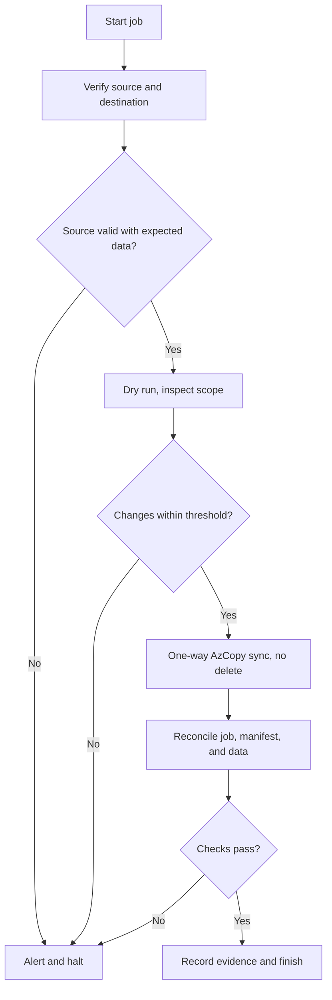

# Synchronizing Data with AzCopy and Azure Storage Explorer

Azure Blob Storage is an object storage service for images, documents, backups, logs, and analytics data. In practice, source data may reside on a workstation, an on-premises server, an Azure VM, or another Storage account. To upload data to Azure, push updated files, download datasets, or move data between storage locations, we need transfer tools that are both efficient and easy to govern.

**AzCopy** is a command-line utility built for copying and synchronizing data with Azure Storage. **Azure Storage Explorer** is a graphical desktop application for browsing containers, inspecting blobs, uploading/downloading, and working with data visually. AzCopy fits scripts, large datasets, and recurring jobs; Storage Explorer fits inspection, manual tasks, and operational troubleshooting.

This lesson belongs to the **Object Storage with Blob Storage** chapter of the Microsoft Azure module. Examples connect to knowledge of subscriptions, resource groups, Microsoft Entra ID, Azure RBAC, virtual networking, monitoring, security, and cost control. The objective is **moving the right data to the right destination with the right permissions and verifiable transfer evidence**.

## Learning Objectives

After this lesson, you will be able to:

- Explain the relationships among Storage accounts, containers, blobs, and prefixes.
- Distinguish `azcopy copy` from `azcopy sync`, particularly update and deletion behaviors.
- Sign in to AzCopy with Microsoft Entra ID and distinguish that mechanism from SAS and account keys.
- Upload, download, run one-way syncs, and copy data between containers using AzCopy.
- Use Azure Storage Explorer to connect, browse, upload/download, and inspect blobs.
- Preview transfers with `--dry-run` and prevent unintended deletions with `--delete-destination=false`.
- Verify transfers via job status, blob listings, and checksums when needed.
- Diagnose errors involving permissions, firewalls, private endpoints, paths, timestamps, or throttling.
- Design a safe scheduled sync workflow with logging, alerts, and cost controls.

## 1. Data Structure in Azure Blob Storage

Blob Storage organizes data in this model:

```text
Azure subscription
└── Resource group
    └── Storage account: storderslab
        ├── Blob container: incoming
        │   ├── invoices/2026/01/a.pdf
        │   ├── invoices/2026/01/b.pdf
        │   └── metadata.json
        └── Blob container: archive
            └── exports/report.csv
```

- **Storage account:** the Azure resource governing namespace, security, network access, encryption, and redundancy.
- **Blob container:** a logical grouping of blobs, typically a clean boundary for data permissions.
- **Blob:** an object having a name, content, properties, and metadata.
- **Prefix:** the leading part of a blob name that looks like a directory, e.g., `invoices/2026/01/`. In standard Blob Storage, this is a naming convention; tools may render it as a folder tree.
- **Hierarchical namespace (HNS):** when enabled for Data Lake Storage Gen2, directories and ACLs carry distinct semantics; verify compatibility for transfer commands.

A blob address typically takes the form:

```text
https://<STORAGE_ACCOUNT>.blob.core.windows.net/<CONTAINER>/<BLOB_NAME>
```

For example, `incoming/invoices/2026/01/a.pdf` specifies container `incoming` and blob name `invoices/2026/01/a.pdf`. When transferring a local folder, tools map filenames to blob names. Therefore, **source, container, and destination prefix** all matter—especially on repeated runs.

### Common Transfer Directions

1. Local directory → Azure Blob container.
2. Blob container/prefix → local directory.
3. Storage account A/container A → Storage account B/container B.
4. One prefix → another prefix within service capabilities and permissions.

For one-way sync, define the **source of truth**: the source is the authoritative copy for the job, and the destination receives updates. Choosing the wrong direction can overwrite or delete valid data.

## 2. How Do Copy and Sync Differ?

| Tool/operation | Goal | Characteristics | Risk |
|---|---|---|---|
| **AzCopy copy** | Copy selected files or blobs | Can run once or repeatedly, with overwrite options | Overwrites same-named objects if configured to allow it |
| **AzCopy sync** | Compare source and destination in one direction | Updates changed/missing objects, optionally deletes at destination | Deletes destination data when delete mode is enabled |
| **Storage Explorer Upload/Download** | Transfer files via GUI | Manual selection and tracking in Activities | Picking wrong container or accidental overwrite |
| **Storage Explorer Copy/Paste** | Copy blobs between supported locations | Convenient for inspecting subsets of objects | Does not provide automated continuous sync |
| **Azure Storage redundancy** | Increase data durability/availability | Service-managed, e.g., LRS/ZRS/GRS | Not a business directory sync mechanism |

**AzCopy sync is a point-in-time one-way sync**; it does not continuously watch for changes and does not reconcile conflicts when two people edit the same object on both sides. For bidirectional sync, design a dedicated conflict-detection and winner-resolution protocol.

**Storage Explorer** offers an intuitive UI for uploading, downloading, and inspecting. Repeating manual GUI actions does not build a scheduled background sync system with conflict handling.

## 3. Preparing the Environment and Verifying Permissions

This hands-on walkthrough assumes:

- An authorized Azure subscription for lab work.
- An existing Storage account and `incoming` Blob container.
- A user account granted read/write permissions on the container.
- AzCopy v10 runnable from a terminal or host permitted to reach Azure Storage.
- Azure Storage Explorer installed on a desktop if performing GUI steps.

### Azure RBAC: Control Plane vs. Data Plane Permissions

| Permission | Example roles | Meaning |
|---|---|---|
| **Control plane** | Reader, Contributor, Storage Account Contributor | View or manage Storage account resource settings |
| **Data plane read** | Storage Blob Data Reader | Read/list blobs within granted scope |
| **Data plane write** | Storage Blob Data Contributor | Read/write/delete blob operations per role and scope |
| **Data plane privileged admin** | Storage Blob Data Owner | Additional data privileges per role definition |

To upload using a Microsoft Entra ID identity, the operator typically needs **Storage Blob Data Contributor** at the container or parent scope. Subscription `Reader` **does not automatically grant permission to read blob contents**.

In Storage Explorer, browsing accounts via the subscription tree and reading/writing blobs can require separate permissions. Someone holding data-plane access on a container without management-plane permission to list accounts may need to attach the resource via an approved method, such as a scoped SAS URI.

### Choosing an Authentication Method

- **Microsoft Entra ID:** generally the preferred option when supported by users/workloads. Permissions are governed via Azure RBAC without sharing account keys.
- **Managed identity:** ideal for jobs running on supported Azure services, avoiding long-lived secrets.
- **SAS (Shared Access Signature):** grants access scoped by resource, operations, and lifetime; use for controlled access sharing. For Blob Storage, prefer user delegation SAS where feasible.
- **Storage account key:** broad-privilege secret. Use only when architecture and policy truly require it; never put keys in scripts, tickets, or docs.

Even after authentication succeeds, **Storage firewalls and network access rules** can deny requests from unauthorized networks. Data permissions and network permissions are two independent layers.

## 4. Installing and Signing In to AzCopy

AzCopy v10 is a standalone executable—do not assume it is installed just because Azure CLI is present. Check in Bash:

```bash
azcopy --version
azcopy --help
```

If the command is not found, install AzCopy v10 from Microsoft's official distribution for your OS and add it to `PATH`.

### Sign in with Microsoft Entra ID

```bash
azcopy login
```

If you need to specify a tenant:

```bash
azcopy login --tenant-id "<TENANT_ID>"
```

On an environment supporting managed identity with assigned data-plane roles:

```bash
azcopy login --identity
```

That last command does not apply on a personal workstation lacking a managed identity. Running `az login` in Azure CLI **does not sign in AzCopy**, as they are two separate tools.

### Check networking from the AzCopy host

Before uploading, confirm:

- Does the Storage account permit public network access from that source, or is a matching network rule configured?
- If the account uses **Private Endpoint** only, does the execution host have VPN/ExpressRoute connectivity or reside in a connected VNet?
- Does Private DNS resolve the blob endpoint to the private IP when needed?
- Do corporate proxies or firewalls allow outbound HTTPS/TCP 443 as designed?
- Does the AzCopy identity hold valid roles/credentials on both source and destination?

Azure Cloud Shell **is not automatically inside your custom VNet subnet**. Therefore, Cloud Shell cannot prove a Private Endpoint inside a VNet is reachable without proper network routing.

## 5. AzCopy Copy: Uploading Files and Directories

Use Bash to create small lab data:

```bash
mkdir -p ./lab-data/reports
printf 'order_id,total\n1001,150\n1002,230\n' > ./lab-data/reports/orders.csv
printf '{"source":"azcopy-lab","version":1}\n' > ./lab-data/manifest.json
```

Declare target resource variables using real account/container names:

```bash
ACCOUNT="<STORAGE_ACCOUNT>"
CONTAINER="incoming"
DEST_URL="https://$ACCOUNT.blob.core.windows.net/$CONTAINER/lab"
```

After authenticating, upload the **contents** of the local directory under the `lab` prefix:

```bash
azcopy copy "./lab-data/*" "$DEST_URL" --recursive=true
```

The `/*` wildcard indicates copying the folder's contents, while `--recursive=true` traverses subdirectories. AzCopy's path-mapping behavior depends on source/destination syntax; inspect the resulting blob names after an initial test before running against real datasets.

### Upload a single file

```bash
azcopy copy \
  "./lab-data/manifest.json" \
  "https://$ACCOUNT.blob.core.windows.net/$CONTAINER/lab/manifest.json"
```

### Avoid overwriting during upload

```bash
azcopy copy \
  "./lab-data/*" \
  "$DEST_URL" \
  --recursive=true \
  --overwrite=false
```

`--overwrite=false` skips overwriting existing destination objects during copy. Other update modes such as `--overwrite=ifSourceNewer` can be helpful where supported, though you should verify your AzCopy version and timestamp behavior.

**Copy does not automatically delete stale files at the destination.** If you delete a local file and re-run copy, the old blob typically remains. To compare source and destination in one direction, use `sync`.

## 6. AzCopy Sync: One-Way Synchronization

`azcopy sync` compares source and destination using tool-supported attributes (such as last-modified timestamps, file sizes, and other conditions depending on source/destination types). Do not assume it performs byte-by-byte comparisons or transfers only changed byte deltas of a blob.

### Preview with dry run

```bash
azcopy sync \
  "./lab-data" \
  "$DEST_URL" \
  --recursive=true \
  --delete-destination=false \
  --dry-run
```

Two critical flags:

- `--dry-run`: prints planned actions without actually transferring or deleting during the trial run.
- `--delete-destination=false`: prevents deleting destination objects that no longer exist at the source.

Review the planned path list carefully. If the tool flags the wrong prefix or an unexpected file count, stop and investigate.

### Execute after reviewing planned output

```bash
azcopy sync \
  "./lab-data" \
  "$DEST_URL" \
  --recursive=true \
  --delete-destination=false
```

Edit a local file or add a new file, then re-run dry run followed by sync. AzCopy determines which objects need updating per its comparison rules. For critical datasets, add secondary verification because timestamps and file attributes are not absolute proof of integrity.

### Does deleting a source file delete the destination blob?

Suppose the destination contains blobs:

```text
lab/manifest.json
lab/reports/orders.csv
lab/old-export.csv
```

While the local directory only has:

```text
manifest.json
reports/orders.csv
```

With `--delete-destination=false`, `lab/old-export.csv` is preserved.

AzCopy also supports **deleting destination objects missing from the source** via `--delete-destination=true`. This can cause data loss. Enable it only after verifying the source is complete, isolating a dedicated target prefix, having recovery copies ready, and obtaining organizational approval.

### Bidirectional Conflict Risks

If Person A edits a local file while Person B updates the same blob name in the cloud, running a one-way sync can overwrite one person's changes. You must:

- Designate which side is the **source of truth**.
- Avoid multiple processes writing to the same prefix without conflict controls.
- Evaluate versioning, soft delete, snapshots, or versioned naming schemes.
- Never pair two opposing sync jobs as an automatic two-way sync without designing consistency semantics.

## 7. Downloading and Syncing from Blob to Local Host

Download using `copy`:

```bash
mkdir -p ./downloaded-data

azcopy copy \
  "$DEST_URL/*" \
  "./downloaded-data" \
  --recursive=true
```

For large datasets, specify the exact prefix to download and verify the resulting file and subdirectory layout afterward.

To compare a cloud source against a local directory:

```bash
azcopy sync \
  "$DEST_URL" \
  "./downloaded-data" \
  --recursive=true \
  --delete-destination=false \
  --dry-run
```

After verifying planned actions, remove `--dry-run` to execute. Never enable delete mode targeting a local directory that holds unrelated files outside the job's scope.

In both scenarios, the session needs blob read permissions and valid network connectivity to the endpoint.

## 8. Copying Between Two Storage Accounts or Containers

AzCopy can copy from one supported Azure Storage URL to another without manually downloading everything to a laptop first:

```bash
SOURCE_URL="https://<SOURCE_ACCOUNT>.blob.core.windows.net/<SOURCE_CONTAINER>/export"
TARGET_URL="https://<TARGET_ACCOUNT>.blob.core.windows.net/<TARGET_CONTAINER>/import"

azcopy copy \
  "$SOURCE_URL" \
  "$TARGET_URL" \
  --recursive=true
```

Before running, verify:

- Which blobs sit under the source prefix, and what names will they receive at the destination?
- Does the identity or SAS hold **read permission at source** and **write permission at destination**?
- Do firewalls on both accounts allow this transfer path?
- Do source/destination regions comply with data residency rules?
- Are versioning, retention, or immutability locks blocking overwrites?
- Are transaction, egress, or cross-region transfer costs acceptable?

Some service-to-service copies use Azure server-side processing to avoid routing all bytes through the client workstation, yet never assume zero cost or unlimited throughput.

## 9. Tracking and Resuming AzCopy Jobs

AzCopy organizes each transfer session as a **job**, reporting succeeded, failed, and skipped transfers.

List jobs:

```bash
azcopy jobs list
```

Inspect details:

```bash
azcopy jobs show "<JOB_ID>"
```

When the job plan remains intact and conditions allow, resume a job:

```bash
azcopy jobs resume "<JOB_ID>"
```

Resumability depends on job state, tool version, preserved job plan/log files, and current credentials. If an ephemeral shell deleted local state or a SAS expired, re-authentication and re-evaluation may be required.

### When a job partially fails

1. Record the job ID, execution timestamp, AzCopy version, and source/destination paths.
2. Check succeeded versus failed transfer counts.
3. Read per-object errors: permissions, firewall, timeouts, throttling, invalid path names, or locked local files.
4. Fix the root cause and check whether another job is running against the same prefix.
5. Resume if appropriate, or re-run with safe parameters and verify afterward.

### Logs and security

AzCopy persists logs and job plans; supported environment variables such as `AZCOPY_LOG_LOCATION` and `AZCOPY_JOB_PLAN_LOCATION` let you control storage paths in regulated environments.

- Restrict read permissions on logs and job plans.
- Never attach SAS tokens, account keys, or credentials to public tickets.
- Avoid logging paths containing personal data unnecessarily.
- Set log retention and clean up after completion.
- In Cloud Shell or ephemeral containers, verify whether log/job plan directories persist across sessions before relying on resume.

## 10. Azure Storage Explorer: Managing Data via GUI

Azure Storage Explorer provides a visual interface for Blob Storage, useful when operators need to confirm blob existence, inspect metadata, upload/download small batches, or spot-check AzCopy outputs.

### Step 1: sign in or attach

1. Install Azure Storage Explorer from official Microsoft sources for your OS.
2. Open the app and navigate to account/connection management.
3. Sign in with Microsoft Entra ID if used by your organization.
4. Select the exact tenant and subscription.
5. Expand the resource tree to Storage account → **Blob Containers**.

If an account only holds direct container permissions without permission to list accounts in the subscription, use **Attach** with a SAS URI or approved method. Never request an account key just to bypass an uninvestigated resource browsing issue.

### Step 2: inspect the container

Select the `incoming` container. Double-check the open Storage account name, subscription, and path. For critical data, carefully verify the active prefix before clicking Upload or Delete.

Storage Explorer typically renders blob names containing `/` as visual folders. In flat Blob Storage, these folders are simply parts of the blob name.

### Step 3: Upload Files or Upload Folder

1. Navigate to the target path inside the container.
2. Choose **Upload → Upload Files** or **Upload Folder** per the UI.
3. Select the local files or folder to transfer.
4. Review overwrite mode, prefix, and filenames.
5. Confirm and monitor the **Activities** pane or transfer report.
6. Refresh the blob listing and verify names, sizes, and status.

If some files fail, never treat seeing a few blobs in the container as proof the entire folder uploaded cleanly.

### Step 4: Download and Copy/Paste

- Select a blob or group of blobs, click **Download**, pick a local folder, and inspect the downloaded files.
- Where supported by your version, use **Copy/Paste** to copy blobs to another permitted container or location.
- Check prefix structure and data properties after each operation.

These actions are great for **manual verification**, not as a recurring bidirectional sync process with automated conflict resolution. For large volumes, AzCopy/scripts are generally far better suited.

### Step 5: when the GUI reports an error

Check in order: account/tenant selection, data-plane permissions, SAS scope/expiration, Storage firewall, Private Endpoint/DNS, container state, and the exact error message. Signing into the GUI successfully does not automatically grant blob read/write permissions.

## 11. Choosing Between AzCopy and Storage Explorer

| Scenario | Preferred tool | Reason |
|---|---|---|
| Upload a few files to test a feature | Storage Explorer | Visual file picker and immediate inspection |
| Sync a daily reports folder | AzCopy sync + scheduler/monitoring | Repeatable with explicit flag controls |
| Migrate a very large dataset | AzCopy | Optimized parallel transfers and job tracking |
| Inspect properties or download one blob | Storage Explorer | Fast browsing and quick manual access |
| Copy two containers in a migration plan | AzCopy, optionally verify with Explorer | Reproducible with persistent logs |
| Recover deleted/overwritten files | Appropriate versioning/soft delete/backups | Copy/sync does not replace version protection |
| Multiple teams editing the same file set | Versioning/conflict-management workflow | Cannot rely on one-way sync to merge conflicts |

When combining both, a clean workflow is **transferring with AzCopy** and **spot-checking with Storage Explorer** on representative samples alongside automated checks.

## 12. File Filtering and Path Management

To skip temporary files, AzCopy supports name/path filtering flags on certain commands. Example:

```bash
azcopy copy \
  "./lab-data/*" \
  "$DEST_URL" \
  --recursive=true \
  --exclude-pattern="*.tmp;*.bak"
```

Pattern evaluation follows AzCopy's matching rules; do not assume the pattern matches full absolute paths. For filtering by prefix, timestamp, or file type, consult `--help` for your version and test on a small directory first.

### Paths and Object Names

Verify these details:

- Does `/*` copy **folder contents** or the parent folder name as well?
- Do destination blobs get the expected prefix?
- Is the local filesystem case-sensitive or case-insensitive?
- Do filenames contain spaces, Unicode, or characters needing escaping?
- Do colliding blob names already exist at the destination?
- Must content type, metadata, tags, access tiers, or ACLs be preserved?

Some local filesystem attributes are not automatically preserved in Blob Storage. With ADLS Gen2/HNS, directories and ACLs have specific semantics; validate before moving critical business data.

### Performance

Transfer speed depends on bandwidth, blob count, blob size, source CPU/disk, proxies, latency, and Storage account request limits. AzCopy exposes concurrency and logging settings depending on version, though excessive concurrency can trigger throttling. Benchmark small batches, measure throughput, and watch for errors before tuning aggressively.

## 13. Post-Transfer Verification

A zero exit code is an important signal, yet does not replace verifying destination data.

### List blobs with AzCopy

```bash
azcopy list "$DEST_URL"
```

Requires list permissions and valid network access. Compare blob names under the `lab` prefix against source data.

### Inspect with Azure CLI

When Azure CLI is signed in with an appropriate data-plane role:

```bash
az storage blob list \
  --account-name "$ACCOUNT" \
  --container-name "$CONTAINER" \
  --prefix "lab/" \
  --auth-mode login \
  --query "[].{name:name,size:properties.contentLength}" \
  --output table
```

This query compares **names** and **byte sizes**. For very large blob counts, account for pagination limits or use inventory/reports rather than treating a partial page as the whole dataset.

### When End-to-End Integrity Verification Is Needed

For software releases, official records, or long-term archives:

1. Record the source filename list, total file count, byte sizes, and timestamps.
2. Generate a manifest with **SHA-256** checksums per approved process.
3. Upload to a staging prefix.
4. Verify destination blobs using an appropriate read/hash verification step.
5. Publish data to applications only after checksums match.
6. Retain the manifest, job ID, and verification results as audit evidence.

Never assume **ETag** is a content hash, or that **Last-Modified** proves every byte matches the source. Business integrity checks should match data criticality.

## 14. Security and Data Residency

### Principle of Least Privilege

A job uploading to one container should receive container-scoped permissions whenever feasible. For jobs reading account A and writing account B, separate required permissions on each side. Never grant subscription-wide Owner/Contributor merely because a command needs data-plane permissions.

### SAS and Keys

An active SAS URL functions as a bearer credential. Avoid exposing it in shared clipboards, shell history, logs, or documentation. When SAS is required by policy, enforce minimal scope, permissions, and lifetime with proper issuance/revocation mechanisms. Never embed account keys in example scripts or committed files.

### Private Networking

- With **Storage firewalls**, the transfer host's IP must be allowlisted per policy.
- With **service endpoints**, traffic from Azure subnets is recognized via the Storage account's virtual network rules.
- With **Private Endpoints**, the host or workload must have routing to the private IP and valid private DNS resolution.
- For on-premises hosts, VPN/ExpressRoute and DNS must be configured explicitly.

AzCopy/Storage Explorer will not bypass firewalls just because authentication succeeded. Azure Cloud Shell also does not automatically sit inside your VNet subnet.

### Data Residency and Costs

Copying blobs across regions, onto personal laptops, or to partner systems creates cross-boundary data flows. Identify data classification, storage/processing residency regulations, authorized viewers, and deletion procedures. Factor in storage capacity, transaction counts, egress bandwidth, and retention costs.

## 15. Preventing Accidental Deletion or Overwriting Critical Data

A misconfigured sync job can cause data loss even when the tool works exactly as designed. Layer these protections:

1. **Dedicated prefixes:** use `incoming/lab/` or app-specific prefixes rather than production roots.
2. **Dry run:** preview planned updates, especially on initial sync runs.
3. **No deletes by default:** keep `--delete-destination=false` unless deletion mirroring is explicitly approved.
4. **Non-empty source guard:** abort if an expected disk mount is missing or empty.
5. **Soft delete and versioning:** enable recovery features aligned with data requirements.
6. **Retention/immutability:** apply where retention is mandated, accounting for impacts on writes/deletes.
7. **Staging:** upload to a temporary prefix, validate, and only then promote.
8. **Restricted permissions:** omit delete permissions when business workflows only write, where supported.
9. **Alerts:** detect sudden spikes in deleted files, failed transfers, or abnormal costs.

**Azure Storage redundancy does not replace independent historical backups.** Overwrites or deletions can replicate across redundant copies. Recoverability must be designed separately.

## 16. Organizing Scheduled Sync Jobs

AzCopy is a CLI command, not a background daemon. For daily syncs, run it via an organization-approved scheduler, pipeline, or orchestrator.



A production job should:

- Read source/destination configuration from managed config stores without hardcoded tokens.
- Verify local source paths exist and volumes are genuinely mounted.
- Prevent concurrent overlapping runs on the same prefix without conflict controls.
- Record exit codes, job IDs, transfer counts, and total bytes moved.
- Configure bounded retries, distinguishing transient errors from errors needing human intervention.
- Check for anomalous change counts before transferring/deleting.
- Alert operators on failure with a documented recovery runbook.
- Account for request/listing fees, storage, egress, and Log Analytics costs.

Dangerous example: a job reads `/mnt/export`, but the volume failed to mount and the folder is empty. If the job enables destination deletion to mirror, massive blob deletion can result. Treat **precondition checks** as mandatory.

## 17. Common Errors and Troubleshooting

| Symptom | Possible Cause | Resolution |
|---|---|---|
| `azcopy` not found | Not installed or missing from PATH | Check `azcopy --version`, install proper binary |
| Sign-in succeeds but upload returns 403 | Missing data role or blocked by Storage firewall | Check Blob Data Contributor, scope, networking, and detailed error |
| `AuthorizationPermissionMismatch` | SAS lacks permissions or identity lacks matching data action | Verify credential permissions and scope |
| Storage Explorer doesn't show account | Wrong tenant, missing browse permission, or not attached | Check subscription/tenant and approved attach method |
| Storage Explorer cannot reach Private Endpoint | Host lacks routing or private DNS | Verify VPN/ExpressRoute, DNS, and firewalls |
| Sync skips updating certain files | Timestamp/size match, filter, or wrong path | Inspect dry run, logs, and file attributes |
| Old blobs remain after local file deletion | `--delete-destination=false` is active | Expected safeguard; confirm mirroring policy before deleting |
| Files land under wrong prefix | Wildcard or folder mapping mistake | Test small batch and inspect resulting blob names |
| Slow upload with throttling errors | Bandwidth/account/request rate/concurrency caps | Review logs, measure load, tune rate/schedule |
| Interrupted job | Network drop, expired token/SAS, closed terminal | Run `jobs show` and `resume` while job plan remains valid |
| File count mismatch | Prefix/filter, list permissions, pagination, or failed transfers | Reconcile manifests, job status, and inventory |
| Cross-region account copy fails | Permissions on either side, firewalls, routing, or policies | Verify source and destination independently then retry |

During investigation, prioritize pinpointing **source–destination–identity–network–error code**. Never open public network access or use broad account keys to mask permission issues.

## 18. Capstone Exercise: Syncing Daily Reports

An analytics team has a local `./daily-reports` directory and wants to update container `incoming`, prefix `daily-reports/`. The requirement is **never delete older blobs**, and auditors must be able to read outputs via Storage Explorer.

### Step 1: prepare

Create the folder and dummy CSV files, ensuring no unauthorized sensitive data is included:

```bash
mkdir -p ./daily-reports
printf 'day,total\n2026-11-19,380\n' > ./daily-reports/orders-2026-11-19.csv
printf 'day,total\n2026-11-20,450\n' > ./daily-reports/orders-2026-11-20.csv
```

### Step 2: define account and container

```bash
ACCOUNT="<STORAGE_ACCOUNT>"
CONTAINER="incoming"
SRC="./daily-reports"
DEST="https://$ACCOUNT.blob.core.windows.net/$CONTAINER/daily-reports"
```

### Step 3: dry run

```bash
azcopy sync "$SRC" "$DEST" \
  --recursive=true \
  --delete-destination=false \
  --dry-run
```

Inspect the planned file list. If anything looks wrong, fix paths before continuing.

### Step 4: sync

```bash
azcopy sync "$SRC" "$DEST" \
  --recursive=true \
  --delete-destination=false
```

### Step 5: verify

```bash
azcopy jobs list
azcopy list "$DEST"
```

Record the job ID and compare the blob listing. Open Azure Storage Explorer using a read-only auditor identity, navigate to the container and prefix above, verify filenames/sizes, download a sample file, and verify its contents.

### Step 6: test update scenarios

- Modify one local CSV and add a new CSV.
- Re-run dry run then sync; observe which file updates.
- Delete one local CSV and run dry run with `--delete-destination=false`; confirm the cloud blob stays intact.
- Clean up lab data at the destination only after confirming exact scope and approval.

### Test Matrix

| Scenario | Expected result |
|---|---|
| Initial sync | New blobs appear under exact prefix |
| Re-run with no changes | Does not re-upload everything unnecessarily per sync logic |
| Add or modify local file | Updates matching blob per comparison rules |
| Delete local file, destination delete off | Older blob remains in place |
| Read-only auditor account | Can view/download blobs, cannot write/delete |
| Host outside Storage firewall allowlist | Access denied despite valid credentials when no exception exists |
| Download file and compare checksum | Content matches confirmed source |

## 19. Pre-Production Checklist

- [ ] Verified subscription, Storage account, container, and source/destination prefixes.
- [ ] Defined source of truth and sync direction explicitly.
- [ ] Used Entra ID/managed identity or appropriately scoped, short-lived SAS.
- [ ] Assigned least-privilege data-plane roles; no account keys embedded in scripts.
- [ ] Verified firewalls, private endpoints, DNS, and routing from the job host.
- [ ] Evaluated soft delete, versioning, retention, and backups for critical data.
- [ ] Tested on small sample data to verify mapping and prefixes.
- [ ] Used dry run before major changes or deletion-capable runs.
- [ ] Kept `--delete-destination=false` unless mirroring with deletes is formally approved.
- [ ] Verified source contains expected data, mounts are healthy, and no duplicate jobs overlap.
- [ ] Persisted logs/job IDs/exit codes with failure alerting.
- [ ] Verified object counts, byte sizes, and checksums where required.
- [ ] Modeled tier, redundancy, transaction, egress, and retention costs.
- [ ] Assigned an owner, recovery runbook, and change management process.

## 20. Self-Check Questions

1. Which task groups fit AzCopy versus Azure Storage Explorer?
2. Why does `azcopy copy` not aim to make the destination an exact mirror of the source?
3. Is `azcopy sync` a continuous, bidirectional synchronization tool?
4. What behavior does `--delete-destination=false` protect destination data from?
5. When should you use `--dry-run`, and why shouldn't you skip it before production transfers?
6. Does a subscription Reader role automatically grant blob read permissions?
7. Can a user holding Blob Data Contributor still be blocked by a Storage firewall?
8. Why can't Storage Explorer on a laptop automatically reach a Private Endpoint?
9. Beyond a success message, what should you verify after a transfer?
10. Why aren't ETag or Last-Modified sufficient as end-to-end content checksums?
11. If a source volume fails to mount and a job permits destination deletion, what is the risk?
12. What information should a scheduled sync job log and alert on?
13. What security, compliance, and cost concerns can arise when copying blobs across regions?

## Conclusion

**AzCopy** enables scripted, command-line copying and one-way syncing for Azure Blob Storage. **Azure Storage Explorer** provides visual browsing, inspection, and manual transfers. Both tools must be used with a clear grasp of containers/prefixes, Microsoft Entra ID or SAS authentication, Azure RBAC permissions, and network boundaries.

Reliable workflows always confirm **source–destination–scope–permissions**, dry-run major changes, protect against accidental deletion, verify post-transfer results, and maintain recovery plans. Pairing these tools with Storage firewalls/Private Endpoints, logging, and cost controls helps operations teams manage Azure data safely, consistently, and auditably.
