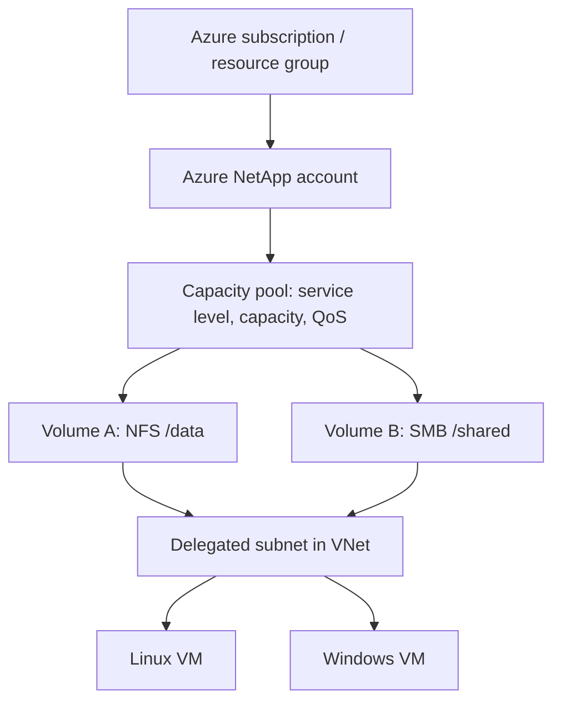

# Azure NetApp Files and High-Performance File-Sharing Workloads

Many enterprise applications need more than just a place to store files. They require **multiple servers reading and writing to the same file system**, maintaining low latency, handling high I/O volumes, preserving file-level access permissions, and recovering quickly from failures. Examples include SAP applications, data analytics platforms, rendering environments, engineering software, Linux apps using NFS, or Windows apps using SMB.

**Azure NetApp Files (ANF)** is a managed file storage service on Azure providing high-performance volumes for suitable workloads. Instead of operating dedicated file server VMs, the platform team creates volumes, selects protocols, grants access permissions, and lets applications mount those volumes over a private network.

This lesson belongs to the **File and Disk Storage** chapter of the **CLOUD_PROVIDERS_AZURE** module. This knowledge connects resource group and subscription organization with VNets, identity, security, deployment, monitoring, and cost governance for Azure application architectures.

> Scope: this lesson explains the ANF model and deployment workflow for high-performance shared-file workloads. Quotas, pricing, regional feature availability, service levels, and protocol options can vary; when deploying, verify support on your target subscription, region, and volume type.

## 1. Learning Objectives

After this lesson, you will be able to:

1. Distinguish Azure NetApp Files from Azure Files, Blob Storage, and Azure Managed Disks.
2. Explain the **NetApp account → capacity pool → volume** hierarchy, delegated subnets, and mount targets.
3. Choose **NFS**, **SMB**, or dual-protocol based on OS, application, and permission requirements.
4. Understand relationships among quota, service level, QoS, IOPS, throughput, and latency.
5. Design private networking, DNS, Active Directory, export policies, and file-level permissions.
6. Provision volumes via the Azure Portal, mount from VMs, and run controlled functional/performance tests.
7. Design snapshots, backups, replication, monitoring, alerts, and cost management for production environments.

## 2. What Problem Does ANF Solve?

Suppose an enterprise runs a video processing application across four Linux VMs. Each VM must see the same `/media/projects` directory. If data sits on each VM's individual disk, operations must handle synchronization manually. If placed on a single file server VM, that file server becomes a component requiring performance management, patching, backups, and high availability.

With ANF, multiple VMs within permitted network and authorization boundaries can mount **the same NFS volume** to share a common dataset. Azure manages the storage service while the application team focuses on directory structure, access permissions, performance, and data durability.

Key characteristics:

- **File-level access:** applications work with files, directories, and open/read/write/rename calls rather than blob object APIs.
- **Shared access:** multiple clients can access the same volume when supported by protocol and application design.
- **Planned performance:** service levels, capacity/quotas, and QoS options enable throughput engineering.
- **Private networking:** volumes are accessed over Azure VNet/hybrid connectivity, not via public Internet URLs.
- **Data protection:** snapshots and additional protection features are configured as required; volumes are not backed up or cross-region replicated by default.

**Do not choose ANF merely because it sounds "premium."** If an application fits object storage, caching, or Azure Files with moderate requirements, another solution may be simpler and more economical.

## 3. Comparing Azure NetApp Files with Other Storage Types

| Service | Model | Ideal use cases | Key considerations |
|---|---|---|---|
| **Azure NetApp Files** | Managed file volumes via NFS/SMB | Shared file workloads needing performance/low latency, legacy or enterprise apps | Requires designing capacity pools, volumes, private networking, protocols, and cost |
| **Azure Files** | Managed SMB/NFS file shares per service options | General file sharing, file server migrations, compatible app integrations | Check specific tiers, protocols, networking, and performance targets |
| **Azure Blob Storage** | Object storage via HTTP(S)/APIs | Images, videos, backups, unstructured data, data lakes | Not a standard POSIX/SMB file system for arbitrary apps |
| **Azure Managed Disks** | Block storage attached to VMs | OS disks, local VM data, database block I/O | Does not automatically form a multi-VM shared filesystem; needs special design if shared |
| **Self-managed file server on VM** | Enterprise-operated NFS/SMB server | Specialized customization or workloads unsuitable for managed services | Must self-manage HA, patching, backups, performance, and file server OS |

**Decision question:** does the workload genuinely need a **shared file system** with NFS/SMB semantics and ANF performance characteristics? Or does it only need to store objects and fetch them over HTTPS? Proper classification prevents placing data on the wrong storage service.

## 4. Resource Hierarchy: Account, Pool, and Volume

Azure NetApp Files is typically organized into three layers:



The diagram shows logical relationships; each volume maintains its own network and protocol settings. Clients can mount a volume only if **protocol, network path, identity, and access permissions** permit it.

### Azure NetApp account

A **NetApp account** is a management resource grouping capacity pools, volumes, and certain service configurations. It is not a user account for SMB sign-in or a direct application identity.

Operators require appropriate Azure RBAC permissions to create or modify accounts, pools, and volumes; these permissions **differ** from NFS/SMB user read/write permissions on the data plane.

### Capacity pool

A **capacity pool** is the unit of provisioned capacity and performance from which volumes draw resources. When creating a pool, select a service level, provisioned capacity (within service-supported increments and limits), and an appropriate Quality of Service (QoS) model.

One pool can contain multiple volumes. Remaining pool capacity and service quotas dictate whether additional volumes can be created or expanded.

### Volume

A **volume** is the file system mounted and consumed by applications. A volume includes:

- Resource name and volume/export path.
- Configured quota or capacity.
- Supported access protocol and related settings.
- VNet/subnet and mount target IP address.
- Export policy for NFS or identity configuration for SMB.
- Snapshots, backups, or replication configured as needed.
- Service-supported performance and network feature options.

**Volume quota does not equal bytes of written files.** Quota is the logical configured limit/space; consumed data and snapshot consumption must be monitored separately.

## 5. Service Levels, QoS, and Performance Sizing

ANF offers **service levels** with distinct performance targets and pricing. Common tier names include **Standard**, **Premium**, and **Ultra**; depending on region, time, or pool type, other options may exist. Do not rely on static throughput tables copied from legacy environments: use specifications published by Azure for **your exact pool type and current region**.

### How do throughput, IOPS, and latency differ?

| Metric | Meaning | Questions to answer |
|---|---|---|
| **Throughput** | Volume of data read/written per second | Enough MiB/s for large files, sequential processing, or batch jobs? |
| **IOPS** | Number of read/write operations per second | Handles many small I/Os and metadata operations? |
| **Latency** | Time to complete an operation | Suits latency-sensitive database/file workloads? |
| **Concurrency** | Number of simultaneous tasks/clients | How does performance behave as worker count scales? |
| **Quota/capacity** | Logical configured space | Sufficient for active data and growth? |

For example, 8,000 operations/sec at 64 KiB I/O size equals roughly:

```text
8,000 IOPS × 64 KiB = 512,000 KiB/s ≈ 500 MiB/s
```

This is a **theoretical** conversion, not a guarantee that ANF delivers 500 MiB/s. Protocol overhead, access patterns, client specs, networking, read/write mix, QoS, and service limits all affect real throughput.

### Automatic QoS vs. manual QoS

Depending on capacity pool type, ANF supports an appropriate QoS model:

- **Automatic QoS:** volume throughput scales with volume size/quota and service level per service mechanics. Resizing a volume alters its allocated throughput.
- **Manual QoS:** operators configure volume throughput within supported ranges independently of volume quota, yet still bounded by pool capacity/capabilities and service limits.

Do not interpret Manual QoS as allowing arbitrary throughput values. Budget aggregate throughput across all volumes against pool capacity and specific limits.

### Sizing example

Three volumes sharing one pool:

| Volume | Demand | What to measure |
|---|---|---|
| `vol-app` | Many small files, many clients | IOPS, metadata latency, concurrency |
| `vol-media` | Sequential large-file reads/writes | Read/write throughput, VM network bandwidth |
| `vol-backup-stage` | Scheduled write bursts | Peak throughput, completion window, traffic spikes |

You cannot pick identical QoS settings purely because "each volume is 1 TiB." Benchmark with production-like file sizes, operations, and concurrency, then tune the pool/volumes.

## 6. Network Design: Delegated Subnet and Mount Targets

Azure NetApp Files is accessed over **private network connectivity**. When provisioning volumes, you must use a subnet **delegated** to the `Microsoft.NetApp/volumes` resource provider inside an appropriate VNet.

Example:

```text
VNet: 10.70.0.0/16

  snet-app: 10.70.1.0/24
    Linux VM A: 10.70.1.10
    Linux VM B: 10.70.1.11

  snet-anf: 10.70.10.0/24
    Delegation: Microsoft.NetApp/volumes
    ANF volume mount target: Azure-assigned private IP
```

Clients in application subnets can reach the volume when routing and permissions allow. VMs do not need to live inside the delegated volume subnet itself.

### Delegated subnet principles

1. Dedicate a subnet specifically for ANF; never mix regular VM NICs into an ANF-delegated subnet.
2. Choose a prefix large enough for current and future needs within service min/max constraints; avoid exhausting subnet IPs.
3. Ensure the VNet, volume region, and network feature settings are compatible.
4. Verify connectivity from peered VNets or on-premises via VPN/ExpressRoute if hybrid access is needed.
5. Check **Basic/Standard network features** and regional support before relying on NSGs, UDRs, or advanced routing topologies.
6. Do not configure routes or firewalls assuming a volume is a VM with a self-managed NIC.

NSG/UDR support and networking behavior depend on volume/subnet **network features** and service rules. Check effective routes, network policies, and deployment-specific docs rather than assuming every ANF subnet behaves identically to a VM subnet.

### Network latency and locality

Place compute and volumes in network locations aligned with the application, typically the same region for latency-sensitive workloads. Cross-region peering or hybrid links increase RTT and degrade small I/Os, even when pool throughput ratings are high.

If an application executes tens of thousands of tiny metadata operations, **latency and protocol round-trips** can matter far more than peak bandwidth. Test from the actual VM tier and network path planned for production.

### DNS does not replace connectivity

SMB generally requires host/share names and specifically relies on working DNS/Active Directory. For NFS, mount targets may be provided as an IP address and export path in mount instructions. Regardless of hostname or IP, clients must have network reachability and open protocol ports.

**ANF is not a public Internet file share.** If employees need remote access outside Azure, provide VPN, ExpressRoute, or an approved enterprise access solution—never attempt to expose volumes as public endpoints.

## 7. Choosing Protocols: NFS, SMB, and Dual-Protocol

Protocol selection must align closely with workloads, operating systems, file semantics, identities, and permissions.

| Protocol | Typical workloads | Design considerations |
|---|---|---|
| **NFSv3** | Linux/Unix, legacy apps, HPC, compatible pipelines | Export policy, UID/GID, UNIX permissions, networking, security options |
| **NFSv4.1** | Linux/Unix needing NFSv4.1 semantics and features | Client compatibility, state/locking, identity, Kerberos security if applied |
| **SMB** | Windows file shares, enterprise apps, user/group ACLs | Active Directory DS, DNS, Kerberos, NTFS ACLs, SMB version compatibility |
| **Dual-protocol** | Workloads needing both NFS and SMB over one dataset | Unified identity, UID/SID mapping, security style, protocol-specific limits/support |

Supported NFS/SMB combinations in dual-protocol and limits on authentication/volume features must be verified at volume creation time. Do not assume every feature of a single-protocol NFS volume works identically in dual-protocol mode.

### NFS permissions

With NFS, export policies determine **which clients/subnets are allowed access** along with attributes like read-only/read-write, root access, or security type where supported. Once mounted, Linux file permissions still apply: UID, GID, mode bits, ACLs, and application umask/file creation behavior.

For example, two VMs mount a volume, yet user `app` has UID 1001 on VM A and UID 2001 on VM B. Despite identical usernames, file permissions will diverge if the system evaluates numeric UIDs/GIDs. Maintain a consistent Linux identity strategy.

**Never use overly broad export policies such as "all IPs read-write, unrestricted root access" just to finish a lab.** Restrict client IP ranges and enforce least privilege.

### SMB permissions

SMB in ANF typically integrates with **Active Directory Domain Services** per supported configuration and prerequisites. Requirements include:

- DNS accurately resolving domain controllers and related SRV records.
- Network reachability to domain controllers on required service ports.
- Approved accounts and admin permissions to configure the AD connection.
- Proper users/groups with share permissions and file/NTFS ACLs.
- Time synchronization and working Kerberos authentication.

**Azure RBAC managing ANF resources does not grant rights to open SMB files.** Data-plane permissions are governed by protocol, AD, and ACLs. A user holding Contributor on the resource group may still be blocked from reading a share folder.

### When should you avoid dual-protocol?

If Windows and Linux applications do not need to write simultaneously to the exact same dataset, separating volumes by protocol is usually far easier to govern. Dual-protocol requires rigorous design for identity mapping, file ownership, ACLs, and file-locking edge cases; avoid using it merely to "support everything."

## 8. Preparing Deployment via Azure Portal

This walkthrough assumes a test subscription, Azure NetApp Files management permissions, a VNet, and sufficient regional quota/feature support.

**Before creating resources, verify:**

- Azure NetApp Files is available in the selected region and enabled on your subscription.
- The `Microsoft.NetApp` resource provider is registered if required.
- Resource quotas, minimum capacity pool sizes, service levels, and target features.
- VNet and delegated subnet CIDRs do not overlap hybrid networks.
- Client hosts (Linux/Windows VMs) are ready for mounting and testing.
- Budget approval; capacity pools can start accruing charges immediately upon provisioning regardless of stored file volume.

### Step 1 — Create a NetApp account

In the Azure Portal, search for **Azure NetApp Files** and create a NetApp account in the target subscription, resource group, and region. Use an environment-clear name such as `anf-lab`. Record owner, project, and tags per governance standards.

### Step 2 — Create a capacity pool

Inside the account, create a capacity pool with a permitted service level (e.g., Premium for testing if supported), minimum/target capacity, and suitable QoS model. Never pick pool size solely from sample dataset GiB: pools allocate in service-mandated increments and minimums that carry meaningful cost.

For production, size pools around throughput goals, quota headroom, and volume count—not just current stored data.

### Step 3 — Prepare the delegated subnet

In your VNet, create a dedicated subnet and configure delegation to `Microsoft.NetApp/volumes` in the Azure UI. Verify region, VNet, and intended **network features** for the volume before continuing.

### Step 4 — Create an NFS volume

Select the capacity pool, create a volume, and configure:

- Volume name and unique file/export path per service rules.
- Appropriate quota.
- **NFSv3** or **NFSv4.1** protocol as required.
- Delegated VNet/subnet.
- Export policy allowing only your test VM CIDR or client subnet.
- Necessary read/write and root access rules.
- Snapshot policy or data protection once designed.

Successful volume creation confirms control-plane provisioning; **it does not prove applications have mounted or can write data**.

### Step 5 — Retrieve mount instructions

Open the volume blade and select **Mount instructions**. Azure displays the mount target and export path matching your protocol. Use the exact portal-provided command matching your OS, NFS version, and volume configuration.

### Step 6 — Mount from a VM and verify

SSH into a test Linux VM in the client subnet (via an approved management path), prepare the NFS client, and mount. Verify permissions and network reachability before creating test files.

## 9. Controlled Linux NFS Mount Example

Illustrative commands for an **existing NFSv4.1 volume**. IP and paths are placeholders; always copy exact values from the volume's Mount instructions rather than guessing.

```bash
sudo mkdir -p /mnt/anf-data

sudo mount -t nfs \
  -o vers=4.1,proto=tcp \
  "<MOUNT_TARGET_IP>:/<VOLUME_EXPORT_PATH>" \
  /mnt/anf-data

mount | grep /mnt/anf-data
df -h /mnt/anf-data
```

Explanation:

- `vers=4.1` applies only when the volume is configured for and the client supports NFSv4.1. For NFSv3, use appropriate options rather than switching versions arbitrarily.
- `<MOUNT_TARGET_IP>:/<VOLUME_EXPORT_PATH>` must match the mount target provided by Azure.
- `df -h` shows capacity from the client perspective and does not replace service-side quota and consumption metrics.
- A successful `mount` does not guarantee the application has write permissions in every folder.

Test permissions **inside an authorized directory**:

```bash
cd /mnt/anf-data
printf 'test-an-fs\n' > ./anf-connectivity-test.txt
cat ./anf-connectivity-test.txt
rm ./anf-connectivity-test.txt
```

If `Permission denied` occurs, inspect export policy, UID/GID, directory permissions, and security type; never rush to run `chmod -R 777` or enable root access volume-wide.

**Consistency note:** when multiple clients share a volume, file locking, concurrent writes, and update handling must follow application semantics. ANF provides a file system, not automatic resolution of application-level race conditions between two processes writing the same file.

### Persistent mounts

If mounts must survive reboots, configure `/etc/fstab` or automounting per OS guidance and operational standards. Before enabling auto-mount in production, verify network startup ordering, timeouts, NFS options, disconnect handling, and that VM reboots do not hang during boot.

Never copy mount options from an old blog post without verifying support on your NFS client/kernel and Azure NetApp Files.

## 10. Connecting to SMB from Windows

For SMB volumes, prerequisites typically include proper Active Directory integration in ANF, DNS/network reachability to domain controllers, and an account authorized to open the share.

On a domain-joined Windows client or supported authentication context:

```powershell
Test-NetConnection -ComputerName "<SMB_SERVER_HOSTNAME>" -Port 445
```

After confirming port and DNS resolution, open the share in File Explorer via:

```text
\\<SMB_SERVER_HOSTNAME>\<SHARE_NAME>
```

Or use PowerShell within an appropriately authenticated session:

```powershell
New-PSDrive -Name "N" -PSProvider FileSystem `
  -Root "\\<SMB_SERVER_HOSTNAME>\<SHARE_NAME>" -Persist
```

Substitute hostname and share from the volume's **Mount instructions**. If drive mapping or your PowerShell context does not support `-Persist`, use standard Windows SMB connection methods suited to your environment.

If domain sign-in succeeds yet files are inaccessible, isolate:

- DNS resolution of the share hostname.
- TCP/445 connectivity from the client.
- Kerberos/AD authentication.
- Share-level permissions and directory NTFS ACLs.
- Which user identity is actually active when opening the share.

Never embed passwords or AD tokens in scripts, connection strings, or logs; use organization-approved credential management.

## 11. Azure CLI: Inventorying and Inspecting ANF Resources

Azure CLI provides the `az netappfiles` command group for managing Azure NetApp Files resources. Syntax or options for certain operations may vary by Azure CLI version and volume type; check `--help` before running state-changing commands.

The examples below are **read-only commands** for Azure Cloud Shell (Bash) or an authenticated Bash session:

```bash
az account show \
  --query "{subscription:name, subscriptionId:id}" \
  --output table

RG="rg-anf-lab"
ACCOUNT="anf-lab"
POOL="pool-perf"
VOLUME="vol-data"
```

List NetApp accounts:

```bash
az netappfiles account list \
  --resource-group "$RG" \
  --output table
```

List capacity pools in the account:

```bash
az netappfiles pool list \
  --resource-group "$RG" \
  --account-name "$ACCOUNT" \
  --output table
```

List volumes in the capacity pool:

```bash
az netappfiles volume list \
  --resource-group "$RG" \
  --account-name "$ACCOUNT" \
  --pool-name "$POOL" \
  --output table
```

Show volume details and capture resource ID:

```bash
az netappfiles volume show \
  --resource-group "$RG" \
  --account-name "$ACCOUNT" \
  --pool-name "$POOL" \
  --volume-name "$VOLUME" \
  --output json

VOLUME_ID=$(az netappfiles volume show \
  --resource-group "$RG" \
  --account-name "$ACCOUNT" \
  --pool-name "$POOL" \
  --volume-name "$VOLUME" \
  --query id --output tsv)
```

These commands do not require printing secrets; however, mount paths, AD connection details, and network parameters should still be shared strictly on a need-to-know basis.

### Inspecting Azure Monitor metric definitions

```bash
az monitor metrics list-definitions \
  --resource "$VOLUME_ID" \
  --output table
```

The metric list returned by Azure for the exact resource type is the authoritative source for metric names, units, and supported aggregations. Once you know exact metric names, use `az monitor metrics list` to query series; never guess metric names across regions, tiers, or volume types.

## 12. Benchmarking Performance and Identifying Bottlenecks

Before concluding ANF is "slow" or "lacks throughput," define clear measurement goals:

| Workload type | Key metrics to watch |
|---|---|
| Sequential large-file reads | Read MiB/s, latency per I/O size, VM network limits |
| Large-file writes | Write MiB/s, parallelism, sync/flush policies |
| Many small files | IOPS, metadata latency, open/close rates, directory ops |
| Multi-client concurrent access | Aggregate concurrency, lock contention, client latency |
| Enterprise SMB | File operation latency, AD/DNS, SMB sessions, file ACLs/locking |
| Databases or specialized apps | `fsync`/commit patterns, vendor requirements, consistency and latency |

Layers to inspect:

1. **Client/VM:** VM SKU, NIC bandwidth, CPU, RAM, NFS/SMB client, connection count, and filesystem settings.
2. **Network path:** VNet peering, hybrid RTT, firewalls/routes, DNS, and link latency.
3. **Protocol:** NFS version, mount options, SMB dialect, locking, identity mapping, and overhead.
4. **ANF volume/pool:** QoS, service level, quota, allocated throughput, utilization, and throttling where exposed by metrics.
5. **Application:** I/O size, IOPS, worker count, lock contention, metadata ops, and I/O wait time.

### Benchmarking with fio

On a **test volume**—never run write benchmarks against production volumes—you can use `fio` to measure patterns approximating your application. Example random read against a benchmark file **pre-created on a lab volume**:

```bash
fio --name=anf-randread-lab \
    --filename=/mnt/anf-data/benchmark-file \
    --rw=randread \
    --bs=64k \
    --iodepth=8 \
    --numjobs=2 \
    --direct=1 \
    --time_based=1 \
    --runtime=60 \
    --group_reporting
```

Ensure `benchmark-file` contains **non-sensitive data created specifically for benchmarking** and is large enough for meaningful measurements. `--direct=1` and concurrency settings may differ from how real applications use OS caching and locking; `fio` does not automatically replicate every SMB/NFS workload. Never run random write tests over live business files.

**Reporting results:** document IOPS, bandwidth, average and percentile latencies, job count, block size, protocol version, VM SKU, service level/QoS, region, and timestamp. Compare results only under equivalent test conditions.

### Interpreting results accurately

A volume can deliver high MiB/s on large sequential reads while feeling slow when listing millions of tiny files. Throughput and IOPS are distinct dimensions; metadata operations and locking also heavily affect performance.

After changing QoS, pools, or volume quotas, re-run standardized benchmarks and observe the real application. Never infer upgrade effectiveness purely from control-plane settings.

## 13. Monitoring and Alerting

Azure Monitor exposes metrics published by ANF for volume and pool resources. Key categories include:

- **Capacity:** volume quota, logical/consumed/allocated size per available metrics, and data growth rate.
- **I/O:** read/write operations, IOPS, and bytes read/written.
- **Latency:** read/write latency or corresponding latency metrics.
- **Throughput:** bytes read/written per second, throughput limits, and QoS attainment where metrics exist.
- **Snapshots/data protection:** published snapshot size or protection status; never assume snapshots automatically equal off-account backups.
- **Access health:** client mount failures, NFS/SMB errors, AD/DNS issues, timeouts, and application SLOs from client telemetry.

Metric names, granularity, and aggregations vary by resource type; never configure alerts against an imagined `AverageLatency` metric if the API does not list that exact name.

### Recommended dashboard

| Chart | Analysis |
|---|---|
| Volume used/quota over 30 days | Capacity exhaustion risk and growth trend |
| Read + write throughput | Peaks relative to provisioned allocation |
| Read/write latency and app p95 | Distinguish averages from tail user experience |
| Read/write IOPS | Driven by high volumes of small I/Os? |
| NFS/SMB error and timeout counts | Are apps dropping connections or hitting permission errors? |
| Pool allocated vs. used capacity | Headroom left for volume expansion? |
| Backup/replication status | Are protection jobs completing on schedule? |

Add alerts when capacity nears quota, elevated latency persists, or throughput approaches limits alongside application errors. Base thresholds on baselines and SLOs rather than applying one rigid threshold across every workload.

### Logs outside Azure Monitor

Many file system issues appear clearly only on the client:

```bash
mount | grep /mnt/anf-data
df -h /mnt/anf-data
nfsstat -m
dmesg | tail -n 30
```

These are read-only status commands; run with appropriate privileges and be cautious when sharing outputs since paths and filenames can expose internal info. On Windows, inspect Event Viewer, SMB client logs, session status, and application logs while checking DNS/AD.

A VM bottlenecked on CPU or NIC bandwidth can exhibit high client-side latency even when volume-side metrics look normal. Always correlate client and service telemetry.

## 14. Snapshots, Backups, and Replication: Not the Same Thing

ANF offers multiple data protection capabilities, each addressing a different risk.

| Mechanism | Purpose | What NOT to assume |
|---|---|---|
| **Snapshot** | Volume data recovery point, typically fast to create and ideal for accidental edits/deletions | Snapshots are not automatically independent backups in another region |
| **Snapshot policy** | Automates scheduled snapshot creation/retention per service capabilities | Does not guarantee applications quiesced or transactional consistency |
| **Azure NetApp Files backup** | Protects data per supported capabilities, schedules, and destinations | Not enabled by default upon volume creation |
| **Cross-region replication** | Replicates data to another region per configured schedule and interval | Not zero-lag synchronous or fully automatic failover by default |
| **Application HA design** | Recovers the full stack: compute, identity, network, and data | Replicated files alone do not restore databases, sessions, or APIs |

### Application data consistency

File-system snapshots capture point-in-time disk state, yet if an application writes across multiple files or holds uncommitted transactions, snapshot restoration does not guarantee **application consistency**. For databases, SAP, enterprise suites, or strict-consistency workloads, follow quiescing mechanisms, backup integrations, and vendor guidance.

### Choosing RPO and RTO

- **RPO (Recovery Point Objective):** how much data loss measured in time can the business tolerate?
- **RTO (Recovery Time Objective):** how quickly must the service be restored?

Daily or multi-times-daily scheduled snapshots will not meet a few-minute RPO by themselves. Cross-region replication has replication lag and explicit cutover workflows; verify feature support, monitor replication health, and **drill failover/failback** per runbooks.

### Protecting against accidental deletion and ransomware

Enforce separation of duties:

1. Application users hold read/write permissions strictly on required folders.
2. Application operators do not automatically hold volume/snapshot deletion rights.
3. ANF administrators operate under least-privilege Azure RBAC and change-approval workflows.
4. Backups/replication are monitored and restore-tested independently.
5. Resource management activity logs are retained per policy.

A compromised account with file write rights can still encrypt or delete volume contents. Snapshots and backups limit damage **only when** properly configured, protected, and restore-tested.

## 15. Availability, Scaling, and Volume Lifecycle

### Scaling capacity and throughput

When additional space or performance is needed:

- Check volume quota, pool available capacity, and scaling limits.
- Verify whether Automatic or Manual QoS is active; changing quota can alter throughput depending on the active model.
- Forecast cost impacts of provisioning larger capacity pools or changing service levels.
- Check protocol/client bottlenecks so expanding a pool actually translates into application speedup.
- Schedule changes, ensure valid recovery points, and verify results from clients.

Never wait until a volume reaches 100% full before expanding. Apps writing temp files, checkpoints, or logs can destabilize before dashboards refresh.

### Data migration

When migrating from self-hosted NFS/SMB servers or Azure Files:

1. Inventory capacity, file counts, ACLs, UIDs/GIDs, file locks, and consumer applications.
2. Confirm target protocol and identity design.
3. Provision ANF volumes and private/hybrid connectivity.
4. Run an initial copy using tools that preserve permissions and metadata.
5. Sync deltas and execute a controlled cutover.
6. Validate applications, permissions, paths, latency, and data integrity.
7. Keep rollback plans active until sign-off, then decommission legacy sources per procedure.

**Copying files successfully does not guarantee a successful file server migration.** For SMB, test ACLs/AD; for NFS, test UIDs/GIDs, symlinks, permissions, and app behavior.

### Zonal or subnet failures

Architectures must evaluate failure points across compute, networking, AD/DNS, volumes, and regions. A high-performance volume does not make a system multi-region on its own. For disaster recovery workloads, combine replication, backups, DNS, runbooks, and standby compute.

## 16. Costs and Optimization Decisions

ANF is engineered for file storage workloads with specific performance and enterprise requirements. Cost should never be evaluated solely by current GB of stored files.

Potential cost drivers include:

- Provisioned capacity pool sized by service level and applicable billing model.
- Provisioned capacity and throughput; pool slack or QoS allocations.
- Snapshots, backups, cross-region replication, or priced add-on features.
- Cross-region transfers, hybrid links, private connectivity, and networking resources.
- Client VMs, monitoring, logs, identity/AD infrastructure, and related backup tools.

**Decision example:** an app has 200 GiB of data yet demands low latency and shared NFS at thousands of I/O/s. ANF is worth evaluating, though costs still depend on minimum pool allocation and service level. Conversely, storing 20 TiB of rarely accessed images served over HTTP likely fits Blob Storage better.

### Optimization workflow

1. Measure actual dataset size and growth velocity.
2. Measure peak workload IOPS/throughput/latency.
3. Choose a service level and QoS with reasonable headroom.
4. Audit for idle volumes or oversized pools relative to demand.
5. Right-size permissions and snapshot/backup retention to RPO/RTO targets.
6. Compare total cost of ownership against Azure Files or alternatives, including operational effort and outage risk.
7. Configure Azure Cost Management budgets and tags by owner/project.

Never shrink quotas or pools based on a single low-traffic day. Monthly or seasonal batch workloads can spike well above daily baselines.

## 17. Troubleshooting Common Issues

| Symptom | Possible causes | Investigation steps |
|---|---|---|
| Linux mount `No route to host` or timeout | Wrong mount target, VNet/peering/VPN/UDR/firewall | Check IP, routes, protocol ports, network features, and VM connectivity |
| `access denied by server` on NFS mount | Export policy excludes client CIDR, mismatched security type | Verify export policy and actual source client IP |
| Mount succeeds but writes fail | UID/GID, mode, ACL, or directory permissions | Check `id`, `ls -ln`, process user, and file permissions |
| Windows cannot open share | DNS, AD/Kerberos, TCP/445, share name, or missing user rights | Check DNS, domain controllers, SMB connections, share/NTFS ACLs |
| Volume reports full | Approaching quota, data growth, retained snapshots/objects | Inspect quota/consumption metrics and expand in controlled steps |
| High latency despite low IOPS | Client/network RTT, metadata ops, lock contention, DNS/AD, or sequential app behavior | Measure per-layer latency, protocol behavior, file ops, and VM load |
| Throughput below expectations | VM/network caps, QoS, volume/pool sizing, insufficient benchmark parallelism | Compare metrics against limits and tune benchmark concurrency |
| Clients see inconsistent permissions | Mismatched UID/GID or dual-protocol identity mapping | Standardize identities, ACLs, and verify security style |
| Snapshot exists but app recovery fails | App-inconsistent snapshot or incomplete dependency restoration | Review quiesce/backup process and test restores |
| Volume creation fails | Insufficient pool space, non-delegated subnet, missing permissions/quota/features | Inspect provisioning error, subscription, region, subnet, and quotas |

When investigating, avoid changing NSGs, export policies, and file permissions simultaneously. Isolate **which layer is failing** and apply the smallest scoped fix.

## 18. Comprehensive Lab Exercise

### Scenario

An image processing platform runs on three Linux VMs in Azure, all requiring shared access to `/media`. The app performs heavy file reads/writes alongside large batch bursts. Operations wants shared file storage without self-managing NFS servers.

### Tasks

1. Explain why **Azure NetApp Files** merits consideration over three separate Managed Disks; compare against Azure Files or Blob Storage by access pattern.
2. Diagram the relationships between NetApp account, capacity pool, volume, delegated subnet, and client VMs.
3. Propose a service level/QoS and **a list of metrics to measure prior to sizing**; avoid locking onto an unverified throughput cap prematurely.
4. Create (or document the creation steps for) a NetApp account, capacity pool, and NFS volume in an authorized lab subscription.
5. Verify the subnet delegated to `Microsoft.NetApp/volumes` and connectivity from VMs to the mount target.
6. Use Mount instructions to mount the NFS volume from two VMs and confirm files written on one machine are readable on the other.
7. Design an export policy permitting only the required client range, avoiding wide root access.
8. Verify UID/GID and file permissions when two VMs share the same data.
9. Run a read benchmark against a test benchmark file, recording IOPS, MiB/s, latency, and client specs.
10. Propose a dashboard covering capacity, throughput, latency, mount errors, and early quota alerts.
11. Plan snapshots and backups aligned with an assumed RPO/RTO; describe how to test restores.
12. Forecast primary cost drivers and a lab resource cleanup plan upon completion.

### Self-Check Questions

**Question 1.** How do a NetApp account, capacity pool, and volume differ? Which object do applications mount?

**Question 2.** Why cannot a subnet delegated to `Microsoft.NetApp/volumes` be used like an ordinary VM subnet?

**Question 3.** Is a volume showing high IOPS yet low MiB/s throughput necessarily a service fault? Relate this to I/O size.

**Question 4.** What issue arises when two Linux VMs share identical usernames yet have different UIDs/GIDs accessing NFS?

**Question 5.** Does holding Contributor on a resource group automatically allow someone to read SMB files on a volume? Why or why not?

**Question 6.** How do Automatic QoS and Manual QoS differ when adjusting quota and throughput?

**Question 7.** Why do snapshots not completely replace backups and cross-region replication?

**Question 8.** A volume exhibits high latency; in what order do you inspect client, network, protocol, QoS, and application?

**Completion criteria:** learners can explain ANF architecture, select protocols and QoS from workload characteristics, verify networking and mounts, configure data permissions properly, observe performance, and outline a data protection and cost plan.

## Conclusion

**Azure NetApp Files** is a managed file storage choice for workloads demanding NFS/SMB file sharing with appropriate performance and manageability. The crux is not simply creating a volume, but **properly designing the capacity pool, service level, QoS, protocol, delegated subnet, identities, file permissions, and client network paths**.

In production deployments, measure **IOPS, throughput, latency, and data growth rate** against real loads, combine snapshots/backups/replication with verified restore drills, and monitor provisioned capacity costs. That discipline keeps shared-file workloads running reliably without sacrificing security, service continuity, or budget efficiency on Azure.
