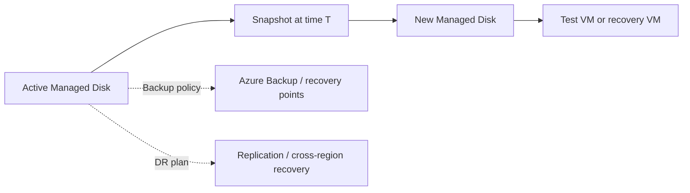
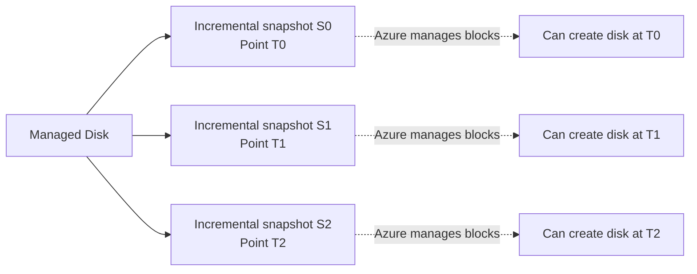
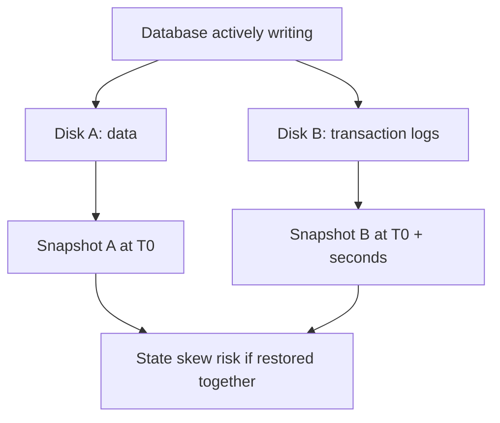
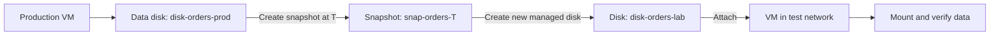
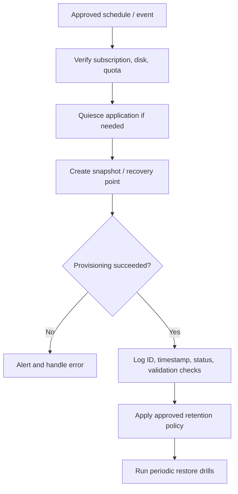

# Disk Snapshots and Creating Data Copies

When operating an application on Microsoft Azure, there are times you need to preserve data state before upgrading software, testing a patch, migrating a workload, or recovering from a mistake. For example, a virtual machine holding application data on an **Azure Managed Disk** needs to be cloned for testing without altering customer-facing live data. A **disk snapshot** provides a read-only capture of a disk at a specific point in time, from which you can create a new disk and deploy an independent copy.

This lesson belongs to the **File and Disk Storage** chapter in the Microsoft Azure module. We will distinguish snapshots, clones, backups, and replication; learn how to capture OS disk/data disk snapshots, evaluate consistency, create data copies via Azure CLI, verify recoverability, manage encryption, and control costs. The content is framed around subscriptions, resource groups, Azure VMs, virtual networks, Microsoft Entra ID identities, and Azure resource protection policies.

## Learning Objectives

After completing this lesson, you will be able to:

1. Explain differences among **disk snapshots**, **new managed disks created from snapshots**, **backups**, and **replication**.
2. Distinguish full snapshots from incremental snapshots and pick the appropriate model by purpose.
3. Analyze **crash-consistent** versus **application-consistent** states, especially for databases or multi-disk writing apps.
4. Create a snapshot of an Azure Managed Disk, restore it into a new disk, and attach it to a VM via Azure CLI.
5. Identify data not protected by managed disk snapshots alone, such as local temporary disks, in-memory data, and certain runtime application states.
6. Design snapshot/backup schedules around **RPO, RTO, retention**, encryption key security, and storage costs.
7. Troubleshoot common errors when restoring data or cloning environments and verify outcomes properly.

## 1. Problem Framing: Why Do You Need a Data Copy?

Consider three distinct requirements:

- **Before an upgrade:** operations wants a recovery point of a data disk in case an update corrupts files.
- **Creating a test environment:** developers need an independent disk holding production-like data to run compatibility tests.
- **Disaster recovery:** the business must recover if an entire VM, storage system, or region is lost and retain multiple historical versions long-term.

The first need can use a short-term snapshot; the second can use **snapshot → new managed disk**; the third typically requires a **backup/DR** solution with retention policies, isolated protection, and recovery drills. A single snapshot does not automatically satisfy every requirement.



**Practical learning objective:** after creating a data copy, you must **read back data on the restored disk** and verify it matches the intended recovery point, rather than merely checking the `Succeeded` status of the Azure resource.

## 2. Distinguishing Snapshots, Disk Clones, Images, Backups, and Replication

| Concept | Nature | Primary purpose | Limits to remember |
|---|---|---|---|
| **Managed disk snapshot** | **Point-in-time**, read-only Azure resource capturing one managed disk's state. | Create recovery points or sources for new disks. | Usually protects **one disk**; does not synchronize transactions across multiple disks. |
| **Disk copy / disk clone** | A **new managed disk** created from a snapshot or valid source disk. | Attach to another VM, test, or replace a failed disk. | Copy is a separate resource; data does not sync bidirectionally with the source disk. |
| **VM image / Azure Compute Gallery** | VM deployment template containing OS and image config per supported model. | Provision uniform VMs at scale and manage image versions. | Does not replace ongoing operational data backups. |
| **Backup / recovery point** | Scheduled protection process with retention policies and restore workflows. | Recover from accidental deletion, corruption, or system failure. | Must verify scope, consistency level, retention, and restore capability. |
| **Replication** | Maintains a near-current copy elsewhere via sync/async mechanisms. | High availability or disaster recovery. | Deletions/corruption can replicate; does not inherently provide version history. |
| **File copy** | Copies files at filesystem or application level, e.g., AzCopy/rsync. | Transfer specific files or directories. | Does not create an atomic block-device point-in-time capture under concurrent writes. |

**A snapshot is not a complete backup** unless you also manage schedules, retention windows, deletion permissions, storage isolation, recoverability, and application consistency. Snapshots also do not automatically fail VMs over to copies when a source disk fails.

## 3. How Do Azure Managed Disk Snapshots Work?

**Azure Managed Disks** provide Azure-managed block storage for VMs. A VM uses an OS disk and can attach multiple data disks. When creating a snapshot, Azure captures the data state of **one managed disk** at that moment. The snapshot becomes a separate Azure resource with its own lifecycle, access permissions, storage config, and billing.

Core characteristics:

- **Read-only:** snapshots cannot be mounted and written to directly like live managed disks. To use data as a writable drive, create a **new managed disk from the snapshot**.
- **Point-in-time:** snapshots reflect one instant and do not receive subsequent changes made to the source disk.
- **Resource-level independence:** snapshots have their own name, resource ID, and management in Azure Resource Manager, though data availability can depend on snapshot type, region, and storage configuration.
- **Can create new disks:** restored disks can generally attach to compatible VMs after verifying region, size, SKU, encryption, and attachment state.
- **Excludes volatile VM state:** RAM, active network connections, running processes, and local temporary disks are not protected by managed disk snapshots.

### 3.1. OS disks vs. data disks

The **OS disk** holds the operating system and boot components. OS disk snapshots can aid OS recovery or disk-level cloning, but beware of duplicated **machine identities**, hostnames, domain memberships, SSH host keys, certificates, and secrets. If your goal is deploying standardized VM fleets, use proper imaging/generalization workflows rather than cloning a live production OS disk verbatim and running multiple copies on the same network.

**Data disks** usually hold application files or databases. Data disk snapshots are helpful for test clones, yet verify whether apps are writing concurrently, whether multiple data disks form a spanned/RAID/LVM volume, and what steps are required to mount volumes after reattachment.

**Temporary disks, ephemeral OS disks, or local NVMe** should not be treated like snapshottable managed data disks. Temporary data can vanish on host changes, VM redeploys, or product lifecycle events. Store important data on storage with suitable protection mechanisms.

## 4. Full Snapshots vs. Incremental Snapshots

Azure supports different snapshot models, with **incremental snapshots** commonly suiting recovery point chains on managed disks. Distinguish storage mechanics from restore capabilities.

### 4.1. Full snapshot

A **full snapshot** captures a point-in-time image of the disk according to its underlying snapshot storage model. It works well when you need a standalone copy for recovery or testing. Actual billing and capacity depend on SKU and snapshot type; do not assume charges strictly equal used filesystem bytes.

### 4.2. Incremental snapshot

**Incremental snapshots** store only block-level changes since the previous snapshot in an Azure-managed chain. Example:

```text
T0: Disk holds data A B C D
    Snapshot S0: initial state

T1: B changes to B', D changes to D'
    Snapshot S1: records corresponding changes

T2: E added, C changes to C'
    Snapshot S2: records subsequent changes
```



Crucially, **every incremental snapshot acts as a full recovery point** under Azure's block management; users never manually stitch delta files together. Azure manages underlying block dependencies so retaining or deleting snapshots per service rules does not break remaining valid recovery points.

Common benefits:

- Reduces extra storage written/retained when only small portions of the disk change between captures.
- Fits periodic snapshot chains requiring multiple recovery points.
- Costs track block churn rather than paying for a full copy on every single snapshot.

However, **incremental snapshots do not guarantee low cost for every workload**: databases rewriting many blocks or high-churn workloads generate heavy delta growth. Monitor snapshot sizes, retained recovery point counts, and regional/SKU pricing. Incremental snapshot support, cross-region copying, and constraints can vary by disk type and configuration.

### 4.3. Choosing full vs. incremental

| Scenario | Consideration |
|---|---|
| Single checkpoint before a minor upgrade | One timely snapshot can suffice if restore capability is verified. |
| Periodic recovery points multiple times daily | Incremental snapshots can lower incremental cost; consider automation and retention. |
| Multi-month/multi-year retention needs | Evaluate Azure Backup or proper retention platforms rather than manual snapshots alone. |
| Workload continuously overwrites most blocks | Estimate real churn and cost; incremental savings may be smaller than expected. |
| Multi-disk transactional app recovery | Prioritize app/VM-consistent recovery points rather than snapshot type alone. |

## 5. Consistency: Crash-Consistent vs. Application-Consistent

**This is the biggest risk when snapshotting an active disk.** Having a block-level copy does not mean data actively written by programs is business-consistent.

### 5.1. Crash-consistent snapshots

A snapshot taken while the VM and applications keep running is typically only **crash-consistent**: disk state resembles a sudden power loss at one instant. In-memory buffers or unflushed writes may be absent from the snapshot. Filesystem journals or database transaction logs can help recovery if the app and config support it.

For example, a database may have written to its transaction log without flushing all corresponding data pages. If captured mid-flight, an engine with crash recovery can often recover upon startup, yet never assume **every** database or business operation recovers cleanly.

### 5.2. Application-consistent snapshots

**Application-consistent** means application writes and dependent components coordinate to produce a clean application-level recovery point. This can require:

1. Pausing/quiescing write activity.
2. Flushing memory caches and transactions to storage using app-supported hooks.
3. Coordinating transaction logs across multiple data disks if used.
4. Capturing the recovery point with tools that guarantee such coordination.
5. Resuming application operations and verifying health.

On Windows VMs, backup engines can coordinate **Volume Shadow Copy Service (VSS)** where supported. On Linux, custom filesystem/database pre/post-quiesce scripts may be required. **Azure Backup** or supported application-aware protection tools are usually far more convenient than standalone manual snapshots when application consistency, schedules, and retention matter.

### 5.3. Multi-disk consistency

A VM can use multiple disks for database data files, transaction logs, indexes, or RAID/LVM volumes. Snapshotting Disk A at 10:00:00 and Disk B at 10:00:07 **does not capture a single atomic instant** across both disks.



When consistent recovery across an entire VM or multiple disks is required, evaluate **VM restore points, Azure Backup, or application-orchestrated snapshots** per supported features. Never treat sequential CLI snapshots as an atomic multi-volume transaction.

### 5.4. Practical risk-based choices

| Workload | Can a live snapshot suffice? | Protection approach to evaluate |
|---|---|---|
| Static folder, rarely written | Potentially suitable if writes pause or none occur during capture. | Verified snapshots, periodic backups. |
| Rebuildable build cache | Low consistency acceptable, or no snapshot needed. | Rebuild from pipeline; store key artifacts in durable storage. |
| Web app storing local files | Depends on file write/rename patterns. | Quiescing or app-level consistency support. |
| SQL Server/PostgreSQL on VM | Never rely solely on crash-consistent snapshots for strict recovery. | Engine/app-consistent backups, transaction logs, and restore drills. |
| Database splitting data and logs across disks | Individual disk snapshots risk time skew. | Supported multi-disk consistent backups/restore points. |
| VM using ephemeral/local temp disks | Unprotected by snapshots of other managed disks. | Move critical data onto durable storage. |

## 6. Snapshot and Data-Cloning Architecture

A common flow for cloning a data disk from production to test:



In this diagram:

- **The production disk** is not replaced by the snapshot; the application keeps using its original disk.
- **The snapshot** is a read-only point-in-time capture, not a volume a VM can write to directly.
- **The lab disk** is an independent managed disk with its own lifecycle and billing. Writes on the lab VM never propagate back to the production disk.
- **Test VNets, Azure RBAC, and VM admin privileges** must stay isolated to avoid accidentally connecting sensitive cloned data to production services.

When using an **OS disk clone**, you must also handle machine identity, domain membership, hostname, and boot configuration on the new VM. Restoring a failed VM's OS disk differs from building a reusable **golden image**; pick the workflow matching your goal.

## 7. Azure CLI Lab: Snapshotting a Data Disk and Restoring to a New Disk

The goal is demonstrating the **complete workflow** with an existing data disk. Creating a new VM is optional in this lesson; attaching is optional and only performed if you have a suitable test VM. **Never run directly against production without formal approval and a quiesce/restore plan.**

### 7.1. Prerequisites

- A test subscription with Azure CLI signed in.
- Resource group `rg-disk-lab` and an Azure Managed Disk `disk-data-source` in a suitable region.
- Azure RBAC permissions to read disks, create snapshots, and create new disks; if attaching, permissions on the VM/NIC and disk at the target scope.
- Data on the disk is safe to capture at test time or properly quiesced per consistency needs.
- Sufficient quota, supported snapshot/SKU/region, and budget for the snapshot and new disk.
- If using CMK or a Disk Encryption Set, verify key permissions and restore disk compatibility.

### Step 1. Sign in, select subscription, and set variables

```bash
az login
az account list --output table
az account set --subscription "<subscription-id>"

RG="rg-disk-lab"
SOURCE_DISK="disk-data-source"
SNAPSHOT="snap-data-before-upgrade"
RESTORE_DISK="disk-data-restored"
```

Set `RG`, `SOURCE_DISK`, `SNAPSHOT`, and `RESTORE_DISK` to match your actual resources. Run `show` commands to verify the **exact source disk** before creating any new resources.

### Step 2. Inspect source disk details

```bash
az disk show \
  --resource-group "$RG" \
  --name "$SOURCE_DISK" \
  --query "{name:name,id:id,location:location,sizeGb:diskSizeGb,sku:sku.name,managedBy:managedBy,provisioningState:provisioningState}" \
  --output json

DISK_ID="$(az disk show \
  --resource-group "$RG" \
  --name "$SOURCE_DISK" \
  --query id --output tsv)"

LOCATION="$(az disk show \
  --resource-group "$RG" \
  --name "$SOURCE_DISK" \
  --query location --output tsv)"
```

`DISK_ID` is the **resource ID** of the disk to snapshot. `LOCATION` comes directly from the disk rather than assuming resource groups and disks always share the same region. If the disk is attached to a running VM, assess application consistency first rather than assuming snapshots quiesce databases automatically.

### Step 3. Create an incremental snapshot

```bash
az snapshot create \
  --resource-group "$RG" \
  --name "$SNAPSHOT" \
  --location "$LOCATION" \
  --source "$DISK_ID" \
  --incremental true \
  --sku Standard_LRS
```

This creates an **incremental snapshot** from the selected managed disk. `Standard_LRS` is an illustrative snapshot SKU; redundancy/SKU support can vary by snapshot type, disk, and region. In real deployments, verify zone, encryption, and snapshot compatibility before reusing identical syntax across all disk types.

**Do not confuse `az snapshot create` with `az disk create`:** after this step you have a read-only snapshot, not a writable disk attached to a VM.

### Step 4. Inspect the created snapshot

```bash
az snapshot show \
  --resource-group "$RG" \
  --name "$SNAPSHOT" \
  --query "{name:name,id:id,location:location,incremental:incremental,provisioningState:provisioningState,sourceDisk:creationData.sourceResourceId}" \
  --output json

SNAPSHOT_ID="$(az snapshot show \
  --resource-group "$RG" \
  --name "$SNAPSHOT" \
  --query id --output tsv)"
```

Verify `provisioningState` succeeded, `sourceDisk` matches the expected ID, and `incremental` reflects your choice. This only verifies the **snapshot resource exists**, not that a database/application restores cleanly. For disks holding sensitive data, restrict snapshot read/export permissions just as tightly as the source disk.

### Step 5. Create a new managed disk from the snapshot

```bash
az disk create \
  --resource-group "$RG" \
  --name "$RESTORE_DISK" \
  --location "$LOCATION" \
  --source "$SNAPSHOT_ID" \
  --sku StandardSSD_LRS
```

The new disk is created with data from the snapshot and becomes an independent resource. Here `StandardSSD_LRS` illustrates a test data disk, **with no guarantee every snapshot supports restoring to that SKU**. Verify disk size, region, snapshot-to-SKU/zone compatibility, encryption, and quotas. If the workload needs high IOPS/throughput, pick the disk SKU matching VM performance needs rather than copying the lab example.

Verify:

```bash
az disk show \
  --resource-group "$RG" \
  --name "$RESTORE_DISK" \
  --query "{name:name,id:id,sizeGb:diskSizeGb,sku:sku.name,provisioningState:provisioningState,managedBy:managedBy}" \
  --output json
```

You now have a **disk-level data copy**; it appears unattached until mounted to a VM. Do not modify the production disk or delete the snapshot until recovery testing succeeds.

### Step 6. Attach the data disk to a test VM (optional)

Assuming a compatible `vm-restore-lab` exists in the region supporting the disk type with available disk slots:

```bash
VM="vm-restore-lab"

az vm disk attach \
  --resource-group "$RG" \
  --vm-name "$VM" \
  --name "$RESTORE_DISK"
```

**Attach the clone strictly to a test VM—never back onto a live production VM without an explicit design.** If both source and cloned disks appear on the same VM, watch carefully for colliding filesystem UUIDs, LVM volume group names, or Windows disk signatures. The OS may mark the clone offline or mount it unexpectedly to avoid conflicts; handle according to OS and volume manager rules.

On **Linux**, inspect before mounting:

```bash
lsblk -o NAME,SIZE,FSTYPE,UUID,MOUNTPOINT
sudo blkid
```

Only after confirming which device is the **restored disk** should an administrator mount it to a test directory; never run `mkfs`, as formatting erases the restored data. With complex filesystems and volume managers, consult relevant docs to avoid altering logs or metadata on mount.

On **Windows**, use Disk Management or PowerShell to inspect disk/partition status, signatures, drive letters, and online/offline state. Never initialize or format a restored disk simply because Windows displays a prompt before confirming it is the exact copy.

### Step 7. Verify application data

Confirm with **data evidence**, not just Azure CLI success:

1. Compare target files or directories against the expected inventory at snapshot time.
2. Verify file sizes, checksums/hashes of representative files, or trusted manifests.
3. For databases, run the engine's recovery/consistency checks inside an isolated environment.
4. Confirm the application opens data without breaking schemas, formats, or file permissions.
5. Record elapsed duration and outcomes to establish real **RTO** for your solution.

A snapshot marked `Succeeded` whose application data cannot open **is not a validated recovery point**. Once the lab finishes, detach disks cleanly from the VM and delete only verified unneeded test resources to avoid ongoing charges.

### Step 8. Safe cleanup

If the lab created dedicated snapshots/disks verified as unneeded afterward, an administrator can delete **strictly those two lab resources** via Azure Portal or CLI once detached. Never blindly delete source disks or shared resource groups. If a snapshot serves retention policies, **do not delete it** merely because a disk was created from it.

## 8. Creating Snapshots via Azure Portal

Without using the CLI, an equivalent workflow in the Azure Portal is:

1. Open **Disks** and select the target source **managed disk**.
2. Confirm subscription, resource group, region, attached/`managedBy` status, SKU, and encryption.
3. Click **Create snapshot** or create a new Snapshot resource from the disk in the current Portal UI.
4. Choose name, resource group, snapshot/replication type where supported, review encryption policies, and create the resource.
5. Open the new snapshot and verify provisioning state and data source.
6. From the snapshot, choose **Create disk** to provision a new managed disk, then attach it to a compatible test VM.
7. Mount/verify at OS and application layers; record restoration results.

Portal labels can shift across UI updates. The safety rule stays constant: **verify the exact source disk, capture at the right time, restore to a new disk, and test data before trusting the copy**.

## 9. Copying Across Resource Groups, Subscriptions, and Regions

The replication goal dictates additional checks:

| Need | Approach | Prerequisites and warnings |
|---|---|---|
| **Same resource group, same region** | Snapshot → new managed disk. | Simplest to manage; requires unique new disk name, quota, and matching encryption. |
| **Different resource group, same subscription/region** | Reference resource ID as source and grant permissions across both scopes. | Role assignments on source/target, network/VM compatibility. |
| **Different subscription** | Use Azure-supported copy/import-export mechanisms with proper authorization. | Tenant, RBAC, SAS export, encryption, and per-resource-type limits. |
| **Different region** | Copy snapshots or data via supported cross-region workflows, then create disks at destination. | Do not assume a regional snapshot automatically survives regional outages; check copy method, transfer time, and cost. |
| **Scheduled DR replication** | Azure Backup, Azure Site Recovery, or solutions tailored to RPO/RTO targets. | Failover order, app dependencies, DNS, VMs/networks, and recovery drills. |

**Managed Disk snapshots have specific deployment scopes and recovery boundaries.** When needing a copy in another region, verify **cross-region copy** support for your snapshot and disk types. Never create a snapshot in Region A and claim data is protected against full-region outages; verify the copy actually exists and restores in Region B.

A VM recovered in a new region also needs matching **VNets/subnets, NSGs, routes, DNS, public/private IPs, managed identities, secrets, load balancers, and database dependencies**. Copied disks alone do not bring an application online at a failover site.

### 9.1. Cloning an OS disk vs. creating a standardized image

When **restoring a specific failed machine**, an OS disk snapshot fits recovery workflows. When **deploying dozens of identical VMs**, use image/generalization workflows or Azure Compute Gallery with version management. Specialized OS disk clones retain machine identifiers and OS-embedded secrets, risking conflicts or security exposure if multiple copies boot simultaneously.

### 9.2. Cloning sensitive data into test environments

When cloning from production, **real data is duplicated into the snapshot**. Developers should not gain access to PII, app secrets, or payment records merely because the disk sits in a test resource group. For QA environments, scrub/mask data or generate synthetic datasets per policy, and isolate networks, keys, and identities. Cloned datasets have their own lifecycle requiring audit and retention tracking.

## 10. Encryption, Access Control, and Sharing Snapshots

### 10.1. Encryption at rest

Azure Managed Disks and snapshots feature **encryption at rest**, offering platform-managed keys or **customer-managed keys (CMK)** depending on disk/snapshot type, region, and configuration. If the source uses a **Disk Encryption Set** or Key Vault, verify the restored disk retains proper key permissions and compatible encryption configuration.

Do not assume copying a snapshot to another subscription or region automatically provisions matching managed identities, Key Vault permissions, and Disk Encryption Sets. Losing key access can render snapshots or restored disks unusable. Before copying sensitive data, check regional data-residency policies and key lifecycles.

### 10.2. Azure RBAC

A snapshot is an **Azure resource**. Anyone holding rights to manage snapshots, create disks from snapshots, or export data can reach sensitive data at the storage layer even without logging into the running VM. Grant least privilege to operators, automation, and QA teams; separate snapshot creation, snapshot deletion, and data export permissions where policy allows.

**Contributor on a resource group holding snapshots can be a very powerful data-level privilege.** Never focus solely on in-guest filesystem permissions while overlooking Azure control-plane permissions on disks/snapshots.

### 10.3. SAS exports and leak risks

Some Managed Disk or snapshot export/import workflows generate **temporary SAS URLs** where supported and authorized. Such URLs can grant read access to raw disk contents while the token remains valid. Treat them strictly as **secrets**—never paste them into logs, chats, repositories, or public tickets; keep lifetimes short and control export channels.

When copying/exporting outside Azure, also evaluate bandwidth, egress, encryption in transit, and data residency. Never assume a snapshot is private merely because the source VM sits inside a VNet with an NSG blocking inbound traffic.

## 11. Retention, RPO/RTO, and Backup Workflows

Snapshot schedules must derive from business requirements:

- **RPO (Recovery Point Objective):** maximum minutes/hours of data loss the organization tolerates since the last recovery point.
- **RTO (Recovery Time Objective):** maximum time acceptable to bring the application back online.
- **Retention:** how many copies to keep for how many days/weeks/months, plus regulatory retention obligations.
- **Recovery validation:** periodic real-world restore tests and validation after major changes.

For example, a workload generating continuous transactions needs a 15-minute RPO and 1-hour RTO. Daily data disk snapshots **cannot meet a 15-minute RPO on their own**. You may need transaction log backups, database-level replication, or a PaaS service with point-in-time restore. Conversely, a system holding weekly-changing config files rarely needs hourly snapshots.

### 11.1. Manual snapshots vs. Azure Backup

| Criterion | Self-managed disk snapshots | Azure Backup / supported backup solution |
|---|---|---|
| Creation schedule | Managed manually or via custom CLI/automation scripts. | Built-in policies and schedules per workload/feature. |
| Retention | Must manage and verify timely deletion yourself. | Managed retention/recovery points per supported policy. |
| Application consistency | Individual snapshots do not guarantee it. | Can integrate app-aware/VM backup mechanisms for supported workloads. |
| Restore | Create disk from snapshot, attach, and manually recover app. | Service-assisted restoration workflows (still require drills). |
| Deletion/permission protection | Must design Azure RBAC and locks yourself. | Provides vault and protection controls (still requires proper setup). |
| Cross-region DR | Requires custom copy and verification workflows. | Depends on backup/replication features, region support, and policy. |

Do not treat Azure Backup as the sole answer for every case; however, when the goal is ongoing system recovery with governed retention and auditing, it is usually worth evaluating over unsupervised manual snapshot scripts.

### 11.2. An illustrative retention plan

An internal app with a 1-day RPO and 4-hour RTO might start with an **initial draft plan**:

1. Capture an appropriate snapshot or backup at end of day after batch jobs complete.
2. Retain short-term recovery points per policy, e.g., seven days.
3. Protect selected long-term points under an appropriate backup policy if compliance requires it.
4. Drill restores on a test VM periodically, validating both data and application behavior.
5. Alert on failed jobs, missing new recovery points, or degraded restore health.

This is only an illustrative pattern, **not a universal recipe sufficient for RPO/RTO on every system**. Consistency, snapshot/copy duration, volume size, and app dependencies must all be measured in practice.

## 12. Controlling Snapshot and Disk Clone Costs

When taking a snapshot and restoring it to a new disk, you may pay for **both resources** plus supporting charges:

```text
Approximate total cost
  = snapshot storage by type/SKU and billable size
  + new managed disks by SKU, provisioned size/performance
  + storage of additional recovery points or backups
  + cross-region or cross-service copy/egress charges where applicable
  + VMs used for testing/recovery + networking + monitoring
```

Major cost drivers:

- **Snapshot type:** full vs. incremental, block churn rate, and capture schedule.
- **Retained recovery point count:** longer retention can increase total protected bytes.
- **Cloned disk SKU:** attaching unnecessary Premium SSD/Ultra Disks to test VMs inflates bills.
- **Data churn:** workloads rewriting lots of data produce large incremental snapshot deltas.
- **Region:** cross-region snapshot copies add transfer fees, target resources, and copy durations.
- **Cleanup:** forgotten lab snapshots or disks keep accruing charges until deleted per policy.

Pricing and billing mechanics vary by region/SKU. Use the Azure Pricing Calculator to budget and **Cost Management** to audit actual bills. Apply tags like `environment=test`, `owner=platform-team`, `createdFor=restore-test`, and `reviewAfter=<date>` to track lab resources—noting tags do not automatically delete disks or enforce retention.

## 13. Controlled Automation

For recurring needs, manual snapshotting easily leads to missed runs or targeting the wrong disk. An automated workflow might follow:



Recommended practices:

- **Managed identity** for automation with least-privilege Azure RBAC; avoid embedding service principal secrets in scripts.
- Verify **subscription, resource ID**, and source state before creating or deleting snapshots.
- Name snapshots to reflect source and UTC timestamp, or tag thoroughly for traceability.
- Implement bounded retries for transient failures without spawning dozens of duplicate snapshots on job reruns.
- Alert on missing recovery points or failed snapshot creation—never log only `Started` messages.
- Base deletion strictly on retention, verification status, and approval—never bulk-delete via loose name prefixes.
- Drill restores independently of snapshot jobs to measure real recoverability.

**Note:** Azure Backup or policy-driven backup services can eliminate custom automation maintenance. Compare operational effort and risk before building bespoke data protection pipelines.

## 14. Troubleshooting: Snapshot Exists Yet Recovery Fails

| Symptom | Possible causes | Resolution |
|---|---|---|
| `az snapshot create` rejected | Missing Azure RBAC, wrong source ID, quota/region, or unsupported disk type. | Verify disk ID, role, SKU, region, feature support, and Azure error code. |
| Snapshot succeeds yet lacks recent data | Captured before app flushed writes or snapshotted the wrong disk. | Check timestamp, disk ID, quiescing method, and app logs. |
| Cannot create disk from snapshot | Incompatible SKU/region/size/encryption, missing quota, or snapshot not ready. | Inspect snapshot state, pick compatible disk SKU, verify quota and key access. |
| New disk created yet VM cannot attach | Disk in use by another VM, region/zone mismatch, VM disk slot limit, or RBAC. | Check `managedBy`, zone, LUN slots, and permissions. |
| Disk attached yet no data visible | OS has not recognized disk, partition offline, filesystem unmounted, or wrong device selected. | Run `lsblk`/Disk Management; never format before verifying. |
| Colliding UUID, VG name, or Windows disk signature | Block clone retains identifying metadata from source disk. | Follow OS/volume manager safe import steps to avoid mount collisions. |
| Database fails to open after restore | Crash-consistent snapshot or skewed multi-disk capture, missing logs, schema/dependency mismatch. | Use app-aware/engine backup restore, verify multi-disk consistency and recovery logs. |
| Recovery blocked by encryption key | Disk Encryption Set/Key Vault/CMK unavailable or missing permissions. | Check identity, key version, region, and crypto permissions. |
| Disk copied to another region yet app fails | Disk exists without VNet/NSG/DNS/identity and backend dependencies. | Recover the complete architecture, not storage alone. |
| Unexpected cost spike | Excessive retention, too many snapshots, full copies, or uncleaned lab disks. | Inspect Cost Management, tags, cleanup, and churn rates. |

### 14.1. Checking recovery point status

Azure CLI can list snapshots created in a resource group:

```bash
az snapshot list \
  --resource-group "$RG" \
  --query "[].{name:name,location:location,incremental:incremental,provisioningState:provisioningState}" \
  --output table
```

This checks **metadata**; it does not prove the application can recover. In subscriptions with multiple resource groups, verify exact source and target scopes. Never auto-delete snapshots based on similar names without confirming owner and retention.

### 14.2. Separating storage errors from application errors

If `az disk show` returns `Succeeded` yet files inside the VM report errors, isolate by layer:

1. Is the disk attached to the right VM and right LUN?
2. Did the guest OS detect the partition/filesystem and mount it at the right path?
3. Are files missing due to an inconsistent snapshot or picking the wrong source disk?
4. Does the database/app require transaction log replay or migrations?
5. Does the test VM have valid secrets/configs/connection strings to open the data?

Combine **Azure Activity Log** for control-plane changes, disk/VM metrics where available, OS logs, and database logs during investigations. Never expose sensitive data or encryption keys inside support logs.

## 15. Design Scenario: Cloning a Data Disk Before an Application Update

An enterprise runs an accounting application across two VMs. `vm-app-01` handles the web tier, while `vm-db-01` runs a self-managed database with separate **data disk** and **log disk**. Operations requires:

- Rollback capability if the weekend upgrade corrupts the database.
- A cloned dataset for testing on a VM inside a test VNet.
- Preventing developers from viewing unmasked personal data.
- Achieving an RPO under one hour and RTO under two hours for financial data.

### Analysis

**Taking two independent snapshots** of the data disk and log disk and assuming consistency is **insufficient**. You need an **application-consistent recovery point** mechanism, or database-engine backup workflows with transaction logs matching the RPO. Manual snapshots may serve certain lab clones, provided writes are coordinated at capture time.

Proposal:

1. **Set recovery targets:** define realistic RPO/RTO and critical checkpoints.
2. **Choose protection mechanism:** evaluate Azure Backup/engine-native backups and log backups to meet financial SLAs.
3. **Create a test recovery point:** ensure data and log disks are mutually consistent and log timestamps.
4. **Restore/create new disks in isolation:** never attach production disks to test VMs or connect test DBs to production networks without authorization.
5. **Mask sensitive data:** before granting access to developers.
6. **Verify:** run consistency checks, functional tests, and measure restoration time; archive audit records.
7. **Add cross-region backup/DR:** if regional outage resilience is required, single-region copies are insufficient.

### Self-Check Questions

1. Why is a managed disk snapshot point-in-time yet not automatically application-consistent?
2. Do incremental snapshots require manually stitching blocks from all prior snapshots when restoring a disk?
3. When database data spans two disks, why is taking sequential snapshots risky?
4. Why does creating a disk from a snapshot not mean the application is recovered?
5. How do redundancy and backups differ regarding accidental deletion risk?
6. What types of data might a test disk cloned from a production snapshot expose?

**Answer hints:** live snapshots may miss RAM buffers or unflushed transactions; Azure manages incremental blocks so any single snapshot still restores directly; separate commands across multiple disks are non-atomic in time; VM and dependencies must match; replication can propagate logical errors; clones can contain all PII, credentials, and secrets stored on the source disk.

## 16. Pre-Production Checklist

- [ ] Clearly defined goal: short-term snapshot, test clone, long-term backup, or DR.
- [ ] Positively identified source disk, OS/data type, region, SKU, and attachment state.
- [ ] Analyzed consistency: crash-consistent, application-consistent, and multi-disk dependencies.
- [ ] Selected full/incremental based on churn, schedule, supported features, and total cost.
- [ ] Verified snapshot support for disk type/region and SKU/encryption limits.
- [ ] Snapshots carry clear names, resource IDs, timestamps, tags/owners, and provisioning states.
- [ ] Restored disks are created as **separate** resources, attached to suitable VMs without harming source disks.
- [ ] Safely mounted/read data; databases checked with engine recovery tools.
- [ ] Periodic restore drills executed, measuring actual RTO and comparing against acceptable RPO loss.
- [ ] Protected Azure RBAC, CMK/Key Vault, SAS export rights, and personal data inside clones.
- [ ] Backups, retention, and clone deletion permissions follow policy; replication is not treated as backup.
- [ ] For regional resilience, verified copies exist in target region alongside full network, identity, and service recovery.
- [ ] Configured monitoring, snapshot/backup failure alerts, and cost controls for unused snapshots/disks.

## Conclusion

**Azure Managed Disk snapshots** capture a disk's state at a point in time and enable **data cloning** by restoring snapshots into new managed disks. **Incremental snapshots** optimize storage for changed blocks over time, yet copies are only trustworthy once consistency is verified and restores are rehearsed. For multi-disk workloads or transactional databases, use application-aware solutions rather than treating standalone snapshots as an atomic transaction. In Microsoft Azure architectures, pair snapshots with backups, RPO/RTO targets, Azure RBAC, encryption, monitoring, and cost controls to protect data without sacrificing availability or privacy.
