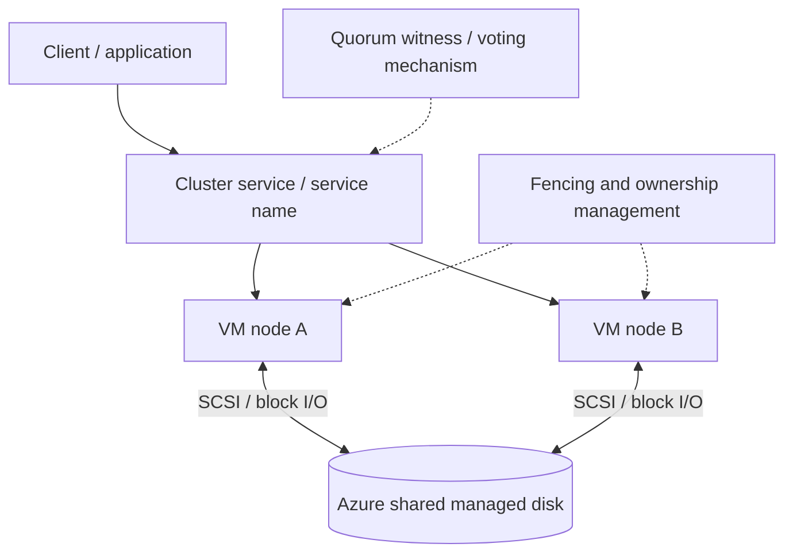
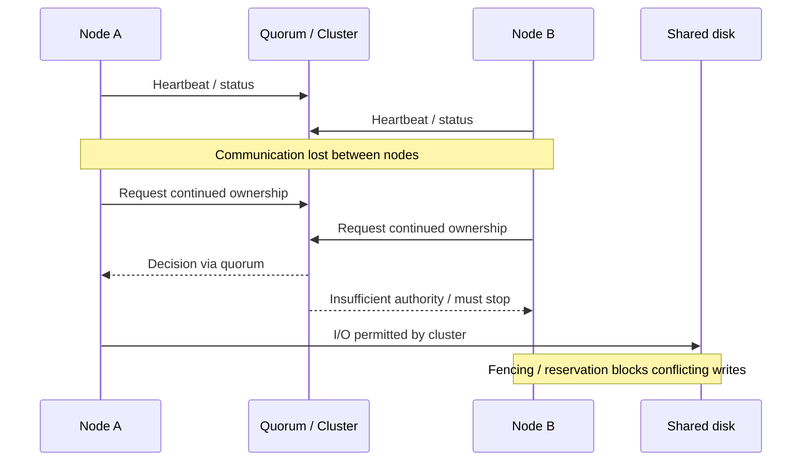
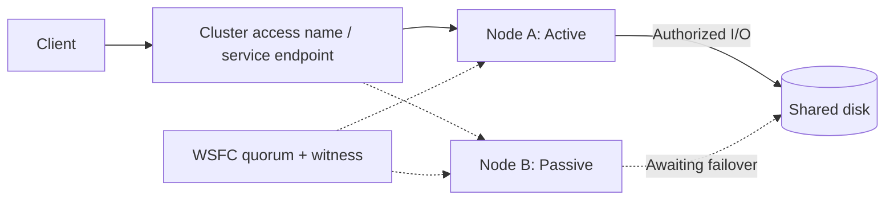
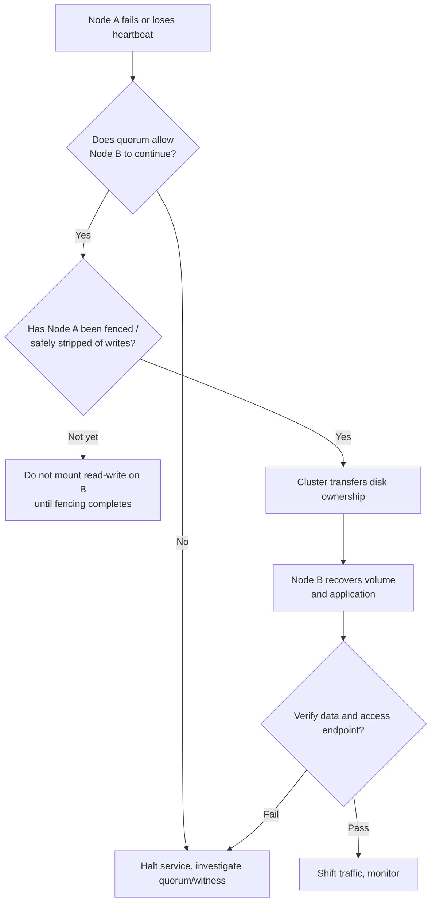

# Shared Disks and Cluster Application Requirements

Two Azure Virtual Machines may need access to **the same block-level dataset** to run an application capable of failing over when the primary node fails, such as a system using **Windows Server Failover Clustering (WSFC)**. However, attaching the same disk to two VMs **does not** automatically make the system a safe cluster. If both nodes write simultaneously to a filesystem that does not support concurrent access, data can become corrupted even while Azure Managed Disks operate flawlessly.

This lesson belongs to the **File and Disk Storage** chapter of the **CLOUD_PROVIDERS_AZURE** module. The module explores Microsoft Azure from subscriptions, resource groups, and Microsoft Entra ID to virtual networks, compute services, storage, and data; and guides deployment, monitoring, protection, and cost control for application architectures. In this chapter, a *shared disk* is one piece of a cluster architecture that must be designed alongside compute, networking, operating system, access control, and operations.

After this lesson, you will be able to:

- Explain what an Azure shared managed disk is and how it differs from Azure Files, Azure NetApp Files, or per-VM standalone disks.
- Distinguish **multi-attach**, **cluster-aware filesystems**, **shared-disk failover**, and **high availability**.
- Understand the roles of **SCSI Persistent Reservations (PR)**, quorum, witness, and fencing in preventing split-brain.
- Identify support prerequisites involving disk SKU, `maxShares`, VM size, availability zones, caching, and OS.
- Diagram WSFC or Linux cluster deployments at the architectural level and know what to verify before production.
- Diagnose attachment failures, disk ownership errors, failover issues, and performance problems across shared nodes.

## 1. What Is a Shared Disk?

An **Azure shared managed disk** is a managed disk configured to **attach simultaneously to multiple Azure VMs**. Each VM sees the same block storage device. This capability uses the *shared disks* feature of Azure Managed Disks and caps concurrent VM attachments via the `maxShares` property.

Two-node architecture example:



Key concept: **one disk, two disk attachments**, not two data copies synchronized at the application layer. At any moment, a cluster may let one node own the volume or let multiple nodes access it via a supported cluster-aware mechanism. That behavior depends on cluster software, filesystems, and how the application coordinates I/O.

### 1.1. Why do many cluster applications need shared block storage?

A *failover cluster instance* application may need data files stored in a single logical place regardless of whether node A or node B currently runs the active process. If node A loses power, node B can take over the cluster-protected disk and resume service after recovering application state.

In this model:

1. The shared disk holds shared data.
2. VMs provide redundant compute capacity.
3. Cluster software decides **which node holds authority to use the data**.
4. Quorum and fencing reduce the risk of two nodes both believing they are the owner.
5. The application performs recovery/transaction replay per its capabilities.

Do not choose a shared disk merely because two VMs need to "see a shared folder." If the requirement is simply **sharing files over SMB/NFS**, a managed file-share service is typically far simpler.

## 2. How Do Shared Managed Disks Differ from Other Storage Options?

| Option | Access unit | Who controls concurrent access? | Suitable scenarios |
|---|---|---|---|
| **Shared managed disk** | Block device attached to multiple VMs | Cluster/application + SCSI PR or equivalent supported mechanism | Cluster workloads needing a shared block LUN |
| Standard managed disk | Block device for one VM at a time | Single owning operating system | OS disks and standalone VM data disks |
| **Azure Files** | SMB/NFS file shares per supported config | File service and file-sharing protocol | Multiple clients sharing folders/files |
| **Azure NetApp Files** | Managed NFS/SMB file volumes | File protocol and supported semantics | File workloads needing high performance and enterprise features |
| Application-layer replication | Each node holds independent data | Database/application protocol | SQL Always On Availability Groups, replicated DBs, distributed systems |
| Object storage (Azure Blob) | Objects/APIs | Application + ETag/lease/concurrency controls | Images, documents, backups, object data |

**Do not confuse them:** Azure Files/NFS/SMB also provide "shared storage," yet they are **not equivalent** to a multi-attached block disk. Managed file share services handle concurrency through filesystem/protocol semantics server-side; shared managed disks shift write-conflict responsibility to the cluster and guest OS.

### 2.1. Shared disk does not mean "doubled durability"

Attaching two VMs to one disk does not create extra data copies against accidental deletion or logical corruption. Infrastructure durability still depends on **Azure Managed Disks redundancy/SKU**; application-error recovery still requires backups and restore procedures.

If both nodes write bad data, the shared disk stores that same bad data. If a volume is deleted or a filesystem corrupts, the cluster may fail over nodes without restoring lost data.

## 3. Three Layers Must Align for a Cluster to Work

Distinguish clearly:

| Layer | Question | Example |
|---|---|---|
| **Azure platform** | Does the disk support multi-attach, VM/zone/SKU limits, and adequate performance? | Disk has `maxShares=2` and both VMs can attach it |
| **Guest OS / cluster stack** | Are reservation, arbitration, and an appropriate filesystem present? | WSFC manages the disk resource, SCSI PR, and ownership transfer |
| **Application** | Does the app support shared-disk failover and post-crash data recovery? | A vendor-certified failover cluster instance |

If only the Azure layer is right, attaching the disk to two VMs can **succeed technically yet remain unsafe for data**. Verify all three layers before running production workloads.

### 3.1. Multi-attach is not safe multi-writer by itself

Standard filesystems like NTFS or ext4/xfs mounted **read-write independently on multiple hosts** without a proper cluster coordination layer risk corrupting metadata and data blocks. Each host keeps private caches and filesystem structures, so hosts can disagree on disk block states.

Viable patterns, depending on OS and product, include:

- **Active-passive:** one node owns and writes the volume while the other waits to take over.
- **Cluster Shared Volumes / clustered filesystems:** multiple nodes access storage through specialized, explicitly supported coordination layers.
- **Applications managing I/O via custom reservations and fencing:** only when vendor-certified and thoroughly tested.

**Safety rule:** never arbitrarily format, mount read-write, or run `fsck`/repair concurrently from two VMs on the same shared LUN.

## 4. SCSI Persistent Reservations, Fencing, and Split-Brain

### 4.1. What are SCSI Persistent Reservations?

**SCSI Persistent Reservations (SCSI PR)** allow a group of hosts to register and arbitrate access to a block device using supported reservation types. Cluster software can use SCSI PR to prevent an unauthorized node from issuing conflicting I/O onto a shared disk.

Key concepts:

- **Registration:** an initiator/node registers a key with the device.
- **Reservation:** the cluster holds a specific access right per SCSI PR rules.
- **Preempt:** the cluster transfers authority during a supported failover sequence.
- **Fence:** isolating or blocking a failed or network-partitioned node from issuing conflicting writes.

SCSI PR is a **low-level block storage primitive**, not a substitute for full cluster validation. Support for SCSI PR, reservation types, firmware/drivers, guest OS, and cluster software **depends on the exact combination of SKU + VM + OS + application**. Always check current Azure and cluster vendor support matrices prior to deployment.

### 4.2. What is split-brain?

Suppose two nodes lose sight of each other due to a heartbeat network failure. Node A assumes B is dead; node B assumes A is dead. If both start the service and write to the shared disk, data corruption follows.



This sequence diagram is conceptual. In reality, outcomes depend on quorum algorithms, witness reachability, and cluster state; **node A is not guaranteed to win**.

### 4.3. Quorum and witness

**Quorum** lets a cluster decide which subset of nodes retains authority to keep running. In small clusters, a **witness** supplies an extra tie-breaking vote to prevent both sides from declaring themselves active.

For example, in a **two-node Windows Server Failover Cluster**, a **Cloud Witness** using Azure Storage can be evaluated per WSFC supportability. A witness never stores the shared database and **never replaces** the shared data disk.

| Component | Purpose | What NOT to use it for |
|---|---|---|
| Shared data disk | Stores application data blocks | Deciding quorum in place of cluster arbitration |
| Cluster heartbeat | Detects peer liveliness | Proving the peer stopped writing during a network partition |
| Quorum/witness | Determines which node set stays active | Storing transactional data files |
| SCSI PR / fencing | Blocks I/O or isolates unauthorized nodes | Replacing data backups |

For Linux clusters running **Pacemaker** or other stacks, **STONITH/fencing**, block reservations, or vendor-supported clustered filesystems may be required. Never configure merely "heartbeat + shared mount" and consider it sufficient.

## 5. Support Conditions and Limits of Azure Shared Disks

Shared disks are supported on **specific managed data disk types, VM sizes, deployment regions, and operating systems**. Supported combinations evolve over time and by service; verify before selecting SKUs.

### 5.1. Disk SKUs and `maxShares`

Azure offers managed disk lines such as **Premium SSD**, **Premium SSD v2**, **Ultra Disk**, and **Standard SSD** with shared disk support/limits depending on supported configurations. Never assume every disk SKU, tier, or region allows multi-attach. **OS disks are not intended for Azure shared managed disks.**

`maxShares` defines the maximum number of VMs permitted to **attach simultaneously** to the disk—not:

- How many cluster nodes are automatically created.
- How many concurrent writers are safe.
- Number of data replicas.
- An IOPS or throughput multiplier.

For instance, `maxShares=2` permits up to two VMs attaching the disk concurrently under supported conditions. It does **not** designate the active owner or validate cluster correctness.

### 5.2. VM, region, and availability zone compatibility

Before deploying, verify:

1. Does the VM size support the disk type and required data disk/LUN count?
2. Does the disk SKU/size support the target `maxShares` value?
3. Are VMs and disks compatible across region, availability zones, and redundancy?
4. If placing cluster nodes across multiple **availability zones**, does the chosen **ZRS managed disk/shared disk** support that cross-zone topology?
5. Are there constraints around VM generation, guest OS, drivers, SCSI PR, or cluster software version?
6. Can the disk attach on the same bus type and consistent LUNs across cluster nodes?

**Note:** placing two VMs in separate availability zones **does not automatically provide high availability** if the disk resides in a single failure domain without cross-zone access support. Conversely, high storage redundancy does not replace application/cluster protection.

### 5.3. Host caching and I/O limits

For shared managed disks, host caching generally must be set to **`None`** per disk type and VM support guidance. Never enable per-host write caching just to chase speed unless explicitly certified safe by the cluster: independent host caches can break I/O consistency.

Performance is a **shared disk budget**:

- Two VMs issuing I/O to one disk **compete for** that disk's IOPS and throughput.
- Each VM has its own IOPS/throughput limit and can become a bottleneck even when disk headroom remains.
- Random/sequential I/O patterns, block size, read/write ratio, and application latency sensitivity heavily shape outcomes.
- Failover can shift different I/O loads onto node B than tested initially, so benchmark before and after node failovers.

Never sum advertised VM throughputs to estimate the speed of one shared disk.

## 6. Designing a Windows Server Failover Cluster

### 6.1. Active-passive scenario

Suppose a system runs a transactional application on Windows VMs needing a shared data volume:

```text
Resource group: rg-cluster-prod
VNet / subnet:  vnet-app-prod / snet-cluster
Node A:         vm-cluster-a
Node B:         vm-cluster-b
Disk:           disk-cluster-data, maxShares = 2
Quorum:         Cloud Witness or WSFC-supported witness
Application:    Vendor-supported Failover Cluster Role
```

Operational flow:

1. The cluster checks node health and disk ownership.
2. Active Node A holds the disk resource and runs the application.
3. Node B has the disk attached yet does not mount/write to it independently.
4. When Node A fails, quorum and cluster logic determine failover eligibility.
5. WSFC transfers ownership/reservation of the shared disk to Node B.
6. Node B brings the volume/cluster role online and restarts application components per workflow.



In production, the **application access endpoint** may require load balancers, virtual network names, health probes, DNS, and vendor-specific WSFC configurations. Never assume attaching a disk automatically creates a failover-capable IP address or service hostname.

### 6.2. Required tasks inside the guest OS

General workflow:

1. Install a supported Windows Server version and the Failover Clustering feature.
2. Configure domain membership, DNS, cluster networking, identities, and application firewall ports.
3. Run **Test-Cluster** or appropriate cluster validation tools to verify nodes, networks, and disks; review results against vendor requirements.
4. Bring the disk under **WSFC** management as a clustered disk resource; configure ownership and access per design.
5. If using **Cluster Shared Volumes (CSV)**, follow supported workload and filesystem restrictions; CSV does not permit uncoordinated arbitrary app writes.
6. Create the application role, configure service dependencies, and test failover.

Example PowerShell inspection commands (run in an environment with cluster features and privileges):

```powershell
# Check cluster status and configured resources.
Get-ClusterNode
Get-ClusterGroup
Get-ClusterResource

# If the workload uses CSV:
Get-ClusterSharedVolume
```

**Do not** manually bring shared disks online or format them in Disk Management on each node independently. For clustered disks, let the cluster coordinate and follow supported volume initialization procedures.

### 6.3. SQL Server FCI vs. Availability Groups

- **SQL Server Failover Cluster Instance (FCI)** uses a shared-storage cluster model per Microsoft and Azure supported configurations, requiring both WSFC and shared disk/resource ownership.
- **SQL Server Always On Availability Groups (AG)** typically use **separate local data disks on each replica**, synchronizing data at the SQL Server tier without inherently requiring shared disks.
- **Azure SQL Database/Managed Instance** are managed database services with built-in availability; needing HA does not mean you must manually build WSFC on VMs.

Choose based on licensing, SQL features, RPO/RTO, OS administration, migration needs, and cost. Never adopt shared disks merely because of the phrase "always-on."

## 7. Designing a Linux Cluster with a Shared Disk

Linux offers cluster stacks such as Pacemaker/Corosync alongside application-vendor solutions. However, shared disk support depends on kernel, distribution, agents, disk SKU, and fencing/reservation mechanisms.

### 7.1. Two access patterns

**Model A — active-passive filesystem:** only the owning node mounts writable and runs the service. On failover, the cluster must ensure the old node loses write access before the new node mounts and starts the application.

**Model B — clustered filesystem:** solutions like GFS2/OCFS2 in supported combinations provide multi-node coordination, requiring a distributed lock manager, fencing, and vendor configuration. Never treat "multiple nodes mounted it" as proof a clustered filesystem is properly configured.

Example observational checks (without formatting or mounting):

```bash
lsblk -o NAME,TYPE,SIZE,FSTYPE,MOUNTPOINTS
findmnt
systemctl status pacemaker
```

`systemctl status pacemaker` applies only if Pacemaker is used. On some distros, cluster tools have specific status commands; follow OS runbooks. Never run `mkfs`, `fsck -y`, or `mount -o rw` on a shared disk from multiple nodes just to "test whether writes work."

### 7.2. Fencing is a safety requirement, not an optional extra

If Node A drops heartbeats yet stays running with an active I/O path to the shared disk, Node B cannot assume A stopped merely because pings fail. **STONITH/fencing** (via a supported mechanism) must isolate or revoke the old node's write path before the new node claims the data.

In Linux HA designs, verify:

- Does the fencing mechanism work with Azure VMs and your cluster software?
- Is SCSI PR for your SKU/guest OS supported by the cluster stack?
- How does quorum behave when losing a node, witness, or heartbeat link?
- Can the filesystem/application recover cleanly after a crash and fencing event?
- Can node reboots or network partitions trigger split-brain?

## 8. Architecture Lab: Creating a Shared Managed Disk in Azure

This example uses Azure CLI to illustrate the workflow **in an approved lab environment**. Resource creation/attachment commands **modify state and can incur charges**; never run them blindly in production. Running these requires a subscription, resource group, two compatible VMs matching your design, and appropriate Azure RBAC roles.

### 8.1. Prepare the configuration

Assume:

```text
Resource group: rg-cluster-lab
Disk:           disk-shared-lab
Sample SKU:     Premium_LRS (verify shared disk support first)
Size:           128 GiB
maxShares:      2
Nodes:          vm-cluster-a and vm-cluster-b
LUN:            1 on both nodes
Host caching:   None
```

Size is illustrative only; verify shared disk support and `maxShares` limits by **tier/size/SKU/region**. For multi-zone needs, select an eligible SKU/redundancy rather than defaulting to LRS.

### 8.2. Create the shared disk

```bash
RG="rg-cluster-lab"
DISK="disk-shared-lab"

az disk create \
  --resource-group "$RG" \
  --name "$DISK" \
  --sku Premium_LRS \
  --size-gb 128 \
  --max-shares 2
```

This creates a multi-attach **managed data disk**; it does not install cluster software or format a filesystem. Azure CLI/APIs may reject the call if the disk SKU/size, region, or subscription capabilities do not support the requested settings.

### 8.3. Attach to both VMs

```bash
az vm disk attach \
  --resource-group "$RG" \
  --vm-name "vm-cluster-a" \
  --name "$DISK" \
  --lun 1 \
  --caching None

az vm disk attach \
  --resource-group "$RG" \
  --vm-name "vm-cluster-b" \
  --name "$DISK" \
  --lun 1 \
  --caching None
```

These examples assume both the disk and two VMs are prepared in compatible locations with valid permissions. If VMs reside in different resource groups, references may require full **resource IDs** instead of short names (verify CLI support). Avoid accidentally attaching two separate same-named disks to each VM.

Keep LUN numbers consistent across nodes when required by the app/cluster, yet remember **LUNs do not protect against concurrent writes**. Never initialize the volume from both OS instances; perform initialization/cluster setup only after quorum and fencing are in place per design.

### 8.4. Inspect resource state

```bash
az disk show \
  --resource-group "$RG" \
  --name "$DISK" \
  --query "{id:id,sku:sku.name,maxShares:maxShares,diskState:diskState,managedBy:managedBy,managedByExtended:managedByExtended,zones:zones}" \
  -o json

az vm show \
  --resource-group "$RG" \
  --name "vm-cluster-a" \
  --query "storageProfile.dataDisks[].{name:name,lun:lun,caching:caching,managedDiskId:managedDisk.id}" \
  -o json

az vm show \
  --resource-group "$RG" \
  --name "vm-cluster-b" \
  --query "storageProfile.dataDisks[].{name:name,lun:lun,caching:caching,managedDiskId:managedDisk.id}" \
  -o json
```

Verify the **disk resource ID** matches identically on both VMs, `maxShares` and attachment states look right, and caching complies with SKU limits. Afterward, **you must** run cluster validation and verify reservations/ownership inside the guest OS. Azure Portal showing the disk attached is only one piece of validation.

## 9. Availability of Cluster Applications

### 9.1. What failures does a shared disk mitigate?

A shared disk in a properly configured cluster enables a **standby node** to access data when the active application node fails. It **does not automatically guarantee**:

- Surviving an availability zone failure unless standby nodes and the disk remain accessible per design.
- Surviving a full regional outage without cross-region DR.
- Redirecting client traffic to the surviving node.
- Zero loss of in-flight transactions at node failure time.
- Backups/restores or recovery from accidental data deletion.

RPO/RTO depend on cluster software, storage redundancy, app recovery time, network failover, and operational procedures. Measure them through controlled drills rather than assigning an SLA number to the shared disk itself.

### 9.2. Failure domains and redundancy

Distribute nodes across failure domains as supported by VMs, disk SKUs, and cluster software. If placing nodes across availability zones, verify **the shared disk supports cross-zone attachment** under your ZRS/service setup. Storage-layer replication does not imply **cross-region multi-attach**.

For full-region disaster recovery, evaluate backups/restores, application replication, or vendor-supported DR solutions. A shared disk is generally **shared storage within a deployment boundary**, not synchronous cross-region block replication for arbitrary apps.

### 9.3. Quorum, witness, and networking

In two-node clusters, link failures between nodes can leave both alive yet unable to see each other. Design quorum/witness so that:

- Strictly one node subset retains authority to serve during a split.
- Non-quorum nodes cannot arbitrarily continue writing to shared storage.
- Heartbeats, DNS, cluster ports, firewalls/NSGs, and witness endpoints have reliable reachability.
- Client endpoint failover is tested separately from disk ownership failover.

For example, if using an Azure Storage Cloud Witness, verify IAM/credentials, network connectivity, and witness reachability per WSFC guidelines. Never use the shared data volume itself as the quorum arbitrator.

## 10. Performance and Cost Estimation

### 10.1. Shared performance budget

Suppose a shared disk has an effective runtime ceiling of **5,000 IOPS** (a **hypothetical** figure for illustration). If Node A drives 4,000 IOPS and Node B drives 3,000 IOPS simultaneously, the combined 7,000 IOPS **exceeds** the disk's budget; latency or throttling will rise.

```text
IOPS demand across nodes:
  Node A: 4,000
  Node B: 3,000
  Total : 7,000

Hypothetical disk budget: 5,000 IOPS
=> You cannot assume each VM gets its own 5,000 IOPS.
```

When sizing:

1. Calculate current I/O load plus post-failover peaks.
2. Compare against disk SKU/size IOPS/throughput and VM limits.
3. Assess latency sensitivity for random writes, `fsync`, and app recovery.
4. Use Azure Monitor metrics and guest OS tools to locate bottlenecks.
5. Test concurrent scenarios such as backups, antivirus scans, index rebuilds, or cluster recovery.

### 10.2. Total cost goes beyond disk price

Costs include:

- Managed disk (SKU, size, provisioned performance if applicable, redundancy).
- Two or more VMs, plus OS/database/cluster licensing as applicable.
- Backups, snapshots, or supported recovery mechanisms.
- Networking, Load Balancers, monitoring, witness storage, data transfer, and DR.
- Operational effort for cluster validation, patching, drills, and capacity planning.

Shared disks do not inherently cost less than PaaS services or replicated database architectures. Compare **TCO and operational burden**, not just storage GiB pricing.

## 11. Backups, Recovery, and Data Protection

### 11.1. Are snapshots consistent?

Disk-level snapshots capture block state at an instant, yet **do not automatically guarantee transactional consistency for clustered applications**. If a database holds dirty pages in memory or mid-flight transactions, an uncoordinated snapshot may achieve only **crash consistency**.

Before designing backups:

- Verify whether your shared disk type is supported by **Azure Backup or your vendor's backup solution** at deployment time.
- Determine whether the application supports quiesce/VSS hooks or backup APIs.
- Trigger backups/snapshots strictly under safe ownership/coordination mechanisms.
- Test restoring onto a new cluster, handling LUNs and disk identities.
- Measure **recovery time** on non-sensitive data or controlled environments.

Never assume "having snapshots" guarantees a database restores into a valid state. Beyond block backups, some applications require transaction log backups and vendor-specific restore sequences.

### 11.2. Encryption and access control

Azure Managed Disks encrypt data at rest per service capabilities. Options for customer-managed keys/disk encryption sets may exist depending on disk type, yet shared disks carry specific support restrictions you must check.

Distinguish:

- **Azure RBAC on the disk**: who can create, modify, attach/detach, or delete the disk resource at the control plane.
- **Guest OS permissions**: who can read/write filesystems/app data once a VM holds block device access.
- **Cluster fencing/ownership**: which node is allowed to issue I/O during failover.
- **Network and application identity**: which clients can call services backed by the disk.

Once a VM attaches a block device, an Azure RBAC `Reader` role on a user **does not** stop privileged processes inside that VM from reading those blocks. Data protection requires proper authorization at both infrastructure and guest OS layers.

## 12. Common Issues and Diagnostic Workflow

| Symptom | Possible causes | Priority checks |
|---|---|---|
| Cannot attach disk to second VM | Unsuitable `maxShares`, unsupported SKU/size/VM/zone | `az disk show`, disk type, VM location, multi-attach limits |
| VM sees disk yet cluster rejects it | Missing driver/cluster feature, failed validation, unsupported reservation | Cluster validation, guest OS, SCSI PR, vendor matrix |
| Both nodes see volume yet filesystem corrupts | Uncoordinated mount/format, split-brain, missing fencing | Stop writes immediately, collect logs, follow incident runbook |
| Disk stays offline after failover | Ownership/reservation failed to transfer, cluster resource fault, inconsistent volume | Quorum, cluster logs, disk resource, SCSI PR |
| Disk online yet clients cannot connect | Virtual name, listener, load balancer, firewall, DNS, or cluster role down | Inspect application endpoint separately from disk |
| Lost heartbeat and both nodes run app | Misconfigured quorum/fencing or missing split-brain protection | Isolate rogue writer, inspect quorum/STONITH/PR |
| Latency spikes when second node attaches | Both VMs contend for IOPS/throughput or wrong host caching | Disk metrics, VM metrics, load test |
| Snapshot succeeds yet DB restore fails | Non-application-consistent snapshot or missing log backups | Drill restores via proper application backup mechanisms |
| Cluster works in one zone but fails cross-zone | Disk redundancy or VM/zone setup disallows cross-zone multi-attach | SKU/ZRS/zone constraints and topology |

### 12.1. Evidence-based diagnostic sequence

1. **Azure layer:** check disk ID, `maxShares`, disk state, zone/SKU, both attachments, host caching, and change permissions.
2. **Guest OS:** verify identical LUN/disk identity, drivers, cluster features, disk resource state, and absence of non-cluster writable mounts.
3. **Quorum/fencing:** inspect witness health, cluster membership, reservation/fence events, and failed node status.
4. **Application:** inspect cluster roles, dependencies, listeners/IPs/DNS, and recovery logs.
5. **Performance:** compare IOPS/throughput/latency at failure time, throttling indicators, and background loads.
6. **Recovery:** run approved failover/failback tests, restore state, and validate data post-incident.

Never "quick-fix" by forcing both nodes online read-write against the same volume. If split-brain or filesystem corruption is suspected, prioritize **halting writes and preserving evidence** before attempting repair.

## 13. Minimal Failover Runbook

Before going live, document:

- Cluster owner, failover decision authority, and on-call contacts.
- VM/disk resource IDs, `maxShares`, SKUs, OS versions, patch levels, and apps.
- Quorum model, witness, fencing mechanism, and required network links.
- How to distinguish a node with "lost heartbeat" from a node "confirmed fenced."
- Metrics and logs proving old writer I/O has ceased.
- Steps to start the standby node and verify volume/transaction recovery.
- How to verify clients reconnect via DNS/load balancer/listener.
- Data reconciliation and vendor-guided rollback/failback steps.



Depending on the product, the cluster stack may automate parts of this flow. **Safety guarantees around fencing and ownership must still hold**—never omit them from design simply because a tool offers a "Failover" button.

## 14. Applied Exercises

**Exercise 1 — Multi-attach.** A disk with `maxShares=3` is attached to three VMs. Can all three VMs independently mount NTFS/ext4 `read-write`? If not, what requirement is missing?

**Exercise 2 — Storage selection.** Three web servers need read access to a shared product-image folder over SMB, with no block-device requirement. Is shared managed disk, Azure Files, or Azure NetApp Files likely more suitable? Why?

**Exercise 3 — WSFC design.** An active-passive application requires two Windows VMs and a shared data disk. List the roles of `maxShares`, SCSI PR, WSFC, quorum/witness, and cluster roles.

**Exercise 4 — Split-brain.** Nodes A and B lose heartbeat communication, yet A still accesses the disk. Should Node B immediately bring the writable volume online? What fencing/quorum evidence is needed?

**Exercise 5 — SQL comparison.** Why might SQL Server FCI require shared storage while Always On AG typically uses separate local disks on each replica?

**Exercise 6 — Sizing.** A disk supports at most 5,000 IOPS in a hypothetical setup. Two nodes aim to run 3,000 and 4,000 IOPS concurrently. Explain the bottleneck and how to test peaks/failovers.

**Exercise 7 — Cross-zone.** To place nodes A and B across two availability zones, which supportability requirements for disk redundancy/SKU/VM and clustering must be verified?

**Exercise 8 — Backup.** A team takes a shared disk snapshot and declares "SQL backups are application-consistent." Point out missing verification steps or backup mechanisms.

## Conclusion

Azure **shared managed disks** allow multiple VMs to attach the same block device, supporting cluster workloads that rely on shared storage. Yet **multi-attach is not safe multi-writer by itself**: the cluster must coordinate ownership, SCSI Persistent Reservations/fencing, quorum, and a concurrency-capable filesystem or application. Production designs must verify SKUs, `maxShares`, VM/zone compatibility, host caching, aggregate performance, backups/restores, and post-failover client access endpoints. When properly configured and thoroughly tested, shared disks are a valuable building block for high-availability architectures on Azure; they do not replace application-level replication, disaster recovery, backups, or disciplined cluster operations.
