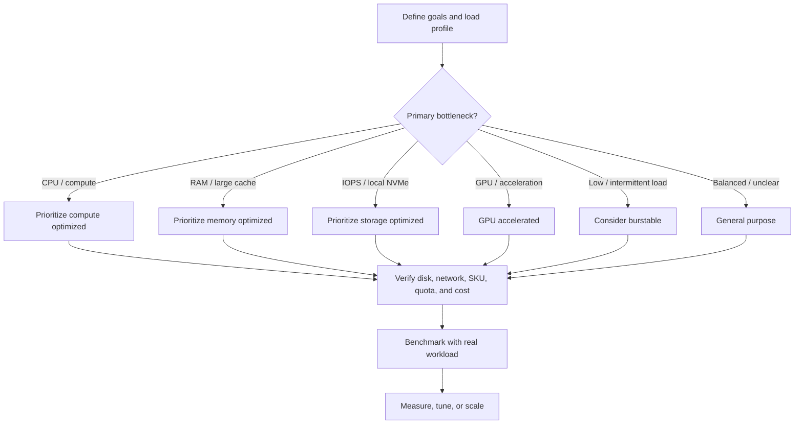

# Selecting a Virtual Machine by CPU, Memory, and Workload

Choosing the wrong virtual machine size (VM size) on Microsoft Azure often leads to two opposite problems: the application slows down or fails under increased load, or the organization pays for CPU and RAM that sit idle most of the time. A VM with many vCPUs may still perform poorly on a workload bottlenecked by memory, disk, or network. Conversely, choosing a VM with very large RAM does not help much if the program consumes little memory and is limited by single-threaded processing speed.

In the **CLOUD_PROVIDERS_AZURE** module, you explore Azure from subscriptions, resource groups, and Microsoft Entra ID to virtual networking, compute services, storage, data, deployment, monitoring, security, and cost. This lesson in the **Azure Virtual Machines** chapter guides you through reading VM specifications, identifying workload characteristics, selecting the right VM family, checking quota and capacity availability, and then verifying the decision with real-world measurements.

## 1. Learning Objectives

After this lesson, you will be able to:

- Distinguish between **vCPU**, RAM, CPU frequency, single-thread performance, available memory, and I/O resources.
- Recognize commonly used Azure VM families: B, D, E, F, L, M, N, H, and their variants.
- Calculate preliminary CPU/RAM requirements from metrics and peak load, with appropriate headroom.
- Select VMs for APIs, Java services, databases, caches, data processing, GPUs, and development environments.
- Check SKUs by region, vCPU quotas, capacity, OS images, and feature support.
- Use the Azure portal and Azure CLI to inspect VM sizes, collect metrics, and evaluate resize operations.
- Compare compute costs alongside disk, network, licensing, monitoring, and scaling options.

## 2. What Is a VM Size and Why Choose by Workload?

An **Azure Virtual Machine** is a virtual compute resource with an operating system, CPU, memory, networking, and storage devices. When creating a VM, you choose a **size**: a predefined configuration of those resources. Azure manages the physical infrastructure; operators remain responsible for the operating system, configuration, patches, security, and software running on the VM.

A size does not only determine the number of vCPUs and GiB of RAM. Depending on the family and generation, it also affects:

- CPU architecture, processor generation, and instruction-set capabilities suited to the application.
- Number of vCPUs, memory capacity, and GiB RAM/vCPU ratio.
- Network bandwidth limits and the number of supported network interfaces.
- Limits on data disks, storage throughput, and IOPS supported by the VM.
- Local/temporary storage, including options for host-level SSD or NVMe.
- Supported features such as Premium SSD, Accelerated Networking, GPU, confidential computing, and compatible image/OS types.
- Pricing by region, operating system type, billing model, and resource availability.

A **workload** is the work the VM must handle: for example, a web API serving thousands of requests per minute, a database server needing large RAM for cache, a short-lived compute batch job, a machine learning task requiring GPUs, or a dev server turned on only during business hours. Each type creates a different resource utilization pattern.

### An Initial Decision Flowchart



This diagram is an **initial filter**, not a substitute for benchmarking. For example, a database might be constrained by both RAM and IOPS, or an AI job might be limited by GPU VRAM capacity rather than CPU.

## 3. Understanding CPU and Memory Specifications

### 3.1. vCPU Is Not Equivalent to Independent Physical Cores

A **vCPU** is the CPU unit allocated to a VM for the operating system and applications to use. The relationship between a vCPU and a physical core/thread depends on the CPU architecture and SKU; some sizes use SMT/hyperthreading, while others use different configurations. Therefore, **8 vCPUs across two VM generations or two VM families are not guaranteed to deliver the same throughput**.

To compare candidates, examine:

1. How many vCPUs the workload can actually utilize.
2. Per-vCPU performance and the program's single-thread execution speed.
3. Concurrency level: number of active workers/threads, contention, and wait time.
4. CPU architecture (x86-64 or Arm64 if supported by the size) and compatibility with images, native libraries, and drivers.

A sequential job running on a single thread typically will not scale proportionally when upgrading from 4 to 16 vCPUs. For workloads with many independent tasks, adding vCPUs can increase throughput if disk, network, and memory can keep up.

### 3.2. RAM and the GiB/vCPU Ratio

RAM holds memory for the operating system, processes, caches, and buffers. For Java programs, VM memory must be sufficient for the **Java heap**, metaspace, thread stacks, native/off-heap allocations, the operating system, and monitoring agents.

A rough estimate of required memory:

\[
\text{Expected RAM} \approx \text{application working set} + \text{OS/agent} + \text{cache/buffer} + \text{headroom}
\]

Choosing more RAM solely because a “used memory” chart looks high can be wasteful: operating systems commonly use free memory for file caching and reclaim it when applications need it. Distinguish between *available* memory, memory pressure, paging/swap, OOM errors, and garbage collection. A Java service with an 8 GiB heap may still require a VM significantly larger than 8 GiB due to off-heap memory and the OS.

### 3.3. CPU-Bound vs. Memory-Bound

| Observed symptom | Likely cause | Action to consider |
|---|---|---|
| Sustained high CPU, growing processing queue, spare RAM | CPU-bound | Optimize code, increase vCPUs, or scale out |
| One core near 100%, overall average CPU not high | Single-thread bottleneck | Improve algorithm/parallelism, compare single-thread performance |
| Low available memory, rising swap/page faults, OOM | Memory-bound | Check for memory leaks, increase RAM, or choose E/M-series |
| Both CPU and RAM are low, yet requests are slow | Bottleneck may be disk/network/DB/locks | Measure dependency latency before upsizing the VM |
| Short CPU spikes in bursts, low most of the time | Bursty workload | Consider B-series and the CPU credits mechanism |
| GPU utilization or VRAM hitting the limit | GPU-bound | Choose N-series based on accelerator type, VRAM, and drivers |

**Average CPU** alone often hides peak loads. Use averages, maximums, appropriate percentiles, request count, latency, and error rate together to understand the application.

## 4. Common Azure VM Families

The naming and capabilities of a VM family vary by generation and specific SKU. Below is a general guide; all details such as vCPU count, RAM, CPU type, disk limits, and pricing must be **looked up for the actual SKU in the target region at deployment time**.

| VM family | Typical characteristics | Suitable workloads | Key considerations |
|---|---|---|---|
| **B-series** | Burstable, uses CPU credits on supported SKUs | Dev/test, low-traffic small services, intermittent workloads | Sustained high CPU can exhaust credits and throttle performance |
| **D-series** | General purpose, relatively balanced CPU/RAM | APIs, application servers, business services | Good default starting candidate when the bottleneck is unclear |
| **E-series** | Memory optimized, more RAM per vCPU | Databases, in-memory caches, large Java heaps | Inspect actual working set to avoid overpaying for unused RAM |
| **F-series** | Compute optimized, higher CPU-to-RAM ratio | Batch compute, builds, algorithmic processing | Unsuitable when the workload requires high RAM per vCPU |
| **L-series** | Storage optimized, options for high-performance local NVMe/SSD | Data processing, search, reproducible data caches | Local disk is ephemeral; requires a durable data strategy |
| **M-series** | Very large RAM, specialized CPU/RAM configurations | Large-scale databases and in-memory applications | High cost/capacity; avoid unless justified by proven demand |
| **N-series** | GPU-accelerated, multiple lines for graphics/HPC/AI | AI/ML, inference, rendering, GPU simulation | Verify GPU model, VRAM, drivers, quota, and regional support |
| **H-series / HPC lines** | Optimized for high-performance computing and specialized interconnects | Scientific simulation, CFD, MPI/HPC | Evaluate interconnect, libraries, and availability |

Some specialized SKUs serve **confidential computing** or carry specific security, CPU architecture, and OS constraints. Suffixes in Azure size names can indicate feature variants, but you should not infer all capabilities from the name alone; verify in the SKU catalog.

### Example of Reading a VM Size Name

A name like `Standard_D4s_v5` illustrates a D-series SKU with 4 vCPUs in a specific generation; suffixes and version numbers provide additional context. However, you should not deduce exact RAM capacity, disk support, or pricing solely from the name. Always check the exact specifications and availability of the SKU.

A VM size may **not support a local temporary disk**, whereas another variant does. Similarly, GPUs are offered in different counts, card generations, VRAM sizes, and drivers depending on the line. Choosing “N-series” generically is not enough to guarantee an AI model will run.

## 5. How Workload Characteristics Determine the VM Family

### 5.1. Web/API and Java Services

For REST APIs or Java microservices, **D-series** is a common starting candidate because CPU and memory needs are usually relatively balanced. If profiling shows large heap/off-heap usage and memory pressure, moving to **E-series** may make sense. If the code is compute-heavy with a low memory footprint, consider **F-series**.

Workload examples:

- Applications handling concurrent requests, querying a database, and calling external APIs: inspect p95/p99 latency, connection pools, CPU, and network.
- Java batch workers encrypting/compressing files: inspect multi-worker concurrency and sustained CPU usage.
- Java services using in-process caches: inspect heap, GC pauses, swap, and RAM consumed by the cache.

Do not pick a VM based solely on total requests per second; two APIs with the same RPS can have vastly different CPU costs per request.

### 5.2. Databases and Cache Systems

Databases typically benefit from RAM for buffer pools/caches while also needing consistent disk latency and IOPS. **E-series** is suitable to test when the working set is large. If the database uses fast storage but the VM size caps IOPS/throughput at a lower level, upgrading the disk tier may **not** achieve the desired speed; the VM's aggregate limit must still be accounted for.

Some scenarios use **L-series** with local NVMe to accelerate caching layers or reconstructible data. Local disks must not be treated as the sole persistent store for critical data. For many workloads, an Azure managed database service can reduce operational overhead; deciding between VM and PaaS requires weighing compatibility, control, and total cost.

### 5.3. Build Servers, ETL, and Batch Jobs

Builds, compilation, image processing, log transformation, and ETL can be CPU-heavy or I/O-heavy depending on the stage. For easily retriable batch jobs, **F-series** or D-series are candidates when CPU dominates. If a job reads/writes very large volumes to disk, account for storage and network throughput rather than just adding vCPUs.

For jobs that can be interrupted and restarted, consider autoscaling, VM Scale Sets, or **Spot VMs** when eviction is acceptable. A critical batch job without checkpointing is generally not suitable for Spot.

### 5.4. AI/ML, Inference, and Graphics

If the algorithm is GPU-accelerated, consider **N-series**. You must know:

- The framework and corresponding CUDA/driver version or acceleration API.
- The VRAM required to hold the model, batch, activations, and headroom.
- GPU utilization, token/frame throughput, latency, and CPU–GPU data transfer performance.
- Number of GPUs needed, multi-GPU interconnect, and whether the GPU model is available in the region.

Not every AI task needs a GPU. Small-scale inference, lightweight data processing, or workloads without suitable accelerated code can sometimes be more cost-effective on CPU. Conversely, picking a high-VRAM GPU while bottlenecked on CPU or network can also be wasteful.

### 5.5. Dev/Test Environments and Low-Traffic Services

**B-series** can be a good fit if CPU stays low most of the time with only brief spikes. B-series VMs typically use SKU-based CPU credits: credits accumulate when usage is below the baseline and are spent when bursting above the baseline. When credits run out, CPU is throttled according to that size's mechanism.

Do not pick B-series for a server running near 100% CPU continuously without analyzing credit behavior. In addition, **stop** and **deallocate** differ in allocation state and billing; to stop paying compute charges for an unused VM, verify that the VM is **deallocated** (charges for disks/public IPs may still continue).

## 6. Do Not Overlook Disk, IOPS, and Network

When an application is slow, vCPU and RAM are only two of many potential causes. A VM size also has its **own I/O limits**, even if you attach a very high-spec disk.

### 6.1. OS Disk, Data Disk, and Local Disk

| Component | Role | Notes when choosing a VM |
|---|---|---|
| **OS disk** | Stores the operating system and installed software | Choose a compatible disk type with performance suited to OS boot time and OS I/O |
| **Managed data disk** | Stores application data, databases, logs | Account for both disk IOPS/throughput and the VM's aggregate limits |
| **Local/temporary disk** | Scratch space, cache, or reproducible data | Data can be lost on host change, redeploy, or infrastructure events |
| **Ephemeral OS disk** | Stores the OS on local resources where supported by the SKU | Has specific constraints; unsuitable if conventional persistent OS disks are required |

**IOPS** is the number of read/write operations per second; **throughput** is the amount of data transferred per second; **latency** is the delay per operation. A workload processing many small queries and a workload reading large sequential files may need similar throughput but very different IOPS.

For example, a Premium SSD can deliver higher performance than a standard disk, but if the VM size caps total throughput below the disk's capability, you remain bottlenecked by the VM. Also check **cached/uncached IOPS**, the maximum number of attachable disks, and whether the size supports Premium SSD or Ultra Disk.

### 6.2. Networking

Workloads transferring heavy data between VMs, databases, storage, or the Internet must also account for:

- Maximum/expected network throughput of the VM size, NIC limits, and Accelerated Networking support.
- Latency between clients, VMs, and databases; selected region or availability zone.
- Network Security Group rules, firewalls, routes, and private endpoints.
- Network egress costs, cross-region traffic, or appropriate connectivity paths.

Choosing a larger size will not necessarily fix latency caused by geographic distance, excessive dependency calls, or network configuration. Placing workloads closer to data and reducing round-trip requests is sometimes more effective than adding CPU.

## 7. A Metrics-Driven VM Selection Process

An evidence-based choice generally follows **collect load data → identify bottleneck → select candidates → benchmark → optimize**. If building a new application, generate a representative workload via load testing and estimate requirements from similar systems.

### Step 1: Write Down Workload Requirements

Before browsing the SKU list, answer:

1. Does the workload run **24/7**, only during business hours, or on a batch schedule?
2. How many concurrent requests/tasks occur under normal load and peak load?
3. What are the SLA/SLOs: p95 latency, throughput, batch completion window, or recovery time?
4. Does the data/OS run on Linux or Windows? Are there x86-64, Arm64, GPU, nested virtualization, or specialized driver requirements?
5. Does the application hold state on the VM, or can instance counts scale dynamically?
6. Which region/availability zone is required for customers, data residency, latency, or governance?

### Step 2: Measure Under Representative Load

For an existing system, record at least one representative business cycle: peak hours, end-of-day batch, month-end, or traffic surge events. Collect:

| Data | Suggested metrics | What it reveals |
|---|---|---|
| CPU | Average, peak, and trend of `Percentage CPU`; per-core CPU if guest metrics are available | CPU saturation or single-thread limits |
| RAM | Available memory, working set, swap/page faults, OOM, GC | Actual memory needed and memory pressure |
| Disk | IOPS, bytes/s, latency, queue depth | Storage bottlenecks |
| Network | Bytes/s, connection count, errors, and latency | Bandwidth or connection limits |
| Application | RPS, queue length, p95/p99 latency, error rate | Effectiveness from the user's perspective |
| Cost | Hourly compute, managed disks, network egress | Affordability and waste-reduction opportunities |

**Azure Monitor** provides platform metrics such as `Percentage CPU` for VMs; **in-OS memory** metrics typically require the Azure Monitor Agent, VM insights, or guest telemetry. Do not conclude a VM has excess RAM simply because you lack memory metrics.

### Step 3: Estimate Required vCPUs

A rough formula for multi-threaded workloads, assuming comparable per-vCPU capacity across sizes:

\[
\text{Target vCPU} \approx
\left\lceil
\frac{\text{Current vCPU}\times\text{Observed CPU utilization}\times\text{Load growth factor}}
{\text{Target CPU level}}
\right\rceil
\]

Example: A current VM has **4 vCPUs**, peak CPU utilization is around **75%**, expected demand growth is **20%**, and you want to keep CPU around **60%** during a similar peak:

\[
\left\lceil\frac{4\times0.75\times1.20}{0.60}\right\rceil=6\text{ vCPUs}
\]

You can compare an 8-vCPU candidate (if the SKU fits) or increase the instance count to meet that load. **This is only an estimation method** and does not prove that adding vCPUs will scale linearly. Newer CPU generations, GC, disk, network, locks, licensing limits, and single-threaded bottlenecks can all change the outcome.

### Step 4: Estimate RAM

Suppose a workload needs **18 GiB** for the application/cache and **2 GiB** for the OS/agents, and you want **20%** headroom:

\[
(18+2)\times1.20=24\text{ GiB}
\]

A 24 GiB or 32 GiB RAM candidate (depending on available SKUs and actual pricing) may be suitable for benchmarking. Continue monitoring peak working set, GC/paging, and data growth, especially for databases or long-lived caches.

### Step 5: Filter by Disk, Network, SKU, and Zone

Eliminate candidates that fail IOPS/throughput, NIC/disk count, GPU capability, OS image, CPU architecture, region, availability zone, or security feature requirements. Then verify **quotas**, limits, and capacity in the target deployment location.

### Step 6: Benchmark at Least Two Candidates

Create a test environment comparable to production and run the same dataset and load profile. Compare:

- Throughput, p95/p99 latency, error rate, and completion time.
- CPU/RAM/GC, disk latency, and network saturation.
- Cost per unit of work: **cost per 1,000 requests**, per job, per GiB processed, or per hour meeting SLO.
- Peak load resilience and recovery when an instance fails.

Select the final size only after results meet SLO **and** cost is acceptable. When production benchmarking is impossible, document your assumptions and schedule post-deployment measurement.

## 8. Checking VM Sizes, SKUs, and Quotas on Azure

### 8.1. Checking via the Azure Portal

1. Open the [Azure portal](https://portal.azure.com/) and select the right tenant and subscription.
2. Go to **Virtual machines → Create** or select an existing VM and open **Size**.
3. Choose the region/availability zone the workload will use; the list of sizes can change based on your selection.
4. Review vCPU count, RAM, disk I/O, networking, VM family, and estimated pricing shown by the portal.
5. Cross-check each size's technical limits against your identified CPU/RAM/I/O requirements.
6. If a size does not appear or cannot be selected, check SKU restrictions, quota/capacity, and subscription policies before concluding the entire VM family is unsupported.

### 8.2. Looking Up Details with Azure CLI

The commands below **only read metadata** and require Azure CLI to be installed, appropriate permissions, and an active login to the target subscription.

```bash
# Sign in; verify subscription and tenant
az login
az account set --subscription "<subscription-id>"
az account show \
  --query "{subscription:id,tenant:tenantId,name:name}" \
  --output table

# List VM SKUs in the selected region
az vm list-skus \
  --location southeastasia \
  --resource-type virtualMachines \
  --output table

# View full capability/restriction details for SKUs if needed
az vm list-skus \
  --location southeastasia \
  --resource-type virtualMachines \
  --all \
  --output json

# Check compute usage/quota in the region
az vm list-usage \
  --location southeastasia \
  --output table
```

`az vm list-skus` lists SKUs published by Azure along with any restriction/capability metadata; `--all` is useful for a broader view, though **a SKU appearing in the output does not guarantee immediate capacity to deploy a VM at that moment**. `az vm list-usage` reflects compute quotas returned by the API and does not replace checking quotas for all other services.

### 8.3. Inspecting a Running VM and Resizable Sizes

```bash
RESOURCE_GROUP="rg-app-prod"
VM_NAME="vm-api-01"

# View current VM size and location
az vm show \
  --resource-group "$RESOURCE_GROUP" \
  --name "$VM_NAME" \
  --query "{name:name,location:location,size:hardwareProfile.vmSize}" \
  --output table

# List sizes Azure reports as available for resizing this VM
az vm list-vm-resize-options \
  --resource-group "$RESOURCE_GROUP" \
  --name "$VM_NAME" \
  --output table
```

The resize list can be affected by VM state and the cluster currently hosting the VM. If a size does not appear or the operation fails, check whether you must **stop/deallocate** before resizing; even then, it still depends on capacity, quota, image, and existing constraints.

### 8.4. Reading CPU Metrics with Azure Monitor

The example below only reads metrics already collected by Azure for the VM:

```bash
# Get the VM resource ID
VM_ID=$(az vm show \
  --resource-group "rg-app-prod" \
  --name "vm-api-01" \
  --query id --output tsv)

# Fetch CPU metrics; default time range follows CLI behavior
az monitor metrics list \
  --resource "$VM_ID" \
  --metric "Percentage CPU" \
  --interval PT5M \
  --aggregation Average Maximum \
  --output json
```

Results depend on the sampling interval, metrics read permissions, and retained data. To analyze peak load, **specify an appropriate time range** for your CLI version or export the data to an analysis tool. These are VM-level CPU metrics; measuring memory/GC or per-process CPU requires appropriate telemetry inside the OS/application.

## 9. Quotas, Capacity, Deployment Regions, and Compatibility

Finding a technically suitable size is not enough for a successful deployment. Azure can reject VM creation for several independent reasons.

| Issue | Example symptom | How to check |
|---|---|---|
| **Quota** | Regional vCPU limit or VM family limit reached | **Quotas** page and `az vm list-usage`; request a quota increase if needed |
| **Capacity** | Quota is available, but a SKU has no available capacity in the chosen zone/cluster | Check another SKU/zone or an approved fallback option |
| **SKU restriction** | Subscription or region does not yet support the size | Inspect SKU capabilities/restrictions and subscription policies |
| **OS/image compatibility** | Incompatible image, VM generation, CPU architecture, or feature | Check capabilities of the specific image and size |
| **Disk/network incompatibility** | Size lacks required disk/NIC/Accelerated Networking features | Verify requirements in the VM size catalog |
| **Azure Policy/RBAC** | VM creation denied by policy or permissions | Check policy assignments, resource group, and Azure RBAC |

Many VM quotas are tracked per **subscription + region** and can include both **total vCPUs** and **vCPUs per VM family**. For instance, a subscription may have remaining total quota while hitting the E-series family quota, blocking new E-series VMs. A quota increase approval **does not guarantee Azure has immediate physical capacity** in a specific zone.

Additionally, a region close to users may improve latency but might not offer every GPU type or specialized size. Do not choose a region solely on lower pricing if your architecture is constrained by latency, data residency, DR, or availability.

### Availability Zones and Reliability

One very large VM does not automatically provide high availability. When an application needs fault tolerance:

- Spread instances across supported **availability zones**, or design around appropriate fault domains.
- Place a load balancer and health checks in front of request-serving instances.
- Use **VM Scale Sets** when the workload fits a group of VMs with similar configuration and lifecycle.
- Design applications to be stateless where possible; store persistent data in an appropriate tier rather than relying on the local temporary disk.
- Prepare backups, recovery procedures, monitoring, and failover testing. VM size selection is only one piece of reliability.

## 10. Scale Up, Scale Out, and Right-Sizing

### 10.1. Scale Up / Scale Down

**Vertical scaling** changes the size of a single VM, such as moving from a 4-vCPU size to an 8-vCPU size with more RAM. This is useful for applications that are hard to partition or need large resources on one instance.

Pros: relatively straightforward to implement with minimal application architecture changes. Cons: bounded by the largest available size, single point of failure, quota/capacity limits, and typically involves uptime impact during resizing.

Before resizing a production VM:

1. Review current size, disks/NICs, availability zone, image, and compatibility limits.
2. Back up or prepare a rollback plan in case the change fails.
3. Check quota and available sizes; determine whether the VM must be **stopped/deallocated**.
4. Confirm that resizing may trigger a VM **restart**, cause downtime, or reset temporary disk data.
5. Schedule a maintenance window, drain traffic, or fail over to another instance.
6. Resize and re-measure metrics/SLOs once the application stabilizes.

The resize command example below **impacts live resources** and should only be used after organizational approval:

```bash
# Illustrative example; do not run directly on production without approval.
# The VM may need to be stopped/deallocated first, depending on size and capacity.
az vm resize \
  --resource-group "rg-app-prod" \
  --name "vm-api-01" \
  --size "Standard_D8s_v5"

# Verify the size after completion
az vm show \
  --resource-group "rg-app-prod" \
  --name "vm-api-01" \
  --query hardwareProfile.vmSize \
  --output tsv
```

`Standard_D8s_v5` is only a syntax example; it is not guaranteed to be supported in your subscription/region or resizable from the current VM. Resizing does not automatically boost disk/network performance across every dimension, nor does it fix memory leaks or unoptimized SQL queries.

### 10.2. Scale Out / Scale In

**Horizontal scaling** increases or decreases the **number of instances**. For example, instead of one 16-vCPU VM, you can run multiple smaller VMs behind a load balancer, depending on availability and cost goals.

Best suited when:

- The application can process requests in parallel across multiple machines.
- Session or stateful data is stored in a shared layer.
- Higher availability is needed if one instance fails.
- Load fluctuates and autoscale rules can use CPU, queue length, or application metrics.

Scaling out also introduces management, load balancer, monitoring, and configuration-sync overhead. Databases do not automatically scale horizontally simply by adding VMs; they require partitioning, replicas, or dedicated features.

### 10.3. Continuous Right-Sizing

**Right-sizing** adjusts VM sizes and instance counts based on operational telemetry to meet SLOs without waste. Periodically review VMs with sustained low CPU, excess RAM, dev/test environments left running after hours, and older-generation VMs not yet migrated to newer sizes. However, never downsize based on average CPU alone if the workload has sharp spikes or mandatory HA headroom.

Use **Azure Monitor** and **Azure Advisor** recommendations as inputs, then validate with the application owners. Advisor does not have full visibility into every business requirement or upcoming event.

## 11. Calculating Total VM Cost

Hourly VM pricing is the most visible piece, but **Total Cost of Ownership (TCO)** must include other components:

\[
\begin{aligned}
\text{Estimated monthly cost} \approx {} &
\text{Compute} + \text{Managed disks} + \text{Network} \\
&+ \text{Backup} + \text{Monitoring} + \text{Licensing}\\
&+ \text{Supporting resources}
\end{aligned}
\]

Where compute cost generally follows:

\[
\text{Compute} = \text{Hourly rate}\times\text{Billable hours}\times\text{Number of VMs}
\]

Do not default to 730 hours for every workload: dev environments running only during business hours, scheduled VMs, or autoscaling systems have different actual running hours.

### Compute Purchasing Models

| Model | Best suited for | Points to consider |
|---|---|---|
| **Pay-as-you-go** | Flexible workloads, uncertain runtime | Hourly rate and usage-based charges |
| **Reserved VM Instances** | Steady, predictable workloads over a commitment term | Commitment lock-in, applicability scope, and exchange/cancellation terms |
| **Azure savings plan for compute** | Consistent compute demand with flexibility within eligible scope | Hourly spend commitment and discount rules |
| **Spot VMs** | Checkpointed jobs tolerant of interruption/eviction | Unsuitable for continuous critical workloads without interruption handling |
| **Azure Hybrid Benefit** | Organizations holding eligible licenses | Verify licensing terms per OS/SKU and existing agreements |

You cannot determine the cheapest option from descriptions alone. Compare using the **Azure Pricing Calculator**, procurement policies, and expected usage per subscription. For GPU VMs, Windows, or proprietary software licenses, costs can differ dramatically from general-purpose Linux machines.

### Example: Comparing Two Options Meeting the Same SLO

Suppose a production API has two load-tested configurations:

- **Option A:** one large VM that achieves the target throughput when healthy.
- **Option B:** two smaller VMs behind a load balancer, each handling part of the load; if one VM fails, the system must have appropriate load-shedding or spare capacity to still meet the SLO.

Compare compute, disks, load balancer, networking, fault tolerance, deployment time, and operational complexity. Option B's total cost is not simply double the price of one small VM; in return, Option A introduces a single point of failure unless mitigated by additional architecture.

## 12. Real-World Scenario: Choosing a VM for a Java Application

A team is building an ordering API with Java and PostgreSQL. Initially there are around 1,000 active users, with potential traffic surges during promotions. The team runs the API on VMs while placing the database on a managed service.

### Data Collection

From load testing on a **4 vCPU / 16 GiB RAM** candidate (illustrative configuration), the team observes:

- Peak CPU reaches 75% during the load test, with lower average CPU.
- Java heap maxes out around 8 GiB; neither the application nor OS shows swap activity.
- p95 latency is approaching the SLO threshold as request volume rises.
- Disk I/O is low; most database access goes over the network.

The team forecasts 20% load growth and wants to keep CPU around 60% at expected peak. The preliminary formula suggests roughly 6 vCPUs. **Two candidates to benchmark** could be an 8-vCPU D-series size or multiple smaller D-series instances behind a load balancer, depending on the availability strategy.

### Making the Decision

1. **Do not pick E-series just because it is Java.** An 8 GiB heap alone does not prove high-RAM demand; inspect overall memory pressure and GC.
2. **Do not jump to F-series without evidence.** It might fit CPU-heavy, low-RAM workloads, but you must verify the RAM/vCPU ratio.
3. **Re-run load tests** on both configurations while keeping the dataset, DB queries, and load profile consistent.
4. **Compare p95/p99 latency and error rates** alongside CPU, RAM, GC, and network; check if the database connection pool is a bottleneck.
5. **Consider availability:** critical production systems may require two or more instances across appropriate fault domains/zones.
6. **Evaluate price:** calculate the cost per 1,000 requests meeting the SLO and total operational cost.

If the 8-vCPU candidate runs only slightly faster while costing much more, the team should investigate the root cause instead of endlessly scaling CPU. If the database turns out to be the bottleneck, optimizing queries, indexes, connection pools, or caching may be the right fix.

## 13. Hands-On Exercises

### Exercise A: Build a Comparison Table of Three VM Sizes

In a subscription where you have permission to read metadata:

1. Choose an actual region such as `southeastasia` and list available D/E/F sizes in that region.
2. Record in a table: size, vCPU, RAM, RAM/vCPU ratio, disk support, network limits, and estimated pricing.
3. Flag any size constrained by quotas, SKU restrictions, or capacity issues.
4. Recommend each size for a specific workload with concrete justification rather than relying on the family name alone.
5. Note which specifications could not be verified from CLI output and require checking SKU documentation.

### Exercise B: Evaluating a Memory-Bound Server

A running VM sits at 25% CPU yet constantly swaps and hits OOM during reporting jobs. Is doubling vCPUs the priority solution?

**Hint:** No. Measure the working set and memory pressure, detect leaks, optimize queries/reports, and then select adequate RAM; compare E-series or a higher-RAM size if needed.

### Exercise C: Choosing B-Series

An internal tool runs a few hours a day; CPU is low most of the time but occasionally spikes to 90% for 2 minutes. Another service runs at 80% CPU continuously for many hours. Which service is a better candidate to test on B-series?

**Hint:** The workload with brief bursts is a better fit. For sustained high CPU, credit behavior and baseline limits must be examined, along with benchmarking.

### Exercise D: Preliminary CPU Calculation

A VM has 8 vCPUs with 60% peak CPU. Load is expected to grow by 50%, and the team wants to keep peak CPU around 60% assuming identical per-vCPU performance. Calculate the preliminary vCPU requirement.

**Hint:** `ceil(8 × 0.60 × 1.50 / 0.60) = 12` vCPUs. Choose a practical size or scaling approach that meets requirements after benchmarking.

## 14. Pre-Creation and Pre-Resize Checklist

- [ ] Defined workload, SLA/SLO, normal load, peak load, and operating hours.
- [ ] Observed CPU, per-core utilization where needed, RAM, disk I/O, network, and application metrics.
- [ ] Distinguished between CPU, RAM, disk, network, database, and application bottlenecks.
- [ ] Estimated preliminary vCPU/RAM with headroom and growth plans.
- [ ] Selected at least two candidate VM sizes and verified RAM/vCPU ratio, CPU generation, and architecture.
- [ ] Cross-checked disk IOPS/throughput limits, data disk count, NICs, and required VM features.
- [ ] Verified SKU availability, total and family-level quotas, capacity/zone, OS image, and Azure Policy.
- [ ] Selected an availability strategy: single VM, multiple VMs, Scale Sets, and appropriate backup/failover mechanisms.
- [ ] Benchmarked under representative load with p95/p99 latency, throughput, error rate, and resource metrics.
- [ ] Forecasted total cost including compute, disk, network, backup, licensing, monitoring, and purchasing model.
- [ ] If resizing, scheduled a maintenance window, prepared a rollback plan, and confirmed restart/deallocate impacts.
- [ ] Configured Azure Monitor/Advisor, budgets, and a post-deployment right-sizing schedule.

## Conclusion

Good Azure Virtual Machine selection starts with **workload characteristics and measured data**, and only then moves to VM family names. D-series is a solid starting point for many balanced applications; E/F/L/N/M/H and B-series address specific memory, CPU, I/O, GPU, high-capacity, or burstable needs. However, real-world effectiveness still depends on disk, networking, deployment permissions, quotas, capacity, and region. Benchmark multiple candidates, calculate lifecycle costs, and continue right-sizing based on metrics and application operational goals.
