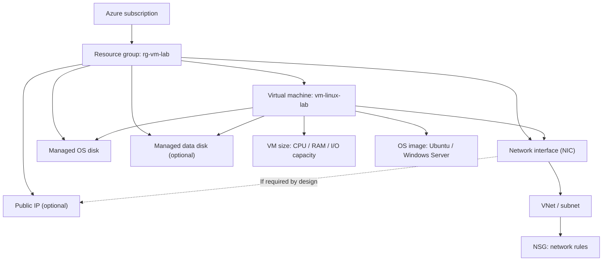
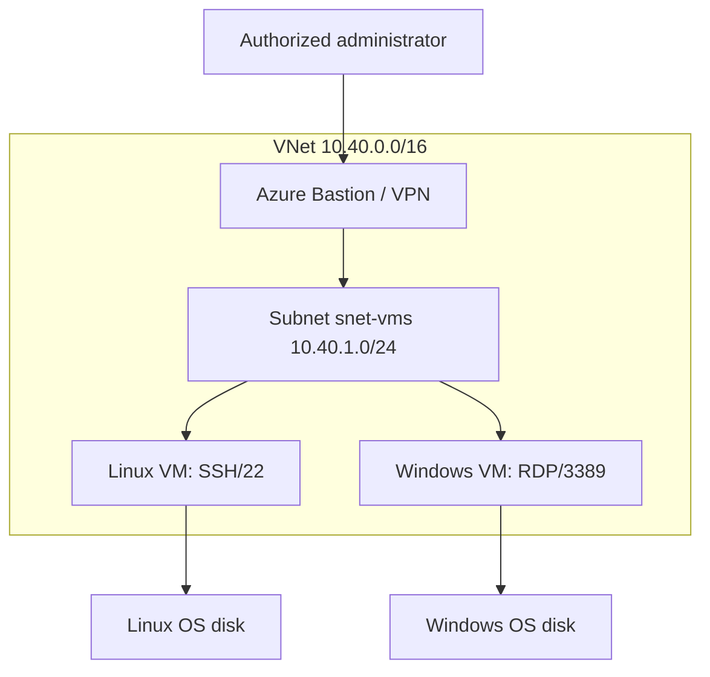
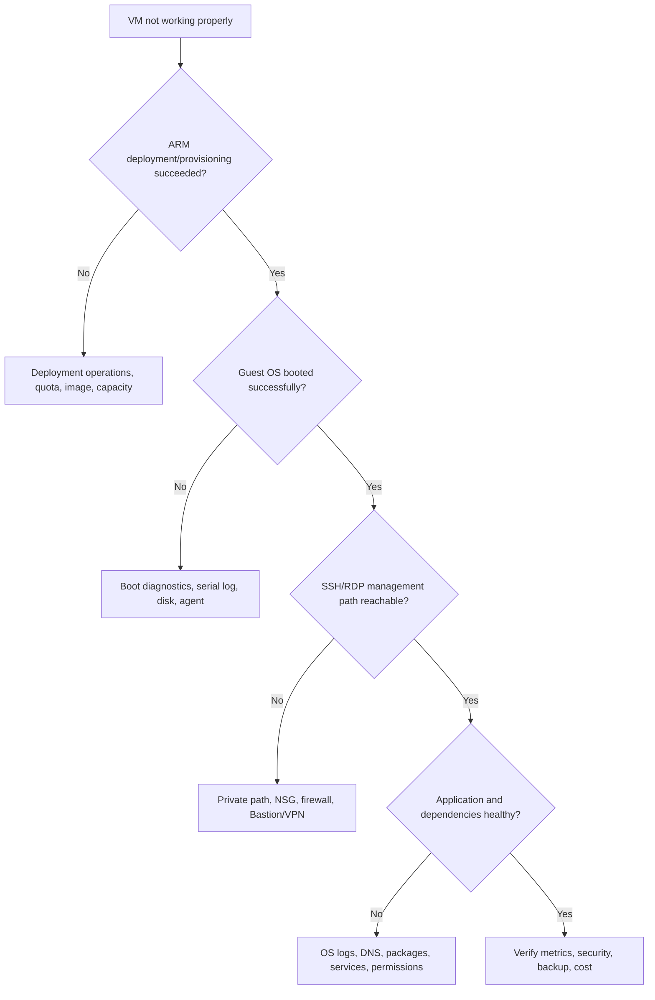

# Creating Linux and Windows Virtual Machines

When an application needs an operating system, custom software, or server-level administrative privileges, **Azure Virtual Machines (Azure VMs)** provide Infrastructure as a Service (IaaS) compute resources. A development team can create a VM running **Linux** for web/API workloads or **Windows Server** for .NET software, Windows services, and legacy applications. However, creating a VM is not enough on its own: you must choose the image, size, disks, networking, sign-in method, protection mechanisms, and cost-management approach.

This lesson belongs to the **Azure Virtual Machines** chapter in the `CLOUD_PROVIDERS_AZURE` module. Across your journey through Azure—from subscriptions, resource groups, and Microsoft Entra ID to virtual networking, compute, storage, data, monitoring, security, and cost control—this lesson focuses on the process of creating **one Linux VM and one Windows VM securely, verifiably, and cleanly disposable after hands-on practice**.

## Learning Objectives

After this lesson, you will be able to:

- Describe a VM and its dependent resources: **VM size, image, managed disks, NIC, VNet/subnet, NSG, identity**.
- Prepare the subscription, administrative permissions, quotas, region, image, and budget before provisioning.
- Create an Ubuntu Linux VM and a Windows Server VM using the **Azure Portal** or **Azure CLI**.
- Design an administrative path via **SSH/RDP with Azure Bastion or a private network**, avoiding exposing ports 22/3389 directly to the Internet.
- Verify provisioning state, boot status, agents, and OS access after the VM is created.
- Understand differences in sign-in, updates, images, disks, and costs between Linux and Windows.
- Monitor VMs, protect data, troubleshoot common issues, and clean up resources properly when finished.

## 1. What Makes Up a VM in Azure?

An Azure VM is not just a single “computer.” In most architectures, Azure Resource Manager (ARM) manages the **VM resource** together with its associated resources:



The **VM size** determines vCPU count, memory, I/O capacity, and hardware characteristics per SKU. The **Image** provides the base operating system. The **OS disk** holds the operating system volume; **data disks** hold application data when attached. The **NIC** places the VM on the network, assigns a private IP, and is governed by subnet, routing, and Network Security Group (NSG) rules.

In Azure, a **resource group** groups resources for management and scoped deletion; it is **not** an automatic network or security boundary. Access control must be designed through Microsoft Entra ID, Azure RBAC, NSGs, network policies, and other security services.

### How Does a VM Differ from Managed Services?

| Option | What you manage | When it fits best |
|---|---|---|
| **Azure VM (IaaS)** | Guest OS, software, OS/application patches, machine configuration, part of networking and data | Need OS customization, legacy software, or server administration |
| **Azure App Service / Container Apps** | Primarily the application and provided platform configuration | Web/API apps that can run on a managed service with minimal OS operations |
| **Azure Kubernetes Service (AKS)** | Containerized applications and many cluster/workload components | Multiple containerized services needing orchestration and complex scaling |
| **Azure Virtual Machine Scale Sets (VMSS)** | VM template, scaling policies, workload, and OS across the fleet | Many similar VMs needing scale-out and load distribution |

**Do not use a VM for every application**: if the requirement is simply deploying a standard web API, a PaaS service can significantly reduce patching, host protection, and OS administration work. A VM is appropriate when that level of control is genuinely needed.

## 2. Decisions to Make Before Creating a VM

### Subscription, Region, and Quota

Every VM must be created in a specific **subscription** and **region**. Before picking a region, evaluate:

1. **User and data location:** place the VM close to the appropriate database/storage to reduce latency; comply with data residency requirements.
2. **Availability Zones:** does the workload need zonal fault tolerance? Do the chosen region and VM size support the target zone?
3. **Quota and provisioning capacity:** does the subscription have enough vCPU quota for that VM family and region? Does the SKU have available capacity?
4. **Image/SKU features:** is the OS image supported on the chosen CPU architecture, security type, generation, VM size, and region?
5. **Cost:** Linux and Windows carry different licensing costs; managed disks, backups, IPs, data transfer, monitoring, and Bastion can also incur charges.

For example, `southeastasia` is the Azure region name for Southeast Asia; production resources must be chosen based on business requirements. Do not treat a region or size in an example as a guarantee that every subscription has quota or capacity available.

### Linux and Windows Images

An **image** is the source Azure uses to provision the OS disk and initial OS configuration:

- Linux: commonly Ubuntu LTS, Debian, Red Hat Enterprise Linux, or another supported distribution.
- Windows: commonly a supported Windows Server edition, such as Windows Server 2022 Datacenter.
- Third-party Marketplace images may come with billing terms, licensing fees, and programmatic term acceptance requirements.
- Custom images or Azure Compute Gallery help standardize VMs across an organization, but require an image update and maintenance pipeline.

Prefer images receiving vendor security updates, within their support lifecycle, and compatible with the application. **Do not assume Azure CLI image aliases will exist forever or be available across all clouds/regions**; verify them before automating.

### Choosing a VM Size

| Requirement type | Selection direction | What to verify |
|---|---|---|
| Lab, small web app, dev/test | B-series VMs with supported CPU bursting | CPU credits, RAM, and network/IO limits |
| Web/API with steady load | General purpose (e.g., D-series) | vCPU/RAM, zone support, bandwidth, autoscale |
| Large RAM needed | Memory optimized (e.g., E-series) | Cost, RAM capacity, application sizing |
| Compute processing | Compute optimized (e.g., F-series) | Core count, CPU performance, workload benchmark |
| GPU/AI/graphics | GPU VM families | Drivers, quota, region availability, high GPU cost |

An example size like `Standard_B2s` may work for a small lab, though it is not a recommended production configuration. Windows Server workloads may require more RAM and disk space than Linux. Base your choice on CPU, RAM, disk IOPS, throughput metrics, and real testing.

## 3. Secure Network Design for Two VMs

This hands-on lab uses a dedicated VNet:

| Component | Example |
|---|---|
| Resource group | `rg-vm-lab` |
| Region | `southeastasia` |
| Virtual network | `vnet-vm-lab` |
| VNet CIDR | `10.40.0.0/16` |
| VM subnet | `snet-vms`: `10.40.1.0/24` |
| Linux VM | `vm-linux-lab` |
| Windows VM | `vm-windows-lab` |
| Administrative access | Azure Bastion or VPN/ExpressRoute to private IP |
| Public IPs for both VMs | **Not created** in the default design |



**This is a secure design pattern for a lab:** VMs receive private IPs inside the VNet without directly exposing SSH/RDP ports publicly. To administer them from your personal machine, a properly deployed and configured management path is required; **having no public IP means they are not directly reachable from the Internet**.

### Network Security Group (NSG)

An NSG enforces inbound/outbound network rules at the subnet or NIC level as configured:

- Do not open SSH `22` or RDP `3389` to `0.0.0.0/0` in production environments.
- If public access is strictly required in an approved lab, restrict source IP, duration, and rules; consider **Just-in-Time (JIT) VM access** via Defender for Cloud when available.
- If using **Azure Bastion**, ensure the VM subnet/NSG allows management traffic from Bastion as required by the feature, and deploy Bastion in a dedicated subnet named `AzureBastionSubnet`.
- VNets, private IPs, and NSGs do not replace the OS-level firewall; inspect both layers.

**Azure Bastion is a separate service with its own configuration and cost.** A VM does not automatically include Bastion; you must deploy one or use an existing Bastion. In hybrid networks, VPN/ExpressRoute and DNS/routing must be configured properly.

## 4. Creating an Ubuntu Linux VM via the Azure Portal

This example creates a lab VM on the planned VNet.

### Step 1. Open the VM Creation Wizard

In the Azure Portal, go to **Virtual machines → Create → Azure virtual machine**. Confirm the active **Directory/Subscription**. Select resource group `rg-vm-lab` (create a new one if it does not exist and you have permission).

### Step 2. Basics Tab

Fill in the details:

1. **Virtual machine name:** `vm-linux-lab`.
2. **Region:** the resource group's region or target region, e.g., Southeast Asia.
3. **Availability options:** choose according to zone/availability requirements; defaults may suffice for a lab, whereas production requires evaluating zones or availability sets.
4. **Security type:** evaluate **Trusted launch** (Secure Boot, vTPM) when supported by the image, generation, and size.
5. **Image:** a supported Ubuntu Server LTS image, e.g., Ubuntu 22.04 LTS.
6. **Size:** choose a SKU matching your quota and lab budget.
7. **Authentication type:** prefer **SSH public key** over passwords for Linux.
8. **Username:** e.g., `azureuser`; choose a name not on the reserved usernames list.
9. **SSH key:** use an existing public key or generate a new key pair through the Portal as guided.
10. **Inbound port rules:** no need to open SSH to the Internet when using Bastion/private management.

If you generate a new key pair in the Portal, **download and protect the private key immediately when offered**; never commit private keys to Git, shared docs, or chat. The public key is placed on the VM; the private key must stay in appropriate secret storage with strict permissions.

### Step 3. Disks Tab

- **OS disk type:** consider Standard SSD for labs if sufficient; Premium SSD for workloads needing higher performance.
- **Data disks:** attach if application data should be stored separately from the OS disk; a basic lab may not need one yet.
- **Encryption:** Azure Managed Disks support encryption at rest by default; enable CMK and other options only when required and compatible.
- **Delete with VM:** verify disk lifecycle settings and whether data must be retained when deleting the VM.

**The OS disk and the temporary/local disk are different.** Do not store data that needs long-term durability on a temporary disk or local ephemeral storage. Data can be lost when a VM is moved, redeployed, or encounters host issues depending on storage type.

### Step 4. Networking Tab

- Select `vnet-vm-lab`, subnet `snet-vms`.
- Choose **Public IP: None** if managing via Bastion or a private network.
- Review the NIC NSG and inbound rules; do not open ports wider than necessary.
- Do not force Accelerated Networking if the size/image/driver does not support it; use an Azure-validated configuration.

### Step 5. Management, Monitoring, Advanced, and Tags

Depending on the Portal layout/SKU, options may appear across different tabs:

- **Identity:** enable **system-assigned managed identity** if the application needs to access Azure APIs or Entra-protected resources without storing long-lived credentials.
- **Boot diagnostics:** enable per policy to view boot screenshots and serial logs during failures.
- **Monitoring:** consider the Azure Monitor Agent and Data Collection Rules to collect guest telemetry when needed.
- **Patching/updates:** choose an assessment and patching mechanism aligned with the OS and organizational requirements.
- **Automatic shutdown:** helpful for dev/test to avoid leaving machines running, though you must verify **deallocation** and remaining non-compute charges.
- **Tags:** e.g., `environment=lab`, `owner=team-cloud`, `expiry=yyyy-mm-dd` for lifecycle management and cost allocation.
- **Advanced:** cloud-init (Custom data) can automate initial Linux configuration.

### Step 6. Review + create

Review the VM size, license/image, disks, IPs, NSG, security type, identity, and estimated cost. Select **Review + create** to let the Portal run validation, then click **Create**.

Once the deployment succeeds, open the VM → **Overview** and check its status. A successful control-plane deployment does not prove the application inside the VM is working; sign in and verify boot, agents, DNS/routing, and application services.

## 5. Creating a Windows Server VM via the Azure Portal

The steps are largely similar to Linux, with key differences in images, credentials, updates, and access methods.

### Step 1. Basics

- **Name:** `vm-windows-lab`.
- **Image:** a supported Windows Server image (e.g., Windows Server 2022 Datacenter).
- **Size:** choose sufficient RAM/CPU for Windows Server, verifying quota and licensing costs.
- **Administrator account:** create a compliant local administrator username, e.g., `azureadmin`.
- **Password:** use a password meeting Azure length/complexity rules and organizational policy; do not reuse personal passwords from elsewhere.
- **Inbound ports:** select **None** when managing via Bastion/private network; RDP defaults to TCP `3389` and must not be exposed indiscriminately to the Internet.

Some Windows images offer an Azure Hybrid Benefit or license eligibility option. Select this only if your organization holds valid licensing rights and billing eligibility has been verified. Windows Server VMs typically include a licensing component in compute pricing unless covered by another valid licensing model.

### Step 2. Disks, Networking, and Management

- Choose the OS disk type based on performance and budget.
- Attach a data disk if the Windows application needs a dedicated data volume.
- Place it in the same lab VNet/subnet as the Linux VM if testing internal connectivity.
- Omit a public IP when Bastion/private connectivity is available.
- Enable boot diagnostics and suitable monitoring/update mechanisms.
- Evaluate Trusted launch and endpoint protection features based on image, SKU, and policy.

### Step 3. Create and Verify

After **Review + create**, open VM → Overview to confirm provisioning. Inspect the guest OS via Azure Bastion or a private network path:

- Windows has booted to the sign-in screen.
- RDP works over the designed secure management path.
- Windows Update, system time, firewall, antivirus/Defender, and required services are in a healthy state.
- No extra test services or users have excessive privileges.

If the VM is strictly for a lab, avoid installing software or opening inbound rules beyond the exercise scope. Store configurations as Infrastructure as Code (IaC) if reproducibility is needed.

## 6. Creating Both VMs with Azure CLI

Azure CLI lets you express deployment configurations repeatably and incorporate them into scripts/IaC. This section uses **Bash** and hypothetical lab resources. Running these commands in a subscription can incur real Azure charges.

**Prerequisites:** compatible Azure CLI installed, permissions to create resource groups/VNets/NICs/VMs/disks and manage networking in the subscription; available quota/capacity; a cloud/region supporting the selected image and VM SKU. Do not run test deployments in a production subscription.

### 6.1 Select Subscription and Create Resource Group

```bash
az login --tenant "<tenant-id>"
az account set --subscription "<subscription-id>"

az account show \
  --query "{subscription:id,tenant:tenantId,name:name}" \
  --output json

az group create \
  --name rg-vm-lab \
  --location southeastasia \
  --output json
```

If a resource group with that name already exists, verify that it **belongs strictly to your assigned lab scope** before proceeding. Resource group names must be unique within a subscription; two people doing the same lab should not share a resource group without explicit coordination.

### 6.2 Create a VNet and Subnet for the VMs

```bash
az network vnet create \
  --resource-group rg-vm-lab \
  --name vnet-vm-lab \
  --location southeastasia \
  --address-prefixes 10.40.0.0/16 \
  --subnet-name snet-vms \
  --subnet-prefixes 10.40.1.0/24 \
  --output json
```

Ensure the CIDR does not overlap with peered VNets or your organization's hybrid networks. **This command does not create Bastion or a VPN**. Without a private network path to the VMs, you cannot sign in directly from your personal machine to VMs lacking public IPs.

### 6.3 Create a Linux VM with an SSH Key

```bash
az vm create \
  --resource-group rg-vm-lab \
  --name vm-linux-lab \
  --location southeastasia \
  --image Ubuntu2204 \
  --size Standard_B2s \
  --admin-username azureuser \
  --authentication-type ssh \
  --generate-ssh-keys \
  --vnet-name vnet-vm-lab \
  --subnet snet-vms \
  --public-ip-address "" \
  --nsg-rule NONE \
  --storage-sku StandardSSD_LRS \
  --output json
```

Key parameters explained:

| Parameter | Effect |
|---|---|
| `--image Ubuntu2204` | Uses the Ubuntu Server 22.04 LTS alias in supported CLI environments; verify the image if unavailable |
| `--size Standard_B2s` | Example lab VM size; requires quota/capacity |
| `--admin-username` | Initial Linux administrator account name |
| `--authentication-type ssh` | Selects SSH public key authentication |
| `--generate-ssh-keys` | Azure CLI uses/generates SSH keys using the supported mechanism on the CLI host |
| `--vnet-name` / `--subnet` | Attaches the VM NIC to the created private network |
| `--public-ip-address ""` | Omits creating a public IP using Azure CLI Bash syntax |
| `--nsg-rule NONE` | Prevents the CLI from automatically opening inbound SSH/RDP on the CLI-managed NSG in that flow |
| `--storage-sku StandardSSD_LRS` | Selects an example managed OS disk SKU |

**Important:** `--nsg-rule NONE` does not necessarily mean “no NSG” or “all traffic is blocked.” Depending on how the CLI creates/attaches the NSG, **default rules** still apply. Inspect the NIC/subnet NSG and effective rules after deployment. `--generate-ssh-keys` requires an appropriate environment; in enterprise settings, supply a centrally managed public key rather than auto-generating keys.

**Shell warning:** this example uses Bash because `--public-ip-address ""` may be parsed differently by Windows shells/PowerShell. On PowerShell, check how empty strings or equivalent flags work in your Azure CLI version; verify **no public IP exists** after deployment.

### 6.4 Create a Windows Server VM

Creating a Windows VM via CLI requires a secure way to supply a **local administrator password** if the image does not support another sign-in model. In the Bash example, read the password from the terminal without echoing it:

```bash
read -r -s -p "Enter Windows admin password for lab: " VM_ADMIN_PASSWORD
echo

az vm create \
  --resource-group rg-vm-lab \
  --name vm-windows-lab \
  --location southeastasia \
  --image Win2022Datacenter \
  --size Standard_B2s \
  --admin-username azureadmin \
  --authentication-type password \
  --admin-password "$VM_ADMIN_PASSWORD" \
  --vnet-name vnet-vm-lab \
  --subnet snet-vms \
  --public-ip-address "" \
  --nsg-rule NONE \
  --storage-sku StandardSSD_LRS \
  --output json

unset VM_ADMIN_PASSWORD
```

The password must satisfy Azure's length and complexity policies. Although the example **avoids writing the password to a file**, passing it on the CLI passes the value as a process argument, which can be exposed if process arguments are monitored or logged uncontrollably. In sensitive environments, prefer approved secrets workflows, secret-protected deployment mechanisms, or the **Azure Portal** secure password field. Never place real passwords in command history, Git, pipeline logs, documentation, or chat.

The alias `Win2022Datacenter` is a common example. If the alias, image generation, or SKU is unavailable in your cloud/region, use an environment-supported image reference rather than an unverified source. `Standard_B2s` is a syntax example; **verify that RAM and CPU are sufficient for your actual Windows workload**.

### 6.5 Verify Both Provisioned VMs

```bash
az vm list \
  --resource-group rg-vm-lab \
  --show-details \
  --query "[].{name:name,location:location,powerState:powerState,privateIp:privateIps,publicIp:publicIps}" \
  --output table

az vm show \
  --resource-group rg-vm-lab \
  --name vm-linux-lab \
  --query "{id:id,vmSize:hardwareProfile.vmSize,osType:storageProfile.osDisk.osType,identity:identity.type}" \
  --output json

az vm get-instance-view \
  --resource-group rg-vm-lab \
  --name vm-windows-lab \
  --query "instanceView.statuses[].displayStatus" \
  --output table
```

Check that:

- Both VMs are in the `running` state when ready for use.
- The `publicIps` property contains no unintended addresses.
- Each NIC has a private IP inside the selected subnet.
- Each Linux/Windows OS matches the intended image.
- The OS disk, NIC, NSG, and dependent resources are created in the right resource group.

CLI output can vary by Azure CLI version; if a `--query` expression returns nothing, inspect the full JSON output or command help to verify field names rather than assuming the VM does not exist.

## 7. Secure Administrative Connections: SSH and RDP

### Linux: SSH

Linux is typically administered via **SSH**. Once you have valid network connectivity to the VM's private IP:

```bash
ssh -i ~/.ssh/id_rsa azureuser@10.40.1.4
```

`10.40.1.4` is just an example; obtain the real private IP from the NIC/VM. The private key path depends on the key used, and Azure CLI may generate keys with a different type or filename. Never copy your private key onto the VM, do not share one administrative key across multiple users, and verify the host fingerprint on first connection.

**SSH does not automatically route from the Internet to a private IP.** You need one of the following options:

- **Azure Bastion**: open VM → **Connect → Bastion** in the Portal once Bastion is properly deployed in the subscription/VNet; configure a supported authentication method.
- **VPN/ExpressRoute**: connects your management network to the VNet; routes, DNS, and NSGs must allow traffic to the private IP.
- **Jump host**: use only if properly designed, hardened, monitored, and access-controlled; never spin up an ad-hoc jump VM with wide-open public RDP/SSH.

Some images/services support **Microsoft Entra login** for Linux via the corresponding extension/configuration, improving access governance and reducing reliance on local accounts. This requires explicit configuration and is not enabled automatically just because the VM lives in a subscription.

### Windows: Remote Desktop (RDP)

Windows Server commonly uses **RDP** over TCP `3389`. Over Bastion or a VPN/private path, Remote Desktop connects to the private IP with an authorized account.

When connecting:

1. Confirm the private management network path works and NSG/Windows Defender Firewall rules allow the designed flow.
2. Use the right local/admin account or configured organizational identity; do not assume Azure RBAC `Reader`/`Contributor` automatically grants Windows sign-in rights.
3. Verify RDP certificates and appropriate authentication mechanisms; do not blindly ignore security warnings.
4. For organizations using Microsoft Entra login on Windows VMs, ensure the extension, VM login RBAC roles, and supported OS/client prerequisites are in place.

**Azure RBAC is a resource-management authorization layer**, whereas signing into the guest OS is a separate layer. Someone with permission to start/stop a VM does not automatically have an SSH or RDP login account on that machine.

### Azure Bastion Has Its Own Requirements

Azure Bastion is not created automatically with a VM. Deploying it requires planning a dedicated subnet named exactly `AzureBastionSubnet`, sizing the subnet for the chosen SKU/features (often recommended at least /26 for new deployments), configuring networking/NSGs, and provisioning associated resources. Bastion incurs **ongoing charges** while deployed, even when no SSH/RDP sessions are active. Only deploy Bastion if authorized and within lab budget; alternatively, use an approved shared Bastion.

## 8. Disks, Data, and Lifecycle Policies

### Managed OS Disk, Data Disk, and Temporary Disk

| Storage type | What it holds | Key things to remember |
|---|---|---|
| **OS disk** | Operating system, parts of configuration, and installed software | An Azure Managed Disk; has its own cost and lifecycle |
| **Data disk** | Application data, databases/files depending on workload | Can be attached after creation; needs formatting/mounting and backups |
| **Temporary/local disk** | Temporary data, cache, or scratch space depending on SKU | Data is not guaranteed to persist across host events/deallocation/redeploy |
| **Ephemeral OS disk** | OS stored on local storage where supported by SKU/image | Intended for stateless/reproducible workloads; data is lost on reimage or events affecting local storage |

In a basic lab, having just the OS disk on both machines is enough. When applications need durable storage, prefer managed data disks or dedicated storage services rather than relying on the temporary disk.

Example of attaching a managed data disk to the Linux VM once quota and budget are confirmed:

```bash
az vm disk attach \
  --resource-group rg-vm-lab \
  --vm-name vm-linux-lab \
  --name disk-linux-data \
  --new \
  --size-gb 64 \
  --sku StandardSSD_LRS
```

After attaching, **a new disk does not automatically have a filesystem or mount point**. On Linux, identify the exact device via `lsblk`/disk ID, create a partition/filesystem if it is a new disk, and configure mounting by UUID; on Windows, use Disk Management/PowerShell to initialize, partition, format, and assign a drive letter. **Never run format commands on an unverified drive**, as this can cause data loss.

### Encryption and Backup

Azure Managed Disks support encryption at rest by default. If your organization requires a **customer-managed key (CMK)**, design a Disk Encryption Set, managed identity, and key permissions according to supported capabilities; not every VM configuration supports every key/security type out of the box.

**Snapshots, backups, and replication serve different purposes.** Backups require schedules, retention policies, tested recovery procedures, and access protection; Azure Backup or equivalent services can be used where supported. Simply copying a VM/disk does not replace an application-consistent recovery strategy, especially for stateful databases.

## 9. Automated Post-Provisioning Initialization

### Cloud-init on Linux

Many Linux images support **cloud-init** to configure the machine during provisioning. You can pass `custom data` at VM creation where supported, for example:

```yaml
#cloud-config
package_update: true
packages:
  - nginx
runcmd:
  - systemctl enable --now nginx
```

This example uses Ubuntu with a compatible package manager. It requires the VM to have network access to package repositories; a private-IP-only VM without an outbound path/NAT may fail to install Nginx. Never store passwords, tokens, or secrets in cloud-init/custom data, as initialization data can be exposed during deployment, in guest logs, or via system metadata mechanisms.

### Windows: Extensions and Run Command

Windows VMs can be configured using golden images, Azure VM Extensions, scripts, and configuration management tools. The Azure Portal offers **Run command** for authorized diagnostic/remediation tasks. Example of querying system services with PowerShell:

```powershell
Get-Service -Name WinRM
Get-ComputerInfo | Select-Object WindowsProductName, OsVersion
```

When using VM Run Command/extensions, ensure appropriate permissions and strict control over script contents because commands can execute with **elevated privileges** inside the guest OS. Never pass credentials in `--scripts` or print them to output logs. Run Command is not a substitute for idempotent configuration management and change control in production.

### Moving Toward IaC

For real workloads, manage VM configurations using **Bicep/ARM, Terraform, or IaC pipelines**: VMs, NICs, subnets, NSGs, identities, disks, tags, and monitoring. Azure CLI is great for learning concepts and labs; manual execution is not a reliable deployment mechanism for hundreds of VMs.

## 10. Operating and Monitoring VMs

Once a VM is running, day-2 operations begin:

| Category | Linux | Windows |
|---|---|---|
| OS patching | Package management, kernel updates, and reboots per distro | Windows Update/Update Manager and reboots |
| Access | SSH keys, optional Entra integration as configured | RDP, local/domain/Entra login as supported |
| OS services | `systemctl`, journald, and logs | Services, Event Viewer, and PowerShell |
| Disk/filesystem | `lsblk`, `df -h`, mounts/UUID | Disk Management, volumes, and event logs |
| Guest monitoring | Azure Monitor Agent/VM Insights if configured | Azure Monitor Agent/VM Insights if configured |
| Security baseline | OS hardening, firewall, SSH policy | Defender, Windows Firewall, RDP policy, and hardening |
| Identity to Azure | Managed identity and service RBAC | Managed identity and service RBAC |

### Azure Monitor and Boot Diagnostics

**Platform metrics** such as CPU percentage and host-level indicators are provided automatically by Azure per resource. **Guest metrics/logs** (memory, filesystem usage, Windows Event Logs, Syslog) generally require an agent or explicit collection configuration.

Key items to monitor:

- VM availability/health and power state changes.
- CPU, memory, disk latency/IOPS, free disk space, and network throughput.
- SSH/RDP sign-in attempts, local user changes, update failures, and security events.
- Full OS or data disks, filesystem errors, or failed application startups.
- Boot diagnostics screenshots/serial logs when a machine fails to boot.
- Cost trends relative to the resource group budget or project tags.

Do not treat `VM Running` as proof that the web/API app is healthy. Combine it with health endpoints, application logs, synthetic probes, and business metrics.

### Managed Identity and Accessing Azure Resources

If a VM needs to read blobs in Azure Storage or secrets in Key Vault, consider a **system-assigned or user-assigned managed identity** as supported. The VM/application obtains tokens via Azure's identity mechanism while the target resource checks Azure RBAC/access policies. Never hardcode storage account keys or Key Vault secrets in source code, config files, or VM logs.

## 11. Availability, Scaling, and Production Design

A single VM is a compute-level single point of failure, regardless of whether the OS is Linux or Windows.

### Availability Zones and Availability Sets

- **Availability Zones** are physically separate fault zones within a supported region. Deploying VMs across multiple zones with a load balancer and appropriately resilient data tiers increases fault tolerance.
- **Availability Sets** distribute multiple VMs across fault/update domains in supported scenarios, typically within a single-zone design.
- **Virtual Machine Scale Sets** manage multiple instances from a template with scaling and upgrade policies.
- **Azure Load Balancer** and **Application Gateway** distribute traffic across backend pools; they do not automatically replicate application data or databases.

Merely choosing `Availability Zone 1` in the Portal does not make a single VM highly available. You need **multiple instances, load balancing, state management, backup/DR, and failover testing**.

### State and Data Considerations

For web/API tiers, avoid storing critical session state solely in the RAM of a single VM. Stateful data requires purpose-built storage or databases. If deploying legacy Windows services or Linux databases onto VMs, verify application-consistent backups, recovery capabilities, and licensing/clustering constraints before scaling.

## 12. Cost: Creating a VM Is Easier Than Stopping Billing

A VM's cost involves more than just compute pricing:

| Cost category | When charges apply | How to control |
|---|---|---|
| **Compute** | While the VM is allocated/running under Azure billing states | Choose an appropriate SKU, deallocate when idle, auto-shutdown policies |
| **Windows/licensing** | Based on image, OS, and licensing terms | Choose the right OS/license; use Azure Hybrid Benefit only when eligible |
| **Managed disks** | While OS disks, data disks, or snapshots exist | Pick right-sized tiers; delete unused resources after verification |
| **Public IP / NAT / Bastion** | By SKU, duration, or network traffic | Omit when unnecessary; share Bastion in a controlled manner |
| **Network egress** | Outbound data to the Internet/other regions or across related services | Co-locate regions and data flows |
| **Monitoring / backup** | Log ingestion, retention, backup vaults, snapshots | Configure appropriate retention, alerts, and backup policies |
| **High-performance disks and extensions** | By disk tier, size, or add-on services | Avoid selecting high-end defaults in labs unless needed |

### Stop vs. Deallocate

Shutting down the OS from inside the guest or performing a `stop` that does not release allocation may allow the VM to hold compute resources and **continue incurring compute charges**. To stop compute billing for a standard IaaS VM, use the **Deallocate** action at the Azure layer and verify the `Stopped (deallocated)` state:

```bash
az vm deallocate \
  --resource-group rg-vm-lab \
  --name vm-linux-lab

az vm deallocate \
  --resource-group rg-vm-lab \
  --name vm-windows-lab
```

**Deallocating does not delete the VM, OS disk, data disks, snapshots, backups, IPs/Bastion, or logs**, so those resources can still generate charges. When a VM starts again, dynamic IP addresses or host placement may change depending on configuration; if you need stable IPs, configure static private/public IPs appropriately.

### Budgets and Auto-Shutdown

For labs, set an **Azure Cost Management budget/alert** at an appropriate scope and attach tracking tags. Auto-shutdown does not guarantee zero costs, especially if managed disks, Bastion, Public IPs, or backups remain active.

## 13. Post-Deployment Verification: A Practical Checklist

Before declaring a VM ready:

1. **ARM:** VM, NIC, OS disk, subnet, NSG, and optional public IP match the design.
2. **Provisioning:** no deployment/extension errors; instance view shows expected status.
3. **Boot:** Linux boot/SSH service or Windows boot/RDP service is operational.
4. **Networking:** private IP, DNS, NSG, routes, and management path (Bastion/VPN) work properly.
5. **OS hardening:** SSH key/password, local accounts, firewall, patching, and endpoint protection are verified.
6. **Disk:** free space, filesystem/mount or Windows volume, and disk encryption are confirmed.
7. **Identity:** VM managed identity has the exact Azure roles required.
8. **Monitoring:** metrics, boot diagnostics, and guest logs/alerts meet requirements.
9. **Application:** health checks and business endpoints respond properly—not just VM status `Running`.
10. **Cost:** VM size, license, disks, IP/Bastion, backup, and budget align with plans.

Document expected values and test outcomes so others can reproduce them. If two machines in the same subnet cannot ping each other, do not rush to open all NSG rules: many operating systems block ICMP by default; test the **actual protocols and application ports required**.

## 14. Troubleshooting Common Errors

| Symptom | Causes to investigate | How to verify |
|---|---|---|
| `QuotaExceeded` or insufficient vCPUs | VM family/region quota exhausted | Azure Portal Quotas, `az vm list-usage`, request quota increase |
| `AllocationFailed`, `OverconstrainedAllocationRequest` | Size/region/zone/image or availability capacity cannot be satisfied | Try a compatible SKU/zone/region, check quotas and restrictions |
| Invalid image or terms acceptance required | Wrong alias/URN, image unavailable in region, Marketplace plan terms | `az vm image list`/`show` and publisher/offer/SKU details |
| Linux SSH timeout | Missing private route, NSG/OS firewall blocking port 22, missing Bastion/VPN | Check NIC/IP, Next hop, Network Watcher, sshd |
| Linux SSH returns `Permission denied (publickey)` | Wrong username, private key, or authorized key | Verify key pair and user; do not blindly enable password auth |
| Windows RDP timeout | Private path unreachable, NSG/Windows Firewall, RDP service | Check Bastion/VPN, TCP 3389, VM agent, guest logs |
| Windows RDP credential error | Wrong account/password, lockout, login rights | Check identity and account policy; reset via authorized procedure |
| VM is `Running` but app does not respond | Service crash, startup script, database/DNS/port failure | Application logs, systemd/Services, health probes |
| Linux cloud-init or extension failed | No outbound path to repo, script bug, incompatible image/agent | Boot diagnostics, cloud-init logs/extension status |
| NIC has IP but no Internet access | No outbound path/NAT, NSG/UDR/firewall, DNS | Check egress design, Network Watcher, DNS, NAT Gateway |
| Deallocated yet charges continue | Disks, snapshots, backups, Bastion, or Public IPs still exist | Inspect resources and Azure Cost Management |
| VM reports boot failure | Corrupted OS disk or boot config, failed guest update | Boot diagnostics, Serial Console where supported, backup/restore |

### Sequential Diagnostic Flow



**Never troubleshoot by opening `0.0.0.0/0` on SSH/RDP or granting Owner on the subscription to a test account.** Separate VM provisioning errors, guest OS issues, network issues, and application errors before applying fixes.

## 15. Capstone Lab: Two VMs in One VNet

**Scenario:** You need a small environment to run a web API on Linux and an internal admin utility on Windows Server. Both VMs must be managed exclusively over a private path; learners must prove that no public IP is directly attached to either machine.

### Part A. Planning

Fill out the following table before provisioning:

| Attribute | Linux VM | Windows VM |
|---|---|---|
| Name | `vm-linux-lab` | `vm-windows-lab` |
| Image | Ubuntu Server LTS | Windows Server 2022 or supported image |
| Size | Lab SKU within quota | SKU with sufficient RAM/CPU and right license |
| Resource group | `rg-vm-lab` | `rg-vm-lab` |
| VNet/subnet | `vnet-vm-lab/snet-vms` | `vnet-vm-lab/snet-vms` |
| Public IP | None | None |
| Guest login | SSH public key | Supported local admin password/identity |
| Management path | Bastion or VPN | Bastion or VPN |
| Monitoring | Boot diagnostics + metrics | Boot diagnostics + metrics |
| Cleanup plan | Deallocate, verify disks, then delete lab | Deallocate, verify disks, then delete lab |

### Part B. Create VMs and Record Evidence

1. Run the Azure CLI commands in section 6 inside a sandbox subscription or perform the equivalent steps in the Portal.
2. Use `az vm list --show-details` to record the private IP and power state of each VM.
3. Open the NIC/NSG in the Portal and confirm there are **no broad Internet inbound rules** for ports 22/3389.
4. Confirm **no public IP** is directly attached to either VM.
5. Verify the OS disk, resource group, and tags.

### Part C. Inspect the Guest OS

If an approved Bastion/VPN is available, sign in:

Linux:

```bash
uname -a
cat /etc/os-release
df -h
ip -br addr
systemctl is-active ssh
```

The SSH service name can vary by distro; Ubuntu typically uses `ssh`, while some other Linux distributions use `sshd`.

Windows PowerShell:

```powershell
Get-ComputerInfo | Select-Object WindowsProductName, OsVersion
Get-NetIPAddress -AddressFamily IPv4
Get-Volume
Get-Service -Name TermService
```

Compare the hostname, OS version, disk capacity, actual IP, and management service. These commands only **read status**. If Bastion/VPN is not yet deployed, stop after verifying the control plane and boot diagnostics rather than exposing RDP/SSH publicly to finish the lab.

### Part D. Security and Cost Check

- Which monitor alerts detect a down VM or a nearly full OS disk?
- When both VMs are deallocated, which costs remain?
- Do Linux and Windows VMs use the same sign-in method? Why or why not?
- Should application data be stored on the temporary disk?
- If the web API needs to scale to three VMs, what additional components handle load distribution and session persistence?

### Part E. Wrap-Up and Cleanup

Before deleting, make certain that **`rg-vm-lab` contains only lab resources that you own**. In a dedicated lab environment, you can run:

```bash
# Run only after inventorying all resources in the group
az resource list \
  --resource-group rg-vm-lab \
  --query "[].{name:name,type:type}" \
  --output table

# Delete the lab resource group; this operation cannot be easily undone
az group delete \
  --name rg-vm-lab \
  --yes
```

**Do not run group deletion if shared resources or important data exist.** Deleting an individual VM can leave behind OS/data disks, NICs, public IPs, backups, and networking resources depending on settings; inventory dependencies too. After cleanup, check Azure Cost Management to confirm no unexpected charges remain.

## 16. Self-Check Questions

**Question 1.** Does a VM showing as successfully created in the Portal mean the web application is healthy?

**Answer:** No. A successful ARM deployment only confirms resource provisioning; you still must verify guest boot, agents, networking, the application, and dependencies.

**Question 2.** Why is creating a VM without a public IP safer for an internal lab?

**Answer:** It reduces direct administrative exposure from the Internet. Administrators must use a private path such as Bastion or VPN, combined with NSGs and proper authentication.

**Question 3.** For Ubuntu, should you use an SSH key or hardcode an admin password?

**Answer:** Prefer SSH keys or a supported identity mechanism. Never hardcode credentials in scripts or repositories.

**Question 4.** Must a Windows VM open TCP/3389 to the entire Internet to allow RDP sign-in?

**Answer:** No. You can use Azure Bastion or a private network path. Open only the minimum required rules under strict control.

**Question 5.** How do a VM size and an OS image differ?

**Answer:** The VM size defines compute resources and virtual hardware specifications; the OS image contains the base operating system and publisher-packaged components.

**Question 6.** If you shut down a VM from inside Windows/Linux, are compute charges guaranteed to stop?

**Answer:** No. You must verify that the VM is in the **Stopped (deallocated)** state in Azure; disks and other resources can still incur charges.

**Question 7.** Why should critical databases not be stored on a VM's temporary disk?

**Answer:** Temporary/local disks do not guarantee data persistence across host events, redeployments, or VM moves. Durable data requires managed disks or an appropriate storage service plus backups.

**Question 8.** Does the Azure RBAC Contributor role automatically grant SSH/RDP access to the guest OS?

**Answer:** No. Azure resource-management permissions and guest OS sign-in permissions are separate layers; appropriate guest authentication and permissions must be configured.

**Question 9.** To make a web API survive a single VM failure, what is needed besides creating another VM?

**Answer:** Additional instances, a load balancer with health probes, session/state management, networking, and proper observability/recovery mechanisms.

**Question 10.** If the CLI returns `QuotaExceeded` when creating a Windows VM, will editing the NSG help?

**Answer:** No. Check vCPU quotas, VM family, region, and provisioning capacity; NSGs do not govern compute quotas.

**Question 11.** Why might a Linux VM without a public IP fail to install packages via cloud-init?

**Answer:** The VM needs a valid outbound path to package repositories (such as a supported NAT/firewall/proxy) and working DNS. Lacking a public IP does not automatically provide outbound Internet access.

**Question 12.** Does deleting a VM always delete all associated managed disks, IPs, backups, and charges?

**Answer:** Do not assume so. The outcome depends on delete-with-VM options and dependent resources; inventory, approve, and clean up remaining items separately as needed.

## Summary

To **create Linux and Windows virtual machines on Azure**, select the right subscription/region, check images and quotas, and choose the VM size, managed disks, VNet/subnet/NSG, and sign-in method. Linux typically uses SSH keys; Windows typically uses appropriate Windows/RDP authentication. In both cases, the secure approach is **not exposing management ports directly to the Internet** when Bastion or private networking is an option.

After provisioning, verify the OS, connectivity, security baseline, identity, monitoring, backups, and cost. Distinguish **Stop** from **Deallocate**, avoid storing durable data on temporary disks, and inventory resources when tearing down labs. These principles move you from simply “spinning up a VM” to **responsibly deploying and operating VMs** within an Azure application architecture.
