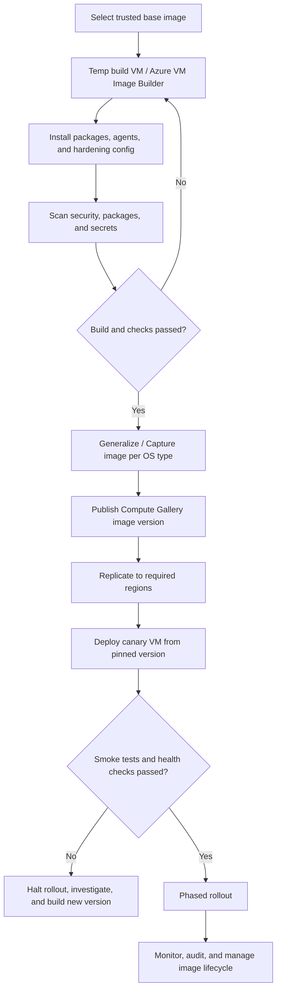

# Images, Azure Compute Gallery, and Virtual Machine Standardization

In the **CLOUD_PROVIDERS_AZURE** module, learners explore the Microsoft Azure ecosystem from subscriptions, resource groups, and Microsoft Entra ID to virtual networking, compute services, storage, and data. The goal is to know how to deploy, monitor, protect, and control the cost of an application architecture on Azure. In the **Azure Virtual Machines** chapter, designing **VM images** and managing them via **Azure Compute Gallery** is a foundational practice for creating consistent, version-traceable, and repeatably deployable virtual machines.

Suppose a company operates 60 Linux VMs for an ordering system across two Azure regions. If administrators install each machine manually, VMs can end up with different library versions, security configurations, monitoring agents, and patches. When recovery or scaling is needed, it becomes very difficult to know which machine was built from which configuration. **Golden images** solve that problem: standardizing the VM foundation into a tested, versioned build so new machines use an approved artifact.

After this lesson, you will be able to:

- Distinguish between **Marketplace images**, **managed images**, **Azure Compute Gallery images**, **disks**, and **snapshots**.
- Explain **generalized images** and **specialized images**, along with the risks of cloning machine identity.
- Design the **gallery → image definition → image version** hierarchy, target replication regions, sharing permissions, and version lifecycle.
- Build a **golden image** workflow: selecting trusted sources, hardening, building, testing, publishing, canary rollout, and rollback.
- Understand illustrative Azure CLI steps to create a gallery, image definition, image version, and a VM from a pinned version.
- Identify common configuration errors and factors affecting cost, security, and operations.

## 1. What Is a VM Image?

A **VM image** is an initialization source used to create the operating system and initial components for one or more virtual machines. An image can contain the operating system, system tools, base applications, and preconfigured settings. When deploying a new VM, Azure creates the appropriate resources such as the OS disk from the image and performs provisioning according to the image type.

One way to visualize it:

```text
OS source + standardized base configuration
                  |
                  v
            VM image version 1.3.0
                  |
          +-------+-------+
          |       |       |
          v       v       v
         VM A    VM B    VM C
          |       |       |
      Each VM has its own disk, identity, and runtime config
```

VMs created from the same image version start with a **matching initial state** but are not the same VM: they each have their own disk resources, hostname, identity, NIC, change history, and runtime data after provisioning.

An image is not a mechanism that automatically updates every VM deployed from it. If you publish image `1.3.1`, running VMs built from `1.3.0` **do not automatically replace their OS disks** just because the gallery has a new version. You need an update/rollout process or an image upgrade mechanism supported by the deployment service.

### 1.1. Distinguishing Images, Disks, Snapshots, and Backups

| Concept | Purpose | Key points to remember |
|---|---|---|
| **Marketplace image** | OS/application image provided by publishers via Azure Marketplace | Must pick the right publisher/offer/SKU/version and review licensing terms |
| **Managed image** | Azure image resource containing a source for creating VMs | Simple packaging, but centralized distribution/versioning is more limited than a gallery |
| **Azure Compute Gallery image version** | Versioned published image artifact that can be replicated to target regions | Ideal for building a golden image catalog across environments/regions |
| **Managed disk** | Block storage disk attached to a VM | Holds mutable data while the VM runs; not a release catalog |
| **Snapshot** | Point-in-time copy of a single disk | Useful for certain backup/copy workflows, but not a governed golden image on its own |
| **Azure Backup** | Policy-driven backup/recovery mechanism for supported workloads | Used for data/system recovery; must not be replaced by merely keeping images |

**An image is a deployment template, not a business data backup.** Creating a VM from an image does not recover transactions or application state created after the image was captured. Systems with databases or user data require a separate backup policy.

### 1.2. What Should and Should Not Go into a Golden Image

Should include:

- Operating system and patches within a tested release scope.
- Common runtime packages, dependencies, hardening configurations, and appropriate management/monitoring tools.
- Repeatable baseline settings, such as audit policies, service agents, time-sync configuration, and trusted package repositories.
- Build and software component metadata (e.g., a manifest or version tracked in the pipeline).

Should not include:

- Environment-specific passwords, access tokens, SSH private keys, client secrets, or storage account keys.
- Customer data, database dumps, or personal certificates not meant for broad distribution.
- Machine IDs, sample user accounts, host keys, or VM-bound tasks that generalization is meant to strip.
- Hardcoded static IPs, domain/hostnames, or private endpoint bindings incompatible with multi-environment deployment.

Some configuration is applied **after VM creation** via cloud-init, Azure VM extensions, Configuration Management, or pipelines/IaC; do not try to bake every environment difference into a single image.

## 2. Generalized Images vs. Specialized Images

Azure distinguishes two OS states for an image source:

### 2.1. Generalized

A **generalized image** has been prepared to strip machine-specific information from the source VM, allowing Azure to provision each clone as a fresh machine. When using this type, the VM creation flow can typically configure the hostname, admin account, or SSH keys in ways supported by the OS and Azure.

Platform workflow examples:

| Operating system | Common in-guest step | Notes |
|---|---|---|
| **Windows** | Run **Sysprep** with generalize, OOBE, and shutdown options per Azure guidance | Verify application Sysprep compatibility, licensing, domain membership, and startup services |
| **Linux** | Run deprovisioning via the active provisioning tool, e.g., Azure Linux Agent (`waagent`) in supported setups | Exact commands depend on the distribution, Azure Linux Agent/cloud-init, and provisioning mode |

**Generalization does not guarantee automatic removal of all sensitive data.** You must still audit secrets, private keys, logs, artifacts, user data, and agents/applications carrying unique IDs before capturing the image.

A critical operational detail: once a source VM is marked **generalized** in Azure, do not treat it as a normal VM to boot back up for further edits. Use a **temporary build VM**, capture all changes in scripts/IaC, and spin up a fresh build VM whenever the image needs changes.

### 2.2. Specialized

A **specialized image** preserves the configured OS/machine state, retaining much of the source VM's identity and provisioning details. Certain scenarios requiring exact replication of an existing OS state can use specialized images, depending on deployment capabilities.

However, a specialized image is **unsuitable as a mass golden image** if it carries over hostnames, accounts, machine identities, keys, and settings that must be unique per VM. Uncontrolled cloning of a specialized machine can trigger identity collisions, conflicts with domains or monitoring systems, and secret exposure.

| Criterion | Generalized | Specialized |
|---|---|---|
| Goal | Create new VMs with individualized provisioning | Recreate a machine from an existing OS state |
| Machine-specific state handling | Prepared to strip information requiring generalization | Retains machine-specific configuration |
| Creating multiple VMs from one source | Generally suitable with a secure build process | Requires careful assessment of identity conflicts and secrets |
| Account/hostname provisioning | Follows the generalized VM flow | Varies by service; does not behave like generalized |
| When to consider | Golden images for app teams, VMSS | Niche stateful workloads evaluated for safety |

**The OS state configured on the image definition must match the image/version source.** Never declare `Generalized` just for a more convenient VM creation flow if the VM was not actually generalized.

## 3. What Is Azure Compute Gallery?

**Azure Compute Gallery** (formerly known as *Shared Image Gallery*) helps organizations **store, share, organize, and distribute** images and certain other compute artifacts according to service capabilities. Within this lesson, we focus on VM images.

Core hierarchy:

```text
Azure Compute Gallery: gal-platform-prod
|
+-- Image definition: ubuntu-java-api
|    |-- Publisher: ExampleCorp
|    |-- Offer: JavaPlatform
|    |-- SKU: Ubuntu2204LTS
|    |-- OS type: Linux
|    |-- OS state: Generalized
|    |-- Hyper-V generation / architecture / features ...
|    |
|    +-- Image version: 1.0.0
|    +-- Image version: 1.1.0
|    +-- Image version: 1.1.1
|
+-- Image definition: windows-dotnet-worker
     +-- Image version: 2.0.0
     +-- Image version: 2.1.0
```

Three levels to distinguish:

1. **Gallery:** logical container for image definitions and versions, providing centralized management, sharing, and permissions.
2. **Image definition:** defines an *image product line* with metadata and key deployment attributes.
3. **Image version:** a specific release of an image definition, holding the OS disk source and optional data disks along with distribution/replication settings.

### 3.1. What Does an Image Definition Define?

An image definition typically contains:

- **Publisher / Offer / SKU:** organization-defined identifiers for the image line, distinguishing OS, workload, or configuration tiers.
- **OS type:** Windows or Linux.
- **OS state:** Generalized or Specialized.
- **Hyper-V generation:** Gen1/Gen2 depending on source and needs; modern features may require Gen2.
- **Architecture**, supported features, and additional metadata as appropriate for the API/image type.
- **Recommended VM vCPU/memory** or related constraints where supported.

Not all attributes on an image definition are automatically inferred correctly from its name. For instance, naming it `ubuntu-java-api` does not guarantee the source image is actually Linux, Gen2, or properly deprovisioned. Your pipeline must verify compatibility attributes.

### 3.2. An Image Version Is a Release

Image versions follow **`Major.Minor.Patch`** formatting, e.g., `1.4.2`. Versioning conventions should communicate what changed:

| Change type | Example | Reference versioning practice |
|---|---|---|
| Major runtime or OS baseline shift | OS platform upgrade or breaking runtime change | Increment major; possibly create a new image definition if core attributes differ |
| Controlled package/runtime upgrade | Updating Java LTS or monitoring agent | Increment minor per convention |
| Security patch / minor fix | OS package update or small config fix | Increment patch |

This is an **internal release convention**, not an Azure-enforced semantic rule for the three numbers. Azure uses the numbers to identify versions; your organization is responsible for publishing changelogs and managing compatibility.

A version is a traceable deployment artifact. When contents change, **publish a new version** instead of treating an image version like a mutable disk. This practice enables comparison, rollback when needed, and auditing the provenance of every VM.

## 4. Choosing Marketplace, Managed Image, or Azure Compute Gallery

| Criterion | Marketplace | Managed image | Azure Compute Gallery |
|---|---|---|---|
| Source | Published by vendor/publisher | Created/captured by organization | Versioned releases published from supported sources |
| Custom baseline management | Limited to prebuilt image; customized later | Yes | Yes, suitable for a catalog |
| Custom workflow versioning | Uses publisher versions | Must organize metadata and resources manually | Explicit image definition/version structure |
| Multi-region distribution | Depends on publisher/Marketplace availability | Typically scoped to a resource/region, needing extra scripts | Built-in target regions/replication within service scope |
| Internal sharing | Subject to Marketplace/RBAC and subscription terms | Based on resource and supported mechanisms | Supports sharing models tailored to organizational needs |
| Best suited for | Direct standard OS usage or pipeline inputs | Simple scenarios, intermediate build artifacts | Multiple workloads, environments, regions, and admin teams |

If you are deploying a single test VM, a Marketplace image may suffice. If an enterprise needs a **consistent VM standard across multiple teams**, Azure Compute Gallery provides better governance over versioning, replication, access control, and lifecycle. However, a gallery also adds cost, permissions management, and operational processes; do not create a gallery just to park a one-off snapshot with no usage plan.

## 5. Golden Images: What Should Be Standardized?

A **golden image** is an image approved by the company as a deployment source. “Golden” is not a distinct Azure resource type, nor does it guarantee security automatically. Its value lies in a **repeatable build and testing process**.

A Linux baseline for a Java application might include:

| Item | Sample content | Pre-release check |
|---|---|---|
| Operating system | Supported Linux LTS release | OS version, kernel, and security patches |
| Runtime | Approved Java version | Version, dependent libraries, licensing |
| Agents | Azure VM Agent, appropriate monitoring/security agents | Agents running cleanly, no sample credentials |
| Hardening | Disable unused services, configure auditing, SSH policy | Config compliance, open ports, internal benchmarks |
| Accounts | No leftover debug accounts or build passwords | Account audit and provisioning checks |
| Logs/temp | Scrub build data, sensitive logs, tokens, and temp files | Post-deprovision inspection |
| Configuration | Bake only shared baseline config; supply env config at bootstrap | Same image runs across dev/test/prod |
| Testing | Boot, SSH/RDP, networking, application smoke test | Test a freshly provisioned VM from the image |

The core principle: **bake components that change infrequently and are shared across many VMs**, while supplying environment-specific parameters at deployment time. For example, the Java runtime belongs in the image when governed by a release cycle; database URLs, API tokens, and connection secrets should come from the target environment's configuration, managed identity, and Key Vault.

### 5.1. Avoiding “Configuration Drift”

**Configuration drift** occurs when post-deployment VMs are modified directly, diverging from the baseline. For instance, Team A installs an extra package via SSH on production VMs but forgets to update the image pipeline; when autoscaling or replacing instances, new VMs lack that package.

Ways to reduce drift:

- Use **Infrastructure as Code** for VMs, networking, disks, identities, and extensions.
- Use pipelines and idempotent scripts to build golden images.
- Restrict manual changes on production VMs; if an emergency hotfix is applied, update source code and rebuild the image.
- Adopt **immutable deployment** where appropriate: replace VMs with fresh VMs from an approved image version rather than endlessly patching an aging VM.
- Periodically audit running image versions and patch status across the fleet.

## 6. Standard Image Build and Release Workflow

A secure pipeline can be broken into stages:



Not every step is handled by the same tool. An organization might combine:

- **Azure VM Image Builder** for automated image builds from declared sources and scripts/customizers.
- **Azure Compute Gallery** for storing, versioning, sharing, and replicating published builds.
- **Bicep/ARM/Terraform** to provision infrastructure and deploy VMs/VM Scale Sets.
- **Azure Policy, Microsoft Defender for Cloud, Azure Monitor**, and configuration compliance tools to detect violations and monitor post-deployment state.

Azure VM Image Builder automates many build tasks, but it **does not replace security testing, base image governance, and approval gates**.

### 6.1. Choosing the Source Image

When using Marketplace, select a specific publisher, offer, SKU, and version. An alias like `UbuntuLTS` may be convenient for experiments, but it does not offer the traceability of pinning an exact version in a pipeline.

Verify:

- The OS is within its support window and patching schedule.
- Trusted publisher; Marketplace plan/licensing terms and usage rights.
- Supported CPU architecture, Hyper-V generation, and VM sizes.
- Compatibility of Azure VM Agent/cloud-init, network drivers, and extensions.
- Secure Boot, vTPM, and **Trusted Launch** settings matching requirements and image/VM size constraints.

### 6.2. Repeatable Builds

Package installation scripts must pin versions or point to trusted repositories. Ideally, builds start from an explicit source image and run unattended. Do not manually sign in to “tweak one more thing” and capture an image without a changelog.

If the pipeline downloads external artifacts, verify checksums/signatures, control outbound network access, and never leave download tokens or private keys on the final OS disk.

### 6.3. Generalize and Capture

After installing and validating the build, generalization and capture must match Windows or Linux, the provisioning method, and the source state. **Never run this directly on a live production VM serving users**: generalization renders the source VM unusable for normal operation.

For Linux using the Azure Linux Agent, some workflows run `waagent -deprovision+user` before marking the VM `generalized`. For distros using **cloud-init** or other provisioning mechanisms, follow their official instructions to avoid boot failures on new VMs. For Windows, run **Sysprep** and ensure applications/services are compatible. In both cases, scrubbing secrets, user-specific keys, and sensitive logs remains an explicit pipeline responsibility.

### 6.4. Test Newly Provisioned VMs, Not Just the Build VM

A healthy build VM does not prove the captured image deploys properly. **Create a brand-new VM from the image version** in a test environment to catch:

- VM provisioning timeouts or failures caused by improper generalization.
- Cloud-init/agent or extension failures after boot.
- Failure to inject a new hostname, SSH key, or user account.
- Leftover references to old networks, domains, regions, or secrets.
- Application services failing to start, or missing packages/drivers.
- Incompatible Secure Boot/Trusted Launch/Hyper-V settings.

Promote to production only after newly provisioned VMs pass smoke tests and security checks.

## 7. Distributing Image Versions Across Multiple Azure Regions

Once an image version is published to Azure Compute Gallery, you can configure **target regions** so Azure creates replicas ready for deployment in those locations. This is especially valuable when organizations deploy VMs or VM Scale Sets across multiple regions.

Example:

```text
Gallery: gal-platform-prod
Image definition: ubuntu-java-api
Version: 1.4.2
        |
        +-- Southeast Asia: 2 replicas (illustrative)
        |
        +-- East Asia:      1 replica  (illustrative)
        |
        +-- Australia East: 1 replica  (illustrative)
```

Replica counts in the example are hypothetical planning numbers, not mandatory settings. Choose counts based on concurrent deployment volume, scale, rollout timing, and service limits per region.

### 7.1. Why Use Replication?

- **Deployment speed:** VMs in a target region can pull from an image version distributed locally rather than relying on a single remote resource.
- **Scale concurrency:** multiple replicas can support creating many VMs simultaneously, depending on deployment capacity.
- **Multi-region architecture:** the same approved baseline can serve standby/DR environments alongside region-specific configuration.
- **Release governance:** a single tracked image version spans multiple regions.

Replication **does not** automatically give an application workload HA or DR. You still need load balancing, DNS/failover, data backups, VM SKU availability, quotas, and a regional recovery strategy. Replicating an image to a new region does not move existing VMs' user data there either.

### 7.2. What to Verify

- Whether the target region supports the image type, Hyper-V generation, and target VM sizes.
- Whether the image version has finished replicating to the region before starting a large rollout.
- Whether replica counts and image storage settings fit deployment speed needs and budget.
- If the image uses encryption settings, Trusted Launch, or specialized features, whether the target region and VMs satisfy all prerequisites.
- Whether the gallery or image version has appropriate **sharing permissions** for the target subscription/tenant.

**Cost:** replicating many image versions to multiple regions increases stored image data and can incur associated storage and replication charges. Retaining every old version across every region indefinitely can steadily inflate costs without proportional rollback value.

## 8. Governing Gallery Access and Sharing

Azure Compute Gallery supports various sharing approaches within Azure's scope, such as **Azure RBAC** for resource access, direct sharing, or community sharing depending on features and conditions. For internal enterprise systems, prioritize **controlled sharing** rather than exposing images containing proprietary configuration publicly.

Common scenarios:

| Scenario | Reference design |
|---|---|
| Platform team builds and approves images | Grant create/edit permissions on image definitions/versions strictly to the pipeline and release team |
| App teams deploy VMs from images | Grant only read/deploy access needed for images; disallow deleting or overwriting versions |
| Shared across multiple subscriptions in one org | Configure RBAC and sharing matching the gallery structure; verify resource IDs and target subscriptions |
| Sharing across tenants or external orgs | Evaluate supported sharing modes, security, licensing terms, and ownership boundaries |
| Public/community gallery | Consider only when intending to publish an artifact publicly after completing content review |

Note: **Reader access on a gallery does not equal full permission to create VMs in a target subscription**. Deployers still need permissions to create VMs, NICs, disks, and related resources, adequate quotas, and properly scoped image sharing. Certain sharing modes enforce extra rules not obvious from role assignments alone.

Images can contain internal tooling, configuration details, or licensed software components. Before sharing, check **software redistribution rights**, sensitive data exposure, and image compliance. Never use community sharing as a shortcut to make internal pipeline downloads “easier.”

### 8.1. Principle of Least Privilege

- Build pipeline identities only get permissions required to build images and publish versions.
- Deployment identities only get permissions to read images/versions and provision infrastructure in target scopes.
- Auditors get read access to metadata, logs, and release info without modifying artifacts.
- Deleting versions, altering sharing, or changing encryption configurations requires approver sign-off.
- Enable administrative activity logging (Azure Activity Log) and monitor RBAC permission changes.

For workloads running in Azure, a **managed identity** is a suitable option for pipelines or supporting services to reduce stored client secrets. Remember that the managed identity used to *access the gallery* is separate from the managed identity *assigned to VMs created from the image*: the two identities serve different purposes and lifecycles.

## 9. Azure CLI Walkthrough: Creating a Gallery and Publishing a Version

Commands in this section target **Bash** with Azure CLI in an approved environment. This is an **illustrative walkthrough**, not a complete production deployment script. These steps require an existing resource group, proper permissions, and sufficient quota. Never run generalization commands on a VM serving live users.

Scenario: the platform team has built and tested a **generalized managed image** of Ubuntu with required runtimes and security agents. Now they want to publish it as version `1.2.0` in an Azure Compute Gallery.

### 9.1. Verify Subscription and Variables

```bash
az account show --output table
az account set --subscription "<subscription-id>"

RG="rg-platform-images-dev"
LOCATION="southeastasia"
GALLERY="galplatformdev"
IMAGE_DEF="ubuntu-java-api"
VERSION="1.2.0"
MANAGED_IMAGE_NAME="img-ubuntu-java-api-120"
```

Assumes the resource group already exists. Gallery and definition names must follow Azure naming rules and avoid conflicts within scope. Never put tokens, passwords, or customer names into resource names or tags.

### 9.2. Inspect the Source Managed Image Before Publishing

```bash
az image show \
  --resource-group "$RG" \
  --name "$MANAGED_IMAGE_NAME" \
  --query "{id:id,location:location,osType:storageProfile.osDisk.osType,osState:storageProfile.osDisk.osState,hyperVGeneration:hyperVGeneration}" \
  --output json

IMAGE_ID=$(az image show \
  --resource-group "$RG" \
  --name "$MANAGED_IMAGE_NAME" \
  --query id --output tsv)
```

Expected checks: the image is Linux, `Generalized`, and matches the Hyper-V generation/architecture of the image definition you plan to create. If attributes mismatch, **stop** and fix the build process or definition; do not try to mask mismatches in metadata.

### 9.3. Create an Azure Compute Gallery

```bash
az sig create \
  --resource-group "$RG" \
  --gallery-name "$GALLERY" \
  --location "$LOCATION"
```

`az sig` is the Azure CLI command group for image galleries, kept for compatibility with the legacy name *Shared Image Gallery*.

Verify the gallery:

```bash
az sig show \
  --resource-group "$RG" \
  --gallery-name "$GALLERY" \
  --output json
```

### 9.4. Create an Image Definition

```bash
az sig image-definition create \
  --resource-group "$RG" \
  --gallery-name "$GALLERY" \
  --gallery-image-definition "$IMAGE_DEF" \
  --publisher "ExampleCorp" \
  --offer "JavaPlatform" \
  --sku "Ubuntu2204LTS" \
  --os-type Linux \
  --os-state Generalized \
  --hyper-v-generation V2
```

This example assumes the source managed image uses **Hyper-V Generation V2**. If the source uses Gen1, create a matching definition instead of leaving `V2` by habit. `publisher`, `offer`, and `sku` here are internal example metadata for the image line, not a claim that the build was published by Canonical or Microsoft.

Verify the image definition:

```bash
az sig image-definition show \
  --resource-group "$RG" \
  --gallery-name "$GALLERY" \
  --gallery-image-definition "$IMAGE_DEF" \
  --output json
```

### 9.5. Publish an Image Version from the Managed Image

```bash
az sig image-version create \
  --resource-group "$RG" \
  --gallery-name "$GALLERY" \
  --gallery-image-definition "$IMAGE_DEF" \
  --gallery-image-version "$VERSION" \
  --managed-image "$IMAGE_ID" \
  --target-regions southeastasia eastasia \
  --replica-count 1
```

This command publishes and replicates a version to the illustrative target regions. In production, verify parameters supported by your CLI/API version, source image location, encryption settings, quotas, and replication status. Never launch a fleet-wide rollout before the version finishes replicating in the target region.

Inspect the version:

```bash
az sig image-version show \
  --resource-group "$RG" \
  --gallery-name "$GALLERY" \
  --gallery-image-definition "$IMAGE_DEF" \
  --gallery-image-version "$VERSION" \
  --output json

VERSION_ID=$(az sig image-version show \
  --resource-group "$RG" \
  --gallery-name "$GALLERY" \
  --gallery-image-definition "$IMAGE_DEF" \
  --gallery-image-version "$VERSION" \
  --query id --output tsv)
```

Use the published **image version Azure Resource ID** for exact provenance of the deployment source.

### 9.6. Create a Test VM from the Pinned Version

Assuming a workload resource group, VNet, and test subnet exist and the deployer has permissions to read the gallery/image and create VMs:

```bash
VM_RG="rg-orders-test"
VM_NAME="vm-orders-canary-01"
VNET_NAME="vnet-orders-test"
SUBNET_NAME="snet-app"

az vm create \
  --resource-group "$VM_RG" \
  --name "$VM_NAME" \
  --image "$VERSION_ID" \
  --size "Standard_D2s_v5" \
  --admin-username "azureuser" \
  --ssh-key-values "$HOME/.ssh/id_ed25519.pub" \
  --vnet-name "$VNET_NAME" \
  --subnet "$SUBNET_NAME" \
  --public-ip-address ""
```

This example creates a Linux VM with no public IP. The VM size, deployment region, image generation, and network infrastructure must be compatible. The public key path is illustrative: in real deployments, use **securely managed public keys** and private access paths tailored to your operations team.

After VM creation, verify cloud-init/agents, packages, security posture, application services, and network connectivity. If environment-specific config is needed, inject it via approved pipelines/extensions; **do not** modify a published golden image version directly for a “quick fix.”

### 9.7. Record Which Image Version a VM Uses

During incident investigation or fleet inventory, inspect the VM's image version reference:

```bash
az vm show \
  --resource-group "$VM_RG" \
  --name "$VM_NAME" \
  --query "{name:name,location:location,imageReference:storageProfile.imageReference}" \
  --output json
```

Depending on image source types or deployment methods, `imageReference` metadata may be represented differently. For reliable traceability, record the **gallery version resource ID** in IaC/release manifests and apply tags such as `imageFamily` and `imageVersion` onto VMs at deployment time.

## 10. Manual Workflow: Creating a Generalized Managed Image from a Build VM

When not using Azure VM Image Builder, you can spin up a temporary build VM from a trusted source, install the baseline, **generalize** it, and capture a managed image. This process has irreversible effects on the source VM once generalized; never run it on a production VM.

Illustrative Linux path:

1. Create an isolated build VM in a temporary resource group.
2. Install and verify packages, security agents, and configurations.
3. Scrub machine-specific data and deprovision inside the guest using the distro's supported tool.
4. End the session on the source VM; deallocate the VM.
5. Mark the VM as generalized in Azure.
6. Capture a managed image from the source, then publish a Compute Gallery version as shown earlier.

On Linux with the Azure Linux Agent in a supported environment, deprovisioning **may** involve:

```bash
# Run inside the temporary build VM guest; never run on a production VM.
# Verify distro documentation, waagent/cloud-init behavior, and patches first.
sudo waagent -deprovision+user -force
```

Then run from an admin workstation using Azure CLI against the prepared VM:

```bash
BUILD_RG="rg-image-build-dev"
BUILD_VM="vm-image-builder-01"

az vm deallocate \
  --resource-group "$BUILD_RG" \
  --name "$BUILD_VM"

az vm generalize \
  --resource-group "$BUILD_RG" \
  --name "$BUILD_VM"
```

Once `az vm generalize` completes, **do not boot the source VM back up for continued use**. The source resource is now ready to be captured:

```bash
az image create \
  --resource-group "$BUILD_RG" \
  --name "img-ubuntu-java-api-120" \
  --source "$BUILD_VM" \
  --location "southeastasia"
```

In this example, the managed image resides in `BUILD_RG`, so when running section 9 commands, adjust `RG` or pass the **exact Resource ID of the source managed image**. Do not assume the image name will appear in the gallery's resource group if created elsewhere.

**Windows differs from Linux:** to build a generalized Windows image, prepare Windows per application vendor guidance and run **Sysprep** (generalize, OOBE, shutdown) before running the Azure deallocate/generalize steps. Never run `waagent` on Windows.

These commands only illustrate the workflow skeleton; production pipelines must select the right agent/provisioning mode, OS prerequisites, disk encryption handling, and source-specific steps. Azure VM Image Builder is usually preferable for repeated builds because steps are codified into a pipeline, avoiding manual steps and reducing human error.

## 11. Versioning and Image Lifecycle Management

Once image `1.2.0` is published, the platform team may build `1.2.1` to address a security patch. It is crucial to track **which versions are approved for deployment**, which versions running VMs currently use, and when older versions can be retired.

A reference lifecycle:

```text
Draft / Build
     |
     v
Candidate (1.2.1) -- security scan, boot test, application test
     |
     v
Approved for test -- deploy to staging / canary
     |
     v
Approved for production -- phased rollout
     |
     v
Superseded -- gradually replaced by newer version
     |
     v
End of life -- inventory dependencies before deletion
```

These statuses are **internal governance conventions**; not all of them exist as automated built-in statuses in Azure Compute Gallery. You can combine metadata, tags, release manifests, excluding versions from `latest`, end-of-life fields, and release management tools to implement this workflow.

### 11.1. Pinning Fixed Versions Instead of “latest”

Suppose yesterday's pipeline created a VM using `latest` and received image `1.2.0`. Today the platform team publishes `1.2.1`; the exact same unmodified template can deploy new VMs from the newer version.

This causes **lack of reproducibility** during incident investigation:

- One production VM runs `1.2.0`.
- A replacement VM created after a failure runs `1.2.1`.
- Two VMs differ in patches/agents despite sharing the same pipeline.

For critical workloads, **pin the image version resource ID** in IaC or release manifests and bump versions through reviewed pull requests. Using `latest` can be convenient for test environments or pipelines intentionally accepting automatic updates, provided you understand the source changes dynamically.

### 11.2. Exclude from Latest and End-of-Life

Azure Compute Gallery supports publishing metadata/settings for **excluding a version from `latest` resolution** and setting an **end-of-life date** per image version capabilities. These help tooling select appropriate images and surface governance warnings.

**Do not treat end-of-life metadata as an automatic mechanism that swaps VM OS disks or deletes artifacts on schedule.** A version marked end-of-life must still be managed based on actual usage, replica states, and deletion constraints. Never delete a version while VMSS models, pipelines, templates, or recovery plans still reference it.

### 11.3. Impact of Deleting an Image Version

Deleting an image version generally **does not cause already deployed VMs to lose their OS disks**, since each VM owns its disk resource. However, it can break:

- Scale-out pipelines creating new VMs from that version.
- VM Scale Sets or templates replacing instances referencing the deleted source.
- Disaster recovery playbooks provisioning new VMs from an older known-good build.
- Audit processes needing to reproduce historical baselines.

Before purging versions, inventory dependencies and define a retention window supporting rollback, audits, and DR. Retaining a defined number of stable historical versions per policy is better than keeping every experimental build forever.

## 12. Canary Deployment, Rollout, and Rollback

**Canary deployment** rolls out a new image to a few VMs or a small slice of traffic to validate behavior before updating the entire fleet.

Example for a 60-VM fleet:

| Stage | Illustrative VM count | Goal |
|---|---:|---|
| Build/test | 1–2 fresh VMs | Verify provisioning, agents, security, and application |
| Canary | 2–3 VMs | Observe real errors under limited traffic |
| Rollout wave 1 | 10 VMs | Validate operations at small scale |
| Rollout wave 2 | 20 VMs | Confirm autoscaling, logs, and health |
| Remaining rollout | Approved remaining VMs | Complete version transition |

Counts in the table are illustrative. Real plans must reflect topology, SLAs, load balancer setup, availability zones, capacity/quota, session draining, and change risk.

### 12.1. What to Verify During Canary?

1. **Provisioning:** VMs deploy cleanly from the image version; OS boots; guest agent/cloud-init are ready.
2. **Identity:** hostnames, SSH keys, local users, managed identities, and certificates are provisioned uniquely and accurately.
3. **Networking:** NICs, DNS, NSGs, routing, private endpoints, firewalls, and required outbound services work.
4. **Application:** runtimes, packages, background services, readiness/liveness probes, startup time, and request handling.
5. **Security:** vulnerability scans, hardening baseline, disk encryption/Trusted Launch per design, no embedded secrets.
6. **Observability:** Azure Monitor, logs, alerts, and agents report to the right environment.
7. **Performance:** CPU, memory, I/O, latency, and behavior under load.

**Canary checks more than “did the VM create?”** A VM that boots while its agent fails to register or the app cannot reach its database is not production-ready.

### 12.2. Proper Rollback

Suppose after rolling out `1.2.1`, the system hits errors due to an incompatible package. Rollback can be executed by **redeploying instances from the approved `1.2.0` version** and shifting traffic back per procedure. For VMSS, how images upgrade/downgrade and instances get replaced depends on orchestration mode, upgrade policy, and service configuration; never assume changing `imageReference` automatically reverts all running VMs.

Image rollback **does not automatically roll back database schemas, data, or external service configurations**. If a release includes migrations, prepare backward-compatibility or a separate data recovery plan.

A rollback runbook should specify:

- The previous stable version and exact Resource ID.
- The active IaC manifest/commit.
- Rollback trigger criteria (error rate, health probes, latency, security alerts).
- How to drain/reroute traffic without dropping requests.
- How to handle disks holding local data or stateful workloads.
- Approvers, recovery time target, and post-rollback verification steps.

### 12.3. What About VM Scale Sets?

**Azure Virtual Machine Scale Sets (VMSS)** can deploy many VMs from an image gallery and support OS image upgrade capabilities depending on the VMSS model, orchestration mode, upgrade policy, health monitoring, and supported conditions.

Organizations should design:

- Explicit source versions for the scale set model.
- Instance replacement, rolling upgrade, and health probe mechanisms.
- Minimum healthy capacity rules during upgrades.
- Whether automatic OS image upgrades are supported and appropriate in the specific architecture; never enable by guesswork.
- Post-upgrade verification plans for extensions/agents and applications.

VMSS simplifies fleet management compared to standalone VMs for certain workloads, but image compatibility and upgrade behavior must be verified upfront.

## 13. Securing the Image Supply Chain

A golden image underpins dozens or hundreds of VMs. If an image carries malware or embedded secrets, the blast radius spans the entire fleet deployed from that version.

### 13.1. Protecting the Build Pipeline

- Choose base images from trusted publishers; check licensing, package repositories, and versions.
- Run builds in an access-controlled pipeline isolated from production application environments.
- Restrict outbound network access from the build VM to approved package sources and verify artifact integrity where applicable.
- Avoid long-lived credentials in scripts, cloud-init, logs, or the build VM's disk.
- Run security scans/vulnerability assessments and review findings before publishing.

### 13.2. Scrubbing Source-VM Artifacts

Items to audit before capture:

| Category | Risk if left inside the image |
|---|---|
| SSH private keys, API tokens, client secrets | Every new VM inherits the same credential |
| Machine ID, host keys, domain join state | Cloned VMs suffer identity collisions or misidentification |
| Debug accounts, default passwords | Creates unauthorized access backdoors |
| Files, logs, caches with customer data | Leaks sensitive data across environments |
| Agent registration/unique tokens | New VMs report under a single identity in management tools |
| Hardcoded IP/DNS addresses | New VMs connect to the wrong environment or lose connectivity |

Generalization is essential, **not a substitute for auditing build inputs**. On Windows, certain apps or agents require specialized prep before Sysprep. On Linux, distributions handle cloud-init and `systemd` machine-id differently; follow supported deprovisioning procedures rather than deleting system files blindly without knowing their role.

### 13.3. Trusted Launch, Disk Encryption, and Sharing Permissions

If organizational policy mandates Secure Boot/vTPM/Trusted Launch, choose compatible image definitions, VM generations, and sizes; do not label an image “Trusted Launch-ready” based on its name alone. OS/data disk encryption, Disk Encryption Sets, or customer-managed keys (if used) must also be accounted for when distributing images across regions or subscriptions.

Never bake key material into an image. Newly created VMs should receive their own identities and fetch secrets via **Microsoft Entra ID / managed identity + Key Vault** under least privilege.

### 13.4. Version Provenance Auditing

Every published version should have a **release manifest** containing at least:

```yaml
imageFamily: ubuntu-java-api
imageVersion: 1.2.0
baseImage:
  publisher: ExamplePublisher
  offer: ExampleOffer
  sku: ExampleSku
  version: "pinned-source-version"
osType: Linux
osState: Generalized
buildPipelineCommit: "<git-commit>"
buildTimestampUtc: "<timestamp>"
securityBaseline: "<baseline-id>"
testedRegions:
  - southeastasia
  - eastasia
approvalTicket: "<change-id>"
```

This is an **illustrative release-governance manifest**, not a YAML file imported directly into Azure Compute Gallery. Store manifests in artifact management or source control; avoid putting sensitive credentials inside them.

## 14. Cost Control and Gallery Hygiene

Costs from building and operating golden images stem from:

| Category | Cost drivers |
|---|---|
| Build and test VMs | VM size, runtime duration, disk types, region |
| Managed images / image versions | Source OS/data disk sizes, storage options, version count |
| Replication | Number of target regions, replica counts, storage characteristics |
| Deployed VMs | VM size, OS/data disks, outbound traffic, snapshots/backups |
| Monitoring/security | Log ingestion, retention, vulnerability scanning, management agents/services |
| Release workflow | Canary VMs, rollbacks, test environments, build frequency |

There is no single fixed cost for every image version. Use the **Azure Pricing Calculator** and current pricing per region/SKU to estimate costs, and apply cost-allocation tags:

```text
workload=platform-images
environment=prod
owner=platform-team
imageFamily=ubuntu-java-api
releaseChannel=stable
```

Gallery tags are not always inherited automatically by VMs created from an image. When deploying a fleet, apply tags to the **actual VMs/resources** via IaC or Azure Policy as required.

### 14.1. Image Version Retention Policy

Example internal policy:

- Retain **currently running production versions** and versions required for scaling/DR.
- Retain the last **N stable production versions** for rollback within a defined retention window.
- Delete failed candidate/test versions once test evidence is archived.
- Alert when a version exceeds its retention age or has zero active references.
- Delete only after checking dependencies across VMSS, IaC, pipelines, and DR plans.

The value of N and retention days are governance decisions, not fixed Azure rules. Purging old versions lowers storage bills but reduces the ability to reproduce historical environments.

## 15. Common Deployment Errors

| Symptom | Possible causes | How to check |
|---|---|---|
| Cannot create VM from image | Missing gallery/version read access, wrong resource ID, or version not ready | RBAC, version/replication status, subscription/region |
| Image definition rejects source | Mismatched OS type/state, Hyper-V generation, architecture, or features | Metadata on managed image and gallery definition |
| VM created but provisioning fails | Improper Sysprep/deprovision, cloud-init/agent failure | Guest provisioning logs, OS docs, test a fresh VM |
| Cloned VMs have duplicate hostnames or IDs | Inappropriate specialized image or incomplete generalization | OS state, machine ID, hostname, agent registration |
| VM in another region cannot use version | Target region missing, replication incomplete, or unsupported | Target regions, publishing profile, replication status |
| Connectivity lost after boot | Hardcoded IP/DNS, NSG/UDR, broken extension/agent or bootstrap script | Network Watcher, VM boot diagnostics, and logs |
| Incompatible VM size | Image generation/architecture/features, SKU, or quota mismatch | Image metadata, regional size availability/quota |
| New VM has unexpected package versions | Build source unpinned or install script pulled “latest” | Release manifest, pipeline logs, package inventory |
| Image built but missing security agent | Agent installed on source VM post-capture or extension omitted from rollout | Image version pipeline, provisioning test, agent health |
| Costs rise with every release | Too many versions/replicas/regions, uncleaned build VMs | Version inventory, replicas, resource costs |
| VMSS fails to scale after version deletion | Scale set still references the deleted version | VMSS model, rollout manifest, version retention |
| New VMs lack secrets | Image rightly omits secrets, but bootstrap/identity unconfigured | Managed identity, Key Vault RBAC, cloud-init/extensions |

### 15.1. Sequential Investigation Workflow

1. **Identify the artifact:** exact gallery, image definition, version, and Resource ID.
2. **Check permissions and scope:** does the deployment principal have read access to the image and write access in the target subscription/resource group?
3. **Check compatibility:** OS type/state, architecture, Hyper-V generation, Trusted Launch, disk options, VM size.
4. **Check region:** has the image version replicated and become available in the target region?
5. **Check deployment:** deployment operations, ARM/CLI errors, quota, VM SKU availability.
6. **Check inside the guest:** boot diagnostics, Serial Console (where available), VM Agent, cloud-init/Sysprep logs, and application service status.
7. **Compare against release manifest:** package versions, base image, scripts, and build timestamp.
8. **Test a VM from the previous stable version:** helps isolate a new-image regression from platform/network issues.

Never “fix” provisioning by attaching overly privileged accounts or opening NSGs to the Internet in production without finding the root cause. When a golden image needs a fix, update the pipeline and publish a **new version** to preserve an audit trail.

## 16. Scenario Exercises

### Scenario A: Standardizing a Java VM Fleet

An enterprise runs 40 Linux VMs in Southeast Asia and 20 Linux VMs in East Asia. App teams require an identical Java runtime, monitoring agent, and security policy, while database configs and secrets differ across dev/test/prod.

**Tasks:**

1. Propose a gallery, image definition, and version structure for the Java machines.
2. Choose generalized vs. specialized images; explain why.
3. State what should be baked into the image versus configured after VM creation.
4. Design the pipeline: build → test → gallery → replica → canary → rollout.
5. Define how to pin versions in IaC to recreate production with the exact approved build.
6. List at least three risks and pre-deployment checks before rolling out to East Asia.

**Reference solution:** one gallery for the platform line aligned to governance boundaries, with definition `ubuntu-java-api` configured for Linux, Generalized, and matching generation/architecture. Publish version `1.2.0` and replicate to both regions. Bake the shared OS, runtime, agents, and hardening; inject secrets, DB endpoints, and managed identities at deploy time. Test fresh VMs in each region, pin the version Resource ID in IaC, and roll out in waves.

### Scenario B: A New Image Version Causes Failures

The platform team publishes `1.5.0`, and 10 canary VMs fail to start the Java service. Older VMs running `1.4.3` continue operating normally.

**Tasks:**

- Name the log and metadata sources to inspect.
- Propose criteria to halt rollout and steps to revert to a stable image version.
- Explain why flipping a `latest` tag does not automatically fix already created instances.
- List checks to prevent a similar regression in the next release.

**Reference solution:** halt rollout; inspect deployment/boot diagnostics, agent/cloud-init logs, package manifests, and application logs on `1.5.0`; keep traffic on `1.4.3` VMs and replace canary instances with fresh VMs from the stable version per runbook. Expand smoke tests/runtime compatibility checks and publish a new patched version only after fixing the root cause.

### Scenario C: Saving Costs While Preserving Recovery

A gallery holds 18 versions, each replicated to 4 regions; many are no longer used for new deployments. Finance asks to reduce storage costs without hurting scale-out or recovery capabilities.

**Tasks:** design an inventory table tracking which versions are actively referenced by VMs/VMSS, which regions must retain replicas, rollback/DR retention rules, and a deletion approval workflow. Explain why version creation date alone is insufficient to decide deletion.

## 17. Self-Check Questions

**1. Is an Azure Compute Gallery image version the same as a running VM's active OS disk?** No. The image is a source used to create new VMs/disks; each VM has its own working disk.

**2. Why should a golden image be generalized?** To create multiple fresh VMs with independent provisioning details and machine identities, where supported by the OS and workflow.

**3. How do an image definition and an image version differ?** A definition describes the image line and baseline attributes; a version is a concrete release used for deployment.

**4. When `1.2.1` is published, do VMs running `1.2.0` update automatically?** No; a supported rollout or upgrade process is required.

**5. Does replicating an image version back up VM application data across regions?** No. It distributes the deployment image; application data requires its own backup and DR protection.

**6. For reproducible deployments, should you use `latest` or a specific image version Resource ID?** Usually pin a specific version for critical workloads.

**7. What can a specialized image expose if cloned indiscriminately?** Machine identities, accounts, keys, configurations, and source-VM-specific data.

**8. What can break if an old image version is deleted while existing VMs are still running?** Scale-out pipelines, VMSS instance replacements, or DR workflows referencing that version.

## 18. Production Golden Image Deployment Checklist

- [ ] Selected a trusted Marketplace/base image, recording exact publisher/offer/SKU/version and license terms.
- [ ] Selected compatible OS type, OS state, Hyper-V generation, and architecture/features.
- [ ] Distinguished generalized vs. specialized clearly; never generalized a production VM.
- [ ] Built with repeatable scripts/IaC and version control for all changes.
- [ ] Verified packages, vulnerability scans, security baseline, agents, and absence of credentials/PII.
- [ ] Created gallery, image definition, and image version following naming/versioning conventions.
- [ ] Verified target regions, replication status, replica counts, and sharing permissions.
- [ ] Tested booting and provisioning **fresh** VMs from the version in every target region.
- [ ] Tested the app, monitoring, networking, DNS, managed identity, Key Vault, and security features.
- [ ] IaC/release manifests pin fixed image versions; any use of `latest` is explicitly documented.
- [ ] Planned canary, phased rollout, rollback, and stateful data handling.
- [ ] Established version retention/cleanup policies based on VMSS, pipeline, and DR dependencies.
- [ ] Estimated and monitored costs across build VMs, image versions, replicas, logs, and related resources.
- [ ] Enforced least-privilege permissions for builders, publishers, deployers, and auditors.

## Conclusion

A **VM image** packages the OS and baseline used to provision new virtual machines; **Azure Compute Gallery** provides the **gallery – image definition – image version** structure to organize, share, and distribute controlled builds. A **golden image** is the output of a repeatable build, hardening, testing, release, and maintenance workflow—not merely a snapshot of a running VM.

To standardize Azure VMs safely, use **generalized images** where supported by your deployment model, pin versions in IaC, test newly provisioned VMs, roll out via canary stages, manage multi-region replication and dependencies, keep secrets and user data out of images, and preserve rollback readiness. Combining image governance with Azure RBAC, Microsoft Entra ID, networking, monitoring, and cost control enables enterprises to operate consistent, auditable VM fleets.
