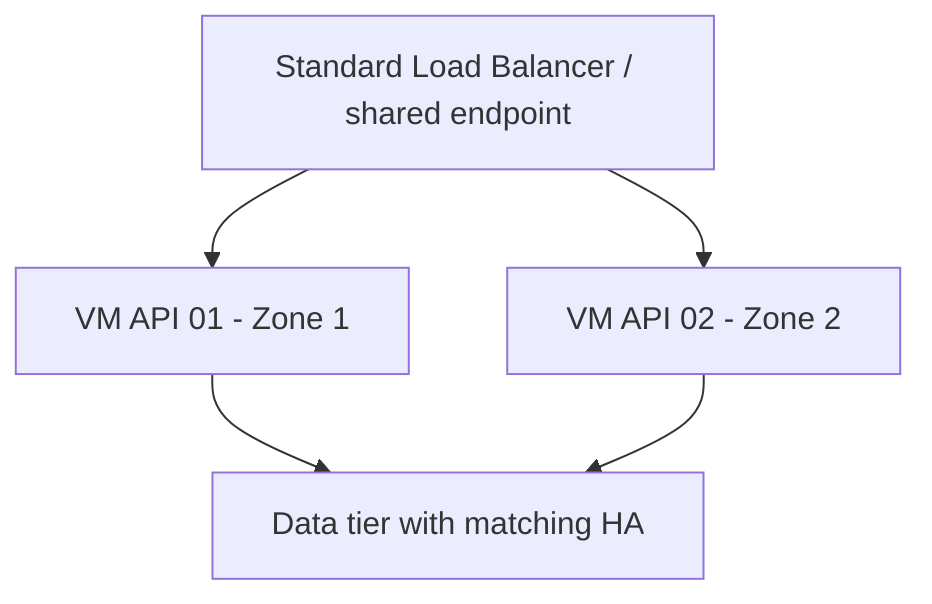
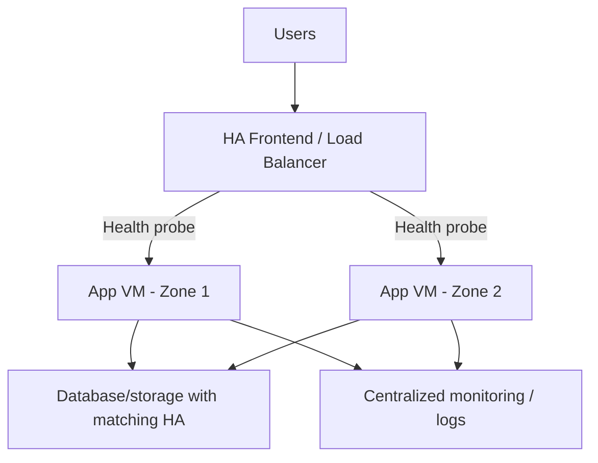

# Availability Sets and Zonal Virtual Machine Deployment

When running an application on an Azure virtual machine, the VM working today does not guarantee continuous service availability. Physical hosts can fail, infrastructure requires maintenance, a group of hardware in a data center can experience an outage, or even an entire **Availability Zone** can lose capacity. If the application has only a single instance, any failure at that point can make the service unreachable to users.

Azure provides multiple mechanisms to **distribute virtual machines across fault domains**, reducing the risk of a single infrastructure outage taking down the entire application. Two key options are **Availability Sets** and **Availability Zones**. They are not the same, do not replace backups, and do not automatically load-balance traffic across VMs.

This lesson belongs to the **Azure Virtual Machines** chapter in the **CLOUD_PROVIDERS_AZURE** module. In the broader Azure application architecture, choosing a high-availability model also ties into subscriptions, compute resources, VNets/subnets, load balancers, storage, security, monitoring, and cost.

## 1. Learning Objectives

After this lesson, you will be able to:

1. Distinguish **Availability Sets**, **fault domains (FDs)**, **update domains (UDs)**, **Availability Zones**, and **Azure regions**.
2. Explain to what extent Availability Sets reduce hardware/maintenance risk and what failure types Availability Zones protect against.
3. Choose the right architecture for single-zone, multi-zone, or multi-region applications.
4. Create Availability Sets and zone-pinned virtual machines via the Azure Portal or Azure CLI.
5. Understand constraints around VM sizes, disks, IPs, load balancing, zone availability, and quotas.
6. Design the application tier, data tier, health probes, and failover so distributed VMs deliver real high availability.
7. Run controlled tests, monitor health, forecast costs, and build a runbook for VM or zone outages.

## 2. High Availability Starts with Identifying Fault Domains

Not all Azure failures share the same blast radius. An effective design must match the failure types the application needs to survive.

| Failure scope | Example | Mitigation mechanism |
|---|---|---|
| **Process / application** | API crash, bad config, deadlock, memory leak | Health checks, multiple instances, restarts, safe deployments |
| **VM / physical host** | VM fails to boot, physical host hardware fault | Multiple VMs spread across fault domains, app-level recovery |
| **Hardware group / maintenance** | Rack or power/network switch failure; infrastructure updates | Availability Set with appropriate FDs and UDs |
| **Availability Zone** | Power/cooling/network loss in an entire zone | VMs deployed across multiple zones with zone-redundant services |
| **Azure region** | Broad regional outage or disaster spanning multiple zones | Multi-region architecture, replication, failover, and DR plans |
| **Data / business logic** | Accidental deletion, schema bug, ransomware, corrupt writes | Backups, point-in-time recovery, access controls, recovery runbooks |

A multi-VM architecture alone does not prevent bad code pushed everywhere at once or accidental database drops. Availability Sets and Availability Zones primarily address **compute placement and infrastructure failures**. They must work alongside data and application protection strategies.

### Two Terms to Distinguish

- **High Availability (HA):** aims to maintain service continuity when a component fails; typically requires redundant instances and shifting traffic to healthy ones.
- **Disaster Recovery (DR):** recovering from major outages through planned restoration of compute, data, networking, identity, DNS, and dependencies.

HA reduces downtime within a region; multi-region DR addresses wider disruptions. Do not treat the two terms as synonyms.

## 3. What Is an Availability Set?

An **Availability Set** is a logical grouping resource for VMs in a workload within the **same Azure region**, allowing Azure to distribute VMs across underlying physical infrastructure groups to reduce the likelihood that a single host fault or maintenance event affects all VMs together.

When creating a VM, you can assign it to a previously created Availability Set. Azure places member VMs according to the set's **fault domains** and **update domains**.

An Availability Set is not a server, VNet, or load balancer. The set itself stores no files and runs no application processes. It governs **VM placement** across managed infrastructure groups.

### Fault Domain (FD)

A fault domain represents a group of physical infrastructure sharing elements such as power sources or network switches. The goal is to prevent a single infrastructure group outage from impacting every VM in the set simultaneously.

For example, two VMs `api-01` and `api-02` are placed by Azure in two different FDs. If one hardware group fails, the VM in the other group has a chance to keep serving traffic.

Supported FD counts depend on the region and Availability Set configuration, commonly **2 or 3 fault domains**. You cannot configure more FDs than Azure allows in that region.

### Update Domain (UD)

An update domain is how Azure partitions VMs to coordinate certain **platform-initiated planned maintenance** activities, avoiding rebooting or impacting all VMs in an Availability Set at once during updates governed by UDs.

For example, an Availability Set has 5 UDs. During certain platform maintenance rollouts, Azure processes VMs one UD at a time rather than placing every VM in the set into the same update wave.

**Important note:** UDs do not prevent all types of reboots, user-initiated deployments, or application failures. They are solely part of distributing platform-managed maintenance impact.

### Placement Example

```text
Availability Set: as-api-prod
  Fault domains: 2
  Update domains: 5

  api-01  -> FD0, UD0
  api-02  -> FD1, UD1
  api-03  -> FD0, UD2
  api-04  -> FD1, UD3
```

This diagram is **illustrative**: actual FD/UD assignments are handled by Azure, and administrators cannot manually pick a specific FD/UD per VM inside an Availability Set. Do not predict exact placement strictly from VM creation order.

### What an Availability Set Does Not Protect Against

- Does not spread VMs across independent **Availability Zones**.
- Does not protect against a full region outage.
- Does not automatically fail over a stateful application.
- Does not provide a shared endpoint IP or distribute incoming requests.
- Does not automatically back up OS disks, data disks, or databases.
- Does not guarantee zero downtime if only one VM in the set can actually handle traffic.

For an Availability Set to be useful, you need **at least two capable VMs**, each able to serve the workload, paired with traffic routing and data design for single-instance loss.

## 4. What Is an Availability Zone?

An **Availability Zone (AZ)** is a physically separate group of data center infrastructure within a **zone-enabled Azure region**, featuring independent power, cooling, and networking according to Azure's design.

In supported regions, zones are typically identified by labels `1`, `2`, `3`. Not every region, VM size, or service supports all zone labels; verify actual support before deploying.

A VM created **in a specific zone** is called a *zonal VM*. An application can run two or three VMs across distinct zones alongside a load balancer and compatible data services.



This is a logical model: the load balancer requires matching health probes, backend pools, and rules; the data layer must survive a zone outage under the chosen architecture.

### Zones Are Logical Labels Per Subscription

The label `Zone 1` does not guarantee that two different subscriptions map zone 1 to the same physical facility. For architectures requiring **cross-subscription zone alignment**, use Azure-supported zone mapping APIs rather than guessing from numeric labels.

### Zonal vs. Zone-Redundant

- **Zonal resource:** a resource pinned to a specific zone, such as a VM placed in Zone 1.
- **Zone-redundant resource:** a service designed to span or remain resilient across multiple zones in a region per its capabilities and configuration.

A single VM placed in Zone 1 **does not become zone-redundant**. Surviving a zone outage requires at least two instances in different zones and eliminating shared single points of failure.

### Zone vs. Region

Multiple AZs reside within a single region. Distributing across zones mitigates single-zone outages, yet remains exposed to **region-wide** failures. If requirements demand DR when an entire region goes down, you need a multi-region architecture and data replication plan.

## 5. Comparing Availability Sets and Availability Zones

| Criterion | Availability Set | Availability Zone |
|---|---|---|
| **Isolation level** | Fault domains and update domains within a single region's infrastructure | Independent infrastructure zones within an AZ-enabled region |
| **Target risk** | Host/rack faults and platform maintenance impact | Loss of an entire zone |
| **How configured** | Create the set, then assign VMs to it at VM creation time | Specify the zone at VM creation time |
| **VM count** | Requires multiple VMs for actual redundancy | Requires VMs in two or more zones to survive a single-zone failure |
| **Regional support** | Depends on service/region and Availability Set support | Only regions/SKUs with matching zone support |
| **Shared endpoint** | Requires a load balancer or routing layer | Also requires a load balancer or routing layer |
| **Data protection** | Does not automatically back up or replicate app data | Does not automatically make app databases/disks zone-redundant |
| **Best suited for** | Intra-region HA where multi-zone is unavailable | HA requiring zone fault tolerance when region and dependencies support it |

**Availability Sets and Availability Zone pinning cannot be applied simultaneously to the same VM.** Pick one placement model when creating the VM.

For new architectures needing zone fault tolerance—where workloads and regions support it—multi-AZ usually covers a broader failure domain than Availability Sets. However, Availability Sets remain useful for legacy workloads, regions/VM SKUs lacking zone support, or scenarios requiring only host/maintenance dispersion.

## 6. Availability Sets, VM Scale Sets, and Other Options

**Virtual Machine Scale Sets (VMSS)** manage a group of VMs and support manual or automatic scaling depending on deployment mode. VMSS can distribute instances across zones or fault domains where supported.

| Need | Option to evaluate |
|---|---|
| Two or three independent, manually managed VMs to reduce host risk | Availability Set |
| Two or more VMs across different zones with self-managed instances | Zonal VMs behind a Load Balancer |
| Homogeneous instance group needing autoscaling and rolling updates | VM Scale Sets with matching placement and orchestration |
| Web app seeking less VM management overhead | App Service, AKS, or managed services with matching zone support |
| Surviving a full region outage | Multi-region architecture and DR |

Do not treat VMSS and Availability Sets as the same feature. VMSS brings its own orchestration and placement mechanisms; choose based on scaling needs, rollouts, VM SKU limits, and workload fit. Never try to force VMSS into a standalone-VM Availability Set.

## 7. End-to-End Design for Real VM High Availability

Placing two VMs in two zones only solves **placement**. The system still goes down if both rely on a single-zone database or an ingress tier with no redundancy.

### 2-Tier Model



Necessary conditions:

1. **All VMs can serve the app:** identical software versions or compatible versions during rollouts.
2. **Shared ingress:** load balancer with matching backend pools, health probes, and rules; never rely on one VM's individual IP.
3. **Data:** databases, file shares, or supporting services have an HA strategy matching the target zones; may require replication or zone-redundant tiers.
4. **Sessions:** avoid storing unique session state solely in one VM's local RAM/disk if requests must route flexibly.
5. **Networking:** compatible subnets, NSGs, routes, firewalls, DNS, and private endpoints across zones.
6. **Deployments:** never take down all VMs simultaneously during updates.
7. **Monitoring:** alert when healthy instance count drops or a zone is degraded.
8. **Capacity headroom:** surviving instances must have enough capacity when an instance/zone is lost, or use tested autoscaling.

### Active/Active vs. Active/Passive

- **Active/active:** two or more VMs actively serve requests. Requires stateless apps or safe shared state.
- **Active/passive:** one primary VM serves traffic while standby waits to take over. Requires health detection, failover, state sync, and clear write ownership.

Availability Sets and AZs **do not designate which VM is active or passive**. That responsibility belongs to the application, clustering software, or load-balancing layer.

## 8. Networking Services Aligned with Zone Models

### Standard Load Balancer

With backend VMs across multiple zones, select a load balancer/frontend SKU that does not accidentally create a single-zone bottleneck in front of the backends.

Key configuration elements:

- **Standard Load Balancer** with a frontend configured to match zone requirements, e.g., a public frontend using a **zone-redundant Standard Public IP** where supported by region/service.
- Backend pool containing NIC/IP configurations of VMs in valid zones.
- Health probe checking a port or endpoint that accurately reflects readiness.
- Load-balancing rules forwarding traffic to healthy backends.
- NSGs permitting application traffic and Azure's health probe traffic.
- Explicit outbound Internet design when needed, such as NAT Gateway or managed egress—never depend implicitly on undefined outbound paths.

If the frontend IP is pinned to a single zone in an architecture intended to survive zone outages, ingress remains a single point of failure. Inspect actual SKU and zone properties on both Public IPs and Load Balancers.

### Application Gateway, Front Door, and DNS

HTTP/HTTPS applications can use Application Gateway with appropriate zone redundancy or Azure Front Door as a global entry point. However, these services do not replace multi-zone backend and data design.

DNS merely resolves clients to endpoints; manual DNS changes do not replace health probes, automated failover, or controlled traffic shifting. Never treat DNS TTL as a guarantee of seamless cutover.

## 9. OS Disks, Data Disks, and Application Data

VM availability and disk availability are related but not identical.

### With Availability Sets

When using **managed disks**, choose an Availability Set with an aligned SKU and configuration so Azure coordinates disk and VM placement across supported fault domains. Avoid legacy unmanaged disk setups for new systems unless strictly required.

Each VM in the set should own its OS disk and necessary local state; an Availability Set does not synchronize data between two managed disks.

### With Zonal VMs

When a VM specifies a zone, attached disks must be **compatible with that VM's zone/SKU**. Many standard managed disks have zonal placement; some **zone-redundant storage (ZRS)** managed disk options are supported within regional, disk-type, VM, and feature constraints.

Do not assume picking a ZRS disk means an app automatically fails over to another zone when a VM dies. Disk attach/detach behavior, access locks, data consistency, disk limits, and VM recovery workflows must still be designed and tested.

### Never Use Local/Ephemeral Disks as the Sole Data Store

Some VM sizes provide local temporary disks or ephemeral OS disks depending on configuration. These have durability and lifecycle limits different from standard managed disks. Storing critical business files on local temp storage risks data loss when hosts or VMs are replaced.

**Right model:** compute availability + storage durability/resilience + application backup/replication strategy. Distributing compute alone is insufficient.

## 10. Pre-Deployment Checklist Before Creating Resources

Before running CLI commands or opening the Portal, answer:

| Question | What to verify |
|---|---|
| Which failures must the workload survive? | Host, maintenance, zone, or entire region |
| Does the region support AZs? | Available zone list and SKUs in the subscription |
| Is the VM size available? | SKU, capacity, vCPU quotas, and zonal restrictions |
| Is the application stateful? | Sessions, local files, databases, caches, and failover mechanisms |
| Is a public endpoint needed? | Zone-appropriate Standard Public IP / Load Balancer configuration |
| Which disks are used? | Zonal support, performance tier, backup, and consistency |
| How much capacity headroom is needed? | Load during loss of one instance or zone |
| What are the RTO/RPO targets? | Acceptable recovery time and maximum data loss |
| What is the cost impact? | VMs, disks, LB, IPs, cross-zone transfer, and monitoring |
| Change/rollback plan? | Cutover sequence, test criteria, and owners |

Specifically, **available capacity is time-sensitive**: a VM size supporting a zone does not guarantee capacity is free in that zone at any given moment. For critical production workloads, plan capacity and quotas ahead of time.

## 11. Creating an Availability Set via the Azure Portal

Example lab environment with two API VMs to reduce host and maintenance risk.

1. Sign into the Azure Portal with an identity authorized to create resources in your test subscription.
2. Search for **Availability sets** and click **Create**.
3. Select the subscription, resource group, region, and name, e.g., **as-api-lab**.
4. Choose the option aligned with **managed disks** (Aligned SKU) when presented by the UI.
5. Select fault domain and update domain counts supported in that region.
6. Create the Availability Set and verify provisioning succeeds.
7. Create the first VM in the **same region**, open Availability options or Availability set, and select the newly created set.
8. Create the second VM in the same set, ensuring identical app setup and dependencies.
9. Configure NSGs, the application, and a load balancer/backend probe if a shared endpoint is needed.
10. Test stopping one VM in the lab and verify the remaining VM continues serving traffic.

**Timing note:** Availability Set membership is a placement property chosen **at VM creation time**. There is no simple in-place toggle to move an existing standalone VM into an Availability Set while keeping all resources intact. Running systems typically require recreating VMs/cutover or a formal migration workflow.

## 12. Creating an Availability Set via Azure CLI

The examples below target **Azure Cloud Shell Bash** or an authenticated Bash environment. Creating VMs can incur costs. Run only in a test resource group and replace variables for your environment.

### Confirm Subscription, Region, and Network Resources

```bash
az account show --query "{subscription:name,id:id,tenant:tenantId}" -o table

RG="rg-vm-ha-lab"
LOC="eastus"
VNET="vnet-ha-lab"
SUBNET="snet-app"
AS="as-api-lab"
```

Assumes the resource group, VNet, and subnet **already exist** in the chosen region; if not, provision them per your environment's network process. Never use production IP ranges, VNets, or subnets for a lab.

### Create the Availability Set

```bash
az vm availability-set create \
  --resource-group "$RG" \
  --name "$AS" \
  --location "$LOC" \
  --platform-fault-domain-count 2 \
  --platform-update-domain-count 5 \
  --sku aligned
```

Values 2 FDs and 5 UDs are **an example configuration**, not a universal rule for every region. Valid counts depend on Azure and the chosen region.

Verify:

```bash
az vm availability-set show \
  --resource-group "$RG" \
  --name "$AS" \
  --query "{name:name,sku:sku.name,FD:platformFaultDomainCount,UD:platformUpdateDomainCount}" \
  -o json
```

### Create Two VMs in the Set

Prepare the OS image, VM size, and SSH identity per organizational standards. Lab example:

```bash
az vm create \
  --resource-group "$RG" \
  --name "api-set-01" \
  --image Ubuntu2204 \
  --size Standard_D2s_v5 \
  --vnet-name "$VNET" \
  --subnet "$SUBNET" \
  --availability-set "$AS" \
  --admin-username azureuser \
  --generate-ssh-keys \
  --public-ip-address ""
```

```bash
az vm create \
  --resource-group "$RG" \
  --name "api-set-02" \
  --image Ubuntu2204 \
  --size Standard_D2s_v5 \
  --vnet-name "$VNET" \
  --subnet "$SUBNET" \
  --availability-set "$AS" \
  --admin-username azureuser \
  --generate-ssh-keys \
  --public-ip-address ""
```

**Illustrative commands only:** `Ubuntu2204` and `Standard_D2s_v5` must be checked for image/size support and quota/capacity in your subscription/region. `--generate-ssh-keys` uses or generates SSH keys on the CLI host; in organizations, supply approved keys/accounts. To omit public IPs, this example passes an empty string to `--public-ip-address`; verify NIC/Public IP state afterward.

For VMs without public IPs, administer via Azure Bastion or controlled private connectivity.

### Inspect VM Placement

```bash
az vm show \
  --resource-group "$RG" \
  --name "api-set-01" \
  --query "{name:name,availabilitySet:availabilitySet.id,zones:zones,vmSize:hardwareProfile.vmSize}" \
  -o json
```

Repeat for `api-set-02`. `availabilitySet.id` should reference the set, while `zones` should not be mistaken for zonal placement inside an Availability Set.

You can use **InstanceView** and VM details in the Portal to inspect Azure-assigned FDs/UDs where APIs and permissions allow. FDs/UDs cannot be set from inside the guest OS.

## 13. Creating Zonal VMs via the Azure Portal

For applications needing single-zone outage resilience, instead of using an Availability Set, deploy VMs into **different zones** within a supported region.

1. Go to **Virtual machines > Create** and select the resource group and an AZ-enabled region.
2. Under Availability options, choose **Availability zone**.
3. Choose **Zone 1** for VM `api-zone-01`.
4. Select a VM size available in that zone along with compatible image and disk types.
5. Create the VM in a same-region VNet/subnet without opening public SSH/RDP unnecessarily.
6. Create VM `api-zone-02`, choosing **Zone 2** (or another supported zone).
7. Verify both VMs are assigned to different zones.
8. Add both VMs to the backend pool of a zone-appropriate Standard Load Balancer/frontend.
9. Configure health probes, NSGs, outbound access, the application, and data connections.
10. Test availability in the lab by taking one VM out of service.

**You cannot mix** Availability Set membership and zonal pinning on the same VM configuration. Choose one placement strategy during deployment and stay consistent across the architecture.

## 14. Creating Zonal VMs via Azure CLI

Below is an independent example without Availability Sets. Do not pass `--availability-set` when creating zonal VMs.

### Check SKU and Zone Support

```bash
RG="rg-vm-zone-lab"
LOC="eastus"
VNET="vnet-zone-lab"
SUBNET="snet-app"

az vm list-skus \
  --location "$LOC" \
  --resource-type virtualMachines \
  --size "Standard_D2s_v5" \
  --all \
  --output json
```

Inspect location/zone details and restrictions for the VM size. You can also check via the Azure Portal or resource SKU APIs. Appearing in the supported list does not guarantee instant capacity.

### Create VMs Across Two Zones

```bash
az vm create \
  --resource-group "$RG" \
  --name "api-zone-01" \
  --location "$LOC" \
  --zone 1 \
  --image Ubuntu2204 \
  --size Standard_D2s_v5 \
  --vnet-name "$VNET" \
  --subnet "$SUBNET" \
  --admin-username azureuser \
  --generate-ssh-keys \
  --public-ip-address ""
```

```bash
az vm create \
  --resource-group "$RG" \
  --name "api-zone-02" \
  --location "$LOC" \
  --zone 2 \
  --image Ubuntu2204 \
  --size Standard_D2s_v5 \
  --vnet-name "$VNET" \
  --subnet "$SUBNET" \
  --admin-username azureuser \
  --generate-ssh-keys \
  --public-ip-address ""
```

Variables and names are illustrative; assumes valid resource group and networking already exist. Certain VM sizes, disk types, or images carry zonal restrictions. Do not blindly cycle zones or SKUs on capacity errors; read the error details and verify quotas/availability first.

### Verify Each VM's Zone

```bash
az vm show -g "$RG" -n "api-zone-01" \
  --query "{name:name,zones:zones,availabilitySet:availabilitySet.id}" -o json

az vm show -g "$RG" -n "api-zone-02" \
  --query "{name:name,zones:zones,availabilitySet:availabilitySet.id}" -o json
```

Expected output: the first VM reports `zones: ["1"]` and the second `zones: ["2"]` (exact formatting may vary by API); neither belongs to an Availability Set.

**Important:** there is no “instant zone switch” property on a running VM. Moving placement to another zone typically requires creating a new VM or migrating workloads while planning disks, IPs, data, downtime, and failover.

## 15. Combining Load Balancers, VMs, and Health Probes

After creating both VMs, verify the shared endpoint keeps serving when one VM fails.

### Design Steps

1. Create a **Standard Load Balancer** (internal or public per requirements).
2. Configure a frontend IP and matching zone properties.
3. Create a backend pool containing the NIC/IP configurations of both VMs.
4. Configure a health probe, such as HTTP to `/healthz` or a TCP port accurately reflecting readiness.
5. Configure a load-balancing rule for the application port.
6. Verify subnet/NIC NSGs allow application traffic and Azure health probes.
7. Deploy compatible application builds onto both VMs.
8. From an authorized client, send multiple requests through the frontend and confirm responses.
9. In the lab, stop the application on one VM so the probe marks that backend unhealthy.
10. Verify new requests continue succeeding on the remaining VM, then restore the stopped backend.

### Health Probes Must Check Real Readiness

An endpoint returning HTTP 200 while the API cannot reach its database is a poor readiness probe. Conversely, an overly aggressive probe might drop both backends if a minor non-critical dependency blips.

Calibrate probes to verify the app **can serve required requests**. Tune timeouts, intervals, thresholds, and recovery behavior carefully.

**Never treat** a VM showing `Running` in the Portal as proof the application is ready. A VM can be running while the process crashed, ports are blocked, or data services are unreachable.

## 16. Maintenance, Updates, and Resilience Testing

### Platform Maintenance

Azure periodically performs maintenance on compute infrastructure. Availability Sets use FDs/UDs to reduce correlated impact in certain scenarios. Zonal deployments reduce reliance on a single zone's infrastructure group.

Yet neither model **replaces an application deployment schedule**: if a pipeline pushes a broken config to all VMs simultaneously, everything can still fail.

### Application-Level Rolling Updates

A simple update sequence:

1. Confirm at least two healthy backends with sufficient spare capacity.
2. Drain one VM out of service or let the health probe mark it unhealthy.
3. Update the app on that VM and run smoke/readiness checks.
4. Return the VM to the backend pool.
5. Monitor metrics/errors before moving to the next VM.
6. Halt rollout and roll back if SLOs degrade.

In Availability Sets, avoid stopping multiple VMs simultaneously. Across zones, avoid deploying identical breaking changes across all zones without canary validation.

### Controlled Testing

In a lab environment, you can simulate stopping an instance:

```bash
az vm deallocate \
  --resource-group "<LAB_RESOURCE_GROUP>" \
  --name "<LAB_VM_NAME>"
```

Then run `az vm start` to bring it back. **Run only on authorized lab VMs**, as deallocating drops in-memory state, wipes temporary disk data, and triggers resource reallocation. Certain IP/disk or placement settings also carry constraints upon restart.

**Stopping one VM does not fully simulate losing an entire Availability Zone.** That test only checks app behavior, health probes, load balancing, and instance-level failover. Zone/DR resilience requires broader scenarios, evidence, and exercises.

## 17. Monitoring and Responding When a VM or Zone Fails

### Monitoring Sources

| Source | Purpose |
|---|---|
| **Azure Monitor metrics** | CPU, network, disk, and configured VM/application metrics |
| **Azure Monitor Alerts** | Alerting when backends turn unhealthy, resources saturate, or SLA/SLO is threatened |
| **Azure Resource Health** | Platform-reported resource health status |
| **Azure Service Health** | Incidents and maintenance events affecting relevant services/regions |
| **Load Balancer health probe/metrics** | Healthy backend counts and availability drop signals |
| **Application Insights or app telemetry** | Error rates, p95/p99 latency, request rates, dependency failures |
| **Log Analytics / VM Insights** | Guest OS visibility and operational trends when collection is enabled |

### Suggested Alerts

- **Healthy backend count drops below safe threshold** (e.g., only one healthy instance when design requires at least two).
- HTTP 5xx error rates or timeouts rising above baseline.
- CPU/network/disk saturation threatening surviving instance capacity.
- VM unavailability or Resource Health state change.
- Zone or region incident reported via Service Health.
- Data-layer replication or backup failures.

### 6-Step Runbook

1. Identify the symptom: VM down, unhealthy backend, or application error?
2. Scope the blast radius: single FD, one zone, or multiple zones/region?
3. Protect traffic: verify health probes removed the bad backend and survivors handle load.
4. Check dependencies: databases, disks, DNS, identity, firewalls, and routes.
5. Recover: execute controlled instance replacement, scaling, or redeployment without destroying data.
6. Verify: end-to-end requests, data integrity, and recovered metrics/logs; document root cause and preventive actions.

Never assume healthy VMs automatically mean a healthy service. End-user observability remains the ultimate criterion.

## 18. SLAs, RTO/RPO, and Setting Realistic Expectations

Microsoft offers varying SLAs depending on service, SKU, VM count, and deployment topology, such as multiple VMs in an Availability Set or across zones under qualifying conditions. **Infrastructure SLAs do not guarantee zero RTO or 100% application uptime.**

Before going to production:

- Check the **official SLA at deployment time** for your exact model, resource types, region, and qualifying rules.
- Define **RTO**: maximum acceptable time to restore service.
- Define **RPO**: maximum acceptable data loss window.
- Measure probe detection latency, LB traffic shift delay, and app warm-up time.
- Calculate reserve capacity so surviving instances/zones absorb full load.
- Evaluate data consistency when writes occur across multiple zones.
- Design backups, restores, and DR since HA does not stop accidental deletes or regional outages.

If an application has a single database in Zone 1 and two web VMs across Zones 1 and 2, a Zone 1 outage can still break the app even though the Zone 2 web VM stays up. That is a textbook **remaining single point of failure**.

## 19. Costs and Trade-Offs of Distributing VMs

An Availability Set itself does not typically add a direct fee like a running VM; actual cost increases come from running **multiple VMs, disks, IPs, load balancers, monitoring, and redundant data**. With zonal deployments, also account for potential **inter-zone** or cross-region data transfer charges depending on pricing and network traffic flows.

| Component | Cost impact |
|---|---|
| Redundant VMs | Pay for additional VMs and uptime; extra capacity headroom for failover |
| Managed disks / backups | Separate OS/data disks per VM plus replicated data storage |
| Load Balancer / Public IP | Networking resources, rules, and data processing charges per pricing model |
| Cross-zone traffic | Potential inter-zone data transfer charges depending on service/region |
| Database HA | Replicas and zone redundancy carry separate charges |
| Monitoring | Log ingestion, retention, and alerts per enabled service |
| Multi-region DR | Standby compute, replicated data, networking, and DR drills in another region |

### Balancing Design with Budget

Non-critical internal tools might tolerate brief downtime with fewer VMs plus solid backup/restore. Mission-critical payment services require true HA investment, tested failover, and data-tier survival across zone loss.

Never add VMs “just to be safe” without measuring CPU, memory, storage, peak requests, and recovery times. Modeling under **the assumption that one instance/zone is lost** shows whether standby capacity is genuinely sufficient.

## 20. Common Errors and Remediation

| Scenario | Possible cause | Remediation path |
|---|---|---|
| Cannot create VM in chosen zone | VM size/image/disk lacks zone support, capacity exhausted, or quota hit | Inspect Resource SKUs, restrictions, quotas, region, and specific zone |
| Need to move VM from Availability Set to a zone | Placement is locked at creation time | Plan VM rebuild/migration, cutover, and data migration |
| Two VMs in set yet endpoint fails when one dies | Missing LB, misconfigured probe, or only one VM actually serves traffic | Inspect backend pools, rules, readiness, and app status |
| Both VMs ended up in the same zone | Created two zonal VMs using the same zone label | Inspect `zones` property on each VM and redeploy with distinct zones |
| API still fails when one zone goes down | Database, disk, DNS, ingress, or state still depends on the failed zone | Audit architecture for remaining single points of failure |
| VM running yet LB drops backend | NSG, guest firewall, health path, port, or app service unhealthy | Inspect probe, routing, connectivity, and application logs |
| Region is valid yet disk/VM fails compatibility | Disk type and zone/SKU combination unsupported | Pick a compatible storage SKU/zone and check current support matrix |
| Autoscale does not balance zones evenly | VMSS settings/placement/capacity mismatch | Inspect orchestration mode, zone balancing, and instance placement |
| Costs jump sharply after going multi-zone | Over-provisioned VMs, LB, disks, replication, or cross-zone traffic | Monitor Cost Management and optimize after verifying SLOs |
| Stopping one VM succeeds in drills yet DR fails | Never tested full zone/region loss, data, or dependencies | Expand runbooks and test across data, network, and app layers |

## 21. Capstone Lab

### Scenario A — Availability Set

A small API runs on two Ubuntu VMs in one Azure region. You want to reduce risk from a host failure or platform maintenance, without yet requiring zone-level resilience.

1. Create or document creating Availability Set `as-api-lab` with valid FD/UD counts.
2. Create two VMs in the set, omitting direct public IPs if unnecessary.
3. Verify `availabilitySet.id` on both VMs.
4. Explain why two VMs in a set alone are not enough to provide an HA endpoint.
5. Design a Standard Load Balancer with a `/healthz` health probe.
6. Safely stop one VM in the lab; confirm new requests still succeed.
7. Start the VM again and observe the backend return to healthy.
8. Describe remaining risks if the entire site/zone or database fails.

### Scenario B — Zonal Deployment

A mission-critical web application must stay online if a single zone goes down in a supported region.

1. Pick two zones where the VM SKU, image, and disks are compatible; check quotas.
2. Create `web-zone-01` in Zone 1 and `web-zone-02` in Zone 2.
3. Verify the `zones` property on each VM.
4. Diagram a load balancer/frontend architecture with appropriate zone resilience.
5. Decide where sessions, uploaded files, and databases live so Zone 1 is not a single point of failure.
6. Build health probes, observe backend health, and plan rolling deployment steps.
7. Estimate increased VM/disk/traffic/monitoring costs and describe how to track them.
8. Write a runbook for responding when Zone 1 becomes unavailable while Zone 2 remains healthy.
9. Explain the difference between testing a single VM stop and simulating a full zone outage.
10. Explain why backups and multi-region DR remain necessary when required by RPO/RTO.

### Self-Check Questions

**Question 1.** How does a fault domain differ from an update domain? Do UDs prevent all application deployment errors?

**Question 2.** Why is a single VM placed in Zone 2 not considered zone-redundant?

**Question 3.** Does an Availability Set automatically load-balance traffic or replicate data between VMs?

**Question 4.** Why must you verify zone support, quotas, and real-time capacity before creating VMs?

**Question 5.** If a web app has VMs in Zones 1/2 while its database lives only in Zone 1, will it survive a Zone 1 outage? What must change?

**Question 6.** Can you switch a running VM from an Availability Set to Zone 1 with a simple configuration toggle?

**Question 7.** Why can Standard Public IP and frontend/load balancer SKU choices affect multi-zone availability?

**Question 8.** How do Availability Zones differ from multi-region DR regarding fault domains and data recovery?

**Completion criteria:** you can accurately explain FDs, UDs, and AZs; choose the right placement model; inspect Availability Set/Zone properties via CLI; design health probes and shared ingress; safely test a single-VM failure; and identify remaining single points of failure in an application.

## Conclusion

**Availability Sets** distribute VMs across **fault domains** and **update domains** within a single region to reduce hardware failures and platform maintenance impact. **Availability Zones** spread VMs across independent zones in supported regions, fitting workloads that require zone-level fault tolerance. A single VM cannot use both placement models simultaneously.

However, **placement is only the foundation of HA**: you need multiple healthy backends, properly tuned load balancers and health probes, resilient data and state management, networks free of single points of failure, plus monitoring and safe rollout processes. Combining these with cost discipline, SLA awareness, RTO/RPO targets, and regular testing builds genuinely reliable Azure applications.
