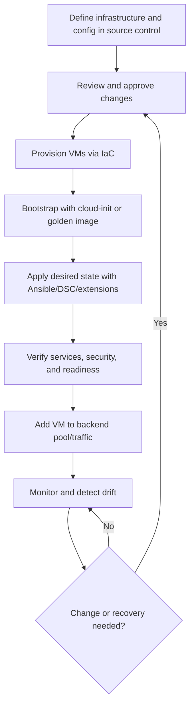
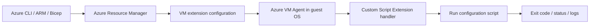

# Automating Virtual Machine Configuration with Management Tools

A newly provisioned Azure Virtual Machine (VM) is rarely ready to serve applications immediately. It may need a web server installed, service accounts created, OS settings tuned, application code placed in the right directory, monitoring enabled, and security policies applied. When administrators SSH or RDP in to perform every step manually, development, staging, and production environments easily diverge; rebuilding a machine after an incident also becomes slow and hard to audit.

**Virtual machine configuration automation** means defining the desired machine state as code or declarative configuration, then using management tools to apply, verify, and update that state. Azure supports several native mechanisms—**cloud-init**, **VM extensions**, and **Azure Run Command**—while tools like **Ansible**, **PowerShell Desired State Configuration (DSC)**, and patch management systems govern machines across their operational lifecycle.

This lesson belongs to the **Azure Virtual Machines** chapter of the Microsoft Azure module. It connects subscription/resource group resources, Microsoft Entra ID, Azure RBAC, VNets/subnets, management networks, storage and data, monitoring, security, and cost control. Commands that affect live resources are **illustrative examples for practice in authorized environments**, not actions already executed on Azure.

## Learning Objectives

After this lesson, you will be able to:

- Distinguish **infrastructure provisioning**, **in-guest OS configuration**, **application deployment**, and **patch management**.
- Choose appropriately among cloud-init, Custom Script Extension, Run Command, Ansible, and DSC.
- Use cloud-init to bootstrap a new Linux VM repeatably.
- Describe how the Azure VM Agent and extensions receive configuration commands, report status, and troubleshoot errors.
- Use an Ansible playbook to declare desired state across a VM group and validate before applying changes.
- Apply **idempotency**, immutable images, and **configuration drift** management.
- Protect credentials, restrict management networks, and combine RBAC with managed identities.
- Design deployment workflows with verification, rollbacks, logging, and cost control.

## 1. Understanding Automation Layers

Not every tool that creates a VM configures applications inside the guest OS. An architecture can be separated into four layers:

| Layer | Question | Tools or techniques |
|---|---|---|
| **Provisioning** | Which resources to create, in which subscription, resource group, region, and subnet? | Bicep/ARM templates, Terraform, Azure CLI |
| **Guest configuration** | Which packages, services, users, files, and OS policies does the VM need? | cloud-init, Custom Script Extension, Ansible, DSC |
| **Application deployment** | Which software version runs on the VM, and where do configs and secrets come from? | Pipelines, Ansible, extensions/scripts, prebuilt images |
| **Operations & compliance** | Is the machine still compliant, patched, and reporting errors? | Azure Update Manager, Azure Monitor, Azure Policy machine configuration, CM tools |

For example, **Bicep** provisions the VM and NIC in `snet-app`. **cloud-init** installs Nginx during the Linux machine's initial boot. **Ansible** deploys website content and keeps the service running. **Azure Monitor** collects logs, while **Azure Update Manager** governs patch assessment and installation schedules where supported. The layers collaborate while maintaining distinct responsibilities.

### Configuration Lifecycle



Separate **VM provisioning succeeded** from **application ready for traffic**. Behind a load balancer, health probes must confirm the app actually serves requests before adding the machine to the backend pool.

## 2. Choosing the Right Management Tool

| Tool | How it operates | Strengths | Limitations |
|---|---|---|---|
| **cloud-init** | Linux VM processes user-data at initialization, mainly on first boot per image setup | Fast bootstrap; declares packages/files/services at VM creation | Not a continuous drift-correction engine; depends on image support |
| **Custom Script Extension** | Azure VM Agent invokes declared scripts/configs on the VM | Runs post-creation config; integrated with Azure Resource Manager | Requires VM Agent, network access, and idempotent scripts |
| **Azure Run Command** | Sends scripts via Azure control plane to supported guest OSes | Controlled diagnostics, fixes, or admin tasks without direct SSH/RDP | Not meant for ongoing configuration management; execution, output, and RBAC limits |
| **Ansible** | Control node connects over SSH/WinRM to run playbooks | Multi-VM management; declarative and idempotent via modules | Requires network reachability, credentials, inventory, and a runner |
| **PowerShell DSC** | Declares Windows desired state via DSC resources and execution engines | Focused on Windows Server state and consistency | Depends on PowerShell/DSC versions and distribution model |
| **Golden image / Azure VM Image Builder** | Builds images preloaded with standard packages, agents, and software | Speeds scale-out; reduces machine-to-machine variance | Every change requires an image build, test, and release cycle |

**Selection hint:** for fresh Linux VMs, cloud-init excels at bootstrapping; for long-lived VM fleets, Ansible or a desired-state tool typically manages drift better. For quick diagnostics or one-off fixes, Run Command helps; at large scale, combining golden images with pipelines is far more reproducible than ad-hoc command sequences.

Never cram all complex system deployment logic into a one-shot script with zero verification steps.

## 3. Prerequisites for the Hands-On Lab

Example using an Ubuntu Linux VM in Azure:

- An approved lab subscription and resource group.
- Dedicated VNet/subnet for the workload and matching NSG rules.
- Execution identity with Azure RBAC to create VMs or manage extensions if performing those actions.
- Logged-in Azure CLI; Ansible installed on a Linux machine/runner with network access to the VMs.
- An SSH public key for the VM; the private key stored strictly on the client or an approved secret store.
- Budget, lab time limits, and a resource cleanup plan.

### Securing the Management Path

You do not need a **public IP** on VMs to automate configuration. Prefer:

- Private IPs inside segmented subnets.
- Interactive admin access via Azure Bastion, VPN/ExpressRoute, or an approved channel.
- An Ansible runner inside a network with SSH/WinRM paths to the VMs.
- Azure Run Command when supported operations via control plane and VM Agent are needed.
- Microsoft Entra ID, RBAC, MFA/Conditional Access, or PIM protecting Azure management roles.

Azure RBAC permissions to edit cloud resources **differ from `sudo`/root or Windows Administrator rights inside the guest OS**. Design and audit each layer separately.

### Never Put Secrets in Bootstrap Data

Values passed via cloud-init `custom-data`, script output, extension parameters, or logs can be inspected by users with appropriate access across management channels. **Never place passwords, long-lived tokens, private keys, or connection strings in example configs or standard cloud-init files.**

When apps need secrets, use the VM's managed identity to fetch from Azure Key Vault under least privilege, or an org-approved secrets workflow. Keeping scripts in Git never justifies keeping credentials in scripts.

## 4. cloud-init: Automating Linux VM Initialization

**cloud-init** is a bootstrap mechanism available on many supported Linux images. At creation time, cloud-init processes user-data to install packages, write files, run commands, and enable services. Availability depends on the image and guest OS setup; do not assume every Linux VM includes cloud-init.

### Example cloud-init to Install Nginx

Illustrative file named `cloud-init.yaml`:

```yaml
#cloud-config
package_update: true
packages:
  - nginx

write_files:
  - path: /var/www/html/index.html
    owner: root:root
    permissions: '0644'
    content: |
      <!doctype html>
      <html lang="en">
      <head><meta charset="utf-8"><title>Azure VM</title></head>
      <body><h1>Web server configured automatically</h1></body>
      </html>

runcmd:
  - [systemctl, enable, --now, nginx]
```

Explanation:

- `#cloud-config` marks this as a cloud-init configuration.
- `package_update: true` refreshes package metadata before installation on supported platforms.
- `packages` installs Nginx using the image's package manager.
- `write_files` creates the sample HTML page with explicit ownership and permissions.
- `runcmd` enables and starts the service once prerequisites are in place.

This fits Linux images using `systemd` and a standard Nginx package. On other distros, package names, package managers, and service names may differ—verify before applying.

### Attaching cloud-init at VM Creation

Bash example in Azure Cloud Shell using an existing lab VNet/subnet and your managed SSH key:

```bash
RG="<RESOURCE_GROUP>"
VM="vm-web-lab"
VNET="<VNET_NAME>"
SUBNET="<SUBNET_NAME>"
REGION="southeastasia"

az account show --output table

az vm create \
  --resource-group "$RG" \
  --name "$VM" \
  --location "$REGION" \
  --image Ubuntu2204 \
  --size Standard_B2s \
  --admin-username azureuser \
  --ssh-key-values "$HOME/.ssh/id_ed25519.pub" \
  --vnet-name "$VNET" \
  --subnet "$SUBNET" \
  --public-ip-address "" \
  --custom-data ./cloud-init.yaml
```

This is a **lab example**, not an already executed command. Verify image/SKU availability in the region, quotas, existing resource names, public key path, and exact flags for your Azure CLI version. Parameters or image aliases can change; consult current CLI help before running.

`--public-ip-address ""` intentionally **creates no public IP**. Therefore, testing HTTP on the VM requires a client inside the VNet, an approved management path, or a dedicated ingress layer. Avoid opening TCP 80 directly to the Internet just for a quick lab check unless required.

### Verifying cloud-init Inside the Guest OS

Once connected to Linux via an authorized sign-in path:

```bash
cloud-init status --long
sudo tail -n 100 /var/log/cloud-init-output.log
sudo systemctl is-active nginx
curl -I http://127.0.0.1/
```

Expected:

- `cloud-init status` reports completion or surfaces actionable errors.
- Nginx is running.
- Local HTTP request to port 80 returns a valid HTTP response.

If cloud-init finishes yet the website does not respond, check package installation logs, service name, config files, and the guest firewall. `az vm create` succeeding never guarantees in-guest setup succeeded.

### Limitations of cloud-init

cloud-init is primarily built for initial VM startup. Editing `cloud-init.yaml` locally **does not automatically update existing VMs**. Modules execute on specific frequencies; avoid repurposing `custom-data` as a continuous desired-state engine.

To apply changes to running VMs, use a management tool with explicit update workflows or replace the VM with a new image/configuration following immutable infrastructure practices.

## 5. VM Agent and Custom Script Extension

The **Azure VM Agent** runs inside the guest OS to let Azure manage platform features and VM extensions. **Custom Script Extension** executes scripts configured via Azure Resource Manager without requiring operators to SSH/RDP into every VM and paste commands.

### Basic Execution Flow



Key prerequisites:

- The image must include supported agent/extension functionality.
- The VM must be running and able to reach Azure platform endpoints required by the VM Agent/extensions.
- Scripts and artifact sources must be reachable under network policies.
- Never allow downloads from untrusted sources or run unverified scripts without integrity checks.
- Appropriate RBAC permissions are needed to modify extensions on the VM in scope.

### Example Running a Linux Script via Azure CLI

Example **strictly for an approved Ubuntu lab VM**, installing Nginx via Custom Script Extension:

```bash
az vm extension set \
  --resource-group "<RESOURCE_GROUP>" \
  --vm-name "<VM_NAME>" \
  --publisher Microsoft.Azure.Extensions \
  --name CustomScript \
  --settings '{"commandToExecute":"apt-get update && DEBIAN_FRONTEND=noninteractive apt-get install -y nginx && systemctl enable --now nginx"}'
```

The JSON payload is quoted for Bash; on PowerShell, quoting/escaping rules differ. Never run this example on live production VMs without compatibility testing, maintenance windows, and rollback plans.

In real environments, prefer version-controlled scripts fetched from trusted channels, verify checksums where appropriate, and never embed credentials in `commandToExecute`. For secrets needed by extensions, evaluate `protectedSettings` or better yet managed identity + Key Vault; even then, never print secrets to logs.

### Checking Extension Status

```bash
az vm extension show \
  --resource-group "<RESOURCE_GROUP>" \
  --vm-name "<VM_NAME>" \
  --name CustomScript \
  --output json
```

Inspect `provisioningState`, status, substatus, and Azure-reported error details. On failure, inspect extension logs inside the guest OS via an authorized access path.

**A VM can be running fine while an extension fails.** Conversely, a succeeded extension does not automatically prove the application is ready—run health checks, functional tests, and post-config verification.

### Repeatability and Re-Running Extensions

When extension settings change or are redeployed per supported rules, scripts may run again. Design scripts to be **idempotent**:

- Do not create duplicate users or append duplicate config lines.
- Pin managed package versions instead of running uncontrolled upgrades.
- Avoid overwriting config files unnecessarily when values already match.
- Restart services only when configuration actually changed.
- Verify status after each step and return non-zero exit codes on failure.

## 6. Azure Run Command for Controlled Checks and Actions

Azure Run Command executes commands inside the guest OS via the Azure management plane and supporting VM components. It is helpful for checking service state or remediating issues when direct SSH/RDP is unavailable.

### Checking a Linux VM

```bash
az vm run-command invoke \
  --resource-group "<RESOURCE_GROUP>" \
  --name "<VM_NAME>" \
  --command-id RunShellScript \
  --scripts "systemctl is-active nginx"
```

### Checking a Windows VM

```bash
az vm run-command invoke \
  --resource-group "<RESOURCE_GROUP>" \
  --name "<WINDOWS_VM_NAME>" \
  --command-id RunPowerShellScript \
  --scripts "Get-Service -Name W32Time"
```

These read-only checks alter no configuration. They work only when the image/VM agent, OS, administrative permissions, and machine state satisfy tool requirements.

Run Command **is not a full substitute for configuration management**. Execution duration, output size, concurrency, and log retention vary by Run Command type. When managing hundreds of VMs, prefer IaC, Ansible/DSC, extensions, or monitored pipelines over ad-hoc manual commands.

### Security Principles

Never pass passwords, tokens, or connection strings inside `--scripts`, as arguments, outputs, and management activity can surface in shell history, logs, and audit trails. Restrict Run Command permissions to minimal operators and audit/alert on privileged invocations.

## 7. Ansible: Declaring State Across a Group of VMs

**Ansible** manages hosts through inventories and playbooks. For Linux, the control node typically connects over SSH; for Windows, it uses WinRM/PowerShell Remoting or supported transports. No dedicated Ansible agent needs to be preinstalled on Linux VMs.

### Illustrative Inventory

`inventory.ini` stored on an admin host or controlled config repo:

```ini
[web]
web01 ansible_host=10.20.10.4 ansible_user=azureuser
web02 ansible_host=10.20.10.5 ansible_user=azureuser
```

These are illustrative private IPs. The control node must have network reachability and valid SSH credentials. Never place private SSH keys inside the inventory file.

### Playbook to Install and Manage Nginx

`configure-web.yml`:

```yaml
---
- name: Configure web server on Azure VMs
  hosts: web
  become: true
  gather_facts: true

  tasks:
    - name: Install Nginx package on Ubuntu
      ansible.builtin.apt:
        name: nginx
        state: present
        update_cache: true

    - name: Create status web page
      ansible.builtin.copy:
        dest: /var/www/html/index.html
        owner: root
        group: root
        mode: '0644'
        content: |
          <!doctype html>
          <html lang="en">
          <head><meta charset="utf-8"><title>Azure Ansible</title></head>
          <body><h1>Managed by Ansible</h1></body>
          </html>
      notify: Reload nginx

    - name: Ensure Nginx is running
      ansible.builtin.service:
        name: nginx
        state: started
        enabled: true

  handlers:
    - name: Reload nginx
      ansible.builtin.service:
        name: nginx
        state: reloaded
```

Meaning:

- `hosts: web`: targets the host group defined in inventory.
- `become: true`: escalates privileges inside the guest OS per configured method.
- `apt state: present`: ensures the Nginx package is installed on Ubuntu/Debian.
- `copy`: ensures the file exists with exact ownership and mode; marks changed only if content/attributes differ.
- `service state: started, enabled: true`: ensures Nginx runs and starts at boot.
- `notify`: invokes the reload handler only when the web page task changes.

Playbooks declare **desired state** rather than running blind commands without checking current state. Still, real idempotency depends on the modules and tasks used; never claim raw shell commands in Ansible are automatically idempotent.

### Running Pre-Flight Checks Before Applying

```bash
ansible-playbook -i inventory.ini configure-web.yml --syntax-check
ansible-playbook -i inventory.ini configure-web.yml --check --diff
```

- `--syntax-check` validates playbook syntax.
- `--check` dry-runs changes for modules supporting check mode.
- `--diff` prints file/config differences.

Check mode cannot perfectly simulate 100% of tasks and does not replace staging environments. Diffs can expose sensitive config if tasks handle secrets—restrict log access and add `no_log: true` on sensitive tasks.

Once approved:

```bash
ansible-playbook -i inventory.ini configure-web.yml --limit web01
ansible-playbook -i inventory.ini configure-web.yml
```

Running against a single canary VM first limits blast radius if the playbook has a bug. Verify service and app health before expanding to the entire group.

## 8. Automating Windows with PowerShell and DSC

On Azure Windows VMs, common tasks include enabling Windows Features, configuring IIS, managing services, registry keys, certificates, and security baselines.

**PowerShell Desired State Configuration (DSC)** uses resources describing target Windows state. Example DSC structure installing IIS on Windows Server:

```powershell
Configuration WebServerConfiguration {
    Node 'localhost' {
        WindowsFeature WebServer {
            Ensure = 'Present'
            Name   = 'Web-Server'
        }
    }
}

WebServerConfiguration -OutputPath '.\MofOutput'
Start-DscConfiguration -Path '.\MofOutput' -Wait -Verbose
```

This illustrates the **compile configuration → apply desired state** pattern, requiring compatible OS versions, DSC resource modules, and PowerShell editions. Do not assume all Windows VMs and DSC generations share identical commands or delivery mechanisms.

For Windows VMs, Azure also provides **Custom Script Extension for Windows** under `Microsoft.Compute` with its own naming and parameters, distinct from Linux Custom Script Extension. To run ad-hoc PowerShell via Azure Run Command, use `RunPowerShellScript` as shown earlier.

### Which Tool Fits Windows?

| Need | Common choice |
|---|---|
| Small bootstrap at VM creation | Custom Script Extension / matching VM provisioning flow |
| Long-term role/service installation and governance | DSC or the organization's configuration management tool |
| One-off diagnostics / status reads | Azure Run Command |
| Maintaining standardized base images | Azure VM Image Builder and Azure Compute Gallery |
| Scheduling patch assessments/installations | Azure Update Manager with maintenance policies |
| Auditing guest configuration compliance | Azure Policy machine configuration where policies/images/conditions support |

Do not confuse **Windows Update patch management** with **application installation and configuration**. Both may be coordinated together, yet follow distinct testing and rollback workflows.

## 9. Idempotency, Immutable Infrastructure, and Configuration Drift

### What Is Idempotency?

An **idempotent** operation given the same input produces the same desired end state when applied repeatedly, rather than accumulating unintended changes.

Examples:

- “Ensure package Nginx is present” can run safely multiple times.
- “Append this line to a config file with `echo >>`” creates duplicate lines on every run.
- “Ensure the service is started” is often safer than “unconditionally restart the service every run.”

### Configuration Drift

Drift happens when a live VM diverges from configuration in source control. Common causes include:

- Engineers SSHing in to edit files directly.
- Automatic patches or packages altering config files.
- VMs restored from stale snapshots or old images.
- An instance missing a newer config rollout.
- Playbooks reaching only part of the fleet due to inventory or network bugs.

To minimize drift, treat the configuration repository as the **source of truth**, review changes via pull requests, apply automatically via pipelines, scan regularly, and alert on deviations.

### Immutable VMs

With immutable infrastructure, rather than mutating long-lived VMs, teams build a new **golden image** containing approved software versions and replace instances via VM Scale Sets or rolling deployments. This curbs accumulated drift, though it requires stateless designs or externalized data management.

### Choosing an Operating Model

| Scenario | Suitable model |
|---|---|
| Small VM, simple first-boot config | cloud-init / bootstrap |
| Fleet needing periodic config updates across many instances | Ansible/DSC or pipelined configuration management |
| Many identical instances scaling rapidly | Golden images + VMSS, optionally with minimal bootstrap |
| Demonstrating guest configuration compliance | Machine configuration / Azure Policy with audit workflows |
| Single diagnostic command inside guest OS | Controlled Run Command |

No single model replaces application testing, backups, or recovery runbooks.

## 10. Secure VM Configuration Pipeline

Sample pipeline from code change to production:

1. **Design:** define target configuration, OS, package versions, and dependencies.
2. **Version control:** store IaC, cloud-init/playbooks, scripts, and tests in access-controlled repositories.
3. **Review:** inspect permissions, secrets handling, NSGs, ports, downtime impact, and rollback steps.
4. **Staging:** provision production-like test machines and execute configuration.
5. **Preflight:** verify subscription, resource group, inventory, quotas, runner network, current health, and backups.
6. **Canary:** apply to one VM or a small subset.
7. **Validation:** verify packages/services, HTTP readiness, agent health, and logs.
8. **Rollout:** apply across remaining VMs in batches with bounded concurrency.
9. **Monitoring:** watch error rates, latency, CPU, memory, disk, and drift.
10. **Rollback:** revert to prior image/configuration or replace instances per runbook if needed.

### Never Roll Out Concurrently Across Stateful Workloads

For VMs hosting databases, local sessions, or local files, installing packages and restarting services can disrupt active writes. Plan backups, quorum/replication health, maintenance windows, and node-by-node ordering.

Similarly, behind Azure Load Balancer or Application Gateway, drain instances out of traffic or ensure health probes automatically pull unhealthy instances out of rotation during configuration updates.

## 11. Secrets, Identity, and Least Privilege

Automation workflows typically span both **Azure control-plane permissions** and **in-guest OS privileges**.

| Operation | What permissions to govern? |
|---|---|
| Create VMs, NICs, disks | Azure RBAC on target resource group/subscription |
| Install/update VM extensions | Azure RBAC for extension management actions |
| Run Command | Role-scoped permissions to execute Run Command on VMs |
| Ansible SSH | SSH identity and least-privilege `sudo` inside the guest OS |
| Windows DSC | Windows rights to run configurations and manage resources |
| App reading Key Vault secrets | Managed identity / service principal with scoped Key Vault access |
| App reading blobs | Storage Blob Data role plus network access |

### Managed Identity and Key Vault

A VM with a managed identity acquires tokens for supported Azure services without storing long-lived client secrets in scripts. To read Key Vault secrets, that identity needs explicit permissions for only the approved secrets along with valid network connectivity.

Do not confuse **having a managed identity** with **having access to everything**. Managed identity only provides an identity; Azure RBAC, data-plane roles, or access policies are still required.

### Minimizing Secrets Exposure in Logs

- Never print environment variables holding tokens, keys, or passwords.
- Never store secrets in user-data, pipeline logs, or source code.
- Restrict `--diff` when playbooks touch sensitive files.
- Use certificates/SSH keys with organization-approved rotation.
- Time-bound privileged access; consider PIM for administrators.
- Verify integrity and access controls on downloaded script sources.

## 12. Post-Automation Monitoring

Different log and evidence layers serve different goals:

| Source | What it provides | Key caveats |
|---|---|---|
| Azure Activity Log | Control-plane events like VM/extension create/edit | Does not log commands executed inside the guest |
| VM Agent / extension status | Extension provisioning state and messages | Does not replace application health checks |
| `/var/log/cloud-init.log`, `cloud-init-output.log` | Linux cloud-init execution details | May contain config details; restrict read access |
| Ansible play recap/logs | `changed`/`ok`/`failed`/`unreachable` tasks per host | Protect sensitive outputs and retain for audit |
| Windows Event Log / PowerShell logs | In-Windows state and script execution records | Depends on organizational logging policies |
| Azure Monitor / VM Insights | OS/app metrics and logs when agents are configured | Requires deploying DCRs/agents and paying retention |
| Azure Policy machine configuration | Guest compliance evaluation per supported policy | Does not guarantee automatic remediation of every drift |

### Azure CLI Verification Commands

```bash
az vm show \
  --resource-group "<RESOURCE_GROUP>" \
  --name "<VM_NAME>" \
  --show-details \
  --output json

az vm get-instance-view \
  --resource-group "<RESOURCE_GROUP>" \
  --name "<VM_NAME>" \
  --output json
```

Cross-check provisioning state, power state, extension status, and any error details. These commands only **read** the control plane; proving Nginx serves requests properly still requires health checks or in-guest verification.

### Signals Worth Alerting On

- VM provisioned yet extension or cloud-init failed.
- Multiple instances turn Unhealthy after a rollout.
- Management connectivity fails or the Ansible runner cannot reach VMs.
- Live configuration drifts from the approved baseline.
- Critical patches remain unapplied past policy SLAs.
- Unusual CPU, disk, memory, or cost spikes following changes.
- Admin accounts invoke Run Command or extensions outside maintenance windows.

## 13. Troubleshooting Common Issues

| Symptom | Common causes | Remediation |
|---|---|---|
| VM created yet Nginx is not running | cloud-init/package install error, service not enabled | Check cloud-init logs, service status, package repo network |
| Edited cloud-init yet old VM did not update | cloud-init is not a continuous desired-state agent | Use Ansible/extensions or deploy fresh VMs |
| Extension reports provisioning failed | VM Agent down, network block, bad script URL, syntax or exit code error | Read extension status/logs; test script in staging |
| Re-running extension breaks or duplicates config | Non-idempotent script | Refactor to desired-state checks before mutating |
| Run Command returns no output | VM Agent unhealthy, OS issue, execution/output limit hit | Check VM/agent state and feature limits |
| Ansible reports `UNREACHABLE` | Wrong private IP, NSG/route/VPN block, SSH key or inventory error | Verify network path and auth from runner |
| Ansible reports `FAILED` on permission | Missing `sudo` or OS permissions | Check `become`, user, and authorized privileges |
| Playbook reports `changed` every run | Non-idempotent task, timestamps, raw shell commands | Switch to stateful modules or proper `creates`/`changed_when` |
| Windows DSC compile/apply error | Missing resource module, version mismatch, Windows permissions | Check DSC modules and DSC event logs |
| Extension succeeded yet app returns 502 | Nginx/backend unready, NSG block, or bad health probe | Check app process, DNS, routes, and health probes |
| Cannot fetch Key Vault secret | Managed identity missing role or Key Vault firewall block | Verify identity, data-plane RBAC, Private Endpoint/DNS |
| High costs after deployment | Oversized VMs, disks, runners, monitoring, or extra instances | Check Cost Management, tags, SKUs, and lab schedules |

**Never take shortcuts by opening SSH/RDP to the Internet, disabling NSGs, granting subscription-wide Owner, or embedding secrets in scripts.** Those hide root causes and weaken system security.

## 14. Capstone Lab: From Empty VM to Managed Web Server

**Scenario:** A dev team needs two Ubuntu VMs running Nginx with identical web content and repeatable configuration updates. The VMs live in a private subnet; admins want no public SSH exposure.

### Step 1: Prepare Networking and Permissions

- Pick a test subscription and resource group.
- Ensure a VNet/subnet that does not overlap admin networks.
- Design connectivity from the Ansible runner to the VMs via private networking or an approved channel.
- Prepare SSH keys, restrict `sudo`, and confirm who can edit NSGs/VMs.
- Ensure a way to test the website from inside the VNet or a controlled ingress.

### Step 2: Bootstrap the First Linux VM

Create `cloud-init.yaml` per section 4 and pass `--custom-data` at VM creation. Verify `cloud-init status`, Nginx, and the sample page once booted.

### Step 3: Create the Second VM

Use the same versioned image and cloud-init configuration. Assign distinct names, IPs, and inventory entries while keeping the baseline configuration identical.

### Step 4: Manage with Ansible

Place both VMs in `inventory.ini` and run:

```bash
ansible-playbook -i inventory.ini configure-web.yml --syntax-check
ansible-playbook -i inventory.ini configure-web.yml --check --diff
ansible-playbook -i inventory.ini configure-web.yml --limit web01
ansible-playbook -i inventory.ini configure-web.yml
```

Inspect per-host results. Re-run the playbook and observe `changed` task counts. Subsequent runs should report zero unnecessary changes when configuration matches desired state.

### Step 5: Test HTTP and VM Status

From a machine with network access to the backends:

```bash
curl -I http://10.20.10.4/
curl -I http://10.20.10.5/
```

Inspect HTTP status and rendered content. Check VM/extension status via Azure CLI if applicable. Replace the illustrative IPs with your actual lab VM IPs.

### Step 6: Test Drift Detection

On a lab machine, modify `/var/www/html/index.html` using an approved method, then rerun the Ansible playbook. Observe Ansible detect the difference, restore the expected content, and report `changed`.

Never edit production files manually just to demonstrate drift.

### Step 7: Simulate a Controlled Failure

In staging, test a playbook revision with an invalid task or mismatched host pattern. Observe the pipeline halt, log the failure, and avoid rolling out across all VMs. Fix the bug and rerun after verification.

### Step 8: Clean Up

When finished, verify resources belong exclusively to the lab resource group before deleting. Example:

```bash
az group list --output table
az group show --name "<LAB_RESOURCE_GROUP>" --output json
```

Only authorized personnel who have confirmed the resource group contains strictly lab resources should delete it per procedure. Stopping a VM does not stop charges on remaining disks, IPs, or supporting services.

### Expected Test Outcomes

| Test case | Expected outcome |
|---|---|
| VMs created from identical cloud-init | Nginx installed and serving matching default page |
| SSH from authorized Ansible runner | Connects cleanly over approved private path |
| SSH from unauthorized Internet host | Connection blocked per policy |
| Initial Ansible run | Reports `changed` on tasks establishing desired state |
| Subsequent Ansible run with no edits | Tasks report `ok`, introducing zero redundant changes |
| Lab VM HTML file altered | Playbook detects drift and restores desired content |
| Web health check | HTTP returns valid response while Nginx runs |
| One VM fails configuration | Pipeline flags failure without declaring full rollout successful |

## 15. Production Adoption Checklist

- [ ] Separated provisioning, guest configuration, application deployment, and patch management.
- [ ] Source control, owners, and peer reviews exist for scripts, playbooks, and cloud-init.
- [ ] Verified VM images, OS versions, and management tool compatibility.
- [ ] Scoped Azure RBAC and guest `sudo`/Administrator rights by least privilege.
- [ ] Using SSH keys/managed identities with zero passwords/tokens in user-data or logs.
- [ ] Designed private management networking, NSGs/routes, and DNS resolution.
- [ ] Verified cloud-init/VM Agent health, network reachability, and extension prerequisites.
- [ ] Applied idempotent configurations with error checks and proper exit codes.
- [ ] Staging, syntax/check mode, canary rollout, and production approvals are enforced.
- [ ] Rollback and backup plans exist for stateful VMs.
- [ ] Application readiness is verified before admitting traffic.
- [ ] Monitoring, logs, alerts, and drift detection are active.
- [ ] Patching schedules, maintenance windows, and post-patch tests exist.
- [ ] Tags, budgets, SKU/size controls, disks, logs, and runtimes are governed.
- [ ] Documented recovery procedures, execution rights, and periodic review schedules.

## 16. Self-Check Questions

1. Why does creating a VM with Bicep or Azure CLI not mean application configuration is automated?
2. How does cloud-init differ from Ansible in lifecycle stage and ongoing configuration enforcement?
3. Why does Custom Script Extension require the Azure VM Agent and proper network connectivity?
4. Which tasks best suit Run Command, and when should you avoid using it?
5. What is idempotency? Give an example of a non-idempotent script and how to fix it.
6. If Ansible reports `UNREACHABLE` while the VM is running, which layer should you check first?
7. Why should passwords or connection strings never be stored in cloud-init/custom data?
8. How do Azure RBAC roles differ from `sudo`/root privileges inside the guest OS?
9. How do golden images help curb drift, and what operational process do they require in return?
10. Why run canary deployments and health checks before configuring all production VMs?
11. How can Azure Update Manager and Ansible complement each other in VM lifecycle management?
12. When a VM extension reports success yet Application Gateway returns 502, what should you inspect?
13. If an automation runner sits outside the VNet, what connectivity options can be used?
14. After finishing a lab, which resources besides the VM itself can continue incurring charges?

## Conclusion

Automating Azure VM configuration is about more than running scripts faster than manual sign-ins. The goal is achieving **reproducible, verifiable, observable, and recoverable machine state**. cloud-init fits Linux bootstrapping; VM extensions and Run Command enable control-plane actions; Ansible and DSC enforce desired state through repeatable workflows; golden images and pipelines scale consistent environments.

By pairing configuration as code with Microsoft Entra ID, Azure RBAC, private management networks, managed identities, Key Vault, Azure Monitor, and cost governance, organizations can operate Azure VM fleets securely while curbing drift and speeding up incident recovery.
