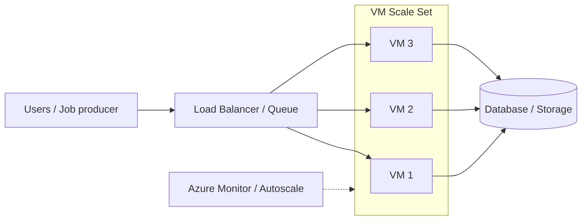
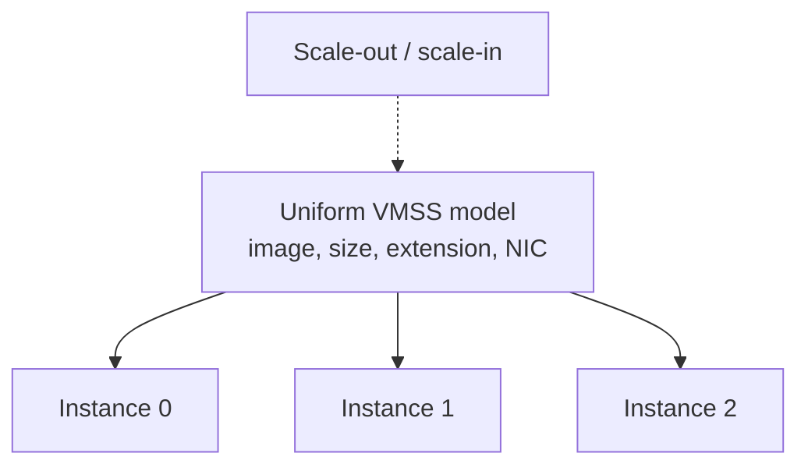
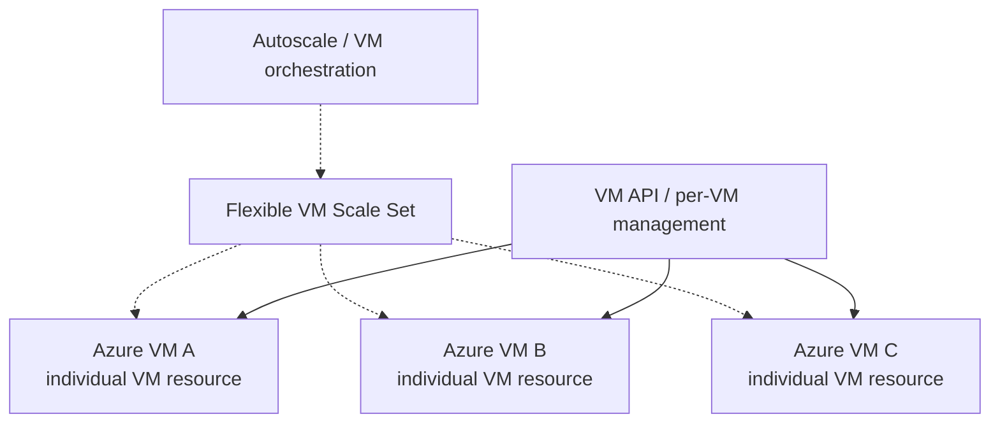
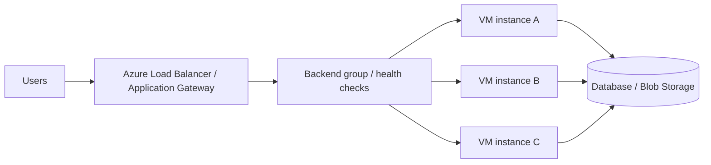
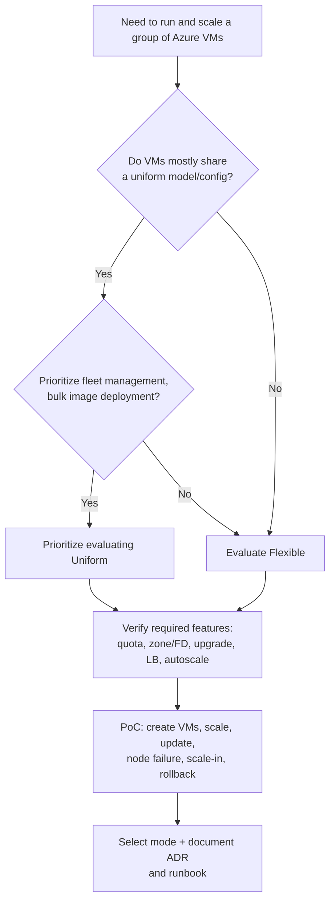
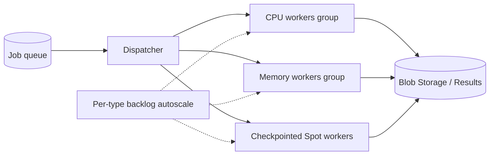

# Choosing an orchestration mode for Scale Sets

An e-commerce platform needs to add virtual machines when traffic spikes during peak hours, while an image-processing team needs to run virtual machines with differing sizes and roles. Both can consider **Azure Virtual Machine Scale Sets (VMSS)**, but how Azure manages each virtual machine in the group, distributes machines across fault domains, and executes the deployment lifecycle depends on the **orchestration mode**.

This lesson belongs to the **Elastic Compute and Batch Processing** chapter of the **CLOUD_PROVIDERS_AZURE** module. The module explores the Azure ecosystem from subscriptions, resource groups, and Microsoft Entra ID to virtual networks, compute services, storage, and data; it also guides deploying, monitoring, securing, and controlling costs for an application architecture. This lesson focuses on the two orchestration modes of Virtual Machine Scale Sets: **Uniform** and **Flexible**, helping you choose based on actual requirements rather than merely the number of VMs.

After this lesson, you will be able to:

- Explain the role of VMSS and the differences between **Uniform orchestration** and **Flexible orchestration**.
- Compare capabilities for individual VM management, configuration standardization, scaling out/in, version rollout, and fault distribution.
- Design autoscale mechanisms, health checks, load balancing, image updates, and scale-in handling.
- Choose the appropriate mode for a stateless web API, an application with VMs requiring independent administration, or batch processing workers.
- Inspect the `orchestrationMode` property via the Azure Portal, Azure CLI, and Infrastructure as Code models.
- Plan an architectural transition when requirements change, avoiding the misconception that you can freely switch modes on a running scale set.

## 1. What problem does VM Scale Sets solve?

**Azure Virtual Machine Scale Sets** is a resource that helps manage a set of related VMs, addressing problems such as:

- Running multiple instances of the same application to increase serving capacity.
- Creating more or removing VMs based on demand, schedules, or monitoring metrics.
- Distributing VMs across supported fault domains/availability zones.
- Applying images, extensions, deployment configurations, and update strategies.
- Integrating with Azure Load Balancer, Azure Monitor, virtual networks, and management tools.

VMSS does not automatically make an application **stateless**, does not automatically synchronize in-memory or database data, and does not automatically make every request runnable on any VM. Decisions regarding sessions, external state, queues, databases, file storage, and idempotency remain at the application layer.

### 1.1. VMSS is not a single VM with many CPUs

When scaling out from two VMs to five VMs, Azure creates additional virtual machines that are **independent in compute**. Each VM has its own operating system, processes, NIC, and lifecycle according to the active orchestration model. A load balancer or job dispatcher determines where requests/jobs go.



The diagram is a high-level model. For HTTP-serving applications, a load balancer/ingress may be used; for batch processing, a work queue and job orchestration mechanism are often more important than a load balancer.

## 2. What is orchestration mode?

**Orchestration mode** determines how VMSS represents, distributes, creates, and manages instances.

Two main modes:

1. **Uniform orchestration**: optimizes a model for a group of VMs with relatively uniform baseline configurations, managing multiple instances via a single scale set model.
2. **Flexible orchestration**: focuses on VMs with **resources and lifecycles easy to administer individually**, while still belonging to a group used for scaling, availability, and orchestration.

Both can serve elastic architectures. The difference lies in **expected uniformity, the management experience for each VM, and integration with Azure VM features**. Specific support levels for autoscale, image upgrades, repairs, extensions, Spot, availability zones, and disks depend on service/CLI/API versions, regions, and VM SKUs; you should not assume every configuration flag of one mode has an equivalent in the other.

### 2.1. Uniform: a shared instance model

In **Uniform**, a VMSS model describes the VM image, machine size, OS configuration, network profile, and many other group properties. Azure creates instances from that model. Scaling, model updates, rolling upgrades, and orchestration operations are typically built around the scale set.



**Typical advantages:** suits homogeneous VM fleets, shared-image deployment pipelines, scale administration, and model-based upgrade mechanisms within supported features.

**Trade-offs:** the ability to use every operation/feature of a standalone VM may differ from standard Azure VMs. When very different configurations are needed across VMs, evaluate whether a Uniform scale set is still the right architecture or if workloads should be split.

### 2.2. Flexible: VMs with individual administrative identity

In **Flexible**, instances can be managed like standard **Microsoft.Compute/virtualMachines** resources while the scale set provides the grouping/orchestration layer. This is convenient for many VM management tasks and for scenarios where you do not want every instance locked into an identical model.



**Typical advantages:** convenient when using VM APIs, managing individual VMs, combining multiple machine configurations within supported scope, integrating existing VM operational workflows, and meeting availability requirements.

**Trade-offs:** many tools, queries, and policies must understand that instances are separate VM resources; you cannot assume every scale-set-level operation applies to all machines in the same way as Uniform.

## 3. Comparison table: Uniform vs. Flexible

| Criterion | **Uniform** | **Flexible** |
|---|---|---|
| Philosophy | Fleet based on a shared **VMSS model** | Group of VMs with high **individual manageability** |
| Instance representation | VMSS instances, managed primarily via VMSS VM APIs | Standard VM resources linked to the scale set |
| Uniformity level | Typically prioritizes consistent image, size, and configuration | More favorable for differing VM configurations within supported scope |
| Scale out/in | Based on VMSS capacity and model | Supports scaling/orchestration, but requires understanding how member VMs are managed |
| Autoscale | Supports metric/schedule scaling in compatible configs | Can use autoscale in compatible configs; verify how VMs are created/removed |
| Upgrades, OS patching | Image/model upgrade policies per Uniform capabilities | Leverages VM experience and appropriate update mechanisms; do not blindly copy Uniform policy assumptions |
| Instance management API/CLI | Typically via `az vmss ...` | Typically via `az vm ...` for member VMs |
| Fault domains, availability zones | Distributed per Uniform placement groups/zones within supported capabilities | Distributed per Flexible fault domains/zones per its capabilities |
| Network configuration | Scale-set model network profiles/integrations | Can manage VM network resources like standalone VMs |
| VM feature integration | Certain features have mode-specific constraints | Aims for broad compatibility with VM feature management |
| Suitable workloads | Homogeneous web/API/workers, model-driven deployments | Heterogeneous VM systems needing independent administration or flexible configurations |

This table describes **decision guidance**, not an exhaustive feature support matrix. For workloads requiring specific backups, encryption, proximity placement groups, Spot mixes, accelerated networking, ultra disks, or custom images, verify the mode together with the SKU/region and API/CLI versions being used.

### 3.1. Avoid concluding "Flexible is always better"

Flexible offers many advantages for per-VM management, yet Uniform remains suitable when an organization wants to operate a homogeneous fleet with a repeatable model and upgrade workflow. Conversely, do not pick Uniform solely because of the word "uniform" if the business needs differing instances or independent VM resource operations.

**Choose the mode based on the operations you need to perform**, not based on "new/old" order or the default of an Azure Portal button.

## 4. Decision factors before deployment

### 4.1. How similar are the workloads?

Answer these questions:

- Do all instances run the **same application image and version**?
- Are VM sizes, disks, extensions, NICs, images, and security baselines identical?
- Are there machines needing GPUs, high CPU, and high RAM in the same group?
- Is there a need to manage a specific VM by name, resource ID, or Azure VM tools?

If **VMs are mostly homogeneous**, Uniform can reduce complexity. If **individual VM administration and shaping are needed**, Flexible deserves priority evaluation. However, a group of machines with **distinct business roles** does not necessarily belong in a single scale set: separating worker groups by role and scaling needs may be better.

### 4.2. Scaling by utilization or by schedule?

For stateless web applications, VM counts can scale by CPU, request rate, queue length, or custom metrics. For batch workloads, scaling by **backlog** and processing throughput is often more accurate than average CPU.

Decisions required:

1. Which metric reflects serving demand?
2. How long does it take for a new VM to boot, bootstrap, and become healthy?
3. What is the minimum instance count needed for fault tolerance?
4. During scale-in, what happens to jobs/sessions on the removed VM?
5. Does the scale set have sufficient VM/vCPU quota, network capacity, and allocation availability for the target VM SKU?

The mode does not solve state persistence or graceful job termination on behalf of the application.

### 4.3. Do you need "a group of VMs" or "a VMSS model resource"?

If existing management tools frequently call the **Azure VM REST API** to modify disks, networks, extensions, identities, or per-machine settings, Flexible may be more convenient.

If operations teams want to push a shared image version, create/remove instances uniformly, and treat every VM as a replaceable component, Uniform is often a clear model.

Evaluate your **IaC stack**, inventory, monitoring, patching, backup, role assignments, and CMDB as well, because differences in instance representation affect how data is collected and permissions are granted.

## 5. Availability: availability zones, fault domains, and placement

### 5.1. Concepts

- **Availability zone (AZ):** an infrastructure domain with independence within an Azure region supporting availability zones.
- **Fault domain (FD):** a group of resources sharing certain infrastructure components likely to be affected together by a failure.
- **Placement group:** how Azure organizes/places Uniform VMSS instances within infrastructure limits.
- **Platform fault domain count:** a property related to fault domain distribution, with different support conditions and limits depending on mode/region/zone.

Choosing Uniform or Flexible **does not automatically guarantee** every machine sits in a different zone; you must configure the topology and inspect the actual outcome.

### 5.2. Designing for two failure types

| Failure | What to verify | Example mitigation |
|---|---|---|
| A single host fails | Is the instance placed in an appropriate fault domain and replaceable? | Distribute across fault domains, health detection, auto repair if supported |
| An availability zone fails | Are there healthy VMs in other zones, and are load balancing and data still accessible? | Spread VMs across multiple zones, design appropriate data and network layers |
| Region fails | Are workloads/data in another region, with DNS/traffic failover and runbooks? | Multi-region architecture; do not rely solely on one VMSS |
| Application bug across all VMs | Same broken build, bad image, revoked secret | Canary/rolling deploy, error monitoring, and rollback |

For example, three VMs across three zones will not keep an API available if they all call a single database lacking corresponding fault tolerance. High availability is an **end-to-end** property encompassing load balancers, DNS, storage, databases, identity, and the application.

### 5.3. Do not assume FD counts and instance limits

Fault domain limits, VM counts, zone support, and placement groups can vary by mode, VM SKU, region, OS image, and feature release timing. In production designs, verify:

- The number of FDs supported in the chosen region/zone.
- Whether `platformFaultDomainCount` is valid for the current mode.
- Maximum size, quotas, and VM allocation capability in each zone.
- Uniform single/multiple placement group configuration if scale demands it.
- New VM placement behavior and scale-in behavior after a zone outage.

Do not assume `instanceCount=3` means three different FDs or three different AZs.

## 6. Managing images, extensions, and version updates

### 6.1. Golden images and bootstrap

A VMSS typically uses an image containing the OS, agents, and application dependencies built to a tested baseline. Azure Marketplace images or images from **Azure Compute Gallery** can be used depending on requirements.

Factors to manage:

- Image versions and clear pinning/rolling-forward practices.
- VM extensions, cloud-init/Custom Script, and safe re-runnability.
- Managed identity and reading secrets from Key Vault instead of embedding keys.
- Application health probes before accepting requests.
- Procedures to replace failed VMs without relying on manual fixes on an instance.

With Uniform, updating the scale set model and rolling changes to instances requires using an **appropriate upgrade policy**; do not assume editing the model immediately updates every running VM. With Flexible, individual VM configurations may have separate lifecycles and also require a consistent deployment plan.

### 6.2. Rolling deployments and health

A safe deployment strategy typically includes:

1. Testing the image/build in a staging environment.
2. Creating new VMs or updating a small subset of instances.
3. Waiting for the application health probe to report the VM is genuinely ready.
4. Expanding rollout in batches if tools and mode support it.
5. Monitoring latency, error rates, queue backlog, and resources.
6. Halting rollout or restoring the previous image if a regression occurs.

Features like **automatic OS image upgrade, rolling upgrades, automatic instance repair, and orchestration policy** do not share identical configuration or support levels across all modes. When migrating from Uniform to Flexible, verify the corresponding mechanism instead of copying IaC parameters verbatim and assuming they will be accepted.

### 6.3. Avoiding "configuration drift"

In either mode, if operators SSH/RDP and manually patch a single machine, new instances spun up from the old image will lack those changes. In Flexible, convenient per-VM administration **does not mean letting the fleet drift uncontrollably**.

For scalable workloads, prioritize building images, policies, and configurations through IaC/pipelines. Exceptions on a single VM must have an owner, reason, expiration, and a plan to return to the standard state.

## 7. Networking, load balancing, and service entry points

### 7.1. Ingress path for a web API



VMSS provides compute capacity; **load balancing is not automatically fully designed** just because a scale set was created. Verify:

- VMs/NICs join the correct backend pool for the mode in use.
- Health probes check an endpoint reflecting application readiness, not merely an open port.
- NSGs, routes, firewalls, and subnets permit required traffic.
- Application Gateway or Load Balancer has sufficient capacity and appropriate zone/redundancy configuration.
- During scale-out/scale-in, backend pool membership updates properly and connections to draining VMs are not dropped unexpectedly.

With Flexible, specifically verify **NICs and backend pool membership of actual VMs** according to how the model/deployment creates them. Do not assume Uniform network profile configuration and instance queries always apply.

### 7.2. Outbound traffic and private resources

For workloads accessing Azure SQL, Storage, or Key Vault via private endpoints:

1. VMs must have appropriate routes/DNS inside the VNet.
2. Managed identities or credentials are granted permissions to target services.
3. Firewalls/NSGs do not block the connection path.
4. Scaled-out new VMs still receive the correct DNS, network, and identity configuration.

If the application calls the Internet via NAT Gateway or a firewall, test outbound connectivity and connection limits as VM counts grow; do not monitor only inbound traffic.

## 8. Autoscale, scale-in, and application safety

### 8.1. Metric-based autoscale

A sample plan for a web API:

```text
Minimum instances:  2
Default instances:  2
Maximum instances:  8

Scale out:  Sustained high average CPU over a measurement window
Scale in:   Sustained low CPU over a longer window
Cooldown:   Wait period to avoid up/down oscillation
```

This is guidance, not recommended parameters for every application. When choosing thresholds, account for VM bootstrap time, metric aggregation, request distribution, and backend capacity.

For a batch processing system:

```text
Queue has 10,000 jobs
Each worker processes about 100 jobs/minute (assumed)
Must complete within 20 minutes
Theoretical minimum workers = 10,000 / (100 × 20) = 5
```

That calculation excludes bootstrap, retries, uneven jobs, database rate limits, and VM quotas. In practice, add buffer capacity and concurrency limits to avoid overloading downstream systems.

### 8.2. Why is scale-in more dangerous than scale-out?

Scale-out adds capacity; scale-in **deletes or deallocates capacity**. If a worker is processing a long job, removing the VM can leave the job unfinished. If a web API holds sessions or temporary files locally on the VM, users can lose state.

Key requirements:

- **Drain** connections/jobs when notified a VM is about to be reclaimed, using supported integrations and lifecycle signals.
- Store durable state in databases/queues/storage, not solely on a VM's local disk.
- Give jobs **checkpoints** or idempotency for safe retries.
- Configure graceful shutdown and appropriate processing windows.
- Set min/max capacity and special VM protection conditions if required by the architecture.

Choosing Flexible does not automatically solve graceful shutdown; Uniform can also handle stateful-adjacent workloads if the application and operational tooling are properly designed, though it often requires extra coordination.

### 8.3. VMSS, Azure Batch, and other services

If the workload consists mainly of **thousands of independent compute tasks**, evaluate whether Azure Batch, container orchestration, or other managed compute services reduce operational overhead compared to self-managing VMSS. VMSS fits when the application needs VM/OS/image/network control and has a clear fleet management pipeline.

Do not let choosing an orchestration mode distract the team from the bigger question: "Do we really need to manage VMs, or would a PaaS service suffice?"

## 9. Azure Spot VMs and cost strategy

Azure Spot VMs can reduce compute costs within pricing/service availability limits, but carry the risk of being **evicted** when Azure needs capacity or according to configured policies.

When designing with Spot:

- Use for retryable jobs, stateless workers, rendering, or checkpointed batch processing.
- Do not rely solely on Spot to maintain minimum capacity for critical services.
- Check how mixing **Spot and standard/on-demand VMs** is configured in your VMSS mode and version.
- Factor in the cost of retries, restarts, temporary data, VM allocation wait times, and quotas.
- Note **eviction policies** and support limits by mode, SKU/region.

Flexible is often worth considering when workloads need to manage VMs with varying attributes and capacity types; however, specific mix support must be verified rather than assuming all Spot/on-demand combinations are valid.

### 9.1. Do not measure only hourly VM price

```text
VMSS Operational TCO =
    VM cost (size, count, runtime, Spot if used)
  + managed disks, images/storage, snapshots/backups
  + outbound data transfer, load balancer, NAT, public IPs
  + Azure Monitor/Log Analytics and telemetry
  + OS/application licenses and security
  + operational, deployment, and troubleshooting overhead
```

A mode that is "easier to create" is not necessarily cheaper overall if it leads to manual update workflows, configuration drift across VMs, or scale-in failures. Conversely, do not choose a complex mode when the workload is homogeneous and completely reproducible from an image.

## 10. Requirements-driven mode selection workflow



This decision tree is **evaluation guidance**, not a mandatory algorithm. The final conclusion must rely on hard application requirements and the actual support matrix.

### 10.1. Reference scoring table

You can score from 1 (poor fit) to 5 (strong fit) across weighted criteria:

| Criterion | Example weight | Evaluation question |
|---|---:|---|
| Compatibility with existing VM tools | 25% | Are VM APIs, VM backups, or standalone-VM inventory needed? |
| Uniformity of image deployment | 20% | Do instances share a model and upgrade in batches? |
| Fault tolerance | 20% | Does the mode satisfy required AZ/FD and health repair topology? |
| Autoscale/scale-in | 15% | Are lifecycle and safe job/session handling controllable? |
| Networking/security | 10% | Are VMs/NICs, LB backends, identities, NSGs, and private connections suitable? |
| Operations and cost | 10% | Do IaC, metrics, quotas, staffing, and TCO align? |

Example weights are only a starting point for discussion. Mandatory criteria such as support for a workload's disk type or VM feature are **disqualifying gates**, not something to offset with a high score elsewhere.

## 11. Scenario A: User-facing stateless Web API

**Context:** A transactional API requires 3–12 VMs during peak hours. All VMs run the same tested image and access Azure SQL and Blob Storage; sessions live in cache/database, not on VMs. The application is distributed through a gateway with health checks.

**Reasonable option to evaluate:** **Uniform** if the operations team prioritizes a uniform model, image-based deployment, and the upgrade/autoscale features supported by that mode in the design. **Flexible** can also satisfy this, provided there is a reason such as VM management integration or specific placement needs.

**Deployment design:**

1. Build a standard image, configure cloud-init/extensions without secrets.
2. Distribute instances across zones/FDs as supported by region/SKU.
3. Use health checks verifying application readiness.
4. Use autoscale on requests/CPU within calculated min/max bounds.
5. Use managed identity, network access, and durable external data storage.
6. Test rolling deployments, rollbacks, losing an instance, and scale-in while connections remain active.

**Key takeaway:** choosing Uniform stems from **homogeneity requirements**, not a rule that "many VMs always mean Uniform."

## 12. Scenario B: Data-processing workers with differing VM needs

**Context:** An image-processing pipeline has jobs requiring high CPU, jobs requiring high RAM, and some jobs able to use Spot. Operations also need to manage/investigate individual VMs using existing VM tools.

**Reasonable option to evaluate:** **Flexible** when wanting VMs with distinct characteristics inside an orchestration model that can support them. However, if workers have completely different roles and scaling metrics, sometimes **splitting into multiple scale sets** (each group with its own scaling target) is easier to control.



**Lesson:** VM flexibility does not mean mixing everything into one autoscale policy. The system still needs separate queues, rate limits, per-job-type metrics, and checkpoints to prevent losing progress when a VM is removed.

## 13. Hands-on: checking orchestration mode with Azure CLI

The following commands **only read configuration**; they do not create VMs or delete resources. Before running, sign in and select the appropriate subscription; the caller needs read permissions at scope. Bash examples:

### 13.1. Confirm context and list VMSS

```bash
az account show \
  --query "{subscription:name,subscriptionId:id,tenantId:tenantId}" \
  -o table

az vmss list \
  --query "[].{name:name,resourceGroup:resourceGroup,mode:orchestrationMode,sku:sku.name,capacity:sku.capacity}" \
  -o table
```

Do not guess the mode from the scale set name. Inspect the `orchestrationMode` property and Azure's returned output directly.

### 13.2. View the mode of a scale set

```bash
RG="rg-compute-lab"
VMSS="vmss-workers"

az vmss show \
  --resource-group "$RG" \
  --name "$VMSS" \
  --query "{name:name,orchestrationMode:orchestrationMode,sku:sku.name,capacity:sku.capacity,zones:zones,upgradePolicy:upgradePolicy,platformFaultDomainCount:platformFaultDomainCount}" \
  -o json
```

Some properties may live inside `virtualMachineProfile` or other fields depending on API/mode; an absent field does not automatically mean the service lacks that feature. Cross-check the returned JSON against the actual mode.

### 13.3. Observe instances by mode

With **Uniform**, the `az vmss` command group is typically used to view instances:

```bash
az vmss list-instances \
  --resource-group "$RG" \
  --name "$VMSS" \
  -o table
```

With **Flexible**, instances are VM resources: you can list VMs in the resource group and inspect a specific VM along with its scale set association property:

```bash
az vm list \
  --resource-group "$RG" \
  --query "[].{name:name,id:id,size:hardwareProfile.vmSize,scaleSet:virtualMachineScaleSet.id}" \
  -o json

az vm show \
  --resource-group "$RG" \
  --name "<flexible-vm-name>" \
  --query "{name:name,id:id,scaleSet:virtualMachineScaleSet.id,vmSize:hardwareProfile.vmSize,networkInterfaces:networkProfile.networkInterfaces}" \
  -o json
```

If the VMSS and member VMs are not in the same resource group, list at the proper scope and use resource IDs rather than names alone. When viewing Flexible VMs, do not assume every VM in the resource group belongs to a scale set; check the association property.

### 13.4. Conceptual declaration of mode at creation time

For CLI or IaC, specify the mode **at design time** with the value:

```yaml
# Conceptual property of Azure VMSS; not a complete ARM/Bicep template.
orchestrationMode: Flexible
# Or:
# orchestrationMode: Uniform
```

Illustrative example of Azure CLI syntax to create a VMSS (network, identity, image, SSH, and region details must be filled in per environment):

```bash
# STATE-CHANGING command; use only after approval in a lab environment.
az vmss create \
  --resource-group "<resource-group>" \
  --name "<vmss-name>" \
  --orchestration-mode Flexible \
  --image Ubuntu2204 \
  --vm-sku Standard_D2s_v5 \
  --instance-count 2 \
  --admin-username azureuser \
  --generate-ssh-keys
```

This example illustrates the concept of setting the mode, **not a production configuration**. Provisioning capability and CLI parameters must be verified against your Azure CLI/extension version, region, VM quota, image, network, and organizational policies. The command can create resources and incur costs; do not run without verification. When creating Uniform, change the mode to `Uniform` and re-verify the associated default network/upgrade parameters.

### 13.5. Key properties when reading JSON

| Property / info group | Question to verify |
|---|---|
| `orchestrationMode` | Is the scale set Uniform or Flexible? |
| `sku`, `capacity` | What are the configuration, current capacity, and management scope of the scale set? |
| `zones` | Which zones is the scale set requested to be placed in? |
| `platformFaultDomainCount` | Is the fault domain count suitable for the mode and region? |
| `upgradePolicy`, image/extension | Under which policy do instance updates occur? |
| `virtualMachineProfile` | What is in the default VM model, and how does it apply to this mode? |
| `virtualMachineScaleSet.id` on VM | Does the VM resource actually belong to the expected Flexible scale set? |
| NIC, load balancer backend pool | Do new instances sit behind the right entry point and health checks? |

Do not use the presence or absence of **a single field** to infer SLAs or functionality without checking the API version and actual configuration.

## 14. Is changing mode just editing one property?

**Do not design under the assumption that `Uniform` ↔ `Flexible` can be switched directly, without disruption, on an already running VMSS.** Orchestration mode is a foundational choice when creating a scale set. In many cases, changing modes must be performed by **deploying a new scale set and migrating workloads**, not by changing one field on the existing model.

### 14.1. Architecture migration strategy

1. **Inventory**: images, instance counts, VM sizes, zones/FDs, disks, identities, NICs, load balancing, NSGs, autoscale, alerts, tags, and permissions.
2. **Choose the new mode**: verify required features, migration constraints, and quotas.
3. **Create a new VMSS group with IaC**: deploy a parallel environment (blue-green) with tested networking and security.
4. **Deploy the application**: verify bootstrap, secret access, health probes, logs, and database connectivity.
5. **Shift traffic/jobs gradually**: use gateway/queues, observe latency, errors, capacity, and session impact.
6. **Drain and stop the old scale set**: ensure unfinished work has checkpoints/idempotent retries.
7. **Check costs and rollback**: retain a plan to revert if the new mode does not meet requirements.

If the system keeps state on local VM disks, migration requires a separate data transfer plan. Do not assume deleting old instances or scale sets preserves all local files and disks as intended.

### 14.2. Testing checklist before switching to production

- [ ] Verified mode is supported for the region, VM SKU, image, and mandatory features.
- [ ] Autoscale can create and remove VMs based on real metrics/scenarios.
- [ ] New VMs receive the correct image, extensions, identity, NSG, DNS, and routes.
- [ ] Load balancer/gateway backends route only to healthy VMs.
- [ ] Host/zone fault tolerance and instance recovery are tested.
- [ ] Image/OS update and rollback workflows are repeatable.
- [ ] Graceful shutdown/queue checkpointing works during scale-in or Spot eviction.
- [ ] Metrics, logs, alerts, and inventory observe instances accurately per the mode.
- [ ] Measured costs of VMs, disks, networking, monitoring, and buffer capacity.
- [ ] Operational documentation and incident owners are assigned.

## 15. Common errors and diagnostics

| Symptom | Possible cause | What to check |
|---|---|---|
| `az vmss ...` script does not see expected instances | Script written for Uniform while scale set is Flexible | Check `orchestrationMode`; query VM resources for Flexible |
| Scale-out does not create VMs | Region quota/capacity, image, policy, network, or autoscale rule | Azure Activity Log, deployment operations, autoscale history, and quotas |
| VM is created but receives no requests | NIC not in backend pool, health probe failing, NSG/firewall blocking | Check LB/gateway backend, VM extension/health, networking |
| New VM has a different app version | Image/model not updated or bootstrap drift | Compare image version, VM instance configuration, and deployment pipeline |
| Model changed but old instances did not update | Upgrade policy or change-application workflow has not run | Check mode, upgrade settings, and instance status |
| Scale-in loses jobs or sessions | Stateful application, not drained/no checkpointing | Design external state, graceful termination, and retries |
| Only one availability zone has VMs | Zone config, quota, or allocation not as expected | Check `zones`, placement, actual VM distribution, and provisioning errors |
| Autoscale oscillates continuously | Metric thresholds too close, short cooldown, delayed bootstrap | View CPU/queue graphs, VM creation time, tune rules |
| Cannot attach disk / cannot use VM feature | Constraints by mode/VM size/API/region | Verify support matrix, disk SKU, and deployment errors |
| Cost rises even as load drops | Min capacity too high, leftover disks, autoscale blocked | Cost Management, capacity history, disk/IP/log usage |

### 15.1. Layered troubleshooting workflow

1. **Identify mode and source configuration**: retrieve `orchestrationMode`, model, image, zones, quotas.
2. **Inspect deployment status**: deployment failures, provisioning state, autoscale activity.
3. **Check actual VMs**: were they created, placed in the right group, given configuration and identity?
4. **Check the application**: bootstrap logs, health endpoints, secret access, dependency reachability.
5. **Check ingress/egress**: load balancing, backend pools, NSGs, firewalls, DNS, and routes.
6. **Check lifecycle**: image updates, repairs, scale-in, Spot eviction, and capacity limits.
7. **Check budget/cost**: VM+disk+network, quotas, cost alerts, and buffer capacity.

Do not change multiple policies at once before knowing whether the issue belongs to mode, networking, VM provisioning, or the application.

## 16. Practice exercises

**Exercise 1 — Choosing a mode for an API.** A web service uses the same image across 20 VMs, all stateless, needing traffic-based scaling and unified rollout. State the reasons to prioritize evaluating Uniform and what conditions still must be verified.

**Exercise 2 — Individual VM administration.** A team has multiple VMs needing custom configurations and separate management tools, yet still wants fault domain distribution and operational grouping. Why is Flexible worth considering? What assumptions about uniformity must be avoided?

**Exercise 3 — Spot and batch.** A video processing system has Spot and on-demand workers, with jobs lasting 30 minutes. Design checkpointing, queues, and scale-in/eviction rules.

**Exercise 4 — Availability.** A VMSS has three VMs in one zone while using a database placed in another zone. Does choosing Uniform or Flexible automatically solve all zone failure risks?

**Exercise 5 — CLI queries.** Running `az vmss list-instances` does not return the expected Flexible VMs. Outline the steps to verify the mode and query member VMs as Azure VM resources.

**Exercise 6 — Model updates.** A team updated the image version of a Uniform VMSS and thought all running instances were updated immediately. Which policy must be checked and how should rollout be tested?

**Exercise 7 — Architectural choice.** A pipeline has CPU, memory, and GPU workers with three distinct queue metrics. Why might splitting into multiple VMSS instances make more sense, even though Flexible allows managing diverse VMs?

**Exercise 8 — Changing modes.** A Uniform system needs to migrate to Flexible to use specific VM management tooling. Describe a plan for creating the new group, shifting traffic, verifying data, rolling back, and retiring the old group.

## Conclusion

Azure Virtual Machine Scale Sets offer two orchestration models: **Uniform** fits VM fleets with a shared configuration and administration based on a scale set model; **Flexible** is advantageous when VMs need to be managed as individual resources while still leveraging grouping, fault distribution, and scaling within supported capabilities. Choose the mode based on **workload uniformity, management tooling, update requirements, autoscale, placement, networking, and cost**, not on naming or tool defaults. Regardless of the mode chosen, the system still requires health probes, durable external state, a safe scale-in plan, monitoring, failure testing, and runbooks. Orchestration mode is an architectural decision that should be validated early with a proof of concept and clearly documented before production deployment.
