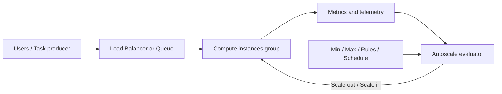
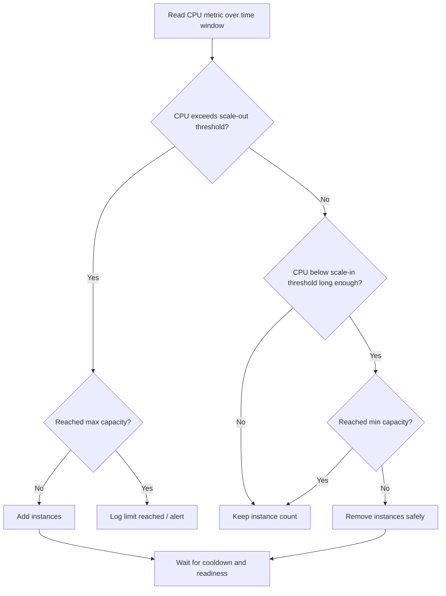
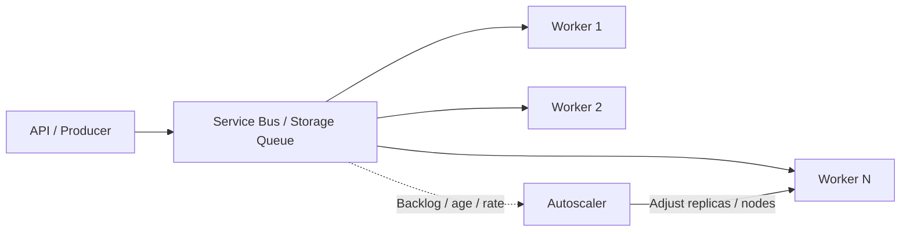
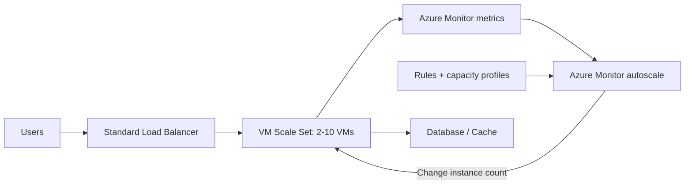
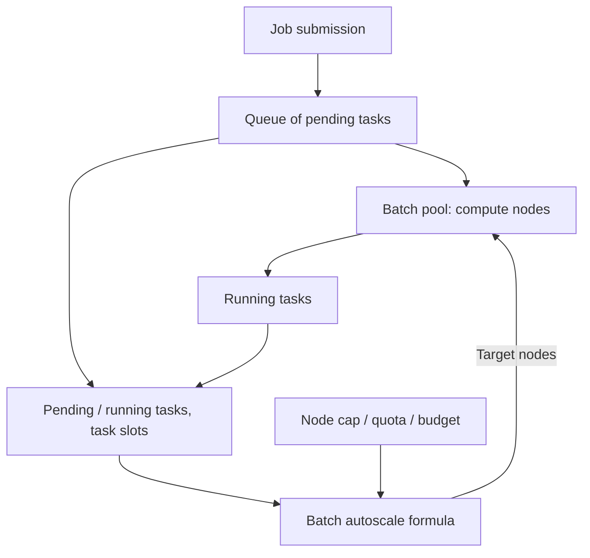

# Autoscaling by metrics, schedule, and workload demand

An application hosted on Microsoft Azure does not receive uniform traffic all day. Morning traffic may have only a few hundred users, peak hours thousands of concurrent users, and nighttime almost zero visits. A batch order-processing system can also accumulate tens of thousands of messages waiting after a data import. Keeping enough servers for peak hours 24 hours a day raises costs; keeping too few servers increases latency, backs up queues, and causes customer requests to fail.

**Autoscale** is the mechanism that automatically adjusts compute capacity based on defined signals or policies: performance metrics (**metric-based**), operating schedules (**scheduled**), and actual work demand (**demand-driven**). On Azure, how autoscale is configured depends on the target service: **Azure Monitor autoscale** can adjust the instance count of supported resources such as Virtual Machine Scale Sets (VMSS); whereas Azure Functions, Azure Container Apps, Azure Kubernetes Service (AKS), App Service, and Azure Batch have their own or complementary scaling mechanisms.

This lesson belongs to the **Elastic Compute and Batch Processing** chapter of the Microsoft Azure module. It covers how to select signals, calculate thresholds, combine multiple autoscale modes, set cost limits, test, and observe the system as compute capacity scales up or down.

## Learning objectives

After this lesson, you will be able to:

1. Distinguish **scale-out/scale-in** from **scale-up/scale-down**, as well as reactive vs. proactive autoscaling.
2. Design autoscaling by CPU, memory, or application metrics, with **thresholds, observation windows, cooldowns, and min/max capacity**.
3. Combine fixed schedules with metrics to pre-warm before peak hours and reduce resources off-hours.
4. Choose demand-driven signals such as request rate, queue length, pending tasks, or concurrency instead of relying solely on CPU.
5. Create and inspect **Azure Monitor autoscale** configurations for a VM Scale Set using the Azure CLI.
6. Compare autoscale mechanisms suited for VMSS, App Service, Azure Functions, Container Apps, AKS, and Azure Batch.
7. Evaluate scale-in risks, startup time, quotas, availability, security, monitoring, and cost.

## 1. What problem does autoscale solve?

Suppose a payment API runs on a VM Scale Set. One VM reliably handles around 200 requests/second based on load test results, while traffic varies from 200 to 1,200 requests/second. Always running eight VMs may cost more than necessary during quiet hours. Running only two VMs leaves the system unable to handle major traffic bursts.

An autoscale policy can start with two instances, add more when load signals cross a threshold, and remove instances when traffic stays low. However, this is **not** a guarantee of always having enough machines: creating instances takes time, quotas may be capped, downstream databases can become a bottleneck, and per-VM capacity is only an estimate from testing.



In this model, the **autoscale controller** changes resource counts, while **the load balancer, queues, application, and data components** must be designed to take advantage of that change. A new VM may be created successfully yet fail to serve traffic if the application is not ready or the health probe has not passed.

### 1.1. Scale out/in vs. scale up/down

| Strategy | Change | Example | Key considerations |
|---|---|---|---|
| **Scale out** | Increase instance count. | VMSS from 2 to 4 VMs. | Service must support multiple instances and load distribution. |
| **Scale in** | Decrease instance count. | VMSS from 6 to 3 VMs. | Requires connection draining, handling in-flight tasks, and protecting data. |
| **Scale up** | Increase configuration of an instance. | VM from 2 vCPUs to 4 vCPUs. | May require restart, SKU change, or downtime. |
| **Scale down** | Decrease configuration of an instance. | Choose a smaller VM size. | Easily hits CPU/RAM/IOPS limits during peak hours. |

Azure Monitor autoscale rules for VMSS primarily adjust **instance count**, i.e., horizontal scaling. Do not use the term "autoscale" to imply that every service automatically changes VM SKUs or database tiers; many services have distinct scaling mechanisms and different limits.

### 1.2. Reactive and proactive autoscale

**Reactive scaling** waits for a load signal to cross a threshold before adding resources. It works well when demand fluctuates and metric data arrives quickly enough. Its drawback is the delay between load increasing and new instances becoming ready.

**Proactive/scheduled scaling** increases instance counts **before** a predicted load window based on business hours or known events. It lowers the risk of overload while VMs/containers start up, though it can waste resources if expected load does not materialize.

**Demand-driven scaling** uses signals close to actual work demand, such as pending message count, concurrent requests, or unprocessed tasks. Many asynchronous processing systems use this approach more effectively than CPU metrics.

## 2. Three autoscale mechanisms to distinguish

| Mechanism | Trigger signal | Advantages | Risks |
|---|---|---|---|
| **Metric-based** | CPU > 70% for 10 minutes; rising latency; throughput exceeding threshold. | Reacts to actual system state. | Delayed data, wrong metric choice, adding VMs when bottlenecked at database. |
| **Scheduled** | 07:30 AM on workdays, report processing week, promotional season. | Prepares ahead of expected load. | Does not handle unexpected spikes if relying solely on schedules. |
| **Demand-driven** | Queue length, backlog age, pending tasks, active requests, concurrency. | Closely tied to volume of work to process. | Must handle poison messages, duplicates, long tasks, and startup time. |

The three approaches are not mutually exclusive. A web system can use a **schedule** to raise baseline capacity before a sale opens and **CPU metrics** to scale out further under heavy real load. A batch system can use **queue backlog** to calculate required workers, combined with a maximum cap to protect the budget.

## 3. Metric-based autoscale: understand signals before setting thresholds

A **metric** is a measurement with units, timestamps, and an aggregation method. Not every metric is suitable for deciding instance counts.

### 3.1. Commonly considered metrics

| Metric | Suitable workloads | Watch out for |
|---|---|---|
| **Percentage CPU** | CPU-bound Web/API or compute processing. | Low CPU does not mean the API is healthy; it may be waiting on database or I/O. |
| **Memory utilization** | RAM-bound workloads, caches, or in-memory processing. | Memory metrics are not available out-of-the-box on all resources; may need guest telemetry or custom metrics. |
| **Request count / request rate** | HTTP APIs with variable traffic. | One request can be very light or very heavy; correlate with concurrency/latency. |
| **Response latency / p95/p99** | Services with response-time SLOs. | Latency caused by downstream bottlenecks may not drop when adding compute. |
| **Queue length** | Asynchronous processing workers. | Total task count does not reflect individual task size or processing duration. |
| **Oldest message age** | Systems needing wait-time control. | Must understand retention, poison messages, and how the metric is measured. |
| **Custom business metric** | Active orders being processed, concurrent sessions, work per partition. | Needs consistent instrumentation; avoid noisy or manipulable metrics. |

For example, an API has 25% CPU but 3-second p95 latency due to slow SQL queries. Scaling from 3 VMs to 12 VMs can increase connections to the database and make the system **worse**. Before wiring a metric to autoscale, identify the true bottleneck via load testing and end-to-end request telemetry.

### 3.2. Parameters of a scale rule

A complete rule must answer:

1. **Which metric?** E.g., `Percentage CPU` on a VM Scale Set.
2. **Which aggregation?** Average, maximum, sum, or whatever the service supports.
3. **How long is the observation window?** E.g., average over the last 10 minutes.
4. **Compared against what threshold?** E.g., above 70% triggers scale-out.
5. **What action?** Add 1 instance, remove 1 instance, or a supported step size.
6. **How long is the cooldown?** E.g., 10 minutes after an action to prevent constant oscillation.
7. **Min/max constraints?** Never drop below 2 or exceed 10 instances.

**Example initial policy, not optimal production values:**

| Parameter | Scale out | Scale in |
|---|---|---|
| Metric | Average CPU | Average CPU |
| Condition | `> 70%` for 10 minutes | `< 30%` for 15 minutes |
| Instance change | `+1` | `-1` |
| Cooldown | 10 minutes | 15 minutes |
| Overall limits | Min 2, max 10 | Min 2, max 10 |

**Why do scale-out and scale-in thresholds differ?** If you scale out at CPU > 60% and immediately scale in at CPU < 60%, the system can repeatedly add/remove VMs around 60%. Separating thresholds (70% and 30%), combined with observation windows and cooldowns, creates **hysteresis** to reduce *flapping*.



The diagram illustrates the control concept; evaluation timing, rule combination behavior, and actual scale-in execution are handled by Azure Monitor autoscale according to configuration and resource type. Do not write a separate loop adding/removing VMs in parallel with autoscale without conflict control.

### 3.3. Measurement windows and metric delay

If CPU exceeds 70% for 20 seconds and returns to normal, a "10-minute average" policy may not trigger. This can be good for brief spikes, yet unsuitable if just 30 seconds of overload causes payment failures. Conversely, using instantaneous metrics easily amplifies noise.

To choose a window, consider:

- How fast load ramps up, and the application's allowable latency.
- How long Azure takes to collect/publish metrics, granularity, and possible missing metrics.
- Instance startup time and time to pass health/readiness checks.
- How quickly queues accumulate during under-provisioning and whether backlogs drain on their own.

Choose rules based on **measurements** and SLOs, rather than copying a CPU threshold from a tutorial across every workload.

## 4. Scheduled autoscale: preparing ahead of predictable load

Suppose an internal registration portal sees heavy usage from 08:00 to 18:00 on weekdays; off-hours traffic is low. Instead of waiting for CPU to spike at 08:00 before creating VMs, the system can raise **minimum/default capacity** before peak hours by a lead time matching startup and warm-up duration.

| Example time window | Suggested baseline | Can metric rules still apply? |
|---|---|---|
| Mon–Fri, 07:30–18:30 | Min 4, max 12 | Yes, to react to abnormal load. |
| Off-peak hours | Min 2, max 6 | Yes, preserves safety while limiting cost. |
| Known special event | Min 8, max 20 during approved window | Yes, but verify quotas and downstream systems. |

With **Azure Monitor autoscale**, **profiles** define capacity and rules, and you can choose a **recurring schedule** or **fixed-date schedule** depending on service capabilities and configuration UI. A scheduled profile can change min/max/default compared to other profiles. Organize schedules and the default profile clearly so the system does not remain stuck at high capacity off-hours.

### 4.1. Recurring schedule and fixed-date schedule

- **Recurring schedule:** repeats daily/weekly, e.g., Mon–Fri at 07:30. Fits business hours or nightly batch windows.
- **Fixed-date schedule:** a period with specific start/end dates, e.g., a promotional campaign or online exam. Fits planned peak events.
- **Default profile:** must be defined so the resource returns to normal behavior when no special schedule applies.

**Timezones matter:** when entering times in autoscale settings, verify the timezone identifier required by the service and daylight saving effects in DST regions. For systems operating in Vietnam (UTC+7), verify the config reflects the intended timezone. Never assume 07:30 on your laptop always equals 07:30 in resource configuration.

### 4.2. Schedules do not replace metrics

An unexpected event can happen outside scheduled hours. If you keep only schedules and remove dynamic rules, the application may lack capacity during a sudden traffic surge. Good designs typically set a **scheduled baseline** and let **metric rules** adjust further within the active profile's min/max bounds.

Conversely, creating overlapping schedules with conflicting capacity levels makes it hard to tell which profile is active. Maintain a precedence table, document owners, and test profile transition boundaries.

## 5. Demand-driven autoscale: queues, tasks, and concurrency

For asynchronous systems, CPU does not always reflect pending work. A worker might wait on I/O while thousands of messages sit in the queue; or CPU might be high on one heavy task while backlog is nearly zero. In such cases, consider **queue length**, **oldest message age**, **pending tasks**, **in-flight requests**, or relevant business signals.



Workers must process messages in a retryable way without duplicate side effects, and delete/ack messages only after completing work successfully per queue semantics. During scale-in, tasks must not be dropped with data loss.

### 5.1. Example: calculating capacity from queue backlog

Suppose a system has:

- **1,800 messages** waiting.
- Average processing time of **2 seconds/message**.
- Each worker instance steadily handles up to **4 concurrent messages**.
- Target to clear the current backlog in **5 minutes = 300 seconds**.

Estimate minimum workers assuming **no new incoming messages**:

\[
N_{\text{workers}}\;\approx\;\left\lceil\frac{B\times t}{T\times c}\right\rceil
\]

Where `B` is the message count, `t` is average seconds per message, `T` is the target time, and `c` is per-worker concurrency.

\[
N_{\text{workers}}\;\approx\;\left\lceil\frac{1{,}800\times 2}{300\times 4}\right\rceil=3
\]

**Three workers is only an ideal estimate.** In practice, account for incoming message arrival rate, processing time variance, provisioning time, errors/retries, effective concurrency, and downstream limits. If producers enqueue faster than consumers drain, backlog will continue growing right after scaling out.

Another method is measuring **arrival rate** (messages/second) and **service rate** (messages/second/worker):

\[
N_{\text{steady}}\gtrsim\left\lceil\frac{\lambda}{\mu}\right\rceil
\]

Where `λ` is message arrival rate and `μ` is effective processing rate per worker. Then add extra capacity to drain existing backlog within the required time. Monitor retry/dead-letter counts to avoid scaling workers endlessly on an unprocessable poison message.

### 5.2. Constraints that cause queue-based scaling to fail

| Issue | Consequence | Design solution |
|---|---|---|
| Messages have wildly varying processing times. | Queue length does not accurately represent total work. | Track processing time and oldest-message age; separate task queues by class. |
| Messages keep retrying or are poison. | Backlog stays high; autoscale constantly hits max. | Dead-lettering, retry budgets, alerts, and fixing root-cause bugs. |
| Downstream database/API has limits. | Adding workers overloads downstream further. | Rate limiting, concurrency caps, and dependency checks. |
| Worker is scaled in mid-processing. | Incomplete work, duplicates, or lost results if code is flawed. | Graceful shutdown, visibility lock/renewal, idempotency. |
| Provisioning takes several minutes. | Queue grows rapidly while waiting for new instances. | Minimum warm instances or scheduled scale-out before batch runs. |
| Max capacity too low or insufficient quota. | Fails task-processing SLOs. | Capacity planning, quota reviews, and saturation alerts. |

## 6. Different Azure services have different autoscale mechanisms

There is no single autoscale command for every Azure service. Choose the mechanism matching the resource you actually operate.

| Service | Common scaling mechanism | Signals and conditions to check |
|---|---|---|
| **Virtual Machine Scale Sets (VMSS)** | **Azure Monitor autoscale** adjusts instance count; VMSS may also integrate other scaling features depending on config. | CPU, supported metrics, min/max, and instance readiness. |
| **Azure App Service** | Scale out per App Service plan capabilities and **Azure Monitor autoscale** or built-in **automatic scaling** options, depending on tier/features. | CPU, memory/request load per supported mode; plan limits, warm-up. |
| **Azure Functions** | Event-driven scaling per hosting plan (Consumption, Flex Consumption, Premium, or other supported plans). | Event counts, trigger concurrency, max instances, cold starts. |
| **Azure Container Apps** | **KEDA**-based scale rules, including HTTP and many other event sources as supported. | Min/max replicas, queue/event scalers, cooldown, and revisions. |
| **AKS** | **Horizontal Pod Autoscaler (HPA)**, **Cluster Autoscaler**, **KEDA** for events; other complementary mechanisms. | Pod CPU/memory/custom metrics, available nodes, requests/limits, scheduling. |
| **Azure Batch** | Autoscale **compute node pool** capacity using Batch autoscale formulas on tasks/metrics or configured mechanisms. | Pending/running tasks, task slots, allocation time, job deadlines. |

For example, in **AKS**, HPA increases **pod replicas** but does not automatically add nodes if the cluster lacks resources to schedule pods. **Cluster Autoscaler** is the component that evaluates adding/removing nodes to fit pending pods, as configured. In **Container Apps**, event scaling can scale down to 0 replicas in supported configurations, but cold-start latency and workload type constraints must be factored in.

With **Azure Functions**, scaling behavior depends on hosting plan, trigger, concurrency settings, and runtime limits; do not copy a VMSS CPU threshold identically to Functions. With **App Service**, clearly distinguish App Service automatic scaling mode from Azure Monitor autoscale rules/profiles, as configuration and capabilities can differ.

## 7. Architecture combining VM Scale Set, Load Balancer, and Azure Monitor

A common pattern for self-managed web/APIs on VMSS:



Conditions for this model to work:

- VMSS already has proper VM image/configuration, networking, identity, bootstrapping, and health/readiness.
- The Load Balancer or ingress sends requests only to genuinely ready instances.
- New instances self-configure via cloud-init, extensions, or equivalent pipelines; operators never SSH in to configure manually.
- Sessions or critical job state do not live solely on a VM about to be removed; externalize state off the VM.
- Databases/caches/queues have enough capacity to absorb load after VMSS scales out.
- Min/max capacity, vCPU quotas, SKUs, and zones have sufficient resources or a fallback plan if new instances cannot be allocated.

**Autoscale and health probes solve two different problems.** Autoscale decides **how many instances are needed**; health/readiness decides **which instances can receive traffic**. If autoscale adds a machine whose app takes 8 minutes to become ready, a policy looking only at 1-minute CPU can react too late or trigger overlapping unnecessary scale actions.

## 8. Azure CLI hands-on: CPU-based VMSS autoscale

The example below uses an **existing VM Scale Set** to focus on scaling configuration without creating a new VMSS. Commands modify target instance counts when conditions occur; run only in a lab environment authorized for capacity changes and cost.

### 8.1. Prerequisites

- A subscription logged into Azure CLI and a resource group containing the VMSS.
- Management permissions on the VMSS granted to the operator identity, using an SKU/tier supporting the corresponding autoscale features.
- Azure Monitor exposing the `Percentage CPU` metric for the target VMSS.
- Existing image, health checks, load balancing, and safe instance add/remove behavior.
- Verified compute quotas, maximum capacity, budget plan, and scale-in impact.

Azure CLI options may vary across versions/extensions; check `az monitor autoscale -h` and current documentation in your environment if differences appear. Examples use Bash syntax; replace placeholders with real values.

### Step 1. Identify the target resource

```bash
az login
az account list --output table
az account set --subscription "<subscription-id>"

RG="rg-compute-lab"
VMSS="vmss-api-lab"
AUTOSCALE="autoscale-api-lab"

VMSS_ID="$(az vmss show \
  --resource-group "$RG" \
  --name "$VMSS" \
  --query id --output tsv)"

az vmss show \
  --resource-group "$RG" \
  --name "$VMSS" \
  --query "{name:name,location:location,sku:sku.name,capacity:sku.capacity,id:id}" \
  --output json
```

Confirm `VMSS_ID` is the intended resource and current capacity matches your plan. **Never** paste a production VMSS ID into a lab exercise and run it immediately: autoscale can delete/add instances of a live workload.

### Step 2. Create an autoscale setting with min/max bounds

```bash
az monitor autoscale create \
  --resource-group "$RG" \
  --name "$AUTOSCALE" \
  --resource "$VMSS_ID" \
  --min-count 2 \
  --max-count 10 \
  --count 2
```

`min-count` and `max-count` are capacity guardrails. `count` defines the default capacity in the created profile; do not mistake it for a guarantee to **immediately** scale the VMSS to exactly 2 instances regardless of configuration and evaluation schedule. Next, add rules and verify the configuration. For critical apps needing high availability, min = 2 is only an example; choose the baseline from zone requirements and SLOs.

### Step 3. Add a rule to scale out on high CPU

```bash
az monitor autoscale rule create \
  --resource-group "$RG" \
  --autoscale-name "$AUTOSCALE" \
  --condition "Percentage CPU > 70 avg 10m" \
  --scale out 1 \
  --cooldown 10
```

Meaning: if average CPU over the observation window satisfies the rule, autoscale can add **one instance** within min/max bounds while respecting cooldown and service evaluation rules. `avg 10m` is Azure CLI autoscale condition syntax, not Prometheus query syntax.

### Step 4. Add a rule to scale in on sustained low CPU

```bash
az monitor autoscale rule create \
  --resource-group "$RG" \
  --autoscale-name "$AUTOSCALE" \
  --condition "Percentage CPU < 30 avg 15m" \
  --scale in 1 \
  --cooldown 15
```

The scale-in rule uses a lower threshold and longer window to reduce premature scale-in. For workloads holding long sessions, in-flight jobs, or requiring draining, **verify instance termination policies and graceful shutdown behavior** before enabling automatic scale-in in production. Adding a low-CPU rule does not mean Azure will safely stop a VM running an application-level job.

### Step 5. Inspect autoscale and VMSS configuration

```bash
az monitor autoscale show \
  --resource-group "$RG" \
  --name "$AUTOSCALE" \
  --query "{name:name,enabled:enabled,target:targetResourceUri,profiles:profiles[].{name:name,capacity:capacity,rules:rules}}" \
  --output json

az vmss show \
  --resource-group "$RG" \
  --name "$VMSS" \
  --query "{name:name,capacity:sku.capacity}" \
  --output json
```

Verify target resource, capacity, and saved rules. **Simply reading configuration does not prove scaling works**; monitor metrics, autoscale run history, Activity Log, and actual instance counts under appropriate load.

### Step 6. Controlled load test

In the lab, generate test traffic using an organization-approved load test script—do not send high request volumes to production or third-party systems. Observe:

1. Does the CPU metric rise on the exact resource/dimension watched by the rule?
2. Does Azure Monitor autoscale log corresponding evaluation/scale action events?
3. Does instance count increase within max bounds without allocation/quota errors?
4. Do new instances complete provisioning, bootstrapping, and health/readiness?
5. Do application latency and error rates improve once new instances begin serving?
6. When load stops, does the system scale in safely and return to baseline?

Record results to tune thresholds/cooldowns. Do not conclude a policy works just because CPU dropped: that may be because the test ended, not because of autoscale.

### Step 7. Lab cleanup

If this autoscale setting belongs solely to the lab and is confirmed not to affect other workloads, administrators can delete the test setting following internal procedures. Do not arbitrarily delete the VMSS or resource group, as they may hold shared resources. Re-verify **instance count, running VMs, and cost** after finishing.

## 9. Configuring schedules in the Azure Portal

To illustrate combining schedules and metrics without relying on deployment template syntax, **recurring profiles** of Azure Monitor autoscale can be configured in the Azure Portal on supported resources:

1. Open the target VM Scale Set, locate **Scaling** (or the corresponding autoscale section), and switch to Azure Monitor-based configuration if supported.
2. Create or inspect an autoscale setting containing a default profile with min = 2, max = 6, default = 2.
3. Create a scheduled profile for workdays starting at **07:30** in the verified timezone, e.g., min = 4, max = 12, default = 4.
4. Define rules inside the profile as needed, or verify they apply properly when the profile takes effect.
5. Configure the return path to the off-hours/default profile and holiday handling; test behavior at profile transition boundaries.
6. Monitor instance counts and autoscale history for at least one schedule cycle before production rollout.

If the Portal or resource type has a different UI, follow that service's autoscale configuration approach; do not assume every Azure resource has the exact same Autoscale page. For fixed-date campaigns, consider a fixed-date profile with explicit end times.

**Avoid scheduling scale-in right when the system processes end-of-day transactions.** If an API must finish long requests or workers are writing results, allow proper drain and retry time, or schedule scale-in after the batch completes.

## 10. Azure Batch: autoscaling by task count

**Azure Batch** runs batch jobs on compute nodes inside a **pool**. Unlike a web API, Batch typically focuses on **pending tasks**, **running tasks**, task slots per node, and job completion deadlines. With Azure Batch, pool autoscale can use **Batch autoscale formulas** referencing service-provided variables/metrics.

### 10.1. Batch autoscale model



A simple principle is adding nodes when pending tasks rise and removing nodes when no tasks await. However, one task might take 2 seconds or 2 hours, so formulas must also consider task slots, processing speed, and node allocation time.

**Conceptual pseudocode (not a Batch formula you can paste directly):**

```text
pending = numberOfPendingTasks()
running = numberOfRunningTasks()
slotsPerNode = configuredTaskSlotsPerNode

requiredNodes = ceil((pending + running) / slotsPerNode)
targetNodes = clamp(requiredNodes, minNodes, maxNodes)

if thereAreRunningTasks and scaleInIsRequested:
    applyAppropriateNodeDeallocationPolicy()
```

In real deployments, the **Azure Batch formula language** has specific variables, functions, sample intervals, and rules; translate pseudocode into Batch-supported syntax and test the formula before enabling autoscale. Choose a **node deallocation** policy to handle running tasks when shrinking nodes. Some scenarios keep warm nodes to reduce allocation/task startup delay; **scaling to 0** is suitable only when jobs and infrastructure allow it.

### 10.2. Optimizing for job deadlines

Suppose 20,000 tasks must finish before 06:00. If each node processes an average of 100 tasks/hour and only 2 hours remain, an ideal estimate is 100 nodes, before accounting for failures, job overhead, and quotas. If the Azure Batch pool has a max quota of 40 nodes, autoscale **cannot bypass quota limits on its own**. You must request appropriate quotas, optimize parallelism, adjust deadlines, or distribute workloads under an approved architecture.

For jobs using spot/low-priority nodes where supported by the service, factor in preemption risk and task retry capabilities. Never treat a target node number from a formula as a guarantee that all nodes will allocate and all tasks will finish on time.

## 11. Choosing min/max capacity based on SLOs and budget

A sound autoscale policy can start from three levels:

- **Min capacity:** sufficient for baseline traffic, maintaining availability, and limiting cold starts.
- **Max capacity:** caps costs and protects downstream systems/quotas; do not simply pick a huge number for peace of mind.
- **Default capacity:** standard level when profiles or metrics trigger no scale action; must fit normal load.

### 11.1. Calculating capacity from measured load

Suppose load testing shows each VM reliably serves **120 requests/second** while keeping CPU and p95 latency within SLO. Forecast peak load is **600 requests/second** with a **20%** redundancy factor:

\[
N_{\text{peak}}=\left\lceil\frac{600\times1.2}{120}\right\rceil=6
\]

**Six VMs is a preliminary planning value** that must be validated across load levels, connection distributions, VM bandwidth/IOPS limits, databases, and caches. If a VM takes 4 minutes to become ready, scale-out thresholds must trigger **before** the system hits its capacity ceiling, or use scheduled warm capacity for known load waves.

### 11.2. Is Min = 0 appropriate?

Some event-driven/serverless platforms support scaling to 0, saving cost when idle. However, **VM Scale Sets, App Service plans, and other hosting types do not share the same capabilities or semantics**. For services requiring persistent connections, background work, or tight p99 latency, min = 0 can cause cold starts or may not be supported.

Do not mandate "min = 0 for all test environments" when the platform disallows it or the app needs to finish background work. Read the scale-to-zero and billing policies of the specific service.

### 11.3. Cost is more than per-VM price

```text
Approximate elastic compute cost
  = runtime of compute instances / replicas
  + disks / networking / load balancing / public IPs
  + data transfer and downstream services
  + logs, metrics, alerts, and related services
  + startup overhead, temporary data, and operations
```

Scale-in lowers compute charges when load genuinely falls, yet does not necessarily eliminate storage or other infrastructure fees. For example, disks, IPs, or log retention may still incur charges under their respective policies. Use the **Azure Pricing Calculator** to estimate and **Azure Cost Management** to monitor actuals; set budget alerts, tags, and owners on autoscale configurations.

## 12. Preventing flapping, scale storms, and unsafe scale-in

### 12.1. Flapping and scale storms

**Flapping** is when instance counts repeatedly bounce up and down around a threshold. A **scale storm** occurs when rapid scaling actions trigger continuously, keeping infrastructure busy provisioning without improving load handling.

Mitigations:

1. Use **different scale-out and scale-in thresholds**.
2. Scale in over a longer window if workload fluctuates sharply.
3. Choose a cooldown aligned with instance creation and system stabilization times.
4. Do not run multiple automations/controllers modifying instance counts simultaneously without clear ownership policies.
5. Set max capacity and alert when pegged at max, instead of assuming infinite VMs fix every bug.

When multiple rules exist in an Azure Monitor autoscale profile, evaluation of scale-out and scale-in conditions may not simply be "whichever rule matches runs immediately." Verify Azure Monitor rule-combination semantics, especially when CPU is low while request rate is high, to avoid scaling in against demand.

### 12.2. Scale-in requires draining work

Risks when removing instances:

- The terminated VM is serving a long request or WebSocket/session state.
- A worker holds a message lock without having persisted results.
- A Batch node still has running tasks.
- Local disk holds data not yet flushed to durable storage.

Applications must handle **termination signals**, stop accepting new work, let in-flight requests/tasks complete within a bounded period, checkpoint where applicable, and support retries/idempotency. Instance hold duration and drain mechanisms depend on the platform (VMSS, AKS, Container Apps, Batch); no autoscaler implements business-level drain logic automatically.

### 12.3. Scaling out does not fix downstream bottlenecks

If a database accepts only 200 connections and 20 VMs each open 30 connections simultaneously, scaling can cause a connection storm. Account for **connection pools**, caching, rate limiting, backpressure, and database/queue capacity. An autoscale metric may look great at the compute tier while harming the data tier if overall limits are missing.

## 13. HA, Availability Zones, and quotas during autoscale

**Autoscale is not High Availability (HA).** HA requires eliminating single points of failure; autoscale adjusts instance counts with load. For VMSS:

- Distribute instances across **Availability Zones** when VMSS/region/SKU supports it and architecture requires it.
- Configure health probes and application resilience to remove failed instances from traffic.
- Verify vCPU/SKU quotas, region/zone capacity, and peak allocation availability.
- Maintain **min capacity sufficient to survive losing an instance or zone** per availability targets; avoid min = 1 when VM fault tolerance is required.
- Consider autoscale behavior when a region or zone runs out of capacity. Have a fallback plan if scaling is rejected.

For instance, min = 3 with all three VMs in one fault domain may fail zone-resiliency requirements. Conversely, placing one VM in each of three zones is insufficient if the application relies on a non-HA SQL instance or an unavailable secrets store.

For multi-region scaling, separate global traffic routing, data replication, and failover mechanisms are required. Azure Monitor autoscale on a single-region VMSS **does not automatically expand into another region** during a regional outage.

## 14. Observing autoscale and designing alerts

Evaluating autoscale by VM count alone is insufficient. Observe **load → scale decision → provisioning → readiness → application SLOs → cost** together.

| Signal to track | Question to answer | Suggested alert |
|---|---|---|
| Autoscale actions / run history | Which rule scaled up/down and when? | Failed scale action or abnormal oscillation. |
| Current vs. desired instance count | Is the system reaching target capacity? | Desired > actual prolonged, provisioning errors. |
| CPU/memory and saturation | Is compute still the bottleneck? | High CPU/queue pressure even at max capacity. |
| Request latency, error rate | Did SLOs improve after scaling? | p95/p99 or 5xx crossing thresholds. |
| Backlog and oldest-message age | Is work actually draining? | Continuously growing backlog age, retries/dead-letters. |
| Startup, readiness, health | Do new instances become ready fast enough to serve? | Abnormal warm-up time or unhealthy backends. |
| Allocation/quota and cost | Were scale-outs rejected due to quota; did costs spike unexpectedly? | Quota saturation, budget/cost anomalies. |

**Azure Activity Log** helps investigate management-plane changes. For Azure Monitor autoscale, inspect corresponding scaling events, metric charts, and service diagnostic/alert settings. Activity Log is not full application telemetry or per-HTTP-request logging.

During testing, record timestamps:

```text
10:00:00  Traffic begins increasing
10:02:00  CPU/request/queue crosses threshold
10:12:00  Metric window satisfies rule and triggers scale action
10:15:00  New instance finishes provisioning
10:17:00  Instance is healthy and begins receiving traffic
10:19:00  p95 latency returns within SLO
```

These timestamps are **illustrative examples**, not Azure Monitor autoscale timing SLAs. Measuring real timings lets you decide whether to schedule earlier, pick leading signals, or shorten bootstrap duration.

## 15. Production autoscale design workflow

A step-by-step workflow avoids guesswork configuration:

### Step 1. Identify compute type and supported scaling mechanism

Distinguish VMSS, App Service, Functions, Container Apps, AKS, and Batch. Identify whether the scale target is VM count, replicas, pods, nodes, or pool nodes. Read the exact documentation and SKU/hosting-plan limits rather than applying one VMSS example to everything.

### Step 2. Define SLOs and budget

For example, `p95 latency < 500 ms`, `5xx rate < 0.5%`, or `95% of messages processed within 2 minutes`. Set a budget and maximum acceptable cost, including dependent resources.

### Step 3. Load test to establish single-instance capacity

Measure requests/second, CPU, memory, latency, IOPS, and database limits across concurrency levels. For batch, measure tasks/second or task duration and effective task slots.

### Step 4. Choose primary metric and protective signals

CPU suits CPU-bound workloads; backlog suits workers; concurrency can suit HTTP/event-driven services. Combine leading signals with downstream monitoring. Set thresholds from real data, not round numbers alone.

### Step 5. Set min/max/default and schedules

Min satisfies HA and cold-start targets; max respects quotas, downstream capacity, and budgets. If predictable load windows exist, add scheduled profiles or platform-supported scheduling.

### Step 6. Design safe scale-in

Ensure draining, retries, idempotency, state externalization, and checkpointing. For long-running batch jobs, understand task-handling policies when nodes are removed.

### Step 7. Test anomalies and monitor continuously

Test sudden spikes, prolonged low traffic, downstream failures, single-zone outages, quota exhaustion, missing metrics, poison queues, unhealthy instances, and schedule transitions. Record outcomes to refine configuration and thresholds.

## 16. Common mistakes and fixes

| Mistake | Why is it risky? | Fix |
|---|---|---|
| Relying on CPU alone for every workload. | Low CPU can hide large backlogs or database bottlenecks. | Pick metrics aligned with workload demand and SLOs. |
| Scaling out after a few seconds of high CPU. | Noise causes flapping and unnecessary VMs. | Observation windows, cooldowns, hysteresis. |
| Using the same threshold for scale-out and scale-in. | Instance count oscillates continuously. | Separate scale-out/scale-in thresholds and windows. |
| Ignoring VM startup time. | New VMs arrive after overload has already occurred. | Scheduled warm-up, leading signals, faster bootstrap. |
| Setting a huge max capacity "to be safe." | Uncontrolled costs and downstream pressure. | Base max on capacity tests, quotas, and budget. |
| Removing workers mid-task. | Lost work, duplicate retries, or corrupted data. | Graceful shutdown, idempotency, deallocation policies. |
| Scaling compute while ignoring the database. | Downstream bottleneck worsens; latency does not improve. | Full-stack capacity plan, connection pooling, backpressure. |
| Configuring schedules without handling unexpected spikes. | System can overload outside scheduled peak hours. | Combine scheduled baselines with metric/demand rules. |
| Assuming AKS HPA provisions enough nodes automatically. | Pods scale up but stay Pending without nodes. | Pair HPA/KEDA with Cluster Autoscaler as needed. |
| Checking Azure VMSS capacity without checking health. | Unready new instances count toward capacity. | Health checks, readiness, SLOs, and scale activity. |
| Assuming autoscale always succeeds. | Quotas or regional capacity can block allocation. | Alerts, quota planning, load shedding, and DR. |

## 17. Case study: web API and batch order processing

An e-commerce platform on Azure has two workload groups:

**Group A — Web API:** deployed on a VM Scale Set; traffic surges from 11:30 to 13:00 and 18:00 to 21:00. New VMs need about three minutes to become ready. The company wants p95 latency under 400 ms and must tolerate losing one VM.

**Group B — Order-processing workers:** messages sit in a queue; each task takes 1 to 20 seconds, and during certain hours task volume jumps fivefold. Workers must finish messages before stopping, support retries, and never create duplicate orders.

### Proposed design

1. For **Group A**, maintain HA-sufficient min capacity, configure CPU or application metrics to scale out with load, scale in conservatively, and add **scheduled warm-up** ahead of 11:30 and 18:00 matching real startup times.
2. For **Group B**, prioritize scaling on backlog/oldest-message age via a mechanism suited to the worker platform (such as Container Apps/KEDA or another supported event-driven scaler). Cap per-worker concurrency based on database capacity.
3. For both, set **max capacity** based on quotas, compute pricing, and downstream capacity; add alerts when hitting max while SLOs remain degraded.
4. Use **managed identity**, RBAC, network restrictions, and security logging; do not expose public management endpoints when adding VMs.
5. Implement **graceful shutdown** for workers, bounded retries, and idempotency keys in order business logic.
6. Monitor request latency, error rates, queue age, autoscale events, VM/pod readiness, and cost; load test both peak ramp-up and scale-down.

### Self-check questions

1. Why is a scale-out schedule before 11:30 useful even with a CPU > 70% rule?
2. Why is low worker CPU insufficient to conclude the queue has been cleared?
3. What states must scale-in protect while a worker is processing a task?
4. If HPA scales up pods but AKS has no nodes left, which component needs checking?
5. Why does reaching max instances not mean autoscale has met the SLO?
6. When a business has a fixed budget but unbounded traffic, should max capacity increase indefinitely?

**Answer hints:** Scheduled scaling prepares capacity during startup time; CPU does not directly reflect backlog; in-flight tasks and data must be protected via shutdown/retries; AKS needs node capacity/Cluster Autoscaler; downstream bottlenecks/quotas/health can still degrade SLOs; every design must cap capacity and apply backpressure, job prioritization, or graceful degradation when exceeding limits.

## 18. Pre-production checklist for enabling autoscale

- [ ] Identified exact service, scaling target, and supported autoscale method.
- [ ] Measured per-instance capacity and set SLOs for latency, error rate, or backlog age.
- [ ] Selected metrics reflect real load, with clear data sources, aggregation, and update cadence.
- [ ] Scale-out and scale-in have thresholds, windows, and cooldowns to reduce flapping.
- [ ] Min/default/max capacity accounts for HA, quotas, downstream limits, and budget.
- [ ] For periodic load, schedules/profiles specify clear timezones, pre-peak lead times, and return-to-normal windows.
- [ ] For queues/batch, calculated throughput, pending/running tasks, concurrency, and poison-message handling.
- [ ] New instances bootstrap automatically and pass health/readiness before receiving traffic.
- [ ] Scale-in avoids data loss: graceful drain, retries, checkpoints, and idempotency.
- [ ] Tested quotas, allocation failures, zone failures, and hitting max autoscale capacity.
- [ ] Alerts configured for autoscale failures, latency, queue backlog, unhealthy instances, and cost anomalies.
- [ ] Azure RBAC/managed identity for automation and operations uses least-privilege scope.
- [ ] Rollback plan exists for rules/profiles along with an operational plan when scaling is unavailable.

## Conclusion

**Autoscale on Azure** adjusts compute capacity by **metrics**, **schedule**, and **workload demand**, balancing user experience with operational cost. **Metric-based scaling** reacts to system state; **scheduled scaling** prepares ahead of predictable load; **demand-driven scaling** suits queues, events, and batch jobs. Good configurations require **asymmetric scale-out/scale-in thresholds, observation windows, cooldowns, min/max capacity, readiness, and safe scale-in**, while understanding the distinct mechanics of VMSS, App Service, Functions, Container Apps, AKS, and Azure Batch. Ultimately, autoscale is only effective when measured by **application SLOs, backlog, resilience, and total cost**, not simply the count of VMs created or deleted.
