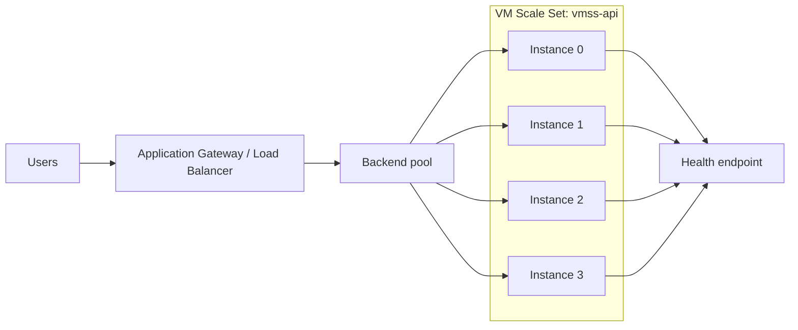
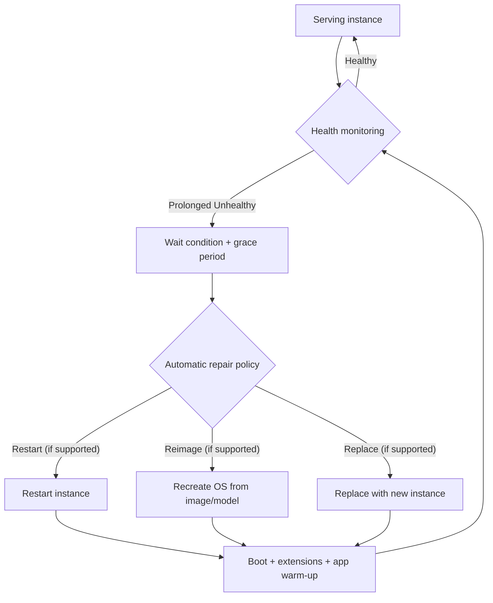
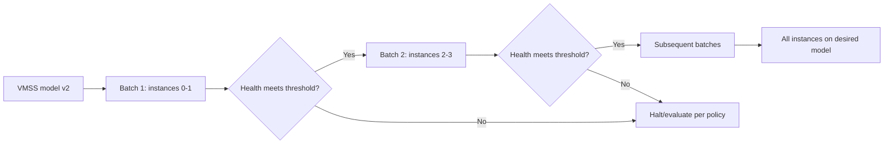
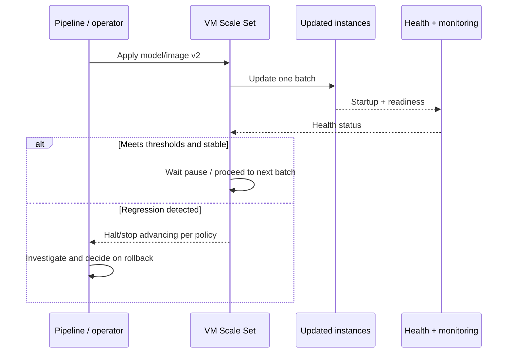
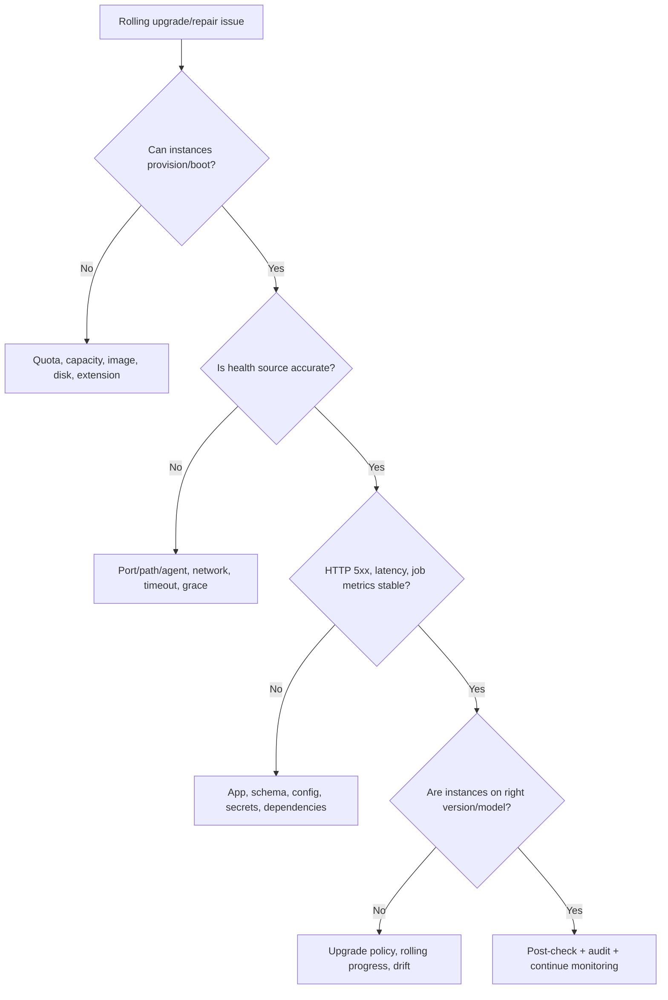

# Health checks, instance replacement, and rolling upgrades

An API running on **Azure Virtual Machine Scale Sets (VMSS)** may serve well when enough VMs are present, yet if an instance remains in the `Running` state while the application process has hung, the load balancer still risks sending requests to an unresponsive backend. When updating the application version or OS image for the whole group, upgrading everything at once can make the service unavailable. Therefore, operating elastic compute requires three coordinated capabilities: **health checks**, **self-healing or replacing unhealthy instances**, and **controlled rolling upgrades**.

This lesson belongs to the **Elastic Compute and Batch Processing** chapter of the `CLOUD_PROVIDERS_AZURE` module. As we explore Azure from subscriptions, resource groups, and Microsoft Entra ID through networking, compute, storage, data, security, monitoring, and cost control, these three mechanisms enable deploying workloads on VMSS without depending on manual per-machine administration.

## Learning objectives

After this lesson, you will be able to:

- Distinguish the state of **the VM**, **the application**, **eligibility to receive traffic**, and **the status of a batch processing task**.
- Choose the appropriate health signal: **Load Balancer health probe** or **Application Health Extension** in supported VMSS scenarios.
- Explain **automatic instance repairs**, the `gracePeriod` wait window, and the consequences of restart, reimage, or replace operations.
- Distinguish **autoscale**, **rolling upgrade**, **automatic OS image upgrade**, and **guest OS patching**.
- Design rolling upgrades with batch size, unhealthy thresholds, pause duration between batches, and stop/continue criteria.
- Inspect configuration and deployment status via the Azure Portal/Azure CLI, collect logs, and troubleshoot errors.
- Build a safe runbook for deploying a web/API or batch worker, including rollback, monitoring, cost, and recovery.

## 1. Why is a `Running` VM not necessarily a healthy instance?

An instance in a VMSS has multiple state layers:

| Layer | Signal example | What the signal proves | What it does **not** prove |
|---|---|---|---|
| **Compute/VM** | Azure reports the VM as `Running` | Machine is provisioned and powered on per platform state | HTTP API is responding or business logic works |
| **Guest OS** | Linux `systemd`, Windows Service Control Manager | OS process/service has a given state | Entire API and all dependencies are ready |
| **Network** | TCP to port `8080` connects | Network path and basic listener work | HTTP requests execute business logic correctly |
| **Application health** | `GET /health/ready` returns a valid code | App meets readiness criteria you defined | No errors occur in other transactions |
| **Load balancer probe** | Backend `Healthy` per probe | Backend passes the condition checked by the probe | All requests succeed with no client-side failures |
| **Job/task** | Job finishes with a checkpoint | Unit of work reached a confirmed processed state | Everything was committed if transaction/idempotency logic is missing |

For example, the VM has booted, the agent is running, and the TCP port is open, yet the application still needs two minutes to load configuration and connect to the database. If the scale set puts that instance into service immediately, a portion of requests will fail. **Readiness** must reflect when the instance can actually handle work, not merely when the VM reports running.

### Three useful types of health checks

- **Startup check:** has the application initialized enough to begin health evaluation? Useful for JVM/.NET, cache warm-up, or services running migrations.
- **Liveness check:** is the process deadlocked or in an unrecoverable state? Prolonged liveness failures may trigger a restart.
- **Readiness check:** should the instance receive **new traffic or jobs** right now? During shutdown, overload, or pre-readiness, readiness should flip before terminating the process.

This is an **application design pattern**. Azure VMSS/Load Balancer does not create these three endpoints or inherently understand their semantics. You must configure health signals compatible with the Azure feature in use and your application.

## 2. VM Scale Sets context: instances sharing a model

**Azure Virtual Machine Scale Sets** lets you deploy and manage multiple VMs from a desired configuration, combining scaling, updates, and monitoring. A common API design is:



In this example, VMs should be **replaceable** instances:

- Running the same approved application version.
- Taking configuration from an image, extension, or idempotent bootstrap.
- Having appropriate identity and backend permissions; never hardcoding secrets.
- Not storing sessions or critical data **only** on a single VM's OS/temporary disk.
- Exposing health endpoints and separate logs to detect failures before entering the pool.

### Flexible and Uniform orchestration

VMSS offers orchestration modes such as **Uniform** and **Flexible**. The deployment mode affects instance management, networking, upgrade policies, health reporting, and supported features. **Do not take a command/config meant for Uniform and blindly apply it to Flexible.**

Before enabling automatic repairs or rolling upgrades, verify:

1. Which orchestration mode the scale set uses.
2. Whether that mode supports the intended health/repair/upgrade mechanism.
3. Whether the image, region, API version, VM size, and backend type meet requirements.
4. Whether scale-in, instance updates, and VM management are compatible with the data architecture.

In this lesson, examples of **rolling upgrade policy and automatic repairs** are presented for VMSS models supporting those corresponding capabilities; check compatibility in Azure/CLI documentation for your deployment environment before applying.

## 3. Health signal #1: Load Balancer health probe

A **Load Balancer health probe** periodically checks backends over the configured protocol and port. With Azure Load Balancer, probes can use TCP or HTTP/HTTPS per supported capabilities. When an instance fails health thresholds, the Load Balancer can exclude it from selection for **new** flows according to the service's mechanism.

For example, a load-balancing rule accepts TCP/443, while the application exposes a health endpoint on port `8080`:

```text
Client HTTPS/TCP 443
      |
      v
Azure Load Balancer frontend
      |              \
      |               \----> Health probe: HTTP :8080/health/ready
      v
Backend VMSS instances
```

A health probe is **a platform measurement**, not the result of verifying real user business transactions.

### When is a probe appropriate?

- Distributing TCP/UDP or web applications behind Azure Load Balancer.
- Wanting unhealthy backends to stop receiving new traffic.
- Needing an instance health signal for VMSS features supported via LB probes.

### Common configuration mistakes

- **Wrong port or path:** app serves HTTP on `8080`, but the probe calls `80`.
- **Endpoint returns an unsuitable status code:** `/health` requires login or redirects to an SSO page; the probe fails even though the app is running.
- **Wrong binding:** service binds only to `127.0.0.1`, not on the private IP/interface reachable by the probe.
- **NSG/OS firewall:** probe traffic cannot reach the target port; inspect NSGs and Azure Load Balancer probe sources rather than opening the entire Internet indiscriminately.
- **Transient dependency failure:** health endpoint depends on a flaky shared service, marking all instances unhealthy at once.

**Health probes must be lightweight, stable, and meaningful.** A readiness endpoint should not run heavy database queries or call numerous external services on every probe. If every instance queries a struggling dependency simultaneously, probing can worsen the outage.

## 4. Health signal #2: Application Health Extension

The **Application Health Extension** is a VM extension that reports application health status per instance in supported VMSS scenarios. Instead of checking only a network port, it inspects an endpoint or health condition from inside the instance context as configured.

Supported platforms may have Linux/Windows extensions accordingly. Supported probe capabilities and health states depend on extension version, configuration, and orchestration mode. Before deploying, verify publisher/type/version and valid properties.

### Conceptual configuration sample

Example for an HTTP app listening on `8080`:

```json
{
  "protocol": "http",
  "port": 8080,
  "requestPath": "/health/ready",
  "intervalInSeconds": 10,
  "numberOfProbes": 3
}
```

**This configuration illustrates the concepts**, not an ARM/CLI payload usable verbatim. Field names, configuration placement, supported protocols, and extension versions must follow the official schema of the extension version used in your environment.

Some designs use **Healthy**, **Unhealthy**, **Initializing**, or **Unknown** states depending on reporting-mode capabilities. Do not assume every health extension option supports all advanced states or identical evaluation algorithms.

### Benefits

- Surfaces application health to VMSS via a supported mechanism.
- Enables repair/upgrade features to evaluate instances by **application health**, not just VM state.
- Decouples health measurement from frontend routing mechanisms in certain architectures.

### Limitations

- If the VM agent/extension fails, health reporting may be inaccurate or fall into unknown state.
- The signal is only as good as the readiness endpoint and probe configuration.
- An instance healthy in the application extension might still be unreachable by users due to NSGs, routes, DNS, TLS, or WAF.
- Requires managing versions, OS support, bootstrap, and extension installation permissions per policy.

### Which signal should you choose?

| Condition | Starting point | Reason |
|---|---|---|
| VMSS sits behind Azure Load Balancer and the model supports LB probe as health source | **LB health probe** | Built-in routing signal and traffic-acceptance verification |
| Need readiness/liveness reported from inside the VM, beyond LB probe results | **Application Health Extension** | Focuses on instance-level application health |
| Multiple frontends, App Gateway/Front Door present, yet VMSS repairs needed | Check **supported VMSS health monitoring mechanisms** | Do not assume gateway/edge health probes replace Application Health Extension |
| Workers not receiving HTTP traffic | Application Health Extension or appropriate supported monitoring | Worker health may not be visible via a web TCP port |

When configuring automatic repairs, Azure requires a compatible health information source. **Do not assume the same repair policy pairs with every probe type or works identically on Uniform/Flexible.** Verify an active, valid health source before enabling automatic instance destruction/replacement.

## 5. Building a `/health/ready` endpoint properly

Suppose the `inventory-api` web application runs on Linux and exposes three endpoints:

| Endpoint | Purpose | Example response |
|---|---|---|
| `GET /health/startup` | Has config/DI/cache initialization finished? | HTTP `200` once initialization succeeds |
| `GET /health/live` | Is the process in a basic operational state? | HTTP `200`, minimally dependent on external services |
| `GET /health/ready` | Is it safe to receive new requests? | HTTP `200` when ready; `503` if draining |

A simple response:

```http
GET /health/ready HTTP/1.1
Host: 10.40.1.5:8080

HTTP/1.1 200 OK
Content-Type: application/json

{"status":"ready","version":"v2.1"}
```

When an instance is deploying a new version or preparing to shut down:

```http
GET /health/ready HTTP/1.1
Host: 10.40.1.5:8080

HTTP/1.1 503 Service Unavailable
Content-Type: application/json

{"status":"draining"}
```

This is an **application endpoint** design; Azure does not generate this JSON payload automatically. Probes typically rely on HTTP status/conditions supported by the feature rather than parsing JSON fields.

### Key principles

1. Health endpoints **must not require interactive login**, cookies/sessions, or regular user tokens. Restrict network access and never return sensitive information.
2. Respond quickly, enforce clear timeouts, and avoid heavy checks.
3. Distinguish **local** failures (process deadlock, full disk, bad config) from **shared** failures (cluster-wide database outage). Do not auto-repair every instance because of one shared dependency.
4. Return readiness false when an instance cannot safely accept new requests; yet maintain a recovery or re-check strategy to avoid draining the entire pool on transient blips.
5. During deployment, include a **warm-up period** for image/extension/app startup. If too short, repair mechanisms may endlessly replace instances before the app becomes ready.
6. Track `version` or build ID via a separate endpoint or metadata to know which release is running; do not use a single health result as proof that code upgraded.

### Readiness differs from batch job health

A worker polling a queue may **process zero jobs** when the queue is empty and still be healthy. Conversely, a worker with a live process that fails to save checkpoints, repeatedly expires queue visibility timeouts, or fails jobs may be **unhealthy** functionally.

For workers, distinguish:

- **Worker readiness:** ready to pull new jobs?
- **Job progress:** which checkpoints were committed and is processing idempotent?
- **Capacity:** running jobs, queue depth, retries/backlog.

Azure VMSS instance repair **does not replace retry, checkpointing, and task management logic in Azure Batch or queue applications**.

## 6. Automatic instance repairs: detection and recovery

**Automatic instance repairs** is a VMSS capability that detects instances evaluated as **Unhealthy** by the configured health source and executes a repair action per policy. Depending on configuration and support level, actions can include **Replace**, **Reimage**, or **Restart**.



This is a high-level lifecycle model and **does not depict Azure's exact internal ordering or health algorithms**. Not every repair action is available for every VMSS mode, SKU, or image type.

### Comparing repair actions

| Action | Purpose | What to prepare |
|---|---|---|
| **Restart** | Restart the instance/VM per supported mechanism | App auto-starts; in-flight data has retries/checkpoints |
| **Reimage** | Recreate the OS from image/model | All OS customizations must be reproducible; OS/temporary disk data may be lost |
| **Replace** | Delete failed instance and create a replacement per scale set model | Resources/identity/network/app bootstrap must be recreatable; no state on a single VM |

**Replace does not mean "keep the old machine and fix software inside it."** Applications must follow a cattle-not-pets mindset: old instances can vanish, and new instances must self-configure and serve. If data lives solely on one instance's local disk, a replace policy can cause **data loss**.

### What is grace period?

`gracePeriod` is the protective/consideration window supported by the policy before a newly created or updated instance becomes eligible for repair, giving the application time to boot and recover. Distinguish grace period from:

- Probe polling interval.
- Number of failed probes before marking unhealthy.
- Connection drain duration.
- Pause duration between rolling batches.

For example, an app takes 4 minutes to load caches, 2 minutes to run migrations, and 1 minute to connect to backends: an overly aggressive repair configuration can loop **create → unhealthy → replace → create**. Measure real startup time and set grace/warm-up within feature bounds.

### Does repair guarantee self-healing?

No. If a new image has a configuration bug causing **every booting VM to be unhealthy**, repair can create a loop and increase costs. If the root cause is a database outage, spinning up new VMs will not fix the dependency. Therefore, automatic repairs must be paired with:

- Health signals distinguishing instance faults from shared system outages.
- Testing image/app bootstrap before enabling automatic repair.
- Alerts on **unhealthy percentage**, consecutive repairs, and image/extension failures.
- Runbooks to disable/adjust the policy via approval workflow if a repair loop is detected.

## 7. What is a rolling upgrade?

**Rolling upgrade** updates instances in **multiple small batches** rather than updating everything simultaneously. After each batch, the system checks health and policy conditions before proceeding to the remaining instances.

Suppose you have **10 instances** and want to update at most **20%** per wave. Conceptually, this organizes into groups of around **2 instances/batch**, allowing the rest to continue serving traffic while one group updates.



**Actual batch counts and rounding are calculated by VMSS based on configuration, scale, instance state, and product limits.** Do not rely on simple division to promise exactly how many machines will stop at once.

### Common upgrade policy modes

| Mode | General meaning | Key considerations |
|---|---|---|
| **Manual** | Model changes, but instances are not automatically updated; operators orchestrate application | Controls timing; must track model drift and update groups manually |
| **Automatic** | Model changes apply automatically per feature mechanism | Does not guarantee health-gated batching like Rolling |
| **Rolling** | Applied in batches with batch and health policies when supported by the mode | Requires valid health source, capacity headroom, and monitoring |

Do not confuse **upgrade policy mode** with **autoscale policy** or **automatic OS image upgrades**. These mechanisms are related but answer different questions.

### Autoscale vs. Rolling upgrade

**Autoscale:** "How many instances should there be?" For example, sustained high CPU raises desired capacity from 5 to 8.

**Rolling upgrade:** "In what sequence should existing instances be updated?" For example, updating image v1 to v2 while keeping a percentage of instances serving.

During rollout, autoscale may change the instance count. Plan **min/max capacity, scale-in cooldowns, unhealthy instance budgets, and headroom** so rollout does not cause capacity outages.

## 8. Key parameters of a Rolling upgrade policy

In supported configurations, a rolling upgrade policy typically includes:

| Parameter | Meaning | Considerations |
|---|---|---|
| `maxBatchInstancePercent` | Maximum percentage of instances in one batch | Larger batches finish faster but temporarily reduce serving capacity |
| `maxUnhealthyInstancePercent` | Overall unhealthy instance threshold tolerated during upgrade | If the fleet already has many unhealthy instances, rollout may halt before starting |
| `maxUnhealthyUpgradedInstancePercent` | Unhealthy threshold among upgraded instances | Helps catch regressions introduced by the new version |
| `pauseTimeBetweenBatches` | Pause duration between two batches in ISO duration format | Allows app warm-up, caches, and metrics to stabilize |
| Health probe/extension | Signal VMSS uses to evaluate health | Misconfigured probes can wrongly halt or wrongly advance rollout |

Additional properties such as prioritizing unhealthy instances, max surge, rollback behavior, or orchestration-mode support can vary by API/version. **Never apply optional properties without checking your VMSS features and schema.**

### Illustrative configuration example

```json
{
  "upgradePolicy": {
    "mode": "Rolling",
    "rollingUpgradePolicy": {
      "maxBatchInstancePercent": 20,
      "maxUnhealthyInstancePercent": 20,
      "maxUnhealthyUpgradedInstancePercent": 20,
      "pauseTimeBetweenBatches": "PT2M"
    }
  },
  "automaticRepairsPolicy": {
    "enabled": true,
    "gracePeriod": "PT30M",
    "repairAction": "Replace"
  }
}
```

This JSON is only a **conceptual property snippet**, **not a complete ARM/Bicep template or deployment command**. Valid values, property placement, health monitoring prerequisites, repair-upgrade interaction, and behavior can differ by API version and orchestration mode. `PT2M` means approximately two minutes in ISO 8601 duration syntax; `PT30M` similarly means 30 minutes.

**Do not copy illustrative configs directly into production.** First verify VMSS type, image model, and health source, then apply via peer-reviewed IaC in a test environment.

### Trade-off analysis

- **Small batches (e.g., 10%)**: lowers blast radius, yet extends total rollout time and increases warm-up/verification cycles.
- **Large batches (e.g., 50%)**: finishes faster, yet may exceed buffer capacity.
- **Strict unhealthy thresholds**: detects regressions quickly, yet may halt on transient unrelated blips.
- **Too-short pause**: next batch starts before caches, metrics, or traffic stabilize.
- **Too-long pause**: lengthens total deployment and prolongs mixed-version coexistence.

Choose settings based on **SLOs**, measured startup duration, capacity buffer, p95/p99 latency, acceptable degradation, and application failure history.

## 9. Does rolling upgrade equal automatic rollback?

**Do not assume so.** A rolling policy can halt/stop advancing when health breaches thresholds, but halting rollout and **reverting the entire fleet to the previous version** are two distinct operations.

A reliable rollback requires:

1. Retaining the image/package and configuration of the prior stable version.
2. Being able to build new instances from the old image repeatably (immutable images/IaC).
3. Managing database schemas in a **backward-compatible** manner while multiple versions run side by side.
4. Rules for connection draining and traffic restoration.
5. Clear criteria for **when to roll back** based on error rates, latency, health, and user impact.
6. Testing rollback from a broken release in a sandbox before production drills.

If an upgrade ran an **irreversible database migration**, reverting VMs to the old image may not restore the application. Compatible database and API versioning are essential parts of any rolling plan.

### Combining canary or blue-green

Rolling updates and **canary** are not mutually exclusive. You can:

- Deploy the new version to a small subset (canary).
- Observe HTTP 5xx, latency, business logs, and health for an adequate window.
- Once thresholds pass, expand rollout via rolling batches.

In some systems, **blue-green deployment** using two independent compute groups with traffic shifting fits better: prepare the new group, test it, then shift most traffic when ready. The trade-off is extra capacity and managing two environments.

## 10. Automatic OS image upgrades are not guest OS patching

To avoid choosing the wrong update mechanism, distinguish:

| Activity | What changes? | Who orchestrates? |
|---|---|---|
| **VMSS model rolling upgrade** | Applies a supported change in model/image/extension to instances in batches | VMSS per upgrade policy and operators |
| **Automatic OS image upgrade** | Updates instances when a new OS image releases per supported feature | Azure coordinating policy and image/VMSS conditions |
| **Automatic VM guest patching / Azure Update Manager** | Installs updates inside the guest OS per patching mechanism | Patching service/OS patching policy as configured |
| **CI/CD application deployment** | Application binary/container/package/config | Pipeline, image builder, extension, or rollout controller |

**Image upgrades** can swap the base OS image used to create instances; **guest patching** updates packages inside running VMs; and **app deployment** updates application code. Each has different schedules, health signals, risks, and rollback paths.

A VMSS pinned to a fixed image version may require an image lifecycle workflow via Azure Compute Gallery or a custom image pipeline; do not assume every custom image supports automatic OS image upgrades like marketplace images.

## 11. Safe upgrade sequence from v1 to v2

Suppose `vmss-api-prod` has 12 instances running API v1 behind Azure Load Balancer, and the app must continuously handle 1,000 requests/second.

### Phase A — Preflight

1. **Clearly identify v1/v2 models:** image ID, application package checksum, extension versions, runtime, config, and schema.
2. **Stable health:** all baseline instances report healthy from a reliable source; any existing errors are explained.
3. **Capacity headroom:** while one batch updates, remaining instances still handle normal load plus redundancy buffer.
4. **Dependencies:** databases, message queues, caches, Key Vault, DNS, storage, and networking have no incompatible changes.
5. **Permissions:** CI/CD identity holds required VMSS management roles at narrow scope, with no secrets stored in code.
6. **Rollback:** v1 image, v1 config, and revert plan remain available; database schema supports side-by-side execution.
7. **Observability:** dashboards/alerts are ready for success rate, latency, unhealthy count, repair count, and capacity.

### Phase B — Canary

Deploy v2 to a very small group in a manner supported by the architecture; verify:

- `/health/ready` succeeds after warm-up.
- No spike in `HTTP 5xx`, timeouts, or error logs.
- Storage/database access and identity succeed without errors.
- Critical business transactions work across both old and new clients.

Do not use **a single passing probe** as the sole acceptance criterion for canary.

### Phase C — Rolling batches

With 20% batches and adequate buffer capacity:



Throughout the process, watch **both** VMSS health and API request-level metrics. If the API returns `200` on probes while payment failure rates surge, evaluate halting rollout even if health probes remain green.

### Phase D — Post-check

1. Verify all instances in target scope run the expected model/image version.
2. Unhealthy ratio returns to baseline; no pending batches or unexpected old-model instances remain.
3. Test HTTP/TCP, transactions, logs, and critical dependencies.
4. Verify autoscale, backup/DR, DNS, load-balancer pools, and alerts.
5. Record the runbook, approvers, deployment timestamps, before/after metrics, and any remediation actions.

## 12. Inspecting VMSS in the Azure Portal

In the Portal, operating within an authorized subscription:

1. Open **Virtual machine scale sets**, select `vmss-api-lab` or your assigned scale set.
2. Inspect **Overview/Instances**: desired capacity, individual instances, provisioning state, power state, and health/extension status if supported.
3. Check **Orchestration mode** to confirm Uniform or Flexible.
4. Inspect **Upgrade policy**: Manual/Automatic/Rolling, rolling parameters, and model update mechanics.
5. Check the **health monitoring** source: Application Health Extension or Load Balancer probe per design; verify linkage to the right backend/pool and VMSS.
6. Locate **Automatic repairs/Health and repair** (or equivalent per UI/feature); check enabled status, action, and grace period.
7. Open **Activity Log** and **Metrics**; correlate recently added, repaired, reimaged, or replaced instances.
8. If a rolling upgrade is running, open rolling upgrade progress/status to see batches, failures, and completion percentage.

Portal menu locations vary by UI version and VMSS mode. If an option is missing, do not assume it is hidden arbitrarily: check **orchestration mode, API compatibility, image, region, and access permissions**.

## 13. Azure CLI: observing configuration, health, and rolling progress

The following illustrative commands **only read state** of an existing VMSS. Do not create, modify, or upgrade production resources without an approved plan.

### 13.1 Select subscription

```bash
az login --tenant "<tenant-id>"
az account set --subscription "<subscription-id>"

az account show \
  --query "{subscription:id,tenant:tenantId,name:name}" \
  --output json
```

### 13.2 Check model, upgrade, and repair policy

```bash
az vmss show \
  --resource-group "rg-elastic-lab" \
  --name "vmss-api-lab" \
  --query "{name:name,orchestration:orchestrationMode,capacity:sku.capacity,upgrade:upgradePolicy,repairs:automaticRepairsPolicy}" \
  --output json
```

Key fields to verify:

- `orchestrationMode`: which model the VMSS uses.
- `sku.capacity`: desired instance count per model at query time.
- `upgradePolicy.mode` and `rollingUpgradePolicy`: policy governing update rollout.
- `automaticRepairsPolicy`: instance repair configuration if supported and configured.

If a field is absent or `null`, do not immediately assume the feature is off. Check the full JSON, API version, orchestration mode, and product docs in your environment.

### 13.3 List instances

```bash
az vmss list-instances \
  --resource-group "rg-elastic-lab" \
  --name "vmss-api-lab" \
  --query "[].{instanceId:instanceId,name:name,provisioningState:provisioningState}" \
  --output table
```

View instance-level status (when supported by command and mode):

```bash
az vmss get-instance-view \
  --resource-group "rg-elastic-lab" \
  --name "vmss-api-lab" \
  --instance-id "0" \
  --output json
```

`instanceId` is an example; retrieve actual IDs from the list output. Flexible orchestration may manage member VMs differently from Uniform; when CLI does not support an operation on your scale set, use individual VM commands or mode-appropriate APIs instead of guessing dummy IDs.

### 13.4 Check latest rolling upgrade progress

```bash
az vmss rolling-upgrade get-latest \
  --resource-group "rg-elastic-lab" \
  --name "vmss-api-lab" \
  --output json
```

If no rolling upgrade has occurred or the CLI/scale set does not support this operation, no relevant result may be returned. Check `az vmss rolling-upgrade -h` and Azure Activity Log to confirm what kind of upgrade took place.

### 13.5 Check Azure Load Balancer health probes

When VMSS uses a Load Balancer backend pool:

```bash
az network lb probe list \
  --resource-group "rg-elastic-lab" \
  --lb-name "lb-api-lab" \
  --query "[].{name:name,protocol:protocol,port:port,requestPath:requestPath,interval:intervalInSeconds,threshold:numberOfProbes}" \
  --output table
```

This command reads probe configuration; it **does not prove instances recently passed probes**. Diagnosis requires combining backend status, network/NSGs, VM agent/extension state, application logs, and load balancer telemetry.

### 13.6 Retrieve resource ID for monitoring

```bash
VMSS_ID=$(az vmss show \
  --resource-group "rg-elastic-lab" \
  --name "vmss-api-lab" \
  --query id \
  --output tsv)

echo "$VMSS_ID"
```

Use this resource ID to locate Metrics, Activity Log, and alert configurations in the Portal/Azure Monitor. Metric names can vary by resource type and feature; inspect metric definitions on the actual resource rather than assuming all VMSS emit the exact same metric set.

## 14. Controlled rolling deployment: operational policy example

Suppose a deployment team has:

| Component | Example |
|---|---|
| VMSS | `vmss-api-prod` |
| Initial instance count | 10 |
| Current image | `api-image:v1` |
| New image | `api-image:v2` |
| Health source | Application Health Extension or LB probe per supported capability |
| Health endpoint | HTTP `GET /health/ready` on port `8080` |
| Desired batch | Up to ~20% |
| Grace/warm-up | Measured in practice, e.g., app takes 5 minutes to become ready |
| Release gate | No error-rate/latency increase beyond approved thresholds |

### Step-by-step runbook

**Pre-deploy:** run health checks from the actual network/probe source, read VMSS state, snapshot model configuration, and record baseline p95 latency, 5xx, CPU/memory, and unhealthy instance count.

**Apply new model:** build/publish tested image v2, update VMSS model via IaC/supported workflow. This requires change permissions, approval, and a deployment window. Never push unvalidated schema configs via ad-hoc CLI in production.

**Observe first batch:** confirm instances upgraded and `/health/ready` passed, and also execute representative synthetic transactions. If app startup takes 5 minutes, do not base acceptance solely on the first 30 seconds.

**Approve next batch:** once API success rate, latency, health, and dependencies meet standards over the observation window. Watch for autoscale or unexpected instance creation/deletion during rollout.

**Halt and troubleshoot:** if healthy instances drop excessively or business errors climb, pause rollout via supported controls, stop advancing new waves, and switch to the rollback/investigation runbook. Never bulk-delete instances or force larger batch sizes "to push through."

**Wrap up:** record image version, instance inventory, health state, metrics, and transaction results; announce completion only after verifying both compute and application layers.

## 15. Failure analysis: unhealthy after upgrade

| Symptom | Possibilities to check | Remediation |
|---|---|---|
| VM runs, yet health probe shows `Unhealthy` | Wrong port/path, endpoint returning 401/302/503, NSG/firewall | Inspect probe config, curl from proper network, check app logs |
| New instances repeatedly replaced | Grace period too short, broken bootstrap/image, readiness not ready | Inspect extension, startup duration, temporarily limit repairs per runbook |
| Rolling upgrade halts before first batch | Too many instances already unhealthy or missing health source | Fix baseline health, check policy and support prerequisites |
| New batch reports healthy, yet 5xx rises | Shallow health endpoint, config/DB mismatch, client incompatibility | Inspect transactions, roll back/canary per runbook |
| Model updated, yet instances still run old version | Upgrade mode Manual, rollout not started, instances out of scope | Compare VMSS model vs. instance version, check rolling status |
| Upgrade takes too long | Small batches, long warm-up/pause, unstable health, capacity allocation | Check rolling progress, per-stage timing, and quotas |
| Capacity shortage during upgrade | Batch too large, autoscale scale-in, zone/SKU stockout | Reserve headroom, pick safe batch size, verify SKU/region |
| Batch worker loses jobs on reimage | Jobs/checkpoints stored locally, missing retry handling | Design queue leases, checkpoints, idempotency, and shutdown |
| Health extension reports no status | Extension/agent error, incompatible version or config | Check extension instance view, guest logs, OS support |
| DB outage makes all instances unhealthy | Health check tightly coupled to shared dependency | Classify faults, adjust readiness and incident response |
| LB unhealthy while Application Health Extension healthy | Two health sources measuring from different locations/conditions | Check NSGs, routes, LB probe endpoint, app listener |

### Layered fault classification



**Do not solve problems by cranking every threshold sky-high or making `/health` always return `200`.** That hides regressions and lets rolling upgrades push broken code across the entire fleet.

## 16. Specifics of batch processing and queue workloads

In the **Elastic Compute and Batch Processing** chapter, two patterns often appear:

1. **VMSS workers:** instances pull jobs from Azure Storage Queue, Service Bus, or another queueing system.
2. **Azure Batch pool:** Azure Batch manages compute node pools and orchestrates tasks with its own lifecycle, scheduling, and recovery.

These are **not the same controller**. VMSS automatic instance repairs and rolling upgrades should not be applied directly as if they were commands for Azure Batch pool nodes.

### If a worker is processing a long job

Suppose an ETL job runs for 45 minutes. If VMSS replaces the instance at minute 30, temporary data and in-memory progress can be lost. An appropriate architecture must support:

- **Checkpointing** to durable storage.
- **Message visibility/lease/lock renewal** per the queue mechanism in use.
- **Idempotent processing:** rerunning a job does not create unwanted duplicate side effects.
- **Graceful shutdown:** stop accepting new jobs, complete or checkpoint in-flight jobs if time permits.
- **Retries and dead-lettering** with limits, alerts, and poison-message handling.
- **Task-level metrics:** throughput, queue age, job failure rate, completion time, and backlog.

A probe returning `200` merely because the worker process is alive **does not prove batches are completing**. With Azure Batch, monitor pools/nodes/jobs/tasks, start tasks, allocation errors, and Batch's own recovery actions.

### Protecting instances during scale-in or updates

VMSS provides mechanisms/limits around **instance protection**, scale-in policies, termination notifications, or shutdown coordination depending on VMSS type. If an instance is running an uninterruptible job, design drain conditions and protection rules accordingly, while accepting that unexpected host/VM failures can still occur.

Do not rely on instance protection as the sole guarantee of job integrity. **Checkpoints and idempotency** remain the decisive safeguard.

## 17. Security and permissions during automatic repair/upgrade

### Azure RBAC and Managed Identity

- **Pipeline/Operator:** permissions to manage VMSS/images/extensions at the exact required scope; avoid granting subscription-wide Owner unnecessarily.
- **VMSS application identity:** use managed identity with business-scoped access to Key Vault, Storage/Queue/databases.
- **Logs/monitoring:** read permissions for metrics/logs and alert configuration, separated from upgrade execution permissions.
- **Health endpoints:** restrict network access; never expose configuration, credentials, connection strings, or stack traces.
- **OS hardening:** keep OS and agents updated; enforce SSH/RDP controls, NSGs, firewalls, Defender, and image scanning per policy.

If image v2 uses a new managed identity, ensure role assignments and Key Vault/Storage permissions take effect **before health switches to Ready**. Otherwise, probes may return `200` while business data calls fail with `403`.

### Safety rules for rollouts

- Apply changes via peer-reviewed Bicep/ARM/Terraform/pipelines with versioning and audit trails.
- Avoid changing image, backend pool, database schema, and NSGs all in one rollout without strong justification and a clear rollback plan.
- Keep secrets in secret stores; never pass them directly into custom script extensions or boot logs.
- Test images/containers and health endpoints with test data before serving production traffic.
- Consider maintenance windows for risky changes, while always keeping monitoring active to halt rollout if SLOs degrade.

## 18. Monitoring and cost control

### Minimum dashboard for VMSS

| Signal group | Metrics/questions to watch |
|---|---|
| **Capacity** | Desired vs. actual instance count, instances blocked by quota/capacity |
| **Health** | Healthy/unhealthy/unknown by health source, breakdown by zone/version |
| **Upgrade** | Active batch, upgraded/pending/failed instances, duration |
| **Repair** | Restart/reimage/replace counts, repair loops by instance/model |
| **Application** | HTTP success rate, 5xx, p95/p99 latency, timeouts, error logs |
| **Worker/batch** | Queue depth/age, throughput, failed jobs, retries, checkpoint age |
| **Infrastructure** | CPU, memory, disk I/O, network, VM agent, extension failures |
| **Cost** | VM hours, instance spikes, disks/egress/logs, image and monitoring costs |

Azure Monitor, Activity Log, VM Insights/Application Insights, and business logging tools help collect these signals depending on deployment conditions. Not every metric is exposed natively by VMSS in every mode; guest/app metrics may require Azure Monitor Agent, SDKs, or application telemetry instrumentation.

### Recommended alerts

1. `Unhealthy` ratio exceeds threshold for a sustained duration.
2. Rolling upgrade halts/fails or runs past the expected deployment window.
3. Instance repairs repeat too frequently within a short period.
4. HTTP 5xx or p95 latency breaches SLO during or after rollout.
5. Queue oldest-message age, job retries, or dead-letters rise across the worker fleet.
6. Desired count exceeds actual count persistently due to quota/capacity.
7. VMSS cost spikes abnormally due to autoscale or repair loops.

### Frequently overlooked costs

- **VM compute:** extra buffer instances for rolling upgrades and autoscale consume additional VM hours.
- **Managed disks:** OS/data disks on replacement VMs and snapshots may incur lifecycle charges.
- **Load Balancer/Application Gateway:** health probes, frontends, throughput, and network services per pricing tier.
- **Logs/monitoring:** Log Analytics ingestion, retention, Application Insights, and alerts.
- **Data transfer:** pulling images/packages, cross-region storage access, and egress.
- **Image pipeline:** Azure Compute Gallery/image versions and associated storage fees.

In a lab, enabling autoscale can expand the fleet unexpectedly and keep incurring charges; configure **min/max capacity, budgets, and auto-cleanup**. When done, delete only inventoried test resources—never delete shared scale sets.

## 19. Comprehensive hands-on lab: a failed instance and a rolling upgrade

This lab **does not require modifying production directly**. If your subscription has no scale set yet, you can walk through the simulation using the state table below and practice read-only configuration checks. If you have an authorized sandbox, run tests within that boundary.

### Context

A web API runs on VMSS `vmss-api-lab` with **5 instances** behind Azure Load Balancer. The `/health/ready` endpoint listens on port `8080`. The team wants to:

- Stop sending new traffic to unhealthy instances.
- Automatically repair persistently failed instances when configuration permits.
- Upgrade the application from v1 to v2 while keeping the API available.

### Part A — Gather current state

1. Run `az vmss show` to inspect `orchestrationMode`, `sku.capacity`, `upgradePolicy`, and `automaticRepairsPolicy`.
2. List instances and verify expected VM count and current image/model.
3. Inspect Load Balancer probes/extensions: port, path, protocol, timeouts, health source.
4. Use the proper management network path to query `/health/ready` on each instance or view reported health results. Avoid exposing SSH/RDP publicly just for a lab.
5. Record baseline: 5 healthy instances, throughput, p95 latency, HTTP 5xx, and queue depth (if any).

### Part B — Scenario: one instance loses readiness

In a dedicated sandbox, simulate instance 2 returning `503` on `/health/ready` while the others return `200`.

| Instance | Readiness | Expected behavior |
|---|---|---|
| 0 | `200` | Continues receiving traffic |
| 1 | `200` | Continues receiving traffic |
| 2 | `503` | Stops receiving new traffic per supported probe/routing; VMSS may evaluate repair per policy |
| 3 | `200` | Continues receiving traffic |
| 4 | `200` | Continues receiving traffic |

**Never intentionally shut down/stop production machines.** Simulate the signal on one instance in a test environment via test app configuration, with a clear revert plan.

Observe:

- Does Load Balancer stop selecting instance 2 for new flows after the configured probe threshold?
- Does VMSS record Unhealthy from the **appropriate health source**?
- If repairs are enabled, how long does the system wait and what action does it perform?
- Does the recovered instance run the expected app/model and pass readiness after warm-up?
- Did user error rates stay within acceptable thresholds throughout?

### Part C — Designing a rolling update

Draft the target configuration for 5 instances following these principles:

- Keep enough serving instances so capacity stays above SLO minimums.
- Small batches (e.g., ~20%, subject to rounding/limits).
- Strict yet realistic unhealthy thresholds and pause times for readiness to stabilize.
- Retain v1 for rollback.
- Monitor API latency/5xx alerts and test transactions after each batch.

Explicitly document **GO/HOLD/ROLLBACK** criteria:

| Decision | Illustrative condition |
|---|---|
| **GO** | New batch is healthy, error rate/latency stable, dependencies error-free |
| **HOLD** | Instance health unstable, missing metrics, or service dependency experiencing issues |
| **ROLLBACK** | Confirmed regression, SLO breach, or inability to recover within allowed window |

These thresholds are **defined by the operations team**; Azure does not infer business SLOs solely from `maxUnhealthyInstancePercent` properties.

### Part D — Results report

A minimal record includes:

```text
Workload: inventory-api
VMSS: vmss-api-lab
Orchestration mode: <actual value>
Health source: <LB probe / Application Health Extension>
Image v1: <ID/version>
Image v2: <ID/version>
Capacity before and after: <instance count>
Repair policy: <enabled/action/gracePeriod>
Rolling policy: <batch%/unhealthy%/pause>
Total batches and deployment duration: <measured values>
Health outcome: <healthy/unhealthy/unknown>
SLOs: <HTTP 5xx, p95/p99 latency, business errors>
Rollback test result: <PASS/FAIL and evidence>
Costs incurred: <compute/disk/network/logs>
```

### Part E — Cleanup

If you created a VMSS, Load Balancer, VNet, disks, public IP, log workspace, or supporting resources in a **dedicated lab resource group**, inventory them and delete only approved resources. Never delete a resource group containing other people's workloads or resources. Check Azure Cost Management because disks, snapshots, monitoring, or networking resources can keep accruing charges after VMs stop.

## 20. Common misconceptions

**"If the VM is running, the application is healthy."** False. Compute state does not prove readiness, API success rates, or task completion.

**"A healthy probe means every transaction is working."** False. Probes only check declared conditions; they do not replace synthetic transactions and business monitoring.

**"Load Balancer probes automatically replace broken instances."** Not by default. LB probes mainly influence routing decisions; VMSS self-repair requires an explicit policy, compatible health source, and supported conditions.

**"Automatic repairs always fix production outages."** False. Broken images, configs, secrets, or shared databases can cause every replacement instance to fail as well.

**"Rolling upgrade is autoscale."** False. Rolling governs the sequence of applying updates; autoscale adjusts instance counts based on load/rules.

**"Rolling upgrade always rolls back automatically to the old image."** Do not assume this. You need a dedicated runbook and tested rollback capability.

**"Updating the OS image is the same as patching inside Windows/Linux."** False. These two activities have different lifecycles and support requirements.

**"Batch workers just need to rerun to avoid losing data."** False. Non-idempotent or uncheckpointed jobs can process duplicates, lose progress, or corrupt data.

**"Setting a very short gracePeriod makes recovery faster."** Not necessarily. Incomplete startup/warm-up can trap newly created instances in continuous replacement loops.

**"Health checks should fail whenever any dependency blips."** Classify carefully. If every instance turns unhealthy over one shared service, mass VM repairs can worsen the incident.

## 21. Self-check questions

**Question 1.** Why is `Running` on a VMSS instance insufficient to place it into a backend pool?

**Answer:** The VM may have booted while the app has not finished initializing, lacks a listener, or cannot process requests. Health/readiness checks with appropriate criteria are required.

**Question 2.** What is the main difference between a Load Balancer probe and the Application Health Extension?

**Answer:** A probe checks from the network/load-balancer mechanism to evaluate backends; Application Health Extension reports instance-level application health from inside via the extension. Support with VMSS/repairs depends on configuration and orchestration mode.

**Question 3.** Can Application Health Extension replace HTTP 5xx metrics?

**Answer:** No. The extension only reflects the declared health check state; request, latency, and business metrics are still required to detect regressions.

**Question 4.** What data can `Replace` lose?

**Answer:** Data not durably stored outside the instance, such as in-RAM sessions, data on temporary/local disks, or OS disks replaced by repair behavior. State and checkpoints must be externalized from the VM.

**Question 5.** Why set a grace period?

**Answer:** To give newly created or updated instances time to boot, run extensions, and warm up the application before repair mechanisms treat temporary non-readiness as a persistent fault.

**Question 6.** Does a 20% rolling upgrade guarantee each batch of a 7-instance set has exactly 1.4 VMs?

**Answer:** No. Batches consist of whole instances; Azure calculates them using feature limits and rules. Inspect actual progress and capacity instead of treating percentages as fractional VMs.

**Question 7.** What happens if the fleet already has many unhealthy instances before a rollout?

**Answer:** Rolling policies may refuse to start or proceed if thresholds are breached. Fix the baseline and verify health sources before upgrading.

**Question 8.** How does Manual upgrade policy differ from Automatic/Rolling?

**Answer:** Manual requires operators to orchestrate applying model updates to instances; Automatic applies them automatically per feature behavior; Rolling applies updates in batches gated by health conditions when supported.

**Question 9.** Why keep image v1 when deploying v2?

**Answer:** To retain a clean rebuild/rollback path if v2 introduces regressions, alongside ensuring database schemas, configs, and dependencies remain compatible.

**Question 10.** A VMSS worker runs a 45-minute job, but the VM is replaced after 30 minutes. Which mechanisms are needed?

**Answer:** Checkpointing, idempotency, queue lease/visibility handling, retries/dead-lettering, and graceful shutdown; instance replacement does not preserve in-progress work automatically.

**Question 11.** What should you do if the LB reports unhealthy while the extension reports healthy?

**Answer:** Check probe target, port/path, NSGs, routes, listener binding, and measurement sources. The two signals may evaluate different conditions or network paths.

**Question 12.** Why can autoscale affect a rollout?

**Answer:** It changes desired capacity during an active update; scale-in or insufficient headroom can drop serving instances below SLO thresholds.

**Question 13.** Which metrics must be tracked besides healthy instance ratio?

**Answer:** HTTP success/5xx, p95/p99 latency, timeouts, queue backlog, job failures, dependency health, capacity, and repair counts.

**Question 14.** Are halting a rolling upgrade and rolling back always the same action?

**Answer:** No. Halting may only stop updating subsequent batches; rollback requires restoring the system to the previous working version/capability through a separate workflow.

## Summary

In Azure VM Scale Sets, **health checks** provide the signal determining whether an instance can serve, **automatic instance repairs** handle instances evaluated as unhealthy per policy, and **rolling upgrades** limit concurrent updates while using health thresholds to control risk. These three mechanisms only succeed when health signals are meaningful, images are reproducible, capacity has headroom, and business-level monitoring is in place.

When deploying to production, verify **VMSS orchestration mode and feature support**, design proper readiness/liveness checks, tune grace periods and batch sizes to startup time and SLOs, keep a tested rollback plan, externalize data/sessions off VMs, and rehearse failover with runbooks. For batch workers, add checkpointing and idempotency so **replacing a machine never means losing work**. Combining these principles yields an Azure architecture that scales elastically while remaining safe, observable, and resilient.
