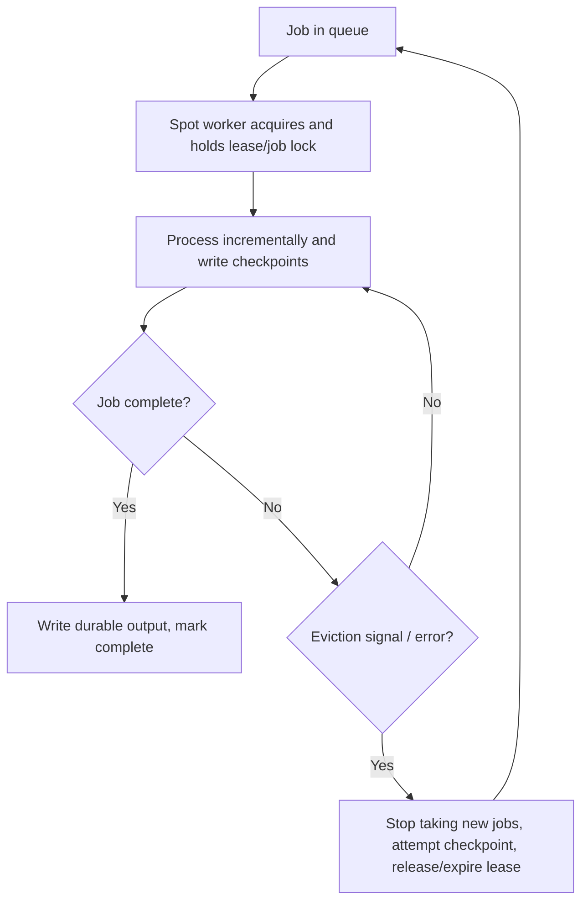
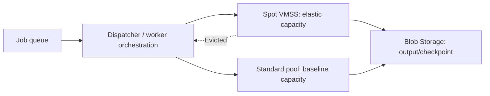

# Spot Virtual Machines and interruption handling

When a system processes thousands of images, renders video, runs automated tests, or trains models in batches, not every virtual machine needs to run continuously. Some jobs can pause mid-way, save progress, and resume on another machine. **Azure Spot Virtual Machines** let you tap into unused Azure compute capacity at prices that can be lower than standard VMs, in exchange for **Azure's right to reclaim the virtual machine at any time** when capacity is needed or pricing conditions no longer match.

The challenge of Spot is not clicking a button to create a cheap VM, but building workloads that survive **eviction** (VM reclamation/interruption), safely rerun jobs, and never lose data. A pipeline succeeds only when work genuinely finishes, not merely because all VMs were once in a `Running` state.

This lesson belongs to the **Elastic Compute and Batch Processing** chapter in the **CLOUD_PROVIDERS_AZURE** module. It connects VM/VM Scale Sets design, Azure Batch, Azure Storage, virtual networking, Microsoft Entra ID, Azure Monitor, security, and cost control within an Azure application architecture.

> **Core principle:** move a workload to Spot only after clearly defining what happens if a machine is reclaimed right in the middle of processing. Spot provides no continuous runtime guarantee or capacity SLA.

## 1. Learning objectives

After this lesson, you will be able to:

1. Explain how Azure Spot Virtual Machines work and why pricing/capacity can fluctuate.
2. Distinguish **capacity-based eviction** from **price-based eviction**, and understand the `max price` option.
3. Compare `Deallocate` and `Delete` when a VM is evicted, especially regarding disk and cost consequences.
4. Use Azure Scheduled Events to receive `Preempt` signals and proactively stop accepting new work.
5. Design queues, checkpoints, retries, idempotency, and durable external storage outside Spot VMs.
6. Create, inspect, and operate Spot VMs via Azure CLI; evaluate VM Scale Sets or Azure Batch models.
7. Design a hybrid mix of Spot and On-Demand/Standard capacity for deadline-sensitive workloads.
8. Monitor interruption counts, rework duration, completion rates, and **cost per successful outcome**.

## 2. What is a Spot VM?

Azure periodically has unused VM compute capacity available. **Spot Virtual Machines** allow running workloads on that capacity under Spot pricing. When that capacity must be reclaimed or the VM's pricing policy is exceeded, Azure has the right to **evict** the VM.

A Spot VM is still an Azure compute resource with CPU, RAM, OS, NIC, and storage per configuration. While running, applications have no Spot-only API for reading files or running tasks: they can use standard Linux/Windows tooling and Azure SDKs.

The major difference lies in **availability and lifecycle**:

| Aspect | Standard VM | Azure Spot VM |
|---|---|---|
| Purpose | Stable compute capacity per service terms | Utilize spare capacity, accepting reclamation |
| Compute price | Standard VM pricing model | Spot pricing can be lower, varying with conditions |
| Allocation availability | Depends on SKU, quota, and capacity | Additionally depends on available Spot capacity |
| Eviction due to Spot shortage | Not subject to Spot policy | Can occur at any time |
| Continuous runtime guarantee | Per SLA/SKU/service terms | **No SLA for uptime or against eviction** |
| Suitable workloads | Primary databases, critical APIs, uptime-critical services | Batch, rendering, CI, stateless tasks, retryable workers |
| Cost control | Reservations, Savings Plans, or other applicable mechanisms | Spot max price, scale caps, budgets, and interruption handling |

Not every VM SKU, region, or zone always has Spot capacity. Successfully creating a VM at one moment does not guarantee you can spin up more of the same type minutes later.

### Spot does not mean underpowered VMs

Spot can use VM sizes with the same CPU/RAM specs as standard VMs of the same SKU. Lower pricing comes from **preemptibility**, not a rule that the machine runs slower.

However, workload performance still depends on VM size, network/disk limits, actual load, and reinitialization overhead after eviction.

## 3. Which workloads should and should not run on Spot?

| Worth evaluating for Spot | Why |
|---|---|
| Batch image/video processing | Each file can be processed independently and rerun |
| CI/CD builds or automated testing | Jobs can be requeued if a runner disappears |
| 3D rendering, simulation, or scientific compute | Can be split into tasks and checkpointed |
| Partitioned data preprocessing / ETL | Can process per partition, writing results to durable storage |
| Checkpointed machine learning training | Can resume from saved model/optimizer state |
| Queue-driven workers | Work can be redistributed to another VM |

| Should not rely solely on Spot | Problem |
|---|---|
| Primary database without HA/replication | Eviction can halt writes and cause service outages |
| Single VM serving a critical production API | No healthy backend remains to serve requests |
| Unrestartable tasks with no checkpoints | Loses all progress upon reclamation |
| Tight-deadline jobs with no fallback capacity | Cannot guarantee completion if Spot capacity runs out |
| Tasks keeping unique state in local disk or RAM | High risk of data loss or unrecoverable state |
| Payment systems with non-idempotent side effects | Retries can create duplicate transactions |

**Deciding criterion:** can the work be split up, redistributed, persisted durably, and rerun safely multiple times? If not, design interruption resilience before optimizing cost with Spot.

## 4. When and why does Azure evict Spot VMs?

There are two main categories of causes:

1. **Capacity-based eviction:** Azure needs capacity for higher-priority demand or no longer has suitable spare capacity. Even if an application is willing to pay top dollar, Spot can still be reclaimed.
2. **Price-based eviction:** Spot price exceeds your configured **maximum price**. This applies only when you set a finite price cap.

Eviction can occur after a long runtime or almost immediately after VM allocation. **No minimum runtime duration is guaranteed.**

### What is Maximum price?

When creating a Spot VM, you can set `max-price`: the maximum compute price you accept per Azure's pricing unit/schedule for that VM size. When the price exceeds that cap, Azure may evict the VM.

The option **`--max-price -1`** generally indicates you do not want eviction **due to a user-defined Spot price cap**; actual compute charges still follow Spot pricing and do not exceed standard VM rates for the corresponding size per service terms. This option **does not** prevent Azure from reclaiming the VM for capacity.

Choosing a low price caps spend rate, yet may increase eviction frequency as prices fluctuate. No option eliminates capacity eviction risk.

### Spot price is not a fixed discount

Spot prices vary by VM size, region, and service conditions. Never treat a past discount example as a guaranteed savings rate for an entire project. Check current prices and compare **total cost to complete the work**, including rework, checkpoint storage, logs, storage, and fallback capacity.

## 5. Two eviction policies: Deallocate and Delete

When configuring a Spot VM, you choose how Azure handles resources after eviction. The two basic policies are:

| Criterion | `Deallocate` | `Delete` |
|---|---|---|
| VM state after eviction | VM is stopped/deallocated; VM resource remains manageable | VM is deleted per eviction policy |
| Restartability | Can attempt restarting when Spot capacity returns; **not guaranteed** | No old VM left to start; must create a new instance |
| OS/data disks | Persistent disks typically remain per configuration when deallocated | Retention/deletion of disks and related resources depends on lifecycle config, disk type, and supported `deleteOption` |
| Compute cost when stopped | No compute charge while deallocated under standard models | VM compute resource no longer exists |
| Non-compute costs | Managed disks, public IPs, and retained resources can keep accruing charges | Any retained or detached resources may still incur charges |
| Common usage | Wanting to retain VM config and attempt reuse | Ephemeral workers recreatable from images and IaC |

### Why `Deallocate` is not "free pause"

A deallocated VM may stop incurring compute charges, **yet storage and certain network resources still cost money**. If hundreds of Spot workers are reclaimed without cleanup, you could end up paying for hundreds of orphaned OS disks or public IPs.

Furthermore, restarting the VM still depends on available Spot capacity. It is not like powering on a VM with reserved compute capacity.

### Why `Delete` requires storing state outside the VM

Workers can lose the VM and attached resources per the chosen deletion policy. Never store critical checkpoints in `/tmp`, temporary disks, ephemeral OS disks, or solely on a managed disk subject to deletion with the VM lifecycle.

If using managed disks configured to persist when the VM is deleted, verify the exact `deleteOption` and cleanup runbook. **Do not treat disk retention as a substitute for storing checkpoints on an independent durable system.**

**Recommendation for easily recreatable batch workers:** store outputs/checkpoints in Blob Storage, Azure Files, Azure NetApp Files, or an appropriate data store and let orchestration spin up new workers as needed. Decide between `Delete` and `Deallocate` based on resource retention cost, recovery speed, and operational requirements.

## 6. Lifecycle of a job running on Spot

Here is a logical model of a worker processing a job from a queue:



In practice, **the VM can vanish before finishing its final checkpoint**. Proper design must therefore remain safe even with zero advance warning.

### Separating execution from result storage

- **Compute:** Spot VM running processing logic.
- **Queue:** Azure Queue Storage, Azure Service Bus, or an appropriate queue holding unfinished work.
- **Checkpoint:** Blob Storage or durable storage retaining processed progress.
- **Final output:** written to a durable destination with completeness verification.
- **Metadata/job state:** records status, attempt count, output version, and processing timestamps.
- **Monitoring:** Azure Monitor, application logs, queue metrics, and eviction telemetry.

If the VM is deleted, the job remains recoverable in the queue or becomes visible again, checkpoint state stays intact, and a new VM resumes the remaining work.

## 7. Receiving eviction warnings via Azure Scheduled Events

Azure provides **Scheduled Events** via an in-VM metadata endpoint. For Spot, the signal of interest is **`Preempt`**, notifying that the workload is at risk of reclamation.

There may be a brief advance notice window, often described as **approximately 30 seconds** for Spot eviction. This is not a time budget your application may strictly rely upon: event delivery, polling intervals, and failure conditions can prevent a worker from reacting in time.

**Principle:** treat the event as an opportunity for graceful shutdown, never as a guarantee you will always receive it.

### Calling the endpoint from inside an Azure VM

Bash example inside the VM:

```bash
curl --noproxy '*' --fail --silent --show-error \
  -H 'Metadata: true' \
  'http://169.254.169.254/metadata/scheduledevents?api-version=2020-07-01'
```

`169.254.169.254` is the Azure Instance Metadata Service (IMDS), accessible from supported VM environments; **it is not a public URL to call from a laptop or Cloud Shell**. Never include tokens, secrets, or sensitive identity details in the request.

The response can contain an `Events` list with fields like `EventType`, `Resources`, `NotBefore`, and `EventStatus` depending on API version. A Spot eviction event may have `EventType: "Preempt"`.

### Example checking for `Preempt` events

If `jq` is installed:

```bash
curl --noproxy '*' --fail --silent --show-error \
  -H 'Metadata: true' \
  'http://169.254.169.254/metadata/scheduledevents?api-version=2020-07-01' \
  | jq '.Events[]? | select(.EventType == "Preempt")'
```

This command only **reads** events. Production workers need a managed polling loop/agent with timeouts and logging; do not rely on manual SSH checks.

### What should a worker do upon seeing `Preempt`?

1. **Mark draining:** stop pulling new jobs from the queue.
2. **Interrupt safely:** stop accepting requests or wrap up a small unit of work.
3. **Checkpoint quickly:** flush critical state to durable storage if time remains.
4. **Release lease/lock or let timeout expire** depending on queue semantics.
5. **Log metadata:** job ID, checkpoint ID, timestamp, and status; never log secrets.
6. **Exit cleanly:** do not wait on an operation longer than the remaining eviction budget.
7. **Let the scheduler spawn another worker:** do not try to block Azure from reclaiming the VM.

Events may include a `NotBefore` field, but do not treat it as an exact countdown promise in seconds. If complex saving takes several minutes, checkpoint **periodically ahead of time** instead of waiting for `Preempt`.

## 8. Preventing lost work with periodic checkpoints

A **checkpoint** is sufficient state for an application to resume work without starting over from scratch.

Example task processing 1,000 images:

- No checkpoint: evicted after image 900 may require redoing all 1,000.
- Checkpoint every 100 images: a new run resumes from the unmarked portion.
- Checkpoint per image: minimizes rework, yet increases state read/write overhead.

Choose checkpoint frequency by weighing:

```text
Average time lost to reruns
    versus
Checkpoint read/write cost and recovery complexity
```

### Requirements for a good checkpoint

- **Durable:** stored off the Spot VM on a system not deleted with the VM.
- **Consistent:** never mark a step complete before its output is actually usable.
- **Versioned:** store job ID, progress, data format version, and checksums if needed.
- **Recoverable:** a new worker can identify the latest valid checkpoint.
- **Idempotent on interruption:** if interrupted mid-checkpoint write, a new worker will not corrupt data.
- **Rate-bounded:** avoid creating storage bottlenecks or excessive transaction fees.

### Two-phase output writes to prevent corrupted files

Example processing an input file:

1. Worker reads `jobs/123/input`.
2. Writes results to a staging path carrying job ID and attempt ID, e.g., `staging/123/attempt-7`.
3. Verifies output completeness and checksum/schema validity.
4. Updates completion status conditionally or uses the data store's commit/idempotency mechanism.
5. Only after a successful commit does it acknowledge job completion in the queue.
6. Cleans up leftover staging files via lifecycle policies.

Not every storage system supports identical rename/transaction semantics. Design atomic commits around the **actual API** of Azure Blob, your database, or chosen store; never assume blob rename is a POSIX-style atomic rename.

## 9. Retries, idempotency, and at-least-once execution

In queue architectures, when a worker dies before acknowledging success, the job can be redelivered. Thus designs typically follow **at-least-once processing**: a job may run more than once.

If a job sends emails, records invoices, or calls payment APIs without deduplication, reruns can produce duplicate side effects. **Idempotency** means reprocessing the same task does not create extra erroneous effects.

### Job model example

```json
{
  "jobId": "resize-photos-2026-001",
  "inputPrefix": "raw/2026-11/001/",
  "outputPrefix": "processed/2026-11/001/",
  "checkpointPath": "checkpoints/resize-photos-2026-001.json",
  "attempt": 3
}
```

This is illustrative data containing no credentials. Workers must use a **stable jobId** to identify work rather than treating every execution as a brand-new job.

### Safe processing flow

```text
Receive job -> Check if already completed?
            -> If not: read checkpoint -> process remaining parts
            -> Write durable output -> verify result
            -> Only then ACK/delete message in queue
```

When using Azure Queue Storage or Azure Service Bus, understand **visibility timeout**, leases/locks, and renewal mechanisms. Set timeouts longer than a processing step, or renew locks controllably for long jobs. If a worker is evicted, the message/lock must eventually allow another worker to pick it up.

### Preventing retry storms

If a region/VM family loses Spot capacity, thousands of jobs may retry simultaneously and spawn new VMs at once. This can trigger load spikes, throttling, or cascading failures.

Use:

- Exponential backoff and jitter for transient retries.
- Attempt caps, deadlines, and classification of permanent errors.
- Poison/dead-letter queues for repeatedly failing jobs.
- Rate limits on worker creation to avoid hammering provisioning APIs.
- Alerts on queue backlog and aged jobs, not just VM CPU.

## 10. Creating a Spot VM with Azure CLI

The following example uses **Azure Cloud Shell Bash** or Bash with Azure CLI. Run only in an authorized test subscription that already has an appropriate resource group, VNet, and subnet. Spot allocation can fail due to capacity: creation commands can fail even when configured correctly.

### Step 1 — Confirm subscription

```bash
az account show \
  --query "{subscription:name,id:id,tenant:tenantId}" \
  --output table

az account set --subscription "<SUBSCRIPTION_ID>"
```

Declare lab names:

```bash
RG="rg-spot-lab"
VNET="vnet-spot-lab"
SUBNET="snet-workers"
VM="spot-worker-01"
SIZE="Standard_D2s_v5"
```

`SIZE` and image are illustrative; verify Spot availability for the VM SKU, region, zone, and subscription before deploying.

### Step 2 — Check VM SKU in region

```bash
LOC="southeastasia"

az vm list-skus \
  --location "$LOC" \
  --resource-type virtualMachines \
  --size "$SIZE" \
  --all \
  --output json
```

This command reports SKU details and restrictions; it **does not guarantee Spot capacity exists at creation time**. Also check quotas, Azure Policy rules, and placement/availability scores if supported in your environment.

### Step 3 — Create a Spot VM with Deallocate

```bash
az vm create \
  --resource-group "$RG" \
  --name "$VM" \
  --image Ubuntu2204 \
  --size "$SIZE" \
  --vnet-name "$VNET" \
  --subnet "$SUBNET" \
  --admin-username azureuser \
  --generate-ssh-keys \
  --priority Spot \
  --eviction-policy Deallocate \
  --max-price -1 \
  --public-ip-address ""
```

Meaning:

- `--priority Spot`: uses Spot priority instead of regular VM priority.
- `--eviction-policy Deallocate`: if reclaimed, keeps the VM in deallocated state instead of deleting it.
- `--max-price -1`: avoids eviction from a user-set finite price cap; **capacity-based eviction still applies**.
- `--public-ip-address ""`: example creating a VM without a direct public IP; administer via Azure Bastion or approved private connectivity.

If you want workers fully driven by images/recreation, you can choose `--eviction-policy Delete` and ensure outputs/checkpoints reside off-VM. Understand exactly which disk/NIC resources are retained or deleted before using that policy.

The command can fail due to quotas, SKU restrictions, subnet limits, Azure Policy, or lack of Spot capacity. Do not retry an unavailable SKU/zone combination endlessly; implement fallback mechanisms.

### Step 4 — Inspect VM configuration and state

```bash
az vm show \
  --resource-group "$RG" \
  --name "$VM" \
  --query "{name:name,priority:priority,evictionPolicy:evictionPolicy,maxPrice:billingProfile.maxPrice,zones:zones,provisioningState:provisioningState}" \
  --output json

az vm get-instance-view \
  --resource-group "$RG" \
  --name "$VM" \
  --output json
```

These fields display priority, eviction policy, and runtime details from the API. `provisioningState: Succeeded` **does not guarantee the VM is running or will exist an hour later**; correlate power state and workload telemetry.

### Step 5 — Clean up lab resources

Do not delete the resource group if shared resources exist. Before cleaning up, check VMs, managed disks, NICs, public IPs, metrics/alerts, and test storage. With `Deallocate`, **disks can still incur charges** after eviction or stopping.

## 11. VM Scale Sets with Spot

A single Spot VM works for testing; systems needing many workers should consider **Azure Virtual Machine Scale Sets (VMSS)**. VMSS manages VM groups from a shared image/config, scales with load, and replaces instances via supported mechanisms.

With Spot configuration, individual instances may be evicted. VMSS or the corresponding orchestration can attempt to provision replacement instances per policy, yet **capacity restoration is not guaranteed** if Azure lacks Spot capacity.

### Management options

- Use a VMSS containing Spot instances per allowed configuration and features.
- Separate a **Spot worker pool** and a **Standard/On-Demand worker pool** to maintain stable baseline capacity.
- Evaluate **mixed priority** in VMSS Flex or equivalent mechanisms if supported by your subscription/region/SKU; verify current features and limits before relying on it.
- Diversify VM SKUs/zones/regions for portable workloads, weighing data latency and cross-region transfer costs.
- Autoscale by **queue depth, job age, or active worker capacity**, not solely CPU.

Logical example:



The dashed line represents worker capacity loss; orchestration must track state and scale appropriate worker groups up or down.

### What happens when all Spot instances are reclaimed?

- The queue still retains unfinished jobs.
- The Standard pool handles baseline load or deadline-critical jobs.
- The autoscaler may try recovering Spot instances in another SKU/zone if policy allows.
- Dashboards must show backlog and projected completion time.
- When Spot returns, the scheduler adds workers and resumes from checkpoints.

**Do not equate desired instance count with actual healthy worker count.** During capacity shortages, VMSS may desire 20 instances while allocating far fewer; operations must monitor the count of workers actually processing work.

## 12. Azure Batch and Spot for batch jobs

For batch compute workloads, **Azure Batch** schedules jobs/tasks and manages compute pools. Depending on supported features, pools can use Spot/low-priority nodes, typically suitable for retryable tasks.

For a long Batch job, you can design:

1. Split data into many small independent tasks.
2. Place inputs and checkpoints in Blob Storage.
3. The Batch scheduler distributes tasks to available nodes.
4. When a node is evicted, the system manages and retries tasks per policy.
5. Tasks resume or rerun; keeping state off-node remains an application design responsibility.
6. Measure job progress and completed task counts to evaluate effectiveness.

**Azure Batch does not automatically make non-idempotent code safe.** If tasks have side effects, use stable keys, verify outputs, and apply corresponding commit/transaction patterns.

### VMSS or Azure Batch?

| Criterion | VMSS | Azure Batch |
|---|---|---|
| Model | Group of VMs for apps/workers you manage | Compute pools and batch task scheduling system |
| Job management | You build queues, dispatchers, leases, retries | Built-in Batch job/task scheduling components |
| Best fit | Custom worker services needing deep OS/runtime control | Batch processing, rendering, simulation, partitioned jobs |
| Eviction handling | Worker/app and VMSS coordinate recovery | Task retry/rescheduling via Batch mechanics + app logic |
| Observability | VMSS + queue + application metrics | Batch job/task metrics + application/storage |
| Constraints | VM orchestration, VM SKUs, networking, disks | Region/pool, Batch account/quotas, and task requirements |

Evaluate feature availability, quotas, and current limits before choosing a service; no single solution beats all others for every batch workload.

## 13. Designing baseline and elastic capacity

A practical strategy often has two layers:

- **Baseline capacity:** Standard VMs or SLA-backed services handling urgent tasks, orchestration, and minimum SLAs.
- **Elastic capacity:** Spot workers scaling with queue backlog when cheaper capacity is available.

Suppose 10,000 tasks must finish within a processing window. The design can keep a Standard group handling near-deadline tasks while Spot handles the rest. If Spot experiences mass evictions, baseline still advances critical tasks and the system raises alerts.

Do not pick a rigid ratio like "90% Spot is always optimal" without data. Evaluate:

- Average and p95/p99 duration per task.
- Eviction rate and amount of rework incurred.
- Peak backlog and real deadlines.
- Actual Spot price by SKU/region.
- Minimum capacity always required.
- Image initialization, model/dependency loading, and warm-up time.
- Checkpoint/storage, retry, and monitoring costs.

### Choosing task size

Very large tasks lose lots of work when interrupted. Very small tasks create high orchestration/queue overhead. A helpful pattern is splitting tasks into units that **finish or checkpoint quickly**, then measuring orchestration overhead.

You can checkpoint by ML epoch/stage or process by data partition. For expensive CPU/GPU jobs, reinitialization and checkpoint-reload time can become a major cost factor.

## 14. Monitoring evictions, worker health, and job completion

Looking only at CPU graphs or `Running` VM counts is insufficient for evaluating Spot. Metrics must cover both **work completion** and **cost**.

| Metric group | Examples |
|---|---|
| Spot capacity | Requested/provisioned/running/deallocated/evicted VM counts |
| Job throughput | Jobs completed per minute, data processed per hour |
| Queue health | Queue depth, oldest job age, retried jobs, dead-letters |
| Eviction | Eviction count, runtime before eviction, recorded reasons |
| Checkpoint | Latest checkpoint age, read/write latency, checkpoint errors |
| Latency/SLO | End-to-end job completion time, p95, on-time completion rate |
| Cost | VM compute by priority, retained disks, storage, transfer, monitoring, cost per completed job |
| Security | Managed identity permissions, storage access errors, role or VM config changes |

### Signal sources

- **Azure Activity Log/Resource Health and VM/VMSS state**: lifecycle changes and infrastructure info provided per resource type.
- **Scheduled Events**: captures `Preempt` signals directly inside workers when available.
- **Azure Monitor and VM Insights**: CPU, memory when collection is enabled, disk and network, alerts.
- **Application Insights or app logs**: job IDs, timestamps, errors, retries, checkpoints, and results.
- **Storage/Service Bus/Queue metrics**: backlog, ingress/egress, errors, throttling.
- **Cost Management**: actual spend and forecasts.

Eviction reason data is not guaranteed in a single uniform metric across all VM/VMSS types. Orchestrator telemetry should record received events and node disappearance times, using platform sources for cross-reference when available.

### Actionable alerts

1. Queue backlog grows continuously and job age breaches thresholds.
2. Healthy worker count falls below required baseline.
3. Job retry or timeout rate is abnormally high.
4. Checkpoints have not updated within expected intervals.
5. Eviction counts rise alongside falling completion rates.
6. Deallocated disk/VM costs climb even though job volume has not increased.
7. On-time job completion rate falls below SLO.

Thresholds should reflect workload baselines and peak hours; avoid alerting just because one Spot VM was evicted, as eviction is expected behavior by design.

## 15. Cost: measure per completed outcome, not just VM rate

A Spot VM with a low compute unit rate does not automatically make a pipeline cheaper. Imagine a job needing 90 minutes on Spot that frequently gets interrupted at minute 80 and restarts from zero: total wasted compute time can be huge.

Estimating total cost:

```text
Total Cost = Spot compute run time
           + Standard/on-demand baseline
           + Storage for input/output/checkpoints
           + Data transfer/networking
           + Monitoring/logging
           + Rework compute cost from evictions
           + Operational and wait-time cost (if quantified)

Cost per successful job = Total Cost / valid completed jobs
```

This is a planning formula, not Azure's billing rule. Exact unit rates and billing components vary by service, region, and usage timing.

### Common cost traps

- `Deallocate` VMs stop compute billing, yet **managed disks remain and may keep billing**.
- Rapid scale-out triggers repeated retries, dependency downloads, and storage requests.
- Overly frequent checkpointing raises storage request charges, though it may still pay off if it prevents rework.
- Choosing a cheap VM SKU with slow startup can cause missed deadlines.
- Moving tasks across regions can add transfer charges and increase latency.
- Keeping baseline too small causes SLO breaches during Spot reclamation.

Evaluate options with measurements covering peak load hours and changing Spot availability periods, not merely prices at initial VM creation.

## 16. Security and safe operations

Spot VMs may be created and deleted at high frequency. You must **automate secure configuration** and avoid leaving credentials in images or orphaned disks.

### Identity

- Prefer **managed identity** for workers accessing Azure Storage, Queue, Key Vault, and Azure Monitor when supported.
- Apply least-privilege RBAC: workers read inputs and write outputs/checkpoints within scoped containers; never grant Owner just to download blobs.
- Never place storage account keys or client secrets in custom data, cloud-init logs, images, startup scripts, or repositories.
- When VMs are deleted, audit identities, role assignments, and lingering sensitive artifacts per actual lifecycle.

### Networking

- Do not give Spot workers public IPs by default. Use private subnets and Azure Bastion or approved management paths when needed.
- If workers reach the Internet, design outbound via NAT Gateway, firewall, or appropriate egress; partner APIs may require stable source IPs.
- Use Private Endpoints when accessing supported Azure Storage/services over private networks with security requirements.
- Verify NSGs, DNS, and routes when workers recreate in different subnets/zones.

### Images and configuration

- Use explicitly versioned images that are security-patched and tested.
- Keep **bootstrap time** within SLO; minimize lengthy package installs on every boot.
- Startup scripts should be **idempotent**: rerunning must not duplicate configs, lose data, or spawn excess side resources.
- Shutdown handlers must tolerate the VM being deleted abruptly before finishing.

### Data protection

Long-lived data must reside outside eviction-prone resources, with proper access controls, encryption, backup/retention, and deletion policies. Lowering compute cost is never a reason to skip data protection.

## 17. Common troubleshooting

| Symptom | Possible cause | How to investigate |
|---|---|---|
| Cannot create Spot VM | Insufficient capacity, unsuitable SKU/zone, quota, or Azure Policy | Check provisioning errors, region/SKU, quota, permissions; use fallback |
| Newly created VM gets evicted quickly | Spot capacity shifted or price condition | Check priority/eviction policy/maxPrice and lifecycle events |
| `--max-price -1` yet still evicted | Capacity eviction still occurs | Check eviction reason; never treat `-1` as an uptime guarantee |
| VM deallocated yet bill still shows charges | Disks or public IPs still exist | Inventory resources and check Cost Management |
| Job vanishes after eviction | State stored only in VM or queue ACKed too early | Move checkpoints/outputs to durable storage, fix ACK ordering |
| Job processed twice | Queue redelivery, lease timeout, or worker died after side effect | Idempotency keys, conditional transactions/commits |
| Worker misses `Preempt` events | Slow polling, agent error, insufficient time to react | Periodic checkpoints, telemetry, notice-independent design |
| VMSS desired count high while actual is low | No Spot capacity left or provisioning failures | Inspect instance health, provisioning errors, SKU/zone, and baseline |
| Scaling Spot slows throughput down | Bootstrap overhead, data downloads, contention | Safely cache dependencies, measure startup/cold start, tune concurrency |
| Queue backlog grows continuously | Too few workers, tasks too long, constant retries | Track job age, completions, errors; increase baseline if needed |
| Checkpoints saved yet resume fails | Non-atomic state or version mismatch | Versioning, checksums, commit markers, recovery tests |
| Spot savings less than expected | Heavy rework, retained disks, transfer/log fees | Measure cost per completed job instead of hourly compute rate |

## 18. Hands-on lab: interruption-resilient batch worker

### Scenario

An application processes 5,000 input images nightly. Each image can be processed independently, with results stored in Azure Blob Storage. The business wants to cut costs with Spot VMs while still finishing work before business hours.

### Part A — Design

1. Choose a queue model per image or small image batch.
2. Place inputs in Blob Storage, outputs in a separate container, and use a stable `jobId`.
3. Specify where checkpoints, completion status, and retry/dead-letter data live.
4. Draw a diagram with queue, Spot VM workers, Standard baseline workers, Blob Storage, and monitoring.
5. Explain why state must not be stored solely on a Spot VM's OS disk.
6. Choose `Deallocate` or `Delete`, stating cost and resource lifecycle implications.
7. Write the worker flow for receiving `Preempt` and for losing the machine **with zero notice**.
8. Define idempotency criteria when two workers pick up the same job.

### Part B — Lab deployment

1. Prepare a resource group, VNet/subnet, Storage account, and test queue per granted permissions.
2. Create a test Spot VM via Azure CLI with `--priority Spot` and your chosen eviction policy.
3. Verify `priority`, `evictionPolicy`, `maxPrice`, and power state.
4. From inside the VM, query the Scheduled Events endpoint and inspect the JSON structure.
5. Run a worker processing mock data, writing periodic checkpoints to durable storage.
6. Simulate abrupt worker loss by killing the process or deallocating an **authorized lab VM**, then let the queue redeliver the job.
7. Spin up another worker and verify only unfinished parts are re-executed.
8. Verify outputs are neither duplicated nor corrupted when a worker stops after writing the file but before ACKing.
9. Measure queue backlog, retry counts, checkpoint age, and completion duration.
10. Clean up VMs, managed disks, NICs, logs, and test resources after confirming no dependencies remain.

**Note:** manually stopping/deallocating a VM **does not exactly replicate** Azure Spot eviction and Scheduled Events `Preempt`. This is a process/VM-level resilience test verifying checkpoints and retries. To test `Preempt` handlers, use mock events or supported testing mechanisms; never force eviction on production resources.

### Part C — Result analysis

Record:

| Metric | What to report |
|---|---|
| Initial total jobs | Tasks actually needing completion |
| Valid completed jobs | Excluding duplicate/corrupted outputs |
| Retried jobs | Retry counts and causes |
| Time lost to reruns | Compute time producing no new output |
| Worker startup time | Bootstrap + dependency/checkpoint loading |
| Queue age / deadline | Did tasks finish on time? |
| Lab cost | Compute, disks, storage, networking, monitoring |
| Cost per outcome | Total cost divided by successful jobs |

### Self-check questions

**Question 1.** Why can a Spot VM be reclaimed even when `--max-price -1` is set?

**Question 2.** What is the key difference between the `Deallocate` and `Delete` eviction policies?

**Question 3.** Do Scheduled Events guarantee a worker always gets several minutes to write checkpoints? Why or why not?

**Question 4.** A worker wrote output but died before deleting the queue message. What design prevents duplicate output when another worker reprocesses it?

**Question 5.** Why keep a Standard/On-Demand worker pool for strict-deadline jobs?

**Question 6.** Why track queue backlog and cost per completed job rather than just running VM count and hourly Spot rate?

**Question 7.** Does a Spot VM in the deallocated state necessarily eliminate all costs?

**Question 8.** If all Spot capacity in a zone disappears, what must the operations team observe and decide?

**Completion criteria:** the learner can explain the pricing and eviction model, create a Spot VM, inspect Scheduled Events, design retryable jobs with checkpoints and idempotency, and evaluate correctness, latency, and cost of a batch pipeline.

## Conclusion

**Azure Spot Virtual Machines** are suited to lowering compute costs for work that is **interruptible, retryable, and independent of any specific machine**. Spot is not a drop-in replacement for every production VM: capacity shifts, prices fluctuate, and eviction can happen at any time.

A reliable architecture combines **queues, off-VM checkpoints, idempotent outputs, graceful shutdown on `Preempt`, Standard baseline capacity, autoscale, and outcome-driven monitoring**. Only by measuring both on-time job completions and the real cost of reruns can you decide whether Spot delivers economic value without compromising your Azure application's commitments.
