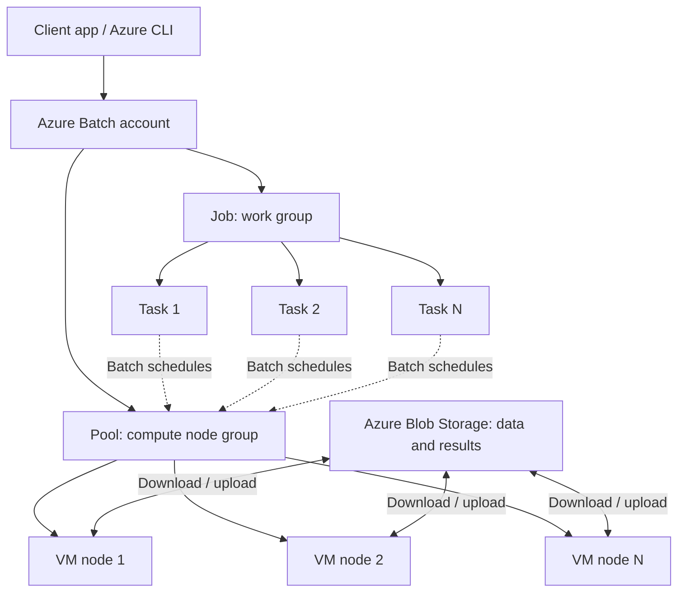
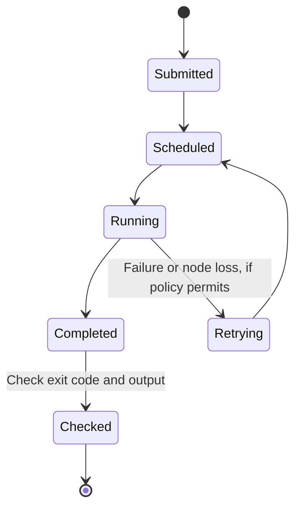
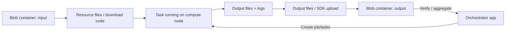

# Azure Batch, pools, jobs, and tasks

A company needs to transcode 20,000 videos, render thousands of product images, run scientific simulations, or process a large dataset overnight. The work can be split into relatively independent pieces, executed in parallel across many machines, and stopped once finished. If operations teams manually create dozens of VMs, distribute work, track progress, and clean up resources, they end up writing and maintaining heavy orchestration plumbing.

**Azure Batch** is a scheduling and compute capacity management service for batch processing (*batch processing*). Azure Batch helps create groups of compute machines, distribute tasks, manage task lifecycles, and scale capacity up or down as needed. Your application remains responsible for supplying the processing program, input data, recovery logic, and expected outputs.

In the **CLOUD_PROVIDERS_AZURE** module, you explore the Azure ecosystem from subscriptions, resource groups, and Microsoft Entra ID through virtual networks, compute, storage, data, deployment, monitoring, security, and cost management. This lesson belongs to the **Elastic Compute and Batch Processing** chapter, focusing on four core concepts—**Batch account, pool, job, and task**—along with how to deploy and operate them as a practical processing system.

## 1. Learning objectives

After this lesson, you will be able to:

- Describe what Azure Batch does and identify which workloads fit it.
- Distinguish **Batch account**, **pool**, **compute node**, **job**, and **task**.
- Explain how Batch schedules tasks onto nodes and collects statuses/exit codes.
- Create pools and jobs via the Azure portal, submit tasks, and inspect results with Azure CLI.
- Design data flows through Azure Blob Storage and handle inputs/outputs.
- Select VM sizes, node counts, task concurrency, retries, timeouts, and autoscale.
- Apply Microsoft Entra ID, managed identity, Azure RBAC, and connection security.
- Monitor errors, optimize costs, handle preempted nodes, and clean up resources safely.

## 2. When should you use Azure Batch?

A workload suitable for Batch can usually be divided into **many finite units of work**, each having a clear command or program that runs on a compute node and writes results to durable storage.

Examples:

| Workload | How to split into tasks | Resources to consider |
|---|---|---|
| Video transcoding | Each task processes one video or segment | vCPU, temporary disk, bandwidth |
| Thumbnail generation | Each task processes a batch of images | CPU or GPU, RAM |
| Monte Carlo simulation | Each task runs a parameter/seed set | CPU, concurrent task count |
| 3D rendering | Each task renders a frame or slice | GPU, VRAM, licenses |
| Periodic data analytics | Each task processes a data partition | CPU, RAM, Blob read throughput |
| Multi-configuration testing | Each task runs one test configuration | Startup duration, software environment |

**Azure Batch does not understand the business meaning of files or datasets.** It schedules the commands/programs you supply. Complex steps such as identifying files to process, managing business queues, coordinating multi-stage pipelines, or aggregating results may require Logic Apps, Functions, Data Factory, CI/CD systems, or a dedicated orchestrator application.

### How does Batch differ from other compute options?

| Solution | Best suited when | Key difference |
|---|---|---|
| **Azure Batch** | Many finite processing tasks running in parallel on a VM pool | Provides pool/job/task model and task scheduling |
| **Azure Virtual Machines** | Need to manage a single server or always-on application | Self-managed workload orchestration and multi-VM lifecycle |
| **Virtual Machine Scale Sets** | Need to manage a scalable group of VMs | Provides VM scaling mechanics without a native Batch job/task model |
| **Azure Functions** | Event-driven tasks whose runtime and resources fit a hosting plan | Abstracts most VM management, bounded by hosting plan limits |
| **Azure Kubernetes Service** | Multi-component containerized apps or teams already using Kubernetes | Self-designed pipelines, Kubernetes Jobs, and cluster operations |

For long computations needing native binaries or scientific software on dedicated VMs, Azure Batch is often worth evaluating. For continuously serving web requests, never use Batch as a web server in place of App Service or AKS.

## 3. Core architecture: account, pool, node, job, and task

The key objects are organized as follows:



### Batch account

A **Batch account** is the management scope for the Batch service: it provides the endpoint/API, holds pools and jobs, and is governed by account quotas and authentication/permission settings. A Batch account belongs to a subscription and resource group, with a region and related settings.

You can link an Azure Storage account to support features like application packages or scenario-specific data storage. **Batch does not automatically serve as permanent storage** for every output file a task produces; design a separate results store.

### Pool

A **pool** is a collection of **compute nodes** (processing VMs) sharing a configuration: VM size, OS image, node agent, target node count, scaling policy, and networking/scheduling parameters. Multiple jobs can share a pool depending on how you organize them.

Batch manages node lifecycles inside the pool, while you choose machine images, software setup, and recovery/cleanup strategies.

### Compute node

A **compute node** is a machine inside a pool where tasks actually execute. Nodes have lifecycle states such as creating, starting, idle/ready, or unusable. A node can run one or multiple concurrent tasks when the pool is configured appropriately for **task slots** and physical resources.

### Job

A **job** manages a group of tasks. A job is typically bound to a pool via its job configuration, with priority policies and failure/completion handling per API capabilities. A job **does not process data itself**: it organizes tasks for Batch to schedule.

### Task

A **task** is the smallest unit of execution in the basic model: it has a **task ID**, command line, execution environment, resource requirements, and retry/timeout options. A task is assigned to a node with an available slot. A task can launch Python, Java, ffmpeg, or other native processes.

| Component | Question answered | Example |
|---|---|---|
| Account | Where is Batch managed? | `batch-media-prod` |
| Pool | Which machine group runs work? | `pool-cpu-video` |
| Node | Which specific machine executes? | A Linux VM in the pool |
| Job | Which processing run? | `job-2026-11-20` |
| Task | What single unit must execute? | `task-video-0001` transcoding one file |

**Common confusion:** a pool is not a job, and a task is not a node. The pool manages *compute capacity*; jobs/tasks describe *workload volume*. Adding more tasks does not automatically create enough VMs if the pool lacks scaling configured.

## 4. Execution lifecycle of a job

Suppose 1,000 video files sit in Blob Storage. The application needs to convert them to a standard format.

1. Load the input file list into your job management system and prepare the transcoding program.
2. Create or select a **pool** with an appropriate VM size and node count for target throughput.
3. Create a **job** bound to the pool.
4. Create 1,000 **tasks**, each receiving a distinct input path and unique output name.
5. Azure Batch queues tasks and assigns them to nodes with available resources/slots.
6. Nodes download code/resource files or use pre-installed software, then execute the task command line.
7. Tasks return exit codes and transition states; the app monitors success/failure and collects logs.
8. Output files upload to Blob Storage via application-configured mechanisms.
9. Reconcile valid outputs against inputs, handle failed tasks, close the job, and shrink/delete the pool when compute is no longer needed.



The states in the diagram are a **simplified logical model**. Exact state names in the Batch API may differ, and a task in the **completed** state can still have a **non-zero exit code**. Always inspect execution outcomes rather than checking only whether the task finished.

## 5. Designing pools and compute nodes

Design a pool around workload characteristics, images, networking, concurrency, and cost. A pool typically involves these decisions:

| Decision | Question to ask | Example |
|---|---|---|
| VM size | Do tasks need CPU, RAM, or GPU? | General-purpose CPU for basic transcoding |
| OS image | Does software run on Linux or Windows? | Batch-supported Ubuntu image |
| Node agent | Is the agent compatible with the chosen image? | Matching node agent SKU for the image |
| Node count | How many concurrent VMs do we want? | Start with 2 dedicated nodes |
| Task slots | How many tasks run concurrently per node? | 1–2 tasks/node after benchmarking |
| Software | Install on startup or pre-bake? | Start task, application package, container |
| Network | Do nodes need Blob/private endpoints or external services? | VNet/subnet, DNS, appropriate routes |
| Lifetime | Long-lived pool or per-job? | Resize to 0 when idle, if suitable |

### Dedicated and Spot/low-priority nodes

Batch can use **dedicated nodes** and, in supported configurations, **Spot/low-priority capacity** with lower cost models that can be preempted when Azure needs capacity.

- **Dedicated:** fits work needing higher stability, though machine errors, maintenance events, or interruptions can still happen.
- **Spot/low-priority:** fits independent retryable tasks with checkpoints that tolerate mid-run interruption.

Never rely on Spot's lower price to assume a job will finish on time. If a node is preempted, tasks may need to rerun; outputs must be designed **idempotently**, checkpointed, and verified before marking success. Naming, support conditions, and quotas can vary by account/API configuration mode.

### Concurrent tasks

A 4-node pool is neither limited to 4 tasks nor guaranteed to run 400. Effective concurrency depends on ready nodes, task slots per node, resource demands, scheduling policies, and task behavior.

For example, with **4 nodes**, each configured with **2 task slots**, and each task needing one slot, theoretical maximum concurrency is **8 concurrent tasks**. However, two tasks competing for CPU/disk/memory on one VM may run slower overall than 1 task/node. Benchmark to find real throughput.

## 6. Jobs and tasks: from work description to results

### What does a Job hold?

When creating a job, specify at least the **job ID** and the **pool** that will run its tasks. Depending on API, jobs can define policies such as:

- **Priority:** affects how tasks across jobs competing for pool resources are prioritized during scheduling.
- **Task constraints:** maximum wall-clock runtime, max retry count where applicable, and task data retention time.
- **On task failure / on all tasks complete:** how the job reacts when a task fails or all tasks finish, if configured.
- **Job preparation / release tasks:** job-level setup or cleanup commands on nodes in supported scenarios.

A job can contain thousands of tasks, yet it does not generate inputs, aggregate outputs, or define business success by itself. For multi-stage pipelines such as **extract → transform → aggregate**, the orchestrator must manage dependencies or use Batch task dependencies after configuring them.

### What does a Task contain?

| Property | Meaning | Example |
|---|---|---|
| Task ID | Task identifier within the job | `task-file-0001` |
| Command line | Process to execute on the node | `/bin/bash -c "python3 worker.py ..."` |
| Resource files | Files downloaded before execution | Scripts, data, manifests |
| Environment variables | Process environment configuration | Input/output names, batch ID |
| Constraints | Timeout, retries, file retention time | Maximum duration for one task |
| Output files | Rules uploading output files to storage | JSON/image/zip results |
| Container settings | Run inside a container when supported | Image with ffmpeg or scientific libraries |

**A task command line should not be treated automatically as a shell script.** On Linux, when needing redirects, pipes, or shell variables, explicitly invoke `/bin/bash -c` or the right shell; on Windows, use `cmd /c` or PowerShell with proper syntax. Verify execute permissions, paths, and the node image.

### Completion status and exit codes

Tasks can transition through states like **active → running → completed**. Once a task reports completed, inspect `executionInfo.exitCode`, failure information, and `stdout.txt` / `stderr.txt`.

- **Exit code 0:** process exited cleanly by convention, yet business output must still be verified.
- **Non-zero exit code:** process reported failure; inspect logs and verify whether retrying is safe.
- **Lost/preempted node:** Batch may reschedule the task depending on configuration and failure type.
- **Task timeout:** configure time limits and handling for hung tasks so they do not occupy nodes indefinitely.

For tasks with side effects (database writes, emails, payments), **automatic retries can repeat the action**. Use idempotency keys, checkpoints, and unique output names to prevent duplicate processing.

## 7. Hands-on: creating a Batch account and pool in the Azure portal

The walkthrough uses illustrative names:

| Resource | Value used in lesson |
|---|---|
| Resource group | `rg-batch-lab` |
| Batch account | `batchlabdemo01` |
| Pool | `pool-linux-cpu` |
| Job | `job-hello` |
| Tasks | `task-001`, `task-002` |
| Nodes | Two Linux VMs of a region-supported SKU |

Real Batch account names must meet naming rules and global availability; do not assume the illustrative name is free. Creating resources can incur VM and storage charges.

### Step 1. Create a Batch account

1. Sign in to the [Azure portal](https://portal.azure.com/) and confirm tenant and subscription.
2. Search for **Batch accounts** and select **Create**.
3. Choose resource group, account name, and a region fitting workload requirements.
4. Review the **pool allocation mode** option. **Batch service** mode and **user subscription** mode differ in provisioning/quota/resource placement; check subscription and region prerequisites.
5. Select an associated storage account if required by your workflow or planned features; plan separate input/output storage.
6. Confirm settings and create the Batch account.

### Step 2. Create a pool

1. Open the newly created Batch account, go to **Pools**, and create a new pool.
2. Enter `pool-linux-cpu` and select **virtual machine configuration**.
3. Choose a Batch-supported Linux image along with its compatible **node agent SKU**. Do not pick an outdated EOL image simply because an old doc shows it.
4. Choose a VM size with sufficient CPU/RAM; for labs, prefer small sizes available in your region and quota.
5. Start with **2 dedicated nodes**, then verify concurrent task limits per node.
6. Configure networking, disks, start task, or application packages if needed by the workload.
7. Create the pool and monitor nodes transitioning to **idle/ready**.

A created pool **does not mean all nodes are immediately ready**. Azure must provision VMs, pull images, start the node agent, and run any start task. If nodes enter an unusable/error state, inspect start task details, image errors, or networking before submitting large jobs.

### Step 3. Create a job and tasks

1. Open **Jobs** in the Batch account and create `job-hello`.
2. Bind the job to pool `pool-linux-cpu`.
3. Add two tasks with simple Linux command lines printing environment info and exiting.
4. Monitor task states on the nodes.
5. Open task details to inspect exit codes and `stdout`/`stderr` files.

UI layouts vary across Azure portal versions. If the add-task button is absent on your current screen, use Azure CLI or an SDK configured with proper access permissions.

## 8. Hands-on: submitting jobs and tasks with Azure CLI

The example below assumes **the Batch account and Linux pool were already created via the portal**, the pool has ready nodes, the user holds proper permissions, and Azure CLI supports Batch commands. Job/task creation modifies service resources; run only in an authorized lab subscription.

### Step 1. Select the right subscription and Batch account

```bash
# Sign in and inspect active subscription
az login
az account set --subscription "<subscription-id>"
az account show --query "{subscription:id,tenant:tenantId}" --output table

# Set connection context for the Batch account
# Actual auth method depends on account RBAC/config.
az batch account login \
  --name "batchlabdemo01" \
  --resource-group "rg-batch-lab"

# Confirm the pool is ready
az batch pool list --output table
az batch node list --pool-id "pool-linux-cpu" --output table
```

If login fails, verify your installed Azure CLI and Batch extension/command group, tenant, principal permissions, and Batch account auth settings. Never put Batch account keys into scripts or shell history as a shortcut around permission errors.

### Step 2. Create a job

```bash
az batch job create \
  --id "job-hello" \
  --pool-id "pool-linux-cpu"

az batch job show --job-id "job-hello" --output json
```

This creates a **job bound to the pool** without adding tasks yet. In production, detailed job configs can be submitted via JSON/SDK to define priority, failure, and termination policies.

### Step 3. Submit Linux tasks

```bash
az batch task create \
  --job-id "job-hello" \
  --task-id "task-001" \
  --command-line "/bin/bash -c 'echo Hello from Azure Batch; hostname'"

az batch task create \
  --job-id "job-hello" \
  --task-id "task-002" \
  --command-line "/bin/bash -c 'echo Second task; date -u'"
```

If the pool runs Windows, command-line syntax must match Windows; do not use `/bin/bash` unless actually installed and configured. Test commands on one small task before submitting thousands.

### Step 4. Monitor and inspect results

```bash
# List tasks and their statuses
az batch task list \
  --job-id "job-hello" \
  --output table

# Inspect execution info for a single task
az batch task show \
  --job-id "job-hello" \
  --task-id "task-001" \
  --output json

# List task files such as stdout.txt / stderr.txt
az batch task file list \
  --job-id "job-hello" \
  --task-id "task-001" \
  --output table
```

In the portal or via the corresponding download command, open `stdout.txt` to inspect command output. If `stderr.txt` shows errors or exit code is non-zero, check logs before increasing retries. A job remaining active after all tasks finish can be normal depending on **job termination policy**.

## 9. Inputs and outputs with Azure Blob Storage

Batch manages processes, while data needs a **lifecycle independent** of nodes. A VM's local disk is scratch workspace; when a pool scales down, reimages a node, or hits an error, data on that machine can disappear.



### Feeding data into tasks

Three common approaches, depending on scale and tooling:

1. **Resource files:** Batch downloads configured files into the task environment before launch; suits scripts or small/medium file sets per API limits.
2. **Task-driven Blob download:** application code uses the Storage SDK to stream data at runtime; suits large files or large counts needing cache control.
3. **Application packages/container images:** bundles runtime and binaries for reuse across tasks, reducing environment drift.

Batch does not automatically know which Azure Blob holds inputs simply because an account links storage. Explicitly configure URLs, containers, auth methods, and task-to-file mappings. When using SAS, ensure **expiration** covers both queuing delay and task runtime, with least-privilege permissions.

### Writing results to durable storage

Tasks must upload outputs to Blob via **output files** or the corresponding SDK/API. For large files, use block uploads with proper retries; never keep critical results only in a node's local directory.

Structure blob names with **job ID + task ID + version/attempt ID** when distinguishing runs matters. Example:

```text
input/videos/001.mp4
input/videos/002.mp4

output/job-2026-11-20/task-video-0001/result.mp4
output/job-2026-11-20/task-video-0002/result.mp4

logs/job-2026-11-20/task-video-0001/stderr.txt
```

For retryable tasks, outputs must be **idempotent**: write to a staging location, verify checksum/metadata, then mark the final output valid. This prevents a failed rerun from overwriting good output from an earlier attempt.

### Working directories and shared data

Batch provides task/node working directories and environment variables such as `AZ_BATCH_TASK_WORKING_DIR`. Files inside the task working directory suit temporary task scratch data; shared directories on a node have limited scope and durability.

Do not treat a **node-local shared directory** as shared storage across all compute nodes. To share across nodes, use Blob Storage, an appropriate file service, or an explicitly designed data layer.

## 10. Pool scaling, quotas, and compute capacity

### Manual resize and autoscale

You can manually set **target dedicated/Spot nodes** or configure **autoscale** so Batch adjusts the pool via formulas referencing supported metrics.

An initial idea when each task needs one slot and each node runs up to two concurrent tasks:

```text
desiredNodes = ceil(pendingTaskCount / 2)
targetNodes  = min(maxNodes, max(minNodes, desiredNodes))
```

This is **planning pseudocode**, not valid Azure Batch autoscale formula syntax. In practice, formulas must also account for running tasks, allocated nodes, sample history, VM allocation latency, node types, and scale-down behavior to avoid killing tasks mid-run.

### Common constraints

- **Quotas:** available cores/VMs for the Batch account and region; quotas may differ by pool allocation mode and node type.
- **Capacity:** an SKU appearing in listings does not guarantee Azure can always allocate your desired node count at that exact moment.
- **Startup latency:** provisioning nodes, pulling images, running StartTask, and starting containers can take significant time.
- **Task slots:** running multiple concurrent tasks on one node must fit the VM's CPU/RAM/disk limits.
- **Node deallocation policy:** governs when nodes are reclaimed and how running tasks are handled per policy to avoid losing outputs.
- **Cost and retries:** spinning up excessive nodes unnecessarily can increase bills without improving throughput.

In production, set clear **min/max nodes**, budget caps, backlog alerts, and scale-down strategies. Once work completes, scale the pool to 0 or delete it if appropriate; never assume deleting a job automatically deletes pool nodes.

## 11. Identity, permissions, and network security

Azure Batch spans two management scopes:

1. **Management plane via Azure Resource Manager:** creating/updating Batch accounts, managing certain infrastructure settings, and resource permissions.
2. **Batch service operations:** operating on pools, jobs, tasks, and nodes via the Batch endpoint/API, governed by account/API-supported auth and permissions.

Do not assume an **Azure RBAC Reader** on a resource group can create jobs/tasks, or that an application's **Contributor** role can automatically read all Blobs. Separate Batch management permissions, Batch service usage permissions, and Storage data-plane permissions at every step.

### Using Microsoft Entra ID and managed identities

**Microsoft Entra ID** is the preferred choice when supported by your Batch client and features; avoid placing Batch account keys in source code or pipelines. Grant exact Azure RBAC roles at narrow scopes and verify actual Batch service permissions.

If code on compute nodes reads/writes Azure Storage, you can configure a **user-assigned managed identity on the pool** in supported models, then:

- Grant **Storage Blob Data Reader** on the input container.
- Grant **Storage Blob Data Contributor** on the output container needing writes.
- Configure the task process's SDK/token acquisition to use **that exact identity**.
- Test libraries, networking, and endpoints before running the full job.

Not every `resourceFiles` or `outputFiles` mechanism automatically uses the in-task code's identity. Features/APIs may require specific auth methods such as SAS or explicit identity fields. When using SAS, grant minimal scope and lifetime, and never print SAS URLs containing tokens into public stdout/stderr.

### Networking and data access

Pools inside a VNet or using private endpoints must have connectivity verified:

- Can nodes reach required Batch service endpoints and Azure Storage?
- Do DNS and routes resolve and route properly to storage private endpoints?
- Do NSGs, firewalls, or proxies block node management traffic, application package downloads, or container registry access?
- Do tasks need outbound Internet access, and is an approved egress path in place?

**Reduce attack surface:** do not open RDP/SSH from the Internet to every compute node just for debugging; use controlled, approved node management features and access paths. Use trusted images and containers, keep them patched, and minimize secrets exposed to tasks.

## 12. Monitoring activity, failures, and job status

Managing Batch requires observing all three layers: **scheduling service**, **compute nodes**, and **in-task applications**.

| Layer | Data to monitor | Meaning |
|---|---|---|
| Batch account/job | Active jobs, active/running/completed tasks | Backlog and processing progress |
| Pool/node | Target node count, ready/unusable nodes, allocation/resize errors | Compute provisioning health |
| Task | Exit codes, retry counts, start/end times, stdout/stderr | Program success or failure |
| Application | Input count, valid outputs, time per file, business errors | Processing output quality |
| Storage | Request counts, capacity, latency, access errors | Input/output bottlenecks |
| Cost | Allocated VM hours, disks, networking, logs, ancillary resources | Cost per completed item |

**Azure Monitor** provides metrics and alerting for Batch per service capabilities. Application logs in `stdout.txt`, `stderr.txt`, or custom files must be collected and shipped to durable storage if needed beyond task/node lifetimes.

When using Microsoft Entra ID, inspect appropriate audit/sign-in logs. Use Azure Activity Log for management-plane resource changes, without assuming Activity Log captures full command lines, task outputs, or every Blob access.

### Criteria for marking a job successful

Do not check only *job finished*. A rigorous completion workflow verifies:

1. Expected task count equals recorded tasks per the manifest.
2. Every required task finished with a valid exit code and zero pending retries.
3. Every required output was durably written to Blob and passed data validation.
4. No inputs were skipped and no outputs were duplicated by retries.
5. The job can be closed, the pool scaled down, and results handed off to business systems.

If tasks may legitimately finish with certain expected business errors, specify which error codes are acceptable and how rejected items are collected.

## 13. Optimizing performance and cost

Azure Batch scales compute capacity elastically, yet running more VMs is not automatically cheaper or faster. Calculate **unit cost per valid output**, not just hourly VM price.

An estimation formula:

\[
\text{Cost per valid output} =
\frac{\text{Compute}+\text{Storage}+\text{Network}+\text{Monitoring}+\text{Other costs}}
{\text{Valid outputs count}}
\]

### Processing time estimation example

Suppose 1,200 independent tasks take an average of **3 minutes** each, with zero failures or overhead. A pool has **6 nodes**, each running **2 concurrent tasks**:

\[
\text{Waves}=\left\lceil\frac{1200}{6\times2}\right\rceil=100
\]

\[
\text{Ideal duration}=100\times3=300\text{ minutes}
\]

Scaling up to **15 nodes**, still at 2 tasks/node:

\[
\left\lceil\frac{1200}{15\times2}\right\rceil\times3=120\text{ minutes}
\]

This is only a **simple lower-bound estimate**: reality can be slower due to VM provisioning, software setup, data downloads, task duration skew, Spot eviction, retries, or network/Storage limits. Adding nodes reduces wall-clock time yet can raise compute spend and stress storage tiers.

### Optimization measures

- **Right-size VM SKUs:** CPU-bound uses sufficient vCPUs; memory-bound prioritizes RAM; GPU workloads need matching VRAM, drivers, and GPU capabilities.
- **Measure task duration:** tiny tasks incur high scheduling overhead; huge tasks are hard to retry/checkpoint. Batch or split based on measured data.
- **Cache sensibly:** download shared binaries/reference data once per node if lifecycle and disk permit, without treating local disk as the sole output store.
- **Minimize idle pool time:** use autoscale or resize to 0 upon completion when appropriate.
- **Consider Spot for retryable workloads:** accept eviction risk and build retries so work is never lost.
- **Co-locate data and compute:** avoid large cross-region transfers unless necessary.
- **Control Blob requests and log volume:** overly granular tasks or verbose logging can inflate transaction and operational costs.

For current pricing, quotas, and availability of VMs/Spot/Storage, check live details for your **region, subscription, and resource type** via the Azure portal or Pricing Calculator. Never extrapolate fixed prices from training examples.

## 14. Real-world scenario: video transcoding pipeline

A content platform receives 5,000 new videos each night. Each video must be transcoded to standard resolution and saved back to Azure Blob Storage before morning business hours.

**Design:**

```text
Blob input
   |
   v
Orchestrator app: list inputs and create job
   |
   v
Batch job: video-nightly-YYYYMMDD
   |
   +-- task-0001 --> ffmpeg(input-0001) --> Blob output/0001
   +-- task-0002 --> ffmpeg(input-0002) --> Blob output/0002
   +-- ...
   +-- task-5000 --> ffmpeg(input-5000) --> Blob output/5000
   |
   v
Verify complete outputs and metadata -> publish results
   |
   v
Shrink/delete pool per policy
```

### Step-by-step implementation

1. **Prepare input manifest:** file ID, size, codec, and Blob path. Each input gets a deterministic task ID for safe retries.
2. **Package the program:** select Linux VMs and install ffmpeg via image/container/start task or application package.
3. **Choose the pool:** benchmark several D/F/N VM sizes if GPU acceleration applies; size tasks/node from measured CPU/RAM.
4. **Create the job:** attach job to pool and submit tasks for videos needing transcoding.
5. **Access data:** tasks read inputs using a permitted identity or secure mechanism and write outputs to Blob.
6. **Prevent duplicate corruption:** retries with the same task ID write verifiable outputs without overwriting good outputs with partial files.
7. **Monitor:** track task wait time, execution time, exit codes, output sizes, throughput, and cost per valid video.
8. **Wrap up:** reconcile against manifest, handle failed inputs, scale down nodes, retain required logs, and close the job.

If videos vary widely in duration, a "one video per task" split can leave a few long tasks holding nodes after most finish. You can refine this by splitting into segments or estimating duration, provided you add segment-stitching and integrity-check logic.

## 15. Common troubleshooting

| Symptom | Possible cause | Check and remediation |
|---|---|---|
| Pool created yet no nodes ready | Quota, capacity shortage, wrong image/node agent, start task error, or network | Check pool allocation errors, node state/start task logs, SKU, and quota |
| Node in unusable state | Init failure, disk issue, or agent crash | Inspect node errors, start task, and host status |
| Tasks stay active very long | No matching nodes/slots, pool still provisioning, unmet task dependencies | Check ready node count, task slots, scheduling, and dependencies |
| Task completed yet output empty | Wrong command or program faked success | Inspect exit code, stdout/stderr, input manifest, and output integrity |
| Task fails with `127` on Linux | Command or executable path not found | Check image/start task, PATH, execute permissions, and shell |
| Task gets `403` reading Blob | Wrong identity/RBAC, expired SAS, or firewall/private endpoint | Check permission scope, token/SAS, DNS, and network rules |
| Tasks rerun repeatedly | Node preempted, timeout, code bug, or overly broad retry policy | Check execution history, node type, exit codes, and checkpoints |
| Job finished tasks yet nodes keep billing | Pool still has target nodes or autoscale hasn't scaled down | Check pool size, autoscale formula, and deallocation policy |
| Adding nodes fails to boost throughput | Blob bottleneck, bandwidth, CPU, licenses, or unpartitioned data | Measure bottlenecks, task duration, and storage connections |
| Task loses results after node deletion | Output stayed only on local disk | Configure durable output upload before node cleanup |

**Diagnostic workflow:** start from the Batch account, pool allocation, node state, task state, and exit code; then inspect stdout/stderr, source data, and network permissions. Record job ID, task ID, pool ID, node ID, UTC timestamp, and error codes before modifying configuration.

## 16. Self-check exercises

**Question 1.** A pool has 5 nodes, each running up to 2 concurrent tasks. There are 50 tasks to run, each taking 4 minutes. What is the ideal duration, ignoring overhead?

*Hint:* 10 concurrent tasks, 5 waves, total **20 minutes**. This excludes machine provisioning and data download times.

**Question 2.** You created 500 tasks, yet the job is stalled because the pool has no ready nodes. Will increasing tasks to 1,000 speed things up?

*Hint:* No. First diagnose why the pool has no ready compute nodes.

**Question 3.** A task has status completed, exit code 1, and no output file. Should it be marked successful?

*Hint:* No. Completed merely means the process exited; always check the exit code and business output.

**Question 4.** Why does saving output only inside the task working directory fail to guarantee data survives pool scale-in?

*Hint:* Node disks are ephemeral to pool lifecycle and may be reclaimed/deleted; outputs must be transferred to durable storage.

**Question 5.** Tasks running on Spot nodes can be preempted mid-run. What must be designed?

*Hint:* Checkpoints, safe retries, idempotent outputs, error monitoring, and considering dedicated nodes for deadline-critical portions.

## 17. Azure Batch deployment checklist

- [ ] Workload splits into finite tasks with clear success criteria.
- [ ] Created proper Batch account, region, pool allocation mode, and auth mechanism.
- [ ] VM size, image, node agent, and software match task requirements.
- [ ] Verified quotas/capacity, node counts, and task slots per node.
- [ ] Job binds to the right pool; tasks have distinct IDs, command lines, and inputs/outputs.
- [ ] Timeouts, retries, dependencies, and job termination policies defined.
- [ ] Designed Blob inputs, durable output destination, and result verification.
- [ ] Client/node principals hold scoped Batch/Storage permissions with protected credentials.
- [ ] Networking, NSGs, DNS, and private endpoints permit required traffic flows.
- [ ] stdout/stderr logs, task/node metrics, backlog alerts, and error tracking enabled.
- [ ] Task reruns, node failures/Spot evictions, and duplicate outputs handled safely.
- [ ] Ran a small pilot batch to benchmark before submitting thousands of tasks.
- [ ] Budget, pool size caps, and scale-down/deletion procedures established when idle.

## Conclusion

Azure Batch executes batch compute workloads across an elastic fleet of VMs: the **Batch account** manages the service, **pools** supply compute nodes, **jobs** group work, and **tasks** define the actual programs to run. To operate effectively, design sufficiently independent tasks, keep inputs/outputs in durable storage, assign proper identities/permissions, size nodes and concurrency from measured data, and monitor failures, retries, and costs. Azure Batch's value comes from controlled orchestration of many tasks, while data quality and program correctness remain the application's responsibility.
