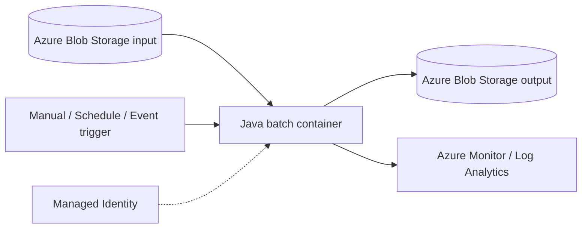

# Packaging and running Java batch jobs on Azure

An enterprise system does not only process real-time HTTP requests. Many tasks—such as end-of-day order aggregation, file conversion, financial report generation, indexing, image processing, or partner data ingestion—run in **batches**. These tasks have a clear start and end; they do not need an always-on web server.

With Java, a batch job can be a program with a `main` method, a Spring Batch application, or a containerized process. On Microsoft Azure, you can package Java code as an **executable JAR**, bake it into a **container image**, and run it via **Azure Container Apps Jobs**. For workloads with many tasks requiring dedicated VM pools and complex scheduling, **Azure Batch** is another option.

This lesson belongs to the **Elastic Compute and Batch Processing** chapter of the Azure module. It connects subscriptions, resource groups, Microsoft Entra ID, virtual networking, Blob storage, access control, monitoring, and cost. The goal is to build a batch pipeline that is **repeatable, verifiable, stops cleanly, and never loses data on reruns**.

> Commands that create resources or deploy images are hands-on examples. Run them only in authorized subscriptions and resource groups. CLI syntax, SKUs, quotas, and support conditions may vary by tool version and region; verify command help and current settings before production deployment.

## Learning objectives

After this lesson, you will be able to:

- Distinguish batch jobs from always-on services and event-driven functions.
- Identify input, output, resource, runtime, and retry requirements of a Java batch job.
- Build a Java program that reads CSV, computes totals, and returns appropriate exit codes.
- Package an application into an executable JAR with Maven and a container image via a Dockerfile.
- Store images in Azure Container Registry (ACR) and execute them with Azure Container Apps Jobs.
- Distinguish **Manual**, **Schedule**, and **Event** triggers in Container Apps Jobs.
- Understand how Azure Batch organizes pools, jobs, and tasks for large-scale workloads.
- Secure Blob reads/writes using managed identity, RBAC, and network rules.
- Monitor executions, logs, failures, retries, idempotency, and costs.
- Design deployment, testing, and operations workflows for batch jobs on Azure.

## 1. What problem do batch jobs solve?

A web API typically must accept requests at any moment, whereas a batch job only runs when there is work to do. For example, every day at 02:00 UTC, a system aggregates the previous 24 hours of sales and exports a report.

A typical batch job:

1. Receives **parameters**: processing window, data location, run identifier.
2. Downloads or reads **inputs** from Azure Blob Storage, databases, or approved sources.
3. Processes data in bulk: parse, validate, aggregate, transform.
4. Writes durable **outputs** to Blob Storage, databases, or queues.
5. Emits logs/metrics for monitoring.
6. Exits with **exit code 0** on success or **non-zero** on failure.

### Differences from web applications

| Criterion | Web/API service | Batch job |
|---|---|---|
| Triggering | Continuous HTTP requests | Manual, scheduled, or event-driven |
| Lifecycle | Typically long-running | Start, process, terminate |
| Success signal | HTTP status and latency | Exit code, execution state, and output results |
| Scaling | Multiple serving requests/replicas | Multiple jobs/tasks/replicas or partitioned data |
| Error handling | Request retries, circuit breakers | Execution/task retries, checkpoints, and idempotency |
| Cost model | Service runtime and baseline resources | Execution duration, provisioned resources, storage, logs, and data transfer |

**Never use a multi-hour HTTP request as a batch job** if the platform enforces timeouts or web frontends can drop connections. Instead, have an API submit a request and execute the work via a dedicated batch platform.

## 2. Choosing the right Azure service

| Service | Model | Consider when | Watch out for |
|---|---|---|---|
| **Azure Container Apps Jobs** | Containers running to completion, Manual/Schedule/Event triggered | Containerized Java batch wanting zero cluster management | Designing timeouts, retries, triggers, identity, and logs |
| **Azure Batch** | Batch account, compute pool, job, and tasks | Many parallel tasks, specialized VM/SKU pools, or HPC | Managing pools, runtime/images, task dependencies, and quotas |
| **AKS CronJob/Job** | Kubernetes Job/CronJob inside a cluster | Organization already runs AKS with Kubernetes expertise | Operating cluster, nodes, identities, and policies |
| **Azure Functions** | Code invoked by timer/event | Compact work fitting runtime/hosting plan and timeout limits | Checking max duration, payload size, and Java Functions model |
| **VM/VM Scale Sets + scheduler** | Scheduled scripts or services on VMs | Needing special OS/agent control or legacy systems | Patching, HA, scale-down, monitoring, and VM costs |
| **Azure Data Factory / pipeline services** | Orchestrates data tasks and dependencies | Multi-step workflows combining data sources | Does not replace Java runtime; still needs an execution target |

In this lesson, the primary choice is **Container Apps Jobs** to illustrate the lifecycle of a containerized Java batch job. **Azure Batch** is explained as an option for large task sets or workloads with specialized VM requirements.

## 3. Problem design: aggregating an order file

We will build a Java application that takes this CSV:

```csv
order_id,total
1001,150.50
1002,230.00
1003,19.50
```

The program will:

- Open the file path passed via command-line argument.
- Validate that the header matches `order_id,total`.
- Read each record and parse the `total` column as `BigDecimal` to avoid floating-point rounding errors when summing money.
- Print the order count and total amount to `stdout`.
- Return a non-zero exit code if the file is missing, data is invalid, or processing fails.

Expected output:

```text
event=batch_completed job=order-summary orders=3 amount=400.00
```

In this lab, the CSV is **packaged inside the image** so the example runs without creating a Storage account. In production deployments, inputs normally live in **Azure Blob Storage** and outputs must be written to durable storage. A container's ephemeral filesystem must never be treated as long-term storage.

### Reference data flow



**Important:** the diagram illustrates the target production flow. The minimal Java example below reads a local file and writes results to logs; implementing real Blob input/output requires adding a data access layer such as the Azure Storage SDK and appropriate authentication.

## 4. Java project structure with Maven

Sample project layout:

```text
order-summary-job/
├── pom.xml
├── src/
│   └── main/
│       └── java/
│           └── vn/
│               └── example/
│                   └── batch/
│                       └── OrderSummaryJob.java
├── sample/
│   └── orders.csv
└── Dockerfile
```

Use **Java 21** and a compatible Maven version. You can pick another LTS per organizational standards, as long as the compile JDK matches the container JRE to avoid `UnsupportedClassVersionError`.

### The pom.xml file

```xml
<project xmlns="http://maven.apache.org/POM/4.0.0"
         xmlns:xsi="http://www.w3.org/2001/XMLSchema-instance"
         xsi:schemaLocation="http://maven.apache.org/POM/4.0.0
                             https://maven.apache.org/xsd/maven-4.0.0.xsd">
    <modelVersion>4.0.0</modelVersion>

    <groupId>vn.example</groupId>
    <artifactId>order-summary-job</artifactId>
    <version>1.0.0</version>
    <packaging>jar</packaging>

    <properties>
        <maven.compiler.release>21</maven.compiler.release>
        <project.build.sourceEncoding>UTF-8</project.build.sourceEncoding>
    </properties>

    <build>
        <plugins>
            <plugin>
                <groupId>org.apache.maven.plugins</groupId>
                <artifactId>maven-compiler-plugin</artifactId>
                <version>3.13.0</version>
            </plugin>
            <plugin>
                <groupId>org.apache.maven.plugins</groupId>
                <artifactId>maven-jar-plugin</artifactId>
                <version>3.4.2</version>
                <configuration>
                    <archive>
                        <manifest>
                            <mainClass>vn.example.batch.OrderSummaryJob</mainClass>
                        </manifest>
                    </archive>
                </configuration>
            </plugin>
        </plugins>
    </build>
</project>
```

Because the project has no external dependencies beyond the JDK, a **standard JAR** suffices. If adding the Azure Storage SDK, database drivers, or Spring Batch, ensure dependencies are included on the runtime classpath—for example, using Maven Shade Plugin to create a **fat JAR/uber JAR** or an appropriate framework packaging plugin. Setting `Main-Class` alone does not bundle dependencies.

## 5. Writing a Java batch job with exit codes and logging

File `src/main/java/vn/example/batch/OrderSummaryJob.java`:

```java
package vn.example.batch;

import java.io.BufferedReader;
import java.io.IOException;
import java.math.BigDecimal;
import java.nio.charset.StandardCharsets;
import java.nio.file.Files;
import java.nio.file.Path;

public final class OrderSummaryJob {

    private OrderSummaryJob() {
    }

    public static void main(String[] args) {
        if (args.length != 1) {
            System.err.println("event=batch_failed reason=missing_input");
            System.exit(2);
        }

        try {
            process(Path.of(args[0]));
        } catch (Exception ex) {
            System.err.println(
                "event=batch_failed type=" +
                ex.getClass().getSimpleName() +
                " message=" + ex.getMessage()
            );
            System.exit(1);
        }
    }

    private static void process(Path file) throws IOException {
        long records = 0;
        BigDecimal amount = BigDecimal.ZERO;

        try (BufferedReader reader =
                Files.newBufferedReader(file, StandardCharsets.UTF_8)) {

            String header = reader.readLine();
            if (header == null ||
                    !header.trim().equals("order_id,total")) {
                throw new IllegalArgumentException("invalid_csv_header");
            }

            String line;
            long lineNo = 1;
            while ((line = reader.readLine()) != null) {
                lineNo++;
                if (line.isBlank()) {
                    continue;
                }

                // For simple sample CSV only, with no commas inside quoted values.
                // Production requires a proper CSV parser.
                String[] parts = line.split(",", -1);
                if (parts.length != 2 ||
                        parts[0].isBlank() ||
                        parts[1].isBlank()) {
                    throw new IllegalArgumentException(
                        "invalid_row_at_" + lineNo
                    );
                }

                BigDecimal rowAmount =
                    new BigDecimal(parts[1].trim());
                if (rowAmount.signum() < 0) {
                    throw new IllegalArgumentException(
                        "negative_amount_at_" + lineNo
                    );
                }

                amount = amount.add(rowAmount);
                records++;
            }
        }

        System.out.println(
            "event=batch_completed job=order-summary" +
            " orders=" + records +
            " amount=" + amount.toPlainString()
        );
    }
}
```

### Why design it this way?

1. **Parameterized input:** the same JAR can run against different files.
2. **Streaming reads:** `BufferedReader` avoids loading the entire file into RAM; better suited for large inputs.
3. **BigDecimal:** avoids `double` precision errors for basic monetary summation.
4. **Early validation:** headers and each line are checked; malformed data is never silently skipped.
5. **Simple structured logs:** `event=batch_completed` and `event=batch_failed` are easy to query in logs.
6. **Exit codes:** code 0 signals success; non-zero tells the job runner the program failed.

The example intentionally supports only **simple two-column CSVs**. If real files contain commas inside quoted strings, embedded newlines, varying encodings, or dynamic headers, use a maintained, well-tested CSV parser. Never use `String.split` as a general-purpose CSV parser in production.

### Meaning of exit codes

| Exit code | Meaning in example | Expected outcome |
|---|---|---|
| `0` | Processed all inputs successfully | Execution considered completed |
| `1` | Read/parse/validation or other error | Job runner registers failure |
| `2` | Missing input argument | Invocation configuration failure |

Printing an `ERROR` line while returning exit code 0 is not enough for orchestrators to know a job failed. Always return accurate process exit statuses and handle retries at the appropriate orchestration layer.

## 6. Building the JAR and testing locally

Create `sample/orders.csv`:

```csv
order_id,total
1001,150.50
1002,230.00
1003,19.50
```

From the project directory:

```bash
mvn -B clean package

java -jar target/order-summary-job-1.0.0.jar sample/orders.csv
```

Expected:

```text
event=batch_completed job=order-summary orders=3 amount=400.00
```

### Testing a failure case

```bash
java -jar target/order-summary-job-1.0.0.jar sample/missing.csv
echo $?
```

In Bash, `echo $?` prints the exit code of the immediately preceding command. With a nonexistent file, the program logs `batch_failed` and returns `1`.

Add dedicated JUnit tests for bad headers, missing columns, negative numbers, empty files, and exact sums as the project grows. **This lesson only illustrates source code** and does not claim build commands were executed.

## 7. Packaging a Java JAR into a container image

A container image bundles the Java runtime, application, and files needed to run. Images allow the exact same build to be tested on developer machines, staging, and Azure.

### Multistage Dockerfile

```dockerfile
# Stage 1: compile Java
FROM maven:3.9-eclipse-temurin-21 AS build
WORKDIR /src
COPY pom.xml ./
COPY src ./src
RUN mvn -B -DskipTests package

# Stage 2: keep only JRE and artifact to run
FROM eclipse-temurin:21-jre
WORKDIR /opt/job
COPY --from=build /src/target/order-summary-job-1.0.0.jar /opt/job/job.jar
COPY sample/orders.csv /opt/job/input/orders.csv

# Lab only needs read permission on packaged files
USER 10001:10001
ENTRYPOINT ["java", "-XX:MaxRAMPercentage=70", "-jar", "/opt/job/job.jar", "/opt/job/input/orders.csv"]
```

`ENTRYPOINT` uses single-line JSON exec-form so it works directly. Image tags are illustrative; in environments with strict software supply-chain controls, pin digests, scan images, check CVEs, and update base images on schedule.

### Why use multistage?

- The build stage includes Maven and the JDK for compilation.
- The runtime stage carries only the JRE, JAR, and lab input, trimming unnecessary components.
- `USER 10001:10001` avoids running as root by default where supported.
- `MaxRAMPercentage` lets the JVM size its heap relative to container memory limits better than a fixed oversized heap flag.

**Important:** in this lab, `orders.csv` sits **inside the image**, so every execution reads the same data. In production, input files must come from external locations such as Blob Storage/volumes, passed by run ID or parameters; never rebuild images daily just to swap data.

### Building and running locally with Docker

```bash
docker build -t order-summary-job:1.0.0 .
docker run --rm order-summary-job:1.0.0
```

Stdout matches running the JAR directly. If the image fails to run, check JAR path, Java version, entrypoint, file read permissions, and container logs.

### Do you need Docker in Cloud Shell?

Do not assume Azure Cloud Shell has a Docker daemon available for `docker build`. To build in Azure without local Docker, **Azure Container Registry Tasks** supports building images from a supplied context using `az acr build` under appropriate service and permission conditions.

## 8. Pushing images to Azure Container Registry

**Azure Container Registry (ACR)** is your organization's private container image store. Azure Container Apps Jobs can pull images from an eligible registry using configured credentials or managed identities.

### Preparing subscription and resource group

In Azure CLI Bash:

```bash
az account show --output table
az account set --subscription "<SUBSCRIPTION_ID>"

RG="rg-java-batch-lab"
LOCATION="southeastasia"
ACR="<UNIQUE_ACR_NAME>"

az group create \
  --name "$RG" \
  --location "$LOCATION"
```

Replace `<UNIQUE_ACR_NAME>` with a valid, globally unique registry name on Azure; check quotas and policies before creating.

### Creating a lab registry

```bash
az acr create \
  --resource-group "$RG" \
  --name "$ACR" \
  --sku Basic \
  --admin-enabled false
```

Keeping admin user disabled avoids treating a registry admin account as the default choice for every job.

### Building an image in ACR

From the **project root directory** containing the Dockerfile, Maven project, and `sample/orders.csv`:

```bash
az acr build \
  --registry "$ACR" \
  --image order-summary-job:1.0.0 \
  .
```

This uploads the build context so the service builds the image inside ACR, requiring no local Docker daemon. It succeeds only when the registry has build capability/permissions and a valid Dockerfile.

Inspect repository/tags:

```bash
az acr repository list --name "$ACR" --output table

az acr repository show-tags \
  --name "$ACR" \
  --repository order-summary-job \
  --output table
```

The image path takes the form:

```text
<UNIQUE_ACR_NAME>.azurecr.io/order-summary-job:1.0.0
```

For production, prefer immutable version tags or **image digest** references so you know the exact build running. Using `latest` on critical jobs complicates investigations and rollbacks.

## 9. Azure Container Apps Jobs: the execution concept

Azure Container Apps Jobs runs containers as **discrete units of work**: when a job triggers, the platform creates an **execution**. An execution can contain one or more replicas depending on configuration. Processes exit with success or failure, and the job runner determines status from outcomes and retry/timeout limits.

Key concepts:

| Concept | Meaning |
|---|---|
| **Container Apps environment** | Shared boundary for Container Apps/Jobs, with associated networking and observability settings |
| **Job definition** | Image, CPU/memory, environment variables, triggers, retries, timeouts, and configuration |
| **Execution** | A single run triggered manually, on schedule, or by an event |
| **Replica** | A container execution unit inside an execution |
| **Replica retry limit** | Configured retry cap for failed replicas |
| **Replica timeout** | Maximum runtime limit for a replica |
| **Parallelism** | Number of replicas allowed to run concurrently per job config |
| **Replica completion count** | Number of replicas that must succeed for the execution to pass |
| **Trigger** | Manual, Schedule, or Event |

A `Manual` job **does not mean a single once-in-a-lifetime run**: you can launch many executions. Each run must identify which data to process and avoid duplicate processing if business rules require it.

## 10. Deploying a Container Apps Job from a private image

To keep images in ACR **private**, use a **managed identity** for Container Apps Job image pulls and assign the appropriate role on the registry. The Portal sequence below applies where the UI supports those options; menu locations may change.

### Step 1: create a Container Apps environment

In the Azure Portal:

1. Select the right subscription and resource group.
2. Create a **Container Apps environment** in an approved region.
3. Configure networking/VNet if the workload must read Blob over a Private Endpoint or has specific outbound rules.
4. Select appropriate observability/logging settings.
5. Confirm the environment is ready before creating the job.

CLI example for creating an environment when supported in the subscription/region:

```bash
ENV="cae-java-batch-lab"

az extension add --name containerapp --upgrade

az containerapp env create \
  --resource-group "$RG" \
  --name "$ENV" \
  --location "$LOCATION"
```

Environment creation may provision or require supporting resources depending on options and CLI version. Review logging configuration and actual costs after creation.

### Step 2: configure identity and image pull permissions

For the job to pull a private image from ACR:

1. Prepare a **user-assigned managed identity** or managed identity type supported by both the job and registry.
2. Grant an appropriate image-pull role on ACR. With standard ACR RBAC, **AcrPull** is the familiar role; if the registry uses repository-based/ABAC permissions, verify the corresponding role and scope.
3. When creating the job, select the ACR image and configure **registry authentication using that managed identity**.
4. Verify ACR allows access from the runtime environment per network and DNS policies.
5. Check image pull status before debugging Java errors.

The managed identity for **image pull** and the managed identity for **Blob reads/writes** can be the same or separate identities. Separating identities keeps each component scoped to least privilege. Never enable ACR admin user or drop registry passwords directly into config files just for quick testing.

### Step 3: create a Manual job

In **Azure Portal → Container Apps Jobs** (or the corresponding section):

1. Select **Create** and name it `job-order-summary`.
2. Choose the resource group and the Container Apps environment created earlier.
3. Select **Manual trigger**.
4. Select image `<ACR_NAME>.azurecr.io/order-summary-job:1.0.0`.
5. Configure the prepared registry identity and pull permissions.
6. Choose suitable CPU/memory, e.g., starting at **0.5 vCPU / 1 GiB** if supported in your environment.
7. Set pilot-appropriate replica timeout and retry limit.
8. Set parallelism = 1 and completion count = 1 for a single-CSV job.
9. Confirm command/arguments; the lab image already has an `ENTRYPOINT` processing the sample file.
10. Create the job, check provisioning state, then start the first execution.

For CLI/IaC deployments, common parameter groups include `--trigger-type Manual`, `--image`, `--cpu`, `--memory`, `--replica-timeout`, `--replica-retry-limit`, `--parallelism`, and `--replica-completion-count`. Private ACR identity flags must match your CLI version and chosen managed identity type; never copy commands lacking auth configuration into production.

### Step 4: start an execution

Once the job is created with working image pulls:

```bash
JOB="job-order-summary"

az containerapp job start \
  --resource-group "$RG" \
  --name "$JOB"
```

List executions:

```bash
az containerapp job execution list \
  --resource-group "$RG" \
  --name "$JOB" \
  --output table
```

Across newer/older CLI versions, check `az containerapp job --help` and `az containerapp job execution --help` to confirm subcommands. Execution status, failure reasons, and logs can also be inspected in the Azure Portal.

### Step 5: inspect logs

In the Azure Portal, open the job → **Executions**, select the latest execution, and view logs/console as supported by the environment. If Log Analytics is configured, query logs for `event=batch_completed` and `event=batch_failed`, correlating timestamps, replicas, and execution IDs.

Expected from the lab image:

```text
event=batch_completed job=order-summary orders=3 amount=400.00
```

This log line proves **the program computed the result**, yet in production you must also verify **actual outputs were written to durable storage**. Never treat a single success log line as proof that every file was exported.

## 11. Trigger types: Manual, Schedule, and Event

| Trigger | When does it run? | Example |
|---|---|---|
| **Manual** | When an operator/API/CLI starts an execution | Ad-hoc report run or dataset reprocessing |
| **Schedule** | On the job's cron expression | End-of-day data aggregation |
| **Event** | When configured event/queue scale rules fire | Processing batches of queued messages |

### Schedule trigger

For a job running daily at 02:00 **UTC**, use a five-field cron expression:

```text
0 2 * * *
```

Cron schedules in Container Apps Jobs are interpreted in UTC in supported designs. If the requirement is 02:00 Vietnam time, convert before configuring (Vietnam is UTC+7, with no daylight saving time). For instance, 02:00 in Vietnam corresponds to 19:00 UTC the previous day, so the daily UTC expression is:

```text
0 19 * * *
```

Do not mistake a cron job for an **exactly-once execution** guarantee. Jobs can retry, run late, or require reprocessing; design idempotency and explicit data-period tracking.

### Event trigger

Event-driven jobs need an event/queue source and matching scale rules. For example: a queue holding per-file processing jobs. When messages arrive, the platform can trigger executions; each execution determines its work from the message or defined data source.

Never assume a starting container automatically knows which message to process. Define rules for **message ownership, acknowledgment, visibility timeout, replica/worker count, retries, and dead-lettering** matching your queue service. Depending on architecture, a continuously running consumer or Azure Functions may fit better than an event-triggered batch job.

### Manual for reprocessing

To rerun a previous day's data, use a Manual job or orchestrator passing `processingDate`/`runId` parameters. Avoid hardcoding "today's date" inside the program, which makes rerunning last month's report awkward to control.

## 12. Bringing Blob Storage data into real Java jobs

The lab image contains a sample CSV purely to verify packaging and runtime. In production, **inputs and outputs must be decoupled from the image**. A typical design:

```text
Container image: Java app version 1.0.0
Job parameters:
  INPUT_CONTAINER=raw-orders
  INPUT_BLOB=2026/11/20/orders.csv
  OUTPUT_CONTAINER=reports
  OUTPUT_BLOB=daily/2026-11-20.json
  RUN_ID=orders-2026-11-20
```

These variables are illustrative and contain no secrets.

### Accessing Azure Blob via Java SDK

In production applications, use the Azure Storage Blob SDK alongside the Azure Identity library with **DefaultAzureCredential** or an explicitly designed environment credential:

```java
// Illustrates data integration only, not a complete program.
// Add matching versions of azure-storage-blob and azure-identity
// via Maven dependency management before compiling this snippet.

BlobServiceClient blobService =
    new BlobServiceClientBuilder()
        .endpoint("https://" + storageAccount + ".blob.core.windows.net")
        .credential(new DefaultAzureCredentialBuilder().build())
        .buildClient();

BlobClient source = blobService
    .getBlobContainerClient(inputContainer)
    .getBlobClient(inputBlobName);

String csv = source.downloadContent().toString();

// parse/validate/aggregate csv here; for large files
// use streaming instead of downloadContent into RAM.
```

Similarly, write results via the Blob SDK using deterministic output blob names and appropriate overwrite/ETag conditional checks. For large files, prefer streaming uploads/downloads, partitioning, and batched processing instead of holding entire contents in a single `String`.

### Configuring identity and permissions

To read inputs and write outputs:

1. Enable managed identity on the Container Apps Job as supported.
2. Grant **Storage Blob Data Reader** on the input container.
3. Grant **Storage Blob Data Contributor** on the output container if writing blobs.
4. If the Storage account allows private networks only, design Container Apps environment networking, Private Endpoints, and private DNS properly.
5. Test real requests under the execution's identity, not only your personal account in the Azure Portal.

An identity with write access to output does not need delete rights across every other container. **Managed identity solves authentication**, while Azure RBAC and Storage firewalls enforce data permissions and network paths.

### Data consistency

If upstream is still uploading `orders.csv`, the job could read incomplete data. Applicable patterns include:

- Upstream uploads to a staging prefix and publishes upon completion.
- Sending a message or **ready** marker after data is written and verified.
- Using ETags/versions or manifests to identify exact input versions.
- Triggering the job only after evidence confirms input readiness.
- Writing outputs to a staging path, validating, then publishing the finalized version.

Using Blob Storage decouples job lifecycle from VMs/containers, yet you still need processes defining **complete inputs** and **valid outputs**.

## 13. Retries, idempotency, and failure handling

Batch jobs can fail due to missing source files, expired tokens, Storage throttling, dropped connections, container eviction, or logic bugs. Retries are essential, yet they can cause **duplicate processing**.

### Idempotency

An **idempotent** job is designed so rerunning the same work does not double-count or corrupt business results.

Examples:

- **Bad:** every run appends daily sales totals to one shared file, so retries double the revenue figure.
- **Better:** outputs are named deterministically by date or run ID, e.g., `reports/daily/2026-11-20.json`, written under version-control policies.
- **Stronger:** use transactions, conditional writes/ETags, state metadata, or locks so a given input version publishes only once.

For financial data, daily overwrites also require clear policies for **reruns**, **historical corrections**, and **approvals**. Idempotency is more than "overwriting the same filename."

### Failure classification

| Error category | Examples | Strategy |
|---|---|---|
| **Transient** | Network timeout, 429/throttling, recoverable service error | Bounded retries, exponential backoff, and jitter |
| **Configuration** | Wrong container, missing role, wrong endpoint | Halt, alert, fix config; blind retries are usually futile |
| **Data** | Malformed CSV, negative values breaking rules | Halt or quarantine bad data, investigate |
| **Resource** | Out of memory, disk full, timeout too short | Adjust memory/CPU, partition data, re-measure |
| **Logic** | Bug, duplicate output, deadlock | Fix code/tests, rerun under control |

### Two-layer retries

- **Inside Java SDK/app:** bounded retries on safely retryable network calls.
- **At the job platform:** replica/execution retries per configuration.

If both layers retry without bounds, total attempts can multiply, driving unwanted load and cost. Align timeout/retry budgets so the system stops and alerts promptly.

### Timeouts and resources

Set timeouts from pilot measurements—neither so short that valid jobs get killed, nor so long that hung jobs waste resources. Monitor CPU, heap, GC, container OOMs, and real throughput. For Java, size heap relative to container memory limits, leaving headroom for native allocations and runtime overhead.

## 14. Parallelizing a Java job

At large data volumes, a single JVM can be too slow. Two approaches exist:

1. **Intra-JVM parallelism:** process chunks concurrently in one process using thread pools, still bounded by one replica's CPU/RAM.
2. **Multi-task/replica parallelism:** split input into partitions and assign them to independent executions/replicas.

For example, input split by file:

```text
raw-orders/part-0001.csv
raw-orders/part-0002.csv
raw-orders/part-0003.csv
...
```

Each task receives a `partitionId` or `inputBlob` and writes its own output. A final aggregation task can merge results from a manifest only after all partitions succeed.

### Do not increase parallelism blindly

If parallel replicas all read the **same file** and write the same output, costs multiply while duplicating work. When increasing `parallelism` in Container Apps Jobs, design how each replica claims a distinct slice of work or pull work from a consistent queue.

Verify database/Storage concurrent connection limits, locking, throughput, and retries when multiple workers run together.

## 15. Azure Batch for large-scale parallel task sets

**Azure Batch** orchestrates batch processing tasks across a **compute pool** of VM nodes. It suits rendering, scientific computing, batch analytics, or jobs needing thousands of independent tasks, specific VM SKUs, and flexible scheduling.

### Core concepts

| Concept | Role |
|---|---|
| **Batch account** | Resource managing the Batch service and configuration permissions |
| **Pool** | Set of compute nodes with matching image/SKU and network settings |
| **Compute node** | VM executing assigned tasks |
| **Job** | Work group containing one or more tasks |
| **Task** | Unit running a command with configured resource files, env vars, and outputs |
| **Start task** | Node environment prep step, e.g., installing Java runtime if absent from image |
| **Job/task scheduling** | Distributes tasks, tracks retries and statuses |
| **Autoscale** | Adjusts node counts in the pool via designed formulas |

### Running a Java JAR on a Batch node

Conceptual design:

1. Package the Java JAR and store the artifact in Blob Storage or an allowed image/volume.
2. Create a Batch pool with a VM image containing a suitable Java runtime; if missing, install Java via a start task or custom image.
3. Create a Batch job holding multiple tasks.
4. Each task receives a `resource file` or input list and runs a command like:

```bash
java -Xmx2g -jar order-summary-job.jar part-0001.csv
```

5. Tasks emit outputs/logs via Batch mechanisms and save result files to durable storage.
6. Monitor task exit codes, failure info, node health, and pool costs.
7. Upon completion, scale the pool down or clean up resources per policy.

That command is the **in-node execution command**, not the full command to create a Batch task. Batch also requires staging resource files, configuring identity/SAS, Storage permissions, application packages, networking, and output files per service capabilities.

### When to choose Batch over Container Apps Jobs?

Choose Azure Batch when you need:

- Thousands of independent tasks orchestrated across many VMs.
- Specialized CPU/RAM/VM SKUs, GPUs, or HPC workloads per regional availability.
- Pool management, node start tasks, task dependencies, or custom node software.
- Fine-grained autoscaling and node cost control tuned to compute characteristics.

Choose Container Apps Jobs when the app already runs cleanly in containers, independent task counts are moderate, and you want minimal VM pool administration with integrated Container Apps triggers/logs.

## 16. Monitoring executions and logs on Azure

A production job must answer:

- Which execution ran, when, and from which trigger?
- Which input data and input version were processed?
- Which image digest and JVM settings ran?
- How many records succeeded, were skipped, or failed?
- Where was output written; how do checksums or manifests verify it?
- Did the job fail due to application code or platform issues?
- Did the job experience retries, timeouts, OOMs, or network blocks?

### Monitoring layers

| Source | Information | Limitations |
|---|---|---|
| **Container Apps Job executions** | Execution status, timestamps, replicas, and outcomes | Does not replace validating output data |
| **Container stdout/stderr** | App logs, exceptions, record counts | Available only if app logs them and retention is configured |
| **Azure Monitor/Log Analytics** | Log queries, trend analysis, alerts | Requires proper diagnostic/log pipeline; incurs cost |
| **Azure Storage metrics/logs** | Transactions, access errors, throttling as supported | Does not verify business aggregation logic |
| **Azure Activity Log** | Control-plane changes to Jobs, Registry, IAM | Does not capture Java processing line by line |
| **Application-level metrics** | `records_processed`, `duration_ms`, `failed_records` | Must be emitted by code/pipeline |

A useful log format:

```text
event=batch_started run_id=orders-2026-11-20 input=raw-orders/2026-11-20.csv
event=batch_progress run_id=orders-2026-11-20 records=5000
event=batch_completed run_id=orders-2026-11-20 records=15000 duration_ms=42000
```

Never log personal data, tokens, connection strings, or order payloads unnecessarily. Without `run_id` or `input_version` in logs, distinguishing retry attempts becomes difficult.

### Operational alerts

Alert when:

- Executions fail or exceed completion deadlines.
- Scheduled runs are missed, with no new execution appearing in the expected window.
- Processing duration or error record counts spike abruptly.
- Memory/CPU hits limits causing OOM/timeouts.
- Outputs are missing or manifests fail validation.
- Retry counts climb abnormally.
- Log, storage, or compute costs rise rapidly.

**Do not monitor only execution success:** a job can exit with code 0 yet export the wrong data period, process partial records, or fail to persist output.

## 17. Security and network control for Java batch jobs

### Identity and RBAC

- Use **managed identity** on Container Apps Jobs or Batch workloads as supported.
- Separate read access for inputs from write access for outputs if needed.
- Grant data-plane roles only—such as `Storage Blob Data Reader` or `Storage Blob Data Contributor`—on the exact containers.
- Never grant subscription-wide `Owner` just so a job can download a CSV.
- Enforce RBAC, MFA/Conditional Access, and PIM for operator accounts authorized to create/modify jobs.

### Registry and image supply chain

- Private ACR with admin user disabled unless explicitly justified.
- Use managed identity with appropriate pull permissions.
- Tag versions explicitly or deploy by digest.
- Scan images and dependencies; use trusted base images and patch the JRE on schedule.
- Never bake secrets into Dockerfiles or image layers.

### Networking

- If Blob Storage restricts public access, place the job in an environment with a network path to **Private Endpoints** or an approved access mechanism.
- Configure private DNS so Storage hostnames resolve correctly from the workload.
- If using firewalls/UDRs, verify outbound HTTPS and platform dependencies.
- Verify ACR is reachable by the job under firewall/private networking rules.
- Block unnecessary egress and retain audit logs where compliance requires.

### Data residency and compliance

When processing sensitive data, verify the region of the environment, input/output storage, logs, backups, and cross-region replication. Placing a Container Apps environment in a region does not automatically guarantee all associated data stays in that region.

## 18. Lifecycle cost reduction for batch workloads

Batch jobs often save money because services do not run 24/7. Still, costs come from multiple components.

| Component | Costs to factor in |
|---|---|
| Container Apps Jobs | CPU/memory and execution usage per applicable plan/pricing; baseline environment charges may apply |
| Azure Batch | Compute nodes, disks, networking, and pool-related charges |
| Azure Container Registry | Registry SKU, storage, and builds/tasks per configuration |
| Blob Storage | Input/output storage, transactions, tiers, egress, and replication |
| Log Analytics | Ingestion, retention, queries/alerts per features and pricing |
| Networking | Private Endpoints, NAT/Firewalls, cross-region peering/egress where applicable |

### Optimization tactics

1. Right-size CPU/memory after measuring real workloads.
2. Never let jobs hang indefinitely; enforce timeouts and retry budgets.
3. Process only partitions with changed data when business rules permit.
4. Trim unnecessary logs and store sensitive data in appropriate tiers.
5. Keep images lean and avoid frequent rebuilds when code has not changed.
6. With Batch pools, use autoscale or stop/shrink nodes when idle.
7. Tag `environment`, `owner`, `service`, and `costCenter` where policy supports.
8. Use Azure Cost Management, budgets, and alerts to monitor spend.

**Budget alerts do not automatically stop resources when breached.** For automated batch pipelines, enforce caps on executions/tasks alongside policies to disable or scale down resources cleanly.

## 19. Common troubleshooting

| Symptom | Likely cause | Remediation |
|---|---|---|
| `mvn package` fails | Incompatible JDK/Maven, syntax error, or missing dependency | Check `mvn -version`, compiler errors, dependency resolution |
| `java -jar` reports missing Main-Class | JAR manifest lacks main class entry | Check `maven-jar-plugin` and target artifact |
| `NoClassDefFoundError` after adding Azure SDK | JAR lacks runtime dependencies or classpath incomplete | Build a fat JAR/proper packaging and inspect dependencies |
| Container fails to start | Wrong ENTRYPOINT, missing JAR, Java version mismatch | Run locally with Docker, inspect container logs |
| `ImagePullBackOff` or image pull failure | Wrong registry auth/RBAC, missing tag, ACR network blocked | Check AcrPull/repository roles, image digest, network, and identity |
| Job execution fails immediately | Missing input, Java returns non-zero exit code, bad args | Read stdout/stderr, inspect command/args |
| Container killed/OOM | JVM heap and memory limit misaligned | Lower heap, raise memory, or stream/partition data |
| Execution timeout | Data volume too large or deadline too tight | Measure duration, adjust timeout sensibly, or split workload |
| Cannot read Blob despite identity existing | Missing Blob Data role or firewall/DNS mismatch | Check data-plane RBAC, Private Endpoint, tokens, and logs |
| Schedule runs at wrong hour | Confused UTC vs. local time | Convert timezone accurately; check cron and execution timestamps |
| Retries produce duplicate reports | Missing run ID/idempotency or appending outputs | Use deterministic output keys, transactions/conditional writes |
| Job succeeds yet no output exists | Wrote only to ephemeral filesystem or skipped persist step | Inspect Blob output, manifest, and logs |
| Azure Batch task fails on node | Missing JRE, resource file, or wrong command path | Check pool image, start task, task stderr/stdout |
| Cost spikes sharply | Too many replicas, retries, idle pools, or long log retention | Review Cost Management, job configs, pool scaling, and log retention |

When debugging, pinpoint **which stage failed first: build → image → image pull → execution → data access → persist output**. Never "quick-fix" by opening the entire Storage firewall, enabling ACR admin user, or granting subscription-wide Owner.

## 20. Comprehensive hands-on lab

**Objective:** package the CSV aggregation program, build a container, run it once on Azure Container Apps Jobs, and collect evidence of a successful execution.

### Steps

1. **Prepare project:** create `pom.xml`, `OrderSummaryJob.java`, `sample/orders.csv`, and Dockerfile per sections 4–7.
2. **Build locally:** run `mvn -B clean package` and confirm `orders=3 amount=400.00`.
3. **Run container locally:** build the Docker image, run it, and verify exit code/logs.
4. **Push to ACR:** create a registry in the lab resource group and run `az acr build`.
5. **Set up environment:** create a Container Apps environment and configure logging/networking.
6. **Grant pull identity:** use a managed identity and image pull permission on ACR per the registry permission model.
7. **Create Manual Job:** select image version `1.0.0`, one replica, and sufficient CPU/memory and timeout for sample input.
8. **Start job:** run `az containerapp job start`.
9. **Verify:** open Executions, read stdout, confirm exit code/success and summed total.
10. **Rerun:** trigger a new execution; observe the same result since lab input is inside the image.
11. **Test failure:** build a lab image with a malformed CSV header, run it in the test environment, and verify the job fails with logs and non-zero exit code.
12. **Production assessment:** replace the in-image file with Blob input/output, assign managed identity data roles, and design partitioning and idempotency.
13. **Clean up:** verify the resource group contains only lab resources before deleting, paying attention to Registry, environment/logging, identities, and related Storage.

### Result evaluation table

| Test | Expected result |
|---|---|
| Maven build | Produces executable JAR and runs cleanly on Java runtime |
| Local Docker | Container exits cleanly after printing result |
| ACR build | Repository and image tag appear |
| Job pulls image via managed identity | Image pull succeeds without passwords in scripts |
| Start execution | Execution created and transitions to succeeded state |
| Valid CSV | `orders=3 amount=400.00` and exit code 0 |
| Invalid CSV | Logs `batch_failed` and execution fails per retry config |
| Rerun | No duplicate business side effects; in lab, simply prints result |
| Production Storage network restriction | Only workloads with valid identity and network path gain access |
| Production output | Report file exists in Blob with verified name, version, and contents |

## 21. Production deployment checklist

- [ ] Defined inputs, outputs, partitions, SLAs, and data processing windows.
- [ ] Java project has repeatable build/tests, managed dependencies, and matching JDK/JRE.
- [ ] Image uses a trusted base, runs as non-root where appropriate, and passes security scans.
- [ ] Selected Container Apps Jobs, Azure Batch, or another platform based on actual requirements.
- [ ] ACR image uses explicit version tags or digests.
- [ ] Job has managed identity, least-privilege registry pull role, and data permissions.
- [ ] Verified Storage firewalls, Private Endpoints, DNS, and outbound networking.
- [ ] No passwords/SAS/long-lived account keys exist in code, images, or logs.
- [ ] Manual/Schedule/Event triggers tested; cron timezone verified.
- [ ] Timeouts, retry limits, completion counts, and parallelism properly sized.
- [ ] Job returns non-zero exit codes on failure and logs diagnostic details.
- [ ] Run IDs, clear input versioning, retry strategy, and idempotency implemented.
- [ ] Outputs persisted durably with manifests/checksums or appropriate validation.
- [ ] Mitigations exist for concurrent runs, incomplete inputs, or missing sources.
- [ ] Logs/metrics/alerts and operational runbooks configured.
- [ ] Tested job failure, permission loss, timeouts, and reprocessing in a test environment.
- [ ] Budget, tags, cost tracking across registry/compute/storage/logs, and cleanup plan in place.

## 22. Self-check questions

1. How does a batch job differ from a continuously running web API?
2. Why should a Java batch job return a non-zero exit code when a CSV file is invalid?
3. When adding the Azure SDK to a project, why might a JAR with `Main-Class` still fail to run?
4. How does a multistage Dockerfile benefit the runtime image?
5. Why should fixed production order data not be baked inside the container image?
6. How do Manual, Schedule, and Event triggers differ in Azure Container Apps Jobs?
7. Does a cron at 02:00 UTC correspond to 02:00 Vietnam time?
8. Why can increasing parallelism without partitioning input cause duplicate data processing?
9. How does a managed identity differ from the `Storage Blob Data Reader` role?
10. Is an execution reporting Succeeded enough to prove business output is correct?
11. Why is idempotency essential when jobs retry or are rerun manually?
12. When should Azure Batch be chosen over Container Apps Jobs?
13. How do you distinguish an image pull failure from a Java application error?
14. After finishing a batch lab, which resources can still incur charges?

## Conclusion

Packaging Java batch jobs on Azure starts with an application that **takes clear inputs, returns accurate exit codes, and terminates cleanly when done**. Maven builds the JAR; a Dockerfile packages the app into a container image; Azure Container Registry versions the image; and Azure Container Apps Jobs runs executions manually, on schedule, or from events. For massive task parallelism and specialized VM requirements, Azure Batch is worth considering.

A production batch system must go beyond "the container runs": data must persist durably, access permissions and networking must be locked down, retries must be safe, outputs must be verified, and costs must be monitored. Combining Java, managed identity, Azure Blob Storage, monitoring, and controlled deployment workflows lets you build Azure batch workloads that are elastic, reproducible, and easy to operate.
