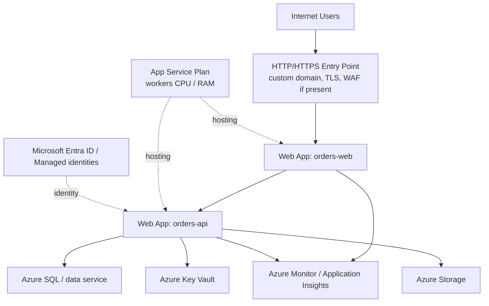

# App Service Plan and the Application Resource Model

In the **CLOUD_PROVIDERS_AZURE** module, we explore the Microsoft Azure ecosystem from subscriptions, resource groups, and Microsoft Entra ID to virtual networks, compute services, storage, and data. The goal is to know how to deploy, monitor, secure, and control the cost of an application architecture on Azure. In the **Web Applications with App Service** chapter, before putting a website or API onto Azure, you need to understand two resources that are often created together yet serve different roles: **App Service Plan** and **Web App**.

For example, an ordering system has a web frontend for customers and an API that processes orders. If you deploy both to a single App Service Plan, they can share compute capacity and split platform costs. However, a traffic spike on the API can affect the website, and scaling the plan's instance count also impacts other apps using the same plan. Therefore, deciding **which app goes on which plan** is an architectural, performance, security, and cost decision—not just a step of picking a resource name in the Azure Portal.

After this lesson, you will be able to:

- Distinguish between Azure App Service, App Service Plan, Web App, deployment slots, and dependent resources.
- Explain the relationship between **SKU/tier**, worker size, instance count, operating system, and Azure region.
- Decide when to place multiple applications on a shared plan and when to separate plans.
- Understand the impact of **scale up**, **scale out**, autoscale, deployment slots, and resource limits.
- Create and inspect an App Service Plan/Web App with the Azure CLI, configure the application, and deploy in a controlled manner.
- Design principles for access control, observability, cost estimation, and safe resource cleanup.

## 1. What is Azure App Service?

**Azure App Service** is a Platform as a Service (PaaS) offering for deploying and operating web applications, REST APIs, and supported web workloads without having to manually manage the entire operating system, web server layer, and underlying VM infrastructure. Depending on the operating system, stack, and SKU, App Service can run .NET, Java, Node.js, Python, PHP, or container-based applications in a supported manner.

When you deploy an application to App Service, Azure manages many platform components such as worker provisioning, service infrastructure, and deployment integration. However, the application team **remains responsible** for source code, dependencies, configuration values, secrets, access permissions, data, application-layer security, monitoring, and scaling decisions.

### 1.1. Two layers to keep separate

```text
Azure subscription
└── Resource group: rg-orders-prod
    ├── App Service Plan: asp-orders-prod
    │   ├── SKU: Premium v3 (example)
    │   ├── OS: Linux
    │   ├── Region: Southeast Asia
    │   └── Worker instances: 2
    │
    ├── Web App: app-orders-web-prod
    │   ├── Web frontend code, runtime, app settings
    │   └── Site URL / custom domain / identity
    │
    └── Web App: app-orders-api-prod
        ├── REST API code, runtime, app settings
        └── Site URL / custom domain / identity

Both Web Apps reference the same App Service Plan.
```

An **App Service Plan** defines the **compute capacity and hosting environment** for applications. A **Web App** defines the **application unit** being deployed: code/runtime, hostname, app settings, authentication, deployment, and its own operational settings.

In Azure Resource Manager, common core resource types include:

| Component | Resource type | Primary responsibility |
|---|---|---|
| App Service Plan | `Microsoft.Web/serverfarms` | SKU/tier, OS, region, worker capacity/instances |
| Web App | `Microsoft.Web/sites` | Application, runtime configuration, hostname, identity, deployment |
| Deployment slot | `Microsoft.Web/sites/slots` | Dependent deployment environment for the parent app; swappable as supported |
| Autoscale setting | `Microsoft.Insights/autoscaleSettings` | Rules to automatically adjust capacity when supported and configured |
| Application Insights | `Microsoft.Insights/components` | Integrated collection of application telemetry |
| Managed identity | Platform identity associated with the Web App | Lets the workload acquire tokens to access other services via RBAC |
| VNet / DNS / private endpoint | Corresponding networking resource types | Connectivity paths to backends or private access to the application |

Not every component in the table is automatically created when you create a Web App. You choose, provision, and link components such as monitoring, networking, certificates, secrets, databases, and logging based on actual requirements.

### 1.2. An App Service Plan is not just an application configuration package

The name **plan** can easily mislead people into thinking it only holds billing quotas. On dedicated tiers, a plan represents a **shared pool of compute resources** for running the apps attached to it. An app, by contrast, is a logical resource with its own lifecycle, hostname, deployment, and configuration.

Two apps on the same plan do not share source code, environment variables, or managed identity. Each app can have different settings and identities. However, they share the plan's worker capacity and typically share the impact when changing the SKU or scaling the plan. This creates both cost-saving benefits and "noisy neighbor" risks at the plan level.

## 2. What factors does an App Service Plan determine?

An App Service Plan has key characteristics:

1. **Azure region:** the location where the worker infrastructure is deployed. Apps created in the plan run within the plan's compatible region.
2. **Operating system:** Windows or Linux, according to the plan configuration. You cannot share a single plan between a Windows Web App and a Linux Web App.
3. **Pricing tier / SKU:** capability level, resource sizes, and available features.
4. **Instance count:** the number of worker instances serving applications on the plan according to the scaling mechanism and SKU.
5. **Hosting environment type:** shared infrastructure on certain basic tiers, or dedicated/isolated hosting depending on the plan and supported options.

A single plan can host multiple apps if those apps meet compatibility and compute capacity limits. Azure does not guarantee that one plan can hold an unlimited number of apps: the feasible number of apps depends on workload, memory, CPU, I/O, configuration, service limits, and SKU rules.

### 2.1. Common tiers

| Tier group | General characteristics | When to consider |
|---|---|---|
| **Free (F1)** | Low capacity and quota, shared infrastructure, limited features | Learning, small experiments |
| **Shared (D1)** | Shared infrastructure, limited features and quotas | Testing without production availability requirements |
| **Basic (B)** | Dedicated compute per plan configuration, some advanced features unavailable | Small services without advanced deployment needs |
| **Standard (S)** | Dedicated; supports more operational features, e.g., conditional deployment slots/autoscale | Small and medium business applications |
| **Premium (appropriate generations/SKU names)** | Higher capacity, scaling/networking/feature options depending on SKU | Workloads with higher performance or specialized capability needs |
| **Isolated / App Service Environment** | Hosting environment isolated under the appropriate ASE model | Enterprises with strict private network/compute environment requirements |

This is an **architectural overview**, not a pricing table or exhaustive feature matrix for a specific date/region. Premium generations, deployment slot limits, zone requirements, and instance types vary by feature; before selecting an SKU, verify current availability for your workload's **region, OS, and subscription**.

**Free/Shared** should not be treated as equivalent to Dedicated just because they also appear as an App Service Plan. Infrastructure sharing, quotas, and billing rules differ; do not apply the "pay for the whole plan by instance count" model of dedicated tiers to infer exact costs across all tiers.

### 2.2. Scale up: changing size and tier

**Scale up (vertical scaling)** means changing the plan's capacity or tier, such as moving from Standard S1 to an appropriate Premium option. Changing the SKU can unlock more CPU/memory/features, but you need to check compatibility, quotas, regional availability, and the impact on running workloads.

```text
Before: App Service Plan S1, 1 worker
        web + api share smaller resources

After:  Appropriate Premium App Service Plan, 1 worker
        web + api share larger worker resources
```

Scale up usually affects **all apps on the same plan**, because the underlying compute resources are changed. Do not immediately use scale up to fix an issue caused by slow database queries or a memory leak without first measuring the root cause.

### 2.3. Scale out: increasing the worker instance count

**Scale out (horizontal scaling)** means increasing the number of instances in the plan, for example from 1 to 3 workers to distribute traffic and processing capacity. In a typical multi-app-per-plan model, each app runs across the plan's workers, and scaling the plan affects the capacity of the entire group of apps.

```text
App Service Plan: 3 worker instances

       Worker 1       Worker 2       Worker 3
       +---------+    +---------+    +---------+
       | web     |    | web     |    | web     |
       | api     |    | api     |    | api     |
       +---------+    +---------+    +---------+
```

The diagram illustrates the typical shared-compute plan model. Some features such as **per-app scaling** have specific support conditions; if you use them, you must verify the app's instance scope and the SKU's scaling rules. Do not assume any app on the same plan can independently scale its instances arbitrarily.

Scale out requires applications to be ready to run across multiple instances: sessions must not depend on a single worker's memory, persistent data must be stored in an appropriate external service, background jobs must avoid duplicate execution, and startup tasks must not assume only a single machine exists.

## 3. Relationship between Plan, Web App, and Deployment Slot

### 3.1. One plan can hold multiple apps

Ordering product example:

```text
asp-orders-nonprod (Standard, Linux, Southeast Asia)
   ├── app-orders-web-dev
   ├── app-orders-api-dev
   └── app-orders-admin-test

asp-orders-prod-web (Premium, Linux, Southeast Asia)
   └── app-orders-web-prod

asp-orders-prod-api (Premium, Linux, Southeast Asia)
   └── app-orders-api-prod
```

In dev/test environments, small apps can share a plan to utilize compute capacity more efficiently. In production, the website and API have different scaling needs, so they are separated into two plans to reduce mutual interference.

This is **one design approach**, not an Azure rule forcing every production environment to separate apps. If the web app and API have similar load patterns, share the same operations team, and have ample capacity headroom, sharing a plan can still be reasonable.

### 3.2. What is a deployment slot?

A **deployment slot** is a deployment environment of a Web App, commonly used for `staging` to validate a release before promoting it to production. A slot is a child resource of the app, with its own hostname and certain supported deployment configurations. An app's slots **share the capacity of the App Service Plan**, rather than being independent plans.

```text
App Service Plan: asp-orders-prod
   |
   +-- Web App: app-orders-api-prod
         |
         +-- Production slot
         |     https://app-orders-api-prod.azurewebsites.net
         |
         +-- Staging slot
               https://app-orders-api-prod-staging.azurewebsites.net
```

**Slot swap** helps switch the deployed version between a source slot and a target slot according to App Service rules. Not all settings swap the same way: some **slot settings** are marked as "deployment slot setting" to stay pinned to their environment, while other settings can be exchanged according to swap capabilities and behavior.

For example, the production connection string must point to the production database, while staging points to the staging database. Before swapping, you must verify app settings, connection strings, managed identity, authentication settings, domains, certificates, and other sensitive settings against App Service swap rules. **Do not assume all configuration types and identities are swapped or kept sticky in the same way.**

Slots are **tier-dependent**: you cannot create a deployment slot on a Free/Shared/Basic plan if that tier does not support it. In addition, running slots also consume the plan's CPU, memory, and I/O, so the number of slots can impact production performance.

### 3.3. A plan is a compute boundary, not an absolute security boundary

Each Web App can have its own hostname, runtime settings, managed identity, access restrictions, and deployment path. However, on the same plan, apps still share hosting resources; you should not rely on splitting into two apps within one plan to claim complete **compute isolation**.

If strict separation is needed due to operations teams, performance, risk, compliance, or scaling demands, consider **two separate plans**, combined with appropriate networking, identity, RBAC, and security policies. Separating plans also does not automatically create a full administrative boundary if both teams still share a subscription with overly broad roles.

## 4. Choosing how to group applications into plans

When designing, answer these questions:

| Question | If the answer is "different" | Implication |
|---|---|---|
| Do Web and API have similar CPU/RAM profiles? | One side experiences traffic spikes | Consider separate plans to avoid noisy neighbors |
| Do they need the same Windows/Linux OS? | Different OSes | Must use separate compatible plans |
| Do they run in the same Azure region? | Different regions | Need plans in their respective regions |
| Do they have the same SKU/feature requirements? | One app needs slots/networking or other capabilities | Avoid forcing both onto an unsuitable tier |
| Do they share the same release cycle and owner? | Independent maintenance teams | Separating plans can help contain the blast radius |
| Do dev/test/prod environments require isolation? | Sensitive production workloads | Prefer separating plans/environments per policy |
| Can workloads share workers without contention? | Risk of memory/CPU pressure | Measure load, set limits, and separate when needed |
| Are the cost savings worth the sharing risk? | No | Choose dedicated plans and monitor costs |

**The trade-off:** reducing the number of plans consolidates workloads and uses idle resources, but putting more apps on the same plan means performance tuning and tier changes affect more components. Conversely, one plan per app can increase cost and complexity if the applications are very small.

### 4.1. Resource group and subscription boundaries

A **resource group** is a unit of lifecycle management, RBAC, and Azure resource grouping, whereas an **App Service Plan** is a compute pool. The two concepts are not equivalent. Permission to delete a resource group can delete multiple apps and plans inside it; moving an app out of a resource group (where supported) does not change the compute capacity boundary.

Creating or moving an app between plans is constrained by region, OS, resource group, and infrastructure deployment unit (**webspace**), depending on the operation, SKU, and App Service type. **Do not assume you can move any app to any arbitrary plan** even if the region name is the same. Before moving/switching, check Azure support prerequisites, network configuration, certificates, deployment slots, capacity, and cost.

In many designs, placing the plan and its dependent apps in the same resource group makes lifecycle management easier to understand. When infrastructure is shared across multiple teams, determine who has permission to modify/delete the plan and which apps are affected before organizing resource groups.

## 5. How does an App Service Plan differ from VMs and self-managed container hosting?

When choosing where to run an application, engineering teams often compare:

| Option | Compute/management unit | Strengths | Responsibilities to note |
|---|---|---|---|
| **Azure App Service** | Web App running on an App Service Plan | Minimal VM/OS management; built-in deployment, TLS, monitoring, and scaling | Must design stateless apps, secure them, and choose the right plan |
| **Azure Virtual Machines** | VM with OS, disk, NIC | Deep control over the OS and application installation | Self-manage patching, availability, web server, and much of the infrastructure |
| **Azure Container Apps** | Containerized apps on a managed environment | Well suited for container/microservice flows and service-driven scaling | Review traffic, revisions, scaling, costs, and container operations |
| **Azure Kubernetes Service (AKS)** | Cluster/node pools/pods | Flexibility for Kubernetes architectures | Requires expertise to manage clusters, networking, workloads, and security |

App Service is a strong choice when the workload is primarily a **website, web API, or web application** with a supported runtime and does not require arbitrary access to the underlying host server infrastructure. No single service is always cheaper or more secure in every scenario; the comparison should be based on networking, performance, CI/CD, operations team capabilities, and availability needs.

An **App Service Plan is not equivalent to a VM you own and SSH into as root**. Azure manages the underlying workers; console/SSH access or environment customization depends on the runtime and container type and does not grant full administrative control over the underlying host.

## 6. Application deployment model with dependent resources

A web application typically requires more resources than just an App Service Plan and a Web App:



This diagram is a conceptual example; it does not imply that web and API automatically reside on a private VNet or that internal traffic is encrypted/controlled by default. If accessing private data services, the deployment team must configure the corresponding networking and identity components.

### 6.1. Configurations belonging to the Web App

Elements typically managed at the **app** level:

- **Runtime stack** or container image of the application; compatible with the plan's OS.
- **Application settings / connection strings**, exposed to the application via environment mechanisms supported by the platform.
- **Managed identity** of the app to call Key Vault, Storage, or other supported Azure services.
- **Hostnames, custom domains, and TLS/certificates**.
- **User authentication/authorization** via App Service integration or application logic.
- **Deployment source, deployment slots, startup command, health check, and logs** per supported features.
- **Access restrictions**, VNet integration, and private endpoints matching the network model.

App settings between two different Web Apps are not automatically identical just because they share a plan. For example, `orders-web` has `PUBLIC_API_URL`, while `orders-api` has `DATABASE_ENDPOINT`; do not share secrets by writing a file on the worker OS and expecting another app to read it.

### 6.2. Which configurations belong to the plan?

Changes that typically take effect at the **plan** level:

- Switching compatible tiers/SKUs (scale up/down).
- Increasing/decreasing the worker instance count (scale out/in).
- Hosting platform characteristics by OS, region, and supported availability/capacity options.
- CPU/memory/throughput limits tied to the worker capacity on the plan.

When one app freezes due to excessive memory consumption, it is not the only one affected: **other apps sharing the same compute pool** can suffer. Therefore, you must monitor both plan-level metrics and individual app metrics.

### 6.3. Network connectivity differs between inbound and outbound

**VNet integration** on App Service is typically used to route an app's **outbound traffic** to destinations through a VNet under supported models. It **does not automatically make the app's HTTP entry point private-only**.

To control **inbound** access, consider access restrictions, private endpoints, public network access settings, WAF/Front Door/Application Gateway, and DNS as needed. To connect securely from the app to Azure SQL/Storage over a private endpoint, you typically need to design outbound VNet integration, DNS, and routing as well.

Distinction:

| Requirement | Relevant mechanisms |
|---|---|
| App calls database/private endpoint inside a VNet | VNet integration, private DNS, routing, NSG/firewall if applicable |
| Internal users access Web App via private IP | Inbound private endpoint, private DNS, and public access restrictions |
| Public website needs HTTP protection | HTTPS/TLS, access restrictions, WAF, and user authentication when appropriate |
| App needs to call Key Vault using an identity | Managed identity, Key Vault RBAC/permission model, and valid network connectivity |

Plan selection can also be constrained by **networking features**, SKU/region/OS support, and service integration limits.

## 7. Cost: billed per plan or per application?

For **dedicated** tiers such as Basic, Standard, and Premium, App Service compute is generally billed by **App Service Plan, SKU/worker size, and instance count**, rather than simply multiplying the number of Web Apps in the plan into separate compute charges.

Conceptual example:

```text
Option A:
    1 App Service Plan S1, 2 instances
       ├── web
       ├── api
       └── admin
    => Three apps share the capacity of two workers on one plan.

Option B:
    1 App Service Plan S1, 2 instances for web
    1 App Service Plan S1, 2 instances for api
    => Two independent compute pools with separate capacity charges.
```

**Do not substitute app count for plan/instance count when estimating costs.** For two small apps sharing a plan with plenty of spare CPU/RAM, savings can be significant. But if web and API contend for resources and force you to upgrade the SKU or instance count for the entire plan, those savings can disappear.

### 7.1. A plan can continue incurring charges when apps are stopped

On dedicated tiers, **stopping a Web App does not necessarily stop App Service Plan billing**: worker capacity remains allocated to the existing plan. Likewise, a paid plan with no remaining apps that has not been deleted or scaled down can continue incurring charges.

For Free/Shared, pricing and quotas follow their own tier rules and should not be inferred directly from dedicated tiers. For Isolated/ASE, environment and compute costs have additional characteristics. Always cross-check Azure pricing by SKU/region and Cost Management data.

### 7.2. Costs beyond plan compute

A Web App can incur additional costs from:

| Line item | Examples |
|---|---|
| Data transfer | Outbound data/egress based on network topology and applicable pricing |
| Network | Private endpoints, gateways, NAT, Firewall, Front Door, or WAF when deployed |
| Monitoring | Log Analytics ingestion/retention, Application Insights, and alerts |
| Storage/database | Azure SQL, Blob Storage, Azure Cache, or other resources |
| Domain/certificate | Certain domains, certificates, or security services with separate fees |
| Deployment/test | Staging/dev plans, slots, or apps consuming resources |

**A deployment slot does not necessarily create a separate plan compute charge**, but it runs on the plan's workers and may require choosing a higher tier, more instances, or supporting services. That still increases overall cost.

### 7.3. A simple estimation formula

```text
Estimated cost =
  App Service Plan compute charge by tier / size / instances / duration
  + networking, storage, database, and related services
  + monitoring, log retention, and add-on features
```

You cannot use one default price across every account: rates vary by Azure region, OS, SKU, commitment model, traffic volume, and agreement terms. When budgeting, use the **Azure Pricing Calculator** with your actual configuration and reconcile with **Azure Cost Management** after deployment.

## 8. Scaling and ensuring application capacity

### 8.1. Manual scale

Manual scale is useful when:

- Preparing ahead of a predictable traffic peak.
- Switching tiers to enable required features.
- Performing capacity planning and controlled load testing.
- Adjusting instance counts according to an operational schedule.

The drawback is that it requires human monitoring; if traffic surges unexpectedly, the app may become overloaded before operators increase capacity.

### 8.2. Autoscale

**Autoscale** adjusts the instance count based on metrics/conditions when supported by the tier and hosting model. For example, using CPU percentage or a time-based schedule; configurations must include **min/max/default instances**, scale-out/scale-in conditions, and cooldown periods to avoid continuous flapping.

```text
Sustained high CPU
       |
       v
Metric + autoscale rule
       |
       v
Increase plan instance count (within configured bounds)
       |
       v
Verify CPU, HTTP latency, 5xx, memory, and readiness
```

Do not simply set one rule like "CPU > threshold -> add instance." You need to evaluate:

- Whether the load is genuinely CPU-bound or a database/storage/network bottleneck.
- Provisioning time for scaling and application warm-up time.
- Scale-out/scale-in thresholds, minimum instance counts, and quota limits.
- Backend availability and concurrency handling during scale events.
- Impact on **all apps on the plan**, especially if the metric represents aggregate compute.

App Service has multiple scaling/automatic scaling mechanisms with conditions and limits varying by SKU, OS, app type, and feature set. Do not apply an autoscale rule designed for one model to another without verifying current support.

### 8.3. Scaling does not replace application design

Suppose `orders-api` stores sessions in an in-memory variable on the first worker. When scaling out to three instances, the next request may land on a different instance; the session risks being lost or inconsistent.

To scale safely:

1. Prefer **stateless** applications and use a centralized cache/session store if needed.
2. Store user files and persistent data in Storage/DB rather than assuming a worker's local disk always persists.
3. Design background tasks to avoid unintended duplicate processing when multiple instances run concurrently.
4. Implement graceful shutdown, health checks, and application warm-up.
5. Check connection pools and database limits as the instance count increases.

**Sticky sessions** (session affinity) can help in certain architectures for specific flows, but should not be treated as a long-term substitute for proper application state management.

### 8.4. Availability and resilience

Increasing a plan's instance count can help the application tolerate worker failures under appropriate conditions. However, it does not by itself solve:

- A bad code deployment causing every instance to fail.
- An Azure region outage.
- A database or backend service lacking redundancy.
- Misconfigured secrets or DNS.
- Unbacked-up local data.

Design around **real SLA/SLO targets**, configure health checks, test failure scenarios, set up data backups, and consider zone redundancy or multi-region architectures according to SKU/region support and workload needs. Zone redundancy capability, required instance counts, and support conditions depend on the deployment plan—do not assume every plan includes them by default.

## 9. Security and governance at the right resource level

### 9.1. Plan management permissions differ from app deployment permissions

In Azure RBAC, permission to modify an App Service Plan can allow scaling capacity up/down or changing tiers, affecting multiple apps. Permission to modify a Web App can allow changing code, app settings, or the app's identity, which is also sensitive.

Suggested separation:

| Team | Responsibilities | Permission principle |
|---|---|---|
| Platform team | Select tiers, create/modify plans, network baselines, and quotas | Plan management permissions within approved scope |
| Application team | Deploy code, app config, and validate releases | Permissions scoped to the exact Web App/slot managed |
| Security team | Design identity, access restrictions, policies, and secrets | Controlled configuration/auditing permissions |
| Operations/SRE | View metrics, logs, health, and execute incident response | View permissions and change execution per process |

You do not necessarily need four separate teams for a small system; the goal is to avoid granting Subscription Owner to everyone just so they can deploy an API.

### 9.2. Managed identity and secrets

Each Web App can enable a **system-assigned managed identity** or be assigned a **user-assigned identity** where supported by the service/design. The backend uses this identity to obtain tokens from Microsoft Entra ID and call Key Vault or other Azure services instead of hard-coding client secrets.

Notes:

- An **App Service Plan identity** (if applicable) is not an application identity substituting for each Web App's own identity.
- Enabling an identity does not automatically grant Key Vault read access; you must configure RBAC or the appropriate permission model.
- Two Web Apps on the same plan can use **different identities**, enabling data permission separation.
- App settings can hold sensitive values; avoid storing raw secrets directly when Key Vault references or identity-based connections can be used.

### 9.3. Networking and access endpoints

A URL like `https://<app-name>.azurewebsites.net` is typically the Web App's endpoint. Whether it is public or private and how it is protected depend on App Service settings, access restrictions, private endpoints, and other network components.

For production applications:

- Enforce HTTPS/TLS according to security requirements and manage certificates.
- Authenticate users/clients and enforce data authorization at the application layer.
- Restrict access to admin/SCM pages and deployment endpoints where appropriate.
- Evaluate a WAF if exposing sensitive public HTTP endpoints.
- Configure private endpoints or VNet integration aligned with the traffic direction you need to protect.
- Do not open all outbound network access just to work around an undiagnosed DNS or RBAC issue.

**Separating apps or plans does not automatically make endpoints private.** Network security must be designed independently and verified in practice.

## 10. Azure CLI hands-on: creating an App Service Plan and Web App

The hands-on walkthrough below demonstrates creating a **Standard S1 Linux** plan and a Web App in a test environment. All names, subscriptions, and runtimes must be adapted to your actual environment. **The commands use Bash/Cloud Shell**, not PowerShell syntax.

**Prerequisites:**

- An active Azure subscription, Azure CLI, and permissions to create resource groups, App Service Plans, and Web Apps.
- The chosen region supports the target SKU and runtime.
- A testing budget; **S1 is a paid tier**. Clean up resources after the lab if no longer needed.
- The Web App name must be valid and globally unique within the corresponding service namespace.

### 10.1. Check subscription and set variables

```bash
az login
az account show --output table
az account set --subscription "<subscription-id>"

RG="rg-orders-app-dev"
LOCATION="southeastasia"
PLAN="asp-orders-dev-linux"
APP="app-orders-api-dev-<unique-suffix>"
```

`<unique-suffix>` is a placeholder. Replace it with a valid, unique string without keeping angle brackets in the real name.

### 10.2. Create the resource group and App Service Plan

```bash
az group create \
  --name "$RG" \
  --location "$LOCATION"

az appservice plan create \
  --resource-group "$RG" \
  --name "$PLAN" \
  --location "$LOCATION" \
  --sku S1 \
  --is-linux
```

After creation, inspect the plan:

```bash
az appservice plan show \
  --resource-group "$RG" \
  --name "$PLAN" \
  --query "{name:name,location:location,sku:sku.name,tier:sku.tier,workers:numberOfWorkers,isLinux:reserved,id:id}" \
  --output json
```

In App Service resource data, the `reserved` property typically identifies a Linux plan. Do not edit resource JSON directly to switch Windows/Linux on a running plan; if you need to change operating systems, provision a compatible plan and application via a migration workflow.

### 10.3. Choose a runtime and create the Web App

Check the list of Linux runtimes returned by the Azure CLI:

```bash
az webapp list-runtimes --os-type linux --output table
```

Pick **a valid runtime value** from the output for your target region/tier. The example below assumes a Node.js runtime identifier currently supported by the CLI:

```bash
RUNTIME="<runtime-value-from-list>"

az webapp create \
  --resource-group "$RG" \
  --plan "$PLAN" \
  --name "$APP" \
  --runtime "$RUNTIME"
```

The Web App's runtime must match the plan's **Linux OS**. If deploying a Java, .NET, or container application, choose the stack configuration matching your service and deployment tool; do not reuse a Node.js runtime string for every application.

Verify the Web App and its link to the plan:

```bash
az webapp show \
  --resource-group "$RG" \
  --name "$APP" \
  --query "{name:name,location:location,state:state,defaultHostName:defaultHostName,planId:serverFarmId,kind:kind}" \
  --output json
```

The `serverFarmId` value on the Web App must reference the App Service Plan you created. If the output differs from expectations, check the resource group, subscription, and plan name before proceeding to production deployment.

### 10.4. Configure app settings and managed identity

Set a **non-sensitive** app setting:

```bash
az webapp config appsettings set \
  --resource-group "$RG" \
  --name "$APP" \
  --settings APP_ENV=development
```

Enable system-assigned managed identity:

```bash
az webapp identity assign \
  --resource-group "$RG" \
  --name "$APP"

az webapp identity show \
  --resource-group "$RG" \
  --name "$APP" \
  --output json
```

From the output above, you can retrieve `principalId` to grant permissions on target services if the app needs them. **Enabling an identity does not automatically grant access to Azure SQL, Key Vault, or Storage.** Each target service still requires appropriate data-plane permissions and networking.

Do not store access keys, database passwords, or client secrets in the `APP_ENV` example. For secret configuration, consider Key Vault references or identity-based connections supported by your stack/service.

### 10.5. Check hostname and HTTP status

Retrieve the provisioned hostname:

```bash
APP_HOST=$(az webapp show \
  --resource-group "$RG" \
  --name "$APP" \
  --query defaultHostName --output tsv)

echo "https://$APP_HOST/"
```

A newly created app may not yet contain your business code or may display a default page. To test thoroughly, deploy code/containers matching the runtime and set up a proper health check endpoint. **Having a hostname does not mean the application has passed deployment verification.**

### 10.6. Increase worker instance count

With a supported tier and quota, try scaling the plan's instance count:

```bash
az appservice plan update \
  --resource-group "$RG" \
  --name "$PLAN" \
  --number-of-workers 2

az appservice plan show \
  --resource-group "$RG" \
  --name "$PLAN" \
  --query "{sku:sku.name,workers:numberOfWorkers}" \
  --output json
```

This command modifies the **plan**, not just one app. If you add a second Web App to the plan, assess how increasing instances affects both applications and raises compute costs.

### 10.7. Try a deployment slot if supported by the tier

With Standard S1 in this example, you can create a `staging` slot within the tier's slot limit:

```bash
az webapp deployment slot create \
  --resource-group "$RG" \
  --name "$APP" \
  --slot staging

az webapp deployment slot list \
  --resource-group "$RG" \
  --name "$APP" \
  --output table
```

After deploying a new version to staging, verify slot-specific app settings, database connections, and behavior before considering a swap. A sample swap command is:

```bash
# Run only after reviewing slot settings and confirming staging is ready.
az webapp deployment slot swap \
  --resource-group "$RG" \
  --name "$APP" \
  --slot staging \
  --target-slot production
```

**Warning:** Swapping can switch code/configuration versions and disrupt traffic if performed on production. Never run a swap command out of habit without checking database compatibility, health checks, and slot configuration.

### 10.8. Inventory resources before lab cleanup

```bash
az webapp list \
  --resource-group "$RG" \
  --query "[].{app:name,plan:serverFarmId,state:state}" \
  --output table

az appservice plan list \
  --resource-group "$RG" \
  --query "[].{plan:name,sku:sku.name,workers:numberOfWorkers}" \
  --output table
```

If the **resource group was created solely for this lab and contains no other resources**, you can consider deleting it after taking inventory and confirming the impact:

```bash
# Example only. Deleting a resource group can delete every resource inside it.
# az group delete --name "$RG"
```

Do not delete a shared plan just because your lab app was stopped: other apps may still depend on the plan. In production, deleting a plan or resource group must follow change-management procedures and verify data, monitoring, and CI/CD dependencies.

## 11. Infrastructure as Code (IaC): reference model

For teams operating multiple environments, manage App Service Plans and Web Apps with **Bicep, ARM, or Terraform** to reduce configuration drift. Below is a **conceptual descriptive** manifest, not a directly deployable schema:

```yaml
environment: production
region: southeastasia

plans:
  - name: asp-orders-web-prod
    os: Linux
    sku: Premium
    instances: 2
  - name: asp-orders-api-prod
    os: Linux
    sku: Premium
    instances: 2

apps:
  - name: app-orders-web-prod
    plan: asp-orders-web-prod
    runtime: "<supported-runtime>"
    managedIdentity: SystemAssigned
    httpsOnly: true
  - name: app-orders-api-prod
    plan: asp-orders-api-prod
    runtime: "<supported-runtime>"
    managedIdentity: SystemAssigned
    httpsOnly: true

monitoring:
  applicationInsights: true
  alerting: true
```

The `sku: Premium` fields in the example are reader-friendly group names; real deployment files must specify a **valid SKU** such as a specific Premium code supported in that region. All networking, datastore, secret, diagnostic, and deployment resources must also use real resource/config definitions matching the chosen IaC tool's API.

### 11.1. What should be managed with IaC?

- Plan: region, SKU, OS, instance count, and appropriate settings.
- App: plan association, runtime, identity, HTTPS-only, hostnames, and non-sensitive app settings.
- Slot: names, slot-specific settings, and deploy/swap workflows.
- Network: VNet integration, private endpoints, DNS, and access restrictions as supported.
- Monitoring: Application Insights, log settings, metrics, alerts, and dashboards.
- RBAC: scopes and roles for deployment identities, app managed identities, and operations teams.
- Governance: tags, policies, cost budgets, and release/change metadata.

For secrets, never store actual values in IaC repositories or pipeline logs. Reference secure secret stores only and use appropriate deployment mechanisms.

### 11.2. Managing drift

A manual change in the Azure Portal can cause the live environment to diverge from the IaC definition. When standardized:

1. Changes are proposed via pull request.
2. Pipelines run lint/validate and **what-if/plan** according to the tool.
3. Responsible reviewers inspect capacity, security, and cost diffs.
4. Deployments progress through dev/test/prod with application testing.
5. Drift is tracked, and approved emergency changes are reconciled back into source code.

This is especially important for shared App Service Plans: a single tier or scale change can impact more Web Apps than the operator sees on one screen.

## 12. Monitoring the App Service Plan and individual applications

Monitoring only a single Web App can miss the real root cause. When multiple apps share a plan, observe **two levels**:

| Monitoring level | Signals to track | Meaning |
|---|---|---|
| **Plan/compute** | CPU Percentage, Memory Percentage, and available worker metrics | Detect pressure from aggregate shared workloads |
| **Web App** | HTTP request rate, response time, HTTP 4xx/5xx, health checks | Detect errors actually experienced by users |
| **Application** | Traces, dependency calls, exceptions, distributed tracing | Pinpoint code/queries/backends causing slowness |
| **Platform** | Deployment events, restarts, scale events, availability, resource changes | Distinguish deployment/capacity incidents from code bugs |
| **Cost** | Costs by plan, subscription, resource group, tags, and related services | Verify estimates align with actual workload |

Azure Monitor and Application Insights can collect corresponding telemetry when configured. **Not every metric exists across all tiers, runtimes, or resource types**, and metric names may vary; always list the available metrics for the actual resource.

### 12.1. Listing metrics via CLI

Get the plan's Resource ID:

```bash
PLAN_ID=$(az appservice plan show \
  --resource-group "$RG" \
  --name "$PLAN" \
  --query id --output tsv)

az monitor metrics list-definitions \
  --resource "$PLAN_ID" \
  --output table
```

After confirming a metric is available, view its values over a time range:

```bash
# Metric name is an example; verify via list-definitions first.
az monitor metrics list \
  --resource "$PLAN_ID" \
  --metric "CpuPercentage" \
  --interval PT5M \
  --output json
```

Do not jump to concluding that an elevated CPU metric proves a specific app is choking the plan. Correlate app metrics, request logs, performance traces, and the timing of recent changes.

### 12.2. Investigation workflow when an app on a shared plan slows down

For example, the API responds slowly while the web frontend has few requests:

1. **Confirm scope:** is only the API slow, or are all Web Apps on the same plan slow?
2. **Check plan metrics:** do CPU/memory pressure spikes match the incident timeline?
3. **Check each app:** traffic, exceptions, 5xx errors, request duration, and restarts.
4. **Check dependencies:** database latency, connection pools, storage, network, and DNS.
5. **Check deployments/scaling:** was the SKU, instance count, or a deployment slot changed around the failure time?
6. **Correlate shared resources:** did a batch app or admin site spike CPU/RAM?
7. **Choose remediation:** fix code/caching/queries, temporarily increase capacity, or move the workload to a separate plan.

If the plan has spare capacity while the API's database calls are slow, scaling the plan may not improve latency. If CPU/memory pressure is driven primarily by one app, moving that app off the plan can be more effective than continually scaling capacity for all apps.

## 13. Common mistakes

### 13.1. Treating one Web App as one App Service Plan

Consequence: inaccurate cost estimates, failing to notice web and API share workers, and overlooking scaling impacts. Fix: always inspect each app's `serverFarmId` and list all apps using a plan before making changes.

### 13.2. Stopping an app to "stop all charges"

Consequence: a dedicated App Service Plan may still be billed. Fix: inspect active plan resources, SKU/instances, and other dependent apps; delete or scale down the tier only when permitted by procedures.

### 13.3. Packing too many apps onto one plan for lower cost

Consequence: one app consumes CPU/memory and degrades the rest. Fix: measure real load, define SLO targets, control background tasks, and group by owner and load profile.

### 13.4. Sharing a plan between Windows and Linux

Consequence: configuration incompatible with the plan OS or inability to create/switch apps as expected. Fix: select plans matching the supported OS and runtime from the design phase.

### 13.5. Assuming plan autoscale automatically balances load and optimizes code

Consequence: instance count grows while the bottleneck remains in the database or non-stateless app logic. Fix: pair autoscale with health checks, load testing, proper state management, and dependency monitoring.

### 13.6. Assuming every SKU has identical deployment slots or networking

Consequence: deployment failures or missing features when promoting across environments. Fix: verify feature support by tier, OS, region, and maximum slot count before choosing an SKU.

### 13.7. Confusing VNet integration with private inbound access

Consequence: the app still has a public endpoint despite VNet integration. Fix: design inbound access restrictions/private endpoints separately from outbound VNet integration.

### 13.8. Placing critical files on the worker filesystem

Consequence: temporary state or data may not persist across restarts, scaling, or instance replacement depending on filesystem/hosting behavior. Fix: use Azure Storage or a database for persistent data; clearly distinguish platform-supported persistent directories from ephemeral storage.

### 13.9. Swapping slots without checking secrets and backend environments

Consequence: staging code may accidentally call production or test databases/services. Fix: classify slot-specific settings, verify identity and secret bindings, and test before and after swapping.

### 13.10. Deleting a shared plan when removing one app

Consequence: other Web Apps lose their hosting. Fix: inventory plan dependencies, RBAC, and remaining apps before deleting a plan or resource group.

## 14. Design scenario for an ordering system

### 14.1. Requirements

A company has three applications:

- `orders-web`: order-taking website; moderate load, traffic increases on weekends.
- `orders-api`: REST API processing orders; higher CPU usage, depends on database and queue.
- `orders-admin`: internal interface, low request volume, accessible only to administrators.

The organization has dev and production environments in Southeast Asia. Dev must optimize cost, while production requires continuous deployment, staging validation, and API load resilience. Databases and secrets are managed via separate services, not stored on the local disk of App Service workers.

### 14.2. Three architectural options

| Option | Plan organization | Pros | Risks |
|---|---|---|---|
| **A. Group all three apps** | One production plan | Simple, easy capacity sharing | Noisy neighbor; scaling API raises cost for the whole group |
| **B. Separate web and API** | One plan for web/admin, one for API | API has dedicated capacity and scaling | Two plans require separate monitoring, governance, and budgets |
| **C. Separate all** | One plan per app | Clearer compute isolation per workload | More compute pools and higher baseline cost |

A reference design:

```text
Dev:
  asp-orders-dev (Linux, appropriate tier)
      ├── app-orders-web-dev
      ├── app-orders-api-dev
      └── app-orders-admin-dev

Production:
  asp-orders-web-prod (Linux, tier with appropriate slots/scale)
      ├── app-orders-web-prod
      └── app-orders-admin-prod (if approved with matching load/owner)

  asp-orders-api-prod (Linux, tier with appropriate slots/scale)
      └── app-orders-api-prod
            └── staging slot
```

The final decision depends on **performance measurements, security requirements, and budget**. If the admin app must be isolated from web for compliance or contains highly privileged functions, place admin on its own plan, combined with separate access restrictions and identity. If an app receives very little traffic and belongs to the same team, grouping can still work when load testing confirms headroom.

### 14.3. Implementation plan

1. Select OS, runtime, tier, and region; verify support for deployment slots/VNet.
2. Provision resource groups, App Service Plans, and Web Apps using IaC.
3. Enable a **separate managed identity for each app**; grant least-privilege access to Key Vault and database/storage.
4. Configure networking, backend private DNS/private endpoints, and inbound protection for web/admin.
5. Set up Application Insights, metrics, health checks, and alerts at both app and plan levels.
6. Deploy code to dev, run load tests, and record CPU/memory and latency.
7. Create a staging slot for supported production apps, verify app settings, and test swaps.
8. Run canary/rollout, monitor actual response times and 5xx errors, and configure autoscale as required.
9. Review costs per plan and reconsider grouping once operational telemetry is available.

## 15. Hands-on exercises

### Exercise 1: distinguish resources

You see in the Azure Portal:

```text
asp-commerce-prod
  SKU: S1
  Instances: 2

app-commerce-api-prod
  serverFarmId: .../serverfarms/asp-commerce-prod

app-commerce-web-prod
  serverFarmId: .../serverfarms/asp-commerce-prod
```

Answer the following:

1. Which is the compute resource and which are the applications?
2. If the plan is scaled to 3 instances, which apps may be affected?
3. If only web is stopped, does the dedicated plan charge automatically stop?
4. If the API has a CPU spike, which metrics should be checked before upgrading the SKU?
5. If web needs to run on Windows while the current plan is Linux, what should be done?

**Solution guide:** `asp-commerce-prod` is the plan; both apps reference the same compute pool. Scaling the plan affects capacity for both. Stopping web does not by default stop plan charges. Check plan and app metrics, dependencies, request latency, and errors. A Windows web app requires a compatible Windows plan, not a shared Linux plan.

### Exercise 2: choose plans for three workloads

Propose a grouping for:

- Public web: seasonal traffic, uses staging deployment.
- Internal API: high CPU, needs independent scalability.
- Admin portal: internal-only access, very low traffic.

List **at least three criteria** driving your decision to separate or group, specify SKU/tier requirements, inbound security, and cost-control methods. Do not argue that "placing apps in one plan provides network isolation."

**Solution guide:** The API should be considered for a separate plan if its load/scaling differs. Web needs a tier supporting slots and adequate capacity. Admin can share a plan with web if load is small and policy allows, but must have its own identity and access restrictions. Monitor CPU, RAM, request latency, and cost to revisit grouping if needed.

### Exercise 3: incident analysis

After deploying a new API release, both the API and web experience increased latency. The App Service Plan running both apps shows high CPU, while database metrics are normal.

Describe the investigation order:

1. Which app changed close to the error time?
2. What do plan metrics and individual app metrics indicate?
3. Is there a background job or memory leak?
4. Will adding workers solve the issue long term?
5. When should you roll back code, and when should you move the API to a separate plan?

**Solution guide:** correlate deployment history with CPU/memory spikes, traces, and exceptions; roll back code if the new release introduced the bug. Adding instances can temporarily relieve load but does not replace fixing the code. If the API regularly puts pressure on web with a different profile, separate the compute pool after measuring load.

## 16. Self-check questions

**1. Does an App Service Plan contain application code or define capacity?** It primarily defines the hosting environment and capacity; the Web App holds the configuration and application deployment unit.

**2. Do two Web Apps sharing a plan automatically share a managed identity?** No. Each app's identity is configured independently.

**3. How does scale up differ from scale out?** Scale up changes the tier/worker size; scale out changes the worker instance count.

**4. Do all tiers support staging slots and autoscale equally?** No. Support varies by SKU, OS, region, and feature set.

**5. Does stopping all Web Apps in a dedicated plan automatically eliminate plan charges?** Not by default; provisioned plan compute can continue incurring charges.

**6. Does VNet integration automatically restrict a Web App to receiving requests only from private IPs?** No. It primarily serves outbound connectivity; inbound access requires separate design.

**7. In which region is an app created when using an existing plan?** The app must be compatible with the plan's region and hosting model constraints.

**8. Why must an application be stateless when scaling out?** Requests can be handled by different workers; local per-worker state is not automatically synchronized.

**9. Does a staging slot have its own plan?** No; a slot belongs to the Web App and uses the plan's resources, subject to tier support rules.

**10. What field should you check to find which plan a Web App uses?** The Web App's `serverFarmId`, or the equivalent relationship in the Azure Portal/IaC.

## 17. Production readiness checklist

- [ ] Correctly distinguished plan, app, slot, RG, and dependent services.
- [ ] Selected compatible region, OS, tier/SKU, and runtime.
- [ ] Verified feature support for slots, autoscale, networking, backups, and availability per SKU.
- [ ] Evaluated CPU/RAM/I/O load and grouping of apps sharing a plan.
- [ ] Production has compute isolation and ownership aligned with SLA/SLO.
- [ ] Defined scale up/out strategy, min/max instances, and cooldowns.
- [ ] Application handles state, sessions, background jobs, and file storage properly across multiple instances.
- [ ] Configured identity, Key Vault, RBAC, and app settings free of unnecessary raw secrets.
- [ ] Designed inbound/outbound networking, access restrictions, private endpoints, and DNS.
- [ ] Configured health checks, request logging, Application Insights, alerts, and metrics at both plan/app levels.
- [ ] Verified slot-specific settings, backend connections, and rollback plans before swapping.
- [ ] Established IaC, separate permissions for plan changes vs. app deployments, and a review process.
- [ ] Estimated compute by plan/instance along with related service costs.
- [ ] Inventoried all apps on a plan before resizing, moving, or deleting resources.

## Conclusion

An **App Service Plan** is the compute capacity and hosting boundary of Azure App Service, while a **Web App** is the unit of application deployment and operation. One plan can serve multiple applications, enabling resource sharing and cost savings, yet those applications jointly experience the effects of worker capacity, scaling, or SKU changes on the plan.

Proper design requires balancing **OS, region, SKU, load profile, lifecycle, sharing risk, and budget**. Place applications with differing needs on appropriate plans, manage each Web App with its own identity and configuration, leverage deployment slots/monitoring where supported, and track costs per compute pool. By combining App Service with Microsoft Entra ID, networking, storage, monitoring, and IaC, you can deploy consistent, operable, and scalable web/API systems on Azure.
