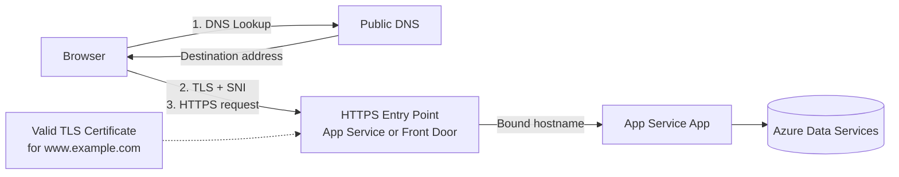
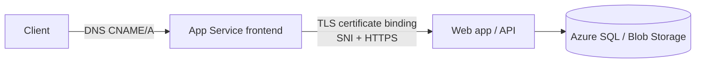
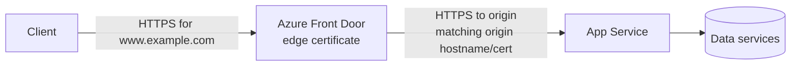

# Custom Domains, Certificates, and HTTPS Configuration

When deploying an application to **Azure App Service**, you can access it immediately via a default address like `orders-portal.azurewebsites.net`. However, customers typically want to use your organization's domain—such as `www.example.com` or `api.example.com`—with a valid padlock icon in the browser. To achieve that, adding a DNS record alone is **not enough**: App Service must be configured to accept the custom hostname, a TLS certificate must cover that exact name, and HTTP requests must be handled under an HTTPS policy.

This lesson belongs to the **Web Applications with App Service** chapter in the **CLOUD_PROVIDERS_AZURE** module. The module introduces the Microsoft Azure ecosystem from subscriptions, resource groups, and Microsoft Entra ID to virtual networking, compute, storage, and data—then deploying, monitoring, securing, and controlling the cost of an application architecture. In that context, custom domains and HTTPS form the **public identity, encrypted transport, and trusted operation** layer for a website or API running on App Service.

After this lesson, you will be able to:

- Explain the roles of **DNS**, **custom hostname binding**, **TLS certificates**, **SNI**, and **HTTPS Only**.
- Select appropriate **CNAME**, **A**, and **TXT** records for subdomains and apex/root domains.
- Execute the domain ownership verification process before binding to App Service.
- Distinguish **App Service Managed Certificates** from organization-managed certificates.
- Design TLS, HTTP redirects, HSTS, and TLS termination points when using a reverse proxy or Front Door.
- Verify DNS, certificates, hostnames, and HTTPS, and troubleshoot common deployment issues.
- Create runbooks for certificate renewal, DNS cutovers, and safe production rollbacks.

## 1. Request flow from a domain name to App Service

Suppose an application has:

```text
App Service app name: orders-portal
Default hostname:     orders-portal.azurewebsites.net
Business hostname:    www.example.com
Target scheme:        https://
```

When a user visits `https://www.example.com`, the general steps are:

1. The browser queries DNS and receives the destination address of the app or an edge proxy/gateway sitting in front of it.
2. The browser opens a TCP connection to port 443 and initiates a **TLS handshake**.
3. During the TLS handshake, the domain name is sent via **Server Name Indication (SNI)** when supported by the client; the TLS terminator selects the matching certificate.
4. The client validates the certificate: matching domain name, trusted certificate chain, valid expiration window, and other checks.
5. Once TLS is established, the client sends the HTTP request with the hostname; App Service or the proxy routes according to the configured custom hostname.
6. The application returns the response over the encrypted connection.



Four distinct yet linked layers:

| Component | Which question does it answer? | If missing |
|---|---|---|
| **DNS** | Where does `www.example.com` point? | Clients cannot locate the right endpoint |
| **Custom domain/hostname binding** | Does App Service accept requests carrying this hostname? | Unrecognized hostname errors or unexpected responses |
| **TLS certificate binding** | Does the HTTPS endpoint hold a valid certificate for this domain? | Browser warns on name/chain mismatch or TLS handshake fails |
| **HTTPS Only / TLS policy** | Are clients forced onto HTTPS and secure TLS versions? | Plain HTTP path may remain open or non-compliant settings accepted |

**Do not equate "DNS resolves successfully" with "HTTPS is secure."** Working DNS without hostname binding or a bound certificate still does not produce a properly functioning web service.

## 2. Distinguishing the default hostname from a custom domain

### 2.1. The `azurewebsites.net` hostname

When creating an App Service, Azure provisions a default hostname shaped like `<app-name>.azurewebsites.net`. Azure manages the certificate for the default hostname via platform mechanisms, letting you test HTTPS without buying a custom domain.

The default hostname is handy for deployment verification and health checks. However, using your organization's own hostname supports branding, separates websites/APIs, and governs client-facing integrations.

### 2.2. Custom domains and hostname binding

A custom domain such as `example.com` is a namespace your organization owns and manages. App Service **custom hostname binding** maps a specific hostname—`www.example.com` or `api.example.com`—to the app.

Each served name must be handled individually:

- `example.com` (apex/root domain).
- `www.example.com` (website subdomain).
- `api.example.com` (API subdomain).
- `*.example.com` (wildcard, only when genuinely needed and supported).

Binding `www.example.com` does **not** automatically bind `example.com`. Nor should you assume a certificate covering `example.com` automatically covers `www.example.com`: check the certificate's **Subject Alternative Names (SANs)** or wildcard scope.

### 2.3. Prerequisites

Before configuring:

1. A running App Service app with known subscription, resource group, and app name.
2. An App Service Plan tier/deployment model that **supports custom domains and the desired certificate type**; support depends on SKU and environment.
3. Permissions to edit DNS at your domain registrar or DNS zone.
4. Permissions to update custom domains and TLS/SSL settings on App Service.
5. Clear identification of the HTTPS termination point: directly on App Service, or via Azure Front Door, Application Gateway, CDN, or reverse proxy.
6. Agreement on ownership, certificate renewal policy, and cutover timing.

You do not need to switch production DNS right when verifying domain ownership; prepare, validate, and choose an appropriate change window.

## 3. DNS: CNAME, A, TXT, and the apex domain case

### 3.1. CNAME for subdomains

For `www.example.com`, a common approach is pointing a CNAME to App Service's default hostname:

```dns
www.example.com.  300  IN  CNAME  orders-portal.azurewebsites.net.
```

DNS resolvers follow the CNAME to fetch the target service's current IP address. CNAMEs generally relieve you from manually tracking App Service IP addresses if the platform changes them.

**Note:** per DNS rules, a CNAME cannot coexist at the same name as incompatible record types. Domain verification records are usually created under a **different name**, such as `asuid.www.example.com`, so they do not conflict with the `www.example.com` CNAME.

### 3.2. A record or alias mechanisms for apex/root domains

For the root domain `example.com`, standard DNS prohibits a CNAME at the zone apex because it conflicts with mandatory zone records like SOA/NS. One option is an **A record** pointing to App Service's inbound IPv4 address:

```dns
example.com.  300  IN  A  <APP_SERVICE_INBOUND_IPV4>
```

`<APP_SERVICE_INBOUND_IPV4>` must come from your real App Service; it is a **placeholder**, not a literal usable IP. If your DNS provider supports **ALIAS/ANAME/CNAME flattening** or Azure DNS alias records in a supported target context, evaluate those to reduce manual IP management risk.

App Service's inbound IP address can change in certain situations, such as infrastructure changes, tier changes, migrations, or resource recreation. Therefore, when using an A record, maintain a process to detect and update IP changes; never assume an IP is permanent.

### 3.3. TXT record for domain ownership verification

App Service uses hostname verification records to reduce the risk of unauthorized users binding someone else's domain. When configuring a custom domain, the Azure Portal may require a TXT record at **`asuid`** or **`asuid.<subdomain>`** containing the **Domain Verification ID** displayed by Azure.

Illustrative example:

```dns
asuid.www.example.com.  300 IN TXT "<DOMAIN_VERIFICATION_ID_FROM_APP_SERVICE>"
asuid.example.com.      300 IN TXT "<DOMAIN_VERIFICATION_ID_FROM_APP_SERVICE>"
```

In this example, the first record is for `www.example.com` and the second is for apex `example.com`. If editing the `example.com` zone directly, your DNS provider UI may expect just `asuid.www` or `asuid` as the host field depending on how it renders FQDNs. Do not accidentally append `example.com` twice.

**Copy the exact verification value and record name from your target app's App Service blade.** Never substitute an app ID, subscription ID, or invented string; never treat illustrative placeholder strings as usable records.

### 3.4. DNS decision table

| Hostname to serve | Typical DNS routing record | Typical verification TXT | Key considerations |
|---|---|---|---|
| `www.example.com` | CNAME to `orders-portal.azurewebsites.net` | `asuid.www` in `example.com` zone | CNAME must be right and hostname must be bound |
| `api.example.com` | CNAME to API app or proxy endpoint | `asuid.api` | API needs valid cert and CORS/auth policies |
| `example.com` | A record to inbound IP or compatible alias | `asuid` | Apex cannot use standard CNAME due to mandatory zone records |
| `*.example.com` | Per supported wildcard capability | Per actual verification requirement | Wildcard certificate and broader hostname scope risks |

**The ownership verification TXT record is not a routing record.** A domain with a valid TXT record and a wrong CNAME/A record still fails to route users to the right app. Conversely, a valid CNAME/A without passing verification will not be accepted for binding by App Service.

## 4. Workflow for binding a custom domain to App Service

A well-structured workflow can follow these steps:

1. **Verify the source:** confirm App Service runs cleanly on `orders-portal.azurewebsites.net`; confirm which backend will serve `www.example.com`.
2. **Verify plan/permissions:** confirm Azure permissions to manage App Service and DNS admin coordination.
3. **Retrieve Azure values:** domain verification ID, inbound IP, or CNAME target shown by App Service.
4. **Add the verification TXT record** and query authoritative or public resolvers to confirm propagation.
5. **Add the routing record** (CNAME/A/alias); for production cutovers, schedule updating live customer-facing records carefully.
6. **Bind the hostname** in App Service under Custom domains; confirm Azure accepts the hostname.
7. **Provision and bind the TLS certificate** for that hostname using a supported mechanism.
8. **Test HTTPS end-to-end**, then enable HTTPS Only/TLS policies and monitor the cutover.

For a **website currently hosted at another provider**, you can add the verification TXT record early to prove ownership without shifting traffic. However, **issuing an App Service Managed Certificate may require active DNS pointing and validation under current service conditions**. Never build a cutover plan assuming a managed certificate will be issued before DNS is pointed properly.

### 4.1. States to track

| Stage | Success evidence | If it fails |
|---|---|---|
| DNS verification | TXT `asuid` has right name and value | Check real zone, TTL, DNS cache, and write permissions |
| DNS routing | CNAME/A resolves to intended endpoint | Check stale records and proxies/CDNs |
| Hostname binding | `www.example.com` appears in app's custom domains list | Check verification, permissions, target app/slot, and bindings elsewhere |
| Certificate availability | Valid cert, right SAN, unexpired | Check CA validation, CAA, DNS, chain, and cert type |
| TLS binding | App/proxy serves the right cert for SNI | Check hostname, TLS/SSL binding, and TLS termination point |
| HTTPS | `https://...` loads cleanly with no cert errors | Check port 443, TLS versions, app response |

Never declare completion merely because the Azure Portal marks a custom domain "validated." **Validation, binding, certificate issuance, and live HTTPS traffic are distinct steps.**

## 5. TLS certificates: essential properties to understand

TLS protects the connection between the client and the **TLS termination point**. A server certificate proves that endpoint is authorized to use the domain via a Certificate Authority (CA) process while enabling encrypted transport.

### 5.1. Domain names and SANs

A TLS certificate must be valid for the hostname requested by the client:

- `www.example.com` is not automatically covered by a certificate listing only `example.com`.
- Wildcard `*.example.com` typically covers one subdomain level such as `www.example.com` and `api.example.com`, but does **not** cover the apex `example.com` or deeper nested subdomains like `a.b.example.com`.
- A certificate with multiple SANs can cover both the apex and specific subdomains together.

Browsers do not trust labels in an admin portal; they verify **the actual certificate presented by the server** when connecting to the hostname.

### 5.2. Trust chain and validity window

A valid certificate also requires:

- Not expired and within its valid `NotBefore`–`NotAfter` window.
- Trusted signature/root for the client, including any required intermediate CA chain.
- Key/certificate algorithms compliant with current TLS and security policies.
- Not revoked or failing other client validation checks.

Renewing a certificate is **not enough** if the new certificate is not attached to the live binding serving traffic. Monitor both **expiration dates** and the **live certificate thumbprint/chain actually received by browsers**.

### 5.3. What is SNI?

**Server Name Indication (SNI)** is a TLS ClientHello extension telling the server which hostname the client wants to reach. One IP can serve multiple hostnames by selecting the certificate matching the requested name.

```text
Client: TLS ClientHello, SNI = www.example.com
Server: Select certificate with SAN www.example.com
Client: Verify SAN, CA chain, validity
Client: Send HTTPS request with Host = www.example.com
```

In App Service, **SNI SSL binding** is the standard choice when binding a custom hostname to a certificate. Certain binding types or environments offer alternatives where supported, but you should not require a dedicated IP merely to host multiple HTTPS hostnames.

## 6. Choosing a certificate type for App Service

### 6.1. App Service Managed Certificate

An **App Service Managed Certificate** is an Azure-provided and Azure-managed TLS certificate option for supported App Service custom domain scenarios. When eligible, Azure handles automatic renewal, eliminating manual private-key and renewal operations.

Points to verify:

- Whether your App Service Plan, app type, hostname, and domain validation method meet current eligibility rules.
- Whether managed certificates support your specific domain pattern; **do not treat it as a wildcard certificate**.
- DNS, CAA, public reachability requirements, and limitations with proxies or private networking.
- Live issuance/renewal status; auto-renewal still depends on stable DNS/domain bindings per service conditions.
- Exportability of cert/private key: managed certificates are not meant for exporting keys to external systems.

For standard websites needing TLS on eligible hostnames, managed certificates are usually simpler than self-managed certs. Still, never rely solely on "free certificate" without verifying feature/SKU support and eligibility.

### 6.2. Bring Your Own Certificate (BYOC)

An organization can obtain a certificate from its own CA and upload/import it into App Service or integrate via supported certificate and Key Vault mechanisms.

Common cases:

- Need a **wildcard certificate**.
- Need specific SAN combinations or compliance with corporate CA policies.
- Need full control over lifecycle, issuance dates, algorithms, renewal workflows, and reusing the certificate across multiple endpoints.
- Using Azure Key Vault to manage certificates/secrets under Azure-supported models.

With PFX uploads, the file must contain the certificate, matching private key, and required chain; the PFX password is a **secret** that must be protected. Never store PFX files or private keys in source repositories, logs, or broadly shared artifacts. Permissions to read certificates and secrets/private keys in Key Vault must be tightly governed.

### 6.3. Choosing a certificate by scenario

| Requirement | Approach to consider | Notes |
|---|---|---|
| Website with one or a few standard hostnames | App Service Managed Certificate if eligible | Verify support, DNS, and auto-renewal |
| Many subdomains needing one wildcard | BYOC wildcard certificate | Wildcard does not cover the apex |
| Corporate policy requiring specific CA/algorithms | BYOC from approved CA | Manage private key, chain, and renewal schedule |
| App behind Azure Front Door | Front Door cert for edge custom domain; origin TLS per design | Do not confuse edge certificate with origin certificate |
| Internal domain unable to meet managed cert rules | Supported PKI/certificate and network design | Review public/private CA trust and client config |

**Where TLS terminates matters greatly.** If clients pass through Azure Front Door before App Service, browsers receive **Front Door's certificate**, not necessarily the certificate bound directly on App Service.

## 7. Binding certificates, HTTPS configuration, and TLS policy

### 7.1. SSL/TLS binding

Once the custom domain is verified and the certificate is ready:

1. Select the specific hostname in App Service.
2. Select the eligible certificate with matching SANs.
3. Create or update the **TLS/SSL binding**, typically using SNI.
4. Check the binding status in Azure.
5. Verify externally with a browser or `curl` against the exact hostname.

A single website can bind multiple hostnames and needs matching certificates for each. If serving both `example.com` and `www.example.com`, verify TLS for **both**.

### 7.2. HTTPS Only

App Service **HTTPS Only** redirects plain HTTP requests on supported endpoints to HTTPS. Enable this on public websites and APIs after certificates and bindings are working.

Key points:

- A redirect does not encrypt the **initial HTTP request**: the client already sent plain HTTP before getting the redirect. Never send cookies, tokens, or secrets over HTTP.
- Redirecting `http://example.com` to HTTPS only succeeds if the HTTPS hostname and certificate are genuinely valid.
- Automated API clients may not follow redirects like browsers do; require clients to use `https://` from the start.
- With a reverse proxy, inspect TLS termination and protocol forwarding to avoid redirect loops.

### 7.3. Minimum TLS version

App Service enforces a minimum TLS version policy for inbound connections; set it to match organizational security standards and client capabilities. For most modern apps, **TLS 1.2** is the common baseline, while **TLS 1.3** support and current environment policies should also be checked.

Review all of:

- **Minimum TLS version** on the application endpoint.
- **SCM/Kudu minimum TLS version** or separate TLS settings on management/deployment endpoints where supported.
- **FTPS state** if your organization does not deploy via FTP/FTPS.
- Protocol and routing settings on Front Door, Application Gateway, or reverse proxies if present.

Picking a TLS number in the Portal does not prove the edge server enforces it for clients; test the live handshake from the internet against the real endpoint.

### 7.4. HSTS and application-layer measures

**HTTP Strict Transport Security (HSTS)** is an HTTP response header instructing browsers to prefer HTTPS for a hostname over a specified duration. Example:

```http
Strict-Transport-Security: max-age=31536000
```

This example applies once HTTPS is verified stable. HSTS must be emitted by the app or edge per design; **enabling HTTPS Only does not automatically configure HSTS**.

Never enable `includeSubDomains` or submit to **HSTS preload** without verifying **every subdomain** serves valid HTTPS; misconfiguration can lock clients out of legacy services. Also use `Secure`, `HttpOnly`, and `SameSite` cookies appropriately, eliminate HTTP mixed content, and protect tokens/secrets.

## 8. Direct App Service vs. Azure Front Door architectures

### 8.1. Clients connect directly to App Service



Suited for many straightforward apps. Since the App Service frontend is the public edge, configure DNS/hostnames/TLS at the app, HTTP→HTTPS redirects, authentication, and access restrictions as needed.

### 8.2. Clients connect via Front Door / gateway



In a proxied model:

- Custom domain DNS typically points to **Front Door/edge**, not directly to App Service.
- User-facing hostnames/certificates live at the **edge**; the origin must serve HTTPS with a valid origin certificate/hostname matching origin validation rules.
- Configure the right **origin host header**, SNI, and host-based routing so requests are not rejected.
- Forward `X-Forwarded-Proto` or equivalent headers via trusted proxy settings so the app knows the client's original scheme.
- If all traffic must traverse the WAF/edge, **restrict direct access to the App Service origin** using supported mechanisms. Otherwise, clients can bypass edge inspection by hitting the default origin hostname directly.

Never assume turning on HTTPS at Front Door automatically encrypts and validates the entire **Front Door → App Service** leg. Those are two separate TLS legs requiring independent configuration and monitoring.

### 8.3. Redirect loops behind a proxy

Suppose a client sends HTTPS to Front Door, but Front Door calls the origin over HTTP. The app sees an HTTP request and redirects to HTTPS; if the edge keeps calling the origin over HTTP, an infinite redirect loop ensues.

Fix architecturally: configure HTTPS to the origin where appropriate, enforce redirects in **one clear layer**, ensure the app trusts forwarded protocol headers only from authorized proxies and never from arbitrary internet clients. Verify with real requests rather than hastily disabling HTTPS Only.

## 9. Hands-on: configuring a custom domain for a sample website

### 9.1. Lab objective

```text
Resource group: rg-web-lab
App Service:    orders-portal
Default domain: orders-portal.azurewebsites.net
Custom domain:  www.example.com
DNS provider:   where the org manages the example.com zone
Certificate:    Managed Certificate if eligible
Policy:         HTTPS Only + minimum TLS per org standard
```

This is a **simulated** example. Do not configure real `example.com` unless you own the domain and hold DNS edit rights. Verify your App Service Plan, permissions, and managed certificate eligibility before proceeding.

### 9.2. Step 1 — Inspect app state

In the Azure Portal, open App Service → **Overview** to retrieve the default domain and inbound IP details (exact display varies by UI). Inspect **Custom domains** and **TLS/SSL settings** in their respective blades.

Via Azure CLI, these commands are **read-only**:

```bash
RG="rg-web-lab"
APP="orders-portal"

az account show \
  --query "{subscription:name,id:id,tenant:tenantId}" \
  -o table

az webapp show \
  --resource-group "$RG" \
  --name "$APP" \
  --query "{name:name,defaultHostName:defaultHostName,hostNames:hostNames,httpsOnly:httpsOnly,enabled:enabled}" \
  -o json
```

Verify the app responds on `https://orders-portal.azurewebsites.net` before touching DNS or binding certificates.

### 9.3. Step 2 — Retrieve verification ID and update DNS

In App Service **Custom domains**, add `www.example.com` and read the values Azure requests: CNAME target, TXT verification record, and Domain Verification ID.

Add records matching those real values, for example:

```dns
www.example.com.       300 IN CNAME orders-portal.azurewebsites.net.
asuid.www.example.com. 300 IN TXT   "<VERIFICATION_ID_FROM_AZURE>"
```

If a production website cannot cut over DNS yet, add the **TXT** record first to start ownership verification, then schedule updating the **CNAME** during a cutover window. Never overwrite an existing record without knowing what system it serves.

### 9.4. Step 3 — Verify DNS records

Use DNS tools on an admin workstation:

```bash
nslookup -type=CNAME www.example.com
nslookup -type=TXT asuid.www.example.com
```

With `dig`, if installed:

```bash
dig www.example.com CNAME
dig asuid.www.example.com TXT
```

Records can be cached per TTL and resolvers refresh at different speeds. If results are wrong, check the **authoritative DNS nameserver**, how the host field is formatted in your DNS provider, and whether a proxy/CDN intercepts the record. Avoid blindly clicking "Validate" repeatedly without checking what DNS actually returns.

### 9.5. Step 4 — Bind the custom hostname

In Azure Portal → App Service → **Custom domains**, validate and add `www.example.com`. Complete this step before assuming the domain is ready to serve users.

You can list bound hostnames via Azure CLI:

```bash
az webapp config hostname list \
  --resource-group "$RG" \
  --webapp-name "$APP" \
  -o table
```

Binding creation can be done via Portal or supported API/CLI syntax. Never run write commands in production without confirming the host is released from any old app, DNS permissions, and a rollback plan.

### 9.6. Step 5 — Provision/import and bind the TLS certificate

For eligible hostnames, issue an **App Service Managed Certificate** from the Custom domains/TLS section of the Azure Portal; otherwise, import an organization-managed certificate following private-key protection procedures.

Next:

- Bind the certificate to the **exact hostname** `www.example.com`.
- Choose the appropriate TLS binding type, typically **SNI SSL**.
- Check certificate thumbprint/SAN/expiry in the Portal and over a live connection.
- If using both apex and `www`, configure certificates and bindings for both hostnames.

Read-only commands to inspect TLS config and listed certificates (depending on permissions):

```bash
az webapp config show \
  --resource-group "$RG" \
  --name "$APP" \
  --query "{minTlsVersion:minTlsVersion,scmMinTlsVersion:scmMinTlsVersion,ftpsState:ftpsState}" \
  -o json

az webapp config ssl list \
  --resource-group "$RG" \
  -o table
```

Listing certificates in a resource group does not prove which certificate is actually served for `www.example.com`. Verify the **hostname binding** and run a real client TLS handshake.

### 9.7. Step 6 — Enable HTTPS Only and check TLS

Once HTTPS works cleanly, enable **HTTPS Only** in App Service and set the minimum TLS version per security standards. An Azure CLI example of a **state-changing** operation:

```bash
# Run only after approving configuration changes on a real app.
az webapp update \
  --resource-group "$RG" \
  --name "$APP" \
  --https-only true

# Reference: set minimum TLS where supported by App Service/configuration.
az webapp config set \
  --resource-group "$RG" \
  --name "$APP" \
  --min-tls-version 1.2
```

Never run these commands while HTTPS hostnames or certificates are still broken. Raising TLS policies can affect older clients, webhooks, or integration agents; verify compatibility and maintain a rollback plan.

## 10. Verifying live HTTPS

### 10.1. Check DNS and HTTP redirects

```bash
nslookup www.example.com

curl -I http://www.example.com/
curl -I https://www.example.com/
```

Expected behavior:

- DNS routes requests to the right App Service or edge.
- HTTP requests receive a redirect to HTTPS when policy applies.
- HTTPS returns a meaningful response (e.g., 200, expected 301, or 401 from an authenticated API) with no certificate errors.
- Responses leak no sensitive details and cause no redirect loops.

`curl -I` sends HTTP HEAD. If an endpoint rejects HEAD, test with GET or a dedicated health route rather than assuming the site is broken just because HEAD returned an error code.

### 10.2. Inspect certificate and SNI

With OpenSSL:

```bash
openssl s_client \
  -connect www.example.com:443 \
  -servername www.example.com \
  -showcerts
```

Inspect the certificate subject/SANs, issuer, chain, and expiration. Note: `s_client` is a **diagnostic tool**; merely seeing a certificate or completed handshake **is not sufficient** to prove full hostname and CA validation passed. Add `-verify_hostname`, `-verify_return_error`, and the proper CA store where supported by OpenSSL, or test directly via a browser/`curl` using default TLS verification.

### 10.3. Test connectivity before DNS cutover

If you know the target endpoint IP and want to test HTTPS with the exact hostname **before switching public DNS**, `curl` supports:

```bash
curl -I \
  --resolve www.example.com:443:<TARGET_IPV4> \
  https://www.example.com/
```

Replace `<TARGET_IPV4>` with the authorized App Service or edge IP under test. `--resolve` forces `curl` to connect to that IP while still sending **www.example.com** for the Host header, SNI, and certificate verification. This is a useful diagnostic trick—**not a substitute** for production DNS records—and does not guarantee a managed certificate is available before cutover.

### 10.4. Test across multiple clients

Beyond an admin machine, test:

- Desktop and mobile browsers matching real customer environments.
- API clients, webhooks, and integration systems with specific CA/TLS constraints.
- All scoped names (`example.com`, `www.example.com`, `api.example.com`).
- With and without CDN/proxy paths if the architecture permits both.
- Path/query-string preservation on redirects, `Secure` cookies, and HTTP mixed-content warnings.

**HTTPS working on a developer machine is not enough** to prove DNS propagated everywhere and no clients are still hitting the legacy endpoint.

## 11. Case study: migrating a production website to App Service

Suppose an organization runs `www.example.com` on a legacy host and wants to migrate to `orders-portal.azurewebsites.net` without disrupting customers.

### 11.1. Proposed plan

| Phase | Activities | Verification criteria |
|---|---|---|
| Preparation | Validate app on default hostname and health checks | API/site works; data/identity verified |
| Ownership | Add `asuid.www` TXT record per Azure | Verification record visible in DNS |
| Hostname | Stage custom hostname binding on new app | Azure accepts binding; coordinate if bound on old app |
| Certificate | Select managed/BYOC, ensure issuance and binding | Valid cert served for target hostname |
| DNS cutover | Lower TTL beforehand per plan; swap CNAME | DNS gradually resolves to new endpoint |
| Observation | Watch traffic, TLS, 4xx/5xx errors, latency, and logs | No significant anomalies |
| Completion | Maintain HTTPS; retire old records/routes after soak period | Clear rollback plan and ownership |

In practice, hostname/certificate/DNS ordering can depend on whether the domain is already bound elsewhere and managed certificate issuance rules. If a managed certificate requires DNS to point first, plan a **cutover window** or use another supported certificate option to minimize exposure. Never assume you can arbitrarily bind the exact same hostname on two App Service apps simultaneously.

### 11.2. Apex and www considerations

If the business wants both `example.com` and `www.example.com`:

1. Bind, verify, and secure TLS for **both hostnames**.
2. Pick one *canonical hostname*, such as `www.example.com`.
3. Configure redirects at the app or edge from the secondary hostname to the canonical one, preserving paths/queries where appropriate.
4. Audit SEO/canonical URLs, OAuth/OpenID Connect callbacks, CORS, cookie domains, and absolute URLs.

Changing hostnames can break Microsoft Entra ID login redirect URIs if redirect lists are not updated in the app registration. Also audit third-party integrations and webhooks referencing old URLs.

### 11.3. Rollback on incident

If TLS or routing fails after cutover:

- Quickly inspect DNS CNAME/A resolution and the live returned certificate to isolate the layer.
- Restoring old DNS records is possible per change-owner decision if the legacy host remains live, though rollback speed is governed by **TTL and DNS caches**, never instant for every client.
- Do not delete old hostnames or certificates until the observation window finishes cleanly.
- If the issue is purely application content, rolling back the app deployment/image may be safer than flipping DNS back.
- If the cause is a certificate issue, fix the certificate binding at the TLS termination point instead of editing DNS records blindly.

## 12. Renewal, monitoring, and domain protection

### 12.1. Certificate lifecycle

For organization-managed certificates:

1. Record domain and certificate owners.
2. Monitor expiration dates with alerts early enough for your CA renewal workflow.
3. Renew/reissue, safeguard the private key, and verify SANs and chain.
4. Update the certificate in App Service/Key Vault using supported workflows.
5. **Bind the new certificate** and verify from live clients.
6. Delete the old certificate only after confirming no bindings still reference it.

For managed certificates, Azure handles renewal under service terms, yet ops teams should still monitor **the live issued/served certificate** and watch for DNS changes that could disrupt renewal.

### 12.2. Domain renewal and DNS ownership

**Domain registration** expiration is a separate risk from **certificate** expiration. Even with an unexpired certificate, losing domain control or mispointing DNS can take the service offline or expose it to hijacking.

Recommended practices:

- Enable domain auto-renewal and renewal alerts; keep registrar contacts current.
- Enforce MFA and least privilege on DNS/registrar accounts.
- Require DNS change approvals, audit logs, and rollback steps.
- Audit stale hostnames, orphaned CNAMEs without live targets, and leftover verification records.

### 12.3. Dangling DNS and subdomain takeover

Leaving a CNAME pointing to a deleted App Service is dangerous: under certain conditions, an external party could claim that target hostname if records are not cleaned up and ownership is not protected. This is a **dangling DNS / subdomain takeover risk**.

Decommissioning workflow:

1. Inventory all custom hostnames, CNAME/A records, and related TXT records.
2. Update or delete DNS records per change management.
3. Remove unused hostname bindings and certificates.
4. Only then delete the App Service app or endpoint when appropriate.
5. Re-verify public DNS and ownership records to confirm no orphaned pointers remain.

The `asuid` TXT check helps domain verification, but never treat a lingering TXT record as a substitute for cleaning up DNS records and governing ownership.

## 13. Common errors and troubleshooting

| Symptom | Common cause | Where to check |
|---|---|---|
| `NXDOMAIN` or fails to resolve | Record missing, wrong nameserver/zone, or domain expired | Check registrar, authoritative NS, and DNS records |
| App Service fails domain verification | Wrong `asuid` TXT, another app's verification ID, unpropagated DNS | Copy ID from target app; query TXT on exact hostname |
| `www` routes to wrong app | Stale CNAME, proxy/CDN, or conflicting record | Inspect CNAME/A, DNS provider, and edge routing |
| Browser shows `NET::ERR_CERT_COMMON_NAME_INVALID` | Certificate lacks hostname SAN or proxy serves wrong cert | Check SNI, certificate binding, edge/origin |
| Certificate shows expired | Renewal failed or binding still points to old cert | Check expiry/chain/automation and live cert on 443 |
| Managed certificate fails to issue | Plan/domain/DNS/CAA/proxy prerequisites unmet | Check eligibility, ownership, and CA validation status |
| HTTPS returns `404` / unrecognized host | DNS is right, yet hostname is unbound on App Service/edge | Check custom domains and host routing |
| HTTP works, HTTPS fails | Missing cert binding, TLS version/chain mismatch, or proxy misconfig | Check 443, `s_client`/`curl`, binding, and TLS policy |
| HTTP↔HTTPS redirect loop | Proxy calls origin over HTTP or forwarded protocol misread | Check origin HTTPS, trusted forwarded headers, redirect Location |
| API client hits TLS error while browser works | Legacy client incompatible with TLS policy or CA chain | Inspect TLS handshake and client compatibility |
| New DNS works in one place, old elsewhere | TTLs, recursive resolver caching, provider propagation | Compare authoritative DNS against multiple resolvers |
| Entra ID login breaks after cutover | Redirect URI/OAuth callback still uses old hostname | Check app registration and callback settings |
| Edge is locked down yet origin remains public | App Service direct access not restricted | Configure access restrictions/private origin per architecture |

### 13.1. Layer-by-layer debugging workflow

1. **Confirm hostname** the user is calling—is it the apex or a subdomain?
2. **DNS**: what do authoritative and public resolvers return? Are CNAME/TXT records accurate?
3. **App Service binding**: has Azure accepted the hostname on the intended app/slot?
4. **TLS endpoint**: which certificate is served via SNI, and are its SANs and chain valid?
5. **HTTPS policy**: minimum TLS, redirects, HSTS, origin protocol, proxy headers.
6. **Application**: routes, auth/callbacks, CORS, cookie domain, health endpoint, and dependencies.
7. **Operations**: domain/cert renewals, DNS edits, rollbacks, Azure Activity Log, and telemetry.

Fix only the layer showing concrete evidence of failure. If DNS is right yet the certificate lacks a SAN, do not randomly alter CNAMEs; if OAuth callbacks break after a domain change, update redirect URIs and app config instead of touching TLS.

## 14. Production deployment checklist

- [ ] App Service Plan and environment support custom hostnames and the chosen certificate type.
- [ ] DNS permissions, subscription/RG/App Service access, and change approvals are in place.
- [ ] Default hostname verified healthy before attaching custom domains.
- [ ] Valid CNAME/A/alias DNS records; apex and subdomains handled properly.
- [ ] `asuid` TXT record uses the exact name and target app's verification ID.
- [ ] Hostname bound to the right app/slot or edge endpoint.
- [ ] Certificate covers exact SANs, has a trusted chain, and is unexpired.
- [ ] SNI/TLS binding matches the hostname; both apex and `www` tested if used.
- [ ] HTTPS Only and minimum TLS version set per policy after verification.
- [ ] HSTS/`Secure` cookies/redirects cause no mixed content or redirect loops.
- [ ] If using Front Door/gateway: both TLS legs secured and origin bypass blocked as required.
- [ ] Updated OAuth redirect URIs, webhooks, CORS, and related absolute URLs.
- [ ] Monitoring active for DNS, cert expiration, HTTP 4xx/5xx, TLS failures, and deploy logs.
- [ ] Cutover/rollback plan, TTL strategy, owner, soak window, and domain renewal tracked.
- [ ] Decommissioning procedure covers removing DNS records and bindings upon retirement.

## 15. Self-check questions

1. Why is pointing a `www.example.com` CNAME to `orders-portal.azurewebsites.net` insufficient to guarantee HTTPS works properly?
2. Why does the apex `example.com` typically need an A or alias record instead of a standard CNAME?
3. What is the `asuid.www` TXT record used for? Does it route HTTP traffic to App Service?
4. Is a certificate containing only SAN `example.com` automatically valid for `www.example.com`?
5. What role does SNI play when multiple hostnames share one HTTPS endpoint?
6. Compare App Service Managed Certificate vs. BYOC across private key management, renewal, and wildcards.
7. Does HTTPS Only encrypt the initial plain HTTP request before the redirect? What does HSTS add, and what are its risks?
8. When Azure Front Door terminates client TLS, does the app still need to verify HTTPS from Front Door to the origin?
9. A site works at `orders-portal.azurewebsites.net` yet `https://www.example.com` reports a certificate error. Which layers do you check in order?
10. After a domain cutover, browsers hit an infinite HTTP 302 redirect loop. Which causes involve reverse proxies and forwarded protocols?
11. Why might a DNS change not take effect immediately for every client even after authoritative records are updated?
12. What risk arises from leaving a CNAME pointing to a deleted App Service, and what must be cleaned up?

## Conclusion

Using a **custom domain and HTTPS on Azure App Service** requires coordinating four layers: **DNS pointing to the right endpoint**, **Azure verifying and binding the hostname**, **a valid TLS certificate bound at the TLS termination point**, and **HTTPS/TLS policies protecting live traffic**. CNAMEs typically fit subdomains; apex domains need A records or compatible aliases; `asuid` TXT records support ownership verification. App Service Managed Certificates reduce renewal toil when eligible, while BYOC serves specialized certificate needs. With Front Door or gateways, separate edge TLS from origin TLS. Ultimately, a reliable production setup tests DNS, SNI/SANs, HTTPS Only, minimum TLS, expiration monitoring, and cutover/rollback plans to protect both service availability and your organization's brand.
