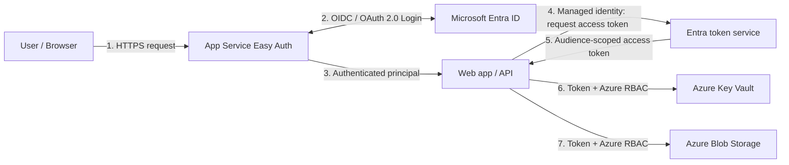
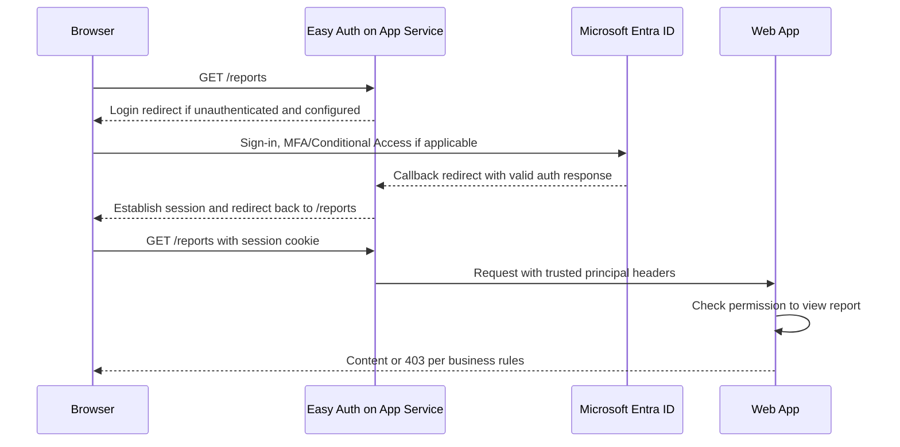
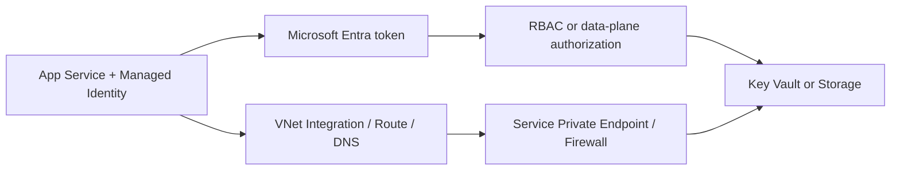
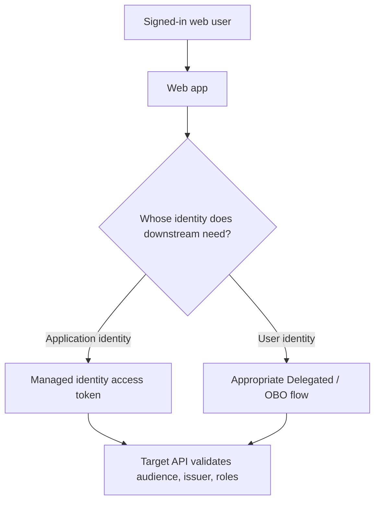
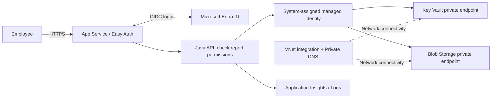

# Built-In Authentication and Managed Identity for Web Apps

A web application running on **Azure App Service** typically faces two distinct security requirements. First, the app needs to know **who is accessing it**, such as an employee signing in to view reports or a customer calling an API. Second, when the app needs to retrieve a secret from Azure Key Vault, read a blob in Azure Storage, or query another Azure service, the app itself must have a **trusted identity** instead of embedding passwords or access keys in source code.

Azure provides two complementary mechanisms: **App Service Authentication/Authorization**, commonly called **Easy Auth**, which handles authentication at the platform layer before requests reach application code; and **managed identity**, which lets the App Service workload obtain Microsoft Entra ID tokens to access authorized services. These two mechanisms address **two separate directions of communication** and do not replace each other.

This lesson belongs to the **Web Applications with App Service** chapter of the Microsoft Azure module. It connects concepts across resource groups, Microsoft Entra ID, Azure RBAC, virtual networks, Key Vault, Storage, and monitoring to design web apps that are secure, minimize reliance on long-lived secrets, and remain operable in production.

## Learning objectives

After this lesson, you will be able to:

1. Distinguish between **authentication (AuthN)**, **authorization (AuthZ)**, **user identity**, and **application identity**.
2. Describe how **Easy Auth** works with Microsoft Entra ID, OpenID Connect, sessions, and request headers.
3. Configure App Service Authentication in the Azure Portal for a web app or HTTP API, selecting the right behavior for unauthenticated requests.
4. Distinguish between **system-assigned** and **user-assigned managed identities**, and identify where to grant Azure RBAC data-plane permissions.
5. Use the Azure CLI to inspect and enable managed identities and grant secret-read permissions in Key Vault under the RBAC model.
6. Use **DefaultAzureCredential** in a Java application to access Key Vault or Blob Storage without hard-coding credentials.
7. Troubleshoot common sign-in, token, role assignment, networking, and secret-resolution errors.

## 1. Two directions of authentication in a single web app

Consider an internal reporting portal. Employees open `https://reports.example.com`, sign in with their corporate accounts, and view reports they are authorized to see. The backend accesses a private Azure Storage container for report files and reads configuration from Key Vault.



Two independent questions:

| Question | Appropriate mechanism | Identity used |
|---|---|---|
| **Who is accessing the web app?** | App Service Authentication (Easy Auth) and Microsoft Entra ID. | The user, or an application calling the API with an accepted bearer token. |
| **Is that person allowed to view Report A?** | Authorization logic in the backend; may rely on claims, app roles, and business data. | The authenticated principal plus application policy. |
| **How does the web app fetch secrets from Key Vault?** | Managed identity + Azure RBAC/Key Vault authorization. | Service principal tied to the web app's managed identity. |
| **Under what identity does the web app read blobs?** | Managed identity obtaining tokens plus a data-plane role like Storage Blob Data Reader. | The workload's identity, not automatically the browsing user's identity. |

**Important note:** Easy Auth does not automatically grant every user permission to view every invoice, and managed identity does not sign users into the website. If an app uses its managed identity to read a multi-customer container, the app itself must enforce **which customer may receive which data**, because all backend requests may share the same workload identity.

## 2. Authentication, authorization, OpenID Connect, and OAuth 2.0

### 2.1. Authentication and authorization are different

- **Authentication (AuthN):** verifies who the subject is—for example, Employee A signed in with a valid Microsoft Entra ID account.
- **Authorization (AuthZ):** decides which actions are permitted—for example, Employee A can read Department A's reports, not delete company-wide reports.
- **Identification:** an ID, email, or username is only an identifier, not proof of authentication or authorization.

Example HTTP responses:

| Case | Typically appropriate response | Meaning |
|---|---|---|
| No credentials sent or invalid token | `401 Unauthorized` | Valid authentication required before using the API. |
| Authenticated but lacking access to the report | `403 Forbidden` | Valid principal without business permission. |
| Browser needs interactive sign-in | `302` redirect to identity provider per configuration. | Starts login flow; unsuitable for many API clients. |

### 2.2. ID tokens, access tokens, and session cookies

In a flow using **OpenID Connect (OIDC)** and **OAuth 2.0**:

- An **ID token** conveys claims about the user authentication event for the intended client. It is not automatically a valid credential for calling arbitrary APIs.
- An **access token** is issued for a **specific resource/audience** with matching permissions/scopes. APIs must validate issuer, audience, lifetime, and permissions consistently with the auth model.
- A **session cookie** may be used by App Service Authentication to maintain the browser's signed-in session after authentication completes.

For instance, an access token issued for Microsoft Graph is **not** automatically valid for your company API; the API must check that `aud` matches the configured application/resource. Likewise, a Key Vault token obtained by a managed identity is not proof that a user signed into the web app.

### 2.3. Claims, scopes, groups, and app roles

Common Entra ID token claims include tenant (`tid`), object ID (`oid`), subject (`sub`), issuer (`iss`), audience (`aud`), and display name/username per configuration. For APIs, permissions may appear as **delegated scopes** (`scp`) or **application roles** (`roles`) depending on token type and permission model.

Do not use display emails as immutable primary keys; email addresses can change or be absent for certain identities. When storing user records, consider immutable tenant-scoped identifiers and policies for guest/multi-tenant users.

**Scopes** and **roles** do not replace business-level authorization. For example, a `ReportReader` role may allow entering the reports section, while checking whether someone may view *Invoice #481 specifically* still requires ownership or ACL checks in application data.

## 3. What is App Service Authentication (Easy Auth)?

**App Service Authentication/Authorization** is an Azure App Service platform feature that handles part of HTTP authentication before requests reach application code. Depending on the provider and configuration, it supports sign-in flows, token validation, session persistence, and passing authenticated principal details to the app.

Benefits:

1. Integrates providers like **Microsoft Entra ID** with less custom login code.
2. Handles certain redirect/callback, token validation, and session flows per configuration.
3. Lets you define unauthenticated-request behavior directly at App Service.
4. Supplies identity info to the backend via **platform-set request headers** and supported system endpoints.

What Easy Auth **does not do automatically**:

- Does not replace per-record or per-resource authorization inside your app.
- Does not grant Azure RBAC permissions to Key Vault, Storage, or databases for the web app.
- Does not protect every endpoint if you configure the platform to allow anonymous requests.
- Does not replace a WAF, network access restrictions, rate limiting, CSRF protection, or other web security controls.
- Does not mean your API accepts every Microsoft Entra ID access token; **issuer, audience, tenant, and client authorization** must match.

### 3.1. Where Easy Auth sits in the request flow



Conditional Access/MFA is governed by your organization's Entra ID policies and applicable licensing; enabling Easy Auth alone does **not** mean MFA is enforced. Enabling MFA also does not remove the need for proper session lifetimes and in-app authorization checks.

### 3.2. Microsoft Entra ID as identity provider

In the Azure Portal, you can configure **Microsoft** as an identity provider for App Service Authentication. Depending on your choice, the setup can create a new **app registration** or reference an existing app registration in the tenant. The app registration represents the app in Entra ID, including client/application ID, tenant, redirect URIs, and secrets/certificates or settings needed for the chosen confidential client flow.

**The Easy Auth app registration and the web app's managed identity serve two different purposes.** The app registration handles visitor sign-in and token validation; the managed identity provides workload credentials when calling Azure APIs. Never delete the app registration just because the web app has a managed identity.

## 4. Preparing before configuring Easy Auth

Internal application example:

```text
Web app:         app-reports-prod
Default host:    app-reports-prod.azurewebsites.net
Custom domain:   reports.example.com (if used)
Identity tenant: Organization's Microsoft Entra ID tenant
Protected route: /reports and /api/reports
Public route:    /healthz (only if required by architecture and controlled)
```

Verify prerequisites:

- You have permission to edit App Service Authentication and, if creating/editing an app registration, appropriate Entra ID permissions.
- HTTPS works; domains and redirect URIs match the hostname clients actually use.
- You chose **single-tenant**, multi-tenant, or permitted user scope matching app requirements. Do not accidentally allow external tenant users when data is internal.
- You have a plan for guest users, groups/app roles, and business authorization.
- You decided whether the web app is primarily a **browser app** or an **API**: login redirect vs. HTTP 401 behavior differs.
- You agreed on health check/monitoring routes and whether any endpoints bypass authentication; avoid leaving broad anonymous access open just so a health probe passes.
- You have a test environment or appropriate deployment slot to verify login before touching production.

### 4.1. Redirect URIs and callbacks

With App Service Authentication's Microsoft Entra ID provider, the callback path typically takes the form:

```text
https://<app-name>.azurewebsites.net/.auth/login/aad/callback
```

If the app is served over a custom domain and uses that hostname in the login flow, register the matching redirect URI, for example:

```text
https://reports.example.com/.auth/login/aad/callback
```

Register only authorized, actively used redirect URIs; avoid broad wildcards or redirecting to uncontrolled domains. Custom domains, upstream proxies, forwarded headers, and callbacks must align consistently to avoid login loops or `redirect_uri` errors.

## 5. Configuring Easy Auth with Microsoft Entra ID in Azure Portal

These steps describe the logical workflow; exact UI labels vary by Azure Portal version and auth v2 options.

### Step 1. Select the right App Service

In the Azure Portal, open **App Services → target web app → Authentication**. Verify subscription, resource group, environment/slot, and hostname; do not accidentally configure production while practicing on a test app.

### Step 2. Add an identity provider

Select **Add identity provider**, choose **Microsoft**, and configure the Microsoft Entra ID app registration. If reusing an existing registration, verify client ID, tenant/issuer, supported account types, and redirect URIs. Determine how client secrets/certificates (when required by the provider) are stored: never put them directly into code or repos.

### Step 3. Decide behavior for unauthenticated requests

Common architectural choices:

- **Internal browser UI:** require authentication; unauthenticated requests redirect to the identity provider per configuration.
- **JSON REST API:** typically return **401** when a valid bearer token is missing instead of returning an HTML login page or interactive redirect.
- **Hybrid app:** clearly separate routes or deployment models so browser and API clients behave appropriately; test each request type.

If you allow unauthenticated requests at the platform level, your controllers/APIs **must enforce checks themselves** on sensitive resources. Never assume enabling a provider automatically blocks every URL.

### Step 4. Verify issuer, audience, and tenant restrictions

Choose the right tenant and audience for browser/API flows. If the API accepts bearer tokens, require tokens issued for **this API**, rejecting tokens issued for unrelated apps. For multi-tenant apps, define tenant trust rules and onboarding/authorization models. A mismatched audience typically causes `401` even when the token signature is valid.

### Step 5. Consider token store and sessions

App Service Authentication provides a configurable **token store** to manage certain provider tokens and sign-in sessions. Enable it only when the workload genuinely needs it, and verify stored/returned tokens, lifetimes, refresh behavior, and current limits. Do not assume stored tokens automatically grant access to every downstream API.

### Step 6. Save, test, and verify

Test anonymous access, valid-tenant users, wrong-tenant users, unauthorized users, API tokens with valid/invalid audiences, and custom domain callbacks. If using a staging slot, check the auth settings and secrets on **that specific slot**; do not assume production settings carry over identically to staging.

## 6. Easy Auth endpoints and request headers

App Service Authentication exposes system endpoints under `/.auth/*`. With the Microsoft provider, common paths include:

```text
/.auth/login/aad
/.auth/login/aad/callback
/.auth/me
/.auth/logout
```

**`/.auth/login/aad`** can initiate interactive sign-in per provider config; **`/.auth/logout`** signs out the app session via platform mechanisms (it does not automatically revoke every session/token across all external systems). **`/.auth/me`** can return principal claims and provider tokens when supported by session/config, so handle sensitive data carefully and never expose this endpoint as a public data feed.

### 6.1. Platform-provided headers

After authentication, Easy Auth can inject headers such as:

| Header | Common content | Notes |
|---|---|---|
| `X-MS-CLIENT-PRINCIPAL` | Principal encoded as Base64 JSON. | Decode and parse claims carefully; not an authorization decision by itself. |
| `X-MS-CLIENT-PRINCIPAL-ID` | Principal ID per provider mechanism. | Do not rely on it as a business customer ID without verifying scope/stability. |
| `X-MS-CLIENT-PRINCIPAL-NAME` | Display name or user identifier per provider. | Avoid using display name/email as an immutable authorization key. |
| Supported `X-MS-TOKEN-*` headers | Can supply provider tokens in specific configurations. | Never log or forward arbitrarily to clients; verify audience and lifetime before use. |

Example decoded principal **illustrating structure only**:

```json
{
  "auth_typ": "aad",
  "name_typ": "http://schemas.xmlsoap.org/ws/2005/05/identity/claims/name",
  "role_typ": "http://schemas.microsoft.com/ws/2008/06/identity/claims/role",
  "claims": [
    {"typ": "name", "val": "Demo User"},
    {"typ": "tid", "val": "<tenant-id>"},
    {"typ": "oid", "val": "<user-object-id>"}
  ]
}
```

Actual claim names depend on version/provider and are sometimes URIs rather than short names; never write fragile code tied solely to a sample format. Inspect actual claims from your real auth config and test your mapping.

### 6.2. Why shouldn't you trust client-supplied headers?

When Easy Auth is enabled and requests pass through App Service's trusted pipeline, the platform manages the identity headers it injects. However, any custom system accepting `X-MS-CLIENT-PRINCIPAL` externally without ensuring a trusted path risks **header spoofing**. Never treat client-supplied headers as proof of authentication, and never expose a side endpoint that bypasses auth while still trusting those headers.

In microservices, if a downstream backend receives HTTP calls from the web app, **do not blindly forward principal headers as credentials**. Use an access token scoped to the target service's audience, or an explicitly designed and validated delegation/trust mechanism.

### 6.3. Authorization in controllers/services

A controller receiving a valid principal still needs permission checks:

```text
GET /api/reports/481
  |
  +--> Easy Auth: is the user authenticated? If not: 401/redirect
  |
  +--> App: does the user have the ReportReader role? If not: 403
  |
  +--> App: which organization/department owns report 481?
  |
  +--> App: is the user permitted to read report 481? If not: 403/404 per policy
  |
  +--> App: use managed identity to fetch the file from Blob Storage
```

**Tenant-level and object-level data authorization** remain the application's responsibility, even after Easy Auth handles sign-in and the managed identity has permission to read the entire Storage container.

## 7. What is a managed identity?

A **managed identity** is an Azure-managed identity attached to a supported Azure resource. The workload uses this identity to request Microsoft Entra ID access tokens without manually managing long-lived client secrets or certificates. Azure handles underlying credential rotation per service design.

Managed identities help eliminate common pitfalls:

- Hard-coded passwords or storage account keys in repositories.
- Secrets copied across environments and never rotated.
- Expired tokens when apps lack token-refresh logic.
- A single broad account key shared across dozens of applications.

However, **a managed identity does not come with built-in data access permissions**. After enabling the identity, grant appropriate Azure RBAC or data-plane permissions at the target resource, and ensure network routes, firewalls, private endpoints, and DNS work properly.

### 7.1. System-assigned vs. user-assigned managed identity

| Characteristic | System-assigned identity | User-assigned identity |
|---|---|---|
| Attached to | One specific Azure resource, such as a single web app. | An independent identity resource assignable to one or more supported resources. |
| Lifecycle | Tied to the resource; deleting the resource deletes the identity. | Exists independently; can persist even if the web app is deleted. |
| Sharing | Not a model for sharing one identity across multiple web apps. | Can be attached to multiple workloads when security/operations justify it. |
| Governance | Simple; fits individual web apps with distinct permissions. | Convenient when needing a stable identity across resource recreates or multi-resource topologies. |
| Main risk | Recreating the web app can change the principal ID, requiring re-granting roles. | Over-sharing an identity widens blast radius if one workload is compromised. |

**System-assigned** is typically the starting point for an independently operated web app. **User-assigned** helps when an identity must attach to workloads that get replaced/rebuilt or spans multiple resources cleanly. Still, sharing an identity must never become a shortcut to bypass least privilege between applications.

### 7.2. Principal ID, client ID, and resource ID

When working with managed identities, you will encounter:

- **Principal ID / object ID:** the service principal's object identity in the tenant, commonly used when creating Azure role assignments.
- **Client ID:** application/service principal identifier used when selecting a specific user-assigned managed identity in SDKs.
- **Azure resource ID:** the ARM path of the web app or user-assigned identity, used for resource management in subscriptions/resource groups.

These values **are not interchangeable**. A frequent mistake is passing a resource ID to an SDK parameter expecting a client ID, or assigning a role to the wrong principal ID and wondering why permissions never take effect.

### 7.3. A managed identity is not a user account

A managed identity represents an **application/service**. It has no rights to read user mailboxes, query Microsoft Graph, or call arbitrary APIs by default. When requesting an access token, the workload must specify the target resource/scope (such as Key Vault, Storage, or a protected API) and be authorized by that target system. Nor does it replace interactive browser user login/OIDC.

## 8. Data permissions: Azure RBAC, data plane, and networking

Suppose `app-reports-prod` needs to read a secret from Key Vault `kv-reports-prod` and download a PDF from a private Blob container. The steps are:

1. Enable managed identity on the web app.
2. Assign the right role to the identity at the **target resource scope**, not broadly across the subscription.
3. Configure appropriate networking and DNS if Key Vault/Storage uses firewalls or Private Endpoints.
4. Use Azure SDKs to acquire tokens and call the service.
5. Verify access using the web app's own runtime identity, not just a developer account.

| Task | Role/permission to evaluate | Notes |
|---|---|---|
| Read secret from RBAC-mode Key Vault | **Key Vault Secrets User** at appropriate scope. | Requires the vault to use Azure RBAC authorization; access-policy vaults require matching access policies. |
| Read blob | **Storage Blob Data Reader** at appropriate scope. | ARM management-plane `Reader` or `Contributor` does not grant blob data read access. |
| Upload blob | **Storage Blob Data Contributor** or narrower custom role. | Never grant write permissions when only downloads are needed. |
| Read resource metadata via Azure Resource Manager | Appropriate ARM role for the operation. | Distinct from Storage or Key Vault data-plane permissions. |

**Every role must be narrowly scoped.** If a web app only reads one container, consider scoping the role assignment to that container (where supported) rather than the entire storage account. For Key Vault, review the authorization model and separation of duties so you avoid granting vault admin permissions merely to read one secret.

### 8.1. Networking and identity are two independent requirements



A valid token cannot bypass a firewall. If Key Vault allows Private Endpoints only, the web app needs outbound networking, VNet Integration, and proper private DNS to reach that endpoint. Conversely, open network reachability will not let an app lacking RBAC permissions read a secret.

## 9. Azure CLI hands-on: enabling managed identity and granting Key Vault access

These commands use **Bash/Cloud Shell** on an existing web app. `identity assign` and `role assignment create` **modify live permissions**, so run them only in a lab resource group or approved environment. Replace `<...>` placeholders with real names.

### 9.1. Inspect existing resources and AuthN

```bash
az login
az account list --output table
az account set --subscription "<subscription-id>"

RG="rg-appservice-lab"
APP="app-reports-lab"
VAULT="kv-reports-lab"

az webapp show \
  --resource-group "$RG" \
  --name "$APP" \
  --query "{name:name,host:defaultHostName,state:state,identity:identity}" \
  --output json

az webapp auth show \
  --resource-group "$RG" \
  --name "$APP" \
  --output json
```

`az webapp auth show` inspects the web app's inbound authentication config—**not** managed identity permissions. Check the identity provider, login enforcement, and tenant/audience settings first; avoid pasting raw configuration containing sensitive fields into public tickets.

### 9.2. Enable system-assigned managed identity

```bash
az webapp identity assign \
  --resource-group "$RG" \
  --name "$APP"

az webapp identity show \
  --resource-group "$RG" \
  --name "$APP" \
  --output json

PRINCIPAL_ID="$(az webapp identity show \
  --resource-group "$RG" \
  --name "$APP" \
  --query principalId --output tsv)"
```

Confirm `principalId` is non-empty and belongs to the target web app. **Never** use the principal ID of the CLI user account or another VM. After creating an identity, Azure RBAC or Entra ID can take time to propagate; an immediate 403 right after role assignment does not always mean wrong syntax.

### 9.3. Retrieve the Key Vault resource ID

```bash
VAULT_ID="$(az keyvault show \
  --name "$VAULT" \
  --query id --output tsv)"

az keyvault show \
  --name "$VAULT" \
  --query "{name:name,id:id,rbacEnabled:properties.enableRbacAuthorization}" \
  --output json
```

**Example prerequisite:** Key Vault uses the **Azure RBAC permission model** (`enableRbacAuthorization` enabled). If the vault uses the legacy access policy model, the role assignment in the next step does not replace required data-plane permissions. Confirm the permission model before assigning access.

### 9.4. Grant secret read permission to the web app identity

```bash
az role assignment create \
  --assignee-object-id "$PRINCIPAL_ID" \
  --assignee-principal-type ServicePrincipal \
  --role "Key Vault Secrets User" \
  --scope "$VAULT_ID"
```

This assigns the role at the **Key Vault scope**, not the whole subscription. In production, choose narrower scopes where needs and the permission model support it. This grants access to **secret values**; never assign this role to users or apps that do not genuinely need to read secrets.

Verify the role assignment:

```bash
az role assignment list \
  --assignee "$PRINCIPAL_ID" \
  --scope "$VAULT_ID" \
  --output table
```

A role assignment is necessary but not sufficient to guarantee reading a secret works. The web app also needs network routing, DNS, a valid token, and the exact secret name. For end-to-end validation, test a request inside the **live application** using its own identity rather than testing with your Azure CLI account on a laptop.

### 9.5. If Blob Storage read access is needed

For an existing storage account, for example:

```bash
STORAGE="<storage-account-name>"
STORAGE_ID="$(az storage account show \
  --resource-group "$RG" \
  --name "$STORAGE" \
  --query id --output tsv)"

az role assignment create \
  --assignee-object-id "$PRINCIPAL_ID" \
  --assignee-principal-type ServicePrincipal \
  --role "Storage Blob Data Reader" \
  --scope "$STORAGE_ID"
```

The storage account scope is shown for clarity; in production, scope the role down to a **specific container** whenever possible. When the app only reads blobs, do not lazily assign Storage Blob Data Contributor. Never add subscription admin roles to "fix" a data-plane 403 error.

## 10. Java application reading secrets via managed identity

For Java apps on App Service, **Azure SDK for Java** and `azure-identity` acquire tokens from the right credential source. **DefaultAzureCredential** often works in both local development and Azure runtime, yet the two environments select **two different identities**: local developers via Azure CLI/IDE, and production via managed identity.

### 10.1. Dependencies and configuration

In a Java project, include the corresponding Azure SDK libraries (manage versions via the **Azure SDK BOM** or appropriate dependency management):

```text
com.azure:azure-identity
com.azure:azure-security-keyvault-secrets
com.azure:azure-storage-blob       (if accessing Blob Storage)
```

Set a **non-secret** configuration variable:

```text
KEY_VAULT_URL=https://kv-reports-lab.vault.azure.net/
```

### 10.2. Java example reading a secret

```java
import com.azure.core.credential.TokenCredential;
import com.azure.identity.DefaultAzureCredentialBuilder;
import com.azure.security.keyvault.secrets.SecretClient;
import com.azure.security.keyvault.secrets.SecretClientBuilder;

public final class SecretReader {
    public static void main(String[] args) {
        String vaultUrl = System.getenv("KEY_VAULT_URL");
        if (vaultUrl == null || vaultUrl.isBlank()) {
            throw new IllegalStateException("KEY_VAULT_URL is required");
        }

        TokenCredential credential = new DefaultAzureCredentialBuilder()
                .build();
        SecretClient client = new SecretClientBuilder()
                .vaultUrl(vaultUrl)
                .credential(credential)
                .buildClient();

        // Read only in an authorized environment; never print the secret value.
        String secretValue = client.getSecret("downstream-api-key").getValue();
        useSecretWithinTrustedServerCode(secretValue);
    }

    private static void useSecretWithinTrustedServerCode(String value) {
        // Integrate with real SDK/client; never log, return over HTTP, or write to disk.
        if (value == null || value.isBlank()) {
            throw new IllegalStateException("Required secret is empty");
        }
    }
}
```

**Never put secret-reading code into frontend JavaScript**, where users can inspect code and values. This is **server-side code** running inside the App Service backend. Secrets should stay strictly scoped in memory and never pass into request logs or exception messages. When an Azure service supports direct managed identity authentication, **needing no secret at all** is even better.

### 10.3. Using a user-assigned managed identity in Java

If a web app attaches **multiple** user-assigned identities, the SDK must know which identity to pick. Example:

```java
import com.azure.core.credential.TokenCredential;
import com.azure.identity.DefaultAzureCredentialBuilder;

String clientId = System.getenv("AZURE_CLIENT_ID");
TokenCredential credential = new DefaultAzureCredentialBuilder()
        .managedIdentityClientId(clientId)
        .build();
```

Use this only when you have created/attached a user-assigned identity and hold its real **client ID**. Check variable names and identity selection against your current `azure-identity` version. If the variable is absent, passing `null` may not behave properly across all setups; production code should validate required config and fail fast with a non-secret error message.

**Note:** `DefaultAzureCredential` is a credential chain, so in environments with multiple credential sources it could pick a different identity than intended. For strict production determinism, verify the environment, inspect which credential type is selected, and consider `ManagedIdentityCredential` directly per design. Never create a credential chain containing secrets that accidentally take precedence over the workload's managed identity.

### 10.4. Reading Blobs with workload data-plane permissions

Java example using the same credential to access Blob Storage:

```java
import com.azure.core.credential.TokenCredential;
import com.azure.identity.DefaultAzureCredentialBuilder;
import com.azure.storage.blob.BlobServiceClient;
import com.azure.storage.blob.BlobServiceClientBuilder;

TokenCredential credential = new DefaultAzureCredentialBuilder().build();
BlobServiceClient blobs = new BlobServiceClientBuilder()
        .endpoint("https://<storage-account>.blob.core.windows.net")
        .credential(credential)
        .buildClient();

boolean exists = blobs.getBlobContainerClient("reports")
        .getBlobClient("2026/11/example.pdf")
        .exists();
```

This snippet illustrates passing credentials to the Storage SDK; place it inside a valid class/method when running. Required permission is **Storage Blob Data Reader** or an equivalent read permission. If accessing Storage via a Private Endpoint, the web app still needs proper networking and private DNS; RBAC does not establish network routes.

## 11. Key Vault references in App Service configuration

Not every app needs to call the Key Vault SDK directly. **App Service Key Vault references** let an app setting or connection string reference a secret in Key Vault using supported syntax. Example **app setting**:

```text
Setting name: THIRD_PARTY_API_KEY
Setting value: @Microsoft.KeyVault(SecretUri=https://kv-reports-lab.vault.azure.net/secrets/downstream-api-key)
```

When properly configured and the App Service identity holds required permissions, the platform resolves the reference so the app reads the setting normally. You avoid placing the raw secret in deployed setting values. Still, **once resolved, the secret remains sensitive inside the process**, and must be kept out of logs, dumps, and HTTP responses.

Notes:

- By default, App Service uses the appropriate identity per Key Vault reference configuration; if using a user-assigned identity, configure the selected identity for references per platform capabilities.
- Key Vault's network and identity settings must allow the web app to reach it.
- Secret rotation and reference refreshes follow platform caching/refresh mechanics; **do not assume changing a secret in the vault immediately propagates to every instance instantaneously**.
- If a reference fails to resolve, inspect resolution status, roles/access policies, secret URI, networking, and identity before editing app code.
- Never dump all app settings containing secrets to logs or artifacts; protect read access to App Service configuration.

**Distinction:** Key Vault references inject secret values into app settings; managed identity + SDK is how an app actively calls resources. If a downstream supports Microsoft Entra ID, prefer **direct tokens** instead of storing passwords/connection strings in Key Vault out of habit.

## 12. Calling Microsoft Entra ID–protected APIs from a web app

Another scenario is a web app calling an internal API protected by Entra ID. There are two identity patterns:

1. **Application-to-application:** the web app uses its managed identity to obtain an **access token for the target API**; the target API validates audience/issuer and the workload's application permissions/roles per the supported model.
2. **On-behalf-of user:** the API requires the signed-in user's own permissions; this requires delegated permissions or an appropriate **on-behalf-of (OBO) flow**, rather than turning a managed identity token into a user token.

For example, a web app uses its managed identity to call an API registered in Entra ID. The API must grant permissions to the **workload identity's service principal**, and the web app must request a token for the **matching audience/API**. If the API enforces per-user authorization, the managed identity's token **does not automatically carry the browsing user's permissions**.



**Never send the web app's ID token to an API as a bearer token** just because it contains the username. Every access token must be used solely against the resource/audience it was issued for, with scopes/roles genuinely accepted by that API.

## 13. End-to-end security architecture for a web app

Reference setup:



This model has **four control layers**:

| Layer | Question | Controls |
|---|---|---|
| Caller identity | Does the request come from a valid user/client? | Easy Auth, Entra ID, OIDC/OAuth2, MFA/Conditional Access per policy. |
| Business permissions | Is the user allowed to view the specific resource? | Roles/claims, tenant checks, and ownership/ACLs inside the app. |
| Workload identity | What permissions does the backend hold on Azure resources? | Managed identity, Azure RBAC data-plane, least privilege. |
| Networking & monitoring | Can it reach resources securely and detect incidents? | HTTPS/TLS, VNet Integration, Private Endpoints, firewalls, logging, and alerts. |

**Do not confuse an authenticated user with an authorized backend.** A request from a real employee may be rejected for lacking report access, even while the web app holds a managed identity permitted to read the report file from Storage. That is the intended security behavior.

### 13.1. Operational points to watch

- **Deployment slots:** check identities, app registration redirect URIs, auth configs, Key Vault references, and role assignments for each slot. System-assigned identities across slots/resources must not be assumed to share the same principal.
- **Custom domains and reverse proxies:** verify HTTPS hostnames, redirect URIs, forwarded headers, and cookie settings when placing Front Door or Application Gateway in front.
- **Scale-out:** multiple backend instances must not depend on single-machine RAM sessions. Verify behavior of platform auth sessions, caches, and the app.
- **Managed identity endpoint:** only trusted runtime code may access it; never expose endpoints or tokens to users or through unvalidated URL-fetching features (SSRF risk).
- **Least privilege:** separate identities between web apps and background workers when the two workloads need different permission sets.

## 14. Testing authentication and authorization

Testing should evaluate **multiple scenarios**, not merely checking whether a login page appears.

| Scenario | Expected outcome |
|---|---|
| Unauthenticated browser hits a login-required page | Redirects to login per config; leaks no report content. |
| API client without a token calls a protected endpoint | Receives `401` or configured behavior; never HTML login page if JSON is expected. |
| Valid-tenant user lacking the required role | App rejects with `403`, not relying solely on Easy Auth success. |
| User A requests a record belonging to User B | App rejects, even if backend can read the blob in Storage. |
| Bearer token has valid signature yet wrong `aud` or `iss` | Rejected; never accepted as valid for this API. |
| Web app has managed identity without Key Vault role | Key Vault returns permission error; never fix by granting overly broad roles. |
| Role assignment is valid yet Key Vault has firewall/private endpoint | Requests still require proper networking, routing, and DNS. |
| Identity changes after recreating web app/slot | Role assignments must be reconciled to the new principal ID. |
| Secret updated in Key Vault | App picks up new value only per supported refresh/cache mechanics. |

### 14.1. Quick inspection commands without leaking secrets

```bash
# App Service inbound authentication configuration
az webapp auth show --resource-group "$RG" --name "$APP" --output json

# Identity attached to the web app
az webapp identity show --resource-group "$RG" --name "$APP" --output json

# Workload permissions assigned on Key Vault
az role assignment list \
  --assignee "$PRINCIPAL_ID" \
  --scope "$VAULT_ID" \
  --output table
```

Never print tokens, account keys, or secrets in test commands. For APIs, use a trusted test client granted an **access token for the exact audience** and log only HTTP status codes/request IDs. For browsers, verify sessions, logout, expirations, and cross-site redirects against your real configuration.

## 15. Troubleshooting: 401, 403, redirect loops, and token failures

| Symptom | Possible cause | Verification step |
|---|---|---|
| Browser loops on login page | Wrong redirect URI/hostname/cookie, mismatched tenant or session config. | Check callbacks, custom domain, HTTPS, and app registration redirect URIs. |
| `AADSTS50011` or redirect URI mismatch | URI sent by app is absent from app registration. | Match **exact** scheme, hostname, and callback path configured. |
| API client gets `302` instead of `401` | Login redirect selected for an API endpoint. | Inspect unauthenticated action and browser/API setup. |
| Valid Entra ID token gets `401` from API | Mismatched audience, issuer, tenant, token type, or provider config. | Check `aud`, `iss`, `tid`, allowed audiences, and API registration. |
| User signs in yet gets `403` | Insufficient role/group/business permission, or app reads wrong claims. | Inspect authorization policy and user/resource mapping. |
| `X-MS-CLIENT-PRINCIPAL` is empty | Easy Auth not applied, anonymous allowed, or request bypassed path. | Inspect Authentication settings and request path through App Service. |
| `ManagedIdentityCredential authentication unavailable` | Managed identity disabled, unsupported environment, wrong client ID, or runtime misconfig. | `az webapp identity show`, SDK diagnostics, and execution environment. |
| Key Vault returns `403 Forbidden` | Wrong identity, missing Key Vault Secrets User/access policy, or firewall. | Check principal ID, permission model, role, route, and Key Vault logs. |
| Blob returns `403 AuthorizationPermissionMismatch` | Missing data-plane permission, propagation delay, or wrong token. | Check Storage Blob Data Reader/Contributor, scope, and runtime identity. |
| Key Vault reference fails to resolve | Wrong secret URI, missing permission, or private DNS/network error. | Check reference status, role, Key Vault settings, and network endpoints. |
| Works locally, fails in production | Local Azure CLI credentials hold broader rights than runtime MI. | Test with App Service managed identity; compare role scopes. |

### 15.1. Separating AuthN, AuthZ, and network errors

A helpful triage tree:

```text
Browser/API request fails
  ├─ Cannot reach login/callback -> check OIDC config, tenant, URI
  ├─ 401 calling API -> check bearer token, issuer, audience, authentication
  ├─ 403 viewing report -> check user's business permissions
  └─ 500 calling Key Vault/Storage
       ├─ Cannot acquire managed identity token -> identity/runtime SDK
       ├─ Token acquired yet service returns 403 -> RBAC/data-plane rights
       └─ Timeout/name resolution -> VNet, routing, firewall, private DNS
```

Do not rely solely on the outer HTTP status code: an API may return 500 because of a Key Vault 403 if exception handling is poor. Correlate request IDs across frontend, backend, and dependency telemetry to pinpoint the failing step.

### 15.2. Logging and monitoring

Use Azure Monitor, App Service logs, Application Insights, and Key Vault/Storage logs as supported. Track:

- Counts of 401/403 responses, login/callback failure rates, and auth latency.
- Managed identity token acquisition failures, RBAC errors, and dependency latency.
- Changes to auth settings, identity assignments, and role assignments via governance audit logs.
- Signs of account abuse, cross-tenant probing, or privilege escalation.

**Never log** access tokens, ID tokens, authorization codes, session cookies, client secrets, Key Vault secret values, or full principal payloads unnecessarily. Azure Activity Log primarily records control-plane resource operations, not individual authentication requests or blob reads. Configure appropriate data-plane telemetry and retention when detailed auditing is needed.

## 16. Security and cost control

### 16.1. Production principles

1. **HTTPS only:** TLS for sign-in, callbacks, APIs, and downstream calls.
2. **Tenant restriction:** accept only approved tenant/account types; design B2B guest access explicitly when required.
3. **Least privilege:** enforce business authorization in the backend and minimal RBAC scopes for managed identities.
4. **No embedded secrets:** eliminate password-bearing connection strings and account keys; prefer Entra ID/managed identity.
5. **Protect tokens and headers:** keep bearer tokens/session cookies out of logs; guard against header spoofing and SSRF.
6. **MFA and Conditional Access:** govern through Entra ID policies rather than assuming enabling a provider suffices.
7. **Lifecycle governance:** document ownership of app registrations, managed identities, role assignments, rotations, and deletion/redeploy procedures.
8. **Pre-release testing:** staging slots, both browser/API flows, guest/multi-tenant cases, and network failure tests.

### 16.2. Cost

Easy Auth and managed identities lower secret-management toil, but do not make the overall solution free. App Service Plans bill by tier/capacity; supporting services like Key Vault, Storage, VNet/private networking, and Application Insights/Log Analytics carry their own charges. Certain Microsoft Entra ID or Conditional Access features also require corresponding licenses.

Monitor **Key Vault/Storage dependency request volume**, avoiding fetching secrets on every single request when safe caching still respects rotation. Avoid over-provisioning permissions or network appliances purely for convenience; use Azure Cost Management and monitoring to verify actual total cost.

## 17. Design scenario: internal web app reading private invoices

A company runs `app-billing-prod` on Azure App Service. Employees sign in with Microsoft Entra ID and may view only invoices belonging to their own unit. PDF invoice files reside in a **private Blob container**, and a partner system API key lives in Key Vault. Storage and Key Vault permit access only over private networks. The company refuses to store storage account keys or passwords in source code.

**Proposed solution:**

1. Enable **App Service Authentication** with Microsoft Entra ID, restrict the tenant, and configure login behavior and redirect URIs for the real hostname.
2. Use roles/groups or claims as an initial check; have the backend verify **business unit and per-invoice permissions** against business data.
3. Enable a **system-assigned managed identity** on the web app. Grant **Storage Blob Data Reader** scoped to the container and **Key Vault Secrets User** on the RBAC-enabled vault (or matching permissions if access-policy mode).
4. Configure **VNet Integration**, Private Endpoints, and **Private DNS** so the app reaches Key Vault/Storage via private IPs while keeping firewall restrictions intact.
5. Use **DefaultAzureCredential** in the Java SDK to read blobs and secrets. Return invoice data only to authorized users; never send secrets to the browser.
6. Monitor 401/403s, dependency errors, token acquisition, Key Vault/Storage access, and costs.
7. Test a User from Unit A requesting Unit B's invoice, a wrong-tenant user, an identity missing roles, and a private DNS failure; confirm unauthorized access is blocked.

### Self-check questions

1. Why aren't Easy Auth and managed identity two names for the same feature?
2. Once a user signs in successfully, can the app skip checking invoice ownership?
3. If a web app has `Reader` on the resource group holding Storage, is it guaranteed to read blobs?
4. Why might a managed identity obtain an access token yet still receive 403 or a timeout from Key Vault?
5. When recreating an App Service, what can change regarding a **system-assigned** identity and its role assignments?
6. Why shouldn't an access token issued for Microsoft Graph be used directly to call your reporting API?
7. Which authentication approach suits an API client that cannot interact with a sign-in webpage?

**Answer hints:** Easy Auth authenticates inbound callers; managed identity authenticates the outbound workload. Signing in does not grant business permissions. Management-plane Reader does not equal Blob Data Reader. A 403 can stem from data-plane RBAC; timeouts can stem from networking/DNS. A recreated system-assigned identity can get a new principal ID. APIs require tokens matching their audience and permissions; API clients typically use appropriate bearer-token flows instead of browser redirects.

## 18. Pre-production checklist

- [ ] Clearly separated the **user/client → web app** flow from the **web app → Azure resource** flow.
- [ ] Microsoft Entra ID app registration matches tenant, supported accounts, and domain/slot redirect URIs.
- [ ] Easy Auth provider and unauthenticated behavior match browser vs. API needs.
- [ ] API validates issuer, audience, lifetime, and scopes/roles per token model.
- [ ] Backend enforces **user/tenant/role and per-object authorization**, not just login checks.
- [ ] Principal headers are trusted only through App Service's authenticated path.
- [ ] Web app has an appropriate system-assigned or user-assigned managed identity.
- [ ] Principal/client/resource IDs are used correctly; data-plane RBAC is scoped minimally.
- [ ] Key Vault/Storage tested under the **runtime identity**, not only a local developer account.
- [ ] VNet Integration, Private Endpoints, DNS, routing, and firewalls tested when using private access.
- [ ] Zero secrets/account keys/tokens in source code, frontend bundles, logs, or telemetry.
- [ ] Key Vault references/secret rotation and cache behavior verified.
- [ ] Tested 401, 403, login redirects, wrong tenant/audience, RBAC failures, and network failures.
- [ ] Evaluated deployment slots, identity lifecycles, role assignments, and rollback plans.
- [ ] Monitoring/authentication audits and cost controls active for App Service, Storage, Key Vault, and logging.

## Conclusion

To secure a web app on Microsoft Azure, separate **authenticating incoming users** from **authenticating the application's own identity when calling downstream services**. **App Service Authentication (Easy Auth)** paired with Microsoft Entra ID handles sign-in, tokens/sessions, and passing principals to the backend—yet **authorization by role, tenant, and individual business resource** must still be enforced inside the application. **Managed identity** lets the web app leverage Microsoft Entra ID and Azure RBAC to reach Key Vault, Blob Storage, or downstream APIs without storing long-lived passwords. Combining these mechanisms with HTTPS, least privilege, VNet/Private Endpoints, monitoring, and failure testing yields Azure web apps that are secure, scalable, and maintainable.
