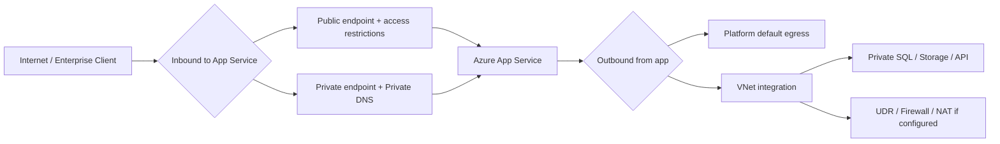
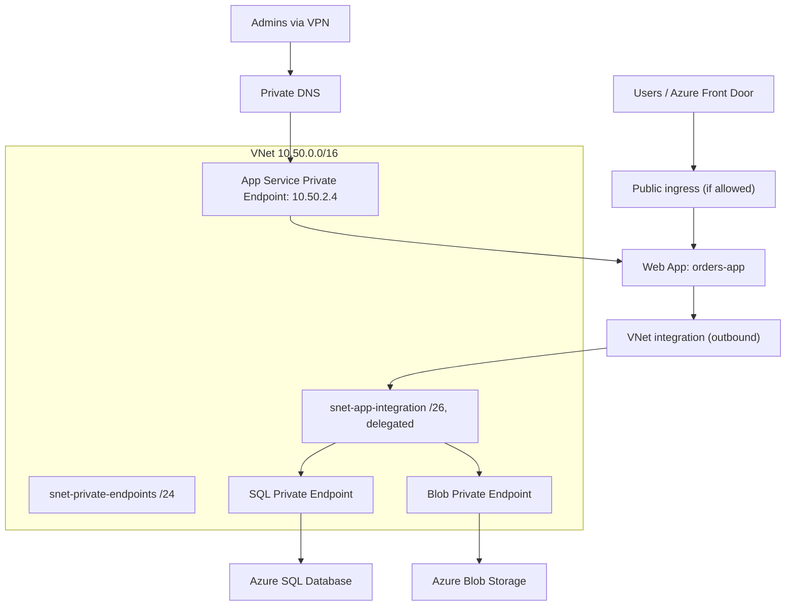
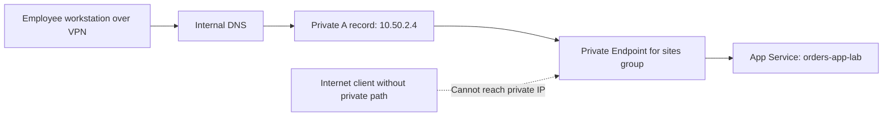
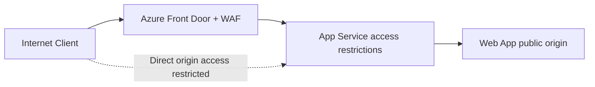
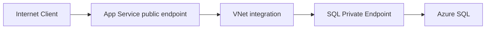
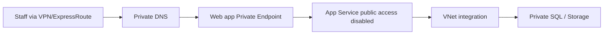
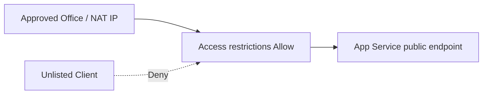
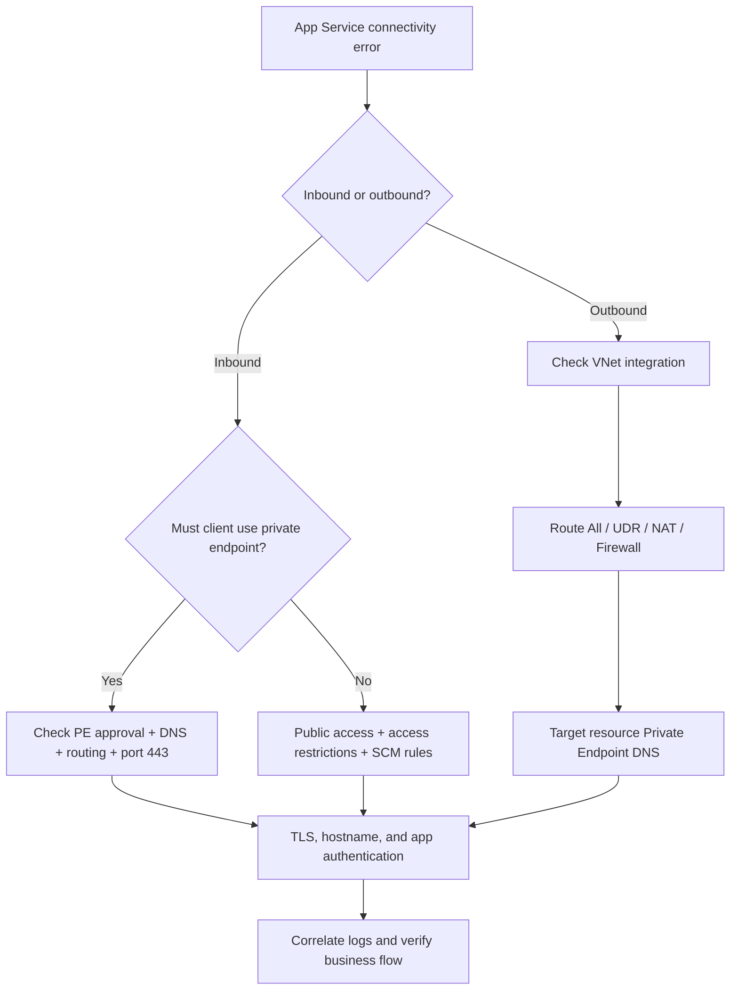

# VNet Integration, Private Endpoints, and Access Restrictions

An application hosted on **Azure App Service** can typically receive HTTP/HTTPS traffic over a public address and initiate outbound calls to other services. However, enterprise apps often need to reach **Azure SQL Database or Storage via private endpoints**, restrict an admin portal solely to internal employees, or accept traffic only from **Azure Front Door** rather than the open internet. These requirements all involve networking, yet they are solved by **three distinct mechanisms**:

- **VNet integration:** lets an App Service app make **outbound connections** to resources reachable through a virtual network.
- **Private endpoint:** provides an **inbound access path** to App Service over a **private IP address** inside a VNet, backed by Azure Private Link.
- **Access restrictions:** **filter inbound requests hitting App Service's public/default endpoint** using IP rules, service tags, or other supported conditions.

This lesson belongs to the **Web Applications with App Service** chapter of the `CLOUD_PROVIDERS_AZURE` module. It ties together subscriptions, resource groups, Microsoft Entra ID, VNets, DNS, compute, storage, and data to deploy Azure applications with **correctly directed**, secure, observable, and cost-effective networking.

## Learning objectives

After this lesson, you will be able to:

1. Clearly distinguish **inbound** from **outbound** traffic from the App Service app's perspective.
2. Design separate subnets for **regional VNet integration** and **private endpoints**, avoiding delegation mix-ups.
3. Understand **Route All**, DNS, NAT Gateway, user-defined routes (UDRs), firewalls, and outbound internet egress.
4. Create a private endpoint for a Web App and configure **Private DNS** for both the main website and the **SCM/Kudu** management site.
5. Build access restrictions with IP/service tags, distinguish **main site** vs. **SCM site** rules, and configure default unmatched behavior.
6. Choose one of the three mechanisms—or combine them—for public, internal, and hybrid scenarios.
7. Verify configurations via Azure Portal/CLI, DNS, and HTTP, and diagnose `403`, DNS, timeout, or deployment errors.
8. Establish operational checklists covering IAM, monitoring, safe changes, and costs.

## 1. The core rule: identify traffic direction

Place **App Service at the center**:

| Flow | Example | Architectural question |
|---|---|---|
| **Inbound** to App Service | User opens `https://orders-app.azurewebsites.net` | Who may call the app, and via which network path? |
| **Outbound** from App Service | App calls `sql-prod.database.windows.net:1433` | Which IP/route/DNS does the app use to reach SQL? |
| **Management inbound** | CI/CD or developer accesses `orders-app.scm.azurewebsites.net` | Is SCM reachable via an authorized network path? |
| **Internet outbound** | App calls a partner API over HTTPS | Must traffic route through a firewall or use a stable public egress IP? |

Directional diagram:



**VNet integration does not make a public web app private.** **A private endpoint does not automatically provide an outbound path into a VNet.** **Access restrictions do not give the app a private IP address.** All three are often combined, but you must understand each mechanism's exact role and scope.

## 2. Which layers does App Service networking operate at?

**Azure App Service** is a PaaS hosting Web Apps/APIs on managed infrastructure. You own app configuration, the App Service Plan, identities, and supported network settings; you do not directly manage underlying host network interfaces or servers as you would with an Azure VM.

Concepts to distinguish:

| Concept | Meaning |
|---|---|
| **App Service Plan** | Compute capacity, SKU/tier, and region serving apps |
| **Web App** | Specific web app with its own primary hostname and settings |
| **Default hostname** | Typically shaped like `<appname>.azurewebsites.net` |
| **SCM/Kudu hostname** | Typically shaped like `<appname>.scm.azurewebsites.net`, used for deployments and diagnostics as supported |
| **Regional VNet integration** | Outbound path used by the app to reach into a VNet |
| **Private Link / Private endpoint** | Private inbound IP inside a VNet for clients to reach the app |
| **Public network access** | Policy enabling or disabling the web app's public inbound endpoint |
| **Access restrictions** | Rules filtering inbound sources hitting the public/default endpoint |
| **Microsoft Entra Authentication** | User authentication/authorization; a separate layer from IP filtering |

**App Service Plan tier, OS, hosting environment type, and region determine which network features are available.** The examples below primarily assume **multitenant Azure App Service** on a tier supporting regional VNet integration and private endpoints. Free/Shared or specialized setups may lack support; verify in your actual subscription.

**App Service Environment (ASE)** is an isolated App Service deployment option with its own private networking model—do not assume multitenant App Service subnet/routing behavior matches ASE identically.

## 3. Comparison table of the three mechanisms

| Criterion | VNet integration | Private endpoint | Access restrictions |
|---|---|---|---|
| Primary traffic direction | **Outbound** from app | **Inbound** to app | **Inbound** to public endpoint |
| Role | App calls resources via VNet | Clients reach app via private IP | Allow/deny caller sources by rule |
| Creates a private IP for clients to call the app? | **No** | **Yes** | **No** |
| Automatically disables public ingress? | No | Do not assume; inspect/configure public network access | No, though it can deny unlisted sources |
| Lets the app call private SQL/Storage? | **Yes**, with proper routing/DNS/permissions | Not its purpose | No |
| VNet subnet | Subnet **delegated** to `Microsoft.Web/serverFarms` | Subnet for private endpoints; **not the delegated integration subnet** | No subnet required for IP rules |
| Special DNS | Resolves private services called by the app | Private DNS for App Service and SCM hostnames | Typically no hostname change |
| Who uses it? | App Service workload | Clients/CI/CD on networks able to route to the private IP | Clients reaching the public endpoint |
| Example | API calling SQL private endpoint | Internal web app over VPN | Restrict public app to office IP or Front Door only |

### Three common misconceptions

**"I enabled VNet integration, yet people on the internet still see the website."** That is normal: VNet integration handles **outbound**, not blocking **inbound**.

**"I created a private endpoint for App Service, so the app can reach private Blob Storage."** Not enough: you need **VNet integration for outbound**, plus routing, DNS, and permissions to Blob.

**"I disabled public access, so adding an IP allow rule for staff is enough."** Incorrect: once public access is off, allow rules on the public endpoint cannot substitute for a private network path. Clients must traverse the private endpoint with proper DNS.

## 4. Reference design: web app calling SQL and Storage privately

Suppose an organization has:

- App Service `orders-app` serving HTTP.
- Azure SQL Database and Blob Storage permitting private paths only by policy.
- Administrators connecting via VPN from the corporate network, with controlled deployment paths.
- VNet `vnet-orders-prod` in the region matching the App Service Plan with separate subnets.



In this architecture:

1. **Inbound to App Service:** either the public endpoint with access restrictions, or a private endpoint for authorized internal networks; both can coexist if business needs and policy allow.
2. **Outbound from App Service:** uses VNet integration to reach the SQL/Storage private endpoints.
3. **DNS:** App Service, SQL, and Storage names must resolve to the right addresses **from the exact point issuing each query**; each service uses its own Private DNS zone.
4. **Identity:** even over private IPs, the app still requires Microsoft Entra ID/managed identity or supported credentials to access SQL/Blob.
5. **Observability:** collect HTTP/App Service logs, Activity Logs, DNS, and network diagnostics rather than trusting a single "Connected" badge.

## 5. VNet integration: outbound from App Service

**Regional VNet integration** lets a web app send outbound traffic to destinations routable through the integrated VNet. VNet integration **does not create an inbound private IP for the web app** and **does not directly grant permissions to target resources**.

### Common prerequisites

Before integrating, check:

1. **App Service Plan** uses a tier supporting the feature; verify mode and region support.
2. **VNet** and integration subnet reside in a region supported by your App Service model; for standard regional integration, the VNet is in the **same region** as App Service.
3. **Dedicated integration subnet**, delegated to `Microsoft.Web/serverFarms`.
4. **Subnet IP capacity** sized for active instances, scale-out, and platform upgrades/migrations. For many workloads, `/26` is a safer starting point than a tiny subnet; exact minimums and limits depend on feature/tier.
5. **NSGs, route tables, DNS**, and network appliances do not block required dependencies.
6. Operators/identities have permissions on both App Service and the target virtual network/subnet.

### What does subnet delegation mean?

The integration subnet is used exclusively by Azure App Service for outbound connectivity. Setting `delegation = Microsoft.Web/serverFarms` tells Azure the subnet is reserved for this service model. Do not treat it as a general subnet for VMs or private endpoints; delegation constraints restrict what can live in it.

**The VNet integration subnet and private endpoint subnet should be two separate subnets.** One is for App Service **going outbound**, while the other holds **private inbound** NICs.

### Flows handled by VNet integration

- App calls an internal VM or API inside the VNet when routing and firewalls permit.
- App calls a private endpoint for Azure SQL, Storage, Key Vault, or another supported service.
- App calls resources in a **peered VNet** or on-premises network via VPN/ExpressRoute when routing, peering, and DNS are configured properly.
- App can be configured to push additional outbound traffic through the VNet via **Route All**.

VNet integration does not let the app bypass NSGs or automatically discover every subnet. Target resources can still reject connections due to wrong service ports, firewalls, routes, DNS, or missing app permissions.

## 6. Route All and outbound internet paths

When using VNet integration, the next question is: **which traffic flows through the integration subnet?**

### Default routing vs. Route All

In many multitenant App Service setups, traffic destined for private addresses routes via VNet integration, while some internet-bound traffic may exit via platform outbound paths unless all traffic is routed through the VNet. **Route All** directs eligible outbound traffic through VNet integration so UDRs, NSGs, NAT, or firewalls apply.

| Scenario | Desired path | Configuration to check |
|---|---|---|
| Calling SQL private endpoint | Via VNet integration to private IP | Private DNS, routing, firewall, identity |
| Calling internal API in a peered VNet | Via VNet integration and peering | Peering, address spaces, UDRs, NSGs |
| Calling internet APIs with controlled egress | Via VNet when **Route All** is enabled | Egress architecture, UDR/NAT/Firewall |
| Calling internet via default path | Does not necessarily traverse the VNet | Outbound IPs/App Service behavior per config |

In the Azure Portal, check **Networking → VNet integration** and routing/Route All options per current UI. In App Service APIs/configs, this maps to properties like `vnetRouteAllEnabled` (older setups may use legacy app settings). In automation, prefer **official supported resource properties** and verify state after saving rather than mixing legacy and modern flags arbitrarily.

### Route All does not create an internet exit by itself

If you force all outbound traffic into the VNet without a valid egress path on that subnet, the app may **lose the ability to reach** internet APIs, package feeds, or identity endpoints. Design one of the supported egress paths:

- **NAT Gateway:** provides controlled public outbound egress IPs from an eligible subnet.
- **Azure Firewall or NVA:** enforces rules, logging, network policies, FQDN/application rules, or inspection where supported.
- **UDR / Route table:** steers target prefixes to a next hop; ensure symmetric return paths and avoid blackholes.
- **DNS resolver/forwarder:** resolves both private and public names properly per architecture.

**Do not assume** enabling VNet integration automatically turns your public outbound IP into a VNet or private endpoint IP. If a partner system must allowlist a fixed outbound IP, design Route All with NAT/Firewall egress as supported and verify from the app itself.

### Impact on DNS

When a web app calls `sql-prod.database.windows.net` and SQL uses a private endpoint, the client must resolve that hostname to its **appropriate private IP** from the app's DNS context. VNet DNS settings, private DNS zones, custom DNS servers, and forwarding govern resolution. **Creating a private endpoint for SQL does not guarantee every app in every VNet resolves it properly.**

## 7. Configuring VNet integration in Azure Portal

Assume you already have:

| Component | Illustrative value |
|---|---|
| Resource group | `rg-app-lab` |
| Web App | `orders-app-lab` |
| App Service Plan | Tier supporting regional VNet integration |
| VNet | `vnet-orders-lab`, `10.50.0.0/16` |
| Integration subnet | `snet-app-integration`, e.g. `10.50.1.0/26` |
| Delegation | `Microsoft.Web/serverFarms` |

Steps:

1. In the Azure Portal, open **App Services → orders-app-lab → Networking**.
2. Under **VNet integration** or **Outbound traffic**, select add VNet integration.
3. Choose the VNet and eligible integration subnet in the matching region/tier.
4. Verify subnet delegation, available IP space, and NSG/route rules.
5. Save and confirm **Connected** status.
6. If routing all outbound traffic through the VNet, enable **Route All** per design after verifying NAT/Firewall egress is ready.
7. Test directly from the app: verify DNS resolution and reachability to the target port/resource rather than stopping at the "Connected" badge.

If the Portal prompts to **create a new subnet** or requires subnet write access, proceed only within authorized lab scope. Never hijack a VM or private-endpoint subnet for integration simply because it has "free IP addresses."

### Azure CLI: inspecting and integrating

Select the right subscription:

```bash
az login --tenant "<tenant-id>"
az account set --subscription "<subscription-id>"

az account show \
  --query "{name:name,id:id,tenant:tenantId}" \
  --output json
```

Inspect current VNet integration:

```bash
az webapp vnet-integration list \
  --resource-group "rg-app-lab" \
  --name "orders-app-lab" \
  --output json
```

If the VNet/subnet already exists, is properly delegated, and you are authorized:

```bash
az webapp vnet-integration add \
  --resource-group "rg-app-lab" \
  --name "orders-app-lab" \
  --vnet "vnet-orders-lab" \
  --subnet "snet-app-integration"
```

This command **modifies the app's network configuration**. In production, require review and a rollback plan; run only in an assigned lab. CLI versions, permissions, and subnet rules vary by App Service type/region; if denied, investigate prerequisites instead of granting Subscription Owner.

Read related ARM state:

```bash
az webapp show \
  --resource-group "rg-app-lab" \
  --name "orders-app-lab" \
  --query "{name:name,location:location,publicNetworkAccess:publicNetworkAccess,subnet:virtualNetworkSubnetId,outboundIps:outboundIpAddresses}" \
  --output json
```

To inspect Route All, check **Networking** in the Portal or read the site configuration via current API/CLI. **`az webapp vnet-integration list` proves VNet integration is attached—it does not prove internet traffic exits via NAT.**

## 8. Private endpoint: inbound App Service via Private Link

An **App Service private endpoint** is a **network interface** inside a VNet subnet that receives a private IP and provides an inbound path to the web app via Azure Private Link. Clients in the VNet or connected networks can reach the app using its **normal hostname**, while internal DNS resolves that name to the private endpoint IP.



### Key points

- A private endpoint is an **inbound mechanism to App Service**, not an outbound interface for the app.
- It is created in a VNet with an appropriate subnet and permissions. **That subnet must NOT be the integration subnet delegated to `Microsoft.Web/serverFarms`.**
- The App Service Plan/tier and app type must support Private Link.
- `publicNetworkAccess` determines whether the app still accepts inbound calls on its public endpoint; **explicitly verify/disable it** when the app must be private-only.
- An app may need separate private endpoint management for **deployment slots** depending on supported group/subresource rules; do not assume the production private endpoint covers every slot.
- Clients must still **authenticate and authorize** at the application layer; a private IP does not replace login.

### Do not replace the app URL with a private IP

Suppose the private IP is `10.50.2.4`. Clients should keep calling:

```text
https://orders-app-lab.azurewebsites.net/
```

Rather than:

```text
https://10.50.2.4/
```

Connecting by bare IP breaks **TLS SNI, Host headers, certificates, and App Service routing**. Azure Private Link is designed to preserve the hostname while **DNS** steers connections to the private IP.

## 9. Private DNS: the most commonly missed piece of a Private Endpoint

Suppose `orders-app-lab` has a private endpoint and corporate clients need to open the site:

```text
Hostname opened by users:
orders-app-lab.azurewebsites.net

Standard Private DNS zone:
privatelink.azurewebsites.net

Private records:
orders-app-lab     A 10.50.2.4
orders-app-lab.scm A 10.50.2.4
```

The default app name follows a `privatelink` CNAME/alias chain. Within a network linked to the Private DNS zone, resolvers return the private IP so clients connect via the private endpoint.

**Verify DNS from the exact location where users and CI agents run**, not just from a VM in another VNet. A missing VNet link on the Private DNS zone or misconfigured on-premises DNS forwarding can cause queries to return the public IP.

### Why is the SCM record needed?

Beyond the main site, App Service exposes an **SCM/Kudu** endpoint commonly used for:

- Zip/package deployments per supported mechanisms.
- Viewing logs/diagnostics and developer tools.
- Certain CI/CD pipelines and app administration tasks.

When an app is private-only, **SCM must also be reachable via a valid private path and DNS**. If `orders-app-lab` exists in Private DNS while `orders-app-lab.scm` is missing, the website may load while deployment pipelines and Kudu fail.

### Private DNS for custom domains

If the app uses `internal.example.com` instead of the default hostname:

1. Configure the custom domain and a valid HTTPS certificate in App Service.
2. In your internal DNS, point the custom hostname to the private target per supported models.
3. Preserve matching Host headers and SNI; never just add a bare A record to the IP while skipping domain/certificate verification.
4. Test both client access to the custom domain and CI/CD access to the default SCM hostname.

### Hybrid scenarios

On-premises machines connecting over VPN/ExpressRoute require:

- **Routing** to the private endpoint IP inside the VNet.
- **DNS forwarding or a resolver** returning private answers instead of always querying public DNS.
- **Firewalls/NSGs** permitting HTTPS traffic to the private endpoint.
- Valid **application authentication**.

An Azure Private DNS zone **does not automatically teach your corporate DNS about private records** without configuring a resolution path.

## 10. Creating a Private Endpoint in Azure Portal

Separate example setup:

| Component | Illustrative value |
|---|---|
| App | `orders-app-lab` |
| App resource group | `rg-app-lab` |
| VNet | `vnet-orders-lab` |
| Private endpoint subnet | `snet-private-endpoints`, `10.50.2.0/24` |
| Private endpoint resource | `pe-orders-app` |
| Subresource / group ID | `sites` (production site) |
| Private DNS zone | `privatelink.azurewebsites.net` |

In the Portal:

1. Go to **App Service → Networking → Private endpoint connections** (or equivalent blade).
2. Click **Add private endpoint**, choosing subscription, resource group, region, and name.
3. Pick the VNet and the subnet **dedicated to private endpoints**; never pick the VNet integration delegated subnet.
4. Select the App Service resource and subresource `sites` for the production site as supported.
5. Configure/approve the Private Link connection if workflow requires manual approval.
6. Integrate the **Private DNS zone** and confirm records for both the main hostname and the `scm` hostname.
7. Check public network access: if the app must be **private-only**, disable public network access per policy after verifying the private path works first.
8. From a VM/agent inside the VNet or over VPN, run `nslookup`/`curl` against the regular hostname.

**Creating a private endpoint does not magically open a route from an external laptop to the private IP.** Reachability requires VNet routing, VPN/ExpressRoute, an authorized Bastion/jump host, or a source inside a connected network.

### Azure CLI: finding App ID and inspecting the private endpoint

Retrieve the app resource ID:

```bash
APP_ID=$(az webapp show \
  --resource-group "rg-app-lab" \
  --name "orders-app-lab" \
  --query id \
  --output tsv)

echo "$APP_ID"
```

Create a private endpoint in an **authorized sandbox**, once subnet and resource are ready:

```bash
az network private-endpoint create \
  --resource-group "rg-app-lab" \
  --name "pe-orders-app" \
  --vnet-name "vnet-orders-lab" \
  --subnet "snet-private-endpoints" \
  --private-connection-resource-id "$APP_ID" \
  --group-id "sites" \
  --connection-name "pe-orders-app-conn"
```

**This command alone does not set up the DNS zone/VNet link or disable public network access.** Configure the Private DNS zone group via Portal/IaC and test after creation; creating endpoints in production requires approval as it can affect routing, availability, and billing.

Inspect the endpoint:

```bash
az network private-endpoint show \
  --resource-group "rg-app-lab" \
  --name "pe-orders-app" \
  --query "{name:name,subnet:subnet.id,connections:privateLinkServiceConnections}" \
  --output json

az network private-endpoint list \
  --resource-group "rg-app-lab" \
  --output table
```

If `privateLinkServiceConnections` is empty, inspect the full JSON for manual/approved connection arrays. A private endpoint in `Pending` or `Rejected` state cannot serve traffic like an `Approved` connection.

### Checking the Private DNS zone group

```bash
az network private-endpoint dns-zone-group list \
  --resource-group "rg-app-lab" \
  --endpoint-name "pe-orders-app" \
  --output json
```

Confirm the zone group links to `privatelink.azurewebsites.net` with DNS records matching the private IP. If managing DNS with Bicep/Terraform instead of the Portal, link the zone to source VNets or configure DNS forwarding per architecture.

## 11. Access restrictions: filtering inbound traffic to the public endpoint

**Access restrictions** filter traffic reaching the **default/public App Service endpoint** using rules based on supported conditions such as IP/CIDR blocks, service tags, or VNet service endpoints within applicable limits.

Example app with a public URL:

```text
https://orders-app-lab.azurewebsites.net/
```

The organization permits only two outcomes:

| Source | Rule | Desired effect |
|---|---|---|
| Office network `203.0.113.10/32` | `Allow` priority `100` | Employees coming from the office egress IP can access |
| All other sources | `Deny` via default unmatched behavior | Blocks the rest of the internet outside the allowlist |

`203.0.113.10` is a documentation-range example IP; in practice use your organization's **approved public egress IP**. Never allowlist a laptop's private LAN IP on a public App Service, because the app sees the public source address after NAT/proxy.

### Rules and evaluation priority

Each access restriction rule can specify:

- **Name** and **priority** controlling evaluation order.
- **Action**: `Allow` or `Deny`.
- **Source condition**, such as IP/CIDR, service tag, or VNet/subnet where supported.
- **Header filters** supported in certain scenarios, such as restricting traffic to a specific Azure Front Door instance.

Lower priority numbers are generally evaluated first per App Service mechanics. When no rule matches, the **default unmatched rule action** decides whether traffic is allowed or denied; verify this explicitly instead of assuming adding one rule blocks everything else.

**Access restrictions are not authentication.** A user coming from an allowed IP must still sign into Entra ID or present valid tokens/app permissions when required; IP filtering only constrains connection sources.

### Main site and SCM/Kudu can have different rules

App Service supports **access restrictions for the main site and advanced tools (SCM)**. Depending on configuration, SCM can **inherit rules from the main site** or define **separate rules**. Protecting only the main site while leaving SCM open can violate security standards; conversely, locking SCM down prematurely can break deployment pipelines.

Check both:

- `https://orders-app-lab.azurewebsites.net`: application traffic.
- `https://orders-app-lab.scm.azurewebsites.net`: deployment/diagnostic traffic.

With a private endpoint, SCM needs **proper private DNS/routing**; with a public endpoint, SCM needs access restrictions matching policy. The two mechanisms differ and can mimic each other's symptoms if misdiagnosed.

### Private endpoint traffic and access restrictions

**Access restrictions do not filter traffic arriving through a private endpoint.** Inbound access restriction rules apply primarily to the **default/public endpoint**. Traffic entering via a private endpoint is controlled by network paths/Private DNS, private network security controls where supported, and application authentication/authorization.

If only **a subset of internal users** may reach the app via a private endpoint, design routing, network segmentation, firewalls/NSGs where supported, plus **Entra ID/Easy Auth** or business authorization. Never assume an `Allow 203.0.113.10/32` rule on the public endpoint filters private endpoint callers.

## 12. Configuring access restrictions via Portal and Azure CLI

### Via Azure Portal

1. Open App Service → **Networking → Access restrictions** or **Inbound traffic** per current UI.
2. Review **main site** rules and **SCM** inheritance/separate-rule options.
3. Add an `Allow` rule for the approved source IP/CIDR with a priority.
4. Set the default unmatched action, e.g., `Deny` to enforce an allowlist.
5. Save and test from **two sources**: an allowed IP and an unallowed IP.
6. Repeat or configure SCM rules separately matching your real deployment path.

**Before switching the default action to Deny**, confirm admins and CI/CD keep a working management path. Reopening access requires configuration changes through Azure Resource Manager; do not count on opening Kudu to fix it when Kudu itself gets blocked.

### CLI: inspect rules before changing

```bash
az webapp config access-restriction show \
  --resource-group "rg-app-lab" \
  --name "orders-app-lab" \
  --output json
```

Inspect fields showing rules, priorities, unmatched default action, and SCM rules. Displayed field names vary by CLI/API version; if fields look missing, read the full JSON.

Example rule addition **only in an authorized environment**:

```bash
az webapp config access-restriction add \
  --resource-group "rg-app-lab" \
  --name "orders-app-lab" \
  --rule-name "AllowOfficeEgress" \
  --action Allow \
  --ip-address "203.0.113.10/32" \
  --priority 100
```

This command **modifies app access**, not a read-only check. By itself it may not set your desired unmatched default action or SCM strategy. After editing, re-run `access-restriction show`, test from real clients, and verify CI/CD still works.

When using **service tags** or HTTP header filters, check `az webapp config access-restriction add -h` and confirm supported source/tag types on your current App Service; never invent header filter properties without verifying them.

## 13. Access restrictions and Azure Front Door

A public website can place **Azure Front Door** in front of App Service for WAF, caching/routing, and global edge delivery. When the App Service origin still uses a **public endpoint**, you must stop clients from **bypassing Front Door** straight to the origin.

A common approach:

1. Route primary user traffic through Front Door.
2. In App Service public access restrictions, allow sources matching the **`AzureFrontDoor.Backend` service tag** as supported.
3. Pair with a header filter such as **`X-Azure-FDID`** to restrict traffic to your authorized Front Door instance/route per service guidance, rather than allowing every Front Door customer's traffic.
4. Set unmatched default action to `Deny` and check SCM separately.
5. Monitor HTTP 403s, WAF logs, and origin health.



This is a **public origin lockdown pattern**, not a Private Endpoint. Verify FDID values, service tags, headers, and rule limits for your current tier. If using **Azure Front Door Premium + Private Link origin** where supported for App Service, origin ingress uses a different model—requiring private networking/DNS/connection approval per Front Door design rather than mechanically copying public access restrictions.

## 14. How can private endpoints and public ingress be combined?

Three common patterns:

### Pattern A — Public app with private outbound



**Choose when:** the web/API must accept public traffic while databases/secrets/data services stay private. Inbound can use Front Door, WAF, and access restrictions; outbound uses VNet integration. **You do not necessarily need a private endpoint on the web app itself.**

### Pattern B — Internal-only web app



**Choose when:** admin portals, internal APIs, or sensitive-data apps must never accept direct internet inbound traffic. Requires a private endpoint, Private DNS, and user/agent network paths. VNet integration is only needed if the app must also **call private resources outbound**.

### Pattern C — Public endpoint restricted to allowed IPs/edge



**Choose when:** the requirement is simply narrowing public inbound access to known sources without needing private IPs or private links. Access restrictions are usually simpler to configure than Private Endpoints, though they **do not provide a Private Link private network boundary**.

### Decision summary

| Question | Mechanism to start with |
|---|---|
| App needs to call a private IP inside a VNet? | **VNet integration** |
| App needs to call Azure SQL over a private endpoint? | **VNet integration + SQL Private DNS** |
| Users need to reach the app itself via a private IP? | **App Service Private endpoint** |
| App must be internal-only with no public ingress? | **Private endpoint + disable public network access + Private DNS** |
| Public app restricted to office access only? | **Access restrictions IP allowlist** |
| App should accept traffic only from Front Door public origin? | **Access restrictions with service tag/header** or supported private origin model |
| App needs a stable public outbound IP? | **VNet integration + Route All + NAT Gateway/egress architecture** |
| App needs token/user-login protection on APIs? | **Microsoft Entra Authentication/authorization**; networking is complementary |

## 15. Complete deployment: internal app using private SQL

### Scenario

An operations team deploys `orders-app-lab` on an appropriate Linux/Windows App Service tier. The app calls Azure SQL over a private endpoint; staff access the app via VPN; CI/CD uses a self-hosted agent inside the connected network. The goal is **no direct public inbound** to either the main site or SCM.

### Resource design

| Resource | Illustrative value |
|---|---|
| Web App | `orders-app-lab` |
| App Service Plan | SKU supporting VNet integration and private endpoints |
| VNet | `vnet-orders-lab`, `10.50.0.0/16` |
| Outbound integration subnet | `snet-app-integration`: `10.50.1.0/26`, delegated `Microsoft.Web/serverFarms` |
| Inbound private endpoint subnet | `snet-private-endpoints`: `10.50.2.0/24` |
| Web App private endpoint | `pe-orders-app`, group `sites` |
| Web App Private DNS | `privatelink.azurewebsites.net` |
| SQL private endpoint | Configured per Azure SQL and appropriate private endpoint subnet |
| SQL private DNS | `privatelink.database.windows.net` in standard design |
| Private management | VPN/ExpressRoute or jump box/agent inside the VNet |

### Safe deployment order

1. **Prepare app and DNS dependencies:** run the base app, verify via existing path; create the SQL private endpoint and SQL Private DNS.
2. **Set up VNet integration:** integrate the app with `snet-app-integration`, verify SQL DNS resolves to a private IP from the app, and test TCP/1433 reachability.
3. **Configure data permissions:** managed identity/Entra ID or approved enterprise SQL credentials; verify real queries, not just TCP reachability.
4. **Create the app private endpoint:** in `snet-private-endpoints`, select subresource `sites`; confirm approval state.
5. **Configure app Private DNS:** link the zone to VNets where staff/agents resolve names, and verify records for both site and SCM.
6. **Test from real authorized sources:** from a machine/agent over VPN, open `https://orders-app-lab.azurewebsites.net` and `https://orders-app-lab.scm.azurewebsites.net` per permissions.
7. **Set public network access to Disabled** once the private path and CI/CD work and a rollback plan exists.
8. **Test external sources:** verify callers outside private networks are blocked per policy.
9. **Document logs, alerts, owners, and runbooks:** record endpoint IDs, DNS zones, IPs, VNet links, SCM deploy paths, permissions, and recovery steps.

### Acceptance tests

| Test | Where executed | Expected result |
|---|---|---|
| Web app DNS | VM/agent in VNet | App hostname resolves to private IP |
| Web app HTTPS | VM/agent in VNet | HTTPS connects and app returns valid response |
| SCM/Kudu DNS | Deploy agent in VNet | `scm` hostname resolves to private IP |
| CI/CD deploy | Authorized agent with network path | Deploys cleanly without opening public SCM |
| SQL private DNS | App Service runtime/console | SQL hostname resolves to private IP |
| SQL query | App Service identity | Authenticates and executes queries per business permissions |
| Public inbound | External client without VPN | Blocked by public network access policy |
| Logs/metrics | Operations team | Diagnostics and required alerts are flowing |

**Never disable public access on step 1** if your dev team currently relies on public build agents and lacks Private DNS/network paths: you can lock CI/CD out of SCM even while the main app keeps running.

## 16. Diagnosing DNS, routing, and ports

When App Service cannot reach a resource or users cannot load the site, **separate traffic direction** before changing any rule.

### Checking inbound from a VM in the VNet

On a Linux VM or self-hosted agent with routing to the private endpoint:

```bash
nslookup orders-app-lab.azurewebsites.net
nslookup orders-app-lab.scm.azurewebsites.net

curl -I --connect-timeout 5 \
  https://orders-app-lab.azurewebsites.net/
```

Observe whether the hostname resolves to a **private IP** or public IP, plus the HTTP status and TLS certificate. `curl -I` sends HTTP HEAD; if the app rejects HEAD, test GET on a read endpoint. Never bypass TLS verification just to force a test "green."

On Windows PowerShell:

```powershell
Resolve-DnsName orders-app-lab.azurewebsites.net
Resolve-DnsName orders-app-lab.scm.azurewebsites.net

Test-NetConnection orders-app-lab.azurewebsites.net -Port 443
```

### Checking outbound from App Service

Depending on App Service OS and supported features, use **SSH/Console**, Portal network diagnostics, or utility commands to check DNS/connectivity. Example from a compatible Linux shell:

```bash
nslookup sql-prod.database.windows.net

# Only test HTTPS on an endpoint if that endpoint actually serves HTTPS
curl -I --connect-timeout 5 https://example.com/
```

For Azure SQL Database, test TCP port `1433` with an appropriate TCP/SQL tool; **never run `curl https://sql-prod.database.windows.net` to conclude SQL is reachable**. DNS returning a private IP proves networking only; querying data still requires valid credentials/roles and SQL policies.

### DNS can differ across three vantage points

| Query location | Expectation with an App Service Private Endpoint |
|---|---|
| Office PC over VPN with DNS forwarding | Web app FQDN → private endpoint private IP |
| Azure VM in a VNet linked to Private DNS zone | Web app FQDN → private IP |
| Internet client outside private networks | May resolve via public DNS without private routing; with public access disabled, public ingress is blocked |

An `nslookup` result on a laptop without VPN **does not prove** internal DNS is broken. Always test from the proper network context.

## 17. Common errors and fixing the right layer

| Symptom | Possible cause | How to verify |
|---|---|---|
| Public web app remains reachable after enabling VNet integration | Feature affects outbound only | Check public network access or access restrictions for inbound |
| App calling private SQL times out | Missing VNet integration, NSG, UDR, peering route, SQL firewall | Check integration, SQL Private DNS, test TCP/1433 |
| App calling SQL returns `403`/login failure | Identity, SQL permissions, or policy | Check auth/authorization once networking succeeds |
| App reaches private SQL yet internet APIs break after Route All | VNet lacks outbound NAT/Firewall route or DNS | Check UDRs, NAT Gateway, firewall, routes, and DNS |
| Private endpoint created yet app FQDN returns public IP | Private DNS zone, A record, VNet link, or forwarding issue | Run `nslookup` from a VM/agent inside the private network |
| Private app site works yet SCM/Kudu/deploy fails | Missing `<app>.scm` record or agent lacks private path | Check SCM DNS and HTTP/443 from CI agent |
| External clients receive `403` | Public network access disabled, access rule deny, or auth | Check access path and HTTP responses/logs |
| Office IP Allow rule has no effect | Different real IP behind NAT/proxy, rule priority/default action, SCM vs. site rule | Check public source IP, rule order, and diagnostic logs |
| Private Endpoint stuck `Pending` | Connection not approved by resource owner | Check private endpoint connection state |
| Cannot add integration subnet | Subnet not delegated, out of IPs, wrong region/tier, permissions | Check `Microsoft.Web/serverFarms`, CIDR, plan/region |
| Cannot create PE inside integration subnet | Integration subnet is delegated and incompatible with PEs | Use a separate PE subnet without conflicting delegation |
| Custom domain fails TLS/404 over PE | Wrong DNS, Host header, SNI, or missing binding/cert | Check custom domain/cert and underlying hostname |
| Front Door access restriction marks origin unhealthy | Wrong service tag/header/priority blocking health probes | Inspect Front Door origin health, App Service restrictions, logs |
| Private website fails to deploy from GitHub-hosted runner | Runner lacks routing and DNS to private SCM | Use a private/self-hosted agent or supported deploy method |
| App works yet egress IP is unstable | Route All / NAT egress not configured properly | Check IP seen by partner and live egress path |

### Troubleshooting flowchart



**Never fix issues by turning on full public access or opening `Any/Any` rules.** Such workarounds may "clear the timeout" while destroying your security posture and masking the underlying DNS/routing defect.

## 18. Security and administrative governance

### Network access vs. Authentication

- **Network controls** determine whether a caller can reach an endpoint over the designed path.
- **Microsoft Entra Authentication / App Service Authentication ("Easy Auth")** and app logic determine **who the user is, whether tokens are valid, and what they may do**.
- **Managed identity** lets the app call Storage, SQL, Key Vault, or supported APIs without long-lived secrets; it does not establish network routes.
- **Azure RBAC** governs who may edit the web app, VNet, subnets, private endpoints, DNS zones, and access restrictions at the control plane.

A request can traverse a private endpoint and receive `401` if unauthenticated, or pass an access restriction and receive `403` if lacking business permissions. Never diagnose network issues from HTTP status codes alone.

### Separation of duties

| Team | Example responsibilities | Recommended boundaries |
|---|---|---|
| Network team | VNets/subnets, routes, private endpoints, DNS forwarding | No need to edit application code |
| Application team | App settings, code, deployments, health endpoints | Cannot arbitrarily open public access or delete Private DNS zones |
| Security team | Policies, IAM, access restrictions, audits | Should not hold standing application admin passwords |
| CI/CD identity | Deploy applications within approved scope | Never grant Subscription Owner |
| Audit/Ops | Read logs, metrics, change history, and incidents | No need for write access across every setting |

**Editing access restrictions or `publicNetworkAccess` can cause immediate downtime.** Use IaC, peer review, verified admin paths, and a tested rollback plan before making changes in production.

## 19. Monitoring, operations, and cost control

### Signals to monitor

| Layer | Signals and evidence to collect |
|---|---|
| App Service | HTTP status/latency, 4xx/5xx, availability, app logs, health checks |
| VNet integration | Integration state, subnet delegation, Route All, route/NSG edits |
| Private endpoint | Connection state, private IP, DNS zone groups, VNet links, access from source networks |
| Access restrictions | Rules and priorities, unmatched default action, SCM rules, config edits |
| Private dependencies | SQL/Blob/Key Vault DNS resolution, port connectivity, auth logs |
| CI/CD | Deployment status, SCM reachability, agent network changes |
| Cost | App Service Plan, Private Link, DNS, NAT/Firewall, data transfer, Log Analytics |

Observability sources include **Azure Monitor**, **App Service diagnostics ("Diagnose and solve problems")**, **Activity Log**, application logs, NSG/firewall logs, and **Network Watcher** for supported network resources. Not every internal App Service flow offers raw packet captures like a self-managed VM.

### Key cost drivers

- **App Service Plan:** compute billed by tier/instances and service model features.
- **Private Endpoint / Private Link:** can bill per endpoint-hour and processed data volume.
- **Private DNS:** zones, queries, and resolver/forwarding services if used.
- **NAT Gateway, Azure Firewall, VPN/ExpressRoute:** resource, hourly, and/or data-processing charges.
- **Egress and data transfer:** internet traffic, inter-region transfers, or network appliance traffic can incur charges.
- **Log Analytics and monitoring:** ingestion, retention, and alerting.
- **WAF / Front Door:** separate cost tier when protecting a public origin.

VNet integration and private endpoints harden architectures **when matched to real needs**, yet not every combination is cost-optimal. A web app needing no private inbound access does not necessarily need a private endpoint; an app accessing no private data services may not need VNet integration.

## 20. Controlled hands-on exercise

**Goal:** choose the right networking configuration for an App Service app in a sandbox environment. If you lack an eligible subscription/region/tier, complete the entire exercise as a design and sample-output analysis; do not provision billable resources unnecessarily just to answer questions.

### Scenario 1 — Public Web API, private database

Requirements:

1. `orders-app-lab` accepts internet HTTPS via Front Door or protected public ingress.
2. SQL Database disallows public access.
3. Web app must connect to SQL using a private IP and authorized identity.

**Selection:** VNet integration for outbound, **SQL** private endpoint, SQL Private DNS, and identity. No **App Service** private endpoint is strictly required since the web API needs public inbound. Add public access restrictions on the app when limiting ingress to Front Door or approved sources.

**Verification:** public API call succeeds; SQL DNS inside the app resolves to a private IP; SQL queries succeed; internet clients cannot reach SQL directly.

### Scenario 2 — Admin portal strictly for internal staff

Requirements:

1. Website and SCM must not be reachable over the public internet.
2. Employees connect via VPN.
3. CI/CD agent can deploy despite the app being private.

**Selection:** App Service private endpoint (group `sites`), Private DNS zone for site and SCM, VPN/routing, disable public network access; CI agent must have private connectivity. If the app calls a private database, add VNet integration for outbound.

**Verification:** site/SCM work over VPN; internet callers without a private path are blocked; pipeline deploy from the private agent succeeds.

### Scenario 3 — Office IP only may access the website

Requirements: the website keeps its public endpoint, yet only employees coming from the company's fixed public IP may access it.

**Selection:** access restrictions with `Allow` for the office IP/CIDR and `Deny` unmatched default; check both main site and SCM policies. No private endpoint needed without private IP requirements.

**Verification:** HTTP from the allowed IP vs. other IPs matches policy; user authentication remains enforced if the app holds sensitive data.

### Results worksheet

```text
Workload: <name>
App Service plan/tier: <type and region>
Inbound requirement: <public/private, which sources>
Outbound requirement: <private VNet/Internet>
Chosen controls: <VNet integration / PE / access restrictions>
Integration subnet: <CIDR, delegation, Route All>
Private endpoint: <resource/group ID/IP/approval>
Private DNS: <zone, VNet link, app + scm records>
Public network access: <Enabled/Disabled>
Access rules: <name/priority/action/default/SCM>
Identity: <managed identity, authorization>
Tests: <DNS, HTTPS, SQL/Storage, CI/CD>
Security approval: <approver>
Monitoring/rollback: <alerts and recovery steps>
Costs: <plan, PE, DNS, NAT/Firewall, logs>
```

### Lab cleanup

Delete only resources **you created and own inside your sandbox resource group** after taking inventory. Private endpoints, DNS zone links, NAT Gateways, App Service Plans, and Log Analytics can continue incurring charges even with zero app traffic. Never delete Private DNS zones or integration subnets shared with other teams. Always re-check **public access, access restrictions, and CI/CD paths** during teardown so you never accidentally expose a previously private endpoint.

## 21. Common misconceptions

**"VNet integration gives the web app a private IP for users to connect to."** False. VNet integration is for outbound. Private inbound uses a private endpoint or another supported private hosting model.

**"An App Service private endpoint lets the app call private Storage."** Wrong direction. Configure outbound VNet integration and network/DNS paths to Storage's private endpoint.

**"With a private endpoint, DNS isn't needed."** False. Apps/CI normally call the App Service hostname; Private DNS must return the private IP to the right callers, including SCM.

**"Access restrictions protect traffic arriving via a private endpoint."** Wrong scope. Access restrictions primarily filter the public/default endpoint; private traffic relies on network segmentation and auth.

**"Just allowlisting my laptop's private IP in access restrictions is enough."** Incorrect for public endpoints when clients sit behind NAT/proxies. Identify the actual public egress IP seen by App Service.

**"Enabling Route All automatically creates a NAT Gateway and static outbound IP."** False. Explicitly design and provision the egress path and verify the live IP seen externally.

**"One subnet can be delegated for VNet integration and also hold app private endpoints."** Poor design. Separate subnets by role and delegation rules.

**"If the private site opens in a browser, CI/CD will definitely deploy."** Not guaranteed. The SCM hostname, Private DNS, permissions, and CI agent network path can differ from regular clients.

**"Adding an Allow rule for Front Door is enough to lock down the origin."** Check service tags, headers/FDID, unmatched policy, SCM, and config details. Otherwise clients can bypass the intended edge.

**"Having a private IP means authentication isn't needed."** False. Private Link restricts network paths; it does not replace Entra ID, tokens, roles, or application authorization.

## 22. Self-check questions

**Q1.** App Service calls a SQL Database with a private endpoint. Among the three mechanisms in this lesson, which serves outbound?

**Answer:** VNet integration, combined with routing and SQL Private DNS. The app still needs proper SQL identity/permissions.

**Q2.** An app enabled VNet integration, yet external internet users can still open its default hostname. Is this a misconfiguration?

**Answer:** Not necessarily. VNet integration does not restrict inbound traffic. To lock down public ingress, use access restrictions or a private endpoint combined with disabling public network access as required.

**Q3.** Can an App Service private endpoint be placed inside a subnet delegated to `Microsoft.Web/serverFarms`?

**Answer:** Do not share the delegated integration subnet in this design. Private endpoints need their own appropriate subnet; the integration subnet serves outbound.

**Q4.** Why is the `orders-app-lab.scm` record needed in `privatelink.azurewebsites.net`?

**Answer:** SCM/Kudu uses a separate hostname from the main site. Without private DNS/routing for SCM, CI/CD or admin tools can fail even when the main site works.

**Q5.** Do access restrictions block traffic entering the app via a private endpoint?

**Answer:** Not under the public/default endpoint filtering model of access restrictions. Controlling private traffic relies on network paths, DNS, segmentation, and proper authentication/authorization.

**Q6.** The app needs a fixed public egress IP for a partner allowlist. Is enabling VNet integration alone enough?

**Answer:** No. Enable Route All and design a supported NAT Gateway/Azure Firewall/egress architecture, then verify the actual IP seen by the partner.

**Q7.** After enabling Route All, the app can no longer call internet APIs. What should you inspect?

**Answer:** Route tables/UDRs, NAT Gateway, firewall/proxy, DNS, NSGs, and the integration subnet's egress path. Never open random inbound ports to fix an outbound failure.

**Q8.** A private web app is only for staff over VPN. Is a private endpoint needed?

**Answer:** Use an App Service private endpoint with Private DNS/routing and disabled public network access, or an appropriate private hosting model. Public IP access restrictions alone do not create a private IP/path.

**Q9.** Why might an app connecting over a SQL private endpoint still receive `Login failed`?

**Answer:** Network reachability and name resolution do not replace authentication/authorization. Verify identity, credentials, and SQL permissions.

**Q10.** Does placing a website behind Azure Front Door guarantee users cannot hit the public origin directly?

**Answer:** Not automatically. Add public access restrictions with properly configured service tags and header/FDID checks, or use a supported Private Link origin model.

**Q11.** An `Allow 203.0.113.10/32` rule was added, yet other internet users can still connect. What should you inspect?

**Answer:** Default unmatched action, higher-priority rules, main site vs. SCM differences, and real source IPs. Never assume adding one Allow rule sets default Deny.

**Q12.** Why isn't `curl https://10.50.2.4` a valid standard test for an App Service private endpoint?

**Answer:** Because TLS SNI, Host headers, and routing depend on the hostname, not a bare IP. Keep the original hostname and verify DNS from the private network.

**Q13.** If CI runners sit outside the VNet and public access is disabled, can SCM pipeline deployments fail?

**Answer:** Yes. The CI agent needs routing and Private DNS to SCM, or you must use another supported deployment approach; never open public SCM temporarily without risk review.

**Q14.** Can the same Private DNS zone be used for both App Service and SQL?

**Answer:** Do not merge them arbitrarily: each service uses its own Private DNS namespace—for example, `privatelink.azurewebsites.net` for App Service and `privatelink.database.windows.net` for Azure SQL in standard designs.

**Q15.** What is the trade-off when choosing access restrictions instead of a private endpoint?

**Answer:** Access restrictions filter sources hitting the public endpoint without providing a private IP/VNet path; choose based on private network requirements, caller locations, DNS, cost, and approved control levels.

## Summary

In Azure App Service, remember these three features by **traffic direction**: **VNet integration for outbound**, **Private endpoints for private inbound**, and **Access restrictions to filter inbound traffic on the public/default endpoint**. For a private app to truly work end-to-end, design subnets by role, configure DNS for both the main and SCM hostnames, verify user/CI routing, configure `publicNetworkAccess`, and enforce identity/authorization on downstream data services.

In real deployments, start with a client → App Service → dependency diagram, pick the minimal components that satisfy security requirements, and then test **DNS, TCP/HTTPS, authentication, CI/CD, and internet egress** from the right source networks. Add monitoring, change reviews, runbooks, and cost controls so your system is **properly connected, properly protected, operable, and recoverable**.
