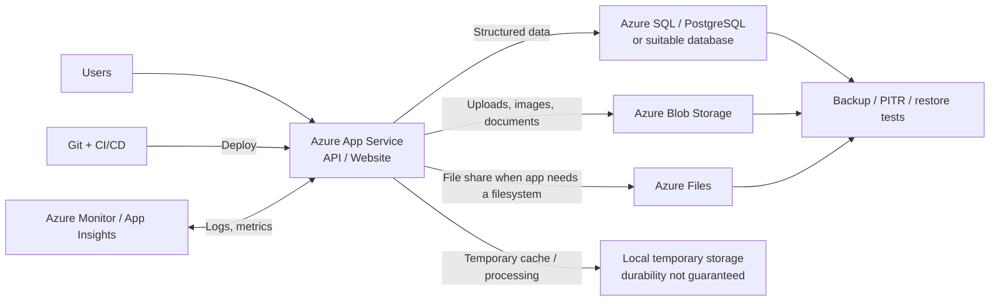

# Application Storage, Backups, and Persistent Data

A website on Azure App Service can run smoothly for months, yet during a new deployment, scale-out, or instance replacement, newly uploaded user photos suddenly vanish. Another team backs up only source code—and only after an incident hits do they discover there is no recoverable backup for database records and attachments. These failures stem from not separating **where the application runs**, **where durable data lives**, and **backup/restore mechanisms**.

In the **CLOUD_PROVIDERS_AZURE** module, you explore Microsoft Azure from subscriptions, resource groups, and Microsoft Entra ID to virtual networking, compute, storage, data, deployment, monitoring, security, and cost control. This lesson belongs to the **Web Applications with App Service** chapter, focusing on using App Service storage areas properly, storing application data outside the runtime, designing backups, and practicing verified recovery.

## 1. Learning objectives

After this lesson, you will be able to:

- Distinguish between **application files**, **temporary storage**, **persistent/shared content**, and **durable business data**.
- Explain what happens to files when App Service restarts, scales out, redeploys, or uses deployment slots.
- Choose **Azure Blob Storage**, **Azure Files**, or a managed database for each kind of data.
- Connect App Service to Azure Storage using **managed identity** and Azure RBAC where supported.
- Understand the benefits and limits of **App Service backup/restore** compared to external data backups.
- Define **RPO/RTO** targets, retention, soft delete, versioning, and recovery workflows.
- Monitor storage quotas, I/O errors, backups, and costs, and run recovery drills.

## 2. App Service is an application runtime platform, not a database

**Azure App Service** provides a managed environment to run web applications or APIs on Windows/Linux with built-in deployment and instance scaling. Each instance has its own OS, app process, filesystem, and platform configuration. Not every writable path on an instance is suitable for holding customer data.

Separate four concepts:

| Data layer | Examples | Where it should be managed |
|---|---|---|
| **Code and deployment artifacts** | JARs, DLLs, static assets, non-sensitive config | Git/CI-CD, artifact registry, deployment package, and App Service content area |
| **Temporary data** | Intermediate processing files, in-progress resized images, rebuildable caches | Short-lived, quota-bounded temporary/local storage |
| **Shared application content files** | Content files that multiple instances must read | App Service persistent/shared content or Azure Files if requirements match |
| **Business data** | User uploads, invoices, transactions, profiles, database records | Azure Blob Storage, Azure Databases, or purpose-built durable storage services |

**Architectural principle:** applications should be able to **replace instances without losing business data**. Code can redeploy from source; uploaded files and business state must have lifecycles independent of App Service instances.



This diagram shows directional guidance. Use only the storage services genuinely needed; a simple app may not need Azure Files, and databases may live in another system.

## 3. Persistent storage and temporary storage in App Service

App Service provides multiple filesystem areas with distinct characteristics. Path names, mount behavior, and quotas can vary across Windows/Linux, container types, and App Service Plans. **Do not treat every disk path visible from code as durable storage.**

### 3.1. HOME / persistent content area

In supported App Service models, the **`HOME`** area holds content preserved across normal app restarts and can be shared across instances of the same app. Common paths include:

- **Windows App Service:** content typically lives under `D:\home` or the equivalent path given by the `HOME` environment variable.
- **Linux App Service:** persistent content is typically mounted at `/home` in supported setups.
- **Linux custom containers:** to persist `/home` using App Service–provided storage, check how **`WEBSITES_ENABLE_APP_SERVICE_STORAGE`** (typically `true` when persistence is enabled), support rules, and actual behavior apply for your container/plan type.

Prefer resolving paths via the `HOME` environment variable rather than hard-coding OS paths. **Do not assume defaults from built-in Linux runtimes apply identically to every custom container.**

Shared content is helpful for files App Service needs to serve or deploy, but should not be treated as an independent business data repository: it carries **quotas**, performance limits, and a lifecycle tied to the App Service/plan, behaving differently from Blob Storage or a database. Never delete an app or change storage settings while unique unbacked-up data still resides there.

### 3.2. Temporary / local storage

Temporary storage holds data that can be regenerated: extracted archives, intermediate files in an image-resizing pipeline, caches, and process scratch data.

- On Windows, temporary/local areas include `D:\local` or paths given by `TEMP`/`TMP`.
- On Linux, directories like `/tmp` are typically used for scratch files depending on the image/container.
- Temporary storage is **not guaranteed to persist** across worker restarts, recycles, host replacements, or scaling, and is generally **not shared consistently** across instances.
- Temporary capacity is bounded and may be shared among apps/processes on the same plan per platform rules.

**Rule:** you may write temporary files during processing, but upload any results that must persist to Blob/Files/database **before** returning a business "completed" status.

### 3.3. Impact of restarts, scaling, and deployments

| Event | Temporary/local data | Supported persistent/shared area | Data outside App Service |
|---|---|---|---|
| Instance restart/recycle | May be lost | Typically preserved per platform mechanics | Unaffected by app restarts |
| Scale out from 1 to multiple instances | Not synchronized across instances | Shareable per supported content model | All instances access via APIs/connections |
| Host/instance replacement | Survival not guaranteed | Follows mount persistence policy | Persists unless explicitly deleted |
| Redeploying code version | Risk of overwrite depending on deploy mode | Depends on deployment policy and paths | Not overwritten by deployment artifacts |
| Deleting or recreating App Service | Not guaranteed to survive | May be lost with resource lifecycle | More independent, still requires RBAC and backups |

This table states **operational principles**, not a guarantee that every App Service path behaves identically. Test specific behavior for your image, container, and deployment mode.

### 3.4. Differences across Windows/Linux and custom containers

Apps using **Run From Package** or immutable content deployments may have a **read-only** application directory. In that mode, writing uploads into the code folder is not only non-durable—it fails immediately. Separate writable data paths from where the package runs.

With **custom containers**, the container's internal filesystem can reset or be replaced whenever the container is replaced. Volume/mount settings determine whether files survive, not whether you named a directory `data` or `uploads`.

## 4. Choosing the right storage type for each application data class

No single storage type is optimal for every need.

| Requirement | Commonly suitable option | Notes |
|---|---|---|
| Images, videos, uploads, exported reports | **Azure Blob Storage** | Accessed via object API/SDK; supports versioning, soft delete, tiering per config |
| Legacy app requiring file-share paths or filesystem ops | **Azure Files** | Evaluate SMB/NFS, mounts, and supported performance/permission models |
| Relational data, transactions, queries, foreign keys | **Azure SQL / Azure Database for PostgreSQL** | Requires dedicated backups/PITR and schema management |
| Sessions or short-lived cache shared across instances | **Distributed cache** such as an appropriate Redis service | Cache is not a sole system of record if loss is unacceptable |
| Logs and telemetry | **Azure Monitor / Application Insights / Log Analytics** | Carries retention and ingestion costs; does not replace data backups |
| Intermediate scratch files, regenerable data | **Temporary local storage** | Must tolerate file loss on restarts/scaling |
| Build artifacts, container images | **Git/CI-CD, registry/artifact store** | Versioned and rolled back independently of user data |

### Why is Blob Storage usually better than `/home/uploads`?

Blob Storage is built for objects with independent lifecycles, concurrent access from many instances, scoped RBAC permissions, supported data-protection features, and clean separation between **app lifecycle** and **file lifecycle**. Using Blob also makes stateless apps, scaling out, and blue-green deployments far smoother.

For example, a learning platform runs 3 App Service instances. When a user uploads `avatar.png`, the API stores it in Blob and saves the **blob name/URI and metadata** in the database. Even if the next request hits a different instance, the app retrieves the right file via the Storage API.

Never store **long-lived SAS URLs** or account keys as primary references in the database; store a durable object identifier and generate short-lived access URLs on demand when needed.

### Azure Files and storage mounts

App Service supports **Azure Storage mounts** for specific scenarios, OSes, plans, and storage types. You can use Azure Files when an app genuinely needs a shared filesystem—for example, reading legacy config files or static assets that are hard to refactor onto an object API.

However, mounting does not turn Azure Files into a database: your app must handle file locks, concurrent writes, network latency, permissions, and connection failures. Never assume every Blob mount offers full traditional local-disk POSIX/SMB semantics. Verify mount support for your exact **App Service OS/plan/storage protocol** before choosing it.

## 5. Designing persistent data across multiple scaled instances

**Stateless compute** does not mean an app has no data; it means critical state lives in dedicated external systems so compute instances can be replaced without losing business state.

A web app architecture might look like:

```text
Client
  |
  v
App Service (instance A / B / C)
  |
  +--> Database: users, orders, file metadata
  |
  +--> Blob Storage: actual files
  |
  +--> Distributed cache: regenerable sessions/cache
  |
  +--> Logs/telemetry: Application Insights
```

**Risks to handle:**

1. Two requests upload the same filename: use unique object keys, conditional writes, or versioning.
2. Database metadata write succeeds while blob upload fails: handle intermediate states, retries/cleanup, or eventual consistency.
3. Blob upload succeeds while database update fails: track orphaned blobs and run controlled cleanup jobs.
4. App returns success before data is durably written: risk losing files if an instance recycles.
5. One instance keeps local sessions: requests hitting another instance lose state; switch to appropriate token cookies or a distributed session/cache store.

For systems needing strong consistency, design explicit workflows and state machines; **never assume Blob Storage and a database share a single ACID transaction**.

## 6. Hands-on: App Service saving files to Azure Blob Storage

**Scenario:** a Java API on App Service must save user uploads into an `uploads` container. Data must survive App Service restarts, redeployments, scale-out, and deployment slot swaps. Instead of storing unique files in `/tmp` or the code directory, the API uses **Azure Blob Storage**.

### Preparing resources

Assume a lab environment with:

| Resource | Illustrative value |
|---|---|
| Resource group | `rg-web-lab` |
| App Service | `web-uploads-demo` |
| Storage account | `stwebuploads01` |
| Blob container | `uploads` |
| App runtime identity | **System-assigned managed identity** |
| Data permission | **Storage Blob Data Contributor** at container scope |

These names are for learning; substitute your organization's real resource names. Before practicing, verify your subscription, identity/role-assignment permissions, and network settings allowing Storage access.

### Step 1. Enable managed identity

In the [Azure portal](https://portal.azure.com/):

1. Open the target App Service.
2. Go to **Identity** and turn on **System assigned**.
3. Save, confirm the identity is created, and note the **Principal ID**.
4. Ensure the Storage account and `uploads` container already exist.

An equivalent Azure CLI approach for environments where you are authorized to modify config:

```bash
az login
az account set --subscription "<subscription-id>"

az webapp identity assign \
  --resource-group "rg-web-lab" \
  --name "web-uploads-demo"

# Read back the managed identity's principal ID
az webapp identity show \
  --resource-group "rg-web-lab" \
  --name "web-uploads-demo" \
  --query principalId \
  --output tsv
```

**Principal ID** is the security principal identifier used for Azure RBAC assignments; do not confuse it with an app registration's client ID or the App Service's resource ID. A system-assigned identity shares the App Service lifecycle; if you delete and recreate the app, plan for a new identity and role assignments.

### Step 2. Grant data permissions at the right scope

To upload blobs, the standard role is **Storage Blob Data Contributor**. Scope it to the **container** rather than the whole storage account to minimize privilege. The operator must hold role-assignment permissions such as Role Based Access Control Administrator or Owner at the appropriate scope.

```bash
PRINCIPAL_ID=$(az webapp identity show \
  --resource-group "rg-web-lab" \
  --name "web-uploads-demo" \
  --query principalId --output tsv)

STORAGE_ID=$(az storage account show \
  --resource-group "rg-web-lab" \
  --name "stwebuploads01" \
  --query id --output tsv)

CONTAINER_SCOPE="$STORAGE_ID/blobServices/default/containers/uploads"

az role assignment create \
  --assignee-object-id "$PRINCIPAL_ID" \
  --assignee-principal-type ServicePrincipal \
  --role "Storage Blob Data Contributor" \
  --scope "$CONTAINER_SCOPE"

# Inspect assignments at scope, including inherited roles
az role assignment list \
  --scope "$CONTAINER_SCOPE" \
  --include-inherited \
  --output table
```

Newly assigned roles may take time to propagate before Blob requests succeed. **Azure RBAC Contributor** at the resource group level does not automatically grant read/write access to Blobs via Microsoft Entra ID; separate the management plane from the data plane.

### Step 3. Upload using the Java SDK

In a Java app, use **`azure-identity`** and **`azure-storage-blob`** at organization-supported SDK versions. The example below demonstrates handling a temporary scratch file and persisting the payload to Blob. It creates a sample text file, not a production internet file-upload endpoint.

```java
import com.azure.identity.DefaultAzureCredentialBuilder;
import com.azure.storage.blob.BlobClient;
import com.azure.storage.blob.BlobServiceClient;
import com.azure.storage.blob.BlobServiceClientBuilder;

import java.nio.charset.StandardCharsets;
import java.nio.file.Files;
import java.nio.file.Path;
import java.util.UUID;

public class DurableUploadExample {
    public static void main(String[] args) throws Exception {
        String storageAccount = "stwebuploads01";
        String containerName = "uploads";
        String blobName = "samples/" + UUID.randomUUID() + ".txt";

        BlobServiceClient service = new BlobServiceClientBuilder()
            .endpoint("https://" + storageAccount + ".blob.core.windows.net/")
            .credential(new DefaultAzureCredentialBuilder().build())
            .buildClient();

        BlobClient blob = service
            .getBlobContainerClient(containerName)
            .getBlobClient(blobName);

        // Temporary file serves only the current processing step.
        Path temporaryFile = Files.createTempFile("web-upload-", ".txt");
        try {
            Files.writeString(temporaryFile, "Demo App Service upload",
                    StandardCharsets.UTF_8);

            // Do not overwrite if a blob with the same name already exists.
            blob.uploadFromFile(temporaryFile.toString(), false);

            // Record business metadata only after upload succeeds.
            System.out.println("Uploaded blob: " + blobName);
        } finally {
            Files.deleteIfExists(temporaryFile);
        }
    }
}
```

**Key points in this example:**

- `DefaultAzureCredential` uses developer credentials locally and managed identity in Azure when configured. **The local principal differs from App Service's identity**, so always test in the deployed environment.
- A temp file is created for processing, yet the durable output is uploaded as a Blob Storage object.
- UUID-based blob names prevent collisions when multiple instances write concurrently. For business data, define clear naming conventions, versioning, or conditional write rules.
- `uploadFromFile(..., false)` avoids overwriting an existing file per the sample API. In production, handle existing objects and failed uploads explicitly.
- Real uploads must validate content types, sizes, and antivirus/malware scanning per policy and upload quotas; never trust client-supplied filenames.
- Never store account keys in source code. When using a user-assigned identity, configure the exact client ID on `DefaultAzureCredential` to avoid identity ambiguity.

### Step 4. Verify networking and access

If the Storage account uses a **firewall or private endpoint**, ensure App Service has a network path to the Blob endpoint and proper DNS resolution. **Holding an Azure RBAC role will not bypass a firewall.** With private endpoints, evaluate App Service VNet integration, routing, private DNS, and outbound rules.

If requests return `403`, inspect in order: active identity, role/scope, propagation delay, public network access, DNS, and network routing. Never work around it by granting Subscription Owner or opening public Storage access unconditionally.

## 7. Mounting Azure Files to App Service when a filesystem path is required

Not every app easily migrates from file APIs to a Blob SDK. Some legacy apps require a directory hierarchy and file read/write operations at a stable path. Where **OS, plan, and storage type** allow, App Service supports configuring **Azure Storage mounts** in the Portal so the app sees shared storage at a mount path.

Design workflow:

1. Create an Azure Files share with appropriate capacity, performance tier, and data protection.
2. Open App Service → **Configuration** or **Path mappings / Azure Storage mounts** per current UI.
3. Add a mount, pick the supported storage account and file share, and specify a **mount path** that does not collide with system directories.
4. Configure the authentication method supported by the feature, protecting credentials/keys if required; do not assume mounts use managed identity across all protocols.
5. Test reading/writing via the mount, restarting, scaling out, and accessing from multiple instances.
6. Configure **Azure Files share backups** independently of App Service backups, with retention and real restore tests.

### Shared filesystem risks

| Scenario | Risk | Mitigation |
|---|---|---|
| Two instances edit the same file | Overwrites or inconsistent file state | Implement locking/atomic writes or migrate data model |
| Azure Files becomes unreachable | App read/write failures, timeouts | Bounded retries, alerts, failover plan |
| Accidental file deletion | Data loss on shared file share | Snapshots/backups as supported, least privilege |
| File share grows unchecked | Rising costs and quota hits | Metrics, lifecycle rules, controlled cleanup |
| App deployed to another slot | Pointing to wrong environment or share mount | Verify slot settings and test swaps/rollbacks |

**Never store critical transactional state in a shared file when database-level consistency is required.** Azure Files provides shared file access over supported protocols; it does not replace database transactions.

## 8. Understanding App Service backup/restore properly

App Service offers **backup and restore** features depending on **plan/tier, app type, OS, and feature version**. Both **automatic backups** and **custom backups** exist in supported setups. Verify actual availability in the Portal/service docs before designing RPO/RTO around them.

### What can an App Service backup protect?

Depending on backup mode, version, and configuration, a backup can include **site content**, certain **app configurations**, and—where explicitly supported and configured—**linked database data**.

However, **never assume** an App Service backup covers everything:

- Data in Azure Blob Storage, mounted Azure Files shares, or external storage accounts.
- Arbitrary Azure SQL, PostgreSQL, MySQL, or external databases the app connects to.
- Key Vault secrets, identities/role assignments, and network configs of external resources.
- Full log history, telemetry, deployment pipelines, or artifacts stored externally.
- Temporary/local data already lost before the backup ran.

For **Azure SQL or PostgreSQL**, configure and test the **database service's own automated backups and point-in-time restore (PITR)**. For **Blob Storage**, use its own data protection capabilities such as versioning, soft delete, or supported backup/PITR. For **Azure Files**, use share snapshots/backups.

### Automatic backup vs. custom backup

| Aspect | Automatic backup | Custom backup |
|---|---|---|
| How it works | Platform maintains backups per supported tier/feature | Operators schedule or trigger backups per supported mode |
| Configuration | May be enabled automatically on eligible App Service Plans | May require selecting a storage container, auth, and backup schedule |
| Retention | Governed by platform policy and feature limits | Governed by supported/configured retention rules |
| Storage location | Managed by the platform backup feature | May involve a chosen Azure Storage account |
| Purpose | Recover app content/config within feature scope | Control schedule and backup artifacts for planned recovery |

**Backup limits** can cover maximum size, site type, deployment method, or supported database engines. These limits vary by plan and feature version; **never put a fixed backup size or schedule into a design without verifying** it on your real App Service.

## 9. Creating a backup and testing restore in Azure Portal

Practice only on a **test app** or an environment you are authorized to manage. Restoring can overwrite target content/config and cause downtime.

### Step 1. Verify backup capability

1. Open the App Service in the [Azure portal](https://portal.azure.com/) and confirm subscription/resource group.
2. Check the **App Service Plan**, OS, and deployment method.
3. Locate **Backups** or the Portal's backup feature.
4. Check whether backups are supported for the current plan/OS; if not, protect source code, config, and external data directly instead of assuming App Service backups always exist.
5. Document which data is covered and which sources **are excluded from the backup**.

### Step 2. Create or inspect a backup

1. With supported **automatic backups**, inspect the backup list and retention settings.
2. With supported **custom backups**, configure destination storage and a schedule or manual backup per Portal prompts, grant required permissions, and select target items.
3. Monitor status and wait for explicit completion rather than assuming clicking **Backup** succeeded.
4. Record the UTC timestamp, backup type, result, and protected scope.
5. If backups rely on a Storage container/access mechanism, verify networking, auth, and credential/token lifetimes.

**Security note:** some backup flows use different auth or network paths from the app itself. Never disable Storage firewalls or share account keys just because a backup failed; check the exact requirements of the backup feature in use.

### Step 3. Run a safe restore drill

1. Pick a lab app backup with a clear timestamp.
2. Prefer **restoring into a separate test app/environment** when supported by features and quotas, rather than overwriting production directly.
3. Select which items to restore: content, configuration, or supported objects.
4. Follow the Portal restore workflow and wait for completion.
5. Run smoke tests: endpoints respond, app version matches, identities/connections work, and sample data is readable.
6. Compare against RPO/RTO targets, recording total elapsed time and manual follow-up steps.

A backup only counts if it **restores cleanly and the app works afterward**. Restoring the app while the database remains on a newer schema or user files remain unrecovered leaves the system inconsistent even if the website boots.

## 10. Designing RPO, RTO, and backup policies

Two metrics to define **before an incident**:

- **Recovery Point Objective (RPO):** maximum acceptable data loss measured in time. A 1-hour RPO means the business must prepare to recover with no more than roughly one hour of lost data per target.
- **Recovery Time Objective (RTO):** maximum target time for the service to return to acceptable operation after an incident.

**Example:** an e-commerce site requires a **15-minute** RPO for orders and a **2-hour** RTO for the ordering service. Product images may tolerate a longer RPO if regenerable from source, whereas payment transactions cannot arbitrarily lose data.

A database snapshot or backup taken once every 24 hours **cannot meet a 15-minute RPO** if it is the sole protection. Likewise, hourly backups that take 8 hours to restore fail a 2-hour RTO.

### Building a protection matrix by data type

| Data | Primary risk | Protection controls to evaluate | Verification |
|---|---|---|---|
| Source code and artifacts | Bad deploy, pipeline loss | Git, versioned artifacts, release/rollback | Redeploy app from approved version |
| App Service configuration | Bad app settings or connection edits | IaC, versioned config, supported backups | Recreate test environment from IaC |
| Blob uploads | Accidental delete/overwrite, ransomware, account loss | Blob soft delete, versioning, supported backup/PITR | Restore sample files and verify contents |
| Azure Files shares | File edits/deletions on share | Azure Files snapshots/backups per supported mode | Restore files/directories |
| Databases | Deleted rows, bad migrations, logic bugs | Database backups/PITR, appropriate replication | Point-in-time restore and schema check |
| Secrets/credentials | Lost keys or access | Key Vault protection, rotation lifecycle, recovery plan | Confirm identity access still works |
| Logs/audits | Lost forensic trail | Diagnostic settings, retention, exports as needed | Query logs across target time range |

*Retention* windows must cover delayed incident detection. Retaining backups too briefly can leave only backups containing corrupted data; retaining too long raises costs and unnecessary data-retention risk.

### Estimating RTO

A simple planning formula:

\[
\text{Actual RTO} \approx \text{detection} + \text{decision} +
\text{infra recovery} + \text{data recovery} + \text{verification}
\]

Example: detection/coordination 20 min, app provisioning 15 min, database restore 45 min, testing 30 min. Total **110 minutes**, before unexpected delays. Against a 2-hour RTO target, only 10 minutes of buffer remains; run drills to verify and shorten bottlenecks.

RPO and RTO are **business targets**, not automatic Azure guarantees per app. Tie them directly to storage design, backups, on-call staff, and real restore drill results.

## 11. Protecting data in Azure Storage and databases

### 11.1. How do soft delete, versioning, snapshots, and backups differ?

| Mechanism | Primary problem solved | Do NOT confuse with |
|---|---|---|
| **Blob soft delete** | Recover deleted blobs within configured retention | Independent backup isolated from the whole storage account |
| **Blob versioning** | Preserve prior versions on updates/overwrites | Full multi-service restore to a consistent point in time |
| **Blob snapshots** | Capture point-in-time state of a blob at creation | Backing up external services |
| **Blob point-in-time restore/backup** | Restore within supported feature capabilities and rules | Default enabled on every account or data tier |
| **Azure Files share snapshots/backup** | Protect file share content by schedule/policy | App Service backups |
| **Database automated backup/PITR** | Restore database state to a target timestamp | Files stored inside App Service |
| **Geo-redundant storage** | Maintain regional replicas for durability/availability | Protection against synchronized deletes or bad writes |

**Replication does not replace backups.** If the app accidentally deletes a file or writes bad data, that change replicates to secondary copies. You need a way to **recover an earlier version or pre-incident point in time**, with governed admin permissions and retention.

### 11.2. Data access permissions

Grant permissions following **least privilege**:

- Static image reader app: typically needs only **Storage Blob Data Reader** on the relevant container.
- Upload API: **Storage Blob Data Contributor** on the uploads container, not across the subscription.
- Backup tooling: required read/write/restore permissions; separate backup identities from app identities where security requires it.
- Database services: dedicated identities/permissions; never substitute Storage Blob RBAC for SQL permissions.

Prefer **managed identities** and Entra authentication supported by the service. Never place storage account keys or long-lived SAS URLs in code, committed config files, or logs. When generating SAS tokens for download links, use minimal permissions and short expirations.

**Access permissions and networking are separate layers:** an identity with the right role can still fail to connect due to firewalls, VNet integration, DNS, or private endpoints. Conversely, open network reachability does not grant permission to read data.

### 11.3. Guarding against accidental deletion and config tampering

For critical data, consider:

1. Enabling soft delete/versioning or backups before go-live.
2. Separating the app's **data write** permissions from administrators' **protection policy delete** permissions.
3. Restricting who can shorten retention, delete accounts, or alter backup policies.
4. Monitoring Activity Logs, Storage logs, and database logs as supported.
5. Testing recovery of deleted files and mis-updated database records in a test environment.

Protection features carry limits by account kind, access tier, region, API, and backup mode. Check real limits before committing to recovery targets.

## 12. Deployment slots, CI/CD, and persistent data

**Deployment slots** let you validate a release on a separate slot/hostname before **swapping** into production where supported. They reduce code deployment risk—they are **not** a business data backup solution.

Key distinctions to remember:

- **Code/artifacts** move per slot and swap operations.
- **App settings/connection strings** can be marked **deployment slot settings** (*sticky*) per platform rules to keep environment settings pinned to a slot.
- **External databases, Blobs, and file shares** live independently of swaps; if staging and production point to the same data, staging can **alter production data** before a swap.
- **Schema migrations** and API compatibility require separate planning. Rolling back code does not roll back databases.

### Example design mistake

A team creates a `staging` slot, copies the production connection string into staging, and runs a "clean up old records" test job. The job deletes live production data because both slots point at one database.

**Better design:** use separate staging databases/containers and keep connection settings sticky per environment; when realistic data is required for testing, use scrubbed/anonymized copies with strict access limits and explicit cleanup schedules.

### Safe deployment plan

1. Deploy the new version to staging and verify health endpoints.
2. Verify slot settings, identities, Storage accounts, and database connections point to the right environment.
3. For database migrations, apply **backward-compatible / expand-and-contract** steps backed by a backup/restore plan.
4. Swap per approved process; monitor error rates, latency, and database behavior.
5. On failure, roll back code where supported; **never assume rolling back code restores prior data**.

## 13. Monitoring storage usage, errors, and backups

A solid storage strategy must be **observable**. Without metrics, an app can stop writing files because temporary storage filled up, or backups can silently fail for weeks.

| Source | What to watch | Action when abnormal |
|---|---|---|
| App Service metrics | Filesystem usage, CPU/memory, HTTP errors, response time (per supported metrics) | Check quotas, overload, app settings |
| Guest/app logs | `ENOSPC`, `IOException`, upload timeouts | Distinguish full temp disk, broken mounts, or Storage/network failures |
| Azure Blob Storage metrics/logs | Transactions, ingress/egress, latency, 4xx/5xx, capacity | Inspect RBAC, firewalls, throttling, and data growth |
| Azure Files metrics/logs | Share capacity, latency, access errors | Inspect mounts, protocols, permissions, and networking |
| Database metrics/backups | Storage, connection counts, backup/restore points, backup status | Scale storage or investigate backup failures |
| App Service backup view | Timestamps, backup status, retention | Alert on missed schedules or failures |
| Azure Monitor / Application Insights | Exceptions, traces, request correlation | Separate app bugs from downstream dependency errors |

Available App Service metrics vary by OS, plan, and app type. **Never assume App Service filesystem quotas and external Storage account capacity are the same metric.** Set separate alerts for each resource.

### Azure CLI: inspecting the app and supported metrics

The commands below read management metadata only; avoid printing all app settings to prevent accidentally exposing sensitive values.

```bash
az login
az account set --subscription "<subscription-id>"

APP_ID=$(az webapp show \
  --resource-group "rg-web-lab" \
  --name "web-uploads-demo" \
  --query id --output tsv)

# Verify app, runtime type, and state
az webapp show \
  --resource-group "rg-web-lab" \
  --name "web-uploads-demo" \
  --query "{name:name,kind:kind,state:state,hostname:defaultHostName}" \
  --output json

# List metric names actually published by Azure Monitor
az monitor metrics list-definitions \
  --resource "$APP_ID" \
  --output table
```

Once you know supported metric names, configure charts and alerts over time. A single point-in-time storage check cannot prove capacity will hold during peak season.

### Logs and retention

Application logs on local filesystems can rotate or disappear with instance lifecycles depending on configuration. In production, use **Application Insights**, diagnostic settings, and dedicated log sinks. If logs contain personal data, sensitive payloads, or tokens, redact/filter them, restrict read permissions, and enforce retention policies.

Never treat logs as a database backup: logs help investigate and replay events, not reliably reconstruct full transactional business state.

## 14. Recovery playbook: new code introduces a bug and corrupts data

**Context:** after deploying a new release, the orders API fails; some database rows were updated incorrectly and several invoice files were overwritten.

### Step 1. Confirm the incident and contain damage

- Open an incident; log the UTC timestamp, deployed version, environment, affected data types, and customer impact scope.
- Stop the bad write path per approved procedures—disable the feature flag or divert traffic if architecture permits.
- Preserve logs and evidence before making sweeping configuration changes.

### Step 2. Assess each data source

| Component | Investigation question | Options to evaluate |
|---|---|---|
| App Service artifact | Which code version caused the bug? | Roll back deployment version or slot |
| Orders database | Which rows changed, and since when? | Database PITR or selective recovery per runbook |
| Invoice Blobs | Which objects were overwritten or deleted? | Versioning, soft delete, supported backup/PITR |
| App settings | Did connections point to the wrong DB/Storage? | IaC/change history, slot settings, and audits |
| Temp files | Was unique data not yet moved to durable storage? | Assess potential data loss; do not assume recoverability |

### Step 3. Restore in an isolated environment

1. Select a restore point matching impact scope and RPO.
2. Restore the affected database or storage data into a safe isolated environment where feasible.
3. Diff before/after data to avoid overwriting valid transactions that occurred after the incident start.
4. Restore the known-good code release and settings, confirming backward compatibility.
5. Run smoke tests and verify sample transactions and files with known hashes or metadata.

### Step 4. Restore traffic and close post-incident controls

Resume normal traffic only once data owners sign off on validation checks. Monitor error rates, latency, database consistency, and Storage operations. Record actual recovery time vs. RTO and actual data loss vs. RPO, then update runbooks, deployment gates, and retention policies.

**Critical mistake:** merely clicking "Swap back" to restore old code and closing the incident while the database or Blob Storage still holds corrupted data. **Code rollback** and **data restoration** are two independent decisions that must be coordinated.

## 15. Cost optimization and lifecycle management

Storing data outside App Service improves scalability and recovery, while adding costs that require governance.

- **App Service Plan:** compute and tier fees; content/temp areas carry plan-based quotas.
- **Blob Storage:** capacity, access tiers, transactions, retrieval/rehydration, and network egress per config.
- **Azure Files:** provisioned/used capacity, transactions, snapshots, and backups per share type.
- **Database:** compute, storage, backup retention, and HA/geo-replication features.
- **Monitoring and backups:** log ingestion, retention, backup vaults, restore operations, and test environments.

To optimize:

1. Classify data by value, access frequency, retention duration, and compliance rules.
2. Apply Blob lifecycle/tiering rules sensibly; avoid moving hot frequently accessed files to tiers with unsuitable retrieval latency or fees.
3. Set retention policies on backups, logs, and file versions; monitor soft-deleted data still consuming capacity.
4. Track capacity per app/container so one team does not create surprise bills for another.
5. Clean up lab environments, yet **never delete a storage account merely because you deleted an App Service** if data is still needed.

Actual costs depend on region, tier, access patterns, and enabled protection features. Check live pricing and Cost Management for your active subscription instead of hard-coding unit rates in designs.

## 16. Hands-on exercises and self-check

### Exercise A: Classify data

A website handles four file types: customer-uploaded profile avatars, access logs, temporary scratch files during PDF generation, and application source code. Choose the right home for each.

**Hint:** avatars → Blob Storage; logs → telemetry/Log Analytics per policy; intermediate PDF scratch files → temp, durable outputs → Blob; source code → Git/artifact pipeline. Never use temp storage as the sole store for avatars.

### Exercise B: Files vanish on scale-out

An app runs on two instances. A user uploads a file to instance A, then a download request lands on instance B and returns `404`. What is the likely cause?

**Hint:** the file was saved to instance A's local filesystem instead of shared storage or Blob. Move files to durable external storage, update metadata, and verify consistency.

### Exercise C: Is App Service backup enough?

An API runs on App Service, storing orders in PostgreSQL and invoices in Blob Storage. Ops enabled only App Service backups without checking database or Blob backups. What is missing?

**Hint:** you need PostgreSQL backups/PITR and independent Blob data protection/restore plans, plus coordinated restore testing to meet RPO/RTO.

### Exercise D: Upload permissions

An API uses a system-assigned managed identity granted **Storage Blob Data Reader** on the `uploads` container. Blob writes fail with `403 AuthorizationPermissionMismatch`. What should you check?

**Hint:** read permissions do not allow writes; assign a write-capable data role such as Storage Blob Data Contributor at minimal scope, while verifying principal, propagation, networking, and endpoint.

### Exercise E: Calculate RTO

An incident is detected after 15 minutes, restore prep takes 20 minutes, database recovery takes 50 minutes, and smoke testing takes 25 minutes. What is the total duration? Does it meet a 90-minute RTO target?

**Hint:** `15 + 20 + 50 + 25 = 110 minutes`. It misses the 90-minute target; streamline procedures or recovery mechanisms.

### Exercise F: End-to-end restore drill

In an authorized lab environment:

1. Deploy a sample web app and enable managed identity.
2. Create a Blob container for test files and assign Blob Data Contributor at container scope.
3. Upload a sample file, recording object name, size, and hash.
4. Restart the app and test scaling if permitted; confirm the file remains readable from Blob.
5. Create an App Service backup via a supported feature and record exactly what it covers.
6. Restore the app into a test environment if feasible, while restoring Blob data via its independent protection mechanism.
7. Cross-check code version, config, and data, measure actual RPO/RTO, and clean up lab resources safely.

## 17. Pre-production checklist for App Service

### Storage and data design

- [ ] Clearly separated code, temporary files, shared content, uploads, and databases.
- [ ] Business data never relies on local temp or replaceable container filesystems.
- [ ] Durable uploads are saved to Blob Storage or suitable storage with metadata and naming rules.
- [ ] If using Azure Files mounts, verified OS/plan/protocol support, permissions, and concurrent write behavior.
- [ ] Tested restarts, redeployments, scale-out, and slot swaps to confirm no data loss or mispointing.

### Security

- [ ] App uses managed identity and minimally scoped Azure RBAC data roles wherever possible.
- [ ] Credentials, account keys, and SAS tokens are protected and absent from source code and logs.
- [ ] Storage firewalls, private endpoints, VNet integration, and DNS tested from the real runtime environment.
- [ ] Least privilege enforced across operators, app identities, and backup/restore identities.

### Backup and recovery

- [ ] RPO/RTO targets approved by system owners for each data class.
- [ ] Verified actual availability, limits, and scope of App Service backups for your plan/OS.
- [ ] Separate backups/PITR configured for databases and data protection policies for Blob/Files.
- [ ] Backups have appropriate retention, failure alerts, and protected storage destinations.
- [ ] Restore tested in a safe environment with measured duration and integrity checks.
- [ ] Recovery playbook coordinates code, configuration, databases, and files in a consistent order.

### Operations and cost

- [ ] Metrics/alerts active for capacity, I/O errors, Storage 4xx/5xx, backup status, and app exceptions.
- [ ] Logging and retention configured properly without leaking secrets into logs.
- [ ] Forecasted costs for App Service Plan, Storage, databases, backups, networking, and monitoring.
- [ ] Scheduled periodic recovery drills, permission reviews, and rollback tests.

## Conclusion

On Azure App Service, **durable data must never be equated with anywhere the app can write a file**. Temporary storage is strictly for regenerable scratch data; the `HOME`/shared content area has its own role and limits; while user files, transactional records, and persistent state belong in Blob Storage, Azure Files, or an appropriate database. Alongside decoupling data from compute instances, systems require **independent backups per data source**, clear RPO/RTO targets, secure access controls, and **verified restore drills**. That foundation lets applications redeploy, scale, and recover from incidents without losing critical data.
