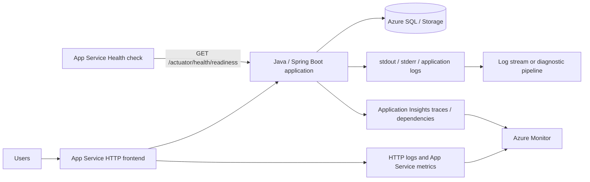
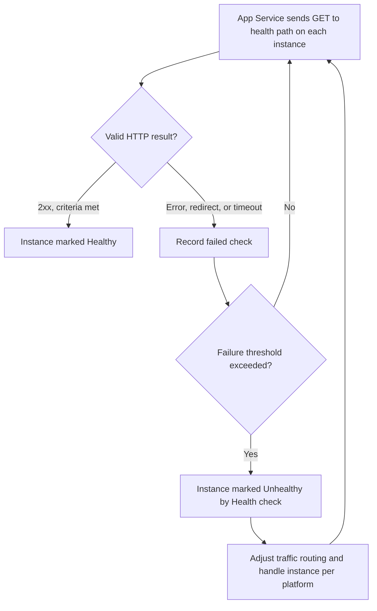
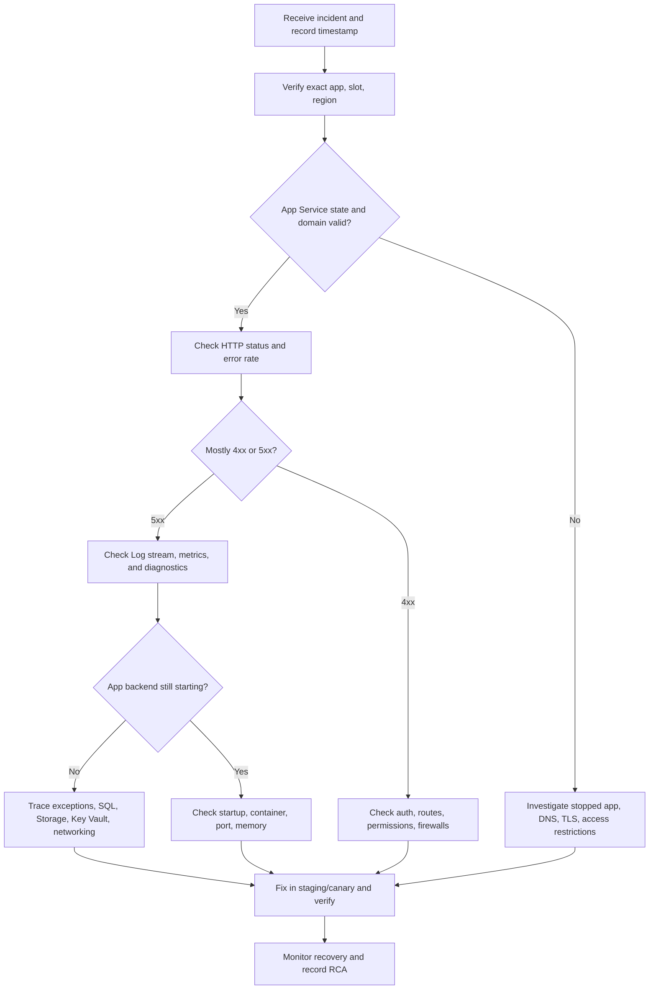

# Log Stream, Health Checks, and App Service Troubleshooting

A web application deployed to **Azure App Service** may show a *Running* state while users still hit HTTP 500, 502, or 503 errors, slow responses, or failed database connections. Resource state tells you the platform allocated and started the app at a basic level—it **does not prove the application is serving business traffic properly**.

To investigate failures effectively, combine three capabilities:

- **Log stream:** observe application or container output in near real time as requests or errors occur.
- **Health check:** give App Service an HTTP path to evaluate whether each instance is ready to accept traffic.
- **Diagnostics:** use **Diagnose and solve problems**, Azure Monitor, Application Insights, deployment logs, and config/network checks to isolate root cause.

This lesson belongs to the **Web Applications with App Service** chapter in the Microsoft Azure module. It connects subscriptions, resource groups, Microsoft Entra ID, virtual networks, compute services, Blob Storage, databases, monitoring, security, and cost control. Examples focus on Java/Spring Boot applications, though the observability and troubleshooting principles apply equally well to .NET, Node.js, Python, and containers depending on supported App Service features.

> **Scope:** Commands in this lesson are examples meant for lab resources or authorized environments. Never turn on logs containing sensitive details, change health check settings, or restart production apps without assessing impact and holding proper authorization.

## Learning objectives

After this lesson, you will be able to:

1. Distinguish between application logs, web server/HTTP logs, container console logs, platform logs, metrics, and distributed traces.
2. Enable or view **Log stream** in the Azure Portal and use the Azure CLI to observe an application.
3. Design a **readiness/health** endpoint that returns accurate, lightweight responses without leaking data.
4. Configure App Service **Health check** and understand its impact across multiple instances, scale-out, and traffic routing.
5. Use **Diagnose and solve problems** to spot anomaly signals while still verifying against logs and metrics.
6. Analyze failed requests using **Application Insights** and Azure Monitor Logs when integrated.
7. Separate application, deployment, resource, networking, DNS, TLS, and data-dependency failures.
8. Build runbooks for handling 5xx spikes, latency, startup failures, or failed health checks.
9. Choose logging modes, retention, sampling, and alerts to support operations without runaway costs.

## 1. Observability model for an App Service application

Suppose an ordering system runs a web frontend on App Service calling a Java API and Azure SQL Database over a controlled network.



A failing request leaves signals across different layers:

| Layer | Signals | Question answered |
|---|---|---|
| **App Service platform** | Site state, restarts, events, instances, HTTP 5xx | Is the app running, recycling instances, or hitting resource limits? |
| **Web/HTTP server** | Method, URL path, status, latency, connections | Did the request reach the frontend, and which status did it return? |
| **Java application** | Exception logs, stack traces, startup, business events | Which piece of code failed, and on which request? |
| **Dependencies** | SQL timeouts, 429s, Storage 403s, DNS, TLS | Did the failure happen when calling an external service? |
| **Health check** | Per-instance readiness status | Is the instance healthy enough to take new requests? |
| **Traces/telemetry** | Request traces, dependency calls, correlation | Which services did a request traverse, and where was time spent? |

Importantly, **never rely on a single signal alone**. One `ERROR` log line might affect only one request; an App Service showing Running might fail for every user; a health endpoint returning HTTP 200 does not guarantee checkout works.

## 2. What is Log stream—and what is it not?

**Log stream** is a near-real-time view of log messages surfaced by App Service. While reproducing a bug, operators can open Log stream, send a controlled test request, and watch matching logs immediately.

Example Java application log output:

```text
2026-11-20T08:00:01Z INFO  order-api request_started trace_id=abc123 path=/api/orders
2026-11-20T08:00:02Z ERROR order-api sql_timeout trace_id=abc123 elapsed_ms=30000
2026-11-20T08:00:02Z INFO  order-api request_completed trace_id=abc123 status=503
```

Using `trace_id`, all three log lines tie back to one request. This is simulated sample data, not logs captured from a live App Service.

### Log stream vs. long-term log storage

| Mechanism | Best used for | Limitations |
|---|---|---|
| **Log stream** | Live output viewing and immediate incident reproduction | Not a historical archive with retention or full querying |
| **Application logging (filesystem)** | Capturing app logs inside supported App Service environments | Bounded capacity, lifecycle, and retention; not for long-term auditing |
| **Container console logs** | Viewing container `stdout`/`stderr` | Quality depends on the app logging properly to console |
| **HTTP/web server logs** | Analyzing status codes, URLs, latency, requests | Lacks internal Java root-cause stack traces |
| **Diagnostic settings → Log Analytics / Storage / Event Hubs** | Centralizing logs, historical querying, retention, and export | Requires configuring categories, destinations, and carries storage/ingest fees |
| **Application Insights** | Requests, dependencies, exceptions, distributed traces | Depends on instrumentation, sampling, and telemetry settings |

**Never conclude "the app has no errors" just because Log stream is empty.** You may not have enabled the right log type, the app may not write to stdout/stderr, you may be watching the wrong slot or instance, the pipeline may not be active, or the crash occurred before logging initialized.

### Log types differ by OS and runtime

App Service supports Windows, Linux built-in runtimes, and custom containers with differing log mechanics:

- **Windows App Service:** offers application logging, web server logging, detailed error messages, and failed request tracing per product features.
- **Linux built-in runtime:** the app must write messages to console or App Service–collected logging channels; certain Windows options do not apply.
- **Linux custom container:** container `stdout`/`stderr` logs are typically primary; inspect container logging config and startup state.
- **Application Insights:** an additional telemetry stream; messages in Application Insights do not automatically appear in Log stream.

Menu names and options vary by OS, SKU, image type, and Portal version. Enable only log categories supported by your actual environment.

## 3. Enabling and viewing Log stream in Azure Portal

Basic hands-on workflow:

1. Open **Azure Portal → App Services** and select the target web app.
2. Confirm **subscription, resource group, app name, deployment slot**, and environment (dev/staging/production).
3. Open **Monitoring → App Service logs** (or equivalent logging blade).
4. Enable **Application logging (Filesystem)** if supported by your runtime/OS, or appropriate **container logging** for custom containers.
5. Pick an appropriate log level if prompted. In production, prefer `Information`, `Warning`, or `Error` per need rather than continuous verbose logging.
6. Save settings, confirm the update notification, and check logging status.
7. Open **Monitoring → Log stream**.
8. Send a test request to an authorized endpoint and watch the log lines and timestamps.
9. Re-check slot name, instance, request ID, and log level if expected lines do not appear.

Some filesystem logging options are designed for **short-term troubleshooting** and automatically turn off or age out per platform rules. For historical retention, configure **diagnostic settings** or Application Insights/Log Analytics separately.

### Do not leave verbose logging on indefinitely

`Debug` or `Trace` levels can generate huge log volumes, spiking disk I/O and ingestion bills while risking logging payloads, tokens, or personal data. When enabling verbose logging:

- Define the exact symptom and observation window.
- Enable only for the approved timeframe.
- Mask secrets and PII.
- Restore the baseline log level once investigation ends.
- Record who made the change and why.

## 4. Viewing logs with Azure CLI

In Azure Cloud Shell (Bash) or a signed-in Azure CLI terminal:

```bash
az account show --output table
az account set --subscription "<SUBSCRIPTION_ID>"

RG="<RESOURCE_GROUP>"
APP="<APP_SERVICE_NAME>"
```

Do not replace placeholders with a production app without authorization and an active investigation workflow.

### Inspect basic app info

```bash
az webapp show \
  --resource-group "$RG" \
  --name "$APP" \
  --query "{name:name,state:state,kind:kind,defaultHostName:defaultHostName,httpsOnly:httpsOnly,serverFarmId:serverFarmId}" \
  --output json
```

This command is **read-only**, identifying the app, state, and App Service Plan. State `Running` is a resource-management indicator, not an application health check.

### Enable application logging where supported

```bash
az webapp log config \
  --resource-group "$RG" \
  --name "$APP" \
  --application-logging filesystem \
  --level information
```

For Linux custom containers, inspect `--docker-container-logging` or the container logging options supported by your Azure CLI/runtime version. Never apply Windows-only flags across every Linux/container app.

### Live streaming

```bash
az webapp log tail \
  --resource-group "$RG" \
  --name "$APP"
```

Open one terminal to stream logs, and use another terminal or authorized client to call a test endpoint. Stop streaming with `Ctrl+C` when finished; that stops only **the log tail client**, not the web app.

If no logs appear, check:

- Is application logging / container logging enabled properly?
- Does the app actually write to `stdout`/`stderr` or a collected log channel?
- Did the request hit the right hostname and slot?
- Which instance/replica handled the request?
- Do both the CLI and service support streaming in that environment?
- Is a separate diagnostic pipeline sending logs only to Log Analytics?

**Slot note:** when an app has deployment slots, pass `--slot <SLOT_NAME>` to supported CLI commands to avoid mixing up production and staging.

### Download logs for investigation

Where supported by App Service type and version:

```bash
az webapp log download \
  --resource-group "$RG" \
  --name "$APP" \
  --log-file "./appservice-diagnostics.zip"
```

This downloads diagnostic files locally. Logs may contain sensitive details; store them in a protected folder and never share them broadly. Downloaded contents depend on OS, enabled logs, and App Service features; do not treat the ZIP as a full mirror of Azure Monitor logs.

## 5. Good logging practices for Java/Spring Boot apps

Applications should log to **`stdout`/`stderr`** or a platform-supported logging channel, especially in containers. Java apps typically use SLF4J with Logback/Log4j2 or the framework's logger.

Spring Boot example:

```java
import org.slf4j.Logger;
import org.slf4j.LoggerFactory;
import org.springframework.http.ResponseEntity;
import org.springframework.web.bind.annotation.GetMapping;
import org.springframework.web.bind.annotation.PathVariable;
import org.springframework.web.bind.annotation.RestController;

@RestController
public class OrderController {
    private static final Logger LOG =
        LoggerFactory.getLogger(OrderController.class);

    @GetMapping("/api/orders/{id}")
    public ResponseEntity<String> findOrder(
            @PathVariable String id) {

        LOG.info("event=order_lookup_started order_id={}", id);

        // Illustrative read operation; real apps need service/data layers.
        String result = "order:" + id;

        LOG.info("event=order_lookup_completed order_id={}", id);
        return ResponseEntity.ok(result);
    }
}
```

This snippet illustrates logging only; place it inside a Spring Boot project with web and SLF4J dependencies. Never log order IDs if they constitute sensitive data in your domain; substitute anonymized IDs or approved correlation IDs.

### What should you log?

- Consistent **timestamps**, preferably UTC.
- **Log level** and component/service name.
- **Request ID / trace ID** to correlate requests across services.
- Stable **event names**, e.g., `payment_retry`, `sql_timeout`.
- **Duration** and item counts when useful.
- **Exception types** and stack traces on genuine errors without swallowing root details.

### What should you NEVER log?

- Passwords, access tokens, refresh tokens, SAS URLs, storage account keys, or secret-bearing connection strings.
- Full HTTP `Authorization` headers or login cookies.
- Personal/sensitive data unnecessary for operations.
- Uncontrolled payloads of every production request.
- Secrets fetched from Key Vault or sensitive environment variables.

**Log stream is visible to operators with log permissions.** Design Azure RBAC and log access controls accordingly; never treat logs as a vault for private data.

## 6. What is a Health check?

**App Service Health check** lets you configure an HTTP path on your app, such as `/health/ready`. The platform polls each instance via App Service mechanisms and uses responses to judge instance health.

The goal is to stop sending traffic to instances failing configured health criteria, especially across **multiple instances**.

### Health check is not the same as checking whether a VM/container is running

A process can still be alive while:

- Its thread pool is deadlocked.
- The web server stopped accepting requests.
- App initialization failed.
- Critical configuration is missing.
- Connectivity to a mandatory dependency broke.

Therefore, a good health endpoint should reflect **readiness to serve intended requests**, not unconditionally return `200 OK`.

### Conceptual evaluation flow



This diagram is a conceptual model, not an exhaustive depiction of every internal timer or state transition. Health check does not replicate databases, nor can it cure a configuration bug broken across every instance simply by replacing instances.

### How should the HTTP response behave?

An App Service health path should:

- Return **HTTP 200–299** when the instance satisfies health criteria.
- Return a **non-2xx** status or appropriate error when unready.
- Respond quickly, deterministically, and without side effects.
- Never redirect to a login page or another URL.
- Never require a user session cookie or interactive login token.
- Never expose sensitive database details, configs, or stack traces.
- Evaluate **per instance**, without relying on state unique to another instance.

If the app uses App Service Authentication/Authorization or centralized auth, verify how **Health check interacts with the auth layer** per supported features. Never strip authentication off the whole app just to let health probes pass; design a minimal health endpoint or supported internal check mechanism.

## 7. Liveness vs. readiness: which to pick for App Service?

In container and app operations, two concepts are often conflated:

- **Liveness:** is the process still alive and able to answer basic checks?
- **Readiness:** has the instance finished initializing and is it ready to handle business requests routed to it?

Examples:

| Condition | Liveness | Readiness | Meaning |
|---|---|---|---|
| App is still booting | May be OK | Not ready | Do not route traffic yet |
| Web server operating normally | OK | OK | Ready to serve traffic |
| Thread pool deadlocked, no HTTP response | Fail | Fail | Needs intervention or instance replacement |
| Mandatory database disconnected | May be OK | May Fail | Decide whether to pull instance from rotation |
| Non-critical email service temporarily down | OK | May stay OK | Do not take down the whole site if main requests still succeed |

**Do not blindly wire every dependency into readiness.** If all instances share one SQL Database and that database blips temporarily, marking every instance Unhealthy will not create extra capacity and can trigger needless restarts or churn. Classify which dependencies are genuinely **required** to accept requests, and avoid deep probes that add load or side effects.

## 8. Health endpoint example in Spring Boot

If your app uses Spring Boot with **Spring Boot Actuator**, you can enable built-in health probes instead of writing custom boilerplate.

Example `application.properties`:

```properties
management.endpoints.web.exposure.include=health,info
management.endpoint.health.probes.enabled=true
management.endpoint.health.show-details=never
```

When probes are supported and configured properly, the readiness endpoint typically looks like:

```text
GET /actuator/health/readiness
```

With Spring Boot Actuator, the health group reflects application readiness via `readinessState`. Indicators for databases or other services can be added via separate config if truly warranted. **Exact paths and behavior depend on Spring Boot version, context path, and security config**; test the real response before entering the path in Azure.

### Local test

```bash
curl -i http://localhost:8080/actuator/health/readiness
```

Expected when ready:

```http
HTTP/1.1 200 OK
Content-Type: application/vnd.spring-boot.actuator.v3+json

{"status":"UP"}
```

Actual `Content-Type` and JSON may vary by version, customization, and security; what matters to App Service is a **valid HTTP status reflecting readiness**.

If the endpoint returns 401/403 due to Spring Security, a 302 login redirect, or 404 because Actuator is disabled, Health check can fail. Fix the exact endpoint/auth configuration rather than opening the entire API.

### Writing a custom health endpoint without Actuator

An app can expose `GET /health/ready`, returning 200 when ready and 503 when not ready. This route must never:

- Write to the database or publish new messages.
- Query heavy database tables.
- Fan out to slow external APIs on every probe.
- Return internal hostnames, credentials, or sensitive system info.
- Require an authenticated user account.

## 9. Configuring Health check in Azure Portal

In the Azure Portal:

1. Open the target web app and slot under **App Services**.
2. Create or verify the health endpoint inside the running app; curl it from an authorized environment.
3. Open **Monitoring → Health check**.
4. Enable **Health check** if supported by your App Service Plan, OS, and configuration.
5. Enter **Path**, e.g., `/actuator/health/readiness`. Use a relative path, not a full URL.
6. Save and inspect per-instance health status.
7. Wait long enough for health probes to run and evaluate; changes do not always show up instantly.
8. Test in staging/canary to verify non-2xx failure handling works as expected.

App Service Health check polls the path **periodically** and requires multiple consecutive failures before marking an instance unhealthy. Exact thresholds, intervals, and replacement behaviors depend on plan/features and settings. Never expect a single HTTP 503 response to evict an instance instantaneously.

Lower App Service Plan tiers have feature limitations and are unsuitable for production health check requirements. Verify Health check support by **SKU/plan** and scale-out capabilities before relying on it.

### Related app settings

Where threshold tuning is needed, App Service provides **`WEBSITE_HEALTHCHECK_MAXPINGFAILURES`** within platform-supported bounds to control how many failed pings mark an instance Unhealthy. Never set it overly low just for fast reaction without evaluating load and transient blips.

Updating app settings via Azure Portal or CLI can restart the app. Before editing production, follow change management, monitor impact, and have a rollback plan.

### Single instance vs. multiple instances

- **Multiple instances:** Health check helps App Service avoid routing requests to an unhealthy instance while healthy instances remain available.
- **Single instance:** there is no other instance to shift traffic to. Health check still provides useful diagnostics and platform recovery hooks, but toggling it on does not create high availability.
- **Shared failures:** if a shared database or configuration fails, every instance can fail together. Fix the root cause instead of blindly restarting all instances.

Consult feature docs and live operational state for details on unhealthy-instance thresholds, replacement timings, and load-balancing behavior.

## 10. Health check does not replace monitoring and functional testing

A health check returning 200 proves only that the **implemented health criteria** passed. It does not prove:

- Users can sign in via Microsoft Entra ID.
- Every API endpoint works.
- The database has valid data and no permission errors.
- Storage blobs can be read/written by the workload identity.
- Rare slow requests are not happening.
- External DNS/TLS outside App Service works for every user.

Therefore, combine:

1. **Internal health check:** per-instance, lightweight, and fast.
2. **Synthetic availability tests:** probe externally through the real user frontend path when cost and architecture fit.
3. **Application Insights request/dependency telemetry:** inspect real production behavior.
4. **Business metrics:** transaction success rates and domain throughput.

An app can appear "Healthy" while only 40% of checkouts succeed; business alerts matter more than instance badges in that moment.

## 11. Diagnose and solve problems in App Service

**Diagnose and solve problems** is Azure App Service's built-in troubleshooting hub. It surfaces detectors and guided checks built from platform-observable signals so you can spot anomalies without starting from a blank query.

### How to open it

1. In the Azure Portal, select the target App Service or App Service Plan.
2. Open **Diagnose and solve problems**.
3. Pick the relevant category such as **Availability and Performance**, HTTP errors, configuration, networking, or current UI tiles.
4. Review the time range, instance details, charts, recommendations, and platform events.
5. Cross-check **Metrics, Log stream, Application Insights, and deployment history** before drawing conclusions.

Detector names and data scope vary by OS, runtime, plan, date, and platform capabilities.

### Questions the tool helps answer

| Symptom | Investigation category | Signals to inspect |
|---|---|---|
| Rising HTTP 5xx | HTTP Errors / Availability | 5xx rates, instances, deployment timestamps |
| High response times | Performance | CPU, memory, request latency, dependencies |
| Unexpected app restarts | Availability / Configuration | Container startup, memory, platform restarts |
| Website unreachable | Availability / Networking | DNS, hostname, TLS, access restrictions |
| App fails right after deployment | Deployment / Configuration | Deployment logs, startup command, environment settings |
| Database connection failures | Networking / Application | VNet Integration, DNS, TLS, identity, firewalls |
| Only some instances fail | Instance health / Performance | Health check, per-instance logs, and load distribution |

**Detectors generate hypotheses**, not final proof. For instance, high CPU coinciding with HTTP 503s could be either the cause or a symptom of retry storms; inspect traces or supported profilers/diagnostics to tell them apart.

## 12. Azure Monitor Metrics: platform-level signals

Azure Monitor metrics show trends over time and correlate incidents with changes.

Commonly useful metrics:

- **Requests:** incoming request count over an interval.
- **HTTP 4xx / HTTP 5xx:** response counts by status class.
- **Average Response Time:** mean response latency; inspect percentiles where telemetry supports them.
- **CPU / Memory:** resource utilization at App Service Plan or instance level depending on metric scope.
- **Connections, HTTP queue length, restart/instance metrics:** use when available and meaningful for your plan/OS.
- **Application Insights requests/dependencies:** latency and failure rates per endpoint and dependency.

### Querying metrics with Azure CLI

```bash
APP_ID=$(az webapp show \
  --resource-group "$RG" \
  --name "$APP" \
  --query id --output tsv)

az monitor metrics list \
  --resource "$APP_ID" \
  --metric Requests Http5xx \
  --interval PT5M \
  --aggregation Total \
  --output json
```

Supported metric names and aggregations vary by resource type and API. If the CLI reports an invalid metric, list metric definitions on that exact resource before hard-coding metric names.

### How to interpret metrics

If HTTP 5xx spikes suddenly at 10:05, determine:

1. Was there a deployment or configuration change right around that time?
2. Is one instance affected or all instances?
3. Did CPU/memory climb before HTTP 5xx rose?
4. Are errors concentrated on `/api/orders` or across all endpoints?
5. Did SQL/Storage dependency errors occur at the exact same time?
6. Did Health check mark any instance unhealthy?

To avoid misreading graphs, always align **UTC, dashboard timezones, metric resolution, and sampling**. A brief sharp spike can vanish inside a 1-hour average.

## 13. Application Insights for requests, dependencies, and exceptions

**Application Insights** (part of Azure Monitor) gives deep application observability, especially when instrumented with SDKs or OpenTelemetry.

For Java, a Spring Boot app can use **Azure Monitor OpenTelemetry** as supported to capture:

- HTTP requests and responses.
- Exceptions during request processing.
- Dependency calls such as HTTP and supported database drivers.
- Trace context correlating calls across services.
- Custom business events/metrics emitted explicitly by the app.

### Why use Application Insights if you already have Log stream?

Example: `GET /api/orders/1001` takes 8 seconds. Log stream may show only `request completed`. Distributed tracing reveals:

```text
GET /api/orders/1001       8000 ms
  ├── Authenticate user       20 ms
  ├── GET inventory API      110 ms
  ├── SQL SELECT            7600 ms
  └── Serialize response      15 ms
```

Timings are illustrative. Tracing exposes the **SQL bottleneck** so you do not waste time optimizing the Java servlet layer.

### Sampling and completeness

To control costs, telemetry may be **sampled**, meaning not every request produces an individual trace. For high-precision counts, understand sampling, aggregation, retention, and measurement methods.

Do not disable sampling or capture full payloads in production just to chase one rare bug; prefer targeted sampling and scoped diagnostics.

## 14. Diagnostic settings and Azure Monitor Logs

To retain logs centrally, configure **Diagnostic settings** on App Service to route supported categories to:

- **Log Analytics workspace:** Kusto Query Language (KQL) queries, dashboards, and alerts.
- **Storage account:** archival storage and lifecycle retention for audits.
- **Event Hubs:** streaming logs to external analytics/event platforms.

Common categories include `AppServiceHTTPLogs`, `AppServiceConsoleLogs`, `AppServiceAppLogs`, `AppServicePlatformLogs`, or others depending on service/OS support. **Never assume every category exists on every App Service**, and note that table schemas depend on `AzureDiagnostics` vs. resource-specific tables.

### Steps

1. Open App Service → **Monitoring → Diagnostic settings**.
2. Click **Add diagnostic setting**.
3. Select the log/metric categories suited to your scenario.
4. Choose a destination, such as an organization-approved Log Analytics workspace.
5. Verify **region, data residency, workspace permissions, retention, and costs**.
6. Save and generate test requests.
7. Wait for ingestion latency before querying; diagnostic pipelines are not instantaneous.

### Example KQL: HTTP 5xx rate

If the workspace uses the resource-specific `AppServiceHTTPLogs` table with supported columns:

```kusto
AppServiceHTTPLogs
| where TimeGenerated > ago(1h)
| where _ResourceId has "/sites/<APP_SERVICE_NAME>"
| summarize
    Requests = count(),
    ServerErrors = countif(ScStatus >= 500 and ScStatus < 600)
    by bin(TimeGenerated, 5m)
| extend ErrorRatePct = iff(Requests == 0, 0.0,
                            100.0 * todouble(ServerErrors) / Requests)
| order by TimeGenerated asc
```

This is an illustrative query—run it only when HTTP logs route to that exact table and schema. If your workspace uses `AzureDiagnostics` or another schema, adjust table and column names to match live data.

### Example KQL: errors by path

```kusto
AppServiceHTTPLogs
| where TimeGenerated > ago(30m)
| where _ResourceId has "/sites/<APP_SERVICE_NAME>"
| where ScStatus >= 500
| summarize Errors = count()
    by CsUriStem, ScStatus
| top 20 by Errors desc
```

Pair with Application Insights when you need exceptions and dependencies for failing routes. HTTP logs lack Java stack traces, while application logs often omit full HTTP metadata.

## 15. End-to-end incident troubleshooting workflow

When receiving a "website is down" report, avoid restarting immediately without evidence. Follow a structured workflow:



### Step 1: define scope

Capture:

- App name, subscription, resource group, deployment slot.
- UTC start time of failures.
- Hostname, URL path, HTTP method, and any request ID/trace ID.
- Error frequency, impacted user count, region, or source network.
- Most recent changes: deployments, scaling, app settings, certificates, firewalls, DNS, or database failovers.

### Step 2: test from the client side

```bash
curl -I https://<APP_SERVICE_NAME>.azurewebsites.net/
curl -i https://<APP_SERVICE_NAME>.azurewebsites.net/health/ready
```

Do not assume the app uses `/health/ready`: substitute your configured health path. When the app uses a custom domain or access restrictions, test from an authorized client hitting the failing hostname/route without putting sensitive data in URLs.

### Step 3: inspect in the Portal

- App Service **Overview**: Running/Stopped, domain, plan, slot.
- **Log stream**: exceptions, startup logs, request errors.
- **Metrics**: Requests/HTTP 5xx/CPU/memory/latency.
- **Health check**: per-instance health status.
- **Diagnose and solve problems**: relevant detectors.
- **Deployment Center**: release changes and deployment logs.
- **Application Insights**: failed requests, dependency failures, traces.
- **Networking**: access restrictions, VNet Integration, Private Endpoints, and DNS.

### Step 4: form and test hypotheses

Example: Java logs record `SQLTransientConnectionException` and metrics show 503s spiking concurrently, while CPU stays flat. Instead of scaling CPU immediately, check database health, connection pools, firewalls, DNS, tokens, and network routes.

### Step 5: remediate safely

Prioritize:

1. Roll back a faulty change when clear evidence and a rollback path exist.
2. Shed load or isolate unhealthy instances using supported tooling.
3. Update app config, certificates, networking, or credentials through change control.
4. Restart only with clear justification and after assessing active user impact.
5. Monitor post-fix to verify both HTTP responses and business flows recover.

## 16. Common App Service errors

| Symptom | Possible cause | Where to check |
|---|---|---|
| **404** on a route | Route not deployed, reverse proxy rewrite, wrong context path | App routing, deployment artifact, HTTP logs |
| **401/403** | AuthN/AuthZ, App Service access restrictions, Storage/API permissions | Entra ID, RBAC, auth logs, network rules |
| **500** | Java exception, missing config, bug, or database failure | Application logs, stack traces, Application Insights |
| **502 Bad Gateway** | Backend unresponsive, app crash, failed startup, reverse proxy/upstream error | Platform logs, startup, health, backend dependencies |
| **503 Service Unavailable** | Instance unready, overload, recycle, dependency outage, platform issue | Health check, metrics, diagnostics, app logs |
| **504 Gateway Timeout** | Request exceeded proxy/ingress timeout or slow dependency | Duration traces, gateway, SQL/API dependencies |
| **429 Too Many Requests** | Throttling in app, dependency, or API rate limits | Rate limiter, dependency headers/metrics |
| **Startup loop** | Bad JAR/entrypoint, port, env var, or missing image | Container console, startup logs, configuration |
| **Slow after deploy** | Cold start, JVM warm-up, connection pools, missing Always On per plan | Metrics, startup times, plan, deployment history |
| **Intermittent 5xx** | One bad instance, GC/OOM, flaky DNS/network | Per-instance logs, health, memory, traces |

HTTP status codes can originate from the **App Service frontend, the application, an upstream gateway, or a dependency**. Never diagnose from the status code alone; find the exact layer generating the response.

## 17. Java and custom container startup failures

On Java App Service, apps can fail **before serving their very first request**.

### Common causes

- JDK/JRE mismatch with compiled class file version.
- Wrong JAR/WAR artifact or startup command.
- Java Spring profile not configured as expected.
- Missing or misformatted required environment variable.
- Unable to pull container image from ACR.
- Custom container not listening on the port expected/configured in App Service.
- Heap sized too large, triggering OOM inside plan/container memory limits.
- App synchronously connects to a database during startup and times out.
- Certificate/truststore error when calling APIs or databases.

### Startup runbook

1. Read **container console / application startup logs** before making edits.
2. Verify image tag/digest or deployment artifact and runtime version.
3. Verify startup command, listening port, and App Service request forwarding.
4. Verify app settings **without printing secret values** to consoles or tickets.
5. Check CPU/memory for OOM, GC thrashing, or restarts.
6. Separate application readiness issues from frontend routing issues.
7. Test the production-identical artifact/image in staging with matching config.
8. Roll back the bad deployment if necessary and re-verify health/requests.

### Java-specific: do not tweak ports blindly

Built-in App Service Java runtimes and custom containers configure ports, startup, and routing differently. For custom containers, ensure the container listens on the interface/port matching App Service and image settings. For built-in runtimes, use the runtime/port variables supplied by the service rather than hard-coding `8080` or `80` across every plan.

For Spring Boot, logging "Started" before finishing dependency initialization does not guarantee readiness to serve requests. Rely on a real readiness endpoint.

## 18. Troubleshooting Azure SQL, Storage, and Key Vault connectivity

App Service often depends on resources protected by VNet/Private Endpoints or firewalls. An unreachable URL may be a **DNS/routing/network** issue rather than a Java code bug.

### Diagnostic checklist

1. Identify target resource hostname and port/protocol.
2. Verify App Service **outbound VNet Integration** is properly attached to the right subnet and plan.
3. If using a Private Endpoint, test **private DNS** from an environment sharing the same network path.
4. Inspect NSGs, route tables, Azure Firewall, service endpoints, or private endpoint rules along the topology.
5. Inspect firewalls and public network access settings on SQL/Storage/Key Vault.
6. Verify **managed identity**, Azure RBAC/data roles, and tokens/credentials.
7. Measure latency, timeouts, and pool saturation on dependencies in traces.
8. Run controlled tests rather than temporarily opening resources to all IPs.

**Distinction:** App Service **VNet Integration** primarily handles **outbound traffic from the app into a VNet**. To reach the web app over a private IP from clients, evaluate an **inbound Private Endpoint** or matching ingress architecture. The two mechanisms do not replace each other.

### Example

A Java app reads a blob and receives HTTP 403 from Azure Storage:

- If the message reports missing `Storage Blob Data Reader` or data-plane permissions, fix Azure RBAC for the right identity.
- If the Storage firewall blocks the caller, fix network routing or add a valid allowlist entry.
- If the Storage hostname resolves wrongly when using a Private Endpoint, fix DNS/VNet links/forwarding.
- Never "fix" it by sharing Storage account keys or disabling firewalls globally.

For Azure SQL, separate TCP connection timeouts, SQL login failures, TLS errors, and exhausted connection pools. Each demands different controls; a `503` health check only states the app is unready—it does not identify which layer failed.

## 19. App Service deployment slots and rollbacks

**Deployment slots** let you deploy a new version into an environment like `staging` before swapping into production on supported App Service Plans. They help you:

- Inspect Log stream and health checks on the new release before live traffic arrives.
- Validate app settings, networking, dependencies, and schema migrations.
- Warm up Java apps prior to shifting traffic.
- Roll back via reverse swap or redeploying the previous version depending on incident and process.

### Caution when swapping

Not all app settings and connections should swap with code. Settings marked as **slot settings** stay pinned to their slot; understand their impact on connection strings, identities, and secret references. Schema migrations or data writes that already ran may **not roll back** cleanly via a reverse swap.

Basic workflow:

1. Deploy the new release to staging.
2. Check readiness, API smoke tests, and dependencies.
3. Compare slot-specific app settings.
4. Approve and execute the swap per process.
5. Monitor 5xx errors, latency, and business metrics.
6. Roll back per runbook if failures occur; inspect any irreversible data changes.

Configure and observe health checks and logs on the right slot—avoid applying staging conclusions to production blindly.

## 20. Hands-on lab: reproducing HTTP 500 and verifying health

**Goal:** use a lab App Service app to inspect logs, trace an error, and verify Health check. Never intentionally inject faults into a production app.

### Prerequisites

- An App Service and App Service Plan supporting required features.
- A Java/Spring Boot (or equivalent runtime) app with a health route.
- Permissions to view logs/diagnostics and edit App Service logs/Health check in the lab environment.
- Known subscription, resource group, web app, and deployment slot (if used).
- A lab-only test fault endpoint or an approved fault scenario.

### Step 1: deploy the health endpoint

Use Spring Boot Actuator per section 8, or a custom `/health/ready` endpoint returning 200 when ready. Test with `curl` before enabling Health check.

### Step 2: enable logging and open Log stream

In the Portal, enable appropriate application logging and open Log stream. Run `az webapp log tail` in another terminal if you want to compare.

### Step 3: call the healthy endpoint

```bash
curl -i https://<APP_SERVICE_NAME>.azurewebsites.net/actuator/health/readiness
```

Record HTTP status, response time, and related logs. If the health route is not public in your lab design, test from an authorized client matching access restrictions.

### Step 4: trigger a controlled fault

Send a request to a **lab-only fault-simulation endpoint**. For instance, an endpoint that intentionally throws an exception returning 500, restricted to testers only.

Record:

- UTC timestamp.
- HTTP method and route.
- HTTP status and request/trace ID.
- Log lines before and after the request.
- `Http5xx` metrics over the matching time window.

### Step 5: check Diagnose and solve problems

Select HTTP 5xx or Availability in **Diagnose and solve problems**. Compare its findings against the errors observed in logs.

### Step 6: check Application Insights or Log Analytics

If telemetry is enabled, find the failed request, exception, stack trace, and dependency span. Without diagnostic settings configured, do not expect records to appear automatically in Log Analytics.

### Step 7: enable Health check

Configure the valid health path, wait through evaluation cycles, and check instance state. Never break production to test instance replacement. In staging/lab, you can test returning a non-2xx status if allowed by your process and plan.

### Step 8: return to normal state

- Disable the fault-simulation endpoint if no longer needed.
- Restore the original logging level.
- Confirm health and 5xx rates return to baseline.
- Delete or retain lab logs per retention/PII policy.
- Document investigation findings and the most useful diagnostic signals.

### Expected evidence

| Evidence | Expected outcome |
|---|---|
| HTTP health | Returns 2xx when the app is ready |
| Log stream | Shows request/exception logs emitted by the app |
| Azure metrics | 5xx count rises during the test window |
| Diagnose and solve problems | Shows relevant signals/analysis per feature and data |
| App Insights / Logs (if enabled) | Shows matching request/dependency/exception or HTTP records |
| Post-recovery | 5xx drops, readiness returns normal, log level restored to controlled baseline |

## 21. Proactive operations: alerts, runbooks, and costs

### Alerts worth configuring

- HTTP 5xx rate exceeds threshold over an observation window.
- Request latency spikes sharply, especially high percentiles where telemetry exists.
- Health check repeatedly reports unhealthy instances.
- Application Insights availability tests fail.
- Abnormal CPU/memory or restarts on the plan/instances.
- Rising SQL/Storage dependency errors.
- Missing logs or telemetry from a critical service for an unusual duration.
- Error rate climbs post-deployment relative to pre-deployment baseline.

Alert thresholds should reflect **baselines** and application criticality rather than one rigid percentage across every workload. On low-traffic services, a single error can spike percentages without carrying the same impact as on a million-request API.

### Incident response runbooks

Every critical alert should link to:

- On-call owner/team and remediation permissions.
- Direct links to the App Service, slot, and resource group.
- Dashboards, Log stream, Application Insights, and metrics.
- Safe reproduction steps and evidence to preserve.
- Criteria for rollback, scaling, or restarts.
- Escalation order when dependency or network outages occur.
- Post-fix verification checks and a **Root Cause Analysis (RCA)** template.

### Observability costs

Logging and monitoring generate costs across:

- Log Analytics ingestion and retention.
- Application Insights telemetry volume and sampling.
- Diagnostic exports to Storage/Event Hubs.
- Queries, alerts, and data retention windows.
- App Service filesystem log usage when enabled.

Never leave high-volume debug logs or full stack traces on indefinitely. Choose categories, retention, sampling, and masking deliberately, and track real spend in Azure Cost Management.

## 22. Pre-production checklist for App Service

- [ ] Readiness endpoint returns clear status quickly, without redirects or secret leaks.
- [ ] Health path verified on the exact runtime, slot, and per instance where possible.
- [ ] Health check enabled on a supported plan and tested before production.
- [ ] Impact assessed for single-instance apps and shared dependencies.
- [ ] Java app logs include timestamps, levels, and correlation IDs without secrets.
- [ ] Log stream works for troubleshooting; verbose debug logging is off by default.
- [ ] Diagnostic settings/Application Insights configured where long-term history is required.
- [ ] Dashboards track HTTP 4xx/5xx, latency, CPU/memory, and dependencies.
- [ ] App Service Plan/SKU, Java runtime, and startup command verified.
- [ ] If using custom containers, verified ports, entrypoints, and image pulls.
- [ ] Clearly distinguished outbound VNet Integration from inbound Private Endpoints.
- [ ] Network/DNS/firewall paths to SQL/Storage/Key Vault verified.
- [ ] Managed identities and Azure RBAC scoped to least privilege.
- [ ] Tested staging slot/canary or rollback procedure where appropriate.
- [ ] Alerts, on-call rotation, runbooks, and log-preservation plans in place.
- [ ] Defined retention, PII masking, log permissions, and observability budget.
- [ ] Added real business transaction checks beyond HTTP 200 health probes.

## 23. Self-check questions

1. Why can App Service show Running while users still receive HTTP 503?
2. How does Log stream differ in purpose from Application Insights and Log Analytics?
3. When Log stream is empty, what causes should you check before concluding there are no errors?
4. Why shouldn't Debug/Trace logging remain enabled long-term in production?
5. Which HTTP status codes does App Service Health check treat as healthy?
6. Why can a health endpoint that redirects to login cause Health check to fail?
7. How do liveness and readiness differ?
8. When all instances share one failing SQL Database, what risk arises from putting database checks inside readiness?
9. Why doesn't Health check alone guarantee HA for a single-instance App Service?
10. Does Diagnose and solve problems replace logs and telemetry for root-cause analysis?
11. If HTTP 5xx spikes after deployment, which data sources should you inspect in order?
12. When App Service cannot reach Storage via a private endpoint, how do you separate DNS, network, and RBAC issues?
13. Why can't a deployment slot swap always roll back data changes?
14. Why must you align timezones and exact time windows when comparing metrics?
15. How do you verify an app has genuinely recovered after disabling a lab fault mode?

## Conclusion

**Log stream** exposes near-real-time application messages; **Health check** signals the readiness of each App Service instance; and **Diagnose and solve problems** surfaces platform-driven diagnostics. Combining Azure Monitor Metrics, Application Insights, diagnostic logs, deployment history, and network/identity verification lets you cleanly separate code bugs, startup errors, resource exhaustion, dependency outages, and misconfigurations.

Reliable operations go beyond merely getting a website "back up"—they require **controlled reproduction, evidence collection, root-cause analysis, post-fix verification, and recurrence prevention**. That discipline underpins safe production Azure deployments meeting observability, security, and cost goals.
