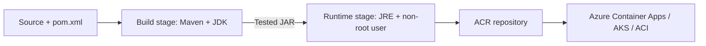
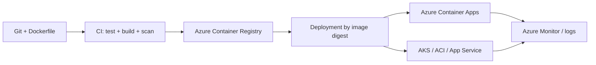
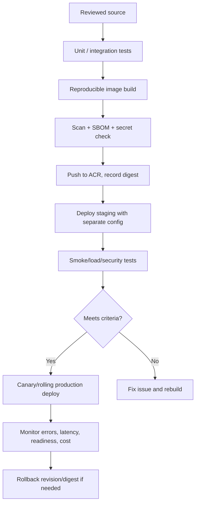

# Building Container Images Suitable for the Azure Environment

An application that runs well on a personal machine is not guaranteed to run reliably when packaged into a container and deployed on Microsoft Azure. The image might be too large, contain passwords, use an incompatible CPU architecture, run as root, write critical data to the ephemeral filesystem, or fail to respond to health probes. Those mistakes lead to slow startups, image pull failures, security risks, and service disruptions during scaling.

A **container image** is a content-immutable package containing the components required to start an application: runtime, libraries, application files, and metadata. An image is built once, pushed to **Azure Container Registry (ACR)** or an appropriate registry, and then pulled to run on **Azure Container Apps, Azure Kubernetes Service (AKS), Azure Container Instances (ACI)**, or other container-capable services.

In the **CLOUD_PROVIDERS_AZURE** module, under the **Container Registry and Container Apps** chapter, this lesson focuses on designing, building, testing, securing, and releasing images ready for the Azure environment. The examples use a Java application for illustration; the general principles also apply to Node.js, Python, .NET, Go, and other runtimes.

## 1. Learning Objectives

After this lesson, you will be able to:

1. Distinguish between Dockerfile, build context, image, container, registry, tag, and digest.
2. Write a **multi-stage** Dockerfile to separate the build environment from the runtime, reducing size and attack surface.
3. Choose the base image, CPU architecture, runtime, network port, user, and logging approach suited to the target Azure service.
4. Use `.dockerignore`, manage dependencies, and avoid placing credentials in the image or build history.
5. Test an image before pushing to ACR; distinguish between build, pull, start, and runtime errors.
6. Build images using Docker or **ACR Tasks**, apply versioning, and deploy by **digest** when reproducibility is required.
7. Design image pull permissions, vulnerability scanning, base image updates, rollback, and post-deployment monitoring.
8. Explain the impact of image size, caching, startup, CPU/memory, and network egress on performance and cost.

## 2. How Do Image, Container, and Registry Differ?

A container system has at least four core concepts:

| Concept | Role | Example |
|---|---|---|
| **Dockerfile** | Recipe consisting of steps to build an image | `FROM`, `COPY`, `RUN`, `USER`, `ENTRYPOINT` |
| **Image** | Filesystem layers and metadata, used as input to launch a container | `api:1.4.2` |
| **Container** | A running or stopped instance from an image, with a process and runtime state | Container serving HTTP port 8080 |
| **Registry** | Place to store and distribute images/artifacts | `demo.azurecr.io` (Azure Container Registry) |

One image can run as multiple containers. If you need to scale from 2 to 10 replicas, the platform typically pulls the same image and creates additional instances; **there is no need to rebuild the image for each replica**.

Image name examples:

```text
demo.azurecr.io/orders-api:1.4.2
└── Registry ──┘ └Repository┘ └Tag┘

demo.azurecr.io/orders-api@sha256:<DIGEST>
└── Registry ──┘ └Repository┘ └Content digest┘
```

A **Tag** is a reference name that can be reassigned to another image if the registry allows it. A **Digest** identifies manifest content by hash; when using a specific digest and the registry still retains the artifact, you can pinpoint the exact content being pulled. The digest of a single-architecture manifest may differ from the digest of a multi-architecture manifest index.

### An Image Is Not a VM Image

A VM image contains the operating system base for a virtual machine. A container image contains the user space and application; standard containers **share the kernel with the host** according to the runtime model. Therefore, Linux containers require a host/container runtime supporting Linux; Windows containers have their own host and compatibility requirements. You cannot turn a Windows container into a Linux container simply by changing a file extension.

## 3. Criteria for an Azure-Ready Image

A production image should satisfy the following requirement groups:

| Group | Specific Criteria |
|---|---|
| **Correctness** | Runs the right application, right runtime, and dependencies |
| **Compatibility** | Linux/Windows, `amd64`/`arm64`, native libraries suited to the target environment |
| **Security** | Contains no secrets, runs non-root when possible, patched, minimal unnecessary packages |
| **Startup** | Main process handles signals, starts within probe/scale budgets, exposes health endpoints |
| **Connectivity** | Listens on the right interface/port, uses TLS to dependencies, handles DNS/proxy |
| **Operations** | Logs to stdout/stderr, stateless or uses external storage, includes telemetry and version |
| **Reproducibility** | Dependencies/versions are managed; image is tagged meaningfully and has a digest |
| **Cost** | Reasonable size, avoids re-downloading unnecessary artifacts, appropriate runtime resources |

A very small image that lacks CA certificates or libraries needed by the application is still a poor image. Optimization must start with **correct functionality and security**, and only then reduce size.

## 4. Choosing a Base Image and Runtime

A **base image** is the foundation layer in the `FROM` instruction. A Java application can use:

- An image with a **JDK** when compiling Java.
- An image with a **JRE** when only running a JAR is needed.
- A minimal or distroless image if dependencies and debugging/observability workflows allow.

Consider these factors:

1. Trusted provider and security update cycle.
2. Runtime version compatible with the application, e.g., Java 21.
3. Operating system and system libraries, including `glibc` or `musl` if native libraries are present.
4. Available CPU architectures, e.g., `linux/amd64` or `linux/arm64`.
5. Presence of CA certificates, timezone data, fonts, or libraries required by the business logic.
6. Default user permissions, writable directories, and signal handling mechanism.
7. Size, layer count, patches, and ability to generate an SBOM.

**Do not use `latest` as a production version management mechanism.** A mutable tag can change content between two builds. You can pin a governed version tag and, when high reproducibility is needed, **pin the digest** after verifying provenance. Digest pinning does not exempt you from updates: the operations team must still proactively apply patches by updating the digest to a tested image.

### Multi-Stage Builds

A build environment contains Maven, a compiler, and various caches; the runtime application usually only needs a JRE and the JAR file. A **multi-stage build** allows using a heavy build stage, then copying only the runnable artifact into the final image.



Compilers, local Maven caches, and source code do not need to appear in the final image, unless the application design specifically requires them.

## 5. Multi-Stage Dockerfile Example for Java 21

Assume a Java/Maven project with the following structure:

```text
orders-api/
  Dockerfile
  .dockerignore
  pom.xml
  src/
    main/...
    test/...
```

The application builds an executable JAR at `target/app.jar`, listens on HTTP port 8080, and provides `/health/live` and `/health/ready` endpoints. If the Maven project does not yet produce a JAR named `app.jar`, you can configure `<finalName>app</finalName>` in `pom.xml` or adjust the `COPY` path to match the actual artifact. For Spring Boot, ensure the JAR is repackaged as an executable JAR.

Dockerfile example:

```dockerfile
# syntax=docker/dockerfile:1

# Stage 1: used only for compiling
FROM maven:3.9-eclipse-temurin-21 AS build
WORKDIR /workspace

# Separate dependency declarations to leverage build cache.
COPY pom.xml ./
RUN mvn -B -ntp dependency:go-offline

COPY src ./src
RUN mvn -B -ntp -DskipTests package

# Stage 2: contains only what is needed to run
FROM eclipse-temurin:21-jre-jammy AS runtime

RUN groupadd --gid 10001 appgroup \
    && useradd --uid 10001 --gid 10001 \
       --no-create-home --shell /usr/sbin/nologin appuser

WORKDIR /app
COPY --from=build --chown=10001:10001 \
    /workspace/target/app.jar /app/app.jar

USER 10001:10001
ENV JAVA_TOOL_OPTIONS="-XX:MaxRAMPercentage=75 -XX:+ExitOnOutOfMemoryError"
EXPOSE 8080

ENTRYPOINT ["java", "-jar", "/app/app.jar"]
```

### Explaining Each Decision

**Build stage:** uses Maven/JDK to compile; source code, compiler, and Maven repository are excluded from the final image. Separating `COPY pom.xml` before `COPY src` helps leverage cache when only source code changes.

**Runtime stage:** uses a JRE because the application does not need a compiler at runtime. The base image chosen here is an example with an OS compatible with Linux user creation commands.

**Non-root user:** `USER 10001:10001` reduces default process privileges inside the container. This is only one layer of risk reduction; host, kernel, seccomp, network policies, and service permissions must still be secured separately.

**Memory-aware Java:** `MaxRAMPercentage` helps the JVM manage the heap relative to container memory limits; the application still needs headroom for non-heap memory, thread stacks, and native buffers.

**`EXPOSE 8080`:** records metadata indicating the container expects to listen on port 8080. This instruction **does not automatically open ingress on Azure** and does not guarantee the application actually binds the port. The port must be configured in both the application and the target Azure service.

**Exec-form ENTRYPOINT:** the Java process receives signals more directly compared to a command wrapped in a shell without `exec` configured. This supports controlled shutdown, though the application still needs to handle SIGTERM and finish in-flight requests within the platform's deadline.

### What Still Needs to Be Done Before Production

The illustrative Dockerfile intentionally does not treat everything as complete:

- The pipeline must run unit/integration tests; `-DskipTests` in the build stage only separates image building from the CI test step.
- Pin the base image according to policy; check for CVEs and rebuild periodically.
- Verify the executable JAR, dependency types, required CA certificates, and timezone.
- Test the image with CPU/memory limits and a read-only filesystem if required.
- Configure registry access permissions and secrets **at runtime**, without baking them into the JAR/image.

If the application creates temporary files, provide an appropriate writable directory (for example `/tmp` or a mounted volume); do not enable a read-only filesystem and ignore write errors.

## 6. Using .dockerignore to Limit the Build Context

The **build context** consists of the files Docker/BuildKit can access during a build. If the entire project folder is sent, unnecessary or sensitive files may travel with the context to the builder. `.dockerignore` helps exclude most unneeded data.

Example:

```dockerignore
.git
.github
.idea
.vscode
target/
build/
*.log
*.tmp
.env
.env.*
**/*.pem
**/*.key
**/secrets/**
**/node_modules
README-local.md
```

Tailor it to your project: do not accidentally exclude configuration files or assets that the build genuinely needs. For multi-module projects, the Maven wrapper, dependency files, or build scripts may need to be kept.

**An important caveat:** `.dockerignore` reduces data sent into the context, but it does not replace secret scanning and repository controls. If a secret has already been committed to Git or appeared in build logs, adding the filename to `.dockerignore` does not make the exposed secret safe.

## 7. Protecting Secrets at Build Time and Runtime

Do not write secrets in a Dockerfile:

```dockerfile
# INSECURE — for error illustration only
ENV DATABASE_PASSWORD="hardcoded-password"
ARG PRIVATE_REGISTRY_TOKEN
RUN echo "token=$PRIVATE_REGISTRY_TOKEN"
```

Values can be exposed through source code, image metadata, build history, cache, logs, or pipeline artifacts. `ARG` is not a secret storage mechanism; `ENV` typically becomes image/container configuration.

### Secrets Needed at Build Time

If a build must fetch dependencies from a private repository, use a secret injection mechanism supported by the build tool, such as **BuildKit secret mount**, to avoid creating an image layer containing credentials:

```dockerfile
# syntax=docker/dockerfile:1
FROM maven:3.9-eclipse-temurin-21 AS build
WORKDIR /workspace
COPY pom.xml .
COPY src ./src

# Illustrative example: build secret is mounted only for the command that needs it.
# Actual Maven settings must be configured to match the repository.
RUN --mount=type=secret,id=maven_settings,target=/root/.m2/settings.xml \
    mvn -B -ntp package
```

When using Docker BuildKit with `--secret`, the secret is passed through a separate build channel. **Do not print secret contents or intentionally copy the secret out to an image layer**; if a script does that, a secret mount cannot save it.

### Secrets Needed While the Container Is Running

For Azure, prefer:

- **Managed identity** or workload identity federation for supported services and environments.
- Azure Key Vault or a platform-supported secret store, with least-privilege access.
- Runtime secret injection mechanisms for Azure Container Apps, AKS, or App Service per organizational policy.
- Secret rotation and runtime restart/refresh if the application caches old credentials.

Distinguish **permission to pull images from ACR** from **the application's permission to access Key Vault/Storage**. The two tasks may use different identities and roles. A successful container pull does not mean the application identity has been granted data access permissions.

## 8. Making Sure the Image Works Properly in a Container Environment

### Listen on All Appropriate Interfaces

Inside a container, the application must listen on an interface to which the runtime can route traffic, typically `0.0.0.0:8080` for IPv4. If the web server only binds `127.0.0.1`, the application might work when called inside the container, but it will not receive requests from the ingress proxy via the container's network address.

Example for a Spring Boot application when explicitly setting port and host:

```properties
server.address=0.0.0.0
server.port=8080
```

Use environment-aware configuration; do not hard-code hostnames, container IPs, or cluster public IPs. The `server.port` value can also be supplied via environment variables per framework conventions.

### Health Probes

For HTTP services, separate endpoints should be provided:

| Endpoint | Role | What Not to Do |
|---|---|---|
| `/health/live` | Process is alive, not basically deadlocked | Do not check every dependency in a way that triggers continuous restarts |
| `/health/ready` | Instance is ready to receive real requests | Do not return 200 when essential dependencies are unavailable |
| `/health/startup` (if present) | Application has finished initial startup | Do not set timeouts too short for slow-starting runtimes |

Azure Container Apps and AKS have their own probe mechanisms. Simply adding a Dockerfile `HEALTHCHECK` instruction **does not mean every Azure service automatically uses it with the same behavior**. Declare probes according to the target runtime mechanism and test failure threshold, interval, timeout, and path/port.

### Graceful Shutdown

During a new revision deployment, scale-in, or node replacement, the platform may ask the container to stop. The application should:

1. Catch `SIGTERM` or the stop signal supported by the runtime.
2. Stop accepting new work.
3. Complete or re-queue in-flight tasks.
4. Flush logs/tracing and durably persistable state.
5. Close connection pools within the termination grace period budget.
6. Exit the process with an appropriate exit code.

Do not assume a container always has several minutes to terminate: shutdown time depends on platform configuration, failure scenarios, or scaling events.

### Statelessness and Persistent Storage

The writable filesystem inside a container is typically tied to the container/replica lifecycle. Do not store order data, uploaded images, application keys, or critical checkpoints solely there. Use **Azure Blob Storage, Azure Files, Azure Database**, or an appropriate data system. If a shared directory is needed, evaluate volume mounts and file semantics by service.

## 9. Logging, Configuration, and Resource Limits

### Standard Container Logging

Applications should write normal operational logs to **stdout** and errors to **stderr**, in a format containing timestamp, level, correlation ID, and necessary details. Azure Container Apps/AKS/App Service can collect logs according to monitoring configurations.

Do not log access tokens, client secrets, session cookies, or sensitive data. Choose an appropriate log level; leaving debug continuously enabled can increase ingestion costs and leak data.

### Using Environment Variables Appropriately

Environment variables are useful for **non-sensitive configuration** such as port, environment name, feature flags, or service URLs. For secrets, use platform-managed secret mechanisms; if the platform injects secrets into the environment, still restrict read access, crash dumps, and debug logs because environment variables are not automatically encrypted in process memory.

The **build once, deploy many** principle: the exact same image digest runs in dev, staging, and production; differences live in environment configuration and identity. Do not build three different images just to embed environment endpoints or passwords.

### CPU/Memory Limits

An application that runs normally under local Docker with abundant RAM can be OOM-killed on Azure if the workload exceeds its memory limit. Test with representative CPU/memory, including peak traffic, thread counts, heap, native memory, connection pools, and startup time.

Note for Java: `MaxRAMPercentage=75` only limits the heap ratio calculated by the JVM, not the application's total RAM limit. Direct buffers, metaspace, JIT, and stacks still need headroom.

## 10. Testing the Image on a Developer Machine or CI

After creating the Dockerfile and `.dockerignore`, run a test build:

```bash
docker build --pull -t orders-api:local .
```

`--pull` attempts to fetch the latest matching base image from the registry; it does not automatically verify that the image has no CVEs. CI should have a separate dependency update/scan step.

Run a test container:

```bash
docker run --rm \
  --name orders-api-test \
  --memory 512m \
  --cpus 1 \
  -e SERVER_PORT=8080 \
  -p 127.0.0.1:8080:8080 \
  orders-api:local
```

This binds the port to localhost on the test machine, avoiding accidentally exposing the service to all host interfaces. If the application does not support the `SERVER_PORT` environment variable, configure the port according to the respective framework.

In another terminal:

```bash
curl --fail --silent --show-error http://127.0.0.1:8080/health/live
curl --fail --silent --show-error http://127.0.0.1:8080/health/ready
```

Inspect metadata:

```bash
docker image inspect orders-api:local \
  --format '{{.Os}}/{{.Architecture}} user={{.Config.User}}'

docker image history orders-api:local
```

`docker image history` helps spot certain unwanted instructions or operations, but does not replace a scanner: secrets can still reside inside file layers without showing up in the history string.

### Testing a Read-Only Filesystem

If the application is expected to run with a read-only root filesystem, test it in a lab environment:

```bash
docker run --rm \
  --read-only \
  --tmpfs /tmp:rw,nosuid,size=64m,mode=1777 \
  --memory 512m \
  -p 127.0.0.1:8080:8080 \
  orders-api:local
```

The container will only succeed if the application does not write outside permitted locations. Adjust tmpfs or volumes per actual requirements. A successful read-only test does not automatically guarantee the target Azure runtime supports the identical configuration; you must use the corresponding platform options.

### Testing Shutdown and Restart

- Send `docker stop orders-api-test` to a running container and observe shutdown.
- Verify no abnormal dropped requests or uncommitted transactions occur once the application receives SIGTERM.
- Run multiple instances to detect local state storage causing session inconsistency.
- Test under lower CPU/memory limits than local environments to catch OOMs and startup timeouts.
- Verify DNS/TLS connectivity to test dependencies over an Azure-like network when possible.

## 11. CPU Architecture and Multi-Platform Images

Azure offers machines with different CPU architectures depending on service and SKU. An image supporting only `linux/amd64` may not run on `linux/arm64` workers; typical errors are **exec format error** or missing corresponding manifest.

### Checking Architecture

```bash
docker image inspect orders-api:local \
  --format 'OS={{.Os}}, ARCH={{.Architecture}}'
```

When building for a specific platform using Buildx:

```bash
docker buildx build \
  --platform linux/amd64 \
  -t orders-api:amd64 \
  --load .
```

If both amd64 and arm64 must be supported, you can use a multi-architecture build pipeline:

```bash
docker buildx build \
  --platform linux/amd64,linux/arm64 \
  -t "<REGISTRY>.azurecr.io/orders-api:<VERSION>" \
  --push .
```

Multi-architecture commands require a builder supporting multi-platform builds, base images for both architectures, and compatible dependencies/native libraries. The build environment may need workers of the respective architectures or appropriate emulation.

Do not assume a multi-architecture image works out of the box even for pure Java applications without testing: JNI libraries, image processing, native DNS/TLS libraries, or observability agents can still depend on CPU/OS.

## 12. Azure Container Registry: Storing and Distributing Images

**Azure Container Registry (ACR)** is a managed private registry used to store OCI/Docker images and compatible artifacts. For Azure projects, ACR unifies access permissions, lifecycle management, build pipelines, and deployments to Azure services.

Example flow:



### Creating an ACR in a Test Environment

Bash/Azure Cloud Shell example:

```bash
az account show --query "{name:name,id:id,tenantId:tenantId}" -o table

RG="rg-container-lab"
LOC="southeastasia"
ACR="<UNIQUE_ACR_NAME>"

az acr create \
  --resource-group "$RG" \
  --name "$ACR" \
  --location "$LOC" \
  --sku Basic
```

This assumes the resource group already exists, the subscription has permission to create registries, and `ACR` is a globally available name. **ACR Basic** is suitable for simple labs but lacks all networking/replication features of higher SKUs; choose an SKU based on requirements and verify current support before deploying.

Retrieve the login server:

```bash
LOGIN_SERVER=$(az acr show \
  --name "$ACR" \
  --query loginServer \
  --output tsv)

echo "$LOGIN_SERVER"
```

### Building and Pushing with ACR Tasks

**ACR Tasks** can perform cloud builds based on provided source/Dockerfile without necessarily needing a Docker daemon on the machine issuing the command.

```bash
REPO="orders-api"
TAG="1.4.2"

az acr build \
  --registry "$ACR" \
  --image "$REPO:$TAG" \
  .
```

The command is executed from the directory containing the Dockerfile and build context. It may incur charges, consume ACR build resources, and access dependency sources according to network configuration. A real pipeline must add testing, scanning, versioning, secret management, and separate push permissions rather than just running this command.

List tags in the repository:

```bash
az acr repository show-tags \
  --name "$ACR" \
  --repository "$REPO" \
  --output table
```

Check the digest referenced by a tag:

```bash
az acr repository show \
  --name "$ACR" \
  --image "$REPO:$TAG" \
  --query digest \
  --output tsv
```

A deployment requiring reproducibility can reference the form:

```text
<REGISTRY>.azurecr.io/orders-api@sha256:<DIGEST>
```

The digest must come from actual output; never fabricate a fake SHA-256 string. When using a multi-platform manifest, ensure the digest references the exact manifest/index expected by the runtime.

### Building Locally and Pushing

If your organization has a Docker engine and granted permissions:

```bash
az acr login --name "$ACR"

docker tag orders-api:local "$LOGIN_SERVER/$REPO:$TAG"
docker push "$LOGIN_SERVER/$REPO:$TAG"
```

`az acr login` provides a way to sign in using Azure identity in supported scenarios. Do not enable the ACR admin user purely for pipeline convenience when least-privilege identity/RBAC can be used.

## 13. Registry Authorization: Push Differs from Pull

Permissions to build/push images and permissions for the runtime environment to pull images must be kept separate.

| Identity | Need | Principle |
|---|---|---|
| CI builder | Push images/metadata to permitted repositories | Push permissions only as needed |
| Azure Container Apps or AKS runtime | Pull images when creating revisions/pods | Pull permissions only as needed |
| Application inside container | Read Storage/Key Vault or call APIs | Separate managed identity/workload identity and data-plane roles |
| Operator | View/redeploy or inspect registry | Role-based RBAC for operations |

In the traditional ACR RBAC model, common roles are `AcrPull` and `AcrPush`. A registry may use repository-scoped/ABAC permission models depending on configuration and feature tier, in which case the appropriate role must be chosen rather than assuming every policy behaves like classic `AcrPull`.

**AKS:** can integrate with ACR so the kubelet identity pulls images, according to configured mechanisms and roles. **Container Apps:** can declare registry credentials or an identity to pull images; prefer managed identity when compatible. Application permissions to use Key Vault/Storage are a separate matter and are not automatically inferred from pull permissions.

When a registry has a firewall/private endpoint, beyond RBAC you also need proper **network routing, DNS, and egress** for the runtime to reach the registry and related endpoints. A deployment with valid credentials can still report ImagePull errors if it cannot resolve or reach the registry.

## 14. Deploying Images on Azure Container Apps

**Azure Container Apps (ACA)** is a managed platform for running containerized applications, supporting revisions, scaling, and ingress depending on service features. Before using an ACR image, prepare:

1. A Container Apps environment in the appropriate subscription/region.
2. A `<REGISTRY>.azurecr.io` registry containing the built image.
3. An identity/credential granted **pull** permission from the registry, plus network connectivity to the registry.
4. A Container App with image, CPU/memory, environment variables, secret references, and workload profile if needed.
5. Ingress/TCP/HTTP target port matching the port the application listens on.
6. Startup/liveness/readiness probes tailored to runtime capabilities and application needs.
7. Logging/monitoring, scale rules, and revision deployment policies.

### Network Ports

If the application in the image listens on `0.0.0.0:8080`, the Container App has **target port 8080** when ingress is enabled. Do not rely solely on Dockerfile `EXPOSE 8080` or assume all containerized apps automatically use port 80.

A container running successfully while ingress returns `502`/timeout can be caused by the process listening on the wrong port, binding loopback, routing, startup probes, or failing startup dependencies.

### Revisions and Image Digests

When releasing a new image, create/update a revision per ACA mechanisms and verify traffic splitting/rollout. In production workflows, reference images by **controlled immutable tag** or verified digest rather than updating `latest` and guessing that all replicas will automatically pull the new version.

Example updating the image for an **existing Container App that already has pull permissions configured**:

```bash
APP="orders-api"
RG="rg-container-lab"
IMAGE_REF="$LOGIN_SERVER/$REPO:$TAG"

az containerapp update \
  --resource-group "$RG" \
  --name "$APP" \
  --image "$IMAGE_REF"
```

The example command does not automatically create the environment, registry identity, ingress, or secrets; those components must be configured beforehand. After updating, verify the new revision is genuinely Ready and functioning before shifting all traffic.

### Scale-to-Zero and State

ACA can scale-to-zero depending on supported ingress, revision mode, workload profile, and scale rules. Applications must be prepared for **cold starts**: when a request arrives, the platform must pull the image (if not cached), create the container, boot Java, and wait for readiness. Large images and overly long startups degrade the user experience.

Do not store sessions or unique uploaded files inside a container instance if the system can scale or replace replicas.

## 15. Deploying to AKS, ACI, and App Service

One image can run across multiple platforms, though runtime requirements and management approaches differ.

| Service | Purpose | Things to Check |
|---|---|---|
| **Azure Container Apps** | Managed web/APIs, event-driven workers, microservices | Revisions, ingress targetPort, scale rules, environment, probes |
| **Azure Kubernetes Service** | Kubernetes orchestration with deep control | Pod securityContext, Deployment, Service, ingress, resources, probes, imagePullPermissions |
| **Azure Container Instances** | Relatively simple, short-lived, or specialized containers/jobs | CPU/memory, OS/architecture, networking, lifecycle, and restart policy |
| **App Service custom container** | Web apps on PaaS with a custom image | Port/ingress, startup and health checks, ACR pull identity, persistent storage when needed |

### Kubernetes Manifest Example

This manifest only illustrates declaring image, port, probes, limits, and user. To apply it, you must have an AKS cluster, configured ACR pull permissions, and matching HTTP endpoints:

```yaml
apiVersion: apps/v1
kind: Deployment
metadata:
  name: orders-api
spec:
  replicas: 2
  selector:
    matchLabels:
      app: orders-api
  template:
    metadata:
      labels:
        app: orders-api
    spec:
      containers:
        - name: orders-api
          image: <REGISTRY>.azurecr.io/orders-api:1.4.2
          ports:
            - containerPort: 8080
          securityContext:
            runAsNonRoot: true
            runAsUser: 10001
            allowPrivilegeEscalation: false
          resources:
            requests:
              cpu: "250m"
              memory: "512Mi"
            limits:
              cpu: "1"
              memory: "1Gi"
          startupProbe:
            httpGet:
              path: /health/startup
              port: 8080
            periodSeconds: 5
            failureThreshold: 30
          readinessProbe:
            httpGet:
              path: /health/ready
              port: 8080
            periodSeconds: 5
          livenessProbe:
            httpGet:
              path: /health/live
              port: 8080
            periodSeconds: 10
```

In Kubernetes, `image` should use an approved digest for critical releases. Pod configuration may also require `readOnlyRootFilesystem`, seccomp profile, dropped capabilities, service account, and network policies per the cluster's security baseline.

**Important:** the Deployment manifest above does not create a Kubernetes Service or ingress; a container port alone does not make the API reachable outside the cluster.

## 16. Image and Software Supply Chain Security

A Dockerfile without secrets can still be insecure if the base image has vulnerabilities or malicious dependencies. You must secure the chain from source → build → registry → deployment.

### Securing Source and Pipeline

- Build from a clear commit/revision; control pull requests and permissions to modify the Dockerfile.
- Pin dependencies, maintain lockfiles or runtime-appropriate version management.
- Test source code and dependencies before release.
- Use short-lived identities/federation instead of long-lived push secrets if the CI platform supports them.
- Restrict network/secrets on build runners and do not use build logs to print sensitive variables.

### Controlling Artifacts

- Scan images and dependencies to detect CVEs using appropriate tools.
- Generate and store an **SBOM (Software Bill of Materials)** for release versions.
- Attach provenance/attestations and image signatures using an organization-approved solution.
- Enforce policies permitting deployment of only approved artifacts when the runtime supports enforcement.
- Restrict permissions to delete images or retag releases.
- Review retention policies so digests referenced by production are not deleted.

ACR and the Azure ecosystem can integrate security assessment tools, including Microsoft Defender for Cloud capabilities depending on configuration and service tier. Do not assume all registry types and SKUs have scanning enabled or automatically block dangerous images.

### Distinguishing Scanning from Patching Vulnerabilities

Scanning only **detects** issues. When a base image or dependency receives a patch, you must rebuild, test, push a new digest, and deploy in a controlled manner. Digest-pinned images do not automatically receive patches without a new release.

### Non-Root Is Not an Absolute Sandbox

Running non-root reduces privileges, yet you still need to:

- Configure secure runtime settings and restrict privilege escalation.
- Mount only necessary volumes and set directory permissions.
- Restrict egress/inbound network traffic.
- Limit registry and Azure data-plane permissions.
- Update OS packages/dependencies.
- Avoid running sensitive daemons or mounting the Docker socket inside applications unless the architecture genuinely requires it and risks have been assessed.

## 17. Optimizing Size, Caching, and Deployment Speed

### Why Are Smaller Images Useful?

Smaller images generally reduce data download volume, cold start time, registry storage, and the surface area of software packages requiring updates. However, startup time also depends on node image cache, network, VM/CPU, Java startup, dependency initialization, and health checks.

**Do not aggressively optimize for megabytes** if stripping runtime files breaks TLS, locale, timezone, or fonts required by the application.

### Optimizing Layers and Caching

1. Place less frequently changing steps (base, dependency declarations) before frequently changing steps (source).
2. Leverage builder Maven/Gradle/npm caches in ways that do not leak secrets.
3. Reduce repeated dependency downloads from the Internet; use a managed artifact repository.
4. Copy only truly necessary files using `.dockerignore` and multi-stage builds.
5. Do not run uncontrolled `apt-get upgrade` commands while bypassing base image/version policies.
6. Compile the artifact once when the pipeline and environment allow, avoiding redundant source builds.
7. Monitor image size, pull/start duration, and cache effectiveness across deployments.

### Image Tags and Retention

Recommendation:

```text
orders-api:1.4.2
orders-api:git-a1b2c3d
orders-api@sha256:<DIGEST>
```

Semantic version and git commit tags help humans trace builds; digests identify exact content. Both tag formats are not strictly required for every project, but you should have release rules and never casually retag a production release.

Be careful when deleting images: registries may retain manifests/tags across multiple references. If a digest still referenced by a deployment is deleted, subsequent scale-out or restore actions may fail to pull. Retention policies must align with rollout and rollback lifecycles.

## 18. Operations: Testing, Deployment, and Rollback

To avoid "build succeeded but production failed," use a multi-gate pipeline:



### What to Verify in Staging

- Image matches `linux/amd64` or the target platform.
- Does not require root privileges or file writes outside the design.
- Ports, protocol, health probes, and shutdown behave correctly.
- Application retrieves credentials via runtime identity/secret references.
- Reaches dependencies through DNS, private endpoints, or firewalls.
- Resource requests/limits suffice for baseline peak loads.
- Logs, traces, metrics, and correlation IDs work.
- Data is not lost when replicas are removed or scaled in.
- Startup and cold start stay within SLOs.
- Build provenance/digest matches the approved release.

### Rollback

Rollback typically means shifting traffic/revisions or deployments back to a **digest known to work well**, not rebuilding old code and tagging it `latest`.

This is only safe if:

1. The registry still holds the old digest and the workload retains pull permission.
2. Data/config schemas are **backward compatible** with the older version.
3. Secrets and API dependencies are still supported.
4. The system has sufficient capacity to bring up old replicas.
5. Traffic shifting is controlled and metrics confirm recovery.

Swapping an image does not automatically roll back incompatible database migrations; a separate data plan is required.

## 19. Troubleshooting: From Build to Runtime

| Symptom | Common Causes | Checks |
|---|---|---|
| `COPY failed` or JAR file not found | `.dockerignore` excluded by mistake, Maven produced a different name, or build stage failed | Check build context, artifact name, and `pom.xml` configuration |
| Abnormally large image | Copied source/build cache into runtime, overly heavy base image | Use `docker image history`, multi-stage, `.dockerignore` |
| `exec format error` | Image does not match CPU architecture | Inspect OS/architecture, image manifest, and node architecture |
| Container exits immediately with non-zero code | Wrong command/JAR, missing dependency, config error | Container logs, ENTRYPOINT, and local test run |
| `permission denied` at runtime | Non-root user lacks read/write permissions on files | Owner, mode, volume mount, UID/GID, and writable paths |
| Java OOM/killed | Low memory limit, high heap/native memory or heavy load | Container metrics, JVM config, safe heap dump |
| 502/503 after ACA deploy | Wrong target port, bound to localhost, readiness fail, app still starting | Ports, ingress, probes, logs, and replica state |
| `ImagePullBackOff` or pull failure | Wrong image ref, nonexistent tag/digest, wrong ACR permissions, or network error | Registry, auth, pull role, private DNS, firewall |
| Registry reports unauthorized | Identity lacks permission or token expired | ACR RBAC/ABAC, auth mode, identity scope |
| Works in staging but fails in production | Different config/secret/identity/network | Compare runtime configs; do not rebuild image to embed secrets |
| Secret appears in image layer | Used ARG/ENV, COPYed credential file, or script wrote secret | Scan layers/history, revoke exposed credentials, and fix build |
| CrashLoopBackOff on AKS | Process error, overly strict liveness, wrong port/probe | `kubectl describe pod`, logs, probe thresholds |
| Rollback fails | Old digest was deleted or database had incompatible migration | Registry retention, migration strategy, and config |
| Slow cold start | Large image, downloading dependencies at startup, JVM warm-up | Measure pull/start/readiness, prebuild artifacts, and optimize startup |

### Logical Investigation Order

1. Confirm the **image ref, tag/digest** is exact and the manifest matches the platform.
2. Confirm the runtime has ACR pull permissions and DNS/routing to the registry.
3. Read startup logs: is the application running the right process?
4. Check memory/CPU limits, filesystem, and user permissions.
5. Check port, ingress, and health probes.
6. Check secrets, managed identity, and network access to dependencies.
7. Check telemetry, rollout history, and the most recent configuration changes.

Do not simultaneously modify the Dockerfile, NSG, image tag, and probes before identifying the root cause; doing so makes it hard to tell which change actually fixed the issue.

## 20. Comprehensive Hands-On Exercise

### Scenario

A development team has a Java 21 REST application. The goal is to build an image running as an unprivileged user, release it to ACR, and deploy it to Azure Container Apps or an equivalent container environment. The application serves HTTP responses on port 8080 and needs to access data in Azure Storage.

### Part A — Preparing the Dockerfile

1. Describe the difference between a build stage using Maven/JDK and a runtime stage using JRE.
2. Write a `.dockerignore` to exclude Git metadata, build outputs, logs, and secret files.
3. Create a multi-stage Dockerfile copying only the executable JAR into the final image.
4. Configure `USER 10001`, port 8080, and exec-form `ENTRYPOINT`.
5. Do not place storage connection strings, account keys, or client secrets into the Dockerfile.
6. Verify the JAR starts and returns responses for `/health/live` and `/health/ready`.

### Part B — Local Testing

1. Run `docker build --pull -t orders-api:local .`.
2. Use `docker image inspect` to verify OS, architecture, and user.
3. Run the container with port mapping to localhost and a memory limit.
4. Test health endpoints and shutdown using `docker stop`.
5. Test a read-only root filesystem; provide temporary directories only when the app truly requires them.
6. Inspect image history and check secret scanning using your pipeline's tool.
7. Record image size, build time, and startup time.

### Part C — Releasing to Azure

1. Verify the subscription, resource group, ACR name, and appropriate permissions.
2. Use `az acr build` to create `orders-api:1.4.2` in the test ACR.
3. Inspect repository/tags and retrieve the actual digest.
4. Prepare an identity with pull-only permissions suitable for the target Azure environment.
5. Deploy the image with target port 8080, CPU/memory, and health probes.
6. Set endpoint/storage configuration at runtime; have the app access storage via managed identity if supported.
7. Check that the revision/pod is healthy, along with logs and external or internal requests per ingress design.
8. Make a minor update, build a new image, test the rollout, and shift traffic.
9. Describe how to roll back to the previous digest after a faulty release.
10. Clean up lab resources per permissions and procedures, checking whether registry/compute/logs incur ongoing costs.

### Self-Check Questions

**Question 1.** Why should you use a multi-stage build instead of including Maven and source code in the runtime image?

**Question 2.** Does `EXPOSE 8080` automatically open the port on Azure Container Apps or Kubernetes Service? What else must be configured?

**Question 3.** How do the tag `orders-api:latest` and the digest `sha256:...` differ? Why does this matter during a rollback?

**Question 4.** Is a Dockerfile that uses `ARG PRIVATE_TOKEN` and runs a command printing the token to logs safer than `ENV PRIVATE_TOKEN`?

**Question 5.** An image runs fine on an Apple Silicon laptop, but an x86_64 AKS node reports `exec format error`. What will you check?

**Question 6.** Why must a container have a readiness probe and a shutdown mechanism when the platform scales in?

**Question 7.** Does the role for pulling images from ACR allow the application to read secrets from Key Vault or blobs in Storage?

**Question 8.** When Container Apps returns 502 even though the image pull succeeded, what layers need to be checked?

**Question 9.** Why is scanning for CVEs once before pushing not enough to protect a long-lived image in production?

**Question 10.** If the exact same image runs in dev and production, where should differences in hostnames, secrets, and database configurations be placed?

**Completion criteria:** learners can build and test a non-root, multi-stage, secret-free Java image; identify the correct platform/port; publish the image to ACR, deploy by version/digest, and establish testing, security, and rollback procedures on Azure container services.

## Conclusion

A container image **suitable for the Azure environment** is not merely an image that builds successfully. It must be designed to be **reasonably compact, reproducible, secure, architecture-compatible, running non-root, listening on the right port, equipped with health probes and graceful shutdown, and free of critical data or credentials inside the image**.

Azure Container Registry provides a place to manage and distribute images, while Azure Container Apps, AKS, ACI, or App Service provide runtime environments with varying options for ingress, identity, networking, scaling, and monitoring. By combining **multi-stage builds, versioning/digests, runtime secret management, vulnerability scanning, staging verification, and controlled rollbacks**, development teams can release Azure applications faster while maintaining traceability, availability, and cost control.
