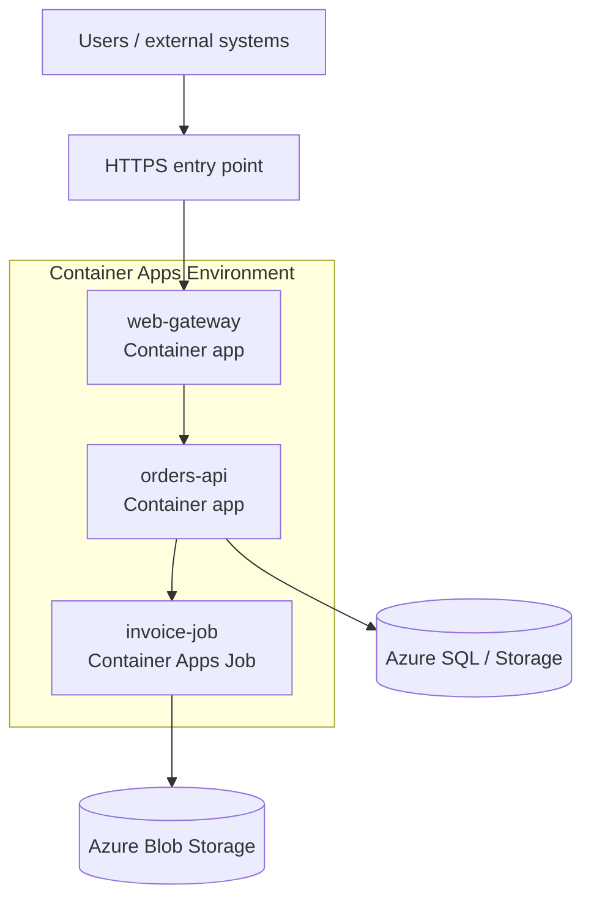
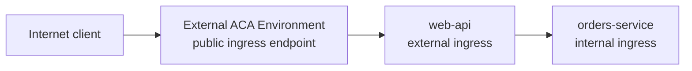
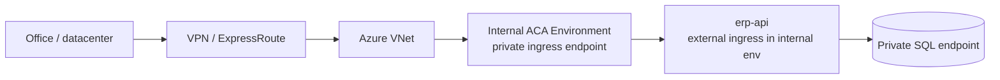
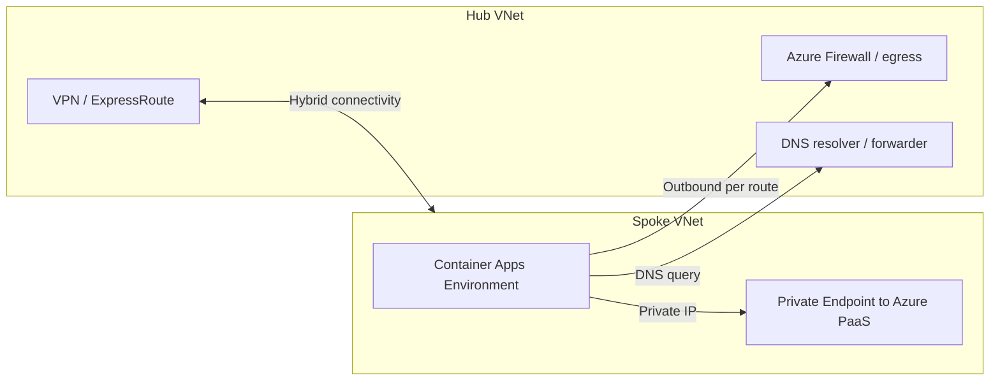
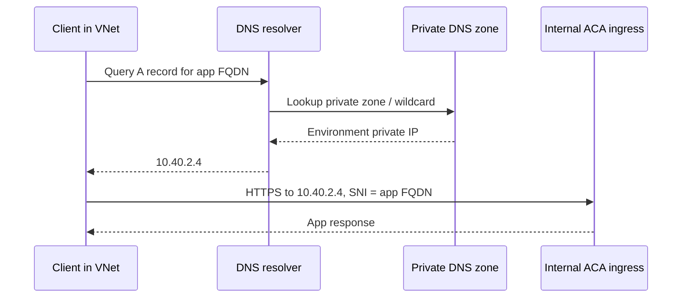
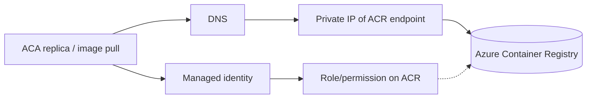
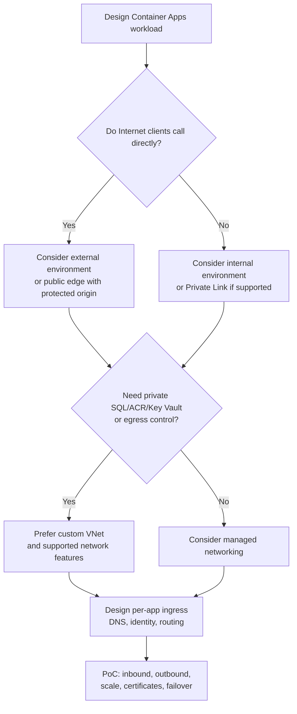
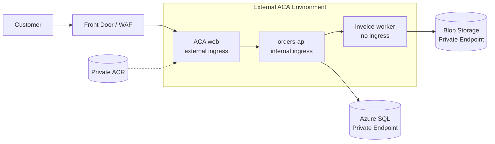
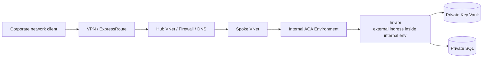

# Container Apps Environments and Network Configuration Options

When a system deploys multiple microservices on **Azure Container Apps (ACA)**, the first question is not merely "which port does the container run on?" but also **which Container Apps Environment the apps live in, who is allowed to call them, which path outbound traffic takes, and how domain names are resolved**. A customer-facing API needs a public HTTPS entry point, whereas a payment processing service or background worker should likely communicate only over a private network.

This lesson belongs to the **Container Registry and Container Apps** chapter of the **CLOUD_PROVIDERS_AZURE** module. The module explores the Microsoft Azure ecosystem from subscriptions, resource groups, and Microsoft Entra ID to virtual networking, compute, storage, and data, while guiding deployment, monitoring, security, and cost control for an application architecture on Azure. With Container Apps, network choices at the **environment** level affect every app and job hosted within it, so they must be evaluated from the initial design stage.

After this lesson, you will be able to:

- Distinguish **Container Apps Environment**, **container app**, **revision**, **job**, and **workload profile**.
- Distinguish **external** and **internal** environments, as well as **external/internal ingress** settings per app.
- Choose between Azure-managed networking and **custom Azure VNet** integration for security, DNS, and hybrid requirements.
- Describe DNS, inbound, outbound, Private Endpoint flows, and connections to Azure Container Registry/Key Vault/Storage.
- Identify verification steps for subnets, routing, NSGs, firewalls, TLS, identities, and scaling capacity.
- Diagnose common errors and plan controlled deployments/migrations.

## 1. What Is a Container Apps Environment?

A **Container Apps Environment** is a shared deployment and operational boundary for one or more **container apps** and **container app jobs** within the same Azure region. The environment provides shared foundational components such as network configuration, a default DNS domain, compute capacity provisioning models, portions of observability settings, and inter-app communication capabilities.

To avoid confusing terms:

| Object | Role | Example |
|---|---|---|
| **Container Apps Environment** | Shared space for networking, region, infrastructure config, and connectivity | `aca-env-prod` |
| **Container app** | Containerized application with revisions, replicas, ingress, and scale rules | `orders-api` |
| **Revision** | Version of the app configuration/template that can have independent replicas and traffic weights | `orders-api--v2` |
| **Replica** | A running instance of a revision | Replica serving HTTP requests |
| **Container Apps Job** | Task running to completion, triggered by schedule/event/manual execution | `invoice-worker` |
| **Workload profile** | Compute/allocation capacity type in environments supporting workload profiles | Consumption or dedicated profile |

**An environment is not a container app.** Changing the ingress of `orders-api` does not change the ingress of `payment-worker`. Conversely, a decision at the environment level regarding networking or deployment mode can affect every app belonging to that environment.

### 1.1. What Does Sharing an Environment Provide?

Multiple apps in the same environment can use ACA-provided internal service discovery and calling mechanisms while sharing network context and region. For example, a frontend calls an internal API and the API triggers a worker through a controlled flow.

However, **sharing an environment does not mean all apps share the same identity permissions**. Each app can have its own managed identity, secrets, ingress configuration, revisions, and scaling rules. An environment also does not automatically create an absolute compliance boundary between app groups; additional identity, network, and application authorization controls are still required.



This diagram shows logical relationships; a background job usually receives work via queues/events rather than direct HTTP calls from an API. Choose the communication protocol suited to each workload type.

## 2. Two Inbound Decision Layers: Environment and App Ingress

This is where design mistakes most commonly happen. There are **two distinct questions**:

1. **Is the environment external or internal?** Does the environment's ingress layer have a public entry point or only a private VNet entry point?
2. **Does each individual container app enable external or internal ingress?** Does the app allow clients outside its own environment to call its endpoint, or only internal components?

**External ingress on an app does not necessarily mean public Internet.** If the app resides inside an **internal environment**, "external" ingress for that app means reachable **from outside the app/environment via the environment's internal entry point**, while still bounded by reachability to the private network.

### 2.1. Four-Case Matrix

| Environment Type | App Ingress | Who Can Reach It on the Network? | Best Suited For |
|---|---|---|---|
| **External** | **External** | Internet clients can reach the public endpoint, if network rules/allowlists permit | Websites and public APIs |
| **External** | **Internal** | Primarily apps inside the same environment via internal service-to-service routing | Backends that should not be publicly exposed |
| **Internal** | **External** | Clients with paths to the VNet/environment's private entry point, including valid connected networks | Enterprise internal APIs, hybrid apps |
| **Internal** | **Internal** | Internal components within the same environment via ACA mechanisms | Microservices with no need to directly serve VNet clients |

This matrix describes **network reachability**, not whether requests are authorized at the application layer. HTTPS, Entra ID/OAuth, mTLS (if designed and supported), API keys, authorization, or other policies remain essential.

### 2.2. Ingress Is Optional—Not Every App Needs It

A container app processing a queue can **disable ingress**: it connects outbound to Azure Service Bus or Storage Queue, receives work, and writes results. There is no need to expose an HTTP port just for the app to exist.

When ingress is enabled, specify the appropriate configuration:

- **HTTP/HTTPS, gRPC, or TCP** per service capabilities and actual needs.
- **Target port** on which the process inside the container listens.
- **External/internal** at the app level.
- **Ingress traffic weights** across revisions when splitting traffic.
- **IP restrictions, TLS/custom domains, and authentication mechanisms** per supported features.

Do not confuse container port `8080` with client HTTPS port `443`. ACA ingress can terminate TLS and forward requests to the container's target port.

## 3. External Environment vs. Internal Environment

### 3.1. External Environment

An **external environment** can expose ingress from the public network for apps with external ingress enabled. This is typically chosen for:

- Websites or REST APIs serving the Internet.
- Services placed behind Azure Front Door/Application Gateway that still use an origin with controlled public entry.
- Simple labs needing rapid testing without private connectivity requirements to internal infrastructure.

**What to avoid:** deploying a frontend behind a WAF while leaving the app's origin accepting all direct clients. In that setup, a client knowing the app's default hostname could attempt to **bypass the WAF**. Depending on the model, apply access restrictions, private ingress, private endpoints at the appropriate layer, or origin authentication and supported network policies.

### 3.2. Internal Environment

An **internal environment** uses a private entry point inside a VNet per the supported infrastructure model. Clients need routing and DNS resolution to the environment's private IP address. Ideal for:

- APIs intended solely for employees over VPN/ExpressRoute.
- Back-office or business systems required not to accept direct Internet requests.
- Microservices communicating with private services in a hub-spoke/hybrid topology.
- Backends sitting behind a gateway inside the corporate network or an edge with appropriate private connectivity.

Do not treat "internal" as an absolute security guarantee. A compromised machine on a network with routing into the VNet could still attempt to call APIs; apps must still verify identity and authorization.

### 3.3. External vs. Internal: Two Diagrams





These two diagrams illustrate access paths. **Accurate DNS and valid routes** are prerequisites for clients to actually reach the endpoint. VNet peering or VPN does not automatically configure Private DNS for every hostname.

## 4. Choosing Azure-Managed Networking vs. a Custom VNet

Another question, independent of app ingress, is: **Does the Environment use service-provisioned/managed networking or a subnet inside an organization-controlled VNet?**

| Criterion | ACA/Azure-Managed Networking | Custom VNet |
|---|---|---|
| Goal | Simplify deployment with minimal network admin | Control IP addressing, private connectivity, and routing |
| Internal routing | Primarily managed by service infrastructure | Can be designed with VNet/subnets/peering per support |
| Connecting to private resources | Can be limited without private network integration | Better suited for accessing private endpoints of Storage/SQL/ACR/Key Vault |
| Hybrid VPN/ExpressRoute | Not a default custom internal connectivity path | Deployable via VNet/hub per enterprise rules |
| Corporate DNS | Limited control over DNS environment | Can integrate custom DNS/Private DNS Resolver per architecture |
| Outbound firewall / NAT / UDR | Controls may be limited | Can evaluate features supported by the environment type |
| Operations | Fewer network objects to administer | Must plan subnets, routes, DNS, NSGs, quotas, and costs |

Choose a custom VNet when **private network integration is mandatory** or fine-grained egress policies are needed. For simple experimental apps without private dependencies, the Azure-managed model enables faster deployment and lower complexity.

### 4.1. Environment-Level Network Choices Are Foundational

VNet/subnet architecture must be decided upfront. Do not plan based on the assumption that **you can freely switch from default networking to a custom VNet, from external to internal, or swap the VNet of a running environment without redeploying**. Many foundational network changes require provisioning a new environment and migrating apps.

Before production deployment, finalize:

1. Which region will host the environment?
2. Is public ingress or private ingress required?
3. Is network connectivity needed to SQL, Storage, Key Vault, ACR, or on-premises?
4. Who administers DNS, VNet, NSGs, route tables, and firewalls?
5. What quotas, subnet sizing, and IPs are needed for scale-out?
6. Are there availability zone, workload profile, or private endpoint requirements?

### 4.2. Consumption-Only vs. Workload Profiles Environments

Azure Container Apps has multiple environment generations/types, where **Consumption-only** and **Workload profiles** differ in workload placement capabilities and certain networking features.

- **Consumption-only** focuses on consumption-based container execution, with specific limits and subnet requirements when integrating a VNet.
- **Workload profiles environments** support profile-based compute models (such as Consumption and service-supported dedicated profiles) and serve as the foundation for several advanced networking and isolation options.
- **Subnet delegation, minimum subnet size, NAT Gateway, UDRs, NSGs, private endpoints, and profile availability** follow different support rules depending on environment type and deployment timeframe.

For example, documentation/deployments may require a subnet **delegated to `Microsoft.App/environments`** in workload profiles mode, whereas consumption-only has its own subnet rules. Never copy a network setup or CIDR size from one environment type's guide to another without verifying current limits.

**Key takeaway:** "Consumption" describes the compute model, while "internal/external" describes the environment's ingress model; these two axes **are not synonymous**.

## 5. Planning the VNet and Subnet for an Environment

### 5.1. Dedicated Subnet

When integrating ACA into a custom VNet, design a **dedicated subnet for the Container Apps Environment infrastructure** per support requirements. Never arbitrarily place VMs, Private Endpoints of other services, or incompatible resources inside the ACA infrastructure subnet.

Subnet checklist:

- VNet and subnet reside in a **supported region and deployment scope**.
- No overlapping CIDRs with on-premises networks or connected VNets.
- Address range accommodates **replicas, scale-out, system components**, and growth plans.
- Subnet has the exact **delegation** (or lack thereof) required by the environment type.
- NSGs, route tables, and service endpoints (if any) comply with the environment type's networking feature limits.
- No policies or security automation automatically modify or delete the subnet causing disruption.

Do not use "two replicas run fine today" as your subnet sizing criterion. Running out of IP addresses during traffic spikes can cause provisioning failures even when autoscale rules are configured properly.

### 5.2. Subnet Size Has No Single Value Across All Modes

Azure Container Apps guidance may specify **different minimum CIDRs between Consumption-only and Workload profiles**. Rather than memorizing a number like `/23` or `/27` for every environment, verify:

1. The exact environment type and workload profiles being created.
2. Subnet delegation rules and minimum CIDR for that type.
3. How ACA consumes IP addresses when adding replicas, revisions, or jobs.
4. Peak scale and standby headroom required.
5. Future expansion capacity and the cost of replacing an environment if addresses run out.

Picking a CIDR that is too small is hard to remediate once an environment hosts multiple applications. Reserve address space according to growth plans and organizational IPAM standards.

### 5.3. Hub-Spoke and DNS

In a hub-spoke architecture, the Container Apps Environment typically sits in a **spoke VNet**. Shared services such as firewalls, DNS Private Resolver, VPN/ExpressRoute, or observability live in the hub. Peering alone is insufficient: verify routing, DNS, NSGs, return paths, and UDR policies on each subnet.



This diagram assumes supported routes are established. If the environment uses custom DNS, that DNS server must know how to resolve service private zones and ACA domains per the corresponding configuration.

## 6. HTTP/TCP Ingress Flow into Container Apps

### 6.1. From Client to App

To receive HTTP requests, an app must enable ingress, specify the target port, and choose the appropriate protocol/transport. A simple model:

```text
Client -> DNS app FQDN -> ACA ingress endpoint -> revision/replica -> container port
```

For an app with external ingress in an external environment, Internet clients can reach the public endpoint. For an app with external ingress in an internal environment, clients on authorized networks must resolve the exact **environment private IP** and have routing to reach it.

**Do not confuse 404/502/503 errors with DNS errors:** DNS and TLS may succeed while the application is unready, the target port is wrong, or the revision has no healthy replicas.

### 6.2. Internal Ingress for Service-to-Service

A backend app can configure **internal ingress** so other apps in the same environment call it via the platform-supported internal name/FQDN. This avoids exposing the backend to clients outside the environment.

However, this provides **network reachability**, not built-in authorization protection. An order processing API still needs to authenticate service callers, authorize access to order data, and restrict dangerous operations.

### 6.3. Ingress Does Not Mean All Traffic Is HTTP

Alongside web APIs, ACA runs jobs, event-driven scaling, and outbound connections to queues/databases. Some workloads use TCP ingress or gRPC; port support, transport options, and external/internal scope must be verified against service documentation. Never assume any arbitrary TCP/UDP port can be exposed publicly just like a VM with a public IP.

## 7. DNS: The Critical Link in an Internal Environment

### 7.1. Why Can an App Still Be Unreachable Even with a Private IP?

With an internal environment, ACA can assign a **private static IP** for the internal ingress entry point and a **default domain**. Clients inside the VNet must resolve the app name to that exact IP.

Illustrative example values:

```text
Environment:          aca-env-internal-prod
Environment static IP: 10.40.2.4
Default domain:       <actual-default-domain-returned-by-ACA>
App:                  orders-api
App FQDN:             <actual-app-fqdn-returned-by-ACA>
```

Never fabricate a default domain by guessing the region or concatenating strings from a template. **Always retrieve `defaultDomain` and `staticIp` from the actual ACA Environment resource** and base your DNS design on those values.

### 7.2. Private DNS Zone and Wildcard Record

A common pattern for internal environments is creating an **Azure Private DNS zone** matching ACA's default domain and adding a wildcard record pointing to the environment's private IP:

```text
Private DNS zone name: <ENV_DEFAULT_DOMAIN>
Record: *   A  10.40.2.4
Record: @   A  10.40.2.4   (if resolving the zone apex is required)
VNet link: VNet where clients/resolvers perform DNS resolution
```

Record names and apex needs depend on how the domain is used. If the app FQDN is resolved through another DNS layer or the organization runs custom DNS, verify the entire resolution chain rather than adding records from memory.



**Applications should call the proper FQDN**, rather than rewriting URLs to `https://10.40.2.4`. TLS certificates/SNI and host-based routing depend on the matching hostname.

### 7.3. VNet Peering and On-Premises

Clients in another VNet or on-premises need two independent pieces:

1. **IP connectivity**: routing to the environment's private IP via peering, VPN/ExpressRoute, or permitted networks, with matching firewalls/NSGs.
2. **Name resolution**: DNS returning the exact private IP for the app FQDN.

Peering **does not automatically link an Azure Private DNS zone** to the peer VNet. For custom DNS or on-premises, use DNS forwarders or Azure DNS Private Resolver per design; never send queries directly to `168.63.129.16` from on-premises as if it were public DNS.

### 7.4. App Custom Domain vs. Environment Custom Domain

If an enterprise wants the API at `api.internal.example.com`, verify:

- App ingress supports custom hostnames and corresponding TLS certificates.
- Corporate DNS resolves the hostname to the right internal/edge ingress point.
- Certificate SAN covers the hostname; manage private keys and renewals.
- Clients send the right SNI/Host header through proxies or gateways.
- The internal path is properly restricted by network controls and application auth.

Custom domains provide friendly names; **they do not create a private network or close public endpoints by themselves**.

## 8. Outbound Traffic: Accessing Dependencies and the Internet

Even when an environment is designed for private inbound only, apps **may still require outbound connectivity** to:

- Pull images from Azure Container Registry.
- Acquire tokens from Microsoft Entra ID or use managed identities via supported mechanisms.
- Connect to Azure SQL, Storage, Key Vault, Cosmos DB, or Service Bus.
- Emit logs/metrics to observability systems.
- Call external partner APIs.

Do not equate **internal ingress** with **zero outbound Internet traffic**. These are two separate network directions.

### 8.1. Egress Options

| Requirement | Options to Consider | Must Verify |
|---|---|---|
| App needs to call ordinary public APIs | Environment default outbound per support | DNS, NSG/firewall; source IP is not guaranteed static by default |
| Partner requires allowlisting one outbound IP | NAT Gateway or static-IP egress per supported environment type | Routing/subnet, cost, actual IP seen by the partner |
| All outbound must be inspected | Route via Azure Firewall/NVA if environment type supports UDR | Return path, SNAT, DNS, FQDN rules, and throughput |
| App only accesses private PaaS | Private Endpoints and Private DNS for each service | Data-plane auth, routing, and subresource DNS |
| Connectivity to corporate datacenter | Custom VNet + VPN/ExpressRoute/hub routing | Non-overlapping CIDRs, NSGs, firewalls, DNS, return paths |

**Do not configure NAT Gateway, UDRs, NSGs, or firewalls assuming "every Container Apps Environment supports everything like an Azure VM."** Verify environment type, subnet delegation, and Azure-supported network capabilities.

### 8.2. Avoid Breaking Platform Dependencies

An unprepared "deny all" egress policy can cause:

- New containers unable to pull images.
- Apps unable to fetch secrets/tokens.
- Scale-outs failing or replicas never becoming ready.
- Logs missing from observability systems.
- Jobs unable to connect to queues.

Inventory all outbound dependencies, including Azure services ACA must reach for the environment type in use. When using a firewall or proxy, allow **supported and approved endpoints/service tags/FQDNs** rather than opening the entire Internet just to fix an image pull failure.

## 9. Azure Container Registry, Key Vault, and Private Link

### 9.1. Pulling Images from Azure Container Registry (ACR)

A container app can use a **managed identity** to authenticate when pulling images from ACR instead of storing admin passwords or long-lived registry secrets. The design must satisfy:

1. Managed identity is assigned to the exact app with appropriate registry permissions, such as a pull role matching the active ACR permission model.
2. ACR permits connections from the environment's network.
3. If ACR uses a **Private Endpoint**, the container app's DNS resolves the registry and associated data endpoints to the right private IPs.
4. Outbound traffic to ACR is not blocked by NSGs, UDRs, or firewalls.
5. The image/tag/digest actually exists and matches the CPU architecture.

**Common mistake:** assigning the right image pull role will not let containers start if DNS returns a public IP while ACR only allows private access. Conversely, a private endpoint does not automatically grant pull permissions.



### 9.2. Key Vault and Storage/SQL

Similarly for Key Vault, Azure Storage, and Azure SQL:

- Each target service may have its own **Private Endpoint** and corresponding **Private DNS zone**.
- The ACA app needs routing from the environment to those private IPs.
- Managed identity or credentials must hold exact **data-plane** permissions.
- Having internal ingress on the environment **does not make all dependencies private**.
- If SDKs call standard service hostnames, DNS must resolve them to the private endpoints within the client's context.

Do not confuse **Private Endpoints for ACR/SQL/Key Vault** with **private ingress of the Container Apps Environment**. Those are different objects and traffic directions.

### 9.3. Private Endpoint to the Container Apps Environment Itself

Certain **workload profiles environment** types support using **Azure Private Link/Private Endpoint** for inbound access to the Container Apps Environment under service conditions. This option must be evaluated separately from an internal environment based on VNet/internal entry points.

If the design requires a Private Endpoint for ACA, check:

- Whether the environment type and region support the feature.
- Public network access controls and related requirements under Private Link configuration.
- Private Endpoint approval and private DNS management.
- Which client networks need to connect and can route to the private IP.
- Compatibility with Front Door/Application Gateway or hybrid integrations.

**Private Link, internal environment, and app internal ingress are not synonymous**, even though all reduce public exposure. Sketch packet flows before choosing.

## 10. Decision Matrix

| Scenario | Environment/Network to Consider | App Ingress | Why |
|---|---|---|---|
| Public website with no private dependencies | External, managed networking may suffice | External for web | Prioritizes deployment simplicity |
| Public website calling private backend in same environment | External, custom VNet if private dependencies needed | Web external, backend internal | Public exposure only at required entry point |
| Back-office app accessed over VPN | Internal + custom VNet | External for VNet-facing API, internal for hidden services | Dedicated private endpoint for authorized networks |
| Worker processing jobs from a queue | Per outbound/VNet requirements | Usually no ingress needed | Minimizes unnecessary entry points |
| Public API where all outbound must go through a firewall | Custom VNet and environment type supporting egress controls | Controlled external | Required for outbound inspection, DNS, and IP control |
| App pulling images from private ACR | Custom VNet + Private Endpoint/DNS to ACR | Depends on app role | Both network path and identity are mandatory |
| API reachable solely over Private Link | ACA Private Endpoint feature on supported environment type | Per private endpoint design | Avoids unintended public ingress |

### 10.1. Decision Tree



This is a directional design approach, not a substitute for the product support matrix. For example, an internal environment typically pairs with an appropriate VNet; if an option does not support the desired environment mode, adjust the architecture early.

## 11. Case Study A: Public Ordering Website, Private Backend

**Requirement:** customers access the website over the Internet; internal APIs exchange order data; the database and registry must not be publicly exposed.

A viable design:



Design decisions:

1. The `web` site needs external ingress, yet the origin must be protected to prevent WAF bypass.
2. `orders-api` uses internal ingress and enforces authentication/authorization between service callers and the API.
3. The queue-processing worker exposes no HTTP endpoint.
4. Because SQL, Blob, and ACR use private endpoints, the environment needs proper network integration, DNS, and routing.
5. App identities receive least-privilege permissions per service; do not grant registry/database permissions to all apps needlessly.
6. Scale web and workers on separate metrics; prevent replica surges from overwhelming the database or queue.

**Verification test:** from the Internet only the allowed web hostname is reachable; the backend cannot be called directly; image pulls and database connections succeed; logs prove outbound traffic flows through the designed network.

## 12. Case Study B: Business API Restricted to the Corporate Network

**Requirement:** office employees access the API over VPN/ExpressRoute; no public website; data resides in Azure SQL and Key Vault behind private endpoints.

A reference design:



Verification checklist:

- Internal environment receives its private IP and accurate default domain.
- On-premises DNS resolves the app FQDN to the private IP via DNS forwarding/resolver.
- VPN/ExpressRoute and peering have routes to the private IP without NSG/firewall blocks.
- The API requires an Entra token or enterprise auth mechanism, **not relying solely on private networking**.
- SQL/Key Vault private endpoints have valid DNS and access permissions.
- CI/CD workflows, observability, and image pulls are not blocked by egress rules.

**If users report unreachable service:** check DNS from a corporate client first, then routing to the IP, ACA ingress, TLS/SNI, authentication, and dependencies; do not assume it is a container bug right away.

## 13. Inspecting Current Configuration with Azure CLI

The commands below are **read-only inspections**. They do not create environments, subnets, or private endpoints. Use Azure CLI with the extension/version supporting `containerapp`, signed in with read permissions on the relevant subscription/resource group.

### 13.1. Identify Subscription, Environment, and Workload Profiles

```bash
RG="rg-aca-prod"
ENV="aca-env-prod"

az account show \
  --query "{name:name,id:id,tenantId:tenantId}" \
  -o table

az containerapp env show \
  --resource-group "$RG" \
  --name "$ENV" \
  -o json
```

In the output, locate fields such as **`defaultDomain`, `staticIp`, `vnetConfiguration`, `publicNetworkAccess`, `workloadProfiles`**, and provisioning status if returned. Exact JSON paths may depend on API/CLI version, so inspect actual output before writing JMESPath queries.

**Do not assume the existence of a private IP means public endpoints are closed.** Check environment ingress type, public network access, and each app's ingress configuration.

### 13.2. Inspect App Ingress

```bash
APP="orders-api"

az containerapp show \
  --resource-group "$RG" \
  --name "$APP" \
  -o json

az containerapp ingress show \
  --resource-group "$RG" \
  --name "$APP" \
  -o json
```

Pay attention to `external`, `targetPort`, `transport`, `fqdn`, traffic weights, and supported IP restrictions. If an app has no ingress, do not assume deployment failed—it may be a background worker by design.

### 13.3. Inspect Custom VNet Subnet

```bash
RG_NET="rg-network-prod"
VNET="vnet-app-prod"
SUBNET="snet-aca-infra"

az network vnet subnet show \
  --resource-group "$RG_NET" \
  --vnet-name "$VNET" \
  --name "$SUBNET" \
  -o json
```

Inspect CIDR, delegation, network security group, and route table. Cross-check the actual subnet ID against the environment's `vnetConfiguration` and the rules of the deployed environment type. Never edit delegation/subnets while workloads are running without a change plan.

### 13.4. Check DNS

From a machine/VM in the **actual VNet or client network needing access**:

```bash
nslookup <actual-app-fqdn>
nslookup <acr-login-server>
```

If using Windows PowerShell:

```powershell
Resolve-DnsName <actual-app-fqdn>
Test-NetConnection <actual-app-fqdn> -Port 443
```

With an internal environment, the returned IP for the app should match the expected private IP/network path. If ACR uses Private Link, DNS must return the endpoint matching the private architecture. Never test solely from a personal laptop outside the VNet and assume workloads inside ACA get the same result.

### 13.5. Test HTTP/TLS and Distinguish Errors

```bash
curl -Iv --connect-timeout 5 https://<actual-app-fqdn>/
```

Responses may be `200`, `301`, `401`, `403`, `404`, or another code depending on the API, auth, and route. **An HTTP response proves you reached an HTTP endpoint; it does not prove the application functions properly for business logic.** If DNS fails to resolve, fix DNS first. If TCP/TLS fails, inspect routes and certificates; if `401/403`, inspect identity/authorization.

## 14. Controlled Deployment: Example Environment Creation Pattern

When preparing a **workload profiles** environment in a lab, an illustrative Azure CLI command might use a custom subnet and internal ingress:

```bash
# FOR APPROVED LAB USE ONLY.
# Parameters and features must be verified for your CLI, region, and environment type.
RG="rg-aca-lab"
ENV="aca-env-internal-lab"
LOCATION="southeastasia"
SUBNET_ID="<full-resource-id-of-supported-delegated-subnet>"

az containerapp env create \
  --resource-group "$RG" \
  --name "$ENV" \
  --location "$LOCATION" \
  --infrastructure-subnet-resource-id "$SUBNET_ID" \
  --internal-only true \
  --enable-workload-profiles
```

**This command modifies state and incurs resources/costs**; do not run it inside this lesson. Support for `--enable-workload-profiles`, delegation requirements, subnet size, and networking limits must be verified for the current CLI/region before applying. If an environment was created with the wrong network type, plan a new environment instead of trying to mutate immutable properties in place.

Example enabling ingress on an **existing** app:

```bash
# WRITE COMMAND: double-check before running in a live environment.
az containerapp ingress enable \
  --resource-group "$RG" \
  --name "hr-api" \
  --type external \
  --target-port 8080 \
  --transport auto
```

In an **internal environment**, `--type external` scopes access from outside the app/environment **within the private network permitted by the environment**; it does not turn the environment into public Internet. For backends serving only apps inside the same environment, select `internal` per supported ingress types.

Before enabling ingress, ensure the container actually listens on the right port, exposes suitable health/readiness checks, and enforces authentication. Never open ingress on a worker that does not need incoming requests.

## 15. Diagnosing Common Networking Errors

| Symptom | Causes to Check | Resolution Direction |
|---|---|---|
| Public client cannot reach app | Internal environment, external ingress disabled on app, or wrong DNS | Verify access scope, ingress type, and actual endpoint |
| VNet client cannot call app in internal env | Missing private DNS wildcard/VNet link/route | Query from client, compare `defaultDomain` and `staticIp` |
| Private IP exists yet TCP times out | NSG/UDR/firewall/route blocks traffic or ingress failed | Check next hop, port 443, provisioning/health |
| TLS error, wrong cert, or host 404 | Calling raw IP directly, wrong SNI/custom hostname, or binding | Use proper FQDN, check Host header and TLS |
| App A cannot call App B | App B lacks needed ingress, wrong service name, auth, or unready revision | Check ingress, app logs, DNS/service discovery |
| Image pull from ACR fails | Missing pull permission, wrong managed identity, or DNS/network to ACR blocked | Check both IAM and private endpoint/data endpoints |
| App cannot read Key Vault/Storage | Missing data-plane RBAC, wrong private DNS, firewall blocked | Check identity, roles, FQDN, routing, and access policy |
| Deploy/scale-out fails after locking outbound | Blocked platform/ACR/Entra/logging endpoints | Inspect egress dependencies and firewall logs |
| Outbound IP keeps changing | Using default egress with no static IP guarantee | Select supported NAT/egress option and verify IP |
| Environment fails to create with custom subnet | CIDR too small, wrong delegation, unsupported region/SKU, IP overlap | Check environment type and subnet limits |
| Hybrid connectivity works intermittently | DNS forwarding, asymmetric routing, firewall state/NAT | Check forward/return paths and DNS on each network |
| App returns 502/503 after deploy | Container not listening on right port, startup/health/revision error | Inspect logs, ingress targetPort, readiness, and scaling |
| Private Endpoint created yet public access still works | Public network access/ingress not restricted | Inspect public policy and corresponding Private Link settings |

### 15.1. Ordered Debugging Workflow

1. **Caller source:** client on the Internet, another VNet, on-premises, or an app in the same environment?
2. **Access model:** external/internal environment; app external/internal/no ingress?
3. **DNS:** does the FQDN resolve to a public or private IP; which resolver answered?
4. **Routing:** do forward and return paths exist; are NSGs/firewalls/NAT blocking?
5. **TLS/Host:** are hostname, certificate, SNI, and port right?
6. **Application:** are replicas healthy, target port, auth, revisions, and service discovery accurate?
7. **Dependencies/outbound:** are ACR image pulls, Entra ID, SQL, Storage, Key Vault, and queues working?
8. **Operations:** recent route/policy changes, costs, scale events, and deployment history?

Do not change DNS, routing, and identity simultaneously before isolating the failing layer. With each change, capture before/after evidence to confirm the root cause.

## 16. Cost, Security, and Hard-to-Reverse Decisions

### 16.1. Networking Costs Can Be Significant

Total cost is not just the replica count:

- Consumption/dedicated workload profile compute per applicable billing model.
- VNets, NAT Gateways, Azure Firewalls, VPN/ExpressRoute, and Private DNS Resolvers when present.
- Private Endpoints and traffic across links per current price sheets.
- Log Analytics/observability and data/egress transfer.
- Operational costs of running multiple environments, standby environments, or migrations when network designs must change.

An organization with light traffic requiring an internal environment plus dedicated hub/firewall/DNS infrastructure may incur significant fixed costs. Evaluate **total cost of ownership (TCO)** and security policy before deciding.

### 16.2. Layered Responsibilities

| Layer | What Must Be Controlled |
|---|---|
| Subscription/resource group | Azure RBAC and Azure Policy for network/ACA configuration permissions |
| Container Apps Environment | Network type, region, subnet, DNS, and public access |
| Container app | Ingress, TLS, revisions, secrets, identity, and scaling |
| Azure Container Registry | Pull permissions, private endpoints, network rules, image provenance |
| Azure SQL/Storage/Key Vault | Data-plane RBAC, firewalls/private endpoints, and DNS |
| Application | OAuth/authorization, input validation, API security, and sensitive data logging |
| Operations | Alerts, backup/DR, runbooks, incident reviews, and cost controls |

Never use "private network" as an excuse to skip application authorization. Conversely, having strong authentication does not mean databases and secret stores should be exposed to the Internet.

### 16.3. Migrating When Changing Network Choices

If an app initially starts in an Azure-managed network environment and later needs a custom VNet/internal ingress:

1. Inventory apps, jobs, ingress/FQDNs, identities, secrets, scaling rules, custom domains, and dependencies.
2. Design the new environment with the right subnet, delegation, routing, DNS, and workload profile type.
3. Provision the new environment and deploy apps side-by-side via IaC/pipelines.
4. Verify image pulls, DNS, routing, certificates, auth, private dependencies, and autoscaling.
5. Shift traffic or job producers in a controlled manner; drain queues and active sessions.
6. Monitor telemetry, quotas, and costs during parallel operation.
7. Retain rollback capability before decommissioning the old environment.

**Do not assume custom domains, certificates, static IPs, or revisions from the old environment automatically move to the new environment.** Verify and rebind the appropriate components while accounting for DNS TTLs.

## 17. Production Design Checklist

- [ ] Identified which Internet, VNet, on-premises, and service-to-service clients need to call each app.
- [ ] Selected external/internal environment based on actual inbound flows.
- [ ] Selected external/internal/no ingress for **each individual app/job**; avoided exposing unneeded endpoints.
- [ ] Determined whether the environment requires a custom VNet or managed networking.
- [ ] Verified environment type, workload profiles, region, subnet delegation/CIDR, and IP growth.
- [ ] Internal environment DNS works from the exact VNets and hybrid networks required.
- [ ] Private endpoints for ACR, Key Vault, and Storage/SQL have proper DNS and routing.
- [ ] Apps use managed identities and least-privilege data-plane roles; no registry/admin keys stored in code.
- [ ] Outbound egress policies allow approved dependencies without blocking image pulls.
- [ ] NSGs, UDRs, NAT Gateways, and firewalls align with the **environment type's support matrix**.
- [ ] TLS/custom domains and authentication are verified from real clients.
- [ ] No WAF/edge bypass paths exist when policy requires gateway inspection.
- [ ] Tested scale-out, rollouts, revisions, health checks, and networking as replicas increase.
- [ ] Metrics, logs, owners, cost alerts, and incident response runbooks are in place.
- [ ] Environment replacement/migration plan exists when foundational choices cannot be changed in place.

## 18. Self-Check Questions

1. On which attributes does a Container Apps Environment differ from a container app and a revision?
2. In an internal environment, does enabling **external ingress** on an app mean public Internet access? Why?
3. Does a worker that only reads from a Service Bus Queue need HTTP ingress enabled?
4. Why should you not use the exact same subnet/delegation settings across all Consumption-only and Workload profiles environments?
5. In a hub-spoke topology, why is VNet peering alone insufficient to guarantee clients resolve an internal environment app's FQDN?
6. An app calling a private ACR fails image pull. Separate checks for managed identity permissions from DNS/network paths.
7. How does a Key Vault Private Endpoint differ from private ingress on a Container Apps Environment?
8. An external-ingress app sits behind Front Door/WAF. What must be done to reduce origin bypass risk?
9. Why does internal ingress not automatically stop an app from calling the Internet via outbound connections?
10. An on-premises user resolves the ACA private IP accurately yet still hits timeouts. Which layers should be checked next?
11. Why can designing a new environment be safer than attempting to change the VNet of an environment already running production?
12. When testing an API returns `401` after DNS/TLS succeed, should you immediately edit routing? Why?

## Conclusion

In **Azure Container Apps**, the Environment is a shared infrastructure decision, whereas ingress is a **per-app** access decision. Distinguish **external/internal environments**, **external/internal/no ingress**, **service-managed networking/custom VNets**, and **Consumption-only/Workload profiles modes**: each solves a different goal. For public applications, expose only necessary entry points and protect origins. For enterprise applications, internal environments require proper subnets, DNS, and routing so VNet/hybrid clients can reach them. Regardless of the inbound path, outbound connections to ACR, Entra ID, SQL, Storage, and Key Vault still require appropriate identities, Private Endpoints/DNS, or firewalls. Planning networking upfront, testing layer by layer, and measuring costs keep Container Apps architectures scalable, secure in operations, and free from expensive future migrations.
