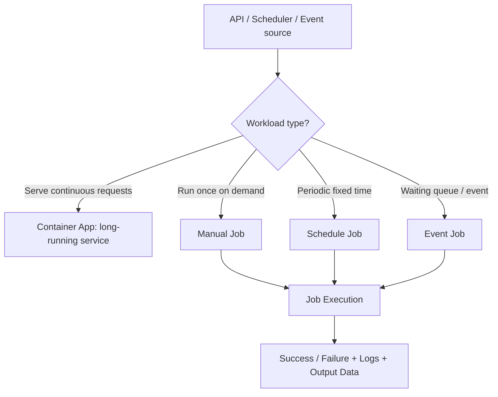
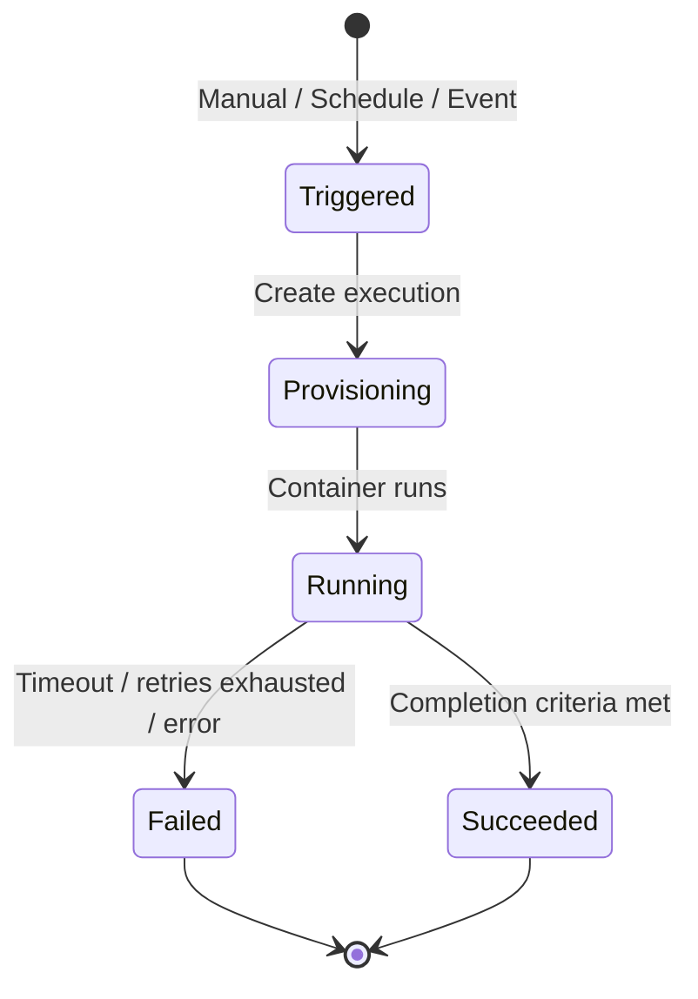
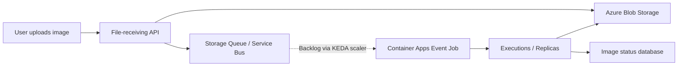
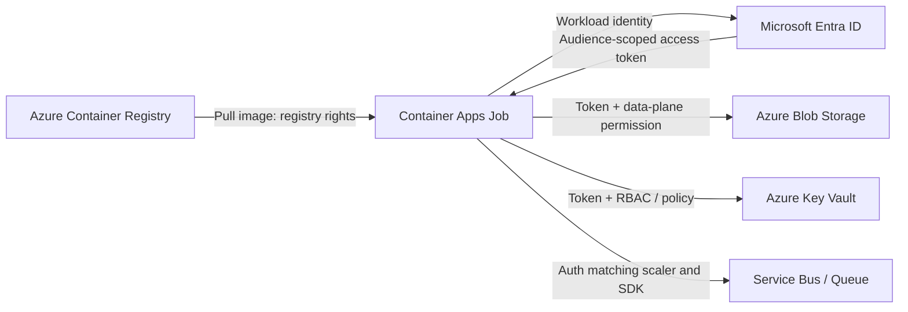

# Container Apps Jobs for Background and Scheduled Tasks

Not every container on Microsoft Azure needs to run continuously serving HTTP requests. An e-commerce system may need to generate a revenue report at 09:00 every day, process thousands of newly uploaded images, import partner data, or clean up temporary data after expiration. These tasks share common traits: **a starting point, a bounded volume of work, and a completion condition**. Placing them inside a web app or an always-on container forces the operations team to build schedulers, coordinate workers, handle retries, and pay for idle time.

**Azure Container Apps Jobs** lets you execute **finite-duration containers** in three ways: on demand/manually (**Manual**), on a cron expression (**Schedule**), or triggered by events (**Event**). The service leverages the Azure Container Apps environment, supporting appropriate resource configurations, networking, secrets, and managed identities while tracking individual runs (**executions**). Jobs are especially useful when a workload is already containerized and can run to completion and exit.

This lesson belongs to the **Container Registry and Container Apps** chapter of the Azure module. We connect knowledge of Azure Container Registry (ACR), Microsoft Entra ID, managed identities, resource groups, virtual networking, data services, monitoring, and cost control to design background and scheduled tasks ready for production deployment and operations.

## Learning Objectives

After this lesson, you will be able to:

1. Explain the difference between a long-running **Container App** and a run-to-completion **Container Apps Job**.
2. Choose the exact trigger type—**Manual**, **Schedule**, or **Event**—for each business requirement.
3. Understand **job execution**, **replica**, **parallelism**, **replica completion count**, **timeout**, **retry limit**, and the meaning of exit codes.
4. Write five-field cron schedules in **UTC**, converting schedules to Vietnam local time when needed.
5. Containerize a worker, create, and monitor Jobs using Azure CLI and Portal.
6. Design an event-triggered job using queues and **KEDA**-based scaling, with idempotency safeguards, retries, and poison-message handling.
7. Apply managed identities/ACR, Azure RBAC, secrets, network policies, logging, alerting, cost optimization, and recovery procedures.

## 1. Why Use Container Apps Jobs Instead of an Always-On Web App?

Suppose a retail system has three functional groups:

| Need | Execution Profile | Option to Consider |
|---|---|---|
| Order-receiving API | Always ready for HTTP requests; usually runs multiple continuous replicas. | **Azure Container App** with ingress; or App Service/AKS depending on architecture. |
| Export revenue report at 09:00 daily | Only needs to run briefly and exit. | **Container Apps Job — Schedule**. |
| Convert images when messages arrive in a queue | Arrives in bursts; many independent tasks. | **Container Apps Job — Event**, or a Container App worker with event scaling depending on processing model. |
| One-time data recovery on admin request | Operator or orchestration tool triggers on demand. | **Container Apps Job — Manual**. |

A standard **Container App** targets continuous services or workloads reacting to traffic/events through longer-lived replicas. A **Job** is designed for **bounded** work: the container starts, performs its work, exits, and returns status. It does not need to expose an HTTP endpoint or ingress to accept Internet traffic.



**Choosing a Job does not automatically make a program idempotent, does not guarantee exactly-once event processing, and does not replace database transactions.** Those properties must be engineered at the application and event-source layers.

## 2. Concepts to Understand Before Creating a Job

### 2.1. Container Apps Environment

The **Container Apps environment** is the deployment and operational boundary for container apps and container jobs. It defines properties related to networking, observability, and underlying infrastructure resources. You create a **job resource** inside a compatible environment, pointing to a **container image** built and pushed to a registry (typically ACR).

The environment does not execute tasks on its own. The **job configuration** defines the image, command, CPU/RAM, trigger, concurrency, secrets, and retry handling. Job runs execute using the configuration active at orchestration time, per service mechanics.

### 2.2. Job, Execution, Replica, and Container

| Component | Definition | Example |
|---|---|---|
| **Job resource** | Configuration identifying the task, image, trigger, and execution policies. | `job-daily-report`. |
| **Job execution** | A distinct run instance of the job. | The Nov 20 run and Nov 21 run are two separate executions. |
| **Execution replica** | A running instance within an execution, running containers per template. | An execution processing data using 3 parallel replicas. |
| **Container image** | Packaged program contents, referenced by tag or digest. | `myacr.azurecr.io/reports:1.4.2`. |
| **Exit code** | Exit status of the main process inside the container. | `0` normally indicates success; non-zero indicates failure. |

Do not equate **one execution** with **one message**: with Event Jobs, event batching, execution counts, replicas, and message consumption depend on the trigger/scaler and how the program processes work. Explicitly design whether a worker processes one or multiple work items instead of assuming every message spawns strictly one isolated execution.

### 2.3. Typical Lifecycle



This diagram is a conceptual model; official state names and transition timing are exposed by the service via API/Portal. Jobs may retry or replicas may finish at different times. **A job execution marked Succeeded does not automatically prove output data has been verified by the business system.**

### 2.4. Tasks Must Terminate Themselves

A container job must have a **main process that exits** once no work remains. For instance, a Java program exports a CSV file, uploads it to Blob Storage, confirms completion, and exits with **exit code 0**. On unrecoverable errors, the program should return a **non-zero exit code**, emitting a failure signal so retry policies and monitoring can react.

Never use an image designed to run an indefinite HTTP server for a Schedule Job meant to export a report and exit; the container will run until timeout and be marked failed. Conversely, never log an error and `return 0`, as the system cannot distinguish a failed run from a successful completion.

## 3. Three Trigger Types: Manual, Schedule, and Event

### 3.1. Manual Job: Run on Demand

A **Manual trigger** does not automatically spawn periodic executions. An operator or authorized system initiates an execution via the Azure Portal, Azure CLI, or supported APIs/automation.

Common scenarios:

- Reprocess a corrected dataset after a partner sends a new file.
- Run a one-time migration/sync during a maintenance window.
- Execute a batch run upon administrator approval.
- Run a data-integrity verification utility for a special request.

Manual Job **does not mean** any application user can trigger it. Azure RBAC and automation identities must restrict start/update/delete permissions on the job. If business logic lets a user click "Export Report Now," the backend should check permissions and call the job management API using a trusted identity, never exposing Azure control-plane credentials to the browser.

### 3.2. Schedule Job: Run on a Cron Schedule

A **Schedule trigger** spawns executions on a fixed schedule using a **cron expression**. This suits daily reports, weekend aggregations, overdue data scans, or hourly file syncs.

Azure Container Apps Jobs uses a **five-field** cron format (minute, hour, day-of-month, month, day-of-week) in **UTC** within the service's schedule configuration:

```text
┌──────── minute (0–59)
│ ┌────── hour (0–23)
│ │ ┌──── day-of-month (1–31)
│ │ │ ┌── month (1–12)
│ │ │ │ ┌ weekday (0–6 or names, per supported syntax)
│ │ │ │ │
0  2  *  *  *
```

Examples:

| UTC Cron | Meaning in UTC | If Operating in Vietnam (UTC+7) |
|---|---|---|
| `0 2 * * *` | Daily at 02:00 UTC. | 09:00 same day. |
| `0 16 * * *` | Daily at 16:00 UTC. | 23:00 same day. |
| `0 */6 * * *` | Every six hours at minute 0. | 01:00, 07:00, 13:00, and 19:00 Vietnam time. |
| `30 1 * * 1-5` | 01:30 UTC Monday through Friday. | 08:30 Vietnam time on weekdays. |

For example, to run at 09:00 AM Vietnam time, use **`0 2 * * *`** instead of `0 9 * * *` (which would run at 16:00 Vietnam time). Verify weekday syntax when using complex schedules, especially when combining day-of-month and day-of-week. Never add a sixth **seconds** field when the service expects five fields.

**A schedule is a launch signal, not an exactly-once processing guarantee.** Workloads must tolerate retried executions, runs overrunning into the next scheduled window, or manual operator re-runs. To prevent two report runs from overwriting the same file, enforce locking or period identifiers at the data layer.

### 3.3. Event Job: Run When Work Awaits

An **Event trigger** typically relies on **KEDA** (Kubernetes Event-driven Autoscaling) and compatible **scale rules** to monitor event sources like queues and spawn executions. This handles workloads arriving unpredictably.

Image upload processing example:



Event Jobs fit when a unit of work can run finitely, often with variable concurrency. Still, **the queue consumer inside the container must actively receive, process, and complete/ack messages per queue protocol**; the scaler does not replace consumer logic and does not guarantee business data completion.

### 3.4. Quick Selection Table

| Need | Recommended Trigger | Why? |
|---|---|---|
| Admin triggers an import job upon approval | Manual | Controls exact launch timing. |
| Export report at 09:00 AM daily | Schedule | Stable recurring schedule, properly converted to UTC. |
| Process files whenever queue has messages | Event | Scales with backlog instead of a fixed clock. |
| HTTP worker must stay always available | Container App | Not a finite run-to-completion task. |
| Batch of millions of tasks across specialized nodes | Evaluate Azure Batch / AKS Jobs | May require specialized workload scheduling and quotas. |
| Send emails in a multi-step approval workflow | Evaluate Logic Apps/Functions | May be simpler than managing container jobs. |

## 4. Execution Parameters Affecting Reliability

### 4.1. Replica Timeout

**Replica timeout** caps how long a replica may run for a single attempt. If a process hangs or a job fails to exit, timeouts prevent indefinite resource consumption. For instance, `1800` seconds = 30 minutes for a report export job normally taking 5–10 minutes.

Setting a timeout too short aborts legitimate runs; setting it too long delays detection of hung tasks and raises costs. Measure p95/p99 runtimes including data reads, API calls, and result uploads, then implement cancellation or checkpointing accordingly.

### 4.2. Replica Retry Limit

**Replica retry limit** caps how many times a replica retries upon failure per service mechanics. A transient Blob connection error may succeed on retry. Yet retrying a money transfer or invoice issuance without an idempotency key can cause **duplicate operations**.

Distinguish two retry layers:

- **In-application retries:** short-term retries with exponential backoff and jitter for transient network/HTTP 429/503 errors.
- **Job replica/execution-level retries:** the service re-runs failed attempts per configuration.

Total downstream attempts equal the **combined effect of both layers**; cap retries, timeouts, and side-effecting attempts. Malformed data, permanent permission failures, or invalid schemas should never retry indefinitely.

### 4.3. Parallelism and Replica Completion Count

Within a single execution, **parallelism** controls how many replicas can run concurrently per configuration; **replica completion count** is how many replicas must succeed for the execution to reach completion. These two parameters are related but **not two names for the same value**.

| Workload Pattern | Example Starting Configuration | Conditions to Check |
|---|---|---|
| Once-daily report | `parallelism=1`, `replica-completion-count=1`. | Do not run duplicate copies of one report inside the same execution. |
| Processing multiple independent partitions | Raise parallelism and completion count to match. | Each replica must claim its own partition to avoid duplicate data processing. |
| Event queue needing multiple workers | Tune execution/replica counts and concurrency. | Queue semantics, concurrency limits, and downstream throughput. |

**Increasing parallelism does not automatically split a file into separate chunks.** If every replica's container runs `process-all-orders`, two replicas will process all orders twice. Design partition IDs, leasing, message consumption, or work-distribution coordination. For scheduled jobs, start with **one replica** until genuine partitioning needs arise.

### 4.4. Event-Driven Parallel Execution Limits

Event triggers have scaling limits and parameters such as min/max executions defined by scale rules and service configuration. **Max executions** is a vital guardrail protecting budgets and downstream systems; it does not mean every queued message immediately spawns an independent execution. KEDA operates with polling intervals, metric evaluation, and resource limits, so real-world scale must be tested.

Suppose each execution processes 10 images/second against a 20,000-image backlog: raising max executions to 50 can flood Azure Storage/DB with connections. Set caps based on **end-to-end pipeline throughput**, not just waiting task count.

## 5. Packaging a Java Task as a Finite-Running Container

Jobs are easiest to operate when the image runs a clear **batch command**: read configuration, process data, write outputs/telemetry, and exit with an accurate exit code. Example packaging a Java JAR application:

```dockerfile
FROM eclipse-temurin:21-jre
WORKDIR /app
COPY target/report-job.jar /app/report-job.jar
USER 10001
ENTRYPOINT ["java", "-jar", "/app/report-job.jar"]
```

This example only shows a Dockerfile for an already-built JAR without running Maven/Gradle in the lesson. In real use, verify directory read permissions, CA certificates, timezones, CPU architecture, dependency vulnerabilities, and how the pipeline produces the JAR. If the image writes temporary files, use a path with appropriate write permissions and space for the non-root user.

### 5.1. Exiting with the Right Status

Pseudocode for a report-export job:

```text
main():
    runKey = period + reportType
    acquireLeaseOrCheckIdempotency(runKey)

    try:
        data = loadRecordsForPeriod(period)
        report = transformAndValidate(data)
        writeTemporaryBlob(runKey, report)
        publishResultAtomicallyOrConditionally(runKey)
        markRunSucceeded(runKey)
        exit(0)
    catch RetryableError:
        recordFailureWithoutSecrets(runKey)
        exit(nonZero)
    catch PermanentInvalidData:
        quarantineInputAndAlert(runKey)
        exit(nonZeroOrExplicitHandledPolicy)
    finally:
        releaseLeaseIfOwned(runKey)
```

This is **design pseudocode**, not directly compilable Java code. `publishResultAtomicallyOrConditionally` can use conditional writes/ETags or appropriate transactions; it does not guarantee cross-Blob-and-database atomicity unless you design it yourself. Explicitly handle cases where a run stops after writing output but before marking success.

### 5.2. Never Store Critical Outputs in the Container's Ephemeral Filesystem

Containers can be purged once an execution completes or fails. **The local filesystem is not durable job storage.** Write reports to Azure Blob Storage, data lakes, or databases, and send status to monitoring systems. Scratch storage can assist processing, provided you account for quota/IOPS and loss when the replica terminates.

### 5.3. Handling Stop Signals and Timeouts

Workers should handle runtime stop signals to stop accepting new work, flush state, and exit within bounds. In Java, use shutdown hooks and manage executors/thread pools cleanly, without assuming the platform always grants enough time to finish an entire transaction upon cancellation. For long tasks, add **checkpoints** and idempotency so subsequent runs recover safely.

## 6. Preparing Infrastructure and Image Registry

Before creating a Job, ensure you have:

1. **Subscription and resource group** where you are permitted to create Container Apps resources.
2. **Container Apps environment** in a region and network matching your data sources.
3. **Pullable container image**, e.g., `myacr.azurecr.io/jobs/reports:1.4.2`, built, scanned, and smoke-tested locally or in CI.
4. **Registry permissions** for runtime image pulls; for private ACR, prefer managed identities and appropriate roles like `AcrPull` per supported registry/Container Apps mechanisms.
5. **Data permissions** for the Job to access Storage/Key Vault/Service Bus granted separately via Azure RBAC or service data-plane mechanisms.
6. **Networking, DNS, and firewalls** properly configured, especially when ACR, Key Vault, Storage, or Service Bus use private endpoints or network restrictions.
7. **Log Analytics/monitoring** and retention policies to investigate failed executions.

### 6.1. Registry Credentials Are Not Data Access Permissions

When a Job pulls an image from Azure Container Registry, the runtime needs **image read permission**. When the container subsequently reads Blob Storage, it needs **Storage data-plane permissions**. `AcrPull` does not permit reading blobs, and `Storage Blob Data Reader` does not permit pulling ACR images. These are **two separate authorization relationships**.

### 6.2. Tag or Digest?

Image tags like `reports:latest` can be overwritten, silently changing contents. For multi-day scheduled tasks, use immutable **versioned tags** by convention or **image digests** to trace exactly which version each execution ran. When updating a Job, prepare a rollback plan and confirm older or in-flight runs do not get mixed versions.

## 7. Azure CLI Practice: Creating a Scheduled Job at 09:00 Vietnam Time

Goal: create a **Schedule Job** running a finite task container daily at **02:00 UTC (09:00 Vietnam time)**, inspect configuration, and observe executions. This lab assumes the resource group, Container Apps environment, and image already exist. Names and addresses are illustrative; substitute your own environment values.

### 7.1. Prerequisites

- Azure CLI with `az containerapp` commands supporting Jobs in your installed version/extension.
- Permissions to create jobs in the target resource group and environment.
- The image actually executes a batch command and returns **exit 0** on success; **never** use an infinitely running web server.
- If the image sits in a private ACR, registry auth/managed identity is configured per service-supported methods.
- Connectivity to required data sources and budget for CPU/RAM, logs, networking, and supporting services.

**Note:** the commands below **create and may trigger billable resources**. Never run them in a production subscription or environment without authorization. If your CLI lacks Jobs flags, check/update the extension and run `az containerapp job create --help` rather than guessing parameters.

### Step 1. Select Subscription and Set Variables

```bash
az login
az account list --output table
az account set --subscription "<subscription-id>"

RG="rg-container-jobs-lab"
ENV="cae-jobs-lab"
JOB="job-daily-report"
IMAGE="<registry-name>.azurecr.io/jobs/report:1.4.2"
```

Verify the environment exists:

```bash
az containerapp env show \
  --resource-group "$RG" \
  --name "$ENV" \
  --query "{name:name,id:id,location:location}" \
  --output json
```

The goal here is a Container Apps **Job**, so do not create a Container App with HTTP ingress expecting it to terminate itself on a cron schedule.

### Step 2. Create the Scheduled Job

```bash
az containerapp job create \
  --resource-group "$RG" \
  --name "$JOB" \
  --environment "$ENV" \
  --trigger-type Schedule \
  --cron-expression "0 2 * * *" \
  --replica-timeout 1800 \
  --replica-retry-limit 1 \
  --parallelism 1 \
  --replica-completion-count 1 \
  --image "$IMAGE" \
  --cpu 0.5 \
  --memory 1.0Gi
```

Explanation:

| Option | Role |
|---|---|
| `--trigger-type Schedule` | Schedule spawns executions automatically. |
| `--cron-expression "0 2 * * *"` | Runs at 02:00 UTC daily, i.e., 09:00 Vietnam time. |
| `--replica-timeout 1800` | Caps each attempt at 30 minutes under Job timeout mechanics. |
| `--replica-retry-limit 1` | Permits replica-level retries per policy. |
| `--parallelism 1` | Starts one replica concurrently; keeps single-period reporting simple. |
| `--replica-completion-count 1` | Requires one replica to finish successfully. |
| `--cpu 0.5 --memory 1.0Gi` | Initial test resources, not production sizing. |

This is an illustrative deployment command. If the image requires environment variables, secrets, managed identities, or custom container commands, supply those **before running in production**. For private ACR, creating the Job does not automatically grant pull roles just because the image URL points to ACR.

### Step 3. Inspect the Job Resource

```bash
az containerapp job show \
  --resource-group "$RG" \
  --name "$JOB" \
  --output json
```

In the output, verify **trigger type**, cron expression, image, timeout, retry limit, parallelism, completion count, resource requests, and target environment. Never publish full configurations if they expose secrets or sensitive environment values.

### Step 4. Observe Executions

```bash
az containerapp job execution list \
  --resource-group "$RG" \
  --name "$JOB" \
  --output table
```

For a newly created Schedule Job, an execution may not appear immediately; it runs when the scheduled time arrives or when triggered via supported mechanisms. Monitor in the Portal under Jobs/Executions and Log Analytics if configured. **Seeing an execution does not prove the report file uploaded properly**: verify output in Blob Storage/DB and business metrics.

### Step 5. Troubleshoot Failures

If no execution appears or an execution fails:

1. Check the cron UTC date/time and your observation window.
2. Check job execution events/state and container logs in the Portal/Log Analytics.
3. Check image pull capability, ACR permissions, image entrypoint, and image architecture.
4. Check identity, secret resolution, data connectivity, and network environment.
5. Check timeout, exit code, CPU/memory, and actual runtime duration.

**Do not delete resources immediately after one successful run** if you still need to inspect data or test schedules. Cleanup must be approved and affect only lab resources you own.

## 8. Practicing a Manual Job for One-Time Data Processing

A Manual Job fits tasks triggered by an explicit administrative action. The example below reuses the **image and environment prepared** earlier; create a separate job so the scheduled job remains untouched:

```bash
MANUAL_JOB="job-import-on-demand"

az containerapp job create \
  --resource-group "$RG" \
  --name "$MANUAL_JOB" \
  --environment "$ENV" \
  --trigger-type Manual \
  --replica-timeout 1800 \
  --replica-retry-limit 1 \
  --parallelism 1 \
  --replica-completion-count 1 \
  --image "$IMAGE" \
  --cpu 0.5 \
  --memory 1.0Gi

# Start an execution once authorized
az containerapp job start \
  --resource-group "$RG" \
  --name "$MANUAL_JOB"

# List executions
az containerapp job execution list \
  --resource-group "$RG" \
  --name "$MANUAL_JOB" \
  --output table
```

**Important:** both Manual and Schedule in this example reference the same image. If the image defaults to generating a report, the Manual Job will run the report rather than magically becoming an import tool. In real applications, use separate images, commands/args, or business configuration to select the right operation. Never assume the resource name `job-import-on-demand` changes the program inside the container.

To let end users launch tasks, never place `az` credentials in the browser. A backend can accept the request, verify permissions, log an audit entry, use a managed identity/service principal with appropriate Azure RBAC to start the job via the control plane, and return an execution/correlation ID for tracking.

## 9. Event Jobs: Connecting Queues and Scaling with Load

An **Event Job** lets the platform spawn executions based on a **scale rule**. For image processing, an API saves the source image and sends a message to an **Azure Service Bus Queue** or **Azure Storage Queue**. The system uses a KEDA-compatible scaler to watch the backlog and trigger jobs as needed. Containers must understand the message schema, receive messages cleanly, and complete processing per queue protocol.

### 9.1. Configuring an Event Job in the Portal

1. Prepare a Service Bus or Storage **queue**, configuring retry/lock/visibility and dead-letter settings for the queue type.
2. Prepare a container image containing consumer logic: receive message, process data, write output, acknowledge success, and exit per execution design.
3. In the Azure Portal, open **Container Apps → Jobs → Create**, pick resource group, environment, image, and **trigger type: Event**.
4. Configure the **scale rule** per supported scaler: event source type, queue/namespace name, backlog threshold or required metadata, and authentication method.
5. Configure **min/max executions** and replica limits suited to incoming volume, Storage/database capacity, and budget caps.
6. Configure **replica timeout**, retries, and parallelism, especially when handling large files or irreversible actions.
7. Grant the Job permissions to access the queue, Storage, or Key Vault; verify networking, DNS, and firewalls.
8. Send a **harmless test message**, watch executions/logs, and verify the message is processed and output lands in the right place.

**Portal/CLI property names may vary by scaler type and supported version.** When using identity-based scalers, verify that both the event source and auth mechanism are supported by KEDA/Container Apps. If a scaler requires a connection string, reference it strictly through a protected secret—never write credentials in YAML or publicly logged commands.

### 9.2. Queue Triggers Do Not Automatically Guarantee Exactly-Once Execution

Suppose a queue message contains:

```json
{
  "jobId": "image-9135",
  "blobPath": "uploads/user-42/photo.jpg",
  "requestedVariant": "thumbnail-256"
}
```

The worker transforms the image and writes `processed/image-9135/thumbnail-256.jpg`. Yet if the worker finishes uploading and loses connectivity **before acknowledging the message**, the queue can redeliver the message to another run. Thus, the same unit of work can execute **more than once**.

To prevent corrupted results:

- Use `jobId` or a stable business key as an **idempotency key**.
- Check whether the work already completed before executing side effects, or use conditional writes/transactions.
- Never delete/complete a message before critical output writes succeed.
- Enforce **maximum delivery count**, dead-lettering, or quarantine for unprocessable messages.
- Combine bounded retries, exponential backoff, and logging with correlation IDs.
- Never assume execution processing order strictly matches queue enqueue order.

### 9.3. Protecting In-Flight Messages During Long-Running Jobs

**Service Bus** uses peek-lock, lock duration, lock renewal, and dead-lettering per configuration. **Storage Queue** uses visibility timeouts and deleting messages via pop receipts after processing. If processing one image takes 20 minutes while lock/visibility lasts only a few minutes without renewal, the message can be redelivered while the original worker is still running.

**Job timeout and queue lock timeout are two independent limits.** Allowing a Job to run for 30 minutes does not make Service Bus automatically renew locks for 30 minutes. Workers must use appropriate SDKs/processors and policies; if execution time cannot be bounded reliably, split tasks into smaller checkpointed steps.

### 9.4. From Backlog to Execution Count

Suppose the queue holds 900 images, each execution processes a batch of 30 images in 2 minutes, and the target is clearing the backlog within 10 minutes. A rough estimate assuming no new arrivals:

\[
N\approx\left\lceil\frac{900/30\times 2}{10}\right\rceil=6
\]

This yields roughly **6 concurrent executions** to drain the batch under ideal conditions. This is not a value KEDA automatically infers from any arbitrary scale rule: configure thresholds and concurrency limits per scaler, factoring in execution startup time, task variance, retries, message locks, and downstream throughput.

If the database only supports 3 concurrent workers, raising max executions to 20 will spike connection pool errors. Cap concurrency at the **actual bottleneck** and alert if backlog exceeds expected processing time.

## 10. Designing Safe Jobs: Idempotency, State, and Deduplication

Background jobs frequently mutate real data: exporting reports, billing, sending notifications, updating order states. A reliable pattern persists a **progress record** outside the container instead of relying solely on exit codes.

### 10.1. Business Keys and State

Example Schedule Job exporting the Nov 20 report:

```text
businessKey = daily-report:2026-11-20

PENDING -> RUNNING -> SUCCEEDED
              |
              +----> RETRYABLE_FAILURE -> PENDING
              |
              +----> PERMANENT_FAILURE -> REVIEW
```

When an execution starts, it attempts to create/claim the record keyed by `businessKey` **atomically**. If the record is already succeeded, the job can log "already completed" and exit per policy. If a run hangs, a **lease/heartbeat with expiry** lets a subsequent run recover safely. Never implement locking with separate `SELECT` then `INSERT` calls when two executions might overlap without a unique constraint or atomic operation.

### 10.2. Writing Results Consistently

A useful file export workflow:

1. Write the output file to a staging area named with `businessKey` and `executionId`.
2. Validate schema, row count, checksum, or manifest.
3. Write/commit business metadata via conditional operations or appropriate transactions.
4. Publish the final path to consumers only after verification passes.
5. Mark the run succeeded; on retries, check `businessKey` to avoid creating duplicate final files.

Note: Blob Storage and databases generally **lack** automatic distributed transactions. To prevent "blob written yet DB uncommitted," design **outbox/saga/reconciliation** or compensating workflows. Return exit code 0 only once completion conditions are verified.

### 10.3. Re-Runs and Backfills

When reports from three days ago are missing, you may need a **backfill** without altering the live schedule. Design workers to accept the target period via args/env or a keyed work item; Manual Jobs or automation can replay missing periods with audit trails. Never hard-code reliance on `now()`, or a backfill for an old date will accidentally export today's data.

If a job overruns into the next scheduled window, pick an explicit policy: **allow overlap**, **skip the new window**, or **enqueue the new period**. This decision belongs to business logic and key/idempotency storage—cron alone will not solve it.

## 11. Managed Identity, Azure Container Registry, and Secrets

In production, Jobs frequently access private image registries and private data stores. **Never bake registry passwords, Storage account keys, or Service Bus connection strings directly into a Dockerfile.**



### 11.1. System-Assigned vs. User-Assigned Identity

| Type | Advantages | Controls Needed |
|---|---|---|
| **System-assigned managed identity** | Lifecycle tied to a single Job resource; simple for standalone workloads. | Deleting/recreating the Job changes the principal, requiring role reassignment checks. |
| **User-assigned managed identity** | Independent resource usable deliberately across deployment lifecycles. | Sharing too broadly across many Jobs widens blast radius if compromised. |

Example permissions:

- **ACR:** image pull permissions, such as `AcrPull` in the compatible classic role model; check repository roles/permissions if the registry uses another authorization mode.
- **Blob Storage:** `Storage Blob Data Contributor` only when uploading; `Storage Blob Data Reader` if read-only.
- **Service Bus:** appropriate data receiver/sender roles for consumers/producers when using Entra ID; never grant full namespace admin rights just to receive messages.
- **Key Vault:** `Key Vault Secrets User` under RBAC permission model when reading secrets; check access-policy mode if configured differently.

**Image pull permissions and data read permissions are independent.** A Job can fail to start with image pull 401 even while holding Blob read rights; it can also pull cleanly yet fail processing with 403 due to a missing Storage role. Diagnose step by step.

### 11.2. Connecting ACR via Identity

General workflow:

1. Create/attach a managed identity to the Job per service capabilities.
2. Assign the matching image pull role to the principal on ACR/repository at minimal scope.
3. Configure Job registry authentication to use that identity rather than long-lived username/password credentials.
4. Verify the environment can resolve and connect to ACR endpoints, including private networking if applicable.
5. Deploy images by explicit tag/digest and inspect pull logs on the first execution.

When using `az role assignment create`, supply the real **principal ID** and ACR resource ID; never mix up client ID, principal ID, and Azure resource ID. Because Job CLI/Portal capabilities vary across versions, verify registry/identity settings directly on the Job resource rather than assuming another Container App's registry setup applies automatically.

### 11.3. Secrets and Environment Variables

Jobs can receive non-sensitive parameters via env vars such as `REPORT_REGION`, `OUTPUT_CONTAINER`, or `BATCH_SIZE`. For credentials where target services lack identity-based auth, use **Container Apps secrets** and **secret references** via supported mechanisms, integrating Key Vault references where available and configured.

Never store secrets in plaintext in source control, build scripts, image layers, Docker ARGs, logs, or recorded commands. Define rotation policies and how Jobs pick up new values; **never assume a running execution automatically refreshes a newly rotated secret**.

## 12. Networking, DNS, and Private Service Access

A Job can hold a valid managed identity yet fail to reach Storage or Key Vault due to **routing, Private Endpoints, DNS, or firewalls**. If data sources only allow private networks, design the Container Apps environment/VNet per supported features and inspect:

- Egress paths to storage accounts, Key Vault, registries, or Service Bus endpoints.
- Private DNS zone links and hostname resolution to exact private IPs.
- Firewalls/NSGs/UDRs/Azure Firewall and return paths across network virtual appliances.
- TLS certificates, outbound proxies, and DNS resolution inside the container.
- Bandwidth/egress limits and resilience when a target service slows down.

**Jobs rarely need HTTP ingress.** Needing to read/write Storage is an **outbound networking** requirement, not a reason to expose a job to the Internet. If external users need to trigger runs, build an authenticated API/web app frontend that invokes the control plane to start a manual job or enqueues a message.

## 13. Logging, Execution Status, and Monitoring

Container Apps Jobs are intermittent workloads; inspecting application logs only when errors surface can catch issues too late. Monitor both **job orchestration** and **business outcomes**.

### 13.1. Signals to Collect

| Signal | Monitoring Source | Suggested Alert |
|---|---|---|
| Execution start/finish | Container Apps Jobs executions, Portal/CLI/API. | Missing execution during expected schedule window. |
| Exit status, retries, timeouts | Job execution/replica status and system logs. | Failed executions or consecutive retries. |
| stdout/stderr | Container logs collected per environment/Log Analytics config. | Spike in exceptions or error logs. |
| Business outcomes | Status database, Blob manifests, report checksums. | Job reports success while file is missing or row counts fail validation. |
| Queue backlog/oldest age | Azure Monitor metrics on queue/Service Bus. | Backlog fails to shrink even at max executions. |
| p95/p99 runtime duration | Application metrics/correlation IDs. | Job approaches timeout or misses reporting deadline. |
| Cost/usage | Azure Cost Management, related metrics. | Cost spikes from retries or excessive executions. |

### 13.2. Structured Log Format

A log entry might look like:

```json
{
  "event": "report_finished",
  "jobName": "job-daily-report",
  "executionId": "<execution-id>",
  "businessKey": "daily-report:2026-11-20",
  "durationMs": 41500,
  "rowsWritten": 12034,
  "outcome": "success"
}
```

Never log files containing personal data, Microsoft Entra ID tokens, managed identity tokens, or connection strings. On errors, log error codes, request/correlation IDs, failing steps, and retryability—avoid dumping raw customer payload bodies.

### 13.3. Querying Logs in Log Analytics

If the Container Apps environment forwards console logs to Log Analytics, query logs by Job/container name in the workspace-provided table. Table and column names vary across schemas/versions (such as `_CL` custom log tables in some configurations). **Never treat the query below as universal syntax across every workspace**:

```kusto
// Example for workspaces using tables and columns with the _CL suffix
ContainerAppConsoleLogs_CL
| where TimeGenerated > ago(24h)
| where ContainerAppName_s has "job-daily-report"
| order by TimeGenerated desc
| take 100
```

If the query fails due to missing tables/columns, confirm the exact **workspace and active log schema** first, open Logs on the Job/environment resource to view available tables, then adapt the query. Never conclude "the job didn't run" merely because you queried the wrong workspace.

### 13.4. A Success Log Is Not Enough

Suppose a Job exits `Succeeded` after writing 200 files when 250 were expected. At the orchestration layer the container returned `exit(0)`, yet at the business layer output is incomplete. Enforce **business success criteria** such as record counts, checksums, batch manifests, commit statuses, and data integrity checks.

Azure Activity Log tracks control-plane edits to job definitions and roles; it does not replace application logs or per-message audits. When investigating a failed execution, correlate execution status, container logs, queue state, and downstream telemetry via a shared correlation ID.

## 14. Performance and Cost Calculations

Container Apps Jobs reduce idle compute compared to always-on workers, yet **do not mean zero total cost when no executions run**. Billing models can depend on Container Apps environment type, workload profile config, allocated resources, execution seconds, networking, Log Analytics, registries, Storage, queues, and related services. Always check pricing for your actual region and deployment mode.

### 14.1. Estimating Compute Consumption

Suppose a Schedule Job uses 0.5 vCPU and 1 GiB RAM, running an average of 8 minutes/day over 30 days:

```text
Expected total execution time: 8 × 30 = 240 minutes = 14,400 seconds
Expected total vCPU-seconds:   0.5 × 14,400 = 7,200 vCPU-s
Expected total GiB-seconds:    1 × 14,400 = 14,400 GiB-s
```

This is an **application resource-time estimate**, not an exact invoice. Account additionally for environment/workload profile billing rules, startup time, concurrency, retries, minimum billing increments where applicable, and ancillary resources. For example, if a job retries twice across several days, total compute time and downstream requests increase.

### 14.2. Rapid Scale-Out Does Not Always Make Batches Cheaper

If ten replicas read concurrently from a slow database, throughput may stagnate while compute and network costs rise. Before raising parallelism/max executions, measure:

1. Time spent per phase: reading, processing, writing outputs, network waits.
2. Actual CPU/memory usage versus container resource limits.
3. Throughput/quotas of databases, Blob, queues, and ACR pulls across concurrent replicas.
4. Retry rates, timeouts, dead-letter rates, and resource errors.
5. Impact on SLOs of APIs/web apps sharing downstream databases.

Optimize concurrency and batching before simply increasing execution counts. Set **max executions**, **timeouts**, **retry limits**, **resource limits**, and **budget alerts** based on measured telemetry.

## 15. When to Choose Jobs, Functions, AKS CronJobs, or Azure Batch?

| Service | Key Model | When to Consider |
|---|---|---|
| **Container Apps Jobs** | Finite containers, Manual/Schedule/Event, managed runtime inside Container Apps environment. | Already have container images, want low infra ops, need batch/scheduled/event-triggered tasks. |
| **Azure Container Apps (service)** | Container apps with HTTP/event ingress and on-demand persistent replicas. | APIs, long-running background consumers, or services needing traffic routing. |
| **Azure Functions** | Event-driven code functions, triggers/bindings, hosting-plan scaling. | Relatively short logic, quick event integration without managing full container jobs. |
| **AKS CronJob / Kubernetes Job** | Kubernetes-native orchestration, pod templates, volumes, K8s ecosystem. | Organizations standardized on AKS needing deep Kubernetes customization. |
| **Azure Batch** | Coordinates node pools, jobs/tasks, and autoscaling for HPC/batch. | Massive parallel tasks, HPC, specialized compute scheduling needs. |
| **Logic Apps** | Workflows with connectors, recurrence, branching/approvals. | Multi-system integration workflows with explicit orchestration steps. |

**Do not pick Container Apps Jobs merely because it says "job."** If the task is simply sending an email after a minor event, Functions may be simpler. If optimizing thousands of complex CPU/GPU tasks, Batch/AKS may fit better. If you already have finite Java/Python container images to trigger by queue or cron without managing Kubernetes, Container Apps Jobs is a strong candidate.

## 16. Troubleshooting: Job Not Running, Failing, or Running Twice

| Symptom | Common Causes | Investigation Steps |
|---|---|---|
| No execution on schedule | Cron entered in local time instead of UTC; wrong day/weekday; wrong time window. | Re-read five-field cron, verify UTC conversion and schedule status. |
| Manual start fails | Missing RBAC or invalid job resource. | Check identity, scope, `az containerapp job show`, and control-plane errors. |
| Image pull fails | Nonexistent image/tag, missing ACR rights, registry networking. | Check tag/digest, `AcrPull`/registry auth, private DNS, and egress. |
| Execution runs endlessly | Image boots web server/infinite loop; worker never exits. | Check entrypoint, timeout, and completion exit logic. |
| Execution returns non-zero exit | App bug, missing env, missing secret, or dependency error. | Inspect console logs, exceptions, identity, and config. |
| Job times out | Oversized data, slow source, deadlock, or overly short timeout. | Measure runtime, split work, checkpoint, or tune timeout appropriately. |
| Event Job does not scale up | Wrong scale rule, missing scaler auth, unsupported event/metric source. | Check queue metadata, secret/identity, event rule, and system logs. |
| Event Job scales too aggressively | Low threshold, large backlog, high max, or poison messages. | Cap max executions, inspect retries/dead-letter, and check downstream throughput. |
| Duplicate results produced | Retry after side effect finished; concurrent executions claiming the same business key. | Unique business key, idempotency, and atomic claim/commit. |
| Job succeeds yet file missing | Wrote to ephemeral filesystem or wrong container/account. | Verify output target Blob/DB, path, and business manifest. |
| 403 reading Storage/Key Vault | Wrong runtime identity, missing data-plane RBAC, or firewall. | Check principal ID, scope, Private Endpoint/DNS, and service logs. |
| No logs visible | Wrong workspace, logging disabled, or wrong execution/schema queried. | Check environment logs, execution ID, and actual table/column names. |

### 16.1. Layered Diagnostic Flow

```text
Job output missing
  |
  +-- Was an execution created?
  |    +-- No: check trigger, UTC cron, event scaler, RBAC
  |
  +-- Did the execution start?
  |    +-- No: check environment, image pull, registry, CPU/RAM quotas
  |
  +-- Did the container run and exit properly?
  |    +-- No: check entrypoint, exceptions, timeout/retries
  |
  +-- Were data services reachable?
  |    +-- No: managed identity, data-plane RBAC, DNS, firewalls
  |
  +-- Is the business outcome valid?
       +-- No: idempotency, message ack, validation, transactions
```

Never fix an image pull failure by granting broader Storage rights; never fix a missing data-plane role by granting subscription-wide `Owner`; never raise retries infinitely when a job processes malformed data. Always diagnose the **first failing step** in the chain.

## 17. Design Scenario: Scheduled Reporting and Event-Driven Image Processing

A company operates a retail API on Azure Container Apps with two needs:

**Need A — Reporting:** daily at 09:00 Vietnam time, the system queries the prior day's data, exports a Parquet/CSV file to Blob Storage, and writes status to a database. Normal runtime is 7 minutes, occasionally reaching 18 minutes. Must never emit duplicate reports for the same period on retries.

**Need B — Image Processing:** when customers upload images, the API pushes messages to Service Bus. Each image takes 10–30 seconds to process, message bursts occur, and duplicate processing corrupts data.

### Suggested Design for Need A

1. Create a **Schedule Job** with cron `0 2 * * *` to start at 09:00 Vietnam time.
2. Use a finite Java batch image with `parallelism=1` and `replica-completion-count=1` as the baseline.
3. Set timeout above p99 runtime and bounded retries; avoid blind defaults without measurement.
4. Use `businessKey=report:<date>` with unique constraints/leases and conditional writes to prevent duplicates on retries or manual reruns.
5. Use managed identity to read data and write Blobs with least-privilege permissions on the target container/DB.
6. Alert if the finalized report is missing before deadline or row counts fail checks.

### Suggested Design for Need B

1. Create an **Event Job** using the Service Bus Queue scaler with secure authentication.
2. Each worker receives messages via SDK, processes the image, writes the output blob, and completes the message only on success.
3. Use `imageId+variant` as the idempotency key; handle retries and dead-letter corrupt messages.
4. Cap max executions/concurrency to match Storage/DB throughput; monitor oldest-message age.
5. For very large images or tight deadlines, split work and add checkpoints so retries do not redo everything.
6. Monitor costs across CPU/RAM execution time, operations, and egress; limit verbose logging.

### Self-Check Questions

1. Why must a Schedule Job at 09:00 in Vietnam use `0 2 * * *` instead of `0 9 * * *`?
2. Why does raising `parallelism` to 10 not automatically make a report run 10x faster?
3. What happens when a container running an infinite HTTP server is deployed as a Job?
4. Why can a Service Bus message be processed twice even after a worker successfully wrote the output file?
5. What is the difference between ACR image pull permissions and Blob Storage read permissions?
6. If a Job execution shows `Succeeded` yet 30% of output data is missing, has it succeeded in business terms?
7. What should you inspect when an Event Job fails to spawn more executions despite a growing queue?

**Answer hints:** Jobs cron uses UTC; parallelism requires explicit work partitioning; containers must exit on completion or they time out; messages can redeliver if ack fails; ACR and Storage use separate permissions/data planes; business success must be explicitly verified; event scaling depends on scale rules, scaler auth, backlog, max executions, and event source health.

## 18. Production Deployment Checklist

- [ ] Selected **Container App** vs. **Container Apps Job** accurately based on workload lifecycle.
- [ ] Selected **Manual/Schedule/Event** trigger matching the real activation source rather than using cron to emulate events everywhere.
- [ ] Cron uses **five-field UTC**, verified timezone/date conversions and overlapping-window handling.
- [ ] Image entrypoint runs finitely, exiting 0 only on genuine success and non-zero on failure.
- [ ] Image uses traceable tags/digests, scanned and tested with representative data.
- [ ] Timeout, retry limit, parallelism, and replica completion count are measured/tested against task behavior.
- [ ] For Event Jobs, configured scaler auth, source metadata, min/max executions, queue lock/visibility, and dead-lettering.
- [ ] Application implements idempotency keys, atomic claim/commit, retry budgets, and checkpoints for long tasks.
- [ ] Critical outputs reside in Blob/Database or durable storage; zero reliance on ephemeral filesystems.
- [ ] Job uses managed identities/secret references, least-privilege ACR permissions, and data-plane RBAC.
- [ ] Container Apps environment has proper DNS, network egress/firewalls, private access, and TLS.
- [ ] Execution status, stdout/stderr, correlation IDs, and business outcome metrics are collected.
- [ ] Alerts active for failed/missing executions, backlog age, quotas, timeouts, and anomalous costs.
- [ ] Tested manual reruns, overlapping schedules, message redelivery, downstream outages, and scale-in/stop handling.
- [ ] Procedures established for image rollback, permission re-provisioning, cleanup, and data/log retention per policy.

## Conclusion

**Azure Container Apps Jobs** fits containers executing bounded tasks and exiting upon completion. **Manual Jobs** run on demand, **Schedule Jobs** run on UTC cron schedules, and **Event Jobs** react to event sources via KEDA scale rules. Operating safely requires combining **accurate exit codes, timeouts, bounded retries, appropriate parallelism, idempotency, message acknowledgment, managed identities, ACR permissions, and durable outputs**. A `Succeeded` execution is merely an infrastructure state; business success still requires result verification and auditing. When triggers, executions, errors, backlogs, and costs are all observed, Container Apps Jobs becomes an effective way to run background and scheduled tasks in Microsoft Azure architectures without maintaining always-on worker servers.
