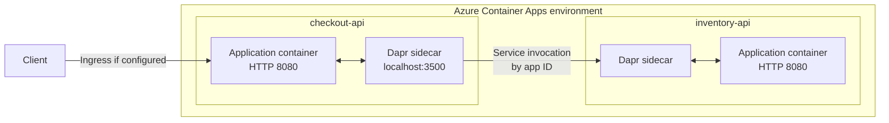
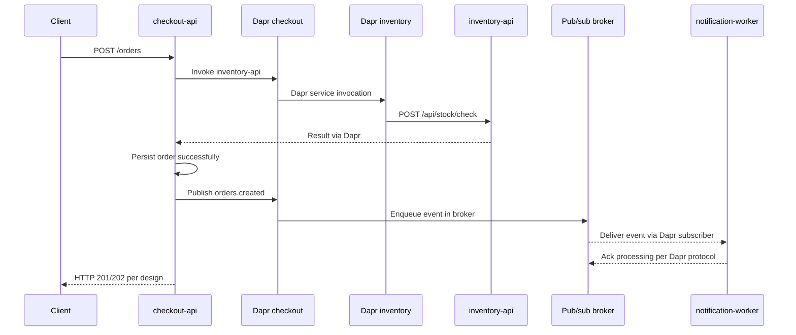
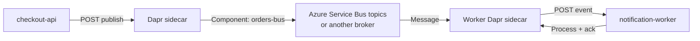

# Dapr and Inter-Service Communication in Container Apps

A retail system is split into multiple services: `checkout-api` accepts orders, `inventory-api` checks stock, and `notification-worker` sends notifications after an order is created. If each service manually handles locating other services' addresses, authentication, retries, message broker connections, and dev/prod environment differences, application code quickly turns complex. **Dapr (Distributed Application Runtime)** standardizes several inter-service communication patterns through shared APIs and configuration components.

In the **CLOUD_PROVIDERS_AZURE** module, you explore the Microsoft Azure ecosystem from subscriptions, resource groups, and Entra ID to virtual networking, compute, storage, data, deployment, monitoring, security, and cost control. This lesson belongs to the **Container Registry and Container Apps** chapter, focusing on integrating Dapr in **Azure Container Apps** for synchronous service calls, asynchronous event exchange, and operating microservice systems.

> **Scope:** Examples assume container apps are created inside an authorized environment. Resource names, endpoints, and config values are illustrative only. Specific Dapr and Container Apps capabilities depend on runtime version, region, and current configuration; verify before deploying to production.

## 1. Learning Objectives

After this lesson, you will be able to:

- Explain what the **Dapr sidecar** is, along with its benefits and limits in Azure Container Apps.
- Distinguish Container Apps **internal HTTP ingress**, **Dapr service invocation**, and **Dapr pub/sub**.
- Configure Dapr app ID, app port, protocol, and call the Dapr API on localhost.
- Invoke another service using Dapr service invocation over HTTP.
- Describe creating a **Dapr component**, publishing events, and registering subscriptions with a message broker.
- Design retries, timeouts, idempotency, security, and observability for inter-service communication flows.
- Troubleshoot common errors: wrong app ID, wrong port, missing component, unreachable broker, or subscriber failing to acknowledge messages.

## 2. Which Parts Do Dapr and Azure Container Apps Solve?

**Azure Container Apps** provides a serverless container platform with revisions, ingress, scaling, and integrated operational infrastructure. Container Apps manages environment and replica lifecycles; applications still implement business logic and talk to other systems.

**Dapr** is an open-source runtime providing API-based building blocks, for example:

| Building Block | Purpose | Example in System |
|---|---|---|
| **Service invocation** | Call another Dapr app by app ID | Checkout calls inventory |
| **Publish/subscribe** | Emit events and receive via a pub/sub component | Checkout emits order-created event; worker receives |
| **State management** | Save/read state via a configured state store component | Persist workflow checkpoints |
| **Bindings** | Interact with external systems via supported bindings | Invoke an integrated external system |
| **Secrets API** | Read secrets from an authorized secret store component | Fetch sensitive config via supported mechanisms |
| **Workflows/actors and other features** | Orchestrate or manage state under appropriate models | Multi-step stateful workflows |

This lesson focuses on **service invocation** and **pub/sub**, as these are the two most common communication patterns between Container Apps. Enable other building blocks only when genuinely needed and after evaluating support.

### Dapr Sidecar

Under Azure Container Apps integration, you **enable Dapr on each container app** that uses Dapr. The platform runs a **Dapr sidecar** alongside the application. The sidecar exposes HTTP/gRPC APIs for the app process to call, then handles service lookup, component interaction, or talking to the target's Dapr sidecar.



Ports `8080` and `3500` are common illustrative defaults; **app port** must match the port your app actually listens on, while the **Dapr sidecar HTTP port** is provided by the runtime (typically via the `DAPR_HTTP_PORT` environment variable).

### What Does Dapr Not Replace?

- Does not write API code, fix business bugs, or create databases.
- Does not make inter-service calls **automatically secure** if apps ignore authorization and input validation.
- Does not conjure a real message broker out of thin air: a pub/sub component still needs infrastructure such as Azure Service Bus or another broker.
- Does not automatically turn an event into an ACID transaction across services.
- Does not guarantee HTTP calls or event processing happen **strictly once**; apps must still design retries and idempotency.

## 3. Three Common Communication Patterns in Container Apps

| Pattern | Mechanism | Best Fit | Things to Watch |
|---|---|---|---|
| **Call via Container Apps internal URL/FQDN** | Direct HTTP via internal ingress | Simple REST services not needing Dapr | Depends on URLs, ingress, networking, and app security |
| **Dapr service invocation** | Call local Dapr API with `app ID`; sidecar routes to target | Synchronous request/response across Dapr-enabled apps | Both sides need compatible Dapr config; timeouts/errors still occur |
| **Dapr publish/subscribe** | Publisher sends event to component; broker delivers to subscribers | Background work, fan-out, temporal decoupling | Needs components, brokers, subscriptions, retries, dedup |

**Choose synchronous when the caller truly needs an immediate response.** For instance, checkout needs to verify sufficient stock before accepting an order.

**Choose asynchronous when the caller does not need to wait for post-processing.** For instance, once an order is durably recorded, email notifications or report generation can process the event in the background.

Do not assume adding Dapr to every service automatically makes an architecture better. Dapr introduces another runtime layer plus operational overhead, sidecar resources, versioning, and configuration. For a standalone service or two very simple apps, direct HTTP may suffice.

## 4. Key Dapr Concepts

| Concept | Meaning | Example |
|---|---|---|
| **Dapr app ID** | Logical name other services use to invoke a Dapr app | `inventory-api` |
| **Dapr app port** | Port the sidecar uses to forward calls to the app process | `8080` |
| **Dapr app protocol** | Protocol the sidecar uses when calling the app | `http` or `grpc` per support |
| **Dapr HTTP port** | Sidecar's local HTTP API port called by the app | Usually `3500`, read `DAPR_HTTP_PORT` |
| **Component** | Connector config pointing to a specific backend | `orders-bus` using Azure Service Bus |
| **Component scope** | List of app IDs allowed to see the component in Dapr | `checkout-api`, `notification-worker` |
| **Subscription** | Declares which topics an app wants to receive via pub/sub | Topic `orders.created` |
| **Container Apps environment** | Environment boundary for Container Apps and integrated resources | `aca-orders-dev` |

**App ID is not a container name, image, or URL.** Pick clear app IDs consistent across callers, receivers, and component configs. In standard internal service invocation, Dapr apps must sit within the environment's supported discovery scope—typically **the same Container Apps environment**; never assume you can invoke by app ID across two independent environments.

**App port differs in purpose from ingress target port.** Ingress target port receives traffic routed by ACA ingress; Dapr app port is used by the sidecar to forward requests into the app. They often match when sharing one HTTP server, yet must be configured clearly, especially for apps with multiple listeners.

## 5. Example Architecture: Ordering and Emitting Notifications

Consider three container apps in the same environment:

- `checkout-api`: accepts order creation requests, validates business rules, calls stock check, and publishes events.
- `inventory-api`: accepts synchronous `POST /api/stock/check`; returns whether stock suffices.
- `notification-worker`: subscribes to `orders.created` events and sends notifications or writes follow-up records.



This diagram shows the **intended business sequence**, with no automatic distributed transaction spanning database and broker. If saving the order succeeds yet publishing fails, the system needs recovery; for critical workflows, use a **transactional outbox** or durable event persistence before confirming completion.

## 6. Enabling Dapr on Container Apps

### Prerequisites

- A subscription/resource group and deployed **Container Apps environment**.
- At least two container apps with HTTP servers listening on appropriate ports.
- Permissions to manage Container Apps and environment/components as needed.
- Azure CLI and `containerapp` extension compatible with the platform version.
- Source and target apps fall within supported Dapr service discovery scope; app IDs do not collide.

### Via Azure Portal

1. Open [Azure portal](https://portal.azure.com/) and select the right subscription and resource group.
2. Select container app `inventory-api`.
3. Locate the **Dapr** section in app configuration and enable Dapr.
4. Set **App ID** to `inventory-api`, **App port** to `8080`, and **App protocol** to `HTTP` if using HTTP.
5. Apply changes; verify new revisions, replicas, and app health if a rollout occurs.
6. Repeat for `checkout-api` and `notification-worker`, giving each its **own app ID** and matching port/protocol.

Enabling Dapr can modify revision configuration and trigger replica restarts/updates. Test in dev, measuring impact on startup, probes, and sidecar resource overhead before enabling in production.

### Azure CLI: Enabling and Inspecting Dapr Config

The commands below **modify app configuration**; run only in authorized environments. Assume both `checkout-api` and `inventory-api` listen on HTTP 8080.

```bash
az login
az account set --subscription "<subscription-id>"

RG="rg-orders-demo"

az containerapp dapr enable \
  --name "inventory-api" \
  --resource-group "$RG" \
  --dapr-app-id "inventory-api" \
  --dapr-app-port 8080 \
  --dapr-app-protocol http

az containerapp dapr enable \
  --name "checkout-api" \
  --resource-group "$RG" \
  --dapr-app-id "checkout-api" \
  --dapr-app-port 8080 \
  --dapr-app-protocol http

# Inspect saved Dapr configuration
az containerapp dapr show \
  --name "inventory-api" \
  --resource-group "$RG" \
  --output json
```

**Verify commands and extension:** if flags differ in your installed CLI version, run `az containerapp dapr enable --help`; never guess replacement flags straight in production. Enabling Dapr does not create app API endpoints automatically: `inventory-api` must still implement `/api/stock/check` in code.

## 7. Service Invocation: Synchronous Calls by App ID

### How It Works

When `checkout-api` queries `inventory-api` for stock, code calls the **sidecar's Dapr HTTP API on localhost** without needing to know inventory's specific hostname or replica:

```text
checkout-api
  |
  | POST http://localhost:<DAPR_HTTP_PORT>
  |      /v1.0/invoke/inventory-api/method/api/stock/check
  v
checkout's Dapr sidecar
  |
  | Lookup app ID and forward request
  v
inventory's Dapr sidecar
  |
  | POST http://localhost:8080/api/stock/check
  v
inventory-api -> returns HTTP status and payload
```

The Dapr API path follows:

```text
http://localhost:<DAPR_HTTP_PORT>/v1.0/invoke/<TARGET_APP_ID>/method/<TARGET_ROUTE>
```

Here `inventory-api` is the **Dapr app ID**, and `api/stock/check` is the target app's actual HTTP route. If the target app does not implement that HTTP handler, Dapr cannot invent one for you.

### Calling from the Source Container with curl

To test from **inside an application container running a Dapr sidecar**, run the following if `curl` is installed:

```bash
DAPR_PORT="$DAPR_HTTP_PORT"
if [ -z "$DAPR_PORT" ]; then DAPR_PORT=3500; fi

curl --fail-with-body -i \
  -X POST \
  "http://127.0.0.1:$DAPR_PORT/v1.0/invoke/inventory-api/method/api/stock/check" \
  -H "Content-Type: application/json" \
  -d '{"sku":"SKU-100","quantity":2}'
```

This illustrates calling the stock-check API **that you implement**. If the image lacks `curl`, use your app's HTTP client or an approved tool. Never confuse the local Dapr port with inventory's **8080** port.

### Java 11+ Example: Calling via Dapr HTTP API

You do not have to install a Dapr SDK to use service invocation: a standard HTTP client works. The code below shows the **client** running inside `checkout-api`:

```java
import java.net.URI;
import java.net.http.HttpClient;
import java.net.http.HttpRequest;
import java.net.http.HttpResponse;
import java.time.Duration;

public class InventoryClient {
    private final HttpClient httpClient = HttpClient.newBuilder()
            .connectTimeout(Duration.ofSeconds(3))
            .build();

    public String checkStock(String jsonBody) throws Exception {
        String port = System.getenv().getOrDefault("DAPR_HTTP_PORT", "3500");
        String url = "http://127.0.0.1:" + port
                + "/v1.0/invoke/inventory-api/method/api/stock/check";

        HttpRequest request = HttpRequest.newBuilder(URI.create(url))
                .timeout(Duration.ofSeconds(5))
                .header("Content-Type", "application/json")
                .POST(HttpRequest.BodyPublishers.ofString(jsonBody))
                .build();

        HttpResponse<String> response = httpClient.send(
                request, HttpResponse.BodyHandlers.ofString());

        if (response.statusCode() / 100 != 2) {
            throw new IllegalStateException(
                    "Inventory failed, HTTP " + response.statusCode());
        }
        return response.body();
    }
}
```

This example assumes `inventory-api` returns valid JSON and purely illustrates the call path. In production, parse responses against a schema, handle timeouts, HTTP errors, tracing, and base retry decisions on **operation safety**. Never infinitely retry a request that mutates inventory or creates transactions without an idempotency key.

### When Service Invocation Fails

| Symptom | Where to Check |
|---|---|
| Cannot reach localhost Dapr API | Dapr not enabled, sidecar not ready yet, wrong `DAPR_HTTP_PORT` |
| App ID not found | Wrong `dapr-app-id`, apps outside discovery scope, target app lacks Dapr |
| Target app has Dapr yet returns 404 | Wrong route `/api/stock/check`, endpoint missing in app |
| Timeout or 503 | Target lacks ready replicas, scale-to-zero/cold start, DNS/network, or app error |
| 401/403 | Auth/authorization policy at app, sidecar, or infra layer; inspect specific logs |
| 500 | Unhandled app exception, backend failure, or runtime error; inspect distributed traces |

**Service invocation is request/response**: if the target app or network is unavailable, the caller must handle the failure immediately. Dapr does not replace circuit breakers, sensible timeouts, or graceful degradation design.

## 8. Publish/Subscribe: Asynchronous Event Communication

In the ordering example, after saving an order, `checkout-api` emits an `orders.created` event. It does not need to know how many apps subscribe to that event. `notification-worker` and other services process it via the configured pub/sub mechanism.



Unlike service invocation, **a successful publish does not mean all subscribers finished processing**. Typically it indicates the backend/component accepted the publish call; event delivery and processing happen independently.

### What Is a Dapr Pub/Sub Component?

A **Component** describes a backend integration, such as Azure Service Bus topics, Redis pub/sub, or another Dapr-supported service. In Container Apps, Dapr components are usually configured at the **Container Apps environment level** and can restrict which app IDs use them via **scopes**.

Distinguish:

- `orders-bus` — the Dapr **component** name you choose.
- `pubsub.azure.servicebus.topics` — the **component type** connecting to Azure Service Bus topics.
- `orders.created` — the **topic** name publishers send to and subscribers subscribe to.
- `checkout-api` and `notification-worker` — Dapr app IDs using the component.

**A component is not the broker itself.** Before using Azure Service Bus, you need a namespace and appropriate access permissions; depending on config, topics/subscriptions must also be created or permitted to be managed via supported APIs and roles.

## 9. Creating a Pub/Sub Component in Container Apps

Example component manifest connecting to Azure Service Bus. **This is a structural illustration**; substitute real backend values, verify the current schema, and choose an appropriate authentication mechanism before deploying.

```yaml
componentType: pubsub.azure.servicebus.topics
version: v1
metadata:
  - name: connectionString
    secretRef: servicebus-connection
secrets:
  - name: servicebus-connection
    value: "<SET_FROM_SECURE_SECRET_SOURCE>"
scopes:
  - checkout-api
  - notification-worker
```

The placeholder `<SET_FROM_SECURE_SECRET_SOURCE>` is **not a valid connection string**. Never commit files containing real connection strings to Git, paste them in tickets, or deploy to production without securing transport and secret lifecycles. **Prefer Microsoft Entra ID/managed identity where supported by the component, Container Apps, and backend**, paired with matching Azure Service Bus roles. Identity-based configuration differs from the `connectionString` snippet above—consult current component documentation.

### Applying a Component via Azure CLI

Assuming `pubsub.yaml` is prepared securely **outside the source repository** and the Azure Service Bus namespace already exists:

```bash
az containerapp env dapr-component set \
  --name "aca-orders-dev" \
  --resource-group "rg-orders-demo" \
  --dapr-component-name "orders-bus" \
  --yaml "./pubsub.yaml"

# List configured components in the environment
az containerapp env dapr-component list \
  --name "aca-orders-dev" \
  --resource-group "rg-orders-demo" \
  --output table
```

This command modifies environment configuration and can impact multiple apps sharing the component. Review **component name, type, scopes, secret references, region, and identity** before running. If the CLI reports missing flags, run `az containerapp env dapr-component set --help` to check your CLI/extension version.

### Why Are Scopes Needed?

In the example, `scopes` restricts which **Dapr app IDs** can use the `orders-bus` component via Dapr. An app outside that list cannot rely on this component as a communication channel.

**Scopes do not replace Azure RBAC, firewalls, or Service Bus identity permissions.** Nor do they grant an external principal access to the broker. Control all of:

1. Who can create/edit Dapr components on the environment.
2. Which identity/credential accesses Azure Service Bus and which topics it can publish/subscribe to.
3. Which app IDs are scoped to the component.
4. Networking, TLS, secret storage, and system logs.

## 10. Publishing Events via Dapr HTTP API

From `checkout-api`, the app can publish a JSON event to topic `orders.created` through its sidecar:

```bash
DAPR_PORT="$DAPR_HTTP_PORT"
if [ -z "$DAPR_PORT" ]; then DAPR_PORT=3500; fi

curl --fail-with-body -i \
  -X POST \
  "http://127.0.0.1:$DAPR_PORT/v1.0/publish/orders-bus/orders.created" \
  -H "Content-Type: application/json" \
  -d '{"orderId":"ORD-1001","customerId":"C-42","total":150000}'
```

General syntax:

```text
POST http://localhost:<DAPR_HTTP_PORT>/v1.0/publish/<PUBSUB_NAME>/<TOPIC_NAME>
```

`PUBSUB_NAME` must match the configured Dapr component name, not the Service Bus namespace name. Payloads should include an **event ID**, **schema version**, timestamp, and minimal required fields; avoid stuffing unnecessary sensitive data into events.

By default Dapr may wrap payloads in a **CloudEvents envelope**, depending on API/headers and configuration. Subscribers must distinguish the event envelope from the business `data`. Illustrative format:

```json
{
  "specversion": "1.0",
  "id": "event-ord-1001",
  "source": "checkout-api",
  "type": "com.example.orders.created",
  "datacontenttype": "application/json",
  "data": {
    "orderId": "ORD-1001",
    "customerId": "C-42",
    "total": 150000
  }
}
```

The envelope above is illustrative; actual ID, type, and source depend on how the publisher emits events and how the Dapr runtime handles CloudEvents. If a subscriber uses raw payload mode or another configuration, the request shape differs.

## 11. Subscribing to Topics and Handling Events in Subscribers

The `notification-worker` app must register its subscription. Dapr supports subscription mechanisms such as **declarative subscriptions** or **programmatic subscriptions** via an app endpoint. In the HTTP example below, the app exposes:

```text
GET /dapr/subscribe
```

JSON Response:

```json
[
  {
    "pubsubname": "orders-bus",
    "topic": "orders.created",
    "routes": {
      "default": "/events/orders-created"
    }
  }
]
```

Dapr then delivers events to:

```text
POST http://localhost:8080/events/orders-created
Content-Type: application/cloudevents+json
```

The `notification-worker` handler should:

1. Read the event ID and `data`, validating format/schema.
2. Check whether the event was already processed using a durable idempotency store.
3. Execute business logic, such as saving the notification request to a database or sending an email.
4. Record durable completion status before acknowledging completion.
5. Return an HTTP response per Dapr protocol to report success or request retry/drop per design.

A handler returning **2xx** is normally treated as processed successfully under HTTP pub/sub semantics. If the handler returns an error or times out, Dapr/broker can retry per policy and backend support. For unprocessable failures, implement a **dead-letter/poison-message strategy** tailored to the active component and broker.

### What Never to Assume

- There is no guarantee of **exactly-once business processing** merely because Dapr delivered the event.
- During retries or multi-replica runs, a subscriber may receive **the exact same event more than once**.
- Event delivery order is **not universally guaranteed** across all components, topics, or partitions.
- A message accepted at the broker does not prove emails, payments, or database transactions finished.
- Scale-to-zero, startup times, queue backlogs, and broker scaling all affect latency.

## 12. Ensuring Reliability: Retries, Timeouts, and Idempotency

Microservice communication can always fail: container restarts, unready revisions, transient broker throttling, dropped links, or slow receivers. Dapr unifies part of the transport plumbing, yet applications must actively engineer **business-level reliability**.

### For Service Invocation

Suppose checkout calls inventory to **check stock**. If inventory times out:

1. The client must enforce a **finite timeout** so user requests do not hang indefinitely.
2. Distinguish retryable errors (e.g., transient connection drop) from business errors (e.g., out of stock).
3. When retrying, use bounded attempts with backoff/jitter; avoid retry storms against an overloaded target.
4. If inventory stays down, decide whether to return a controlled error, degrade gracefully, or queue the request per business needs.

**Note:** checking stock may be a read, whereas **reserving/deducting stock** mutates state. Retrying a reservation without an idempotency key can cause duplicate deductions or multiple reservations.

### For Pub/Sub

In brokered systems, messages can be redelivered if a subscriber fails before acknowledging. Designing for **at-least-once processing** is the safe assumption in most scenarios.

```text
Receive CloudEvent
    |
    v
Validate event ID + schema
    |
    v
Check processed_events table (keyed by event ID)
    |
    +-- Already processed --> Return SUCCESS/2xx per protocol
    |
    +-- Not yet processed --> Execute business mutation
                                |
                                v
                          Record event as processed
                                |
                                v
                          Return SUCCESS/2xx
```

This is a logical flow. To truly prevent duplicates, use an **atomic operation or unique constraint** pairing the business mutation and event-processed marker inside the same database where supported; otherwise a race window remains. For external side effects like sending emails, combine outboxes, provider request IDs, and matching retry policies.

### Transactional Outbox

A dangerous failure occurs when `checkout-api` commits an order to the database yet crashes before publishing the event. The order exists while workers never receive the event.

A common solution is the **transactional outbox**:

1. Within one database transaction, write both the **order** and an **outbox event record**.
2. A publisher process reads unsent outbox records and publishes them via Dapr.
3. Once the broker acknowledges, mark the outbox record sent; if the process crashes midway, it can safely republish.
4. Subscribers handle events idempotently using the event ID.

An outbox prevents losing events between database and broker, yet does not magically make delivery exactly-once; republishing can still cause **duplicate deliveries** that receivers must deduplicate.

### Dead-Lettering and Poison Messages

If an event has a broken schema or fails repeatedly after retries, infinite retries jam subscribers. Design:

- Reasonable retry counts and backoff intervals.
- A dead-letter topic/queue or error-handling flow supported by the **broker and Dapr component**.
- Alerts, dashboards, and replay procedures once the root cause is fixed.
- Distinction between permanent bad messages and transient failures such as database timeouts.

Never blindly mark a failing message succeeded just to clear a backlog to zero. Lost business work is still data loss even if dashboards turn green.

## 13. Scaling, Revisions, and Availability

Azure Container Apps scales replicas based on configuration, yet **enabling Dapr does not mean every subscription automatically gets a matching scale rule**. Evaluate Container Apps scaling and workload metrics independently.

| Component | What to Watch |
|---|---|
| `checkout-api` | HTTP concurrency, peak requests, min/max replicas, cold start duration |
| `inventory-api` | p95 latency, CPU/memory, database connections, ready replicas |
| `notification-worker` | Service Bus backlog, processing throughput, max replicas, external API limits |
| Dapr sidecar | Resource consumption and startup/readiness alongside the app |
| Broker | Message counts, throttling, quotas, dead-letters, consumer concurrency |

If service invocation requires low latency, setting appropriate **min replicas** lowers cold-start risk. For event workers, scale-to-zero saves costs, provided you configure a **matching broker scale rule** and test waking up, registering subscriptions, and draining backlogs. A Dapr subscription **does not guarantee** workers wake from zero for arbitrary event sources.

### Revisions and Version Rollouts

Container Apps uses **revisions** and can split traffic across versions. This affects service invocation and pub/sub:

- When rolling out `inventory-api`, verify routes across revisions stay compatible with callers.
- When changing event schemas, support an overlap period where old and new publishers/subscribers coexist.
- Before upgrading the Dapr runtime or altering components, test existing call paths in staging.
- When app IDs or component names change, coordinate updates across affected callers and subscribers.
- Avoid letting two incompatible consumer versions read the same events unless the broker/subscription and distribution model are designed for it.

**Never use revision names as durable business identifiers.** App IDs, topic names, and event schemas are integration contracts that must be governed independently of replica counts or release lifecycles.

## 14. Identity, Authorization, and Securing Communication

Dapr standardizes transport APIs, yet **does not erase security boundaries** between clients, sidecars, brokers, and backends.

### Layers to Control

1. **Container Apps ingress:** governs public/internal endpoints, TLS, and external authentication requirements.
2. **Local Dapr API:** the app talks to its sidecar on localhost; never expose the Dapr port as a public API.
3. **Service-to-service invocation:** validate caller identity and authorization at the target app when business rules require; never assume knowing an app ID grants permission to mutate data.
4. **Dapr component scopes:** restrict which app IDs can see or use a component.
5. **Backend identity/RBAC:** authorize Azure Service Bus, Storage, Key Vault, or other services using real identities.
6. **Networking:** VNets, DNS, network restrictions, and outbound connectivity to brokers/private endpoints.

In many cases you can use the Container App's **managed identity** so backends receive tokens per component support. With Azure Service Bus, the principal must hold exact data roles, such as **Azure Service Bus Data Sender** to send or **Azure Service Bus Data Receiver** to receive, at the required scope. Verify the exact **identity used by the Dapr component**, rather than guessing app permissions and sidecar auth paths are identical.

### Critical Security Rules

- Never store connection strings or SAS tokens in repositories, container images, or logs.
- Prefer secrets/managed identities with least privilege; maintain credential rotation and revocation plans.
- Protect permissions to modify Dapr components: a single component change can affect multiple apps in the environment.
- Separate dev/staging/prod environments or authorization zones; never mix production brokers with test environments.
- Authenticate and validate business payloads on every endpoint; never treat internal calls as inherently trustworthy.
- Enforce encryption/TLS for broker connections and verify inter-sidecar protection capabilities of your deployed platform.
- Never expose `/dapr/subscribe` or event handlers to the Internet unless the architecture genuinely requires it and protections are in place.

**A Dapr app ID is a routing identifier, not proof of end-user authorization.** If checkout acts on behalf of a customer, propagate and verify user authorization per design rather than relying solely on the caller's ability to invoke inventory.

## 15. Observability: Logs, Traces, and Metrics

A communication failure can originate in the source container app, source sidecar, network, target sidecar, target app, or broker. Therefore, propagate **correlation IDs/trace IDs** across all requests and events.

| Observability Source | Useful Data | When to Use |
|---|---|---|
| Source container app | Method, target app ID, HTTP status, timeout, trace ID | Inventory invocation fails |
| Source/target Dapr sidecar | App ID resolution errors, component initialization, invoke/publish errors | Distinguish runtime errors from app errors |
| Target container app | Route, exception, latency, return code | Call reached target app yet failed |
| Azure Service Bus | Publish failures, active/dead-letter messages, quotas | Events undelivered or backing up |
| Application Insights / Azure Monitor | End-to-end traces, request/dependency metrics, alerts | Analyze multi-service flows |
| Container Apps revisions/replicas | Ready replicas, scaling, restarts, CPU/RAM | Cold starts, rollout failures, capacity shortfalls |

**OpenTelemetry** and distributed tracing help follow call chains across services when configured; exact Dapr and Container Apps trace collection support must be verified for your runtime and observability backend. Never assume simply enabling Dapr automatically populates complete traces in Application Insights.

### Azure CLI: Checking Config and Logs

```bash
RG="rg-orders-demo"

az containerapp dapr show \
  --name "checkout-api" \
  --resource-group "$RG" \
  --output json

az containerapp revision list \
  --name "checkout-api" \
  --resource-group "$RG" \
  --output table

# Read app logs; use portal/configured logging to inspect sidecar logs
az containerapp logs show \
  --name "checkout-api" \
  --resource-group "$RG" \
  --type console \
  --tail 100

az containerapp env dapr-component list \
  --name "aca-orders-dev" \
  --resource-group "$RG" \
  --output table
```

These sample commands are read-only operations. For sidecar logs, flags for selecting replicas/containers and log access paths may vary across CLI/portal versions. If a command lacks a flag, check `--help`. Scrub credentials, tokens, personal data, and sensitive payloads before storing or sharing logs.

## 16. Troubleshooting Dapr in Container Apps

| Symptom | Possible Causes | Checks to Perform |
|---|---|---|
| Calls to `localhost:3500` refused | Sidecar not running, Dapr disabled, or different HTTP port | Check Dapr config, revision, `DAPR_HTTP_PORT`, sidecar logs |
| `checkout-api` cannot call `inventory-api` | Wrong app ID, target app lacks Dapr, or outside discovery scope | Compare app IDs, environment, app/revision status |
| Sidecar invokes yet returns 404 | Wrong endpoint path or HTTP method on target app | Test target route directly inside target; inspect app logs |
| Invocation timeout | Target app overloaded, cold start, network, or slow dependency | Check ready replicas, latency, traces, timeouts |
| Publish returns component not found | Wrong `orders-bus`, component not created, app ID missing from scope | Check Dapr component, type, scopes, sidecar startup |
| Service Bus returns permission error | Expired identity/secret, missing Sender/Receiver, wrong namespace config | Check credentials, RBAC, broker, and Dapr logs |
| Event published yet subscriber receives nothing | Missing subscription, wrong topic/route, no active consumer | Check `GET /dapr/subscribe`, topic name, broker, logs |
| Event processed multiple times | Retries, broker redelivery, replica restarts | Implement idempotency, event IDs, transactions/outbox |
| Event received yet app returns 500 | Handler bug, database, or external API error | Check stdout/stderr, traces, dead-letter policy |
| Worker does not process when min replicas = 0 | Missing/wrong scale rule or scaling failed to trigger | Check KEDA/Container Apps scale rule and queue backlog |
| Works in dev, fails in prod | Different identity, component scope, private DNS, network, secret | Compare configs across environments; avoid copying credentials |

**Recommended diagnostic order:** check app/revision → Dapr enabled/app ID/port → app endpoint → component and subscription → backend permissions → networking → retries/logs/correlation IDs. Never fix errors by granting subscription-wide Owner, disabling firewalls, or blindly opening public ingress.

## 17. Real-World Scenario: Orders and Asynchronous Notifications

A company runs three Container Apps in the same environment:

```text
checkout-api         Dapr app ID = checkout-api        port 8080
inventory-api        Dapr app ID = inventory-api       port 8080
notification-worker  Dapr app ID = notification-worker port 8080

Dapr component: orders-bus
Type: pubsub.azure.servicebus.topics
Topic: orders.created
```

Controlled deployment procedure:

1. **Prepare target app:** deploy `inventory-api` exposing `POST /api/stock/check`, with health checks and database permissions.
2. **Enable Dapr:** set app IDs/ports on all three apps; verify `az containerapp dapr show` and ready replicas.
3. **Verify synchronous calls:** from `checkout-api`, invoke inventory via `/v1.0/invoke/inventory-api/method/api/stock/check`. Test sufficient stock, insufficient stock, timeouts, and 500s.
4. **Prepare broker:** create Azure Service Bus namespace/topic or needed entities; grant least-privilege send/receive permissions to identities.
5. **Create Dapr component:** configure `orders-bus` at the environment level with backend/secret or identity and scopes for publisher/subscriber.
6. **Subscribe to events:** have `notification-worker` return the subscription for `orders.created` and implement `/events/orders-created`.
7. **Emit events reliably:** after durably persisting the order, use an outbox/publisher to emit the event through Dapr.
8. **Verify safety:** subscriber persists event IDs, executes business logic idempotently, and acknowledges; verify dead-lettering on failures.
9. **Controlled fault injection:** restart workers, temporarily break broker connectivity in the lab, and observe retry and backlog recovery.
10. **Measure:** compare invocation p95 latency, events processed/minute, backlog, retry counts, and compute + Service Bus costs.

**Success criteria:** creating one order yields strictly one valid business outcome, zero events are lost if publishing is interrupted, inventory errors return cleanly, and notifications safely handle redeliveries. Never judge success solely by a publish API returning 2xx.

## 18. Costs and Architectural Choices

Dapr typically does not add a separate per-invocation line item fee, yet the **underlying infrastructure components** carry real costs: Container Apps compute/memory and replica counts, sidecar resource overhead, pub/sub backends like Azure Service Bus, state storage, network egress, and logs/telemetry.

| Decision | Benefits | Costs / Risks |
|---|---|---|
| Use Dapr invocation | Call by app ID, reduce hostname coupling | Extra sidecar and multi-hop debugging |
| Use pub/sub | Decouple publishers from consumers; absorb async bursts | Broker cost, message storage, retries, deduplication |
| Keep min replicas > 0 | Eliminate cold starts for latency-sensitive APIs | Idle compute charges |
| Scale workers on backlog | Boost throughput during event spikes | Requires scale rules and monitoring broker quotas |
| Enable detailed tracing/logs | Easier cross-service troubleshooting | Ingestion/retention fees and data exposure risk |
| Separate dev/prod environments | Isolate configs, identities, and brokers | Additional environment resources to govern |

To pick the right design, ask: do we truly need Dapr, or is Container Apps internal HTTP sufficient? Do we need a durable message broker, or does an event-driven job fit better? Measure **cost per successfully processed order/event** and reliability, not container app costs alone.

## 19. Exercises and Self-Check Questions

### Exercise A: Choosing Communication Patterns

A system has three needs: (1) checkout must check stock immediately; (2) send email after an order is created; (3) store user profiles in a database. Decide among service invocation, pub/sub, or database access.

*Hint:* (1) synchronous service invocation/HTTP; (2) asynchronous pub/sub; (3) database access via the service owning user data—never treat pub/sub as a profile store.

### Exercise B: Diagnosing App IDs

`checkout-api` calls `/v1.0/invoke/inventory/method/api/stock/check`, while the target app's Dapr configuration sets `dapr-app-id=inventory-api`. Why does the request fail?

*Hint:* Dapr service discovery matches by **exact app ID**; `inventory` and `inventory-api` are two distinct names.

### Exercise C: Handling Duplicate Events

`notification-worker` receives the same `event-ord-1001` twice after a replica restarts. If the worker sends two emails and records two payments, what went wrong?

*Hint:* Missing idempotency and failure to separate notification delivery from payment processing. Implement processed event ID tracking, transactions/outbox, or proper idempotency keys.

### Exercise D: Does Pub/Sub Need an External Broker?

Operations enabled Dapr on all three apps, yet calling `POST /v1.0/publish/orders-bus/orders.created` fails with "component not found." What should you check?

*Hint:* Missing `orders-bus` component in the environment, typo in name, `scopes` excluding the publisher, or component initialization failure. Simply enabling Dapr does not create a Service Bus.

### Exercise E: End-to-End Lab Practice

1. Create a lab environment and two HTTP container apps with test routes.
2. Enable Dapr on both with clear app IDs.
3. Invoke the target app via Dapr invocation from inside the source app.
4. Prepare an organization-approved test broker/component and configure pub/sub on the environment.
5. Create a subscription and publish a sample event.
6. Record the event ID, handler invocation count, HTTP status, logs, and traces.
7. Simulate a temporary handler failure followed by recovery; verify retries and idempotency.
8. Clean up lab resources, secrets, and role assignments **belonging solely to this lab**, never deleting shared brokers.

## 20. Pre-Production Checklist for Dapr

### Architecture

- [ ] Clearly separated synchronous calls from asynchronous events.
- [ ] Confirmed Dapr solves genuine system needs rather than adding unnecessary runtime layers.
- [ ] Container Apps reside within supported Dapr discovery scope.
- [ ] Dapr app IDs, app ports, and protocols are clearly defined without conflicts.
- [ ] Pub/sub components and topics/subscriptions are named, versioned, and assigned owners.
- [ ] Event schemas include versions, contracts, and compatibility rules for new revision rollouts.

### Reliability

- [ ] Timeouts, bounded retries/backoff, error handling, and graceful degradation are implemented.
- [ ] Side-effecting requests and event handlers are protected by idempotency.
- [ ] Transactional outbox or equivalent prevents lost events when database commits succeed yet publishing fails.
- [ ] Dead-letter/poison-message workflows and replay procedures exist.
- [ ] Tested restarts, broker outages, cold starts, scale-to-zero, and overload scenarios.

### Security

- [ ] Azure RBAC/backend permissions and component scopes are cleanly separated.
- [ ] Managed identities preferred where supported; no secrets in code, images, or logs.
- [ ] Ingress, service-to-service auth, TLS, networking, and DNS comply with policy.
- [ ] Dapr HTTP API is never exposed directly to the Internet.
- [ ] Dev/staging/prod never accidentally share topics, storage, or production identities.

### Operations

- [ ] Logs, traces, metrics, correlation IDs, and alerts exist for invocation/pubsub errors.
- [ ] Scale rules match demand, quotas, and budget limits.
- [ ] Rollout/rollback procedures exist for Dapr components and event schema changes.
- [ ] Documented costs for Container Apps, sidecars, brokers, networking, and monitoring.

## Conclusion

**Dapr** helps services on **Azure Container Apps** communicate through unified APIs: **service invocation** for synchronous calls by app ID, and **pub/sub** for asynchronous events via a broker-backed component. To deploy effectively, configure sidecars with the right ports and app IDs, manage components at the environment level, define clear subscriptions, and govern identities and backend permissions. Above all, Dapr **does not automatically guarantee once-only business processing**: timeouts, retries, idempotency, outboxes, dead-lettering, observability, and scaling must still be engineered and tested. Done well, microservice systems scale and operate more smoothly without sacrificing data reliability.
