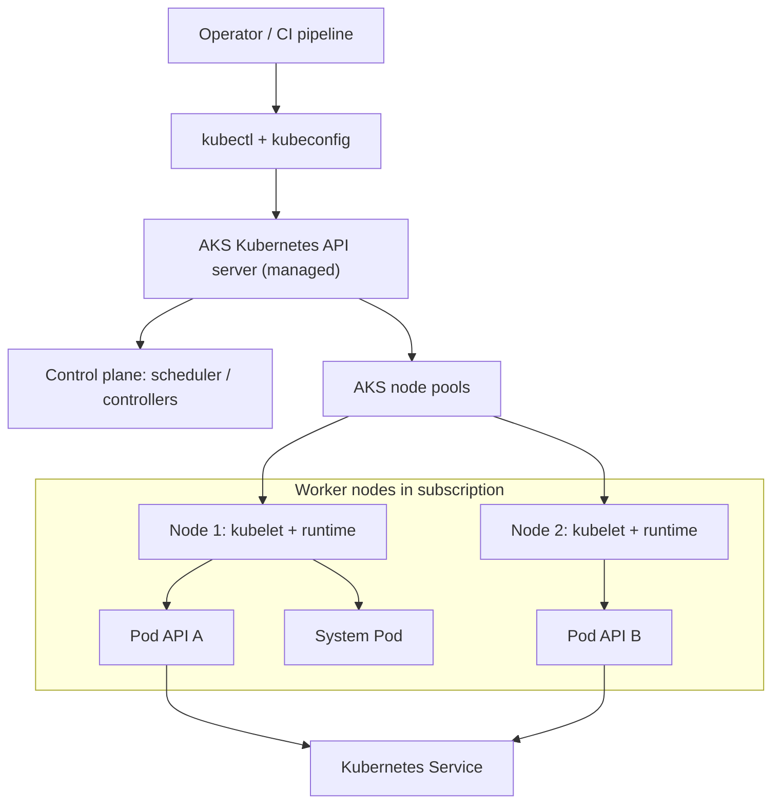
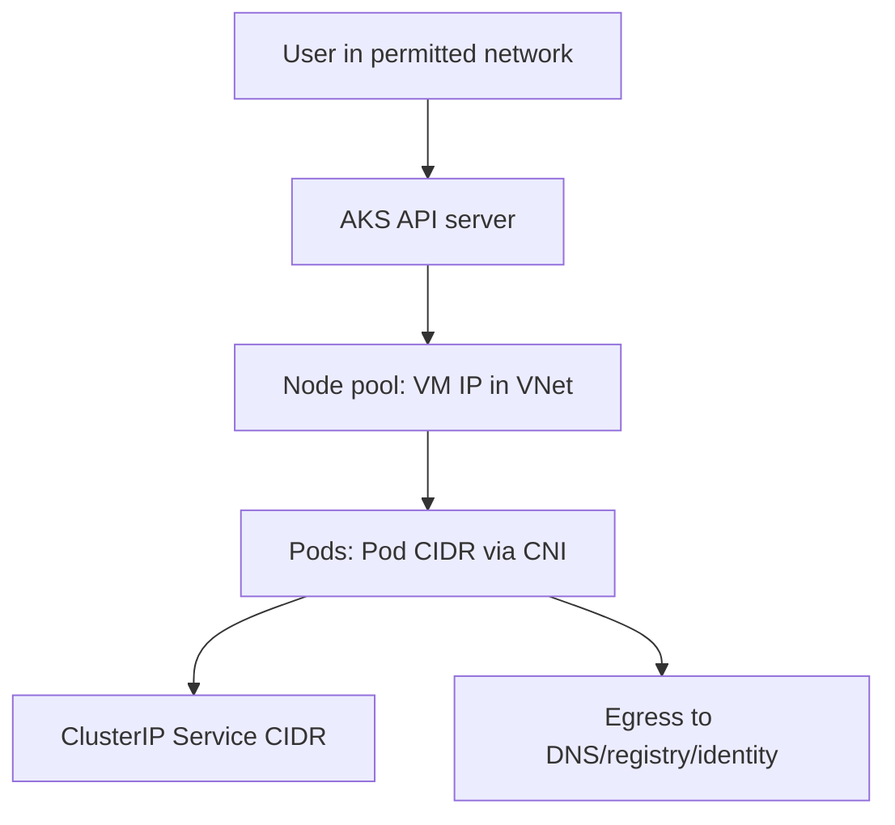
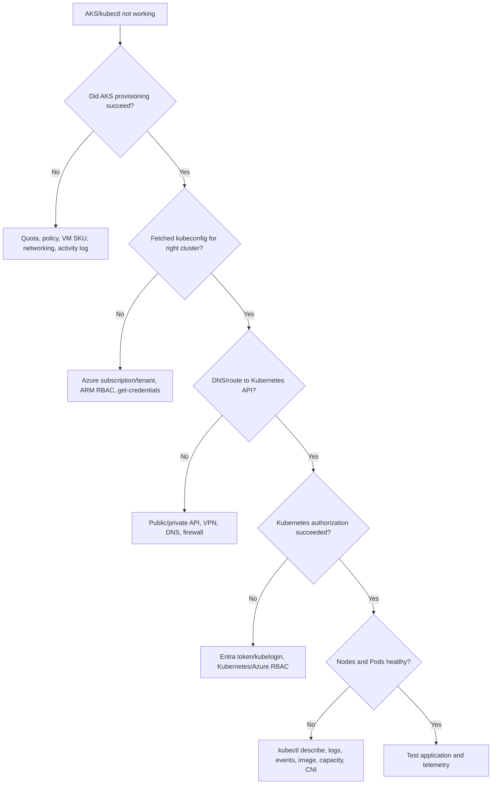

# Creating an AKS Cluster and Connecting with kubectl

Suppose a development team has containerized an API and wants to deploy multiple replicas, auto-recover failed Pods, load-balance traffic, and update the application without self-operating the entire Kubernetes control plane. **Azure Kubernetes Service (AKS)** is Microsoft Azure's managed Kubernetes service, well suited for this problem. However, successfully creating a cluster in the Azure Portal is not enough to operate applications: the administrator must also configure **networking, identities, Kubernetes permissions, the API server access path, and the `kubectl` tool**.

This lesson belongs to the **Azure Kubernetes Service Fundamentals** chapter in the `CLOUD_PROVIDERS_AZURE` module. In the journey exploring Azure from subscriptions, resource groups, and Microsoft Entra ID to virtual networking, compute, storage, data, deployment, monitoring, protection, and cost control, this lesson guides you through **creating an AKS cluster in a lab, connecting from an admin machine or Azure Cloud Shell with `kubectl`, inspecting the cluster, and deploying a sample application**.

> **Lab scope:** The resource names, IP ranges, and commands below are examples only. Running actual AKS creation commands may incur charges for node VMs, disks, networking, and related services. Use an approved sandbox subscription; do not create clusters outside your budget or authorization scope.

## Learning objectives

After this lesson, you can:

1. Describe the AKS structure including the **managed control plane**, node pools, Kubernetes API server, Pods, Services, and the node resource group.
2. Prepare the subscription, region, quota, Azure CLI, `kubectl`, Azure RBAC, and Kubernetes RBAC before deployment.
3. Understand key networking choices: **Azure CNI**, Pod/Service addressing, public/private API server, and node egress paths.
4. Create a basic AKS cluster using the **Azure Portal** or **Azure CLI** with managed identity.
5. Retrieve access info using `az aks get-credentials`, verify **kubeconfig/context**, and connect using `kubectl`.
6. Distinguish between **lack of permission to retrieve credentials**, **lack of Kubernetes permissions**, and **lack of a network path to the API server**.
7. Create a Namespace, Deployment, and ClusterIP Service, and use `kubectl port-forward` to test the application without opening a public Load Balancer.
8. Inspect Pod/Node status, logs/events, monitoring, costs, version updates, and clean up lab resources properly.

## 1. What is AKS and which parts does Azure manage?

Kubernetes is a container orchestration system. AKS provides a managed Kubernetes cluster on Azure so application teams can focus on containers and workloads rather than building, controlling, and maintaining the entire control plane themselves.

In a typical AKS model:

- **Managed control plane**: Azure provisions and operates Kubernetes control components such as the API server and related control plane components according to service responsibilities.
- **Node pools**: virtual machines executing Pods located on compute infrastructure within the customer's subscription, typically using Azure Virtual Machine Scale Sets under supported models.
- **System node pool**: hosts critical system Pods, such as components required for the cluster to function.
- **User node pool**: an appropriate choice to separate application workloads from system workloads in production designs.
- **Azure networking, identities, and storage**: integrated so Pods can access the network, pull images, mount volumes, and call Azure resources per granted permissions.



### Who is responsible for what?

| System part | Azure's primary responsibility | Customer team's primary responsibility |
|---|---|---|
| AKS-managed control plane | Provisions/operates per service characteristics | Choose appropriate tier/SLA, configure API access, upgrade versions within supported lifecycle |
| Worker nodes | VM/node resources orchestrated by the service per config | Choose VM size, node count, pools, upgrades, autoscaling, monitor capacity and cost |
| Container application | Scheduling/execution platform | Docker images, config, resource requests/limits, health probes, secrets, logging |
| Networking | Integrates supported Azure components | CIDRs, subnets, NSGs, DNS, network policies, egress, ingress, public/private exposure |
| Identity and permissions | Integrates Azure IAM/Entra per features | Grant least-privilege Azure RBAC/Kubernetes RBAC, workload identity, data permissions |
| Data and DR | Dedicated supported storage/data services | Design persistent storage, backups, recovery, RPO/RTO, and testing |

**Managed AKS does not mean zero operations.** For example, if an application inside a Pod is misconfigured or a PVC holding data is deleted, AKS does not automatically know how to restore your business data.

## 2. Minimum Kubernetes concepts before creating a cluster

| Concept | Explanation | Practical example |
|---|---|---|
| **Cluster** | A Kubernetes environment consisting of a control plane and worker nodes | `aks-lab-vn` |
| **Node** | A host running Pods, with kubelet and a container runtime | `aks-nodepool1-...` |
| **Node pool** | A group of nodes sharing similar VM/image/state config per AKS features | Pool `system`, pool `apps` |
| **Pod** | Smallest deployable unit in Kubernetes, containing one or more related containers | An instance of an HTTP API |
| **Deployment** | Declares Pod replica count and rollout strategy for stateless workloads | `hello-nginx` with 2 replicas |
| **ReplicaSet** | Controller maintaining the Pod replica count managed by a Deployment | Replicas of `hello-nginx` |
| **Service** | Stable name/address to access a group of Pods by selector | `hello-nginx` of type ClusterIP |
| **Namespace** | Logical scope for Kubernetes resources | `aks-demo` |
| **Ingress / Gateway API** | HTTP(S) routing to services via an appropriate controller | Domain `api.example.com` to Service |
| **ConfigMap/Secret** | Non-sensitive configuration / data requiring protection | Runtime config, credentials |
| **kubectl** | CLI tool for interacting with the Kubernetes API | `kubectl get nodes` |
| **kubeconfig** | Cluster/credentials/context configuration file for the client | `~/.kube/config` |

### Understanding the deployment flow

When running:

```bash
kubectl create deployment hello-nginx --image=nginx:stable --replicas=2
```

`kubectl` sends a request to the **Kubernetes API server**. Controllers/scheduler reconcile cluster state toward the desired configuration: creating Pod objects, placing Pods on nodes with sufficient capacity, and pulling the matching image. **A successful CLI command does not guarantee containers are running and ready**, so you must check rollout and Pod status.

## 3. AKS cluster is an Azure resource, Pods are Kubernetes resources

There are two separate management layers:

**Azure control plane (ARM):**

```text
Subscription
  └── Resource group: rg-aks-lab
       └── Microsoft.ContainerService/managedClusters: aks-lab-vn
            ├── Cluster configuration
            ├── Node pools
            ├── Identity and networking settings
            └── Resource group containing AKS-managed nodes/resources
```

**Kubernetes API:**

```text
Cluster aks-lab-vn
  ├── Nodes
  ├── Namespace: kube-system
  │    └── System Pods
  └── Namespace: aks-demo
       ├── Deployment: hello-nginx
       ├── ReplicaSet / Pods
       └── Service: hello-nginx
```

Azure typically creates a **node resource group** named in the pattern `MC_<resource-group>_<cluster>_<region>` for VMSS, disks, NICs, load balancers, and AKS-managed components. The actual name and structure can vary by configuration/features; read the `nodeResourceGroup` property instead of guessing from naming conventions.

**Do not manually modify resources in the node resource group** unless the change is explicitly supported by AKS. Direct modifications can be overwritten by AKS, cause drift, or break the cluster lifecycle.

## 4. Preflight: prerequisites before creating a cluster

### 4.1 Subscription, tenant, and permissions

Before deploying, you need:

- An active **Azure subscription** permitted to create resource groups, AKS, and related compute/network resources.
- Appropriate RBAC permissions at the management scope; do not default to `Owner` when only specific permissions are needed.
- The right **Microsoft Entra tenant**, subscription, and region; one account may have visibility into multiple environments.
- Required resource providers, especially `Microsoft.ContainerService`, registered per subscription policy.
- Confirmation of whether organizational **Azure Policy** imposes rules on regions, private clusters, allowed VM SKUs, images, egress, tags, or identities.
- An adequate budget; creating a cluster provisions worker VMs, managed disks, and potentially load balancers/public IPs.

### 4.2 Azure CLI, kubectl, and authentication tools

You can use **Azure Cloud Shell** or a terminal with Azure CLI installed. In suitable environments, Cloud Shell comes with `az` and `kubectl`, though you should still verify versions and permissions. On a local machine, install/verify:

```bash
az version
az login

kubectl version --client
```

If `kubectl` is missing, Azure CLI provides a command to install it:

```bash
az aks install-cli
```

Some environments require install permissions, PATH configuration, or installing via a system package manager. For clusters integrated with Microsoft Entra ID, a compatible **kubelogin** binary may be needed to support current authentication mechanisms. `az aks install-cli` can install both kubectl and kubelogin in supported versions; check help:

```bash
az aks install-cli -h
kubelogin --version
```

Keep `kubectl` within the Kubernetes-supported version skew relative to the API server. Avoid using an outdated client or downloading binaries from untrusted sources.

### 4.3 Region, quota, VM size, and node count

Choose a region based on application/data locality, latency, availability, data residency policies, and feature support. Example:

| Attribute | Illustrative lab value |
|---|---|
| Resource group | `rg-aks-lab` |
| Cluster | `aks-lab-vn` |
| Region | `southeastasia` |
| Node count | `2` |
| Node size | `Standard_D2s_v5` (if available) |
| Node pool OS | Linux |
| Authentication | Managed identity for cluster |
| API endpoint | Controlled public API for lab, or Private API if management path exists |
| Practice namespace | `aks-demo` |

`Standard_D2s_v5` is only an example: depending on the subscription/region, you may lack vCPU quota, face capacity limits, or be blocked by policy. Choose another **verified** supported SKU matching budget and Pod resource requirements.

A production cluster must evaluate separate **system pools** and **user pools**, node counts across availability zones and capacity, autoscaling, and **PodDisruptionBudgets**. Two lab nodes do not represent a comprehensive high-availability design.

### 4.4 Kubernetes version

AKS maintains support policies for specific Kubernetes versions. Before creating a cluster, query the live list for your region:

```bash
az aks get-versions \
  --location southeastasia \
  --output table
```

Do not hardcode an old Kubernetes version merely because it appeared in a tutorial. For reproducibility, select a version **currently supported by AKS** and document your upgrade policy; if omitted, inspect the default version chosen by the create command and confirm it aligns with organizational standards.

## 5. AKS networking architecture: three address types not to confuse

In AKS, Kubernetes applications use multiple IP ranges:

1. **Node IP:** IP of the node VM inside the Azure VNet/subnet.
2. **Pod IP:** IP used between Pods per the CNI model; not necessarily an IP allocated directly from a VNet subnet.
3. **Service IP (ClusterIP):** virtual IP for a Kubernetes Service from the Service CIDR, not a VM address in the VNet.



The diagram shows conceptual address scopes, **not the packet flow path of every CNI**. In practice, Service proxying/routing forwards traffic to Pod endpoints according to configuration.

### Azure CNI and Azure CNI Overlay

AKS networking options vary in support scope and limits by version. With **Azure CNI Overlay**:

- Nodes get IPs from an Azure subnet.
- Pods receive IPs from a separate **overlay Pod CIDR** and are routed via the CNI's mechanisms.
- Services receive ClusterIPs from the **Service CIDR**.
- Pod CIDR, Service CIDR, VNet subnets, and corporate network ranges must be planned so they **do not overlap**.

Illustrative design example only:

```text
VNet/node subnet: 10.50.0.0/16 (dedicated planning)
Pod CIDR:         192.168.0.0/16
Service CIDR:     10.2.0.0/16
Kubernetes DNS:   10.2.0.10
```

Before applying in reality, check for conflicts with **VNet peering, VPN/ExpressRoute, hub-spoke topologies, corporate networks, and other clusters**. The `192.168.0.0/16` range is commonly used in internal corporate networks, so it is not automatically safe for every enterprise.

### Public vs. private API server

The Kubernetes API server is where `kubectl` sends management commands. A **Public AKS API server** exposes an endpoint reachable from external networks as configured, while still requiring proper authentication/authorization. A **Private AKS cluster** configures the API endpoint over private networking so only clients with appropriate connectivity and DNS can reach it.

| Mode | Suitable for | What to understand |
|---|---|---|
| **Public API endpoint** | Simple labs or environments with approved public management policies | Requires Entra/RBAC, can use authorized IP ranges; never treat a public URL as an unauthenticated API |
| **Private cluster** | Production or policy-restricted management environments | `kubectl` requires private network path, private DNS, jump VM/VPN, or suitable runner |

**A private cluster does not mean** a user can open any Internet-connected laptop and run `kubectl` with kubeconfig successfully. Having credentials without DNS/routing to the private API server still results in timeouts or name resolution failures.

### Application ingress differs from the API server

Do not confuse the two entry paths:

- **Kubernetes API server:** used to deploy/manage resources via `kubectl`.
- **Application ingress:** used by users to call the workload's Service, Ingress, Gateway API, Azure Load Balancer, or Application Gateway.

An AKS cluster with a public API server **does not automatically expose all Pods**. Conversely, creating a public `LoadBalancer` Service can provision a frontend public IP and incur charges even if the API server is private, depending on configuration.

## 6. Creating an AKS cluster via Azure Portal

### Step 1. Choose subscription and resource group

Open **Azure Portal → Kubernetes services → Create → Azure Kubernetes Service (AKS)**. Select your sandbox subscription, resource group `rg-aks-lab`, and region `Southeast Asia` or an approved region.

Set **Kubernetes cluster name** to `aks-lab-vn` and choose the cluster pricing/tier as needed. For a lab, pick an economical option available in the UI, but do not assume "Free control plane" means **all nodes and related services are free**.

### Step 2. Choose Kubernetes version and node pools

Select a currently supported Kubernetes version. In the node pools section:

- Name the pool per AKS naming rules, e.g., `nodepool1`.
- Choose Linux for the lab; the node image and OS must match your containers.
- Select a VM size with sufficient vCPU/RAM and desired node count, e.g., 2.
- Check availability zones and auto-scaling settings as needed.
- For production, consider a **system pool** hosting system Pods and a **user pool** for applications; a lab can start simpler.

### Step 3. Identity and security

Prefer **managed identity** for AKS where supported. If your organization uses Microsoft Entra ID integration and Azure RBAC for Kubernetes Authorization, ensure selections match your deployed authorization model.

Do not disable authentication requirements or enable local admin credentials just to bypass connection errors. **Cluster admin credentials** carry very high privileges and are inappropriate for everyday developer or CI access.

### Step 4. Networking

Choose the network plugin/mode and CIDRs per your plan:

- Azure CNI / overlay or a networking option currently supported by AKS for your SKU.
- Appropriate non-overlapping Pod/Service/DNS ranges.
- Public/private API server per policy.
- Outbound type (load balancer, NAT Gateway, or other supported configuration) so nodes can pull images, reach dependencies, and apply updates.
- Network policy and ingress designed per workload needs; do not expose applications publicly solely to verify the cluster.

### Step 5. Integrations, Monitoring, and Tags

Evaluate Azure Monitor/Container insights, Azure Policy, Key Vault CSI driver, Microsoft Defender for Containers, or Azure Container Registry (ACR) integration **based on need and permissions**. These features may incur costs or require additional roles.

Apply tags such as `environment=lab`, `owner=cloud-team`, and an expiration date to track resources. Review estimated costs before creating.

### Step 6. Review + create

Before selecting **Create**:

1. Check subnet, CIDR, zones, and node size.
2. Check identity permissions and cluster authorization.
3. Review API exposure and authorized access per policy.
4. Check whether node count, tier, and logging fit your budget.
5. Record the lab resource group name for accurate cleanup.

Once Azure reports deployment succeeded, open **AKS resource → Overview** to check provisioning state, Kubernetes version, node pool count, and the node resource group. **Deployment success does not guarantee application Pods are Ready**: the next step is connecting with `kubectl`.

## 7. Creating an AKS cluster with Azure CLI — controlled lab

Examples use **Bash in Azure Cloud Shell or a Unix terminal**. If using Windows PowerShell, adjust environment variable syntax and line continuations accordingly; do not copy raw Bash syntax into PowerShell and blame AKS for errors.

In this section, commands actually create Azure resources and incur costs when executed. Only run them in an authorized sandbox subscription.

### 7.1 Verify environment

```bash
az version
az aks create -h
kubectl version --client

az login --tenant "<tenant-id>"
az account set --subscription "<subscription-id>"
az account show \
  --query "{subscription:id,tenant:tenantId,name:name}" \
  --output json
```

Verify the active subscription is where you are authorized to create VMs/node pools. If a resource provider is missing, Azure errors typically indicate which provider needs registration; follow your subscription admin process rather than attempting to escalate privileges.

### 7.2 Set names and create resource group

```bash
RG="rg-aks-lab"
AKS="aks-lab-vn"
LOCATION="southeastasia"

az group create \
  --name "$RG" \
  --location "$LOCATION" \
  --tags environment=lab owner=cloud-team \
  --output json
```

**Warning:** resources inside a resource group can be deleted together. If a group with this name already exists and belongs to another team, **do not share it**; pick a unique sandbox resource group name.

### 7.3 Check versions and choose SKU

```bash
az aks get-versions \
  --location "$LOCATION" \
  --output table

az vm list-skus \
  --location "$LOCATION" \
  --size "Standard_D2s_v5" \
  --output table
```

The SKU list does not automatically confirm available quota/capacity. If `Standard_D2s_v5` is constrained, pick another **verified** size matching workload and budget. Address ranges, node count, and Kubernetes version must follow organizational policy; avoid account defaults if network conflicts exist.

### 7.4 Create cluster

Illustrative example using Azure CNI Overlay and managed identity:

```bash
az aks create \
  --resource-group "$RG" \
  --name "$AKS" \
  --location "$LOCATION" \
  --node-count 2 \
  --node-vm-size Standard_D2s_v5 \
  --enable-managed-identity \
  --generate-ssh-keys \
  --network-plugin azure \
  --network-plugin-mode overlay \
  --pod-cidr 192.168.0.0/16 \
  --service-cidr 10.2.0.0/16 \
  --dns-service-ip 10.2.0.10 \
  --output json
```

Meaning of key options:

| Option | Role |
|---|---|
| `--node-count 2` | Initial node count; not automatically sufficient for production HA |
| `--node-vm-size` | Node pool VM size; affects capacity and cost |
| `--enable-managed-identity` | Uses managed identity for AKS to manage Azure integrations as supported |
| `--generate-ssh-keys` | Generates SSH keys per Azure CLI mechanism; protect the private key on the CLI host |
| `--network-plugin azure` | Selects Azure CNI |
| `--network-plugin-mode overlay` | Supported overlay Pod IP model |
| `--pod-cidr` | Pod address range; must not conflict with connected networks |
| `--service-cidr` | ClusterIP range for Kubernetes Services |
| `--dns-service-ip` | IP of Kubernetes DNS within the Service CIDR |

**Items to verify before running:**

- Confirm your current Azure CLI/AKS environment supports all these flags and this network mode using `az aks create -h` and current service docs.
- This example lets **Azure manage default node networking for the chosen config**; it does not specify a custom enterprise VNet/subnet. For production, intentionally design subnets, routing/UDRs, firewalls, IP planning, and node identity permissions.
- This example does not configure a private API server or authorized IP ranges. **Do not use this public API endpoint sample as a production security baseline.**
- This example does not set up Application Gateway, ingress, ACR, workload identity, network policies, or backups; those must be designed additionally per workload.
- Nodes may need egress to registries and required Azure services; if your environment blocks outbound traffic, the cluster or Pod image pulls may fail.

### 7.5 Verify AKS in the Azure control plane

```bash
az aks show \
  --resource-group "$RG" \
  --name "$AKS" \
  --query "{name:name,location:location,provisioningState:provisioningState,kubernetesVersion:kubernetesVersion,nodeResourceGroup:nodeResourceGroup,apiServerFqdn:fqdn}" \
  --output json

az aks nodepool list \
  --resource-group "$RG" \
  --cluster-name "$AKS" \
  --query "[].{name:name,mode:mode,count:count,vmSize:vmSize,osType:osType}" \
  --output table
```

Expected output shows provisioning succeeded and the node pool displaying the expected node count. The `fqdn` property differs between public/private configurations; do not assume the API is reachable solely because a hostname appears in metadata.

## 8. kubectl, kubeconfig, and context: three concepts to distinguish

**`kubectl`** is the tool that sends authenticated requests to the Kubernetes API server. It is not the Azure CLI and does not automatically know which subscription or cluster to manage.

**`kubeconfig`** is a configuration file containing:

- **clusters**: Kubernetes API server addresses and related CA/trust settings.
- **users**: mechanisms for obtaining client credentials/tokens, potentially via an exec plugin.
- **contexts**: pairs a cluster with a user and an optional default namespace.
- **current-context**: the active context used when `--context` is not specified in a command.

Illustrative configuration layout:

```text
kubeconfig
  clusters: [aks-lab-vn, aks-staging, aks-prod]
  users:    [user-lab, user-staging, user-prod]
  contexts:
    aks-lab-vn  -> cluster aks-lab-vn + user-lab
    staging     -> cluster aks-staging + user-staging
    production  -> cluster aks-prod + user-prod
  current-context: aks-lab-vn
```

**A dangerous mistake:** an operator signs into the right Azure subscription, while `kubectl` is still pointing at the **production context from an earlier session**. Always check context before applying, deleting, or modifying Kubernetes resources.

## 9. Retrieving credentials with `az aks get-credentials`

### Quick method: merge into default kubeconfig

For the lab cluster you created:

```bash
az aks get-credentials \
  --resource-group "$RG" \
  --name "$AKS"

kubectl config get-contexts
kubectl config current-context
```

By default, `az aks get-credentials` updates/merges entries into your active kubeconfig at the default location or as configured by your environment. If a context with the same name already exists, the CLI may warn you. **Do not blindly enable `--overwrite-existing`** on a workstation managing multiple clusters before understanding what will be overwritten.

### Safe method for labs: use a separate kubeconfig

To avoid modifying `~/.kube/config` used for other clusters:

```bash
mkdir -p "$HOME/.kube"

az aks get-credentials \
  --resource-group "$RG" \
  --name "$AKS" \
  --file "$HOME/.kube/aks-lab-config"

export KUBECONFIG="$HOME/.kube/aks-lab-config"

kubectl config get-contexts
kubectl config current-context
```

This example uses Bash. In PowerShell, set the environment variable using PowerShell syntax, such as `$env:KUBECONFIG = "..."` with the actual Windows path. A kubeconfig can contain sensitive info or privileged access mechanisms; store it in a protected user directory, never commit it to Git, and never send the raw file to others.

### Do not use `--admin` as a shortcut

`az aks get-credentials --admin` retrieves privileged admin credentials if permitted by the cluster and policy. It is **not the standard fix** for users denied Kubernetes permissions and may be unavailable when local accounts are disabled.

For organizations, prefer **Microsoft Entra ID integration** and proper authorization via Azure RBAC/Kubernetes RBAC. Having user credentials does not automatically grant `cluster-admin` rights.

## 10. Verifying the initial connection with kubectl

After configuring kubeconfig properly:

```bash
kubectl config current-context
kubectl cluster-info
kubectl get nodes -o wide
kubectl get namespaces
kubectl get pods --all-namespaces
```

### Reading the output accurately

- `kubectl cluster-info` returns the control plane address: this confirms a level of connectivity to the Kubernetes API and cluster info, **not that every component is healthy**.
- `kubectl get nodes`: nodes can appear in `Ready`, `NotReady`, or other states. For a newly created lab cluster, wait for provisioning/booting to finish and check again.
- `kubectl get pods -A`: inspect system Pods such as DNS, network agents, and other components depending on AKS version. Names and Pod counts vary by enabled features.
- `kubectl get namespaces`: lists namespaces; `aks-demo` will not exist until you create it.

Abbreviated illustrative output example:

```text
$ kubectl get nodes
NAME                       STATUS   ROLES   AGE   VERSION
aks-nodepool1-xxxxxxxx-0   Ready    <none>  8m    v1.xx.x
aks-nodepool1-xxxxxxxx-1   Ready    <none>  8m    v1.xx.x
```

**Node names, roles, and version are illustrative only**. Do not treat `v1.xx.x` as an actual Kubernetes version to pass into deployment commands.

### Check permissions before modifying resources

```bash
kubectl auth can-i get pods --all-namespaces
kubectl auth can-i create deployments -n default
```

The command returns `yes` or `no` based on the active identity/context permissions. If `no`, it indicates **Kubernetes authorization** denial from RBAC or Azure RBAC for Kubernetes; it is not a networking issue if you received a response from the API.

## 11. Microsoft Entra ID, Kubernetes RBAC, and kubelogin

AKS can integrate with Microsoft Entra ID to authenticate users. Distinguish three separate questions:

1. **Who has permission to read AKS credential info from Azure Resource Manager?**
2. **How will kubeconfig authenticate to the Kubernetes API server?**
3. **Once authenticated, which verbs/resources is the user allowed to perform in Kubernetes?**

| Component | Role | Example |
|---|---|---|
| Azure RBAC control plane | Permits ARM operations / retrieving credentials per role | `Azure Kubernetes Service Cluster User Role` is appropriate for retrieving user credentials |
| Microsoft Entra authentication | Establishes user identity toward the Kubernetes API per cluster config | Azure CLI login or supported token mechanism |
| Kubernetes RBAC | Restricts verbs/resources/namespaces inside Kubernetes | `Role`, `RoleBinding`, `ClusterRoleBinding` |
| Azure RBAC for Kubernetes Authorization | Option using Azure roles for Kubernetes authorization when configured | Azure Kubernetes Service RBAC roles by scope |
| kubelogin | Assists kubeconfig exec plugin in acquiring Entra tokens when required | `kubelogin convert-kubeconfig -l azurecli` |

**Being allowed to run `az aks get-credentials` does not mean you can run `kubectl delete deployment`.** Azure ARM credential retrieval and Kubernetes authorization are two separate layers.

### When to use kubelogin?

For Entra ID-integrated clusters using current kubeconfig mechanisms, the `kubelogin` tool may be required. If installed and you need to convert kubeconfig to use Azure CLI tokens:

```bash
kubelogin convert-kubeconfig -l azurecli

kubectl get nodes
```

This command changes how kubeconfig invokes the token helper. **Use it only when it matches your authentication method and current AKS/kubelogin version**, and never run it blindly against production kubeconfigs. If `az login` is signed into a different tenant than the cluster, re-verify the subscription/tenant and login session.

### Namespace-scoped Kubernetes RBAC

A development team typically only needs read/deploy permissions within its own namespace rather than cluster-wide `cluster-admin`. In traditional Kubernetes RBAC, `Role` and `RoleBinding` restrict scope; in Azure RBAC for Kubernetes Authorization, Kubernetes permissions can be managed via Azure roles as supported.

The proper workflow when hitting `Forbidden` is to **identify the identity, scope, verb, resource, and binding**, then grant approved least-privilege permissions. Never distribute admin credentials as the default for all developer workstations.

## 12. Deploying a test application with kubectl

Once nodes are `Ready` and your identity has permission to create resources in the lab namespace, deploy **a test web app using the public Nginx image**. The goal is to understand the Kubernetes Deployment → Pod → Service flow, not to configure public ingress.

### 12.1 Create a dedicated namespace

```bash
kubectl create namespace aks-demo

kubectl get namespaces
```

Namespaces organize resources into logical groups, but **do not create an absolute security boundary on their own**. To restrict permissions and traffic between workloads, add Kubernetes RBAC, NetworkPolicy, quotas, and appropriate controls.

### 12.2 Create a Deployment

```bash
kubectl -n aks-demo create deployment hello-nginx \
  --image=nginx:stable \
  --replicas=2

kubectl -n aks-demo get deployments
kubectl -n aks-demo get pods -o wide
```

Notes:

- `nginx:stable` is a **mutable tag**, suitable only for illustration. For production CI/CD, use a **pinned version or image digest** that has been tested and vulnerability-scanned.
- Two replicas do not guarantee the two Pods land on two different nodes unless **pod anti-affinity/topology spread** or scheduler constraints are configured.
- Without valid Internet/ACR egress from the nodes, Pods can hit `ImagePullBackOff` even though the Deployment object was created successfully.
- If containers lack CPU/RAM or violate security settings, Pods can still end up Pending or CrashLoopBackOff.

### 12.3 Check rollout status

```bash
kubectl -n aks-demo rollout status \
  deployment/hello-nginx \
  --timeout=180s

kubectl -n aks-demo get deployment hello-nginx
kubectl -n aks-demo get pods -o wide
```

In a Deployment, distinguish:

- **DESIRED**: desired replica count.
- **AVAILABLE/READY**: number of replicas meeting Kubernetes availability/readiness criteria.
- **UP-TO-DATE**: number of Pods running the latest template version.

`kubectl create deployment` can succeed while `rollout status` times out. When that happens, inspect Pod events/logs instead of assuming the cluster is broken.

### 12.4 Create a ClusterIP Service

```bash
kubectl -n aks-demo expose deployment hello-nginx \
  --name hello-nginx \
  --port 80 \
  --target-port 80 \
  --type ClusterIP

kubectl -n aks-demo get services
kubectl -n aks-demo get endpointslices
```

A **ClusterIP** Service gets an in-cluster virtual IP/service identity for **internal cluster access** on the Kubernetes network; it **does not create a public Azure Load Balancer**. EndpointSlices list the Pod endpoints selected by labels and readiness according to the controller.

### 12.5 Test with port-forward without opening a public IP

In a terminal using the right kubeconfig:

```bash
kubectl -n aks-demo port-forward \
  service/hello-nginx 8080:80
```

In a second terminal **on the same machine running `kubectl`**:

```bash
curl -I http://127.0.0.1:8080/
```

Expected output is an HTTP response from Nginx, typically `200 OK` on the root path if the container is ready. **Port-forward only works while the command process stays running**. If executed in Azure Cloud Shell, `127.0.0.1` refers to the Cloud Shell environment, not your local laptop. Never change the bind address to `0.0.0.0` just to share access externally without controls.

### 12.6 View logs and describe resources

```bash
kubectl -n aks-demo get pods
kubectl -n aks-demo logs deployment/hello-nginx --tail=50
kubectl -n aks-demo describe deployment hello-nginx
kubectl -n aks-demo get events --sort-by=.lastTimestamp
```

Logs and events only reflect data retained within the Pod/cluster retention window. For production, export logs, metrics, and traces to a proper monitoring system rather than relying solely on logs inside containers.

## 13. Creating a Deployment with YAML for reproducibility

Imperative `kubectl create` commands are handy for labs, but production should declare resources as **version-controlled manifests** deployed through a reviewed CI/CD pipeline.

Illustrative manifest:

```yaml
apiVersion: apps/v1
kind: Deployment
metadata:
  name: sample-api
  namespace: aks-demo
spec:
  replicas: 2
  selector:
    matchLabels:
      app: sample-api
  template:
    metadata:
      labels:
        app: sample-api
    spec:
      containers:
        - name: web
          image: nginx:stable
          ports:
            - containerPort: 80
          resources:
            requests:
              cpu: "100m"
              memory: "64Mi"
            limits:
              cpu: "250m"
              memory: "128Mi"
          readinessProbe:
            httpGet:
              path: /
              port: 80
            initialDelaySeconds: 2
            periodSeconds: 10
          livenessProbe:
            httpGet:
              path: /
              port: 80
            initialDelaySeconds: 10
            periodSeconds: 20
---
apiVersion: v1
kind: Service
metadata:
  name: sample-api
  namespace: aks-demo
spec:
  type: ClusterIP
  selector:
    app: sample-api
  ports:
    - port: 80
      targetPort: 80
```

The YAML above is **example content** and does not automatically create a file on your machine. If you save it as `sample-api.yml` in your sandbox and the `aks-demo` namespace already exists, you can deploy it:

```bash
kubectl apply -f sample-api.yml
kubectl -n aks-demo rollout status deployment/sample-api
kubectl -n aks-demo get all
```

### Why are resources and probes needed?

**Resource requests** help the scheduler place Pods onto nodes with sufficient expected resources; **limits** cap resource usage under Kubernetes enforcement. The **readiness probe** determines when a Pod receives traffic via a Service; the **liveness probe** helps restart a container when failures are detected. Sample numbers must be tuned per workload.

**Production note:** this illustrative manifest omits full security context, non-root images, network policies, PodDisruptionBudget, topology spread, image signing, admission policies, and secrets management. `nginx:stable` is still an unpinned tag. All of these must be added when deploying real workloads.

## 14. Distinguishing Azure RBAC, Kubernetes RBAC, and Pod permissions

An AKS cluster involves at least three identity groups:

| Group | Task | Where permissions are granted |
|---|---|---|
| **AKS creator/administrator** | Create clusters, scale node pools, modify network settings | Azure RBAC on ARM resources |
| **kubectl user** | View Pods, deploy Deployments, create Services | Kubernetes RBAC or Azure RBAC for Kubernetes Authorization |
| **Application inside Pod** | Read Blob, Key Vault, queues, databases | Workload identity/managed identity and target resource permissions |

Never bake an **admin kubeconfig**, Azure service principal secret, or storage account key into a container just so the app can "call Azure." For AKS workloads, prefer **Microsoft Entra Workload ID** or a supported identity mechanism, combining a Kubernetes ServiceAccount, OIDC issuer, and federated credential per design.

AKS cluster identity and kubelet identity serve different Azure management purposes. For example, **Azure Container Registry (ACR)** image-pull permissions must be granted to the appropriate identity per the integration model, not solved by giving all developers Owner on ACR or the subscription.

## 15. Networking after cluster creation

### Service types

| Service type | Usage | Exposure level |
|---|---|---|
| **ClusterIP** | Creates an in-cluster endpoint for Pod-to-Pod connectivity | Not automatically exposed to the Internet |
| **NodePort** | Opens a port on nodes per Kubernetes mechanism | Depends on node network/firewall; should not default to public |
| **LoadBalancer** | Requests provisioning a load balancer frontend via the cloud provider | Can create a public or internal frontend depending on annotations/config |
| **ExternalName** | DNS alias to another hostname | Does not create a proxy or load balancer |

In this lesson, the `hello-nginx` Service uses ClusterIP and `port-forward` to **avoid creating unnecessary public frontends**. For production HTTP(S), use an ingress controller, Gateway API implementation, or Azure Application Gateway/Front Door per supported patterns; configure TLS, domains, WAF, routes, and health checks.

### Private AKS API server

With a private cluster, administrators may need:

- A VM/jump host inside the VNet or an environment connected via VPN/ExpressRoute.
- Private DNS resolution to the cluster's API hostname.
- NSGs/routes/firewalls allowing traffic to the API server per policy.
- An identity permitted to retrieve credentials and use the Kubernetes API.
- A CI/CD agent with a **network path** to the private control plane; Internet-hosted runners may be unable to connect directly.

`az aks get-credentials` succeeding in public Cloud Shell **does not guarantee `kubectl get nodes` will work** if the private API is unreachable from Cloud Shell. Fetching credentials via ARM and calling the Kubernetes API take two different network paths.

### Pod egress and container images

Nodes/Pods typically need access to container registries, DNS, and system endpoints. If you place a cluster in a VNet with UDRs/Firewall, design outbound allowlists or private registries/mirrors per supported mechanisms. A cluster with blocked egress may provision its control plane successfully, yet new Pods cannot pull images and hit `ImagePullBackOff`.

A private API server does not automatically make every workload/Service private. Each ingress and egress flow must have its own policy.

## 16. AKS scaling, upgrades, and high availability

### Scaling nodes vs. scaling Pods

**Scaling nodes:** increasing/decreasing the number of VMs in a node pool, e.g., from 2 to 3, manually or via cluster autoscaler.

**Scaling Pods:** adjusting Deployment replica counts, such as `kubectl scale deployment`, or using Horizontal Pod Autoscaler when metrics are available.

```bash
# Example to inspect current node count; read-only
az aks nodepool list \
  --resource-group "$RG" \
  --cluster-name "$AKS" \
  --output table

# Example to change replicas in the lab namespace
kubectl -n aks-demo scale deployment/hello-nginx --replicas=3
kubectl -n aks-demo rollout status deployment/hello-nginx
```

Scaling Pods up does not automatically add nodes if capacity runs out and cluster autoscaler is not configured. Scaling nodes up does not automatically scale your application if replicas do not change. Autoscalers, quotas, PodDisruptionBudgets, requests/limits, and topology must be evaluated together.

### Upgrading Kubernetes versions

AKS maintains specific Kubernetes version support schedules and policies. To view upgrade options:

```bash
az aks get-upgrades \
  --resource-group "$RG" \
  --name "$AKS" \
  --output table
```

**Do not upgrade a production cluster using unreviewed sample commands.** Kubernetes upgrades can replace node images and related components; beforehand, back up manifests and check deprecated APIs, PodDisruptionBudgets, quota/capacity, maintenance windows, app compatibility, and rollback/recovery plans per service capabilities.

### Availability is more than having two nodes

To reduce single points of failure, consider:

- Multiple nodes spread across availability zones supported by the region/SKU.
- A separate system pool and user pools with sufficient capacity.
- Replicas, anti-affinity/topology spread, readiness/liveness probes, and PodDisruptionBudgets.
- Stateless workloads or stateful data with proper backup/DR.
- Monitoring, cluster/node autoscaling, and controlled upgrade processes.
- For multi-region, additionally design DNS/global routing, data synchronization, and application failover.

Azure's managed control plane does not automatically provide high availability for an application running **a single Pod**.

## 17. Troubleshooting when creating AKS or running kubectl

### Step 1. Identify which layer is failing



### Step 2. Interpret common messages

| Symptom | Possible cause | Checks to perform |
|---|---|---|
| `QuotaExceeded` when creating node pool | Insufficient vCPU quota for region/VM family | Azure quotas, SKU/capacity, and quota request permissions |
| `AllocationFailed` | Region/zone or SKU temporarily out of capacity | Check VM size, zone, region, node count |
| `RequestDisallowedByPolicy` | Organizational Azure Policy disallows configuration | Review policy assignment, use approved config |
| `AuthorizationFailed` with `az aks create` | Insufficient Azure RBAC at resource scope | Verify subscription/account and granted role |
| `az aks get-credentials` denied | Missing ARM permission to read user credentials or wrong subscription | Check AKS Cluster User Role and scope |
| `kubectl: command not found` | Machine lacks `kubectl` or PATH is misconfigured | Install tool safely, verify `kubectl version --client` |
| `kubelogin not found` / exec plugin error | Missing auth helper for Entra-integrated cluster | Install matching `kubelogin` and configure kubeconfig |
| `Unable to connect to the server` | API server unreachable or wrong kubeconfig | Current-context, endpoint, DNS, private route |
| `dial tcp ... i/o timeout` | Firewall/route/private API/authorized IP ranges | Check networking from the machine running kubectl |
| `no such host` | DNS cannot resolve API server hostname | Resolver, Private DNS zone, and VNet links |
| `Unauthorized` | Invalid or expired token/credential | Entra login/tenant, kubelogin, kubeconfig user |
| `Forbidden` | Authenticated, but lacking Kubernetes RBAC | `kubectl auth can-i` and roles/bindings |
| Node `NotReady` | Kubelet, network plugin, disk pressure, bootstrap failure | `kubectl describe node`, node/extension logs |
| Pod `Pending` | Insufficient CPU/RAM, taints, affinity, PVC, or autoscaler | `kubectl describe pod` and events |
| Pod `ImagePullBackOff` | Registry auth, wrong image/tag, or blocked egress | Image path, ACR roles, DNS/firewall/egress |
| Pod `CrashLoopBackOff` | App starts then crashes repeatedly | `kubectl logs --previous`, env/secrets/limits |
| `kubectl port-forward` fails | Service has no ready endpoints, container not listening on port, local port busy | EndpointSlice, Pod readiness, `--target-port`, local port |

### Step 3. Safe diagnostic command set

```bash
# Current cluster/context
kubectl config current-context
kubectl cluster-info

# Inspect nodes and kube-system
kubectl get nodes -o wide
kubectl get pods -n kube-system

# Inspect lab workload
kubectl -n aks-demo get deployments,pods,services -o wide
kubectl -n aks-demo get events --sort-by=.lastTimestamp
kubectl -n aks-demo describe deployment hello-nginx
kubectl -n aks-demo logs deployment/hello-nginx --tail=100
```

If a specific Pod is in `CrashLoopBackOff`, inspect logs from the previous run after finding the exact Pod name:

```bash
kubectl -n aks-demo logs "<pod-name>" --previous --tail=100
kubectl -n aks-demo describe pod "<pod-name>"
```

Never paste raw logs containing tokens, connection strings, personal info, or sensitive data into uncontrolled ticketing systems.

## 18. Security controls before production use of AKS

### Protecting the Kubernetes API

- Use Microsoft Entra ID integration when aligned with policy.
- Restrict ARM credential-retrieval permissions and Kubernetes verbs with least privilege.
- For private APIs, design private networking/DNS/CI runners; for public APIs, evaluate authorized IP ranges and supported protections.
- Record audit logs and privilege changes.
- Never store admin kubeconfigs in repositories, container images, or shared laptops.

### Protecting workloads

- Use container images from trusted registries, scan for vulnerabilities, and pin versions/digests for releases.
- Set CPU/memory requests and limits to prevent a single Pod from starving an entire node.
- Configure readiness/liveness/startup probes with appropriate endpoints and timeouts.
- Manage secrets using proper integrations such as **Secrets Store CSI Driver + Key Vault** or organization-approved solutions; never hardcode into manifests.
- Use **Workload Identity** with Kubernetes ServiceAccounts and Entra federation when workloads call Azure resources.
- Apply Kubernetes RBAC, NetworkPolicy, admission/policies, and separate namespaces/pools by risk level.
- Monitor runtime, vulnerabilities, node images, and patch/upgrade on schedule.

### Protecting data

A stateless Deployment is easy to recreate, but PersistentVolumes, databases, and object storage require dedicated backup/restore management. Deleting a Kubernetes namespace or cluster can delete workload state or data if volumes are configured for deletion under policy. **Never treat the ability to recreate nodes or Pods as a data recovery plan.**

## 19. Monitoring and controlling AKS costs

### Resources that can incur charges

| Component | What to estimate |
|---|---|
| **AKS control plane tier** | Pricing/SLA model by specific tier and configuration |
| **Worker nodes** | vCPU/RAM, VM count, and runtime hours |
| **Managed disks / storage** | OS disks, data disks, PersistentVolumes, snapshots |
| **Load Balancer / Public IP** | Frontend services, data processing, and IPs by SKU |
| **Egress/NAT/Firewall** | Traffic paths, NAT Gateway/Azure Firewall, and data transfer |
| **Azure Monitor / Container insights** | Metrics/logs collection, ingestion, retention, and alerts |
| **Container Registry** | Image storage, builds/transfers, and selected features |
| **Backup/DR and security** | Backup storage, Defender, Key Vault, policies/telemetry per config |

**Important:** an AKS cluster with zero user workloads still has **system nodes and disks**, so it can generate continuous charges. Fewer Pods do not automatically stop node VMs from billing.

### Minimum observability

In production, monitor:

1. **Node health:** Ready/NotReady, memory/disk pressure, CPU/memory utilization.
2. **Pods and Deployments:** desired/available replicas, restarts, CrashLoopBackOff, Pending, scheduling delay.
3. **Application SLOs:** HTTP 5xx, p95/p99 latency, availability, throughput, queue backlog if applicable.
4. **Control plane access:** audits, auth failures, API latency as provided.
5. **Capacity and autoscaler:** current/desired nodes, unschedulable Pods, quotas, and scale limits.
6. **Networking:** ingress errors, DNS, registry/image pulls, egress failures.
7. **Costs:** by resource group/tags, node resource group, and supporting services.

For Azure Monitor, Container insights, or managed Prometheus, enable and configure the corresponding features; do not assume all guest/container logs are collected automatically for free.

## 20. Lab wrap-up: verification and controlled cleanup

### Step 1. Acceptance checklist

| Item | Command/evidence | Expected result |
|---|---|---|
| ARM cluster | `az aks show` | Provisioning succeeded, right subscription/region |
| Node pool | `az aks nodepool list` | Pool/size/count match design |
| kubectl context | `kubectl config current-context` | Points to the lab cluster |
| API access | `kubectl cluster-info` | No DNS/route/auth errors |
| Nodes | `kubectl get nodes` | Required nodes are `Ready` |
| Namespace | `kubectl get ns aks-demo` | Lab namespace exists |
| Deployment | `kubectl -n aks-demo rollout status deployment/hello-nginx` | Deployment ready |
| Service | `kubectl -n aks-demo get svc hello-nginx` | ClusterIP, no public IP |
| HTTP test | `curl http://127.0.0.1:8080` during port-forward | HTTP response from workload |
| Security | Review RBAC, ingress, egress, secrets | No unintended endpoints/permissions exposed |
| Cost | Azure Cost Management and live resources | Clear view of node VMs/disks/network/logs |

### Step 2. Delete Kubernetes lab resources

After confirming you are on the **right kubeconfig/context** and the namespace only contains your test workload:

```bash
kubectl config current-context
kubectl -n aks-demo get all

kubectl delete namespace aks-demo
```

Deleting a namespace deletes all other resources inside it; never run this on a shared namespace. This action **does not delete the AKS cluster, node VMs, or compute charges**.

### Step 3. Inventory Azure resources

```bash
az aks show \
  --resource-group "$RG" \
  --name "$AKS" \
  --query "{name:name,nodeResourceGroup:nodeResourceGroup}" \
  --output json

az resource list \
  --resource-group "$RG" \
  --query "[].{name:name,type:type}" \
  --output table
```

Review the list before deleting; confirm `rg-aks-lab` **only contains sandbox resources you own**. Resource groups holding shared data, App Gateways, registries, or log workspaces should generally not be deleted alongside AKS.

### Step 4. Delete the AKS cluster when no longer needed

In an approved sandbox:

```bash
az aks delete \
  --resource-group "$RG" \
  --name "$AKS" \
  --yes
```

Deleting the cluster releases workloads/Pods and many AKS-managed node resources per service behavior; do not treat this as a backup method or a simple reversible operation.

If the resource group is a **dedicated lab** already inventoried with no data to retain:

```bash
az group delete \
  --name "$RG" \
  --yes
```

**Never run resource group deletion if other people's resources reside in it.** Verify afterwards whether any managed disks, public IPs, load balancers, network resources, Log Analytics/ACR/Key Vault, or PersistentVolumes outside the deletion scope remain. Cross-check Azure Cost Management to prevent lingering charges.

### Step 5. Clean up kubeconfig

After deleting the cluster, stop using the context pointing to the deleted cluster. If you used a separate `$HOME/.kube/aks-lab-config` file per this lesson, you can remove it once you verify it holds no other cluster configs and is no longer needed. If merged into the default kubeconfig, **delete only the context/cluster/user matching the lab AKS name**, never the entire `~/.kube/config`.

## 21. Common misconceptions

**"AKS runs containers so it doesn't need VMs."** False. AKS worker nodes are typically VMs in node pools with their own costs and capacity limits, even though the control plane is managed.

**"Creating a cluster means kubectl works from anywhere."** False. You need the right kubeconfig, credentials, Kubernetes permissions, and network/DNS path to the API server; private clusters have additional connectivity requirements.

**"Azure Contributor on the resource group equals Kubernetes cluster-admin."** False. Azure RBAC control plane and Kubernetes authorization are two independent layers.

**"Permission to run get-credentials guarantees I can create Deployments."** False. User credential retrieval does not automatically grant `create deployments` inside Kubernetes.

**"Using --admin is the best fix for all RBAC errors."** No. Those are privileged credentials that may be forbidden by policy and must not be used for routine operations.

**"If the cluster is private, every HTTP service is automatically private."** False. Kubernetes API access and application ingress are configured separately. A LoadBalancer Service can still create a public IP depending on configuration.

**"Creating 2 replicas guarantees 2 healthy nodes across 2 zones."** False. Scheduler constraints, node pool topology, and zone support determine placement; replicas alone do not guarantee multi-zone availability.

**"Pod created means the container is running properly."** False. Check `Ready`, rollout status, logs, events, image pull, and endpoints.

**"Kubeconfig is just a config file and can be shared publicly."** False. It can contain credentials or token-helper permissions and cluster management info; protect it as a security artifact.

**"Deleting the namespace stops all AKS billing."** False. Nodes, disks, networking, and supporting services remain until properly decommissioned through their lifecycle.

## 22. Self-check questions

**Question 1.** How do the control plane and node pool differ in AKS?

**Answer:** Azure manages the Kubernetes control plane per service responsibilities; node pools contain VMs running Pods in the customer environment and require sizing, node counts, and cost management.

**Question 2.** Why can `az aks get-credentials` succeed while `kubectl get nodes` still times out?

**Answer:** The first command talks to Azure Resource Manager to fetch kubeconfig; `kubectl` must connect to the Kubernetes API server. Private APIs, DNS, firewalls, or routing can block the network path.

**Question 3.** Which command checks which cluster `kubectl` is currently targeting?

**Answer:** `kubectl config current-context`, combined with `kubectl config get-contexts` and verified cluster information.

**Question 4.** Why should you use a separate kubeconfig file in a lab?

**Answer:** It reduces the risk of overwriting or accidentally targeting staging/production contexts, and makes managing and cleaning up lab credentials easier.

**Question 5.** Does `Azure Kubernetes Service Cluster User Role` automatically grant all permissions inside a namespace?

**Answer:** No. That role governs retrieving user credentials at the Azure control plane; Kubernetes RBAC or Azure RBAC for Kubernetes Authorization controls actual Kubernetes actions.

**Question 6.** What should you usually check when a Pod is in `ImagePullBackOff`?

**Answer:** Image name/tag, pull permissions from ACR/registry, DNS, egress, firewalls, and Pod event messages.

**Question 7.** Does creating a `ClusterIP` Service provision a public IP?

**Answer:** It does not automatically create a public Load Balancer; the Service gets an internal Kubernetes address and can be tested via `kubectl port-forward`.

**Question 8.** Distinguish Node IP, Pod CIDR, and Service CIDR.

**Answer:** Node IPs belong to the node VM network; Pod CIDR allocates addresses to Pods per CNI; Service CIDR holds virtual ClusterIPs for Kubernetes Services. These ranges must be planned without overlap.

**Question 9.** When is `kubelogin` needed?

**Answer:** When kubeconfig/AKS uses Microsoft Entra ID authentication requiring the corresponding exec plugin; you need the tool and a token-acquisition method matching the version and policy.

**Question 10.** Why might a Deployment have 2 replicas yet fail to serve requests?

**Answer:** Pods may be Pending or NotReady due to insufficient resources, image pull failures, application crashes, or failing readiness checks; inspect rollout status, Pod events, and logs.

**Question 11.** Does a public AKS API server make all Pods accessible from the Internet?

**Answer:** No. The API server is for cluster management; applications become public only when networking/Service/Ingress is configured to expose them.

**Question 12.** Why can a newly created cluster incur costs even with no applications deployed?

**Answer:** Worker nodes, OS disks, network resources, monitoring, or the control plane tier by SKU can still incur charges.

**Question 13.** If an application needs to read Blob storage without storing an account key, what should you consider?

**Answer:** Microsoft Entra Workload ID with a Kubernetes ServiceAccount/federation and appropriate data-plane Azure RBAC for Blob, alongside proper networking and DNS.

**Question 14.** Does deleting the `aks-demo` namespace also delete the AKS cluster?

**Answer:** No. It only deletes Kubernetes resources inside that namespace via Kubernetes; the cluster and nodes remain.

**Question 15.** Why shouldn't you directly modify VMSS in the node resource group?

**Answer:** Those are AKS-managed resources. Modifications outside supported APIs can be overwritten or cause conflicts and break cluster operations.

**Question 16.** What checks are needed before upgrading production Kubernetes?

**Answer:** Supported versions, deprecated APIs, capacity/quota, availability, PodDisruptionBudgets, backup/DR, app/extension compatibility, maintenance window, and recovery plans.

## Summary

To **create an AKS cluster and connect with kubectl**, you cross two clear layers: **Azure** provides the managed Kubernetes cluster, node pools, and networking/identity configuration; **Kubernetes** manages Nodes, Pods, Deployments, Services, and API authorization. The practical workflow starts with subscription, region, quota, network CIDRs, and managed identity; next, create the cluster via Portal or `az aks create`, retrieve kubeconfig with `az aks get-credentials`, inspect the context, and verify with `kubectl get nodes`.

A cluster is considered application-ready when **permissions are right, the network path to the API server works, nodes are Ready, Pods deploy cleanly, and workloads are tested**. Moving to production requires adding private/public ingress, egress, workload identity, Kubernetes RBAC, security policies, monitoring, backups, capacity planning, upgrades, and cost controls. Always clean up lab resources within their exact scope to avoid unnecessary costs and security risks.
