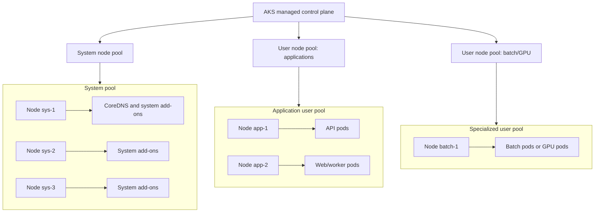
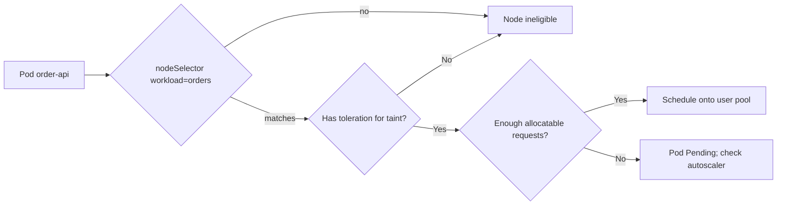
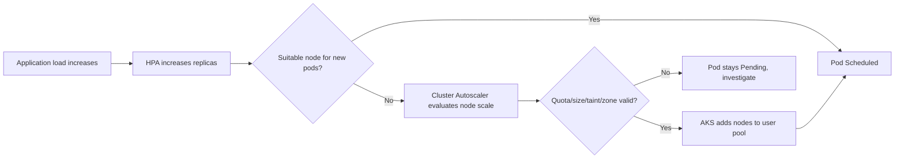

# System Node Pools, User Node Pools, and Node Size Selection

**Azure Kubernetes Service (AKS)** is a Kubernetes service managed by Microsoft Azure at the *control plane* layer, while applications and many system components run on **worker nodes** inside **node pools**. When building a real cluster, one of the most important decisions is: **how many nodes should be dedicated to the system, how many nodes to workloads, which VM size to pick, and when to scale out or scale in?**

A cluster can be created successfully yet perform poorly: CoreDNS runs out of resources, applications compete for CPU with system components, pods fail to schedule due to lack of memory, a node pool cannot survive a single-node failure, or bills spike because VM sizes are poorly matched. This lesson explains how to distinguish **system node pools** from **user node pools**, plan node resources by **CPU, RAM, pod density, storage, networking, availability, and cost**, and apply these practices using Azure and Kubernetes tools.

This content belongs to the **Azure Kubernetes Service Fundamentals** chapter in the Microsoft Azure module. The concepts connect to subscriptions, resource groups, Microsoft Entra ID, VNet/subnets, compute services, storage, security, monitoring, and cost governance of an application system. Any resource-modifying commands are examples for an authorized lab environment; no actual Azure changes are made in this lesson.

## Learning objectives

After this lesson, you can:

1. Explain the relationship between an AKS cluster, control plane, node pool, node, pod, and container.
2. Distinguish a **system node pool** from a **user node pool** and explain why they are separated.
3. Understand the roles of node labels, taints/tolerations, nodeSelector, affinity, and topology spread.
4. Estimate node count and size from **resource requests, allocatable resources, and failure headroom**.
5. Compare common VM families across CPU, RAM, I/O, GPU, and cost.
6. Select node pools for Java applications, batch workers, memory-intensive workloads, or GPUs.
7. Distinguish Cluster Autoscaler, Horizontal Pod Autoscaler (HPA), and Vertical Pod Autoscaler (VPA).
8. Use Azure CLI and `kubectl` to inspect, add, scale, and monitor node pools.
9. Plan availability zones, upgrades, drains, disruption budgets, security, and networking.
10. Troubleshoot `Pending` pods, `NotReady` nodes, non-scaling autoscalers, and resource exhaustion.

## 1. The big picture of AKS

An AKS cluster can be viewed across two layers:

- **Azure-managed control plane:** API server, scheduler, controller manager, Kubernetes state store, and corresponding management components. Users do not self-manage control plane VMs as they would in a self-hosted Kubernetes cluster.
- **Worker nodes in node pools:** VMs running kubelet, container runtime, and system/application pods. AKS node pools are typically deployed on **Virtual Machine Scale Sets (VMSS)** managed by AKS.



**A system node pool is not the control plane.** It runs on worker VMs belonging to the cluster and provides resources for critical Kubernetes infrastructure pods. Do not confuse increasing system pool nodes with increasing control plane instances.

### Key terminology

| Term | Meaning |
|---|---|
| **AKS cluster** | Management unit for Kubernetes and its node pools |
| **Node pool** | Group of nodes sharing a configuration: VM size, OS, mode, labels, taints, scaling… |
| **Node** | Worker VM receiving pods assigned by the scheduler |
| **Pod** | Execution unit running one or more containers sharing a network/storage context |
| **System add-on** | Component serving cluster operation such as DNS or system services |
| **Workload** | Business application: API, web, batch, data processor… |
| **Node allocatable** | CPU, RAM, and resources available to pods after system reservations |
| **Node pool mode** | `System` or `User` managed by AKS |

## 2. What is a system node pool?

A **system node pool** is a node pool with **mode = System**, designated to prioritize running critical pods needed for the cluster to operate properly. Common examples:

- CoreDNS for service name resolution inside Kubernetes.
- Pods in `kube-system` or foundational add-ons depending on configuration.
- Infrastructure pods that the cluster must keep stable so applications can deploy and run.

### Why protect system resources?

Suppose a Java application has a memory leak and consumes nearly all RAM on nodes running CoreDNS. When nodes hit memory pressure, system pods can be impacted, causing DNS failures or cascading disruptions across many applications in the cluster.

Separating a system pool reduces resource contention risk and makes monitoring and node upgrade planning easier. In production, **multiple system nodes** are usually needed so a single VM outage does not wipe out system capacity; the exact count depends on AKS limits, topology, and availability requirements.

### Key characteristics

- A system pool must satisfy **AKS-enforced constraints** on OS, VM types, node count, and related features. In common AKS configurations, system pools run **Linux**; verify current cluster/SKU requirements.
- A cluster must maintain at least one **valid system node pool**. You cannot convert or delete the last system pool without preparing a replacement system pool through supported procedures.
- The `System` mode helps AKS manage and target system workloads, **but does not automatically forbid all application pods from running on this pool**.
- Actual scheduling also depends on **taints, tolerations, selectors, affinity, and resource requests**.
- DaemonSets managing networking, monitoring, or security may run on multiple node types, including user nodes, if configuration permits.

### Should a system pool run business applications?

In small lab clusters, applications sometimes share system nodes to save money. In production, however, you should have **dedicated user node pools** to:

- Reduce resource contention between apps and system add-ons.
- Upgrade, scale, or change VM sizes for workloads with minimal impact on system components.
- Apply distinct taint/label policies for apps, batch jobs, and GPUs.
- Measure costs more clearly by workload group.

Separating system and user pools is a **design choice for managing risk**, not a guarantee that every pod will automatically land in the right pool without scheduling policies.

## 3. What is a user node pool?

A **user node pool** has **mode = User** and is designed to run application workloads. A cluster can have multiple user pools, for example:

- `webapps`: web apps or APIs serving requests.
- `batch`: batch data workers whose node count scales by schedule/load.
- `memory`: memory-intensive workloads, caches, or large Java heaps.
- `gpu`: machine learning/inference using GPUs with matching drivers and images.
- `spotjobs`: interruption-tolerant jobs with checkpointing.
- `windows`: Windows container workloads when the AKS version and node pool meet prerequisites.

### Comparing System and User pools

| Criterion | System node pool | User node pool |
|---|---|---|
| **Mode** | `System` | `User` |
| **Goal** | Sustain critical infrastructure pods | Run business workloads |
| **Existence requirement** | Cluster requires a valid system pool | Multiple pools can be added as needed |
| **VM size/OS flexibility** | Constrained by AKS system requirements | More flexible by OS, SKU, region, and features |
| **Scaling** | Prioritizes stability and buffer for system add-ons | Scales with workloads, cluster autoscaler, batch demand |
| **Spot nodes** | Should not be used for critical system components; must obey product limits | Suitable for eviction-tolerant workloads when Spot is used |
| **Scheduling control** | Labels/taints help keep apps off the system pool | Labels/taints/affinity direct pods to the right pool |
| **Cost management** | Required baseline platform cost | Can right-size, autoscale, and allocate by app group |

Simply selecting User mode does not immediately keep all Kubernetes pods off the system pool. Taints/selectors and live scheduling constraints determine where pods run.

## 4. How does the Scheduler pick a node?

The Kubernetes Scheduler does not look only at current live CPU usage. It evaluates multiple constraints:

1. Does the pod specify `nodeSelector` or `nodeAffinity`?
2. Does the node have a **taint** for which the pod lacks a **toleration**?
3. Does the node have enough **allocatable CPU/memory** left for the sum of **requests**?
4. Are there limits on pod count, ports, volumes, topology, or other constraints?
5. Does the node satisfy OS/architecture, GPU, zone, and storage topology requirements?
6. When multiple nodes qualify, the scheduler applies scoring/spreading criteria per configuration.

### Node labels

A label is a key/value pair attached to a node, for example:

```text
workload=orders
environment=production
kubernetes.azure.com/mode=system
```

A pod can use `nodeSelector` or affinity to **run only on nodes carrying matching labels**. Labels are not an independent security boundary: users with node or cluster admin permissions can alter configurations.

### Taints and tolerations

A **taint** on a node expresses: "pods without a matching toleration must not be scheduled here" when using an effect like `NoSchedule`.

Example taint:

```text
workload=orders:NoSchedule
```

A pod wanting to run on that tainted node needs a matching toleration. However, **having a toleration does not guarantee the pod will land on that pool**: to force pods strictly into the `orders` pool, you must also add a `nodeSelector` or node affinity.

### Combining labels and taints

| Configuration | Effect |
|---|---|
| Label `workload=orders` on user pool | Marks nodes belonging to an app group |
| Taint `workload=orders:NoSchedule` on user pool | Blocks pods lacking a matching toleration from entering the pool |
| Pod `nodeSelector: workload=orders` | Forces the pod to select labeled nodes |
| Pod toleration for `workload=orders` | Allows the pod to bypass the taint |
| Pod requests/limits | Helps the scheduler evaluate capacity; caps runtime usage via container mechanisms |

In production, manage labels/taints via node pool configuration / IaC. Changes applied directly to individual nodes may not survive node replacement or upgrades; reconcile them with AKS-managed state.

## 5. Isolating workloads from the system pool via scheduling

A commonly adopted architecture:

- Pool `sysnode` (System mode): nodes reserved for system add-ons, with appropriate taints where recommended/supported.
- Pool `orders` (User mode): configured with label `workload=orders` and taint `workload=orders:NoSchedule`.
- Application pods declare matching `nodeSelector` + toleration.



Never apply an arbitrary taint to a production system pool without first checking the list of system pods and their existing tolerations. Some DaemonSets or add-ons must run on every node; blocking them with a new taint can break networking or monitoring.

**Note:** AKS may apply specific labels indicating pool mode; inspect with `kubectl get nodes --show-labels` or Azure CLI. Do not manually edit system labels into workload labels to bypass platform constraints.

## 6. CPU, RAM, and allocatable: do not treat VM size as pod capacity

When Azure advertises a VM with 4 vCPU and 16 GiB RAM, Kubernetes **does not make all 4 vCPU and 16 GiB available to application pods**.

A portion of resources is consumed by:

- The operating system, kubelet, and container runtime.
- System services and DaemonSets such as networking/monitoring agents.
- Kube/system reservations and eviction thresholds.
- Node processes outside pods.
- Headroom to avoid sustained memory pressure or CPU throttling.

### Capacity vs. Allocatable

- **Capacity:** total resources reported by the node.
- **Allocatable:** CPU/memory/ephemeral-storage available for pods after reservations managed by Kubernetes/AKS.
- **Requests:** resources requested by a pod for scheduler placement decisions.
- **Limits:** runtime consumption caps enforced on containers; CPU may be throttled, and exceeding memory limits can trigger an OOM kill.

```text
VM capacity
  - OS / kubelet / system reservations
  = Node allocatable (available to pods)
  - DaemonSet requests and currently scheduled pods
  = Remaining headroom for new pods
```

**Do not estimate with the formula "16 GiB VM ⇒ runs 16 pods of 1 GiB each."** Pods may need more than 1 GiB memory requests, DaemonSets consume resources, JVM heap differs from RSS, and nodes also have pod-count/network limits.

### Inspecting actual resources

```bash
kubectl describe node "<NODE_NAME>"
```

Inspect `Capacity`, `Allocatable`, and `Allocated resources`. To view a node in JSON/jsonpath form:

```bash
kubectl get node "<NODE_NAME>" \
  -o jsonpath='{.status.capacity.cpu}{"\n"}{.status.allocatable.cpu}{"\n"}{.status.allocatable.memory}{"\n"}'
```

Numbers from an actual cluster are more accurate than guessed reservations. OS image, AKS version, maxPods, and add-ons all affect allocatable values.

## 7. Sizing nodes from pod requests

Suppose a Java application has:

- **12 replicas** of an API.
- Each replica requests **500m CPU** (0.5 vCPU) and **1 GiB RAM**.
- Each replica has limits of **1000m CPU** and **2 GiB RAM**.
- A planned user node pool uses VMs nominally sized at **4 vCPU, 16 GiB RAM**.
- For illustration, suppose after reservations and DaemonSets, **usable CPU for apps per node is ~3.4 vCPU** and **RAM is ~13 GiB**. These are illustrative assumptions, not guarantees for any SKU.

### Summing total requests

```text
Total CPU requests = 12 × 0.5 = 6 vCPU
Total RAM requests = 12 × 1 GiB = 12 GiB
```

Dividing evenly:

- CPU limit per node: `floor(3.4 / 0.5) = 6` pods/node.
- RAM limit per node: `floor(13 / 1) = 13` pods/node.
- CPU is the binding constraint, so one node can hold at most roughly **6 pods** under these assumptions, before considering topology/pod density and extra overhead.

With only **2 nodes**, they could theoretically fit all 12 pods; however, if one node fails, the remaining node cannot hold all replicas by requests. To **tolerate losing one node**, you need at least **3 nodes under these assumptions**, since after one node fails, 2 nodes × 6 pods = 12 pods remain.

### Initial sizing formula

```text
CPU nodes = ceil(Total CPU requests / Target allocatable CPU per node)
RAM nodes = ceil(Total RAM requests / Target allocatable RAM per node)
Base node count = max(CPU nodes, RAM nodes, topology constraints, pod density)
HA node count = additional nodes needed to satisfy N-1 or fault-tolerance targets
```

Keep **realistic headroom** for spikes, rollouts, DaemonSet growth, evictions, and upgrades. Real sizing must also factor in `maxPods` limits, zones, pod topology, PDBs, quotas, disk, and networking.

### Requests are not usage

If an app requests 500m but regularly consumes nearly 1 vCPU, the scheduler still counts 500m during placement; CPU limits can trigger throttling when exceeded. If memory requests are far below actual usage, nodes risk memory pressure/OOM even though the scheduler thinks space remains.

For Java, measure:

- JVM heap and non-heap memory.
- Metaspace, thread stacks, direct buffers, and native memory.
- Memory peaks during GC, heavy load, or batch runs.
- CPU throttling, GC pauses, and request latency.
- Sidecar containers if using a service mesh, logging, or agents.

Base requests/limits on **load tests, telemetry, and SLOs**, rather than copying one template across every service.

## 8. Choosing VM families by workload profile

Azure offers many VM families. SKU names and availability depend on region, quota, CPU architecture, and AKS version. The table below is directional guidance, not a pricing sheet or current SKU catalog.

| VM family | Relative profile | Suitable workloads | Things to watch |
|---|---|---|---|
| **D-series** (general purpose) | Balanced CPU and RAM | APIs, web apps, general workers, system pools when eligible | Common starting point for right-sizing |
| **E-series** (memory optimized) | Higher RAM relative to CPU | Java services needing large heaps, caches, in-memory data | Do not pick it merely to mask unoptimized heap usage |
| **F-series** (compute optimized) | Higher CPU relative to RAM | Compute-intensive stateless workloads | May lack RAM if Java requires a large heap |
| **B-series** (burstable) | CPU credits/baseline, economical for light workloads | Labs or low traffic with acceptable burst behavior | Generally unsuitable for critical system components or sustained CPU loads |
| **N-series** (GPU) | GPUs or specialized accelerators | AI/ML, rendering, GPU compute | Requires GPU drivers, operators, quota, and a dedicated node pool |
| **Storage/IO optimized** | High disk, IOPS, or throughput by SKU | Large file processing, disk-intensive workloads | Distinguish managed disks vs. ephemeral disks and network bandwidth |

### Criteria to check beyond vCPU and RAM

1. **CPU architecture:** amd64 vs. arm64; container images and all native dependencies must match.
2. **Ephemeral OS disk:** supported by the SKU/OS/AKS and sufficient cache/temp storage.
3. **Local ephemeral storage:** enough for image layers, logs, temp files, unpacking, and runtime.
4. **Disk IOPS/throughput:** critical for workloads using volumes, local files, or PersistentVolumes.
5. **Network bandwidth:** apps calling APIs/Storage heavily may hit NIC or infrastructure limits.
6. **Accelerated networking:** support depends on VM size/OS and feature requirements.
7. **Max pods per node:** affects IP allocation, network plugins, and workload density.
8. **Availability zones and quota:** whether the SKU has capacity in your target zones/region.
9. **Actual compute pricing:** varies by region, VM type, OS, reservations/savings plans, and runtime hours.
10. **AKS system requirements:** not every VM SKU is permitted for every mode, OS, or feature.

Avoid designing a pool with too many tiny VMs purely because per-VM price is low, since **each node incurs OS/kubelet/DaemonSet overhead**. Conversely, overly huge VMs increase the blast radius when a node fails and waste capacity if workloads are small.

## 9. MaxPods, CNI, and IP planning

An often overlooked limit is the **maximum number of pods per node** (`maxPods`). Even when CPU/RAM remain free, the scheduler cannot add pods once a node hits its limit or the network runs out of addresses under the active configuration.

### How does the network plugin matter?

AKS offers several networking options, such as:

- **Azure CNI** with different pod IP allocation models.
- **Azure CNI Overlay** using an overlay pod CIDR architecture.
- Other configurations matching the AKS version and organizational policy.

Depending on the model, pods either consume IP addresses from a VNet subnet or use a separate pod address space. Therefore, **node count and maxPods impact subnet and pod CIDR capacity differently**.

Never copy an IP calculation from a cluster using one CNI to a cluster using another CNI. Before creating a node pool, determine:

- Node subnet, pod network model, and non-overlapping ranges with VPN/peered VNets.
- Maximum node count when autoscaler scales out.
- Actual `maxPods` by pool/network type and current limits.
- Pod IP allocation speed during rapid scaling.
- NSG rules, UDRs, DNS, and outbound connectivity for nodes.

**Node pools in the same cluster can have different settings**, while foundational network plugin choices are typically fixed at cluster level. Check specific capabilities and limits before deciding.

## 10. Availability zones and fault-tolerant design

If an application has a strict SLO, avoid placing all replicas on a single VM or in a single failure domain.

### Multiple nodes do not guarantee zone tolerance

A three-node pool may still sit inside a single availability zone if configured that way or if the region lacks zone support. In zone-enabled regions, specify which zones the node pool spans and verify VM SKU capacity.

### Pod spreading

You can use:

- **Pod anti-affinity:** avoid placing multiple replicas of the same role on the same node.
- **Topology spread constraints:** spread pods across nodes/zones using labels and topology keys.
- **PodDisruptionBudget (PDB):** limits pods disrupted by voluntary disruptions, such as maintenance drains.
- **Deployment replicas:** maintain enough replicas to keep serving when one node becomes unhealthy.
- **Readiness probes:** send traffic only when a pod is genuinely ready.

### Example pod spread constraint

```yaml
topologySpreadConstraints:
  - maxSkew: 1
    topologyKey: kubernetes.io/hostname
    whenUnsatisfiable: ScheduleAnyway
    labelSelector:
      matchLabels:
        app: orders-api
```

This constraint tells the scheduler to **prefer** spreading pods across nodes. `ScheduleAnyway` does not strictly enforce even spread; if strict enforcement is required, use `DoNotSchedule`, noting it increases the risk of Pending pods if nodes or zones are unavailable.

For zone topology, use `topology.kubernetes.io/zone` when nodes carry the appropriate labels. Verify available zones/nodes; a 3-replica Deployment does not guarantee one replica per zone if topology constraints cannot be met.

## 11. How do Cluster Autoscaler, HPA, and VPA differ?

### Cluster Autoscaler (CA)

**Cluster Autoscaler** adjusts the number of nodes in a node pool within configured min/max bounds, primarily driven by pod scheduling demand. If a pod is Pending due to insufficient resources and adding a node would resolve it, CA can scale out. When nodes are underutilized and pods can be safely relocated, CA can scale in according to its rules.

This **does not mean CA increases vCPU/RAM size per VM**. If the chosen VM size is wrong, create a new pool or move workloads to another node size.

### Horizontal Pod Autoscaler (HPA)

**HPA** scales the number of pod replicas up or down based on CPU, memory, or supported custom/external metrics. For example, under high API load, HPA scales from 4 to 10 pods.

If the user pool only has room for 6 pods, the remaining 4 pods may stay Pending; CA can add nodes if configured and quota/conditions allow.

### Vertical Pod Autoscaler (VPA)

**VPA** recommends or updates workload resource requests/limits depending on its capabilities and mode. Updating pods may involve pod recreation, and you must check interactions with HPA, especially if both act on CPU/memory in conflicting ways.

### Example autoscale flow



**Scaling is not instantaneous**: provisioning a VM, joining the cluster, pulling images, starting containers, and passing readiness checks all take time. For apps with sudden traffic spikes, keep headroom or evaluate capacity reservation strategies based on architecture and budget.

## 12. Managing node pools with Azure CLI

The hands-on steps use **Bash** in Azure Cloud Shell or a terminal with Azure CLI, within an approved lab subscription.

### Step 1: verify subscription and cluster

```bash
az account show --output table
az account set --subscription "<SUBSCRIPTION_ID>"

RG="<RESOURCE_GROUP>"
AKS="<AKS_CLUSTER_NAME>"
```

Before modifying configurations, confirm the right cluster, region, and admin permissions:

```bash
az aks show \
  --resource-group "$RG" \
  --name "$AKS" \
  --query "{name:name,location:location,kubernetesVersion:kubernetesVersion,nodeResourceGroup:nodeResourceGroup}" \
  --output json
```

### Step 2: list node pools

```bash
az aks nodepool list \
  --resource-group "$RG" \
  --cluster-name "$AKS" \
  --output table
```

Inspect details of a specific pool:

```bash
az aks nodepool show \
  --resource-group "$RG" \
  --cluster-name "$AKS" \
  --name "<NODE_POOL_NAME>" \
  --query "{name:name,mode:mode,vmSize:vmSize,count:count,osType:osType,maxPods:maxPods,autoScale:enableAutoScaling,min:minCount,max:maxCount,labels:nodeLabels,taints:nodeTaints}" \
  --output json
```

Key fields to read: System/User mode, VM size, current node count, min/max, labels/taints, OS, and maxPods. Never infer whether a pool is system or user solely from its name; the `mode` property is the authoritative AKS setting.

### Step 3: inspect live nodes and pods

Fetch Kubernetes credentials with an authorized identity:

```bash
az aks get-credentials \
  --resource-group "$RG" \
  --name "$AKS"
```

Then verify **current context** to avoid running `kubectl` against the wrong cluster:

```bash
kubectl config current-context

kubectl get nodes -o wide

kubectl get nodes \
  -L kubernetes.azure.com/mode,agentpool,workload

kubectl get pods -A -o wide
```

List pods in the `kube-system` namespace and observe which nodes they run on. Do not assume every pod in that namespace must run on the system pool or that zero system pods run on user pools.

### Step 4: check allocatable and resource status

```bash
kubectl describe nodes

kubectl top nodes
kubectl top pods -A
```

`kubectl top` only returns data when **metrics-server / the metrics pipeline** is running and permitted. Missing metrics does not mean nodes use zero CPU; check the metrics pipeline or Azure Monitor.

## 13. Example: creating an AKS cluster with System and User pools

To understand the sequence, you can create a lab cluster with a system pool and then add a user pool. These are **cost-incurring commands**; run only when approved and with adequate quota.

### Step 1: create lab resource group

```bash
RG="rg-aks-pools-lab"
LOCATION="southeastasia"
AKS="aks-pools-lab"

az group create \
  --name "$RG" \
  --location "$LOCATION"
```

### Step 2: create cluster with initial node pool

```bash
az aks create \
  --resource-group "$RG" \
  --name "$AKS" \
  --location "$LOCATION" \
  --nodepool-name system \
  --node-count 3 \
  --node-vm-size Standard_D4s_v5 \
  --enable-managed-identity \
  --generate-ssh-keys
```

`Standard_D4s_v5` and 3 nodes are **sizing examples**, not guaranteed available in every subscription/region or compliant with every organizational policy. Verify AKS policies, quota, default network mode, Kubernetes version, VM SKU list, and pricing before creating.

**Networking note:** this command uses the CLI's default networking option at runtime. In production, explicitly configure Azure CNI/CNI Overlay, node subnet, pod CIDR, network policy, private cluster/public API access, and outbound rules per design. Never copy this minimal command into production as a complete network architecture.

### Step 3: add a user pool for workloads

```bash
az aks nodepool add \
  --resource-group "$RG" \
  --cluster-name "$AKS" \
  --name orders \
  --mode User \
  --node-vm-size Standard_D4s_v5 \
  --node-count 2 \
  --labels workload=orders \
  --node-taints workload=orders:NoSchedule
```

The two `orders` nodes in this lab do not have autoscaler enabled yet. The taint `workload=orders:NoSchedule` keeps out pods not intended for this pool. A pod targeting `orders` needs a **toleration**, and to restrict it exclusively to that pool it also needs a **nodeSelector**.

If the command fails due to quota, SKU, subnet IPs, or policy, do not switch to a larger VM size without checking cost and technical requirements.

### Step 4: enable Cluster Autoscaler on the user pool

After confirming workloads can run, for example:

```bash
az aks nodepool update \
  --resource-group "$RG" \
  --cluster-name "$AKS" \
  --name orders \
  --enable-cluster-autoscaler \
  --min-count 2 \
  --max-count 6
```

Min/max counts are illustrative only. Once autoscaler is enabled, avoid directly modifying instance counts on the AKS-managed VMSS or running conflicting manual scale operations. Use the appropriate AKS node pool / cluster autoscaler commands.

**Why min = 2?** This is chosen to keep at least two user nodes in the lab illustration. For node-fault-tolerant production workloads, the minimum node count also depends on CPU/RAM requests, replica counts, PDBs, zones, and N-1 planning.

### Step 5: verify node pools

```bash
az aks nodepool list \
  --resource-group "$RG" \
  --cluster-name "$AKS" \
  --output table

az aks get-credentials \
  --resource-group "$RG" \
  --name "$AKS"

kubectl get nodes -L kubernetes.azure.com/mode,agentpool,workload
```

Expect nodes belonging to both the system pool and user pool, with the expected labels/taints on user nodes. Verify further:

```bash
kubectl describe node "<USER_NODE_NAME>"
```

Inspect `Taints` and `Labels` instead of trusting a successful pool creation command alone.

## 14. Deploying an application onto a user pool with YAML

Suppose a Java API is packaged as a container image in your organization's registry. The following manifest configures **2 replicas**, resource requests/limits, and scheduling targeting only the `orders` pool.

```yaml
apiVersion: apps/v1
kind: Deployment
metadata:
  name: orders-api
  namespace: default
spec:
  replicas: 2
  selector:
    matchLabels:
      app: orders-api
  template:
    metadata:
      labels:
        app: orders-api
    spec:
      nodeSelector:
        workload: orders
      tolerations:
        - key: workload
          operator: Equal
          value: orders
          effect: NoSchedule
      topologySpreadConstraints:
        - maxSkew: 1
          topologyKey: kubernetes.io/hostname
          whenUnsatisfiable: ScheduleAnyway
          labelSelector:
            matchLabels:
              app: orders-api
      containers:
        - name: orders-api
          image: <REGISTRY_NAME>.azurecr.io/orders-api:1.0.0
          ports:
            - containerPort: 8080
          resources:
            requests:
              cpu: "250m"
              memory: "512Mi"
            limits:
              cpu: "1000m"
              memory: "1Gi"
          readinessProbe:
            httpGet:
              path: /health/ready
              port: 8080
            initialDelaySeconds: 10
            periodSeconds: 10
          livenessProbe:
            httpGet:
              path: /health/live
              port: 8080
            initialDelaySeconds: 30
            periodSeconds: 20
```

Before saving and applying:

- Replace `<REGISTRY_NAME>` with your real registry, ensure the image exists, and verify the AKS kubelet identity has pull permissions.
- The `/health/ready` and `/health/live` endpoints must actually be implemented by the application.
- `namespace: default` is for lab use only; production should separate namespaces by access control and workload.
- You need Kubernetes RBAC permissions to create a Deployment.
- If nodes carry additional taints, the manifest may need extra tolerations or a revised pool design.

### Testing manifest application

Assuming the manifest is saved to `orders-api.yaml` in a lab environment:

```bash
kubectl config current-context

kubectl apply \
  --dry-run=client \
  -f orders-api.yaml

kubectl apply -f orders-api.yaml

kubectl get deployment orders-api
kubectl get pods -l app=orders-api -o wide
```

Running `--dry-run=client` only checks parts of the manifest verifiable client-side; it **does not replace** admission policies or live scheduling. If pods stay Pending, run `kubectl describe pod` to inspect detailed events.

### Verify pods landed on the right pool

```bash
kubectl get pods -l app=orders-api -o wide

kubectl describe pod "<ORDERS_POD_NAME>"

kubectl get nodes -L workload,agentpool
```

Cross-check the node name assigned to each pod against the user pool's labels. Always verify actual placement after rollout rather than relying solely on the manifest.

## 15. Should you put a taint on the system pool?

A common goal is preventing application pods from competing for CPU/RAM with system add-ons. AKS and Kubernetes provide taints such as:

```text
CriticalAddonsOnly=true:NoSchedule
```

This is an example taint used to dedicate nodes to critical add-ons in supported configurations. **Do not assume every system pool has this taint by default**, and do not add it to a live pool without checking tolerations of all running add-ons.

### Safe procedure

1. List system nodes and currently running pods.
2. Inspect pool labels/taints in Azure CLI and Kubernetes.
3. Define policy on which workloads should be permitted on the system pool.
4. Verify scheduling of CoreDNS, metrics, networking, and DaemonSets.
5. Test the taint policy in a lab or equivalent staging cluster.
6. Apply changes via AKS-supported mechanisms, never by manually editing VMSS.
7. Watch `Pending`, `NotReady`, DNS, and metrics after the change.

**Taints are not network access control or data authorization.** Even when pods are kept off a given pool, they still need Kubernetes RBAC, network policies, workload identity, and secret protection across other layers.

## 16. Upgrading, changing VM sizes, and migrating workloads

A node pool is a set of VMs sharing common specs. Some properties can be updated in place; major changes such as **switching to a different VM size** should usually be done by creating a **new node pool** and migrating workloads through supported workflows, rather than directly editing the AKS-managed VMSS.

### Why not edit VMSS manually?

- AKS manages the lifecycle of node pools and underlying infrastructure.
- Out-of-band changes can cause drift, break compatibility, or get overwritten during upgrades.
- Scheduler and autoscaler rely on accurate capacity, labels, and taints.
- Quota, zones, and networking must be managed consistently when creating new nodes.

### Strategy for migrating from an old pool to a new pool

1. **Assess:** review requests/usage, target VM size needs, region, zones, and quota.
2. **Create a new user pool** with appropriate OS, CNI/network, labels/taints, and maxPods.
3. **Verify nodes are Ready:** DNS, CNI, storage CSI, image pulls, metrics, and DaemonSets.
4. **Adjust workload placement** so the scheduler places new replicas onto the new pool.
5. **Create/update replicas** via rollout strategy; wait until readiness passes.
6. **Cordon/drain** old nodes in a controlled manner, respecting PDBs and stateful workloads.
7. **Observe:** error rate, latency, memory, CPU, and application health.
8. **Scale down/delete the old pool** only when zero dependent workloads remain and a rollback plan exists.

### Why does draining matter?

`kubectl drain` marks a node unschedulable and evicts movable pods according to Kubernetes rules. Avoid aggressive draining when:

- Production has only a single replica running.
- A PDB prevents evicting enough pods.
- Stateful workloads use local disks without a data strategy.
- Pods have strict affinity/topology constraints.
- Remaining nodes lack sufficient allocatable capacity.

For system pools, replacements/upgrades require extra care so CoreDNS and other add-ons retain sufficient capacity.

## 17. Safe node pool upgrades and maintenance

AKS must keep Kubernetes versions, node OS images, and configurations within supported lifecycles. When nodes are upgraded or reimaged, pods may be evicted or restarted.

Key factors:

- **Surge capacity:** ability to spin up temporary nodes during upgrades per supported configuration.
- **Drain timeout / eviction:** wait time for pods to terminate gracefully and PDB allowance.
- **PDB:** limits voluntary disruptions, though it does not prevent unexpected VM outages.
- **Pod replicas:** with only one replica, a drain can cause service downtime.
- **Availability zones:** spread workloads so upgrades or zone faults do not take down all replicas.
- **Quota/subnet IPs:** surge upgrades need temporary extra VMs/IPs; insufficient quota can stall upgrades.
- **System pool:** keep enough capacity for DNS, networking, and add-ons throughout upgrades.

Avoid combining VM size changes, network plugin changes, and Kubernetes version upgrades into one complex event if you can phase them; separating changes makes root-cause analysis much easier when errors occur.

## 18. Spot, GPU, Windows, and ARM workloads

Some workloads have different requirements than standard web applications.

### Spot user pool

Spot VMs can lower costs for **interruption-tolerant** jobs, such as checkpointed batch tasks or retryable rendering. However, Azure can evict Spot capacity per service terms, so:

- Never run critical system components on Spot.
- Never rely on Spot as the sole capacity for workloads with strict availability SLOs.
- Use taints/labels so only suitable workloads enter the pool.
- Design for retries, idempotency, checkpoints, and durable outputs.
- Monitor evictions and potential capacity unavailability during scale-out.

### GPU pool

When workloads use GPUs:

- Choose a GPU VM SKU supported by AKS and the target region.
- Ensure compatible drivers, operators, and device plugins are installed.
- Declare GPU resource requests/limits using the exposed resource name, e.g., `nvidia.com/gpu` where applicable.
- Use dedicated pools, taints, and labels to keep ordinary web pods off expensive GPU nodes.
- Factor in VRAM and GPU sharing/MIG if supported and required.
- Monitor GPU utilization to avoid paying for idle nodes.

### Windows user pool

If applications require Windows containers, choose an AKS-supported Windows user pool and verify compatibility across container images, container runtime, host OS version, networking, storage, and gMSA if needed. Some DaemonSets/add-ons built for Linux cannot run natively on Windows.

### ARM64

Certain Arm64 VM families offer attractive price/performance for compatible workloads. Before adopting them, verify architecture compatibility of container images, Java runtimes, and native dependencies. Use `nodeSelector`/affinity on `kubernetes.io/arch` when running mixed architectures in one cluster.

## 19. Governance, security, and workload isolation

**A node pool is not a complete security boundary.** A pod can still reach resources on another pool over the network without proper network policies or firewalls. Likewise, a node label does not prove a pod is authorized to access Azure Storage or Key Vault.

### Protection layers

| Layer | Common controls |
|---|---|
| **Azure management plane** | Azure RBAC, Microsoft Entra ID, PIM, policies, activity logs |
| **Kubernetes control plane** | Kubernetes RBAC, namespaces, admission policies, auditing where configured |
| **Node placement** | System/user modes, labels, taints, affinity, topology spread |
| **Network** | Azure CNI, NSGs/UDRs, network policies, private cluster/API access, firewall |
| **Workload identity** | Microsoft Entra Workload ID or supported mechanisms; avoid sharing node credentials |
| **Secrets** | Secrets Store CSI / Key Vault and policy-compliant secret handling |
| **Image supply chain** | ACR permissions, image scanning, digests, signing/verification where applicable |
| **Runtime** | Requests/limits, securityContext, avoid privileged mode unless required |
| **Observability** | Azure Monitor, Container Insights, Prometheus metrics, or equivalent tools |

### Why not use node managed identity for every pod?

Node/kubelet identities typically manage cluster resources and pull images. If multiple applications share one broad identity, the **least privilege** principle is violated. For apps reading Blob or Key Vault, use supported **workload identity** with minimal data-plane roles.

### Does a dedicated node pool guarantee absolute isolation?

No. A dedicated user pool reduces resource contention and supports operational policies, but strict isolation requirements may require:

- Separate namespaces and RBAC.
- Network policies restricting east-west traffic.
- Pod security / admission controls.
- Separate clusters/subscriptions for distinct tenants or trust zones.
- Appropriate monitoring and auditing.

## 20. Cost and capacity efficiency

AKS costs stem from node VMs, managed disks, IPs/networking, load balancers, logging, storage, and selected managed tiers/features. **Never look only at the control plane price and conclude cluster cost is low**: continuously running worker nodes usually account for most of the bill.

### Design comparison example

Suppose two options both total a nominal 8 vCPU and 32 GiB RAM:

- **Option A:** 2 nodes × 4 vCPU / 16 GiB.
- **Option B:** 4 nodes × 2 vCPU / 8 GiB.

Both have the same nominal capacity, yet **actual allocatable capacity** differs because OS/DaemonSet overhead repeats on each node. Option B can distribute node failures better if pods/topology allow, but incurs higher per-node overhead, additional disks/IPs, and potentially different management/networking costs.

Conversely, one giant node limits failure distribution and increases how many pods go down together when that node fails.

### Cost components to factor in

1. VM pricing by SKU, region, and runtime duration.
2. Minimum system pool nodes always running to keep the cluster operational.
3. Minimum user pool nodes, peak nodes, and autoscaler min/max settings.
4. OS disks/ephemeral storage, PersistentVolumes, and backups.
5. Outbound NAT/Firewall, load balancers, public/private IPs, and cross-zone/region traffic.
6. Registry, image pulls, and log/metric ingestion.
7. Spot evictions and batch retry costs.
8. Overprovisioning kept for SLOs, upgrades, or rapid scaling.
9. External resources outside the cluster such as SQL, Redis, Storage, and Key Vault.

### Right-sizing workflow

- **Measure:** requests, limits, actual CPU/RAM usage, pending pods, OOMs, GC, and latency.
- **Compare:** are requests far from usage? Do nodes sit with excessive headroom or suffer memory shortages?
- **Separate:** group workloads with distinct profiles into suitable pools.
- **Test:** create a new pool in staging, run load tests, and inspect real allocatable capacity.
- **Roll out:** deploy with canary/rollback and bounded disruption.
- **Review:** compare cost and SLOs after several load cycles.

**Budget alerts only notify**; they do not automatically shut down nodes when a budget is exceeded. You need autoscaler caps and operational governance to prevent runaway scaling.

## 21. Troubleshooting Pending pods, NotReady nodes, and stalled autoscaling

### Scenario 1: pod Pending due to insufficient CPU/memory

```bash
kubectl get pods -A --field-selector=status.phase=Pending

kubectl describe pod "<POD_NAME>" \
  -n "<NAMESPACE>"
```

Messages like `Insufficient cpu` or `Insufficient memory` mean the scheduler found no node with enough free **requests**. Check:

- Are pod requests set reasonably?
- How much node allocatable capacity and DaemonSet overhead remain?
- Does another node pool with matching labels/taints have capacity?
- Is autoscaler enabled on the right pool and still below `max-count`?

Never fix this by slashing requests to artificially tiny numbers without measuring real usage; that turns `Pending` errors into OOMs or CPU throttling in production.

### Scenario 2: pod Pending due to taint/selector

Messages may mention `untolerated taint` or nodes failing `node affinity/selector` matching.

Inspect:

```bash
kubectl get nodes --show-labels

kubectl describe node "<NODE_NAME>"

kubectl describe pod "<POD_NAME>" \
  -n "<NAMESPACE>"
```

If a Deployment specifies `nodeSelector workload=orders` and no pool carries that label, the pod cannot be scheduled there. If a node has a taint and the pod lacks a toleration, scheduling also fails. Cluster Autoscaler cannot help when **no node group can satisfy the constraints**, even if the cluster has quota.

### Scenario 3: node NotReady

```bash
kubectl get nodes

kubectl describe node "<NODE_NAME>"

kubectl get pods -n kube-system -o wide
```

Possible causes:

- Kubelet, container runtime, or node OS failure.
- Networking, DNS, or CNI failure.
- VM disk exhaustion, memory pressure, or full image filesystem.
- Ongoing upgrade, reimage, or platform operation.
- Network policy, routing, or firewall blocking the node from reaching required components.

Never manually delete production nodes before checking stateful workloads, local disk data, and VM/scale set status. Follow AKS management channels and approved recovery runbooks.

### Scenario 4: Cluster Autoscaler does not scale

Check:

1. Is CA enabled on the right **user node pool**?
2. Has the node count reached `max-count`?
3. Do the node size, OS, architecture, taints, and zones match the pod?
4. Does the subscription have VM quota and regional/zonal capacity?
5. Do node subnets or pod CIDRs have enough IPs for a new node?
6. Does the pod have unsatisfiable storage volume topology/affinity constraints?
7. Are policy constraints, PDBs, or unhealthy nodes blocking scale-in/scale-out?

Kubernetes events and supported autoscaler/AKS logs distinguish configuration errors from capacity shortages. Adding more nodes will not fix image pull errors, CrashLoopBackOff, or app config bugs once a pod is already scheduled.

### Scenario 5: Node has idle CPU yet pod is Pending

The scheduler evaluates **requests** and constraints, not only live CPU usage. If existing pods have reserved all allocatable CPU via requests while actually using very little, new pods still remain Pending. Inspect `Allocated resources` and right-size requests.

### Scenario 6: Pod is OOMKilled

```bash
kubectl describe pod "<POD_NAME>" -n "<NAMESPACE>"

kubectl logs "<POD_NAME>" \
  -n "<NAMESPACE>" \
  --previous
```

If container memory exceeds its limit or the node hits memory pressure, the pod can be killed and restarted. For Java, check heap, off-heap/direct buffers, thread stacks, and sidecars; increasing node size is only one option and does not replace investigating memory leaks.

## 22. Comprehensive exercise: choosing node pools for a Java API and batch worker

**Scenario:** an Azure system runs a user-facing Java API and an overnight batch worker. The team wants to:

- Keep system add-ons stable.
- Run the API on a user pool with spare capacity.
- Run the batch worker on a separate pool that scales down when idle.
- Measure CPU/RAM impact and cost.
- Prevent batch jobs from starving the system pool.

### Step 1: build a workload inventory

| Workload | Typical replicas | CPU request/pod | RAM request/pod | Characteristics |
|---|---:|---:|---:|---|
| Java API | 6 | 500m | 1 GiB | Continuously serving, needs HA |
| Batch worker | 0–12 | 1000m | 2 GiB | Hourly/periodic, retryable |
| System add-ons | Cluster-dependent | Measure live | Measure live | Must stay stable |

These are **hypothetical numbers for the exercise**. Production must use live measurements plus DaemonSet overhead.

### Step 2: design the pools

- **System pool:** Linux nodes sized for CoreDNS/add-ons with buffer for single-node failure.
- **User API pool:** general-purpose or memory-optimized VMs based on Java metrics; node count covers current replicas plus N-1 target.
- **User batch pool:** VMs prioritizing compute/RAM per task, scaled by CA or pipelines; dedicated taint, and consider Spot if appropriate.

### Step 3: implement scheduling policies

The API pool gets label `workload=api` and the batch pool gets `workload=batch`, each with dedicated taints if strict separation is desired. API Deployments and batch Jobs specify matching `nodeSelector`/tolerations.

Do not put only a toleration on batch jobs and hope the scheduler picks the batch pool; include matching selectors/affinity.

### Step 4: test losing one API node

Suppose the API pool has enough capacity to reschedule replicas after one node fails. Use a controlled staging test to simulate an unavailable node and observe:

- How long are pods Pending?
- Does CA scale out if needed?
- How long until pod readiness passes?
- Are there 5xx responses or latency spikes?
- Are PDBs or topology constraints blocking voluntary evictions?

Never intentionally crash a production node just to complete a lab exercise.

### Step 5: test batch scaling

Create a test batch workload with realistic CPU/memory requests and increasing task counts. Observe:

```bash
kubectl get pods -o wide

kubectl get nodes -L agentpool,workload

kubectl top nodes
```

Confirm batch pods land on the right user pool; once jobs finish, watch autoscaler scale-in per its rules. Cluster Autoscaler does not guarantee instantaneous scale-down the second a job ends.

### Step 6: evaluate

Produce a report covering:

- Node size and min/max node counts per pool.
- Total requests and peak usage.
- Pending/NotReady/OOM pods and root causes.
- Ability to keep the API healthy during a single-node outage.
- Node-hours and estimated regional cost.
- Decisions to right-size, change VM size, or keep headroom.

## 23. Production deployment checklist

- [ ] Distinguished the AKS control plane from the worker system node pool.
- [ ] At least one valid system pool with sufficient resources and required fault tolerance.
- [ ] User workloads separated from system add-ons via scheduling policies.
- [ ] Verified live node labels, taints, and tolerations.
- [ ] Inventoried workloads, requests/limits, sidecars, DaemonSet overhead, and peak usage.
- [ ] Calculated node allocatable, headroom, and N-1 capacity rather than raw VM capacity alone.
- [ ] Selected VM series matching CPU/RAM/I/O/GPU needs and container image architecture.
- [ ] Verified SKU availability, quota, zones, OS image, pod density, and maxPods.
- [ ] Designed node subnet/pod IPs and CNI for scale.
- [ ] Configured autoscaler min/max, evaluated HPA/VPA, and checked interactions.
- [ ] Enforced workload placement using nodeSelector/affinity, not tolerations alone.
- [ ] Configured replicas, readiness probes, topology spread, and PDBs for HA where needed.
- [ ] Prepared node pool upgrade plans, surge/drain settings, rollbacks, and temporary quota.
- [ ] Defined policies for Spot/GPU/Windows/ARM64 if used.
- [ ] Restricted Azure RBAC/Kubernetes RBAC, network policies, and workload identity permissions.
- [ ] Set up monitoring for CPU/memory, Pending/NotReady/OOM pods, and autoscaler events.
- [ ] Budgeted VM node-hours, disks, networking, logging, and spare capacity.
- [ ] Documented runbooks for pool replacement, node failures, Pending pods, and scheduling incidents.

## 24. Self-check questions

1. How do the AKS control plane and a system node pool differ?
2. Why does production usually separate user node pools from the system node pool?
3. Does `System` mode automatically block all application pods from running on that pool?
4. How do node labels, taints, and tolerations differ? Why does a toleration not replace a nodeSelector?
5. How do node Capacity and Allocatable differ?
6. Does the scheduler evaluate live measured CPU usage or CPU requests when placing a pod?
7. With 12 replicas each requesting 500m CPU, why might two 4-vCPU nodes lack redundancy?
8. How do general-purpose, memory-optimized, and compute-optimized VMs suit different workloads?
9. Why do `maxPods` and the network plugin influence node size selection?
10. Why might having three nodes still not protect against losing one availability zone?
11. What does HPA scale, what does Cluster Autoscaler scale, and what does VPA adjust?
12. Why should Spot nodes be used for interruption-tolerant batch jobs rather than system components?
13. When moving workloads from an old VM size to a new size, why create a new node pool?
14. When a pod is Pending with `untolerated taint`, what should you inspect?
15. Why can't Cluster Autoscaler fix an image pull error or CrashLoopBackOff?
16. When a node has idle CPU yet the scheduler reports `Insufficient cpu`, what could be the cause?
17. When a Java pod is OOMKilled, which memory sources should you investigate?
18. Is a dedicated AKS user pool alone enough to guarantee network and data isolation?

## Conclusion

**System node pools** provide worker capacity for critical Kubernetes components, while **user node pools** host business workloads such as Java APIs, web services, batch jobs, and GPU tasks. Separating the two reduces resource contention, simplifies upgrade schedules, and enables tailored scheduling policies. However, System/User mode alone does not enforce strict isolation; combine it with **labels, taints, tolerations, selectors, RBAC, and network policies**.

Node sizing must start from **resource requests and actual allocatable capacity**, then account for fault tolerance, zones, pod density, networking, storage, autoscaling, and cost. A strong AKS design is not the one with the largest VMs or the most nodes, but the one with **sufficient capacity for critical workloads, timely scaling, safe recovery, and measurable operating cost**.
