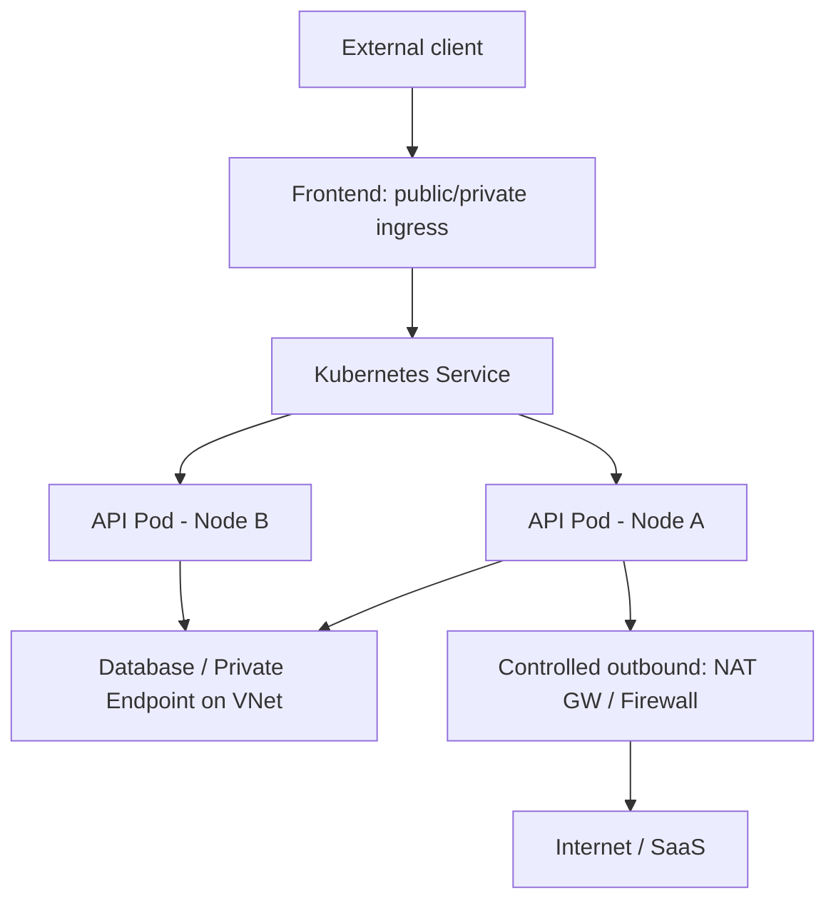

# Azure CNI and IP Address Planning for AKS

An **Azure Kubernetes Service (AKS)** cluster can run hundreds of nodes and thousands of pods. If you choose the wrong network address ranges upfront, the cluster may still work while small, yet fail to allocate IPs when scaling out, upgrading node pools, or connecting to datacenter systems. Conversely, allocating an overly huge range without accounting for other VNets and on-premises networks causes CIDR conflicts, complicates hybrid connectivity, and increases operational overhead.

**Azure Container Networking Interface (Azure CNI)** is the networking integration component for AKS, coordinating Kubernetes with Azure Virtual Networks to assign addresses and connectivity to pods. Planning must account for **node subnets, pod addresses, Kubernetes Service CIDR, DNS service IP, ingress, egress, peering, Private Endpoints, autoscalers, and cluster upgrades**.

This lesson belongs to the **Azure Kubernetes Service Fundamentals** chapter of the **CLOUD_PROVIDERS_AZURE** module. The goal is to design IP addressing sufficient for Azure applications today and as they scale, while preserving security controls, data connectivity, and cost efficiency.

> Scope note: AKS and Azure CNI continuously add new features. CLI flag names, support levels for Cilium/IPv6/Windows, quotas, and migration paths between modes depend on the AKS version, region, SKU, and deployment time. The examples below describe common models; before real deployments, verify cluster policies and platform-supported parameters.

## 1. Learning objectives

After this lesson, you can:

1. Distinguish IP addresses of **nodes**, **pods**, **Services**, and ingress/egress endpoints.
2. Explain the differences between **Azure CNI Overlay**, **Azure CNI Pod Subnet**, and **traditional (flat) Azure CNI Node Subnet**.
3. Build a non-overlapping CIDR plan across VNet, node subnet, pod subnet/pod CIDR, Service CIDR, and hybrid networks.
4. Estimate IPs for autoscaling, `maxPods`, DaemonSets, and surge nodes during upgrades.
5. Configure and inspect Azure CNI when creating AKS via Azure CLI.
6. Understand how CNI affects pod-to-pod, pod-to-VNet, ingress, egress, DNS, and network policies.
7. Troubleshoot IP exhaustion, Pending pods, DNS resolution failures, unreachable private endpoints, and missing egress.
8. Evaluate networking decisions affecting scalability, security, and cost.

## 2. Which IP addresses exist in an AKS cluster?

In Kubernetes, a **node** is a VM or VMSS instance running kubelet and a container runtime. A **pod** is the application deployment unit, typically sharing one IP address among its containers. A **Service** provides a stable access endpoint for a group of pods, rather than representing a dedicated VM or network interface.

| Object | What is the IP used for? | Allocated from the VNet? |
|---|---|---|
| Node | Kubelet, infrastructure traffic, VM network path | Typically has a private IP from the node subnet |
| Pod | Application communication between pods/workloads | Depends on CNI mode: overlay IP or IP from VNet pod/node subnet |
| ClusterIP Service | Stable logical name/address for an in-cluster service | Drawn from Kubernetes Service CIDR, not a regular VNet subnet |
| CoreDNS Service | Resolves service names inside the cluster | Selected IP inside the Service CIDR |
| LoadBalancer Service | Entry point for applications, internal or public depending on config | Frontend IP via Azure Load Balancer/VNet or public IP |
| Ingress controller | Receives HTTP/HTTPS and routes to services | Endpoint depends on ingress model: public/private LB, gateway, or service |
| Egress IP | Source IP when workloads call services outside the cluster | Depends on node SNAT, NAT Gateway, Azure Firewall, load balancer, or custom design |

Example of addresses playing different roles:

```text
Node:             10.50.0.12      (VNet node subnet)
Pod:              10.240.1.8      (Azure CNI Overlay)
Service:          172.20.4.15     (Kubernetes Service CIDR)
Cluster DNS:      172.20.0.10     (IP in Service CIDR)
Private Endpoint: 10.50.5.25      (dedicated subnet in VNet)
Internet egress:  public IPv4 from NAT Gateway / firewall / LB
```

The addresses here are **illustrative plans** only, not defaults for every cluster. If using Azure CNI Pod Subnet, Pod IPs come from a planned VNet subnet rather than an overlay CIDR as in this example.

## 3. Request flow in AKS



In this diagram:

- Nodes and pods have separate addresses depending on the networking mode.
- The Service IP is a **virtual IP** handled by the cluster dataplane to forward requests to pods, not an address bound to a separate VM NIC.
- With Azure CNI Overlay, pod traffic leaving for the VNet is typically source-translated (SNAT) to the node IP before reaching VNet resources.
- With Azure CNI Pod Subnet, pods hold VNet IP addresses, enabling more direct routing/access to pods subject to network capabilities and policies.
- **Ingress** and **egress** paths must be designed separately; successfully creating a pod does not prove the application is safely exposed to the Internet.

Do not hardcode Pod IPs into business configurations: upon rescheduling, restarts, or node replacement, a new pod may receive a different IP. Inside the cluster, applications should call each other via **Kubernetes Service DNS** or an appropriate service discovery mechanism.

## 4. What is Azure CNI and what is it not?

**CNI** is the standard interface enabling the Kubernetes runtime to configure pod networking. In AKS, Azure CNI is the Azure-integrated networking option managing addresses and connectivity according to the selected mode.

Distinguish three layers:

1. **IPAM / CNI:** allocates IPs and configures pod network interfaces/paths.
2. **Network dataplane:** forwards packets, enforces network rules, and handles service forwarding depending on the solution.
3. **Network policy:** controls which pods can connect to which pods/destinations, when enforced by a supported policy engine.

**Azure CNI is not synonymous with Cilium.** An Azure CNI deployment can use the traditional dataplane or **Azure CNI powered by Cilium** when supported by configuration and version. Enabling Cilium does not automatically resolve IP exhaustion or re-select your Service CIDR.

**Kubenet** is an older AKS networking model with different address allocation and routing behavior. For new designs, evaluate currently recommended and supported Azure CNI modes; do not apply kubenet IPAM formulas to Azure CNI.

## 5. Pod IP allocation models in Azure CNI

### 5.1 Azure CNI Overlay

With **Azure CNI Overlay**:

- Nodes receive private IPs from an Azure VNet subnet.
- Pods receive IPs from a **cluster-private pod CIDR**, typically not allocated directly from a VNet subnet.
- AKS provides pod-to-pod networking inside the cluster; when traffic leaves the overlay space toward networks outside the cluster, the mode's address translation/routing applies.
- VNet/on-premises networks do not automatically have direct routes to individual overlay Pod IPs.
- Each node is typically assigned a **/24** block from the overlay pod CIDR per AKS network design; setting a lower `maxPods` does not mean only `maxPods` addresses are reserved from the CIDR.

```text
VNet node subnet: 10.50.0.0/22

  Node A 10.50.0.10
    -> Pod CIDR block 10.240.0.0/24
    -> Pods 10.240.0.x

  Node B 10.50.0.11
    -> Pod CIDR block 10.240.1.0/24
    -> Pods 10.240.1.x

AKS Overlay Pod CIDR: 10.240.0.0/16
Kubernetes Service CIDR: 172.20.0.0/16
```

**Pros:** avoids directly consuming large numbers of VNet IPs per pod; suitable when pod counts are high and VNet IP space is shared across many resources. **Trade-off:** Pod IPs are not directly routable from systems outside the cluster like flat pod networking. External systems should reach pods via Services, ingress, or designed endpoints.

Overlay does not turn networking into "zero IP planning": the pod CIDR still needs enough **blocks for the maximum node count**, the service CIDR must be distinct, and the node subnet must accommodate autoscaling/upgrades.

### 5.2 Azure CNI Pod Subnet

With **Azure CNI Pod Subnet**, nodes and pods are assigned IPs from **separate VNet subnets**:

```text
VNet 10.50.0.0/16
  |
  +-- Node subnet: 10.50.0.0/22
  |      Node A: 10.50.0.10
  |      Node B: 10.50.0.11
  |
  +-- Pod subnet: 10.50.64.0/17
         Pod A: 10.50.64.25
         Pod B: 10.50.64.26
         Pod C: 10.50.64.27
```

Pod IPs belong to the VNet address space, making it easier to design private connectivity and policies requiring VNet-identifiable Pod IPs.

Address management variants within Azure CNI Pod Subnet include:

- **Dynamic IP allocation:** allocates IPs to nodes/pods from the pod subnet in batches/blocks as needed, instead of pre-reserving the full `maxPods` per node upfront.
- **Static block allocation:** in supported environments/features, allocates address blocks using another model to optimize density and IP efficiency; constraints on CIDR, `maxPods`, Linux/Windows, and dataplane must be verified per AKS version.

**Do not use a single IP formula for every Pod Subnet variant.** Dynamic allocation, static blocks, and per-node pod limits have different allocation mechanics. Obtain official specifications for your chosen mode before sizing production networks.

### 5.3 Traditional flat / Azure CNI Node Subnet

In the traditional **Azure CNI Node Subnet** model, pods and nodes draw addresses from the **same VNet subnet**. This makes Pod IP routing straightforward to understand, but can consume many IPs because each node must reserve addresses for pods.

Example:

```text
VNet app subnet: 10.50.16.0/20

  Node A: 10.50.16.10
  Pod A1: 10.50.16.11
  Pod A2: 10.50.16.12

  Node B: 10.50.16.40
  Pod B1: 10.50.16.41
```

In some traditional flat setups, IPs are pre-allocated up to the maximum pods per node even when fewer pods are running. Setting `maxPods` too high therefore inflates subnet size requirements. Dynamic vs. block allocation varies by mode; do not infer behavior solely from the plugin name `azure`.

### Quick comparison

| Criterion | CNI Overlay | CNI Pod Subnet | Traditional CNI Node Subnet |
|---|---|---|---|
| Pod IPs drawn from | Overlay range outside VNet | Dedicated pod subnet in VNet | Same VNet subnet as nodes |
| Node subnet IP consumption | Mainly nodes and related resources | Mainly nodes | Node + Pod IPs |
| VNet IP consumption for pods | Not directly | Yes, via pod subnet | Yes, via node subnet |
| Direct Pod IP access from VNet | Not by default | Routable per policy and connectivity | Routable per policy and connectivity |
| Growth planning | Pod CIDR by blocks/nodes, node subnet | Node subnet + pod subnet + allocation mode | Max nodes × pod capacity/node + surge |
| When to evaluate | Many pods, limited VNet IP space | Want VNet Pod IPs with separate subnet & flexible management | Legacy workloads / existing flat requirement |

Never choose a mode solely on "which mode is fastest." Real performance depends on dataplane, VM size, MTU, network services, network policies, and application patterns; benchmark when latency/throughput requirements are strict.

## 6. Building a CIDR table before creating the cluster

Ideally, the platform team prepares the IP plan upfront rather than picking IP ranges on the fly while running AKS creation commands. A planning table should list:

| Scope | Overlay example | Pod Subnet example | Role |
|---|---|---|---|
| VNet | `10.50.0.0/16` | `10.50.0.0/16` | Azure network space for workloads |
| Node subnet | `10.50.0.0/22` | `10.50.0.0/22` | VM/VMSS nodes |
| Ingress subnet | `10.50.4.0/24` | `10.50.4.0/24` | If design requires a dedicated gateway subnet |
| Private Endpoint subnet | `10.50.5.0/24` | `10.50.5.0/24` | Storage, databases, or compatible endpoints |
| Pod IP | `10.240.0.0/16` (overlay CIDR) | `10.50.64.0/17` (VNet pod subnet) | Pod addressing |
| Service CIDR | `172.20.0.0/16` | `172.20.0.0/16` | Kubernetes ClusterIPs |
| DNS Service IP | `172.20.0.10` | `172.20.0.10` | CoreDNS Service |
| Peered VNet | `10.60.0.0/16` | `10.60.0.0/16` | Other app/service networks |
| On-premises network | `192.168.0.0/16` | `192.168.0.0/16` | Hybrid via VPN/ExpressRoute |

**These two columns are two independent options**, not a single cluster configured with two Pod IP styles at once. Illustrative CIDRs do not overlap and must be adjusted to match your enterprise IPAM.

### Why must ranges not overlap?

If `Service CIDR` overlaps with a VNet subnet or on-premises network, when a pod tries to reach an IP in that range, Kubernetes may intercept it as a Service IP instead of routing externally. Overlapping pod CIDRs or node subnets with other networks also causes ambiguity, unexpected routing, and hard-to-diagnose failures.

Specifically audit:

- All VNets in the same organization and VNets likely to peer in the future.
- VPN/ExpressRoute connections to on-premises.
- Private endpoints, Application Gateway, and service-dedicated subnets.
- Other AKS clusters connected via a hub, service mesh, or gateway.
- Partner CIDRs when private network links exist.
- Special public/private ranges and organizational routing rules.

If two independent overlay clusters share the same Pod IP range, connecting services/gateways between them can sometimes still work without direct Pod IP routing. However, **never rely on CIDR reuse** when future architecture may require cross-cluster pod-to-pod traffic or direct route advertisement.

## 7. Calculating subnet capacity for nodes

Azure reserves **5 IPv4 addresses in every subnet**. For example, a `10.50.0.0/22` subnet has 1,024 IPv4 addresses, leaving roughly **1,019 usable addresses for resources** under this rule.

Do not reason "the cluster has 40 nodes so a /26 subnet is enough": new node pools, autoscalers, and upgrade surge nodes may require adding new VMs before old VMs are removed.

### Node planning formula

```text
Planned Node IPs
    = max nodes across node pools sharing the subnet
    + temporary surge nodes for upgrades/scaling
    + recovery/replacement and operational headroom
    + addresses of any other resources sharing the subnet

Usable IPv4 addresses in an Azure subnet
    ≈ 2^(32 - prefix_length) - 5
```

Example:

- System node pool max 10 nodes.
- User node pool max 70 nodes.
- Upgrades need up to 20 temporary surge nodes in a phase.
- Recovery/rollout headroom: 20 addresses.

Total planned: **120 node addresses** (10 + 70 + 20 + 20). A /25 subnet provides 123 usable IPs mathematically, which is dangerously tight and leaves almost no margin if plans change. A /23 or /22 gives comfortable headroom; the final choice must balance VNet space needed for other services and future growth.

**Note:** `maxSurge` can be configured as an absolute number or percentage; calculate temporary surge per **each node pool**, not just the average total nodes. Autoscaler `maxCount` is a scale ceiling that must have corresponding IP capacity reserved.

### Node pools using multiple subnets

A cluster can place different node pools in different subnets where supported. Calculate IPs for **each subnet individually**, because spare IPs in subnet A cannot rescue a node pool running out of addresses in subnet B.

## 8. Calculating Pod IPs for Azure CNI Overlay

Azure CNI Overlay typically allocates one **/24 block per node**. A /24 block contains 256 addresses in CIDR math, though not all 256 are usable depending on how AKS manages pods. Check the `maxPods` limit of your cluster version instead of treating 256 as a guaranteed pods/node capacity.

For example, suppose you need to support **200 nodes** at peak load, including temporary upgrade nodes. The `10.240.0.0/16` range splits into:

```text
Number of /24s in a /16 = 2^(24 - 16) = 256 blocks
Planned demand = 200 blocks for 200 nodes
Remaining margin = 56 blocks before considering other constraints
```

**Do not calculate:**

```text
200 nodes × 30 maxPods = 6,000 IPs
=> conclude a /19 is enough
```

With Overlay assigning a /24 block per node, a /19 contains only 32 /24 blocks—insufficient for 200 nodes even at just 30 pods per node.

### Relationship between maxPods and Pod CIDR

- `maxPods` caps the maximum number of pods placed on each node per kubelet/AKS config.
- The Pod CIDR serves the entire cluster and allocates blocks according to Overlay mechanics.
- DaemonSets and system pods also consume pod capacity.
- HPA adds pods while Cluster Autoscaler adds nodes, pushing both limits upward simultaneously.

When nodes are replaced or the cluster scales, IP blocks are managed/reused by the system; never hardcode static IPs predicting new pod addresses.

## 9. Calculating Pod IPs for Azure CNI Pod Subnet

With Pod Subnet, limits primarily come from the pod subnet's address space **and the active IP allocation mechanism**. Example plan:

- 150 nodes at normal peak.
- 20 temporary surge nodes during upgrades/scaling.
- Target density of up to 60 pods/node.
- Account for system pods/DaemonSets and policy buffers.
- Theoretical maximum pods near `170 × 60 = 10,200`.

A `10.50.64.0/17` subnet has 32,768 addresses, or 32,763 after Azure's 5 reserved IPs. Counting raw IPs, this range has headroom for 10,200 pods, **but that is not a guarantee you can utilize all 32,763 addresses for pods**.

Reasons:

- Dynamic allocation may reserve IP blocks in allocation chunks rather than packing 100% immediately.
- Static blocks have their own assignment rules and limits.
- Some IPs may be consumed by services or policies depending on deployment mode.
- Pod churn between nodes during upgrades/scaling can create transient IP demand higher than Ready pod counts.
- All node pools sharing the pod subnet must be summed together.

### Working formula with dynamic allocation

```text
Estimated Pod IP demand
    = (max total nodes + surge) × expected pod capacity
    + buffer for allocation blocks and rollout churn

Usable subnet IPs
    ≈ 2^(32 - prefix_length) - 5
```

**This is a high-level planning formula**, not the exact internal IPAM algorithm of Azure CNI. When approaching high utilization of an IP range, calculate using the exact block sizes and limits published for your mode, then load-test scaling and redeployments.

### How does traditional Node Subnet differ?

In traditional Azure CNI Node Subnet, each node consumes addresses for itself and multiple pods from the **same subnet**. A conservative calculation commonly used:

```text
Preliminary IP demand
    ≈ (max nodes + upgrade surge nodes)
       × (1 node IP + maxPods)
    + IPs for other resources
    + headroom
```

Example with 80 nodes + 20 surge nodes, `maxPods = 30`:

```text
100 × (1 + 30) = 3,100 preliminary IPs
```

A /20 subnet provides 4,091 usable addresses under Azure IPv4 rules—arithmetically sufficient, though you must still account for other subnets and allocation variants. Do not apply this formula to Overlay or treat it as an exact specification for Dynamic Pod Subnet.

## 10. Kubernetes Service CIDR and DNS Service IP

The **Service CIDR** holds virtual addresses for Kubernetes `ClusterIP` Services. These addresses are not drawn from an Azure VNet subnet or attached to node NICs.

Example:

```text
Service CIDR: 172.20.0.0/16
DNS Service IP: 172.20.0.10
Service orders: 172.20.12.15
Service payments: 172.20.12.16
```

From a pod, applications typically call `orders.default.svc.cluster.local` or the short Service name within the same namespace, rather than `172.20.12.15`.

### Mandatory checks

1. Service CIDR must not overlap with the VNet, node subnet, Pod CIDR/pod subnet, or any connected network.
2. `dns-service-ip` must sit inside the Service CIDR and avoid reserved/invalid addresses per AKS rules.
3. Service CIDR must be large enough for the expected number of Services, not the number of pods.
4. Configuration must be finalized before cluster creation; changing Service CIDR on a running cluster may be unsupported in place or require constrained migration procedures.
5. When using custom DNS, pods must still resolve internal Kubernetes names and Azure private DNS zones as designed.

**Caution:** a Service having an IP in the Service CIDR does not prove healthy backend pods exist. A Service can exist with zero endpoints due to a mismatched label selector or unready workloads.

## 11. Ingress, egress, and public/private IPs

### Ingress: inbound traffic to applications

Common exposure patterns:

- `ClusterIP`: internal to the cluster via appropriate network paths and policies.
- Internal `LoadBalancer`: private frontend IP inside a supported VNet/subnet.
- Public `LoadBalancer`: public frontend IP managed by Azure / configured resources.
- Ingress controller / Application Gateway or Front Door: HTTP/HTTPS routing and protection per architecture.

Example Kubernetes Service:

```yaml
apiVersion: v1
kind: Service
metadata:
  name: orders-api
  namespace: default
spec:
  type: ClusterIP
  selector:
    app: orders-api
  ports:
    - name: http
      port: 80
      targetPort: 8080
      protocol: TCP
```

This Service creates a Kubernetes virtual IP from the Service CIDR. It **does not** create a public IP and **does not** expose the API to the Internet. For external users to access it, you must add ingress/frontend resources, routing, and authentication/WAF/NSGs as needed.

### Egress: outbound traffic

Pods needing to call Internet APIs or pull images (in practice, image pulls are primarily performed by the node/runtime) require an outbound path.

Options depend on the cluster model, such as:

- Outbound via Azure Load Balancer per configured AKS outbound type.
- NAT Gateway on the appropriate subnet, where supported by mode and deployment type.
- Azure Firewall or NVA with user-defined routes per security policy.
- Clusters with restricted egress using private connectivity to ACR, Storage, and Key Vault.

**CNI does not replace NAT Gateway/Firewall.** With Overlay, outbound traffic typically translates to the node IP at the VNet layer before applying public SNAT. With Pod Subnet, Pod IPs belong to the VNet, yet public egress must still be designed; the source IP seen by SaaS partners depends on actual routing and SNAT.

If a partner requires allowlisting public IPs, measure actual egress IPs from the workload and register **every possible egress IP**, never guessing from the Pod CIDR or node subnet.

## 12. Private Cluster, Private Endpoint, and Azure CNI are separate concerns

A **private AKS cluster** controls connectivity to the **Kubernetes API server / control plane**; it does not automatically make all pods and Services private or disable Internet egress.

A **Private Endpoint** lets Azure Private Link-supported resources be accessed via a private IP inside an Azure network; it is distinct from a Pod IP or ClusterIP. Example:

```text
Pod orders-api
  -> DNS: ordersstorage.blob.core.windows.net
  -> Private DNS resolution: 10.50.5.25
  -> Storage Private Endpoint
```

For this path to work, you must design:

1. The Private Endpoint for the target service.
2. The Private DNS zone and appropriate VNet link/resolver.
3. Routes/NSGs/firewalls permitting traffic to the private IP.
4. Secure application identity/RBAC or SAS/credentials.
5. Azure CNI mode and actual source IP when leaving the pod network.

An application can have working DNS and routing yet still receive HTTP 403 if data permissions are missing. Conversely, a valid identity cannot overcome DNS returning a public IP when policy permits only Private Endpoint access.

## 13. Network policies and pod-to-pod traffic control

Kubernetes **NetworkPolicy** defines pod-level traffic controls, but enforcement depends on a supported network policy engine/dataplane enabled in the cluster.

Example for namespace `apps`: allow only pods labeled `app=frontend` to call pods labeled `app=orders-api` on TCP/8080.

```yaml
apiVersion: networking.k8s.io/v1
kind: NetworkPolicy
metadata:
  name: orders-only-from-frontend
  namespace: apps
spec:
  podSelector:
    matchLabels:
      app: orders-api
  policyTypes:
    - Ingress
  ingress:
    - from:
        - podSelector:
            matchLabels:
              app: frontend
      ports:
        - protocol: TCP
          port: 8080
```

This policy only affects pods matched by `app=orders-api` in the `apps` namespace and **only when enforcement is supported**. The rule does not create Services or Deployments. Always verify rules for other ingress/egress flows, DNS, telemetry, and dependencies before enabling default-deny.

**NSGs and NetworkPolicy do not replace each other:**

- NSGs are Azure network rules at the subnet/NIC and supported scopes.
- NetworkPolicy enforces pod/namespace-level rules at the dataplane.
- Azure Firewall / NAT Gateway handle egress routing and/or security per features.
- RBAC, workload identity, and app authorization must still be enforced independently.

With **Azure CNI powered by Cilium**, evaluate policy engine and dataplane support for your AKS version. Never apply NetworkPolicy YAML and assume it is enforced if the cluster lacks a policy engine.

## 14. Preparing the cluster: IPAM and access checklist

Before running `az aks create`, document:

- Subscription, resource group, region, AKS version, and cluster type.
- VNet range and all existing and planned subnets.
- Pod networking mode: Overlay, Pod Subnet, or another supported model.
- System/user node pools, min/max node counts, `maxPods`, and `maxSurge`.
- Pod CIDR or pod subnet sized for node growth.
- Separate Service CIDR and DNS Service IP.
- VNet peering, DNS, on-premises CIDRs, and VPN/ExpressRoute.
- Load balancers, ingress, egress, NAT Gateway/firewall, and private endpoints.
- Network policies and application security requirements.
- Permissions for the AKS managed identity on custom VNets/subnets, such as the **Network Contributor** role at the required scope per configuration.
- VM quotas, node sizes, IP availability, SKU/region support, and costs.

**Do not verify networking solely by checking subnet names.** AKS needs permission to read and modify required network resources; missing subnet permissions can cause provisioning or node/pod scaling to fail even when CIDRs have plenty of space.

## 15. Hands-on: creating AKS with Azure CNI Overlay

Examples target **Azure Cloud Shell (Bash)**. Resource creation commands can incur charges; run only in an authorized test subscription. Examples assume the **resource group, VNet, and node subnet already exist**, and the AKS identity has required network permissions.

### Step 1 — Verify subscription

```bash
az account show \
  --query "{subscription:name,id:id,tenant:tenantId}" \
  -o table
```

Define variables:

```bash
RG="rg-aks-network-lab"
AKS="aks-overlay-lab"
VNET="vnet-aks-lab"
SUBNET="snet-nodes"
```

Retrieve the node subnet resource ID:

```bash
NODE_SUBNET_ID=$(az network vnet subnet show \
  --resource-group "$RG" \
  --vnet-name "$VNET" \
  --name "$SUBNET" \
  --query id -o tsv)

echo "$NODE_SUBNET_ID"
```

**Do not use** a `NODE_SUBNET_ID` from another subscription or region when creating the cluster; confirm the VNet and AKS region match your configuration.

### Step 2 — Check subnet and address space

```bash
az network vnet subnet show \
  --resource-group "$RG" \
  --vnet-name "$VNET" \
  --name "$SUBNET" \
  --query "{id:id,prefix:addressPrefix,prefixes:addressPrefixes}" \
  -o json
```

Confirm this subnet is reserved for AKS nodes and does not hold addresses used by other resources that could starve scaling. If the subnet is shared by another system, never modify CIDRs or delete IP configurations to "make room" without approval.

### Step 3 — Create the Overlay cluster

```bash
az aks create \
  --resource-group "$RG" \
  --name "$AKS" \
  --node-count 3 \
  --node-vm-size Standard_D4s_v5 \
  --network-plugin azure \
  --network-plugin-mode overlay \
  --vnet-subnet-id "$NODE_SUBNET_ID" \
  --pod-cidr "10.240.0.0/16" \
  --service-cidr "172.20.0.0/16" \
  --dns-service-ip "172.20.0.10" \
  --max-pods 50 \
  --generate-ssh-keys
```

This is an **illustrative configuration**, not a complete production security template. Verify AKS version, plugin capabilities, subnet permissions, outbound type, system node pool, network policies, and quotas at runtime. `--node-vm-size` may lack availability or capacity in the chosen region.

After creation, do not rely solely on a successful `az aks create` command to conclude all pod networking works: verify node Ready state, pod scheduling, CoreDNS, and actual connectivity.

### Step 4 — Inspect the network profile

```bash
az aks show \
  --resource-group "$RG" \
  --name "$AKS" \
  --query "{networkProfile:networkProfile}" \
  -o json
```

Values to verify: `networkPlugin`, `networkPluginMode`, `podCidr` or `podCidrs`, `serviceCidr`, `dnsServiceIP`, `networkDataplane` (if present), and `outboundType`.

Returned fields vary by API version; if a field is absent, do not automatically assume the feature is disabled.

## 16. Alternative: AKS with Azure CNI Pod Subnet

If applications require Pod IPs belonging to the VNet, you can choose Azure CNI Pod Subnet where supported by the AKS version. This example assumes **node subnet and pod subnet already exist** with sufficient capacity and permissions:

```bash
NODE_SUBNET_ID=$(az network vnet subnet show \
  -g "$RG" --vnet-name "$VNET" --name "snet-nodes" \
  --query id -o tsv)

POD_SUBNET_ID=$(az network vnet subnet show \
  -g "$RG" --vnet-name "$VNET" --name "snet-pods" \
  --query id -o tsv)
```

Example creating a cluster in an environment supporting dynamic Pod Subnet:

```bash
az aks create \
  --resource-group "$RG" \
  --name "aks-podsubnet-lab" \
  --node-count 3 \
  --network-plugin azure \
  --vnet-subnet-id "$NODE_SUBNET_ID" \
  --pod-subnet-id "$POD_SUBNET_ID" \
  --service-cidr "172.20.0.0/16" \
  --dns-service-ip "172.20.0.10" \
  --max-pods 50 \
  --generate-ssh-keys
```

**Do not run both clusters unless you have the budget and lab objective for it.** This is an alternative to Overlay, not an in-place conversion step from an existing cluster. If static block allocation or the Cilium dataplane is needed, confirm exact syntax and supported combinations in your current CLI/AKS version; never guess unverified flags.

With Pod Subnet, pod IPs come from the configured pod subnet. Each node still needs its own IP from the node subnet. Check both IP pools together during autoscaling or upgrades.

## 17. Verifying from Kubernetes after cluster creation

After confirming API server access permissions:

```bash
az aks get-credentials \
  --resource-group "$RG" \
  --name "$AKS"
```

For private clusters, your machine or Cloud Shell must have network connectivity and DNS resolution to the API server, or use an organization-approved management workflow. Successfully fetching kubeconfig does not guarantee the API server is reachable from every location.

Inspect nodes and Pod IPs:

```bash
kubectl get nodes -o wide
kubectl get pods --all-namespaces -o wide
kubectl get services --all-namespaces -o wide
```

Inspect node capacity and addresses:

```bash
kubectl describe node "<NODE_NAME>"
```

Fields to inspect: `InternalIP`, `PodCIDR` if present, `Allocatable pods`, `Ready` status, placed pod count, `NetworkUnavailable` condition if reported, and events.

Check pod distribution across nodes:

```bash
kubectl get pods -A -o wide
kubectl get endpointslices -A
kubectl get networkpolicies -A
```

Remember that `kubectl get networkpolicies` only lists declared resources. It does not prove enforcement is active or that policies match their intended targets.

### Inspect network profile and node pools

```bash
az aks nodepool list \
  --resource-group "$RG" \
  --cluster-name "$AKS" \
  --query "[].{name:name,count:count,maxPods:maxPods,subnet:vnetSubnetID,podSubnet:podSubnetID}" \
  -o json
```

Inspect node pools individually: system pools, user pools, and newly added pools may use different subnets or settings. When changing `maxPods` for workloads, never assume you can alter arbitrary network settings on a live node pool without creating/redeploying a pool.

## 18. Connectivity testing workflow

A network test should verify each path individually rather than merely pinging between two addresses.

| Path | Target | How to verify |
|---|---|---|
| Pod → Pod (same node) | Local pod networking | HTTP call to an authorized test pod in the lab |
| Pod → Pod (different node) | Cross-node connectivity | Call a Service or test endpoint on another node |
| Pod → ClusterIP Service | Kubernetes service forwarding | DNS lookup and HTTP request to the Service |
| Pod → CoreDNS | Internal DNS | Resolve `*.svc.cluster.local` names |
| Pod → VNet private endpoint | Workload to Storage/database | DNS resolves to private IP, TCP/TLS and app auth succeed |
| Pod → Internet | Outbound path | Test an organization-approved URL and inspect public egress IP |
| VNet client → app | Private ingress | Internal LB/ingress and health probes |
| Internet client → app | Public ingress when needed | Public frontend/WAF/TLS and auth |

If using a debug container, only use organization-approved images; avoid pulling unverified images into production clusters. Practice in a test namespace with appropriate RBAC/NetworkPolicy and clean up afterwards.

### Separating DNS from network path issues

If `curl https://service.example` fails, check in sequence:

1. Does the name resolve to the expected IP?
2. Is that IP inside the VNet, a private endpoint, or on the Internet?
3. What is the route to that IP?
4. Do NetworkPolicy, NSGs, and firewalls allow that TCP/port?
5. Do the TLS certificate and hostname match?
6. Is the target application healthy and permitting the caller's identity?

A `403` error from Storage is generally not a Pod IP allocation failure; it typically points to RBAC, credentials, or Storage firewalls. DNS returning a public IP when a Private Endpoint is required usually points to a private DNS zone or resolver issue.

## 19. Common errors from poor IP planning

| Symptom | Possible cause | What to check |
|---|---|---|
| Node pool scale-out fails | Node subnet out of IPs, VM quota, or zonal capacity | Check available IPs, quota, events, VMSS provisioning |
| Pod Pending while node has free CPU/RAM | `maxPods` limit, no matching nodes, taints/quotas, or IPAM | `kubectl describe pod`, `describe node`, CNI events |
| Pod network setup error | CNI/IPAM failed to allocate IP, missing subnet permissions, or bad network config | Pod events, CNI/AKS state, subnet permissions |
| Cross-node pod traffic fails | Dataplane, routes/NSG/firewall, or MTU mismatch | Check network path, CNI state, and NetworkPolicy |
| In-cluster services fail to resolve | Unhealthy CoreDNS, Service CIDR/DNS config, or egress policy blocking DNS | CoreDNS pods, DNS Service, resolver config |
| Pod cannot reach private endpoint | Wrong Private DNS, route/NSG/firewall, or target service blocking | Resolve FQDN, PE IP, network path, and credentials |
| VNet VM cannot reach Overlay Pod IP | Overlay Pod IPs are not directly routable from VNet | Expose via an appropriate Service, internal LB, or ingress |
| Pod IP or Service IP overlaps on-prem | Overlapping CIDRs | IPAM, effective routes, service CIDR, and migration plan |
| Ingress returns 502/503 | Service selector, readiness, backend endpoints, gateway routes | Service, EndpointSlice, ingress/controller logs |
| Outbound IP differs from partner allowlist | NAT/Firewall/Load Balancer uses a different IP set | Measure actual egress IP from workload, check outbound type |
| Node upgrade stuck despite enough nodes | Insufficient IPs for surge nodes, quota, or PodDisruptionBudget | `maxSurge`, subnet, cluster events, and PDBs |
| Subnet expanded yet errors continue | Overlay Pod CIDR or dedicated pod subnet exhausted blocks | Check both IPAM layers, not just the node subnet |

### Do not confuse IP exhaustion with compute exhaustion

A Pending pod can result from CPU/memory requests, taints, affinity, PodDisruptionBudget, or PVCs; not every Pending pod is caused by missing IPs. Similarly, node scaling can fail due to VM quota or node SKU capacity even when the subnet has plenty of free IPs.

Diagnose from **Kubernetes events and Azure allocation errors**, not a single dashboard.

## 20. Decisions that are hard to change after cluster creation

Several AKS networking properties carry major constraints and, depending on support, cannot be modified arbitrarily once a cluster is running:

- **Service CIDR and DNS service IP** are bound to Kubernetes cluster design; in-place changes may be unsupported.
- **Azure CNI plugin/mode**: migrating from flat to overlay or between variants depends on supported migration procedures and versions, not editing one line of YAML.
- **Overlay Pod CIDR**: choosing too small a range caps node count; changing the cluster range may lack a simple in-place path.
- **Subnet size/placement**: expansion can be blocked by adjacent subnets, existing allocated IPs, peering, and Azure rules.
- **maxPods and node pool networking**: many changes require creating a new pool or cycling nodes rather than editing live nodes directly.
- **Private cluster and outbound routing**: changes impact the API server, image pulls, bootstrapping, and DNS.

For critical clusters, create a **migration plan**:

1. Inventory current CIDRs, pod counts, nodes, services, DNS, peering, and network policies.
2. Design new CIDRs with a supported CNI model.
3. Provision a test environment or new cluster, configure permissions and networking.
4. Test deployments, ingress, egress, DNS, private endpoints, and performance.
5. Migrate workloads by namespace/service, verifying DNS and state.
6. Cut over traffic in a controlled manner while keeping a rollback window.
7. Decommission the old cluster once data and applications are confirmed stable.

Never delete the subnet/pod CIDR of a running cluster to recreate from scratch without backups, a cutover plan, and formal approval.

## 21. Security, cost, and operability

### Security

- Enforce Kubernetes RBAC and workload identity for Azure access; an IP address is not a trustworthy application identity.
- Use NetworkPolicy where the dataplane supports it and design deny/allow rules per namespace/service.
- NSGs, Azure Firewall, private endpoints, and egress policies protect inbound/outbound flows.
- Minimize public endpoints; protect ingress with TLS, authentication, and WAF as needed.
- Log connections, DNS, and traffic per approved organizational mechanisms; avoid logging tokens, cookies, or sensitive data.
- For custom VNets, grant the **cluster identity** least-privilege subnet permissions needed for operations; never grant subscription-wide Owner just for AKS IP allocation.

### Cost

Private IPs inside a pod CIDR do not dictate the whole bill, yet **IP design impacts scalability and infrastructure costs**. Items to forecast:

- VMSS nodes, disks, and spare surge nodes during upgrades.
- Azure Load Balancer, Public IPs, NAT Gateway, or Azure Firewall.
- Data transfer within/across zones, regions, and out to the Internet.
- Private Endpoints, DNS resolvers, gateways, and hybrid links.
- Network monitoring, Log Analytics, and log ingestion volume.
- Expanding VNets/subnets, rebuilding clusters, or running migrations if initial IP design fell short.

Overlay saves IP space **inside the VNet for pods**, but does not eliminate NAT/egress costs or security requirements.

### Observability and alerting

Monitor:

1. Ready node count and actual vs. desired node pool counts.
2. Pod count per node and utilization relative to `maxPods`.
3. Available IPs in node subnets, pod subnets, or remaining overlay blocks by mode.
4. Cluster autoscaler events and scale-out duration.
5. Pending pod rates and network setup failure rates.
6. CoreDNS latency/errors and DNS cache behavior.
7. Network policy drops / firewall denies if matching telemetry exists.
8. Ingress error rates, backend readiness, and outbound connectivity.
9. Quota/scale/upgrade events causing IP usage spikes.

If Azure Monitor does not expose a ready-made metric called "free overlay /24 blocks," calculate it from the Pod CIDR, current node count, and maximum node count by topology. Never invent metric names to declare a cluster healthy.

## 22. Case study: a web service growing from 20 to 150 nodes

An enterprise runs three workloads on AKS:

- **Web API:** 80% of traffic, needs rapid scaling during campaigns.
- **Background workers:** queue-driven, pod counts can surge sharply.
- **System workloads:** DNS, monitoring, and ingress controllers.

Currently the cluster has 20 nodes, but the team forecasts up to 150 nodes at peak load; during upgrades, 20 temporary surge nodes are needed. Existing Azure networking:

```text
Application VNet: 10.50.0.0/16
On-premises:      192.168.0.0/16
Peered VNet:      10.60.0.0/16
```

### Option A: Overlay

- Node subnet: `10.50.0.0/22`.
- Pod CIDR: `10.240.0.0/16`.
- Service CIDR: `172.20.0.0/16`.
- DNS Service: `172.20.0.10`.
- Planned total nodes: `150 + 20 = 170`, plus headroom.
- With /24 blocks per node, a `/16` yields 256 /24 blocks in CIDR math.

**Pros:** avoids allocating tens of thousands of VNet addresses for pods. **Caveats:** VNet/on-prem systems cannot route directly to overlay Pod IPs; expose applications via Services, internal LBs, or ingress.

### Option B: Pod Subnet

- Node subnet: `10.50.0.0/22`.
- Pod subnet: `10.50.64.0/17`.
- Service CIDR: `172.20.0.0/16`.
- Size pod IPs based on pods/node, node surge, and supported dynamic/static block mode.

**Pros:** Pod IPs come from the VNet, convenient in architectures requiring direct Pod IP handling. **Caveats:** the pod subnet can exhaust addresses if workloads spike dramatically; maintain headroom for allocation blocks, upgrades, and shared node pools.

### Design decision

If there is no strict requirement to route directly to Pod IPs from the VNet, Overlay eases IPAM pressure. If policy requires Pod IPs routable across Azure/hybrid networks, Pod Subnet is worth evaluating. Both options still require testing private endpoint connectivity, DNS, ingress/egress, network policies, scaling, and live SLOs.

## 23. Practice exercises and self-check questions

### Exercise A — Address planning

Design an AKS cluster with two node pools:

- System pool: max 8 nodes.
- User pool: max 64 nodes.
- Planned max surge: 16 extra nodes across the cluster.
- Expected max 50 pods per node.
- Requires VNet peering and database access via Private Endpoint.
- On-premises network is `192.168.0.0/16`.

**Tasks:**

1. Propose non-overlapping VNet, node subnet, and private endpoint subnet ranges.
2. Choose Azure CNI Overlay or Pod Subnet, explaining via Pod IP access requirements.
3. If using Overlay, calculate the minimum number of /24 blocks for planned nodes plus headroom.
4. If using Pod Subnet, estimate Pod IPs by node/pod counts and allocation mode; propose a subnet with buffer.
5. Pick a valid, non-overlapping Service CIDR and DNS Service IP.
6. Specify where private ingress sits and the egress mechanism for partner APIs.
7. Explain why Pod IPs should not serve as fixed endpoints in applications.

### Exercise B — Cluster inspection

On an authorized lab cluster:

1. Run `az aks show` and record the network plugin, mode, dataplane, pod CIDR, service CIDR, and outbound type.
2. List node pools, `maxPods`, and corresponding subnet IDs.
3. Run `kubectl get nodes/pods/services -o wide` to compare Node IPs, Pod IPs, and Service IPs.
4. Check placed pods per node and remaining pod capacity.
5. Create a `ClusterIP` Service for an authorized test app; verify DNS and access via Service name.
6. From an approved debug pod, test private endpoint DNS and TCP/TLS connectivity to a data service.
7. Check outbound public IP using an organization-approved IP echo endpoint; compare against NAT/Firewall/LB.
8. Scale replicas within safe limits and observe Pod IPs and node changes as the autoscaler acts.
9. Describe how to investigate a Pod Pending due to IP exhaustion vs. CPU/memory/taints.
10. Clean up lab resources and review costs before finishing.

### Self-check questions

**Question 1.** How do Node IP, Pod IP, Kubernetes Service IP, and DNS Service IP differ?

**Question 2.** Why can't you multiply `nodes × maxPods` to calculate exact Pod CIDR capacity for Azure CNI Overlay?

**Question 3.** With Azure CNI Pod Subnet, where do Pod IPs come from, and why must the node subnet still have enough addresses?

**Question 4.** Can a Service CIDR overlap a VNet CIDR or on-premises network without risk?

**Question 5.** When Cluster Autoscaler adds nodes but the node subnet runs out of IPs, what symptoms will you observe?

**Question 6.** For the same application, when using Overlay instead of Pod Subnet, does direct VNet client access to Pod IPs work the same way?

**Question 7.** Can you assume a Kubernetes NetworkPolicy is actively enforced merely because the `NetworkPolicy` YAML was created successfully?

**Question 8.** Why might a private AKS cluster still require outbound Internet or Azure service egress?

**Question 9.** If an application needs to scale to 100 nodes while the Overlay Pod CIDR only contains 64 /24 blocks, what can happen?

**Question 10.** When the wrong Pod CIDR/Service CIDR is chosen initially, why do many environments need a migration plan rather than editing one config line?

**Completion criteria:** learners can distinguish Azure CNI models, build non-overlapping CIDRs, calculate node/IP capacity including upgrade surge, create/inspect network profiles via CLI, and diagnose core AKS network flows.

## Conclusion

**Azure CNI and IP planning for AKS** go far beyond picking a network plugin at cluster creation. They determine how nodes and pods receive addresses, how traffic flows across pods, VNets, Private Endpoints, and the Internet, and how smoothly the cluster scales and upgrades in the future.

**Azure CNI Overlay** conserves VNet addresses for pods via a private overlay space, though you must plan **/24 blocks per node** and never assume Pod IPs are externally routable. **Azure CNI Pod Subnet** assigns Pod IPs from a separate VNet subnet—helpful when Pod-IP-level network integration is required—while demanding careful capacity forecasting for the chosen allocation mode. Traditional **Azure CNI Node Subnet** can consume more VNet addresses since nodes and pods share a subnet.

A resilient design requires **non-overlapping CIDRs, headroom for autoscaler/upgrades, proper DNS/Service CIDRs, subnet permissions, network policies, controlled ingress/egress, and IP exhaustion monitoring**. Planning well from day one keeps AKS scaling reliably while avoiding workload disruptions and costly network migrations later.
