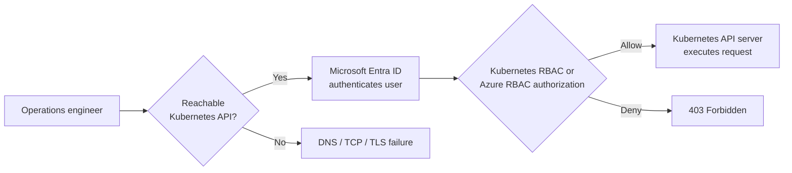
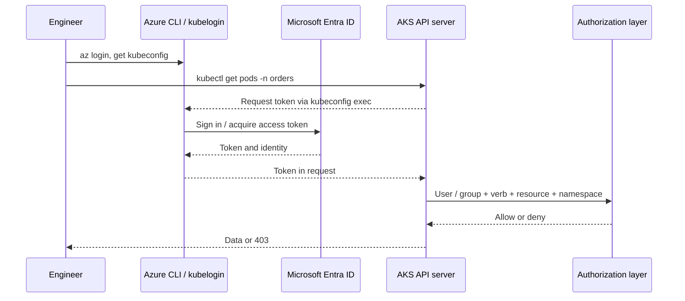
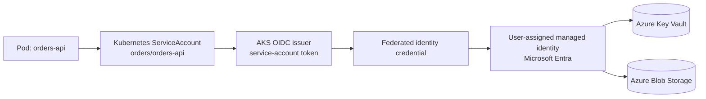
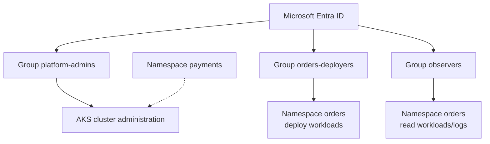

# Microsoft Entra ID Integration and AKS Authorization

An enterprise has three teams operating **Azure Kubernetes Service (AKS)** together: a platform team administering the cluster, a development team deploying apps only inside its own namespace, and an observer team limited to reading operational status. If everyone shares a `cluster-admin` account, least privilege cannot be enforced, actions are hard to audit, and a single leaked credential can compromise the entire cluster.

**Microsoft Entra ID** authenticates humans or groups when they access the AKS Kubernetes API. After authentication, the system must decide **what the user is allowed to do** using a specific authorization model: **Kubernetes RBAC** or **Azure RBAC for Kubernetes Authorization**. In addition, applications running inside pods have their own identities and permissions to call Azure Storage, Key Vault, or other services.

This lesson belongs to the **Azure Kubernetes Service Fundamentals** chapter of the **CLOUD_PROVIDERS_AZURE** module. The module introduces Microsoft Azure from subscriptions, resource groups, and Microsoft Entra ID to virtual networks, compute, storage, and data, while guiding deployment, monitoring, protection, and cost control of application architectures. In AKS, designing Entra ID and RBAC forms the foundation for multiple teams sharing a cluster while maintaining clear responsibility boundaries.

After this lesson, you can:

- Distinguish **authentication**, **authorization**, Azure resource management, and Kubernetes API access.
- Explain the Entra ID sign-in flow across `az aks get-credentials`, `kubelogin`, and `kubectl`.
- Compare Kubernetes RBAC with Azure RBAC for Kubernetes Authorization and choose the right model.
- Design Roles/RoleBindings or Azure role assignments by namespace and Entra group.
- Distinguish human identities, **cluster managed identity**, **kubelet identity**, **Kubernetes service account**, and **Microsoft Entra Workload ID**.
- Understand the impact of `--admin`, local accounts, private clusters, and emergency break-glass access.
- Verify effective permissions, diagnose `401`/`403` errors, and build operational runbooks.

## 1. Three independent questions: who are you, what can you do, and can you reach the API?

A request like `kubectl get pods -n orders` succeeds only when **all three layers** pass:

1. **Network reachability:** can the admin workstation reach the AKS Kubernetes API server via DNS, routing, firewall, and TLS?
2. **Authentication:** can the API server verify the requester's identity? For Entra users, the login token must be valid and accepted.
3. **Authorization:** does the authenticated identity hold permission to execute the `list` verb on `pods` in the `orders` namespace?



**401 Unauthorized** typically indicates missing or invalid identity/authentication credentials. **403 Forbidden** typically indicates the caller was identified but lacks permission for the specific action; even so, inspect API messages and audit logs before concluding. Timeout or TLS failures should never be "fixed" by granting cluster-admin.

### 1.1. Two control planes that are easily confused

| Operation | Receiving component | Relevant permission mechanism |
|---|---|---|
| Create/delete AKS cluster | Azure Resource Manager (ARM) | **Azure RBAC** at subscription/RG/resource scope |
| View AKS resources in Portal | ARM | Appropriate Azure RBAC read permissions |
| Fetch user kubeconfig via Azure CLI | ARM/AKS resource provider | Credential retrieval role, e.g., Azure Kubernetes Service Cluster User Role |
| List pods in a namespace | **Kubernetes API server** | Kubernetes RBAC or Azure RBAC for Kubernetes Authorization |
| Create Deployment, edit Service, read Secret | Kubernetes API server | Corresponding Kubernetes API permissions |
| Pod reading a blob in Azure Storage | Azure Storage data plane | Workload identity + Azure Storage data-plane permissions |

**Owner or Contributor on a resource group must not be interpreted as "every kubectl command is allowed."** Azure RBAC for ARM and Kubernetes API authorization are separate layers; certain Azure roles may allow retrieving **admin credentials** if local accounts remain enabled, creating a privileged path that requires strict control.

## 2. Managed Microsoft Entra integration for AKS

AKS supports **managed Microsoft Entra ID integration** so users sign in with their Entra identities instead of distributing shared Kubernetes admin accounts. This option should be evaluated for any cluster operated by multiple teams.

Core components:

- **Microsoft Entra ID tenant:** manages users, groups, sign-ins, MFA, and Conditional Access per policy capabilities.
- **AKS cluster** with Entra integration enabled: accepts Entra sign-in flows for administrators and operators.
- **Azure CLI/kubelogin:** client tools on the user's machine acquiring Entra tokens and supplying them to `kubectl` via supported mechanisms.
- **Kubernetes API server:** validates tokens, identifies user/group claims, and passes to authorization.
- **Authorization model:** one of two models for Entra user permissions: Kubernetes RBAC or Azure RBAC for Kubernetes Authorization.



The diagram summarizes logical interactions; in practice `kubectl` invokes `kubelogin` via a kubeconfig **exec credential plugin**, and tokens may be cached. Sign-in, token refresh, and MFA prompts depend on your organization's Entra policies.

### 2.1. Use groups instead of assigning permissions per individual

Rather than writing RBAC per employee, enterprises should define Entra groups such as:

| Example group | Purpose |
|---|---|
| `aks-platform-admins` | Cluster administration and cluster-wide resource changes per process |
| `aks-orders-deployers` | Deploy applications within the `orders` namespace |
| `aks-orders-observers` | Read-only access to non-sensitive resources in `orders` |
| `aks-security-auditors` | View operational activity and audit data within approved scope |

In configuration manifests, store the **group Object ID** when required by bindings—never rely solely on display names (which can collide or change). Verify group membership, token/group claims, and how Entra emits groups; membership changes may not take effect immediately on cached tokens.

### 2.2. Managed Entra vs. legacy Entra integration

When inheriting older clusters, you may encounter legacy Entra integration using self-managed server/client app registrations. Do not apply legacy tutorials to clusters running **managed Entra integration**. Inspect the actual `aadProfile` configuration and plan migration to AKS-supported mechanisms if needed.

## 3. Two authorization models for Entra users

Entra ID handles **authentication**. Next, AKS can use:

1. **Kubernetes RBAC:** Kubernetes `Role`, `ClusterRole`, `RoleBinding`, and `ClusterRoleBinding` objects; permissions are evaluated against users/groups received from authentication.
2. **Azure RBAC for Kubernetes Authorization:** Azure role assignments at supported scopes govern Kubernetes API permissions for **Entra users** via AKS integration, using dedicated built-in roles.

Do not configure both and assume user permissions are simply additive. **The cluster's authorization mode determines which model evaluates Entra user requests.** Kubernetes service accounts continue using Kubernetes RBAC; see the workload identity section below.

### 3.1. Comparison table

| Criterion | Kubernetes RBAC | Azure RBAC for Kubernetes Authorization |
|---|---|---|
| Where Entra user permissions are defined | Kubernetes API objects | Azure role definitions/assignments |
| Management tools | `kubectl`, GitOps, Helm, Kubernetes manifests | Azure Portal/CLI/ARM/IaC |
| Typical scope | Namespace via Role/RoleBinding; cluster via ClusterRole/ClusterRoleBinding | AKS resource or supported namespace scopes |
| Entra identity | Users/groups mapped into Kubernetes RBAC bindings | Entra users/groups/service principals per supported authorization mode |
| Auditing/permission governance | Kubernetes audit and GitOps reviews | Azure role assignment governance combined with Kubernetes audits |
| Granularity | Very fine-grained by API groups/resources/verbs | Depends on built-in/custom roles and Azure RBAC authorization limits |
| Who can modify permissions | Principals with Kubernetes RBAC admin permissions | Principals allowed to manage Azure role assignments at that scope |
| In-pod service accounts | Kubernetes RBAC | Kubernetes RBAC is still used for service accounts |

**Selection hint:** if GitOps already manages all Kubernetes manifests and you need fine-grained permissions on custom resources, Kubernetes RBAC is often easier to express. If the organization standardizes identity governance, access reviews, and role assignments through Azure, evaluate Azure RBAC for Kubernetes Authorization. In both cases, check feature support limits for your AKS version, resource types, and workflows.

### 3.2. Switching authorization modes is a high-risk change

A cluster with existing RoleBindings for Entra users/groups can lose or alter access if **Azure RBAC for Kubernetes Authorization** is enabled without creating corresponding Azure role assignments first. Conversely, switching back to Kubernetes RBAC requires the right bindings in place.

Therefore:

- Inventory all current users/groups, service accounts, and CI/CD workflows.
- Document effective permissions at namespace and cluster scopes.
- Prepare mappings to target roles/assignments.
- Test with a low-privilege account before cutting over production.
- Maintain an approved administrative recovery runbook.

Never treat `enableAzureRbac` as a harmless toggle flag.

## 4. Kubernetes RBAC: Role, ClusterRole, and bindings

Kubernetes RBAC consists of four core objects:

| Object | Definition/application scope | Meaning |
|---|---|---|
| **Role** | Single namespace | Set of rules permitting verbs on resources in that namespace |
| **ClusterRole** | Cluster level | Rules applicable to cluster-wide resources or reusable inside namespaces |
| **RoleBinding** | Single namespace | Binds a Role or ClusterRole to subjects within that namespace |
| **ClusterRoleBinding** | Cluster-wide | Binds a ClusterRole to subjects across the entire cluster |

Standard Kubernetes RBAC uses **allow rules** and has no general "deny" rule inside Roles/ClusterRoles to override another allow. A subject's effective permissions are the **union** of permissions granted across bindings; if granted `cluster-admin` via another binding, a read-only RoleBinding will not restrict them.

### 4.1. What makes up a rule?

An RBAC rule specifies:

- **apiGroups:** e.g., `""` (core API group), `apps`, or custom resource groups.
- **resources:** e.g., `pods`, `deployments`, `services`, `pods/log`.
- **verbs:** `get`, `list`, `watch`, `create`, `update`, `patch`, `delete`.
- **resourceNames** (where appropriate) to restrict certain actions to specific named resources.

Do not equate `get pods` with `get secrets`. However, permissions to **create pods, exec into pods, read secrets, edit role bindings, or use privileged service accounts** can create indirect privilege escalation paths; evaluate the security impact of permissions, not just verb names.

### 4.2. Read-only example in the `orders` namespace

Suppose Entra group `aks-orders-observers` has Object ID `<ENTRA_GROUP_OBJECT_ID>`. In a cluster **using Kubernetes RBAC for Entra users**, you can define a Role and RoleBinding:

```yaml
apiVersion: rbac.authorization.k8s.io/v1
kind: Role
metadata:
  name: orders-observer
  namespace: orders
rules:
  - apiGroups: [""]
    resources: ["pods", "services"]
    verbs: ["get", "list", "watch"]
  - apiGroups: [""]
    resources: ["pods/log"]
    verbs: ["get"]
  - apiGroups: ["apps"]
    resources: ["deployments", "replicasets"]
    verbs: ["get", "list", "watch"]
---
apiVersion: rbac.authorization.k8s.io/v1
kind: RoleBinding
metadata:
  name: orders-observers-binding
  namespace: orders
subjects:
  - kind: Group
    name: "<ENTRA_GROUP_OBJECT_ID>"
    apiGroup: rbac.authorization.k8s.io
roleRef:
  kind: Role
  name: orders-observer
  apiGroup: rbac.authorization.k8s.io
```

**Explanation:**

1. The `Role` applies only in the `orders` namespace and does not permit reading `secrets`.
2. The `RoleBinding` binds the group recognized by AKS after Entra authentication to that Role.
3. `Group.name` must be replaced with the **real group Object ID**, not a display name or placeholder string.
4. This permission applies only if requests are evaluated by Kubernetes RBAC and the user's AKS-recognized identity includes that group.
5. If the group holds a stronger `ClusterRoleBinding`, effective permissions will exceed this example.

Applying YAML requires RBAC-editing rights and an existing `orders` namespace. Because this is a **cluster write operation**, it must be reviewed/approved and preferably deployed via GitOps/IaC:

```bash
# Use only on a lab/approved cluster, with the real group Object ID substituted.
kubectl apply -f orders-observer-rbac.yaml
```

Never apply manifests with placeholder Object IDs to production. RBAC changes should undergo peer review, testing with real accounts, and rollback preparation.

### 4.3. RoleBinding with a ClusterRole

You can define reusable permissions in a `ClusterRole` and bind it via a **RoleBinding** per namespace to keep permissions namespace-scoped. Conversely, a **ClusterRoleBinding** grants matching permissions cluster-wide—never use it merely because "the command is shorter."

Never grant `cluster-admin` to the entire development team just so they can update Deployments. Craft Roles for the exact resources they operate, paying close attention to escalation vectors like `roles`, `rolebindings`, `secrets`, `serviceaccounts`, `pods/exec`, and launching workloads with higher-privilege identities.

## 5. Azure RBAC for Kubernetes Authorization

When **Azure RBAC for Kubernetes Authorization** is enabled, Azure role assignments on Entra principals allow or deny Kubernetes API actions at supported scopes.

Common built-in roles:

| Azure role | General meaning | Notes |
|---|---|---|
| **Azure Kubernetes Service RBAC Reader** | Read many Kubernetes resources within granted scope | Cannot read all Secrets or sensitive data by default |
| **Azure Kubernetes Service RBAC Writer** | Manage many resources within namespace/scope | May carry sensitive actions like creating workloads or reading data depending on role; review carefully |
| **Azure Kubernetes Service RBAC Admin** | Broader Kubernetes administration within applied scope | Do not grant broadly; inspect exact RBAC scope |
| **Azure Kubernetes Service RBAC Cluster Admin** | Cluster-wide Kubernetes administration | Reserve for very few principals under tight controls |

These are Azure-provided **Kubernetes data-plane authorization** roles, distinct from:

| Azure role for AKS control plane | Primary purpose |
|---|---|
| **Azure Kubernetes Service Cluster User Role** | Permission to retrieve user kubeconfig from AKS when eligible |
| **Azure Kubernetes Service Cluster Admin Role** | Permission to retrieve admin credentials/kubeconfig where permitted |
| **Azure Contributor/Owner** at AKS/RG scope | Manage Azure resources per role definition; may include sensitive AKS actions, inspect closely |

**Distinguish "Cluster Admin Role" from "RBAC Cluster Admin" using full role names.** An ARM credential-retrieval role is not the same as Kubernetes API permissions governed by Azure RBAC for Kubernetes Authorization. Permission to fetch admin credentials can create a bypass around Entra policies if local accounts remain enabled.

### 5.1. Role assignment scopes

An Azure RBAC role assignment consists of a **principal**, **role definition**, and **scope**. For AKS, scopes can be at cluster or namespace level where supported. Conceptual example:

```text
/subscriptions/<sub-id>
  /resourceGroups/<rg>
    /providers/Microsoft.ContainerService/managedClusters/<aks-name>
      /namespaces/orders
```

When permissions are needed only in `orders`, consider the AKS-supported namespace-level scope rather than assigning cluster-wide access. Never invent scope strings or copy this verbatim without substituting **real resource IDs** and verifying the assignment syntax for your current API/version.

Azure RBAC permissions can inherit from higher scopes such as resource groups or subscriptions. When auditing effective permissions, inspect parent-scope assignments, Entra groups, and PIM—not only assignments directly on the AKS resource.

### 5.2. Example permission matrix

| Group | Recommended scope | Role |
|---|---|---|
| `aks-platform-admins` | Cluster as genuinely required | Azure Kubernetes Service RBAC Cluster Admin, with PIM/review if used |
| `aks-orders-deployers` | `orders` namespace | Appropriate deploy role; no admin access to other namespaces |
| `aks-orders-observers` | `orders` namespace | Azure Kubernetes Service RBAC Reader |
| `aks-security-auditors` | Approved audit scope | Appropriate observer role, plus Log Analytics read access if needed |

In practice, the `Writer` role may be broader than "update Deployments only." For sensitive workloads, evaluate **custom Azure roles** within AKS-supported bounds or Kubernetes RBAC when finer granularity is required, avoiding accidental grants to read Secrets, `exec`, or modify service accounts.

### 5.3. Checking assignments with Azure CLI

These commands are **read-only**:

```bash
RG="rg-aks-prod"
AKS="aks-orders-prod"

AKS_ID=$(az aks show \
  --resource-group "$RG" \
  --name "$AKS" \
  --query id -o tsv)

az role assignment list \
  --scope "$AKS_ID" \
  --include-inherited \
  -o table
```

This command lists role assignments at the cluster scope and inherited parent scopes. It **does not automatically enumerate every child namespace-scoped assignment**. To inspect a namespace, query the corresponding supported child scope or check Azure Portal/ARM at that scope. Also verify real principal/group memberships rather than relying on display names alone.

## 6. Connecting kubectl with Entra ID and kubelogin

### 6.1. Tool preparation

Your workstation needs:

- Azure CLI signed into the right **tenant/subscription**.
- `kubectl` compatible with the AKS/Kubernetes version.
- Matching `kubelogin` (exec authentication helper).
- Network/DNS connectivity to the API server, especially for private AKS clusters.
- Azure permission to retrieve **user credentials** and matching Kubernetes API permissions.

`kubelogin` can be installed via Microsoft-supported channels such as `az aks install-cli` where supported. Never store Entra tokens or kubeconfigs containing sensitive credentials in source control.

### 6.2. Standard user workflow

```bash
# Sign in with user identity per enterprise policy.
az login
az account set --subscription "<subscription-id>"

# Fetch user kubeconfig (writes to local kubeconfig).
az aks get-credentials \
  --resource-group "rg-aks-prod" \
  --name "aks-orders-prod"

# For kubeconfigs requiring exec plugin and Azure CLI login mode:
kubelogin convert-kubeconfig -l azurecli

# Check permissions in namespace after proper authentication.
kubectl auth can-i list pods -n orders
kubectl get pods -n orders
```

**Note:** `az aks get-credentials` **writes/updates your local kubeconfig** even though it does not modify the cluster. Verify your context to avoid accidentally running commands against production. `kubelogin convert-kubeconfig` also edits local kubeconfig auth settings; do not re-run it unconditionally if the file already has the right exec config.

### 6.3. Kubeconfig is not authorization

A kubeconfig holds the **cluster endpoint**, context, and how to acquire credentials. It does not grant `create deployments`. A user can download kubeconfig successfully yet still hit `403 Forbidden` on API calls if authorization is missing.

Example local context and permission checks:

```bash
kubectl config current-context
kubectl config get-contexts
kubectl auth can-i get pods -n orders
kubectl auth can-i create deployments.apps -n orders
kubectl auth can-i get secrets -n orders
```

`yes`/`no` output reflects authorization checks for your active identity and cluster; confirm both context and user token are right. Certain checks may be constrained by how authorization webhooks/roles behave; verify further with read-only commands and audit logs when needed.

Never paste full kubeconfigs containing tokens or certificates into public tickets or chats. If sharing diagnostics, include only sanitized non-sensitive fields with tenant IDs, internal endpoints, and credentials redacted per policy.

## 7. Local accounts, admin credentials, and break-glass access

Depending on configuration, AKS may support access via **local admin/user credentials**. Command:

```bash
# High-privilege risk example — DO NOT run in routine workflows:
# az aks get-credentials -g rg-aks-prod -n aks-orders-prod --admin
```

`--admin` requests **admin credentials**, distinct from standard Entra sign-in, and can bypass Entra authentication/authorization on clusters where local accounts remain enabled. Therefore:

- Strictly minimize principals allowed to fetch admin credentials.
- Consider **disabling local accounts** on Entra-integrated clusters where supported.
- Assess impact on legacy automation before disabling local accounts.
- Maintain an approved **break-glass** procedure grounded in supported mechanisms rather than leaving an unmonitored backdoor.
- Monitor credential retrieval, role assignments, and cluster configuration changes.

Once **local accounts are disabled**, do not assume `--admin` will still work. During incidents, use your prepared Entra/Azure RBAC emergency path instead of attempting to re-enable an uncontrolled privileged bypass.

### 7.1. PIM and Conditional Access

When your organization uses **Microsoft Entra Privileged Identity Management (PIM)** and Conditional Access, consider:

- Assigning admin roles as **eligible**, activated only for a limited window when needed.
- Requiring strong authentication/MFA for high-risk actions.
- Requiring approvals, justification, and audit trails for cluster-level roles.
- Scheduling periodic access reviews for Entra groups holding AKS permissions.

PIM behaves differently for **Azure role assignments** vs. **Entra group memberships**. Verify that activation, group claims, and tokens have updated before testing; never assume new permissions instantly appear in a cached `kubelogin` session.

## 8. Pod identity is not operator identity

AKS involves several distinct identity types:

| Identity | Primary purpose | Do not confuse with |
|---|---|---|
| **Entra user/group** | Human operators signing in and authorized for Kubernetes API | Pod runtime identity |
| **AKS cluster managed identity** | AKS control plane managing Azure infrastructure per granted roles | Operator's `kubectl` permissions |
| **Kubelet identity** | Node/kubelet interacting with Azure resources such as pulling images from ACR | Permission to read Secrets across all namespaces |
| **Kubernetes service account** | Workload identity inside the Kubernetes API, with tokens and Kubernetes RBAC | Entra user |
| **Microsoft Entra Workload ID** | Links a Kubernetes service account to an Entra identity so workloads call Azure APIs | Human AKS administration rights |

**A pod calling Azure Key Vault successfully does not prove it can run `kubectl delete nodes`.** Those are two different authorization systems. Likewise, someone holding Azure RBAC Contributor on a Storage Account does not automatically have permission to manipulate Kubernetes resources.

### 8.1. Workload Identity: OIDC and federation

Microsoft Entra Workload ID for AKS uses an **OIDC issuer** and **federated identity credentials** to link a Kubernetes service account to a configured Entra identity. Applications acquire Azure tokens through supported credential flows without storing long-lived client secrets.



A valid implementation typically requires:

1. Enabling the **OIDC issuer** and **workload identity** features on AKS as supported.
2. Provisioning an appropriate user-assigned managed identity or application identity.
3. Creating a **federated identity credential** with exact issuer, audience, and subject.
4. Creating a Kubernetes service account in the right namespace/name with the client ID annotation.
5. Configuring the workload/pod with webhook-required labels/annotations, e.g., `azure.workload.identity/use: "true"` where applicable.
6. Assigning required Azure data-plane roles, such as reading a specific Key Vault secret or Blob Data Reader at the right scope.
7. Testing the Azure Identity SDK from inside the pod and monitoring token/permission errors.

A service account snippet may look like:

```yaml
apiVersion: v1
kind: ServiceAccount
metadata:
  name: orders-api
  namespace: orders
  annotations:
    azure.workload.identity/client-id: "<MANAGED_IDENTITY_CLIENT_ID>"
```

In the federated credential, the subject follows this illustrative format:

```text
system:serviceaccount:orders:orders-api
```

**This is only a configuration fragment**, insufficient on its own for workload identity to work. You also need pod labels, OIDC issuer, credential federation, Azure RBAC scopes, and compatible SDK/feature versions. Never put client secrets in manifests or assume an annotation replaces the rest of the setup.

### 8.2. Kubernetes RBAC for service accounts

A pod using service account `orders-api` should hold only the Kubernetes API permissions it truly requires. If the app never calls the Kubernetes API, **it needs zero RoleBindings** to read pods or secrets. Workload identity for Blob/Key Vault access **never grants** Kubernetes `cluster-admin`.

Be especially cautious with permissions to create pods, run pods under other service accounts, `pods/exec`, modify RBAC, or mount host paths. A Kubernetes namespace is not an absolute security boundary if workloads hold sensitive node-level capabilities.

## 9. Security hardening for multi-team AKS

### 9.1. Namespace-scoped least privilege

A reference policy:

- Application teams can **deploy and inspect** workloads solely inside their own namespaces.
- Support teams can **read non-sensitive status/logs**, without reading all Secrets.
- The platform team owns cluster-wide CRDs, nodes, admission controls, network policies, and system namespaces.
- CI/CD uses dedicated identities, scoped permissions, and audit trails—never shared admin kubeconfigs.
- Application secrets/data-plane credentials use Key Vault or supported mechanisms, never hardcoded values.

When strict isolation is needed between untrusted tenants, evaluate **separate AKS clusters** or stronger infrastructure boundaries rather than assuming namespaces + RBAC stop every node, kernel, or network attack.

### 9.2. Protecting the Kubernetes API server

Entra ID and RBAC form the **identity layer**; the API server also needs network protection:

- **Private AKS cluster** with a private endpoint and matching DNS/routing.
- **API server authorized IP ranges** when using a public endpoint where supported.
- Bastion, VPN/ExpressRoute, private DNS, and endpoint device management as needed.
- Monitoring for API access, failed sign-ins, and configuration changes.

When a private cluster is unreachable from a laptop due to DNS/routing, never grant Azure Kubernetes Service RBAC Cluster Admin to "unlock" the network. Conversely, an allowlisted source IP does not mean the caller should be allowed to run `kubectl get secrets`.

### 9.3. Protecting CI/CD and the supply chain

Separate **permission to create Deployments** from **permission to push images, sign images, or alter admission policies**. A deployment pipeline may need `patch deployments` in a specific namespace, yet needs zero rights to edit ClusterRoleBindings or `kube-system`.

Key risks:

- Pipelines holding long-lived admin credentials leaked in logs or artifacts.
- Developers permitted to create Pods using privileged service accounts or read Secrets.
- Mutable image tags overwritten, introducing unreviewed code.
- GitOps controllers granted broader permissions than the apps they manage.

Use workload federation/managed identities where appropriate, review RBAC, pin image digests when needed, and preserve audit trails.

## 10. Hands-on: inspecting Entra and authorization state of a cluster

The Azure CLI commands below are **read-only**; they do not enable/disable Entra integration or alter permissions. Use the right tenant/subscription and a principal with read access.

### 10.1. Inspect AKS `aadProfile` and local accounts

```bash
RG="rg-aks-prod"
AKS="aks-orders-prod"

az account show \
  --query "{subscription:name,id:id,tenant:tenantId}" \
  -o table

az aks show \
  --resource-group "$RG" \
  --name "$AKS" \
  --query "{name:name,aadProfile:aadProfile,disableLocalAccounts:disableLocalAccounts,apiServerAccessProfile:apiServerAccessProfile}" \
  -o json
```

Look for:

- `aadProfile.managed` or equivalent fields indicating managed Entra integration.
- `aadProfile.adminGroupObjectIds` if present, as admin groups can represent broad privilege.
- `aadProfile.enableAzureRbac` to see whether Azure RBAC for Kubernetes Authorization is active.
- `disableLocalAccounts` to see how local credentials are controlled.
- `apiServerAccessProfile` to inspect private cluster and authorized IP range settings if configured.

Field names and presence depend on API version and cluster type; inspect the actual JSON rather than assuming an absent field means a feature is turned off.

### 10.2. View Azure permissions at cluster scope

```bash
AKS_ID=$(az aks show \
  --resource-group "$RG" \
  --name "$AKS" \
  --query id -o tsv)

az role assignment list \
  --scope "$AKS_ID" \
  --include-inherited \
  -o table
```

With Azure RBAC authorization, inspect namespace-scoped assignments at the matching child scope as well as user group memberships. New role assignments may take time to propagate; if a token lacks updated group claims, sign in again safely and check token caching.

### 10.3. Verify kubectl permissions (read-only)

```bash
kubectl config current-context
kubectl auth can-i list pods -n orders
kubectl auth can-i get secrets -n orders
kubectl auth can-i create deployments.apps -n orders
kubectl get pods -n orders
```

`can-i` queries are evaluated by the Kubernetes API for your active identity and context. If a user is not allowed to list pods, `kubectl get pods` returns `Forbidden`—the expected behavior for an unprivileged account, not a reason to automatically grant admin.

### 10.4. View Kubernetes RBAC objects when authorized

```bash
kubectl get roles,rolebindings -n orders
kubectl get clusterroles,clusterrolebindings
```

These listing commands also require Kubernetes API permissions; they cannot be used for auditing by callers lacking RBAC read rights. In clusters using Azure RBAC for Kubernetes Authorization, RoleBindings alone do not show all Entra user permissions: you must also inspect **Azure role assignments**.

## 11. Organizational example: three teams, three permission levels

An AKS platform hosts two namespaces, `orders` and `payments`:



### 11.1. When choosing Kubernetes RBAC

The platform team manages namespaces and bindings via GitOps:

1. Create a deployment `Role` for the `orders` team without cluster admin privileges.
2. Create a `RoleBinding` referencing the **Entra group Object ID** in the `orders` namespace.
3. Create a read-only Role for observers.
4. Avoid creating `ClusterRoleBindings` granting `cluster-admin` to all developers.
5. Test permissions using real accounts from each group; test `get secrets`, `create rolebindings`, and cross-namespace actions to verify unauthorized requests are blocked.

### 11.2. When choosing Azure RBAC for Kubernetes Authorization

Platform and IAM teams collaborate:

1. Assign **Cluster User Role** or appropriate user kubeconfig retrieval permissions when needed.
2. Assign **Azure Kubernetes Service RBAC Reader/Writer** or a suitable custom role at the supported namespace scope.
3. Assign **RBAC Cluster Admin** only to a small team with genuine need, gated by PIM/approval where available.
4. Audit inherited roles at subscription/RG/cluster levels and Entra group memberships.
5. Use `kubectl auth can-i` to verify real effective permissions rather than relying solely on the Azure role assignments view.

In both models, the `payments` namespace must be protected from unnecessary `orders` permissions, including indirect escalation via secrets, pod exec, service accounts, and admission settings.

## 12. Troubleshooting: signed in yet kubectl does not work

| Symptom | Possible cause | Investigation steps |
|---|---|---|
| `az aks get-credentials` reports missing permission | Principal lacks permission to read user credentials on the AKS resource | Check Cluster User Role or matching ARM permissions |
| `kubectl` times out connecting to API server | Private cluster DNS, VPN/peering/NSG/firewall, or unreachable endpoint | Check DNS, TCP/TLS, routes, and private API endpoint |
| `kubelogin` fails or exec plugin error | Missing/incompatible plugin version or wrong kubeconfig exec config | Verify install and convert kubeconfig to supported login mode |
| Entra login fails / MFA incomplete | Wrong tenant, Conditional Access, stale token cache, unauthorized account | Check `az account show`, sign-in logs, and policies |
| `kubectl` returns `401 Unauthorized` | Invalid/expired token, wrong audience, authn rejection | Check kubeconfig, kubelogin, and Entra sign-in |
| `kubectl` returns `403 Forbidden` | Missing authorization for verb/resource/namespace | Check RBAC model, bindings, or Azure assignments |
| User enters cluster yet cannot read another namespace | RBAC properly scoped by namespace | Confirm whether this is the intended least-privilege design |
| `kubectl auth can-i` stays `no` after role grant | Wrong scope/principal, different Entra group ID, propagation/token cache | Verify Object ID, inherited roles, namespace, and re-authenticate |
| RoleBinding exists yet user is still denied | Cluster uses Azure RBAC authorization or group mismatch | Check `aadProfile.enableAzureRbac` and identity group claims |
| User has `Contributor` yet cannot view pods | Azure control-plane role is not Kubernetes authorization | Assign proper data-plane role per active mode |
| `--admin` grants overly broad access | Local admin credentials allowed, bypass needs governance | Inspect local accounts, credential retrieval roles, and audits |
| Pod cannot read Key Vault | Workload identity federation, managed identity, data-plane RBAC, or network error | Check service account subject, OIDC, token, and Key Vault scope |
| ACR image pull fails | Kubelet/managed identity lacks pull role or ACR network/DNS error | Inspect image pull logs, identity, role, and private endpoint |
| CI/CD works intermittently | Credential/token rotation, group propagation, wrong context, or varying identity | Log exact principal/token, namespace, timestamp, and pipeline |

### 12.1. Evidence-based troubleshooting workflow

1. **Record the exact request:** `kubectl get pods -n orders`, user principal, context, namespace, and timestamp.
2. **Check networking:** which IP does the API server resolve to, and do routing and TLS succeed?
3. **Check authentication:** right tenant, kubelogin, token, Entra policy, and active sign-in session?
4. **Inspect authorization mode:** `aadProfile.enableAzureRbac`, local accounts, and admin groups.
5. **Trace effective permissions:** Azure assignments (including parent/namespace scopes) or Kubernetes RoleBindings/ClusterRoleBindings per active mode.
6. **Verify sensitive actions:** `get secrets`, `pods/exec`, `create rolebindings`, and cross-namespace actions; confirm they are denied when unneeded.
7. **Collect audit evidence:** Kubernetes API audit logs, Azure Activity Log, Entra sign-in logs, and PIM history where configured.
8. **Fix one layer at a time**, re-test with the exact same identity and request, and record results in the incident.

Never use `cluster-admin` as a first debugging step. It may hide the symptom while masking the missing permission and introducing security risk.

## 13. Monitoring, change control, and permission recovery

### 13.1. Auditing and observability

When operating multi-team AKS, maintain:

- **Azure Activity Log** for AKS resource edits, role assignments, and control-plane operations.
- **Microsoft Entra sign-in logs** for logins, MFA, and Conditional Access enforcement per access rights.
- **Kubernetes API audit logs** enabled and collected via diagnostic settings / Log Analytics or approved observability tools.
- Alerts on changes to `ClusterRoleBindings`, admin groups, or privileged Azure role assignments.
- Log retention aligned with security and cost; never log credentials or tokens in tickets or logs.

Log sources cover **different layers**; do not expect a single log to answer who created a pod, who granted the permission, and which authentication policy applied.

### 13.2. Employee lifecycle permission governance

- Grant access through owned groups with documented purpose and review dates.
- Revoke group memberships on role changes or offboarding; audit leftover direct assignments.
- Replace shared technical credentials with managed identities / workload federation where supported.
- Periodically review who can retrieve admin credentials or edit role assignments.
- Enforce separation of duties: cluster permission grantors should not be the sole approvers of their own privileges.

### 13.3. Runbook for changing the authorization model

Before toggling Azure RBAC for Kubernetes Authorization on a live cluster:

1. Snapshot Entra groups, Azure role assignments, Kubernetes Roles/Bindings, and relevant CI/CD identities.
2. Confirm how at least one valid administrative recovery path will remain intact per policy.
3. Build equivalent permission mappings; check CRDs, Secrets, and cluster-scoped resources.
4. Test in a lab cluster matching the version and features.
5. Execute during an approved, monitored change window.
6. Test across real personas: admin, deployer, observer, service account/pod, and pipeline.
7. If issues arise, run your prepared rollback rather than handing out blanket admin access.

**Disabling local accounts** also needs its own runbook: inventory automation relying on admin kubeconfigs, prepare Entra alternatives, and verify valid recovery paths before enabling.

## 14. Pre-production AKS design checklist

- [ ] Identified the Entra tenant and used AKS-supported managed integration.
- [ ] Separated ARM control-plane governance from Kubernetes API authorization.
- [ ] Deliberately selected Kubernetes RBAC or Azure RBAC for Kubernetes Authorization for Entra users, with clear rationale.
- [ ] Designed role-based Entra groups; bindings/assignments use Object IDs and exact scopes.
- [ ] Every group holds least-privilege namespace/cluster rights; avoided default `cluster-admin`.
- [ ] Audited indirect escalation paths via pods, service accounts, secrets, exec, and RBAC management.
- [ ] Operators use `kubelogin`/kubeconfig per process; admin credentials are never shared.
- [ ] Evaluated `disableLocalAccounts` and documented break-glass recovery.
- [ ] Designed private API / authorized IP ranges, DNS, VPN, and firewalls appropriately.
- [ ] Scoped cluster managed identity, kubelet identity, and workload identity to their intended purposes.
- [ ] Workloads use OIDC federation / managed identity for Azure data-plane calls instead of static secrets where suitable.
- [ ] CI/CD pipelines use dedicated identities, least privilege, and audit trails.
- [ ] Verified `kubectl auth can-i` with real accounts including expected denials.
- [ ] Configured logging/auditing, access reviews, PIM if used, and role assignment ownership.
- [ ] Prepared runbooks for authorization mode changes, access recovery, and revoking stale permissions.

## 15. Self-check questions

1. Why can `az aks get-credentials` succeed while `kubectl get pods` still returns `403 Forbidden`?
2. Does Microsoft Entra ID handle authentication or authorization? Which component decides whether `delete deployments` is permitted?
3. State the differences among Azure Kubernetes Service **Cluster User Role**, **Cluster Admin Role**, and **RBAC Cluster Admin**.
4. In Kubernetes RBAC, why is a namespace-scoped RoleBinding safer than a ClusterRoleBinding when only read access to pods in `orders` is needed?
5. An Entra group holds a read-only RoleBinding yet also receives `cluster-admin` via another binding. What are its effective permissions?
6. With Azure RBAC for Kubernetes Authorization, why must you inspect parent and namespace scopes rather than only the AKS resource?
7. If Azure RBAC for Kubernetes Authorization is enabled, do legacy Kubernetes RoleBindings automatically continue governing all Entra users?
8. A pod uses Microsoft Entra Workload ID to read Azure Blob Storage. Does that prove it can run `kubectl get secrets`?
9. Distinguish cluster managed identity, kubelet identity, and Kubernetes service account by responsibility.
10. Why must `--admin` and local accounts be tightly controlled, especially when AKS integrates with Entra?
11. A laptop cannot reach the private AKS API due to broken DNS. Will changing an Azure RBAC role fix it?
12. Design three Entra groups with distinct permissions for platform, deployer, and observer teams across two namespaces.
13. When newly granted permissions have not taken effect yet, beyond RBAC manifests, what should you inspect regarding group Object IDs, scope, and token caching?
14. When migrating from Kubernetes RBAC to Azure RBAC authorization, why must you plan ahead for pipelines and service accounts?

## Conclusion

Integrating **Microsoft Entra ID** with AKS provides centralized user authentication, yet a secure architecture also requires choosing a **clear authorization model**. **Kubernetes RBAC** uses Roles/ClusterRoles and bindings for granular permissions, while **Azure RBAC for Kubernetes Authorization** uses dedicated Azure role assignments for Entra users. Both must be distinguished from Azure Resource Manager administration, kubeconfig retrieval permissions, and pod workload identities. Assign permissions by **group, namespace, and least privilege**; lock down local admin credentials, protect the API server network path, use Workload ID for Azure data-plane access, and verify effective permissions with real accounts. Auditing, access reviews, and change runbooks keep AKS agile across multiple teams while preserving strong security boundaries in Azure.
