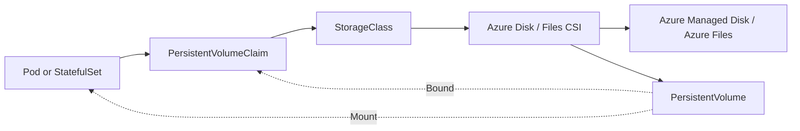
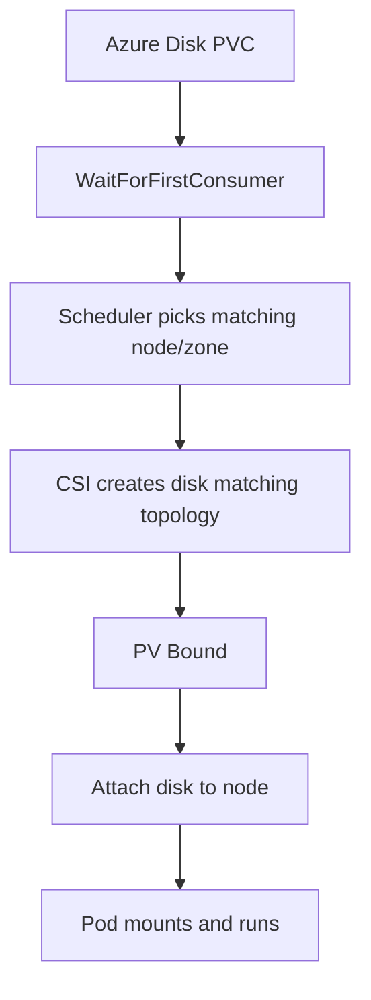

# Azure Disk CSI and Azure Files CSI for Persistent Volumes

A pod running in **Azure Kubernetes Service (AKS)** can be deleted, recreated, or rescheduled onto another node when the app scales, nodes upgrade, or failures happen. If data resides only in the container's writable filesystem layer, it is not guaranteed to survive those changes. For databases, uploaded files, shared documents, or business state, you need **persistent storage** with a lifecycle independent of pods.

Kubernetes provides **PersistentVolume (PV)**, **PersistentVolumeClaim (PVC)**, and **StorageClass** objects. Azure integrates storage infrastructure via the **Container Storage Interface (CSI)**, with two primary drivers:

- **Azure Disk CSI** (`disk.csi.azure.com` provisioner): provisions Azure Managed Disks, suited for block storage, typically attached to one node for writes at a time.
- **Azure Files CSI** (`file.csi.azure.com` provisioner): uses Azure Files shares over supported protocols, suited when multiple pods/nodes need concurrent access to a shared filesystem.

This lesson belongs to the **Azure Kubernetes Service Fundamentals** chapter in the Microsoft Azure module. The concepts connect to subscriptions, resource groups, Microsoft Entra ID, VNet/subnets, node pools, storage, data, monitoring, security, and cost control. Commands are presented for **practicing on an authorized cluster**, not operations already executed against a live cluster.

## Learning objectives

After this lesson, you can:

1. Explain the difference between ephemeral container data and persistent volumes.
2. Describe the relationship among PV, PVC, StorageClass, and CSI drivers in AKS.
3. Choose between Azure Disk CSI and Azure Files CSI based on access mode, throughput, latency, and sharing needs.
4. Create StorageClasses/PVCs and mount volumes into pods or Deployments.
5. Understand **ReadWriteOnce (RWO)**, **ReadWriteMany (RWX)**, **ReadOnlyMany (ROX)**, and **ReadWriteOncePod (RWOP)**.
6. Distinguish dynamic provisioning from static provisioning and govern reclaim policies.
7. Inspect volume binding, attaching, mounting, expansion, zones, and scheduling.
8. Design Azure Files SMB/NFS with private networking, DNS, and proper credentials.
9. Monitor and troubleshoot Pending PVCs, Multi-Attach errors, FailedMount, and I/O performance.
10. Build a backup/restore and cost-management checklist for AKS production data.

## 1. Why do containers need persistent volumes?

Suppose a Java application writes to `/app/data/report.csv`. If `/app/data` lives only on the container's filesystem, the file vanishes when the container is recreated from its image. A replacement pod may land on a different node, so you cannot rely on the old node's local filesystem.

Storage options differ in lifecycle:

| Storage type | Tied to which lifecycle? | Usage |
|---|---|---|
| Container writable layer | Container | Temporary files, disposable |
| `emptyDir` | Pod on current node | Scratch/cache shared among containers in the same pod |
| HostPath or local volume | Specific node | Special cases requiring tight node/topology management |
| PVC using Azure Disk CSI | Managed Disk attached to a node | Stateful apps, databases with dedicated volumes |
| PVC using Azure Files CSI | Network-mounted file share | Pods needing a shared filesystem |
| Azure Blob Storage via SDK | Object storage independent of pods | Large files, images, logs, API-driven objects |

**A PersistentVolume is not a backup.** If a PVC has a backend deletion policy, deleting the PVC can destroy data. If an application writes bad data, data on the disk/share is still corrupted. Separate snapshots/backups and restore testing are mandatory.

### Selection principle

Data that can be regenerated quickly rarely needs a PV. Business data that must be preserved needs storage with explicit lifecycle and access controls. When files are essentially objects (such as user photos), **Blob Storage via SDK** is often better suited than mounting a shared filesystem.

## 2. How do PV, PVC, StorageClass, and CSI work together?

- **PersistentVolume (PV):** a cluster-scoped Kubernetes resource representing an actual or dynamically provisioned volume. A PV tracks capacity, access modes, reclaim policy, CSI driver, and backend identifier.
- **PersistentVolumeClaim (PVC):** a request for capacity and access modes by an application in a **namespace**. Pods reference the PVC without needing to know how the Azure Disk or Azure Files share was provisioned.
- **StorageClass:** specifies the provisioner, backend SKU/parameters, binding timing, expansion support, and default reclaim policy.
- **CSI driver:** plugin enabling Kubernetes to request volume creation/deletion, attach/detach, and mount/unmount across Azure infrastructure, depending on driver features.
- **Pod:** declares `volumes.persistentVolumeClaim.claimName` and `volumeMounts.mountPath` to expose data at a directory path.



### Dynamic provisioning flow

1. Developer creates a PVC specifying `storageClassName`.
2. Kubernetes finds the StorageClass, and the CSI provisioner prepares the backend if prerequisites pass.
3. A PV is created and bound to the PVC, typically showing `Bound`.
4. When the pod is scheduled, CSI coordinates attaching/mounting onto the right node.
5. Containers read/write via the mount path; data resides on the Azure backend.
6. When the pod is deleted, the PVC/PV/backend persist unless explicitly deleted per lifecycle.

**A Bound PVC does not guarantee a Running Pod.** A volume can bind cleanly yet fail to mount due to networking, secrets, zones, or node plugin errors. Trace each step: provisioning, binding, scheduling, attachment, and mounting.

## 3. Comparing Azure Disk CSI and Azure Files CSI

| Criterion | Azure Disk CSI | Azure Files CSI |
|---|---|---|
| Provisioner | `disk.csi.azure.com` | `file.csi.azure.com` |
| Backend | Azure Managed Disk | Azure Files share |
| I/O model | Block storage + filesystem | Network file share |
| Typical access mode | `ReadWriteOnce` | `ReadWriteMany` |
| Multi-node sharing | Not under standard RWO PVC model | Yes, via SMB/NFS and network connectivity |
| Ideal use cases | Stateful databases, dedicated per-instance filesystems | Shared uploads, files shared across replicas |
| Node constraints | Disk attachments, VM size, and zones | Network path, DNS, protocol, and mount credentials |
| Performance bottlenecks | Disk IOPS/throughput, VM limits | Network latency, share/account throughput, and locking |
| Typical errors | Multi-Attach, zone mismatch | TCP 445/2049, DNS, credentials |
| Cost drivers | Disk size/tier and snapshots | Share tier/provisioning, usage/throughput, and snapshots |

### Can Azure Disk be shared?

Some Azure Managed Disk features support shared disks under specific conditions, yet **must not be treated as a way to turn a standard RWO PVC into a safe RWX volume**. Sharing a block device across multiple nodes can require clustered filesystems and complex coordination.

### Can Azure Files replace a database disk?

Azure Files provides a network filesystem. Many databases require specific I/O, locking, latency, and durability semantics; **never mount an RWX share so multiple database replicas write to the same data files** unless the engine explicitly supports it. Database replicas should use dedicated volumes and the database's own replication protocol.

## 4. Access modes and what they really mean

| Access mode | Kubernetes meaning | Choose when |
|---|---|---|
| `ReadWriteOnce` (RWO) | Read/write mount on one **node** at a time | Standard Azure Disk |
| `ReadWriteMany` (RWX) | Read/write mount across multiple nodes | Azure Files shared access |
| `ReadOnlyMany` (ROX) | Read-only mount across multiple nodes | Supported by backend/driver for shared reads |
| `ReadWriteOncePod` (RWOP) | Restricts read/write access to a single **pod** where CSI supports it | Need exclusive pod-level write access |

**RWO does not mean "strictly a single pod."** Two pods on the same node can sometimes share an RWO volume; the constraint is attachment per node. **RWX does not automatically resolve write conflicts**: if two pods edit the same file simultaneously, the app must handle locking and business consistency.

Never judge security solely from PVC `accessModes`. Pods are also governed by Kubernetes RBAC, filesystem permissions, ServiceAccounts, and network/security policies.

## 5. Checking CSI drivers and StorageClasses on the cluster

Before creating volumes, confirm you are targeting the right subscription and cluster:

```bash
az account show --output table
az aks get-credentials \
  --resource-group "<AKS_RESOURCE_GROUP>" \
  --name "<AKS_CLUSTER_NAME>"
kubectl config current-context
```

Inspect CSI drivers and StorageClasses:

```bash
kubectl get csidrivers
kubectl get storageclass -o wide
kubectl get nodes -o wide
```

Look for provisioner names:

```text
disk.csi.azure.com
file.csi.azure.com
```

Common built-in StorageClasses on many AKS clusters include `managed-csi`, `managed-csi-premium`, `azurefile-csi`, and `azurefile-csi-premium`. **Do not assume every cluster has these exact class names**, as AKS versions, cluster configs, and admin customizations vary.

Inspect a specific class:

```bash
kubectl describe storageclass "<STORAGE_CLASS_NAME>"
```

Check the Azure storage profile:

```bash
az aks show \
  --resource-group "<AKS_RESOURCE_GROUP>" \
  --name "<AKS_CLUSTER_NAME>" \
  --query "{name:name,kubernetesVersion:kubernetesVersion,storageProfile:storageProfile}" \
  --output json
```

If a driver is missing, check addon status, AKS version, and supported ways to enable/upgrade it. Never deploy an unverified third-party CSI plugin onto production.

## 6. What does a StorageClass define?

Key fields:

| Field | Meaning |
|---|---|
| `provisioner` | CSI driver creating the backend |
| `parameters` | SKU, protocol, backend options |
| `reclaimPolicy` | Default `Delete` or `Retain` for created PVs |
| `volumeBindingMode` | `Immediate` or `WaitForFirstConsumer` |
| `allowVolumeExpansion` | Permits PVC size expansion requests where supported |
| `mountOptions` | Driver-specific filesystem/protocol mount flags |

### `Immediate` vs. `WaitForFirstConsumer`

- **Immediate:** provisions/binds the volume as soon as the PVC is created; usually suitable for file shares not pinned to one node.
- **WaitForFirstConsumer:** waits until a pod uses the PVC so node and topology are evaluated before provisioning; very helpful for **zone-bound Azure Disks**.

A PVC using `WaitForFirstConsumer` stays `Pending` while **no pod references it**—that is normal behavior, not a provisioning failure.

### Why specify `storageClassName` explicitly?

If a PVC omits `storageClassName`, Kubernetes picks the default StorageClass. If the default class changes, environments may provision unexpected backends. For production data, declare StorageClass and PVC explicitly in Infrastructure as Code.

## 7. Azure Disk CSI: StorageClass and PVC

Example using a lab StorageClass for standard Premium SSD Azure Managed Disks.

**StorageClass:**

```yaml
apiVersion: storage.k8s.io/v1
kind: StorageClass
metadata:
  name: disk-premium-csi-lab
provisioner: disk.csi.azure.com
parameters:
  skuName: Premium_LRS
reclaimPolicy: Delete
volumeBindingMode: WaitForFirstConsumer
allowVolumeExpansion: true
```

**PVC in namespace `csi-lab`:**

```yaml
apiVersion: v1
kind: PersistentVolumeClaim
metadata:
  name: orders-disk
  namespace: csi-lab
spec:
  storageClassName: disk-premium-csi-lab
  accessModes:
    - ReadWriteOnce
  resources:
    requests:
      storage: 20Gi
```

### Explanation

- `disk.csi.azure.com` identifies the driver.
- `skuName: Premium_LRS` is an example SKU; check region support, VM compatibility, and cost.
- `WaitForFirstConsumer` aligns disk topology with pod scheduling.
- `ReadWriteOnce` matches node-level disk attachment.
- `20Gi` is the requested capacity; actual billing often depends on disk tier/provisioned size, not merely written bytes.
- `Delete` is risky for irreplaceable data: deleting the PVC/PV per lifecycle can delete the underlying disk.

Do not confuse `reclaimPolicy: Delete` with deleting a pod: **deleting a pod while keeping the PVC does not delete the disk**.

## 8. Pod mounting Azure Disk and testing data persistence

Example pod appending timestamps to a file:

```yaml
apiVersion: v1
kind: Pod
metadata:
  name: disk-writer
  namespace: csi-lab
spec:
  containers:
    - name: writer
      image: busybox:1.36
      command: ["/bin/sh", "-c"]
      args:
        - |
          while true; do
            date -u >> /data/events.log
            sleep 30
          done
      volumeMounts:
        - name: data
          mountPath: /data
  volumes:
    - name: data
      persistentVolumeClaim:
        claimName: orders-disk
```

When the pod is Running:

```bash
kubectl get pvc -n csi-lab
kubectl get pod -n csi-lab disk-writer -o wide
kubectl exec -n csi-lab disk-writer -- cat /data/events.log
```

To verify persistence in the lab, delete **only the pod**, not the claim:

```bash
kubectl delete pod disk-writer -n csi-lab
kubectl apply -f disk-pod.yaml
kubectl exec -n csi-lab disk-writer -- cat /data/events.log
```

Wait for the new pod to reach Running before running `exec`. Prior log lines persist because the backend/PVC remained intact and the disk reattached/mounted cleanly. If the pod moves to another node, CSI may take a moment to detach from the old node before attaching to the new node.

### RWO Multi-Attach

If two nodes attempt to attach the same RWO disk simultaneously, a `Multi-Attach error` can occur. Inspect the current node, previous node, and volume attachments; **never delete an Azure Disk holding data** just because pod rescheduling is slow.

For multi-replica StatefulSets, you usually need **a separate PVC per replica** via `volumeClaimTemplates`. StatefulSet itself does not implement database replication.

## 9. Azure Files CSI: StorageClass and RWX PVC

A multi-replica application needing shared file read/write access can use an Azure Files share via CSI.

**Illustrative SMB StorageClass:**

```yaml
apiVersion: storage.k8s.io/v1
kind: StorageClass
metadata:
  name: files-premium-csi-lab
provisioner: file.csi.azure.com
parameters:
  skuName: Premium_LRS
  protocol: smb
reclaimPolicy: Delete
volumeBindingMode: Immediate
allowVolumeExpansion: true
mountOptions:
  - dir_mode=0770
  - file_mode=0660
  - uid=1000
  - gid=1000
  - mfsymlinks
```

This is a **Linux SMB** example. Mount options must match container user/group IDs, CSI version, kernel support, and security controls. Permissions displayed on the mount **do not replace** Azure Storage authorization or Kubernetes RBAC.

**RWX PVC:**

```yaml
apiVersion: v1
kind: PersistentVolumeClaim
metadata:
  name: team-files
  namespace: csi-lab
spec:
  storageClassName: files-premium-csi-lab
  accessModes:
    - ReadWriteMany
  resources:
    requests:
      storage: 100Gi
```

`100Gi` illustrates a Premium share; minimum/provisioned capacities and billing models vary by tier and storage account type. Check actual limits and pricing rather than treating `100Gi` as mandatory for every Azure Files share.

## 10. Multiple pods sharing one Azure Files PVC

A Deployment with two replicas uses the same `team-files` PVC. Each replica writes **a separate file named after its hostname**, avoiding concurrent writes to one file in this simple example:

```yaml
apiVersion: apps/v1
kind: Deployment
metadata:
  name: shared-writers
  namespace: csi-lab
spec:
  replicas: 2
  selector:
    matchLabels:
      app: shared-writers
  template:
    metadata:
      labels:
        app: shared-writers
    spec:
      containers:
        - name: writer
          image: busybox:1.36
          securityContext:
            runAsUser: 1000
            runAsGroup: 1000
          command: ["/bin/sh", "-c"]
          args:
            - |
              while true; do
                date -u >> "/shared/$(hostname).log"
                sleep 20
              done
          volumeMounts:
            - name: shared
              mountPath: /shared
      volumes:
        - name: shared
          persistentVolumeClaim:
            claimName: team-files
```

After creating the Deployment:

```bash
kubectl get pods -n csi-lab \
  -l app=shared-writers -o wide

kubectl exec -n csi-lab "<WRITER_POD_NAME>" \
  -- ls -l /shared
```

Expect one pod to see files created by the other replica. To prove sharing **across nodes**, verify the two pods are actually running on **two different nodes**; if they landed on the same node, the test hasn't proven multi-node mounting.

### File sharing does not automatically synchronize business logic

Multiple RWX pods can read/write concurrently, yet applications must manage file locking, conflict resolution, atomic writes, cache consistency, and permissions under SMB/NFS semantics. Never use a file share as a distributed database engine unless the database explicitly supports it.

## 11. SMB and NFS in Azure Files

Azure Files supports **SMB** and **NFS** protocols under supported service configs; not every storage account, SKU, region, or OS supports both identically.

| Criterion | SMB | NFS |
|---|---|---|
| Protocol | SMB 3.x where supported | NFS v4.1 where supported |
| Primary network port | TCP **445** | TCP **2049** |
| Common OS | Linux/Windows per driver/config | Primarily Linux workloads |
| Protection mechanism | Network + credentials or identity per SMB mode | Network access and POSIX UID/GID semantics per NFS |
| Mount options | SMB-specific like `uid`, `gid`, `file_mode` | NFS-specific; never copy SMB options directly |
| Common risks | Port 445 blocked, wrong secret/key | Port 2049 blocked, incompatible tier/network/permissions |

### When to choose NFS?

Choose NFS when Linux workloads require POSIX/NFS semantics and your Azure Files tier and network match. Some Azure Files NFS setups require Premium shares and private network access per service rules. Verify the current support matrix before configuring `protocol: nfs`.

**Never just flip `protocol: smb` to `nfs` while keeping SMB `mountOptions`.** Authentication, file ownership, client capabilities, and network paths differ.

## 12. Static provisioning vs. dynamic provisioning

### Dynamic provisioning

Kubernetes uses the PVC and StorageClass to provision a fresh volume. It automates easily and lets each StatefulSet replica receive its own PVC.

Risks:

- Every PVC can create a Managed Disk or File share and incur cost.
- `Delete` can remove the backend when the PVC/PV is deleted.
- Provisioning depends on quotas, Azure RBAC, policies, region, and networking.
- Resources may appear in the **node resource group** or a StorageClass-specified resource group, not necessarily the app's resource group.

### Static provisioning

Binds an **existing disk/share** into Kubernetes via a manually created PV. Useful for migrations, recovery, or managing backend lifecycles independently of PVCs.

Static PV and PVC example for a pre-existing Managed Disk—**never point this at a production disk currently attached to another VM**:

```yaml
apiVersion: v1
kind: PersistentVolume
metadata:
  name: existing-disk-pv
spec:
  capacity:
    storage: 20Gi
  accessModes:
    - ReadWriteOnce
  storageClassName: ""
  persistentVolumeReclaimPolicy: Retain
  csi:
    driver: disk.csi.azure.com
    volumeHandle: /subscriptions/<SUBSCRIPTION_ID>/resourceGroups/<DISK_RESOURCE_GROUP>/providers/Microsoft.Compute/disks/<DISK_NAME>
    fsType: ext4
---
apiVersion: v1
kind: PersistentVolumeClaim
metadata:
  name: existing-disk-claim
  namespace: csi-lab
spec:
  storageClassName: ""
  volumeName: existing-disk-pv
  accessModes:
    - ReadWriteOnce
  resources:
    requests:
      storage: 20Gi
```

The disk must have matching capacity, SKU, filesystem, attachment mode, zone, and permissions. `storageClassName: ""` is intentional to stop the default StorageClass from provisioning a new disk.

Static Azure Files can also bind an existing share via CSI PV, requiring exact `volumeHandle`, secrets/auth, and network reachability for SMB/NFS. **Never put storage account keys directly in public manifests.**

## 13. Reclaim policy and data lifecycle

| Action | Typical consequence |
|---|---|
| Delete only the pod | PVC/backend data persists as long as PVC remains |
| Delete Deployment without deleting PVC | PVC typically remains intact |
| Delete PVC bound to a `Delete` PV | CSI may delete the backend disk/share per lifecycle |
| Delete PVC bound to a `Retain` PV | Backend stays intact for manual handling; PV may become `Released` |
| Delete Managed Disk/File share directly in Azure | Data is lost even though Kubernetes PV/PVC still exist |

StorageClass sets the **default reclaim policy at PV creation time**, while existing PVs carry their own `persistentVolumeReclaimPolicy`. Editing a StorageClass does not retroactively change existing PVs.

### When should you use `Retain`?

- Production data requiring human review before deletion.
- System migrations.
- Keeping backends alive even if a namespace or application is deleted.

However, **`Retain` is not a backup**, and rebinding a `Released` PV usually requires manual admin intervention. Maintain runbooks, clear owners, and permission checks before deleting resources.

## 14. Expanding PVCs and capacity limits

With a StorageClass setting `allowVolumeExpansion: true`, a PVC can request a **larger** size if supported by the driver, backend, and filesystem.

Example expanding the lab Disk PVC from `20Gi` to `40Gi`:

```bash
kubectl patch pvc orders-disk \
  -n csi-lab \
  -p '{"spec":{"resources":{"requests":{"storage":"40Gi"}}}}'

kubectl get pvc orders-disk -n csi-lab
kubectl describe pvc orders-disk -n csi-lab
```

Key points:

- **Never shrink size** by editing `requests.storage` expecting safe volume shrinking.
- Azure backend resizing and filesystem resizing may finish at different times; verify usable space from inside the pod.
- Some scenarios require pod remount/restart or specific driver/filesystem conditions.
- Increasing disk/file share size can raise cost, quota usage, or performance tiers.
- Always verify backups/restores before major storage changes.

## 15. Azure Disk topology and AKS node pools

Managed Disks can be bound to an **availability zone** or redundancy type. A zonal disk cannot always attach to a node in a different zone.



**`WaitForFirstConsumer`** ensures provisioning considers the real node and zone. Conversely, pre-creating a PV/disk in a zone that does not match your node pool can leave pods unschedulable.

### Constraints to factor in

- **Disk attachment limits** depend on the node VM size.
- Node drains/upgrades require detaching and reattaching disks per driver rules.
- PVs can carry zonal `nodeAffinity`.
- Pods have `nodeSelector`, affinity, taints/tolerations, and resource requests; all affect scheduling together.
- If a node pool spans only one zone, zone-failure tolerance is limited.
- For VMSS nodes, never manually attach/detach cluster-managed PV disks outside AKS/CSI.

For instance, a 3-replica database StatefulSet typically needs **3 separate PVCs**, and the database itself must run replication/leader election. Kubernetes does not automatically turn three disks into a consistent database cluster.

## 16. Azure Files Private Endpoint, DNS, and networking

Azure Files CSI mounts over the network, so verify the path from **worker nodes to the File endpoint**.

The File service hostname typically follows:

```text
<STORAGE_ACCOUNT>.file.core.windows.net
```

When using a Private Endpoint, the private DNS zone typically follows:

```text
privatelink.file.core.windows.net
```

Do not accidentally configure Blob Storage's `privatelink.blob.core.windows.net` and expect Azure Files SMB to work.

### Network verification matrix

| Component | Check |
|---|---|
| Node subnet | Is there a route to the endpoint? |
| DNS | Does the File FQDN resolve to the intended private IP? |
| NSG / Azure Firewall | Is TCP 445 (SMB) or 2049 (NFS) allowed to the target? |
| Storage firewall | Does it allow the designed private/public path? |
| Private Endpoint | Is the connection approved for the right storage account and `file` subresource? |
| Credentials | Can the mount access valid keys/identities? |
| AKS nodes | Does the actual node running the pod have the expected network path? |

Viewing a storage account in Azure Portal from your laptop **does not prove AKS nodes can mount the file share**. Azure Resource Manager management, the Files data plane, and node networking are separate layers.

Never open TCP 445/2049 to the entire Internet just to clear mount errors. Configure exact targets, subnets, and approved network rules.

## 17. Identity, Secrets, and mount permissions

Distinguish three mechanisms:

1. **AKS/CSI infrastructure identity:** holds Azure permissions to provision Managed Disks/File shares or attach resources per infrastructure config.
2. **Pod Workload Identity:** allows applications to access Azure services like Blob/Key Vault via SDK using assigned roles.
3. **Azure Files SMB mount credentials:** in some default setups, uses Storage account keys stored in a Kubernetes Secret; identity-based mounting applies only where supported by the driver/Azure Files and explicitly configured.

**A Pod's Workload Identity for the Blob SDK does not automatically mount Azure Files SMB shares.** If an identity-based security model is needed, verify feature support, protocol, node OS, and service prerequisites.

### Security practices

- Grant least-privilege Azure RBAC to the CSI control plane identity and applications.
- Never put Storage account keys in Git, Dockerfiles, tickets, or logs.
- Protect Kubernetes Secrets with RBAC, encryption at rest, and rotation policies.
- Separate namespaces and tightly govern PVC/Secret access.
- Enforce Private Endpoints, firewalls, and TLS/encryption per compliance rules.
- For Linux containers, configure `runAsUser`, `fsGroup`, and mount options cleanly.
- Never `chmod 777` shared directories as a shortcut around permission errors.

Depending on protocol, `uid`, `gid`, `file_mode`, and `dir_mode` on SMB only govern how permissions appear on the Linux client—they do not replace Azure Storage security.

## 18. Performance and selecting backends by workload

### Azure Disk CSI

Disk performance depends on:

- SKU, size/tier, IOPS, and throughput.
- Node VM I/O limits.
- Random vs. sequential read/write patterns, block size, and queue depth.
- Caching and filesystem choice.
- Database `fsync`, transaction logs, and app I/O patterns.
- Number of disks attached to the node.

A faster disk **does not guarantee a faster system** if the bottleneck is Java GC, database locks, CPU, or networking.

### Azure Files CSI

File share performance depends on:

- Tier, share/account quotas, provisioned capacity, and bandwidth.
- SMB/NFS latency, connection count, metadata operations, and file locking.
- Number of pods/nodes sharing the same share.
- Mount options/caching and file sizes.
- Network paths and supporting services.

A shared RWX share can become a single bottleneck when scaling replicas. Load-test and measure IOPS/latency/throughput instead of guessing from pod counts.

### Decision table

| Workload | Recommended starting point |
|---|---|
| Single-instance PostgreSQL primary | Azure Disk RWO, plus separate backups/database replication |
| StatefulSet where each replica owns private data | Separate PVC per replica, typically Azure Disk |
| Two web replicas sharing an upload folder | Azure Files RWX or Blob Storage SDK |
| Large images/object files | Consider Blob SDK if POSIX filesystem isn't needed |
| Temporary batch scratch | `emptyDir` or ephemeral storage |
| Immutable configuration | ConfigMap/Secret/image; rarely needs a PVC |
| Read-heavy shared model files | Files or object storage/caching depending on latency and concurrency |

## 19. Snapshots, backups, and recovery

Persistent volumes can still lose data via accidental PVC deletion, user error, software bugs, or ransomware.

Consider:

- Azure Disk snapshots or Kubernetes `VolumeSnapshot` via CSI driver where supported.
- Azure Files snapshots/backups appropriate to the share tier.
- Azure Backup for AKS or organization-verified tools within their supported data scope.
- Database-native backups to guarantee application consistency.
- Copying backups to an authorized vault/location and rehearsing restores periodically.

**Snapshotting a filesystem while a database is actively writing does not guarantee an application-consistent backup.** Use transaction log flushing/quiescing or database-native backups.

### RPO and RTO

- **RPO:** maximum acceptable data loss.
- **RTO:** target time to restore service.

Never assume two pods sharing one file share can survive losing the entire share. Application replicas, backend storage redundancy, and backup history are separate dimensions.

## 20. Inspecting PVs/PVCs and troubleshooting

### Diagnostic commands

```bash
kubectl get storageclass
kubectl get pvc -A
kubectl get pv
kubectl get pods -A -o wide

kubectl describe pvc orders-disk -n csi-lab
kubectl get events -n csi-lab \
  --sort-by=.lastTimestamp
kubectl describe pod disk-writer -n csi-lab
```

Once a PVC is `Bound`, find its PV and inspect driver, reclaim policy, capacity, and node affinity:

```bash
kubectl get pv "<PV_NAME>" -o yaml
```

Inspect CSI system components if permitted:

```bash
kubectl get pods -n kube-system -o wide
```

Never manually edit or restart AKS-managed CSI DaemonSets/controllers in production without identifying the root cause.

### Read-only Azure resource lookups

```bash
az disk list \
  --resource-group "<DISK_RESOURCE_GROUP>" \
  --output table

az storage account list \
  --resource-group "<STORAGE_RESOURCE_GROUP>" \
  --output table
```

Dynamically provisioned disks/shares may live in the **node resource group** or a StorageClass-designated resource group. Check PV/driver metadata rather than guessing resource groups from application names.

### Common issues

| Symptom | Possible cause | What to check |
|---|---|---|
| PVC Pending (Disk `WaitForFirstConsumer`) | No pod exists yet or scheduler hasn't picked a node | StorageClass binding mode, pod events |
| `StorageClass` not found | Wrong `storageClassName` | `kubectl get sc` |
| `ProvisioningFailed` | Missing Azure RBAC, quota, unsupported SKU/zone | PVC events, AKS config, Azure logs |
| PVC Bound yet Pod Pending | Node selector, taints, resource requests, or volume topology | `kubectl describe pod`, PV `nodeAffinity` |
| `Multi-Attach` on Azure Disk | Disk still attached to another node | Node placement, VolumeAttachment, CSI events |
| `FailedMount` on Azure Files SMB | Port 445, DNS, firewall, or wrong secret | Node network, Private Endpoint, credentials |
| `FailedMount` on Azure Files NFS | Port 2049, incompatible tier/network/permissions | NFS support and network path |
| Pod can read but cannot write | Wrong UID/GID or filesystem permissions | `id` inside pod, `mountOptions`, `securityContext` |
| PVC deleted and disk/share gone | `reclaimPolicy: Delete` | PV policy and backups |
| Expansion not reflected in pod | Filesystem resize/remount incomplete | PVC conditions, CSI events, filesystem |
| Database slow | Disk IOPS, node bandwidth, or DB locks/GC | Azure metrics and app traces |
| RWX share slows at scale | Share throughput, locking, or metadata overhead | Azure Files metrics, concurrent load |
| Pod switches zones and cannot attach | Disk topology mismatch | PV affinity, node zone, scheduling |

### Troubleshooting method

1. Confirm exact cluster, namespace, PVC, StorageClass, and pod.
2. Isolate the failing stage: **Provision → Bind → Schedule → Attach → Mount → App I/O**.
3. For Disk, inspect zone alignment and attachment state.
4. For Files, inspect DNS, network, ports, and secrets.
5. Once mounted, check filesystem permissions and actual data.
6. Change one cause at a time and re-verify.
7. Never delete a backend holding unbacked-up data.

## 21. Comprehensive hands-on lab on AKS

The lab uses a dedicated namespace, two dedicated StorageClasses, and the manifests shown earlier. **Azure Disk/Azure Files charges may apply**, so run only on an approved test cluster.

### Step 1: preflight checks

```bash
az account show --output table

az aks get-credentials \
  --resource-group "<AKS_RESOURCE_GROUP>" \
  --name "<AKS_CLUSTER_NAME>"

kubectl config current-context
kubectl get csidrivers
kubectl get storageclass
```

### Step 2: create namespace

```bash
kubectl create namespace csi-lab
```

StorageClasses are cluster-scoped; PVCs and pods live in `csi-lab`. If the namespace already exists, verify ownership first so you do not affect another team's data.

### Step 3: test Azure Disk

Save the StorageClass, PVC, and Pod from sections 7–8 as:

- `disk-sc.yaml`
- `disk-pvc.yaml`
- `disk-pod.yaml`

Apply in order:

```bash
kubectl apply -f disk-sc.yaml
kubectl apply -f disk-pvc.yaml
kubectl apply -f disk-pod.yaml

kubectl get pvc,pod -n csi-lab -o wide
```

Once the Pod is Running, inspect the file, then delete only the pod:

```bash
kubectl exec -n csi-lab disk-writer -- cat /data/events.log

kubectl delete pod disk-writer -n csi-lab

kubectl apply -f disk-pod.yaml
```

Wait for the new pod to run and verify prior data remains intact. If scheduled onto a new node, allow time for detach/attach. **Do not delete the PVC** while testing persistence.

### Step 4: test Azure Files RWX

Save:

- `files-sc.yaml`
- `files-pvc.yaml`
- `files-deployment.yaml`

Apply:

```bash
kubectl apply -f files-sc.yaml
kubectl apply -f files-pvc.yaml
kubectl apply -f files-deployment.yaml

kubectl get pvc -n csi-lab

kubectl get pods -n csi-lab \
  -l app=shared-writers -o wide
```

Pick a live pod to inspect shared files:

```bash
kubectl exec -n csi-lab "<WRITER_POD_NAME>" \
  -- ls -l /shared
```

If the two pods sit on **two different nodes** and still see each other's files, you have strong evidence of multi-node RWX sharing. If both landed on the same node, multi-node mounting hasn't been verified yet.

### Step 5: inspect logs and events

```bash
kubectl describe pvc orders-disk -n csi-lab

kubectl describe pvc team-files -n csi-lab

kubectl get events -n csi-lab \
  --sort-by=.lastTimestamp
```

Record the StorageClass, access mode, PV name, CSI driver, node, backend path, and read/write verification results.

### Step 6: controlled cleanup

**Never delete namespaces or PVCs automatically without checking.** Once you confirm the data is lab-only and unneeded, stop workloads first:

```bash
kubectl delete deployment shared-writers -n csi-lab
kubectl delete pod disk-writer -n csi-lab
kubectl get pvc -n csi-lab
kubectl get pv
```

These commands **have not deleted the claims yet**. Deleting a PVC with reclaim policy `Delete` deletes the Azure Managed Disk or Azure Files share and destroys data. Confirm backups and approvals before deleting claims or the namespace.

## 22. Production cost and operations

| Factor | Azure Disk | Azure Files |
|---|---|---|
| Capacity charges | Disk size/SKU/performance tier | Share tier/model and provisioned/used capacity |
| Performance | IOPS, throughput, VM limits | Share/account throughput, transactions, protocol |
| Backup/snapshots | Depends on backup type and retention | Depends on snapshots/backup and retention |
| Networking | Disk attachment/topology; still incurs node/infra costs | May add Private Endpoint and data transfer costs |
| Scaling | Each StatefulSet replica usually needs its own disk | One share can serve multiple replicas |
| Common waste | Orphaned disks left after app deletion | Provisioned file shares/accounts with no active workloads |

A PVC provisions Azure resources that continue billing even when applications are idle. With `Retain`, maintain an inventory and clear owners to clean up orphaned volumes safely. For Azure Files, also track Private Endpoints, snapshots, storage account provisioning, and network data transfer.

### Production checklist

- [ ] Classified data: ephemeral, block stateful, shared filesystem, or object storage.
- [ ] Determined RWO/RWX/RWOP and application concurrency semantics.
- [ ] Verified StorageClass/CSI driver/AKS version/VM SKU support.
- [ ] Sized capacity, IOPS, throughput, latency, file concurrency, and billing tiers.
- [ ] Aligned node pools with disk zones/topology and per-VM disk attachment limits.
- [ ] For Files, verified SMB/NFS, port 445/2049, DNS, and Private Endpoints.
- [ ] Designed identities/secrets, Key Vault, or appropriate auth mechanisms.
- [ ] Kept secrets out of public manifests and avoided overly permissive mount rights.
- [ ] Selected `reclaimPolicy` matching data retention vs. deletion requirements.
- [ ] Configured appropriate backups/snapshots and rehearsed restores.
- [ ] Tested volume expansion in staging.
- [ ] Tested pod restarts, node drains, and recovery within approved scope.
- [ ] Monitored PVC/PV/CSI events and backend storage metrics.
- [ ] Set budgets, tags, owners, and cleanup processes for orphaned resources.
- [ ] Documented runbooks for Multi-Attach/FailedMount/Pending and PVC deletion approvals.

## 23. Self-check questions

1. Why doesn't writing files inside a container guarantee data survives pod replacement?
2. How do PV, PVC, StorageClass, and CSI drivers differ in responsibility?
3. When should you pick Azure Disk CSI instead of Azure Files CSI?
4. Why does `ReadWriteOnce` not strictly mean "only one pod"?
5. `ReadWriteMany` allows multi-node access, but does it automatically protect concurrent writes?
6. Why can a PVC using `WaitForFirstConsumer` stay Pending when no pod exists?
7. When deleting a PVC bound to a `Delete` PV, what can happen to the Managed Disk?
8. Is `Retain` a backup mechanism?
9. Why might an Azure Disk pod fail to start if rescheduled onto a node in a different zone?
10. Why do multi-replica database StatefulSets usually need a separate PVC per replica?
11. Which ports do Azure Files SMB and NFS typically require?
12. Which Private DNS zone is normally used for an Azure Files Private Endpoint?
13. Why can someone have Azure Portal permissions yet still see SMB mount failures on nodes?
14. How does an app's Workload Identity differ from CSI credentials mounting Azure Files?
15. What should you check when encountering a `Multi-Attach error`?
16. A PVC is Bound yet the pod stays in `ContainerCreating`: what errors can still occur?
17. Why might a PVC resize not immediately show extra space inside the container filesystem?
18. What causes an RWX share to slow down as replicas scale out?
19. Why isn't a disk snapshot taken while a database is actively writing guaranteed to be consistent?
20. What must you verify to prove two pods on two different nodes are sharing the same Azure Files volume?

## Conclusion

**Azure Disk CSI** provides durable block storage, typically suited for stateful workloads using **ReadWriteOnce**, requiring attention to disk attachment limits and node zones. **Azure Files CSI** provides network file shares via SMB/NFS where supported, suited for **ReadWriteMany** across multiple pods and nodes. Both integrate through **StorageClass, PVC, PV, and CSI drivers** to decouple application manifests from Azure resource provisioning details.

Production designs must address access permissions, topology, performance, networking, `Delete`/`Retain` policies, backups/restores, and cost. A `Bound` PVC only confirms volume binding; real success means **the application reads and writes data reliably, data survives pod and node failures, and it can be restored whenever needed**.
