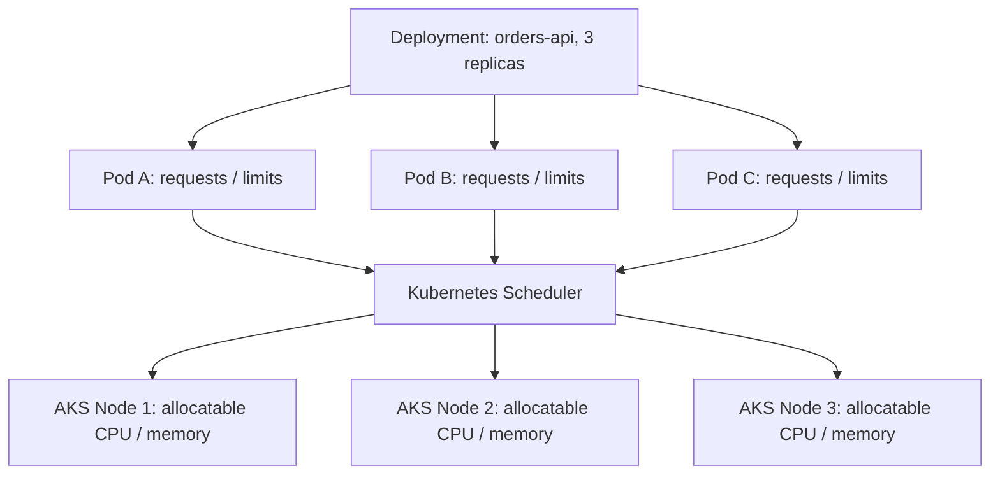
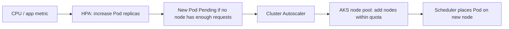

# Setting Resource Requests, Limits, and Resource Allocation

An application running on **Azure Kubernetes Service (AKS)** can be deployed as multiple Pods across nodes belonging to one or more node pools. If a Pod is allocated too little memory, the process may be terminated by the operating system; if the CPU limit is too low, the application may become abnormally slow even when the node has unused CPU. Conversely, if every Pod declares CPU/memory requests that are too large compared to actual demand, Kubernetes may report **Pending** and require scaling out node pools while physical resource utilization remains low. Therefore, configuring `requests`, `limits`, and allocation policies is a core part of AKS operations.

This lesson belongs to the **AKS Operations** chapter of the Microsoft Azure infrastructure module. We will distinguish declared resources from consumed resources; explore the Kubernetes scheduler, Linux cgroups, Pod Quality of Service, ResourceQuota, LimitRange, and the relationship between HPA, Cluster Autoscaler, availability, and cost. The examples use Kubernetes YAML and `kubectl` on an existing AKS cluster without creating new Azure infrastructure.

## Learning Objectives

After this lesson, you will be able to:

1. Interpret `requests.cpu`, `limits.cpu`, `requests.memory`, and `limits.memory` in Kubernetes units.
2. Explain the difference between **request-based scheduling** and **runtime resource consumption limits**.
3. Identify CPU throttling, `OOMKilled`, Pod eviction, `Pending`, and the causes preventing a node from accepting additional Pods.
4. Set resource requests/limits for multi-container Deployments and understand QoS classes: `Guaranteed`, `Burstable`, `BestEffort`.
5. Use **LimitRange** and **ResourceQuota** to manage resources at the namespace level.
6. Read metrics and events using `kubectl top`, `kubectl describe`, HPA, and AKS monitoring tools.
7. Design resource allocation aligned with HPA, node pools, Cluster Autoscaler, fault tolerance, and budget.

## 1. The Big Picture: Pods, Containers, Nodes, and Node Pools

Kubernetes runs applications as **Pods**, each consisting of one or more containers that share certain network resources and lifecycle. Pods are assigned by the **scheduler** to a **node** that has sufficient allocatable resources and satisfies other constraints. In AKS, nodes are typically VMs belonging to a node pool managed by Azure under the AKS model; node pools use VM SKUs, availability zones, disk configurations, networking, and cluster policies.



The diagram illustrates the logical flow: the scheduler does not necessarily place three Pods on three different nodes. The decision also depends on resources, affinity, taints/tolerations, topology spread constraints, priority, volumes, and other policies. Setting requests/limits properly **does not automatically guarantee** even distribution across availability zones.

### 1.1. Requests and Limits Answer Two Different Questions

| Property | Question | Primary Impact |
|---|---|---|
| `resources.requests.cpu` | How much CPU does the container need for the scheduler to reserve capacity? | Scheduling, certain autoscalers, and CPU sharing mechanisms during contention. |
| `resources.limits.cpu` | Up to how much CPU is the container allowed to consume? | On compatible Linux systems, CPU quota/cgroup may cause **throttling** when exceeded. |
| `resources.requests.memory` | How much memory must the scheduler reserve in advance? | Scheduling and usage levels considered when a node lacks resources. |
| `resources.limits.memory` | Up to how much memory can the container use? | When exceeded and memory cannot be reclaimed, the container may be **OOM killed**. |

**A request is not a hard-allocated, isolated region of physical RAM**, and a limit does not mean the application is guaranteed to achieve the corresponding performance. The node shares CPU/memory according to runtime/kernel mechanisms and is affected by actual workloads.

### 1.2. Two Intuitive Examples

Pod A declares `requests.cpu: 250m`, `limits.cpu: 1000m`. The scheduler counts **0.25 CPU** when selecting a node; when the node is idle, the container can use more CPU than its request but will be capped at the CPU limit per runtime enforcement. Pods on the same node still contend for CPU when load increases.

Pod B declares `requests.memory: 256Mi`, `limits.memory: 512Mi`. The scheduler counts **256 MiB** toward resource requirements, while the process can use more memory than its request. If usage exceeds the limit and the cgroup cannot free sufficient memory, the container may be `OOMKilled` even if the physical node still has free RAM.

## 2. CPU and Memory Units in YAML

Kubernetes uses **resource quantities**. Values are not arbitrary strings: entering the wrong unit can create a request many times larger than expected.

### 2.1. CPU: Cores and Millicores

| Value | Interpretation | When to Use |
|---|---|---|
| `100m` | 0.1 CPU core. | Lightweight services, post-measurement testing. |
| `250m` | 0.25 core. | Web APIs with moderate CPU consumption. |
| `500m` | 0.5 core. | Workers with moderate processing. |
| `1` | 1 core. | Applications with higher CPU requirements. |
| `2` | 2 cores. | Batch jobs or suitable parallel compute processing. |

`m` stands for **milli** (1/1000 core): `1000m = 1 CPU`, `500m = 0.5 CPU`. Do not confuse `100m` CPU with 100 MB of memory. CPU cores are Kubernetes scheduling units; actual performance also depends on VM SKU, CPU architecture, platform, and workload characteristics.

### 2.2. Memory: MiB/GiB and Decimal Units

| Value | Scale | Notes |
|---|---|---|
| `128Mi` | 128 × 2²⁰ bytes. | 128 mebibytes. |
| `512Mi` | 512 × 2²⁰ bytes. | Half a GiB. |
| `1Gi` | 1 × 2³⁰ bytes = 1024 MiB. | Binary unit commonly used for RAM. |
| `1G` | 1 × 10⁹ bytes. | Different from `1Gi`. |
| `500M` | 500 × 10⁶ bytes. | Decimal unit, different from `500Mi`. |

Kubernetes is case-sensitive with suffixes. **`400m` for memory is 0.4 bytes in milli notation**, not 400 MB. In production YAML, prefer `Mi` or `Gi` for memory to avoid confusion; `m` is commonly used for CPU.

### 2.3. Example Configuration for a Single Container

```yaml
resources:
  requests:
    cpu: "250m"
    memory: "256Mi"
  limits:
    cpu: "750m"
    memory: "512Mi"
```

The scheduler counts **250 millicores and 256 MiB**; the container can increase CPU usage up to the 750m limit under throttling enforcement and has a memory limit of 512 MiB. These are **illustrative numbers**, not a default configuration to copy for every Java/.NET/Node.js application.

## 3. How the Scheduler Uses Requests to Allocate Resources

### 3.1. Node Capacity Differs from Node Allocatable

A 4 vCPU / 16 GiB RAM node by VM SKU **does not mean** Kubernetes uses all of those resources for workload Pods. A portion serves the OS, kubelet, system components, and eviction thresholds. Kubernetes exposes **Capacity** and **Allocatable** to distinguish total resources from resources available for Pods.

```text
Azure VM node (theoretical example): 4 vCPU / 16 GiB
 ├─ OS, kubelet, system/kube reserved, eviction thresholds
 └─ Node Allocatable: smaller than VM capacity
      ├─ System Pods and DaemonSets
      ├─ Application Pod A: request 500m
      ├─ Application Pod B: request 1000m
      └─ Remaining capacity for other Pods
```

Actual allocatable resources depend on the node pool, OS, kubelet, and AKS version. **Do not hard-code a fixed overhead percentage** for every VM size. Use `kubectl describe node` or the Node API to read actual figures.

### 3.2. Scheduling Decisions Based on Total Requests

Suppose after subtracting requests of running Pods, a node has **1600m CPU** and **3Gi memory** remaining. A new Pod requesting `1000m` and `2Gi` can pass the resource check if other conditions are also satisfied. A Pod requesting `1800m` will not be placed on that node even if actual CPU utilization is low.

- The scheduler primarily relies on **requests**, not the sum of `limits`, as reserved capacity to select a node.
- Total CPU limits can exceed the core count on a node; when all Pods spike simultaneously, there will be contention and potential throttling.
- Total memory limits can also exceed allocatable; when concurrent usage is high, the node may experience memory pressure, OOM, or eviction.
- The scheduler also checks `nodeSelector`, affinity, taints, topology, volumes, Pod count, and extended resources.

**Requests that are too high cause waste at scheduling time; requests that are too low cause contention at runtime.** Choose values based on measurement and workload criticality.

### 3.3. Multi-Container Pods

A Pod has an `api` container requesting `500m` CPU and `512Mi` memory, and a `sidecar` requesting `100m` and `128Mi`. The total request for the two app containers is:

\[
CPU_{pod}=500m+100m=600m,\qquad Memory_{pod}=512Mi+128Mi=640Mi
\]

The scheduler sums **the relevant containers** along with rules for init containers and Pod overhead when applicable. For traditional init containers that **do not run concurrently with app containers**, the effective requirement per resource type is typically the greater of the **sum of app containers** and the **largest request among init containers**. Restartable init containers acting as sidecars follow different rules; check the Pod spec/Kubernetes version.

Do not forget the memory of service mesh proxies, log collectors, or sidecars. Measuring only the main container and requesting CPU/memory for the whole Pod will underestimate demand.

## 4. CPU Limits and Throttling

On Linux and corresponding Kubernetes runtimes, CPU limits are typically enforced using **cgroup CPU quota**. When a container exhausts its quota for a period, the kernel may delay running the process until the next period: **CPU throttling**.

For example, a worker requests 250m and has a limit of 500m, but while processing a file it wants to use 1.5 cores continuously. The kernel may cap it at 0.5 core. Processing time increases, p95 latency degrades, or tasks time out even though the node has idle CPU.

### 4.1. A CPU Request Is Not a CPU Limit

If a container requests `250m` but **does not set a CPU limit**, it can utilize spare CPU when the node is idle and remains subject to CPU sharing mechanisms during contention. Some teams use this approach for tail-latency-sensitive APIs to avoid quota throttling, but this requires capacity planning, reasonable requests, and contention monitoring.

**There is no single universal recommendation to "always remove" or "always set" CPU limits.** Multi-tenant environments may need limits to prevent noisy neighbors; latency-sensitive applications might omit limits if policy allows. Test with realistic load.

### 4.2. Identifying CPU Throttling

- High latency even though `kubectl top` shows node CPU is not full.
- Container CPU usage frequently hits the CPU limit.
- Cgroup/Prometheus metrics such as **`container_cpu_cfs_throttled_periods_total`** increase when collected.
- Adjusting the CPU limit in a controlled manner improves p95/p99 latency in A/B load tests.

`kubectl top` displays usage from the metrics pipeline and **does not directly show all throttling events**. Combine CPU/cgroup metrics, runtime telemetry, application traces, and load tests when drawing conclusions.

## 5. Memory Limits, OOMKilled, and Eviction

Memory differs from CPU: the kernel cannot simply "slow down RAM" when an application allocates more and runs out of memory. If a container exceeds `limits.memory`, the cgroup may trigger an **out-of-memory (OOM) kill**. Kubernetes may report the container terminated as `OOMKilled` and restart it according to the applicable policy/controller.

### 5.1. OOMKilled Due to Memory Limit

For example, a Java API has a maximum heap of 700Mi, plus metaspace, thread stacks, direct buffers, and native memory. Setting container `limits.memory=768Mi` can lead to an OOM kill even before the heap is full, because **JVM heap size does not equal total process RAM**.

```text
Memory limit should consider
  >= actual max heap
     + native/direct/metaspace/thread stacks
     + runtime/library overhead
     + headroom based on reliable peaks, p95/p99
```

Measure working set/RSS, GC, and native memory; avoid applying a fixed heap-to-container ratio across all Java versions/GCs.

### 5.2. Low Memory Requests and Node Memory Pressure

A Pod requesting `128Mi` that routinely consumes `1Gi` causes the scheduler to pack too many Pods onto a node. When multiple Pods increase usage at the same time, **node memory pressure** occurs; the kubelet may **evict** Pods to protect the node, which differs from a container being `OOMKilled` for exceeding its own limit.

| Symptom | Signal | Investigation Path |
|---|---|---|
| **Container OOMKilled** | `Last State: Terminated`, `Reason: OOMKilled`, usually exit code 137. | Limit, peak usage, heap/native memory, logs before restart. |
| **Pod Evicted** | Pod `Failed` with `Reason: Evicted`, describing memory/disk pressure. | Node Conditions, requests, pressure levels, and co-located Pods. |
| **Pending: Insufficient memory** | Scheduler event reports node lacks memory. | Allocatable, total requests, and node pools. |
| **Application OutOfMemoryError** | Runtime reports heap/native memory error. | Distinguish heap OOM from cgroup OOM. |

Increasing the limit may temporarily treat the symptom while masking a memory leak. Check memory growth, caches, batch sizes, GC, and spikes before increasing limits indefinitely.

### 5.3. RAM Limits Are Guardrails, Not Performance Guarantees

Memory limits reduce the risk of one container consuming the entire node. However, if every container has a very high limit and a low request, **memory overcommit** leads to node pressure when usage rises concurrently. Set limits based on peaks and stability, and size Pods per node to avoid simultaneous usage exceeding allocatable memory.

## 6. Pod Quality of Service (QoS)

Kubernetes typically classifies QoS based on CPU/memory requests and limits according to the corresponding rules:

| QoS Class | Typical Condition | Operational Meaning |
|---|---|---|
| **Guaranteed** | Every relevant container has a request and limit for CPU and memory; each pair has request = limit. | Strictly declared, generally given relatively higher protection during memory pressure. |
| **Burstable** | At least one CPU or memory request/limit is set, but does not meet Guaranteed. | Has a baseline and headroom for extra usage within configured limits. |
| **BestEffort** | No CPU or memory requests/limits declared and none added by admission defaults. | Most vulnerable when a node runs low on resources. |

```yaml
# Guaranteed example if all containers follow this pattern:
resources:
  requests: {cpu: "500m", memory: "512Mi"}
  limits:   {cpu: "500m", memory: "512Mi"}

# Burstable example:
# resources:
#   requests: {cpu: "250m", memory: "256Mi"}
#   limits:   {cpu: "1000m", memory: "768Mi"}

# BestEffort: omit all resources across all relevant containers.
```

**QoS is not a measure of business criticality.** A Guaranteed Pod can still be `OOMKilled` if it exceeds its memory limit; priority, usage above requests, and pressure signals also affect eviction. Combine Pod Priority, replicas, topology, and readiness rather than relying solely on QoS.

### 6.1. Defaulting Requests When Only Limits Are Declared

If a container only specifies a limit for a resource without declaring a request and no other admission rule applies, the system may **copy the limit as the request** for that resource. **LimitRange** can also inject default requests/limits. Therefore, "omitting requests" does not always mean the scheduler treats them as 0.

```bash
kubectl get pod <pod-name> -n <namespace> -o yaml
```

Inspect the Pod spec **after admission** instead of looking only at the Deployment YAML before applying. Mutating webhooks, LimitRange, and sidecar injection can make a Pod's actual resources differ from the original manifest.

## 7. Sizing Requests and Limits from Observation

A practical workflow:

1. Measure per-container CPU/memory across normal days, peak hours, batch runs, deployments, and downstream incidents.
2. Define SLOs such as p95 response latency, error rate, and queue processing time.
3. Set requests reflecting what is needed for normal operation and reliable load peaks, with headroom.
4. Set memory limits with sufficient headroom; decide on CPU limits based on isolation policies and throttling results.
5. Run controlled load tests to measure Pod restarts, OOMs, CPU throttling, latency, HPA, and node resource pressure.
6. Adjust based on real data across multiple cycles, avoiding endless limit increases when a memory leak exists.

### 7.1. API Sizing Example

| Metric | Illustrative Observed Level |
|---|---|
| Normal average CPU | 120–180m/container. |
| Peak p95 CPU | 260m. |
| Short CPU spike | 500–650m. |
| Normal memory working set | 220–280Mi. |
| Peak p99 memory | 380Mi. |
| SLO | p95 latency under 400ms. |

An initial test might set `requests: 300m/384Mi` and `limits: 800m/512Mi`, then re-measure p95/p99 and OOM/throttling. These are **not** validated production thresholds. If the CPU limit causes throttling, consider raising or removing it per policy; if memory approaches the limit, analyze peaks and native allocations first.

### 7.2. Notes on Interpreting Metrics

Dashboards may display memory working set, RSS, cache, or node percentage. These differ and do not necessarily equal the exact memory the kernel counts toward the cgroup limit. Metrics sampled every 5 minutes can miss OOM spikes lasting only a few seconds. For Pods containing a Java API and a sidecar, measure **each container individually**, not just the Pod total.

## 8. Hands-On: Deployment with Explicit Resource Requests and Limits

Assume you have an AKS cluster, `kubectl` is configured with the right context, and you have permission to work in a test namespace. **Do not deploy to production or modify shared workloads before confirming with the owner.** Images in the YAML are placeholders: replace them with real runnable images providing the declared health endpoints.

### 8.1. Check Context and Create Lab Namespace

```bash
kubectl config current-context
kubectl get nodes -o wide
kubectl create namespace sizing-lab
```

The namespace creation command will return an error if the namespace already exists; in that case, verify existing resources/ownership before using it. If you are not yet connected to AKS, a prerequisite outside the scope of this lab is logging into the right subscription and fetching an authorized kubeconfig (e.g., with `az aks get-credentials`), then **re-checking the context before any write commands**.

### 8.2. Sample Deployment YAML

Save the following as `orders-api.yaml` in your lab environment (this lesson does not create any example files outside the assigned Markdown):

```yaml
apiVersion: apps/v1
kind: Deployment
metadata:
  name: orders-api
  namespace: sizing-lab
  labels:
    app: orders-api
spec:
  replicas: 3
  selector:
    matchLabels:
      app: orders-api
  template:
    metadata:
      labels:
        app: orders-api
    spec:
      containers:
        - name: api
          image: myregistry.azurecr.io/orders-api:1.4.2
          ports:
            - name: http
              containerPort: 8080
          resources:
            requests:
              cpu: "250m"
              memory: "256Mi"
            limits:
              cpu: "750m"
              memory: "512Mi"
          readinessProbe:
            httpGet:
              path: /readyz
              port: http
            initialDelaySeconds: 5
            periodSeconds: 10
          livenessProbe:
            httpGet:
              path: /livez
              port: http
            initialDelaySeconds: 20
            periodSeconds: 20
```

`readinessProbe` determines when a Pod can receive traffic; `livenessProbe` helps detect faulty containers needing a restart. **Only use `/readyz` and `/livez` if the application actually provides those endpoints.** Misconfigured probes can cause rollout failures even if requests/limits are correct. For private images on Azure Container Registry, AKS also needs image pull permissions and appropriate registry connectivity.

### 8.3. Apply and Inspect Results

```bash
kubectl apply -f orders-api.yaml
kubectl rollout status deployment/orders-api -n sizing-lab
kubectl get pods -n sizing-lab -l app=orders-api -o wide
kubectl describe deployment orders-api -n sizing-lab
```

If the image does not exist, ACR credentials are missing, or the application fails to start, Pods may enter `ImagePullBackOff` or `CrashLoopBackOff`. Do not conclude the resource configuration is wrong just because a rollout fails. First determine whether the error is in the **image, registry, auth, probes, resource capacity, or application**.

### 8.4. View Pod Resources After Admission

```bash
kubectl get pods -n sizing-lab -l app=orders-api \
  -o custom-columns='NAME:.metadata.name,CPU_REQUEST:.spec.containers[0].resources.requests.cpu,CPU_LIMIT:.spec.containers[0].resources.limits.cpu,MEM_REQUEST:.spec.containers[0].resources.requests.memory,MEM_LIMIT:.spec.containers[0].resources.limits.memory'

kubectl describe pod <pod-name> -n sizing-lab
```

The custom-columns command reads only the first container in a single-container example; for multi-container Pods, inspect each container. `describe pod` typically shows requests, limits, QoS, node, and events. This reveals whether a LimitRange or mutating webhook altered resources compared to the manifest.

## 9. Observing Usage: kubectl top, Node Allocatable, and Events

### 9.1. kubectl top Requires a Metrics Pipeline

```bash
kubectl top nodes
kubectl top pods -n sizing-lab
kubectl top pods -n sizing-lab --containers
```

`kubectl top` uses the **Metrics API** provided by the cluster's metrics pipeline, usually via metrics-server or a compatible component. If you encounter `Metrics API not available`, verify the pipeline on **that specific AKS cluster**. Do not assume Pods are consuming zero CPU/memory just because `top` is not working yet.

`kubectl top` shows observed usage, **not requests/limits**. Combine it with Azure Monitor/Container Insights, Managed Prometheus, or your organization's monitoring system to view history, trends, p95/p99, and alerts.

### 9.2. Node Capacity and Allocatable

```bash
kubectl get nodes \
  -o custom-columns='NAME:.metadata.name,CPU_CAP:.status.capacity.cpu,CPU_ALLOC:.status.allocatable.cpu,MEM_CAP:.status.capacity.memory,MEM_ALLOC:.status.allocatable.memory'

kubectl describe node <node-name>
```

The **Allocated resources** section at the bottom of `describe node` shows total requests and limits per resource, usually as a percentage of allocatable. It is **not the currently measured utilization**. Total CPU limits on a node can exceed 100% even while requests fit within allocatable; overcommit is only dangerous when concurrent load exceeds actual capacity and degrades SLOs.

### 9.3. Inspecting Pending, OOMKilled, and Evicted

```bash
kubectl get pods -n sizing-lab -o wide
kubectl describe pod <pod-name> -n sizing-lab
kubectl get events -n sizing-lab --sort-by=.lastTimestamp
kubectl logs <pod-name> -n sizing-lab --previous
```

`--previous` fetches logs from the previous container instance before restart if still available; for multi-container Pods, add `-c <container-name>`. `FailedScheduling` events may indicate insufficient CPU/memory or node constraint issues; `OOMKilled` reflects cgroup/runtime termination; `Evicted` is usually related to node pressure. Always read the **specific message** rather than guessing from the status name alone.

## 10. LimitRange: Setting Namespace Defaults and Bounds

**LimitRange** is a Kubernetes policy that sets default requests/limits, min/max bounds, or limit-to-request ratios for containers/Pods/PVCs in a namespace depending on the configured resource type. It is useful when multiple teams deploy workloads and risk leaving resources unspecified. Rules are evaluated at **admission** for new or updated resources per the relevant mechanism, and do not retroactively modify all running Pods.

### 10.1. LimitRange Manifest

Example for the `sizing-lab` namespace:

```yaml
apiVersion: v1
kind: LimitRange
metadata:
  name: default-container-resources
  namespace: sizing-lab
spec:
  limits:
    - type: Container
      min:
        cpu: "50m"
        memory: "64Mi"
      max:
        cpu: "2"
        memory: "4Gi"
      defaultRequest:
        cpu: "125m"
        memory: "128Mi"
      default:
        cpu: "500m"
        memory: "512Mi"
      maxLimitRequestRatio:
        cpu: "4"
        memory: "4"
```

In this example, a container without declared requests/limits can be assigned defaults per policy, and then validated against min/max and ratios. `defaultRequest` differs from `default`: the first applies to **requests**, the second to **limits**. Check consistency across values; if the default limit is lower than what software actually needs, Pods may frequently OOM/throttle even when developers omit resource declarations.

**Note:** LimitRange does not mean existing containers automatically have their limits changed as soon as you create the policy. When a rollout creates new Pods, they undergo admission under the effective configuration. Some workloads may be rejected at admission if their requests/limits violate `min`, `max`, or ratios.

### 10.2. Apply and Verify

```bash
# After saving the sample YAML as limitrange.yaml
kubectl apply -f limitrange.yaml
kubectl describe limitrange default-container-resources -n sizing-lab
kubectl get limitrange -n sizing-lab -o yaml
```

Do not apply the lab's default LimitRange to an entire production namespace containing many unmeasured applications. Before rolling out a policy, inventory current requests/limits, sidecars, init containers, and runtime memory such as Java heap to avoid causing failures during rolling deployments.

## 11. ResourceQuota: Limiting Total Resources per Namespace

**ResourceQuota** limits total requests/limits or object counts within a namespace. It prevents one team from creating too many Pods or requesting excessive CPU/RAM relative to its allocated budget. This is an **admission-time** governance tool, not a mechanism that automatically reduces CPU usage of running Pods.

### 11.1. Sample Quota for an Application Team

```yaml
apiVersion: v1
kind: ResourceQuota
metadata:
  name: team-compute-budget
  namespace: sizing-lab
spec:
  hard:
    requests.cpu: "4"
    requests.memory: "8Gi"
    limits.cpu: "8"
    limits.memory: "16Gi"
    pods: "20"
```

This means the namespace can declare a total **maximum of 4 CPU cores and 8Gi memory in requests**, **8 CPU cores and 16Gi in limits**, while capping the count of Pods within the corresponding Kubernetes counting scope. Quota limits are namespace-level declaration boundaries: **they do not equate to a dedicated node with 4 CPUs or 8Gi**, nor do they guarantee the cluster will always have enough capacity to schedule those Pods.

If a Deployment tries to create additional Pods that push total requests/limits over quota, the API server/admission controller may reject Pod creation, and the ReplicaSet will log errors in events. Kubernetes does not automatically delete other Pods to "free quota" for a new Deployment unless custom operational automation is used.

### 11.2. Apply and Monitor Quota

```bash
# After saving the sample YAML as resourcequota.yaml
kubectl apply -f resourcequota.yaml
kubectl get resourcequota -n sizing-lab
kubectl describe resourcequota team-compute-budget -n sizing-lab
kubectl get events -n sizing-lab --sort-by=.lastTimestamp
```

Monitor the **Used** and **Hard** fields. A namespace with `Used requests.cpu = 4` out of `Hard requests.cpu = 4` cannot create new Pods requiring CPU requests without freeing or adjusting quota. Changing usage/requests on another workload does not automatically guarantee a Pending Pod will immediately run if node capacity or scheduling constraints remain blocking.

### 11.3. Relationship Between LimitRange and ResourceQuota

| Component | Scope | Mechanism |
|---|---|---|
| **Container resources** | Single container in a Pod. | Declares actual required requests/limits. |
| **LimitRange** | Eligible objects in a namespace. | Defaults, min/max, limit/request ratios; admission validation. |
| **ResourceQuota** | Total declared resource consumption/object counts in a namespace. | Blocks creating/modifying resources when namespace limits are exceeded. |
| **Scheduler + Node Allocatable** | Nodes and unscheduled Pods. | Selects nodes with sufficient requests and satisfied constraints. |
| **cgroups/kubelet** | Containers/Pods at runtime. | Enforces CPU/memory restrictions and handles pressure per configuration. |

A namespace with quotas on `requests.cpu`/`limits.cpu` usually requires containers to declare those fields, or must have an appropriate **LimitRange providing defaults**. If you only create a ResourceQuota without a defaults policy, Pods omitting requests/limits may be rejected at admission instead of being assigned resources automatically.

**Namespace boundaries are not absolute security boundaries.** Quotas do not replace NetworkPolicy, Azure RBAC/Kubernetes RBAC, Azure Policy/Gatekeeper/Kyverno when used, nor do they cap total cluster costs outside Pod CPU/memory.

## 12. HPA and CPU Requests: Why Setting Requests Affects Autoscaling

**Horizontal Pod Autoscaler (HPA)** scales Pod replicas up or down based on CPU, memory, or custom/external metrics as configured. When using the **percentage CPU utilization** metric type, Kubernetes compares measured CPU usage against the **container/Pod CPU request** as the denominator. If the request is misconfigured, autoscaling decisions can also be wrong.

### 12.1. CPU Utilization Relative to CPU Request

Suppose a container has:

```text
CPU request  = 250m
CPU usage    = 200m
CPU HPA utilization = 200m / 250m × 100% = 80%
```

If HPA targets **60%**, it may treat this as exceeding the target load, even though the container has not hit its `750m` CPU limit. If a developer raises the request from 250m to 500m while the application still uses 200m CPU, request-based HPA utilization drops from 80% to 40% even though **actual load has not changed**. Therefore, do not arbitrarily inflate requests just to lower the HPA metric.

### 12.2. Replica Estimation Formula

HPA generally uses a proportional scaling principle:

\[
desiredReplicas\approx\left\lceil currentReplicas\times\frac{currentMetric}{targetMetric}\right\rceil
\]

For example, with 3 replicas, average CPU utilization at 80%, and target 60%:

\[
\left\lceil 3\times\frac{80}{60}\right\rceil=4\text{ replicas}
\]

This is an **explanatory model**, not a guarantee that HPA will immediately create exactly 4 Pods. The controller also applies tolerance, stabilization windows, handling for unready Pods or missing metrics, min/maxReplicas, and scaling policies. If usage is low due to a downstream failure, HPA may scale down replicas even when application requests are not being served properly; choose metrics appropriate for the workload.

### 12.3. HPA YAML Example

```yaml
apiVersion: autoscaling/v2
kind: HorizontalPodAutoscaler
metadata:
  name: orders-api-hpa
  namespace: sizing-lab
spec:
  scaleTargetRef:
    apiVersion: apps/v1
    kind: Deployment
    name: orders-api
  minReplicas: 2
  maxReplicas: 8
  metrics:
    - type: Resource
      resource:
        name: cpu
        target:
          type: Utilization
          averageUtilization: 60
  behavior:
    scaleDown:
      stabilizationWindowSeconds: 300
```

After saving as `orders-api-hpa.yaml`, apply it in the lab environment and observe:

```bash
kubectl apply -f orders-api-hpa.yaml
kubectl get hpa -n sizing-lab
kubectl describe hpa orders-api-hpa -n sizing-lab
kubectl get hpa orders-api-hpa -n sizing-lab --watch
```

CPU-based HPA requires a metrics pipeline and appropriate CPU requests. If relevant containers lack CPU requests, calculating utilization for that metric may fail or remain undefined. When HPA manages replicas, avoid overwriting Deployment `spec.replicas` every few seconds via another GitOps/release tool, which creates a loop of **two controllers fighting over the replica count**.

### 12.4. HPA and VPA

**Vertical Pod Autoscaler (VPA)** can provide recommendations or modify requests/limits depending on its configured mode, while HPA typically adjusts **the replica count**. If HPA uses request-based CPU utilization and VPA simultaneously auto-modifies CPU requests, the two controllers can interact unpredictably or conflict. A safe approach is running VPA in **recommendation/off mode** when gathering sizing insights while HPA still scales on CPU, or designing compatible metrics/mechanisms supported by platform documentation. Do not enable both to auto-tune the same CPU resource without testing.

## 13. Cluster Autoscaler and AKS Node Pools

HPA increases replicas, but a cluster may not always have nodes with enough CPU/memory to place new Pods. **Cluster Autoscaler** can increase the node count in supported, configured AKS node pools when Pods are **unschedulable** due to insufficient capacity and scaling conditions are met, within min/max node counts and quotas. HPA and Cluster Autoscaler solve two different layers.



| Controller | Resource Modified | Signal/Policy |
|---|---|---|
| **HPA** | Replica count of a supported Deployment/target. | CPU/memory/custom/external metrics and HPA behavior. |
| **Cluster Autoscaler** | VM node count in a node pool. | Unschedulable Pods and autoscaler/node pool configuration. |
| **VPA** | Requests and sometimes limits depending on capability/recommendation. | Observed usage and update mode. |

**Cluster Autoscaler does not necessarily resolve every Pending Pod.** For example, a `nodeSelector` targeting a non-existent pool, zone unavailability, vCPU quota limits, a Pod requesting more than any node SKU's allocatable capacity, reaching max node count, or unsatisfied volumes/taints. In those cases, adding more nodes of the same type will not fix the root cause.

### 13.1. Rough Node Density Calculation

Suppose a node has 3600m CPU and 14Gi memory allocatable; system Pods/DaemonSets already request 600m and 2Gi. That leaves 3000m and 12Gi. If each application Pod requests 600m CPU and 1Gi memory, **CPU theoretically caps the Pod count at 5**; memory allows up to 12. However, the real number is also constrained by max pods per node, IP availability, node affinity, topology, ephemeral storage, volumes, and other DaemonSets.

If each Pod requests 1000m instead of 600m while actual usage stays the same, one node only fits roughly 3 Pods by CPU, potentially requiring more AKS VMs. Optimizing requests reasonably reduces costs, but requests should never be lowered below real load just to pack more Pods.

### 13.2. Dedicated Node Pools for Workloads

AKS can use multiple **user node pools** to separate workloads by VM SKU, zone, GPU, and OS requirements. Tools like `nodeSelector`, `nodeAffinity`, taints/tolerations, and topology spread constraints help direct Pods to the right place. They **do not replace requests/limits**: a Pod allowed into a node pool still needs sufficient allocatable resources.

For example, a platform might have a `general` pool for web APIs and a `batch` pool for image processing. Web APIs prioritize sufficient replicas across multiple zones; batch jobs may run in specific windows, demand high CPU, and tolerate restarts/retries. Separating pools can reduce noisy neighbors, but you must still account for total node quotas, budgets, and allocatability.

## 14. Efficient Allocation While Ensuring Availability

### 14.1. Bin Packing and Topology Spread

**Bin packing** attempts to pack Pods efficiently onto an appropriate number of nodes to minimize idle VMs. **Topology spreading** aims to distribute replicas across nodes/zones to reduce blast radius if a node/zone fails. These two goals can trade off against each other: packing all replicas onto one node saves money but creates a single point of failure.

An application requiring HA can combine:

- At least 2 or 3 replicas depending on SLOs and actual fault tolerance needs.
- `topologySpreadConstraints` or anti-affinity by hostname/zone where appropriate.
- `readinessProbe` and graceful termination handling.
- `PodDisruptionBudget` (PDB) to limit concurrent **voluntary disruptions**, though it is not an absolute guarantee against node failure or OOM.
- Node pools with enough spare capacity for rollouts and surviving a node/zone failure when required by objectives.

### 14.2. Topology Spread and PDB Examples

These are two independent configurations: add `topologySpreadConstraints` to the Deployment's **Pod template** and create the PDB in the same namespace:

```yaml
# Section under spec.template.spec of Deployment
topologySpreadConstraints:
  - maxSkew: 1
    topologyKey: kubernetes.io/hostname
    whenUnsatisfiable: ScheduleAnyway
    labelSelector:
      matchLabels:
        app: orders-api
```

```yaml
apiVersion: policy/v1
kind: PodDisruptionBudget
metadata:
  name: orders-api-pdb
  namespace: sizing-lab
spec:
  minAvailable: 2
  selector:
    matchLabels:
      app: orders-api
```

`ScheduleAnyway` is a soft preference to avoid blocking scheduling solely due to suboptimal spread. If you use `DoNotSchedule`, lacking nodes in one zone/topology can leave Pods Pending even when capacity exists elsewhere. A PDB with `minAvailable: 2` is an example for a Deployment normally running at least 3 replicas; account for periods when HPA scales down to 2, rollouts, drains, and node maintenance. A PDB cannot save a Pod killed by a memory limit.

### 14.3. Resource Headroom for Rolling Updates

A Deployment with `replicas: 10` may temporarily create extra Pods during a rolling update according to `maxSurge`. If the node pool only has enough capacity for the requests of exactly 10 Pods, new version Pods may remain **Pending** even though total capacity suffices for steady state. Plan headroom for surge alongside PodDisruptionBudgets and rollout strategies; do not lower requests to unrealistic levels just to make a rollout temporarily succeed.

## 15. CPU/Memory Are Not the Only Resources

Kubernetes also manages several other resources and node constraints:

| Resource/Constraint | Why It Matters | How to Evaluate |
|---|---|---|
| **ephemeral-storage** | Writable layers, certain logs, and `emptyDir` volumes on node disks can exhaust temporary space. | Requests/limits, node disk pressure, and eviction. |
| **GPU/extended resources** | AI/ML workloads require GPUs; GPUs cannot be treated like ordinary shared CPU. | GPU node pools, device plugins, supported resource names/quantities. |
| **Pod count/IP availability** | A node can run out of Pod slots/IPs before running out of CPU/RAM. | AKS networking, `maxPods`, IP allocation, and subnets. |
| **Persistent volumes / zone** | PVCs can bind Pods to compatible zones/nodes. | StorageClass, volume topology, access modes. |
| **Network throughput/IOPS** | Low CPU yet slow application performance due to network or disk bottlenecks. | VM SKU, storage metrics, and tracing. |

### 15.1. Ephemeral Storage

For example, a batch container downloads files to `emptyDir` and extracts them; CPU is only 20%, yet node disk space can fill up. Kubernetes allows declaring requests/limits for `ephemeral-storage` in supported environments:

```yaml
resources:
  requests:
    cpu: "250m"
    memory: "256Mi"
    ephemeral-storage: "1Gi"
  limits:
    cpu: "1"
    memory: "1Gi"
    ephemeral-storage: "3Gi"
```

Using `emptyDir` with `medium: Memory` consumes RAM/tmpfs and is accounted against memory mechanisms, **not simply disk-based ephemeral-storage**. The kubelet may evict Pods upon disk pressure or when exceeding certain temporary storage limits per supported mechanisms. For important outputs, write to Azure Blob Storage, Azure Files, or appropriate persistent storage rather than keeping them in the container's writable layer.

### 15.2. CPU/Memory Limits Do Not Protect Every Dependency

Even if every Pod has accurate limits, databases can run out of connection slots, queues can back up, Redis can experience evictions, or outbound SNAT ports can be exhausted. Resource optimization must examine **request → application → database/cache/storage/network**. Do not try to fix latency incidents solely by raising CPU limits when the root cause is a slow query.

## 16. Symptom-Based Troubleshooting

| Symptom | Initial Hypothesis | Check and Remediation |
|---|---|---|
| Pod `Pending`, `Insufficient cpu` | Total CPU requests have no room left on eligible nodes. | `kubectl describe pod`, `describe node`; consider sizing or Cluster Autoscaler. |
| Pod `Pending`, `Insufficient memory` | Insufficient allocatable `requests.memory`. | Compare actual requests, sidecars/init containers, and node pool capacity. |
| Pod creation rejected due to `exceeded quota` | Total resource requests/limits or Pod count exceeds ResourceQuota. | `kubectl describe resourcequota`, events; adjust workload/quota with approval. |
| Admission reports min/max or ratio error | Violates LimitRange. | `kubectl describe limitrange`, check each container. |
| Container `OOMKilled` | Insufficient memory limit, spike, leak, or runtime overhead. | `describe pod`, logs `--previous`, memory trends, heap/native analysis. |
| Pod `Evicted` | Node experienced memory/disk/ephemeral pressure. | Node Conditions, kubelet events, node-wide requests/usage. |
| Slow API despite low node CPU | Container CPU throttling, or network/disk/database bottleneck. | Cgroup throttling metrics, tracing, load tests. |
| HPA CPU displays `<unknown>` | Missing CPU requests or Metrics API, unreadable metric. | `describe hpa`, Pod requests, metrics pipeline. |
| HPA adds replicas but Pods stay Pending | Insufficient nodes, quota, node constraints, or autoscaler max reached. | Cluster Autoscaler events/logs, max node count, vCPU quota. |
| Deployment rollout stalled | Insufficient surge capacity, failing probes, or image pull issues. | `rollout status`, `describe pod`, `describe deployment`. |
| One node full while other nodes are idle | Affinity, taints, topology, PVC/zone, or Pod distribution. | `describe pod/node`, scheduler events, labels/taints. |

### 16.1. Safe Diagnostic Flow

```text
Application slow or Pod not ready
 |
 +-- Is the Pod scheduled?
 |    +-- No: check FailedScheduling, requests, quota, node selectors
 |
 +-- Are containers running?
 |    +-- No: image pull, probes, crash logs, OOMKilled
 |
 +-- Is CPU/memory usage close to limit?
 |    +-- CPU: check throttling + p95 latency
 |    +-- Memory: check OOM/GC/cache/leak
 |
 +-- Is the node under pressure?
 |    +-- Yes: allocatable, other Pods, system overhead, autoscaler
 |
 +-- Is a downstream dependency bottlenecked?
      +-- DB, disk, queue, network, external API
```

Operational rule: **read information before making changes**. Do not infinitely raise quotas, limits, or VM counts just to mask bugs. If the application processes critical data, every resource adjustment should go through a rollback-capable rollout, SLO monitoring, and state preservation.

## 17. Multi-Tenant Governance and AKS Cost Control

When multiple teams share an AKS cluster, requests/limits become the mechanism for allocation and capacity planning. A governance approach may include:

1. **Namespaces per team/environment**, with clear owners and governance labels.
2. **LimitRange** as a safe baseline to avoid containers without resource declarations.
3. **ResourceQuota** defining total budgets for requests/limits and Pod counts per team.
4. **Kubernetes RBAC/Azure RBAC** to restrict who can deploy, modify quotas, or manage node pools.
5. **Azure Policy/admission controls** when the organization needs to enforce resource declarations and deployment rules.
6. **Monitoring** by namespace, workload, node pool, cluster, and Azure Cost Management spend.

### 17.1. How Requests Impact the Bill

AKS typically incurs major costs from **VM nodes, disks, networking, observability, and supporting Azure services**, plus cluster management fees depending on tier/configuration where applicable. Kubernetes does not necessarily bill VMs directly based on individual Pod CPU/Memory requests, but requests determine **how many Pods fit on a node**, thereby affecting the number of VMs maintained and Cluster Autoscaler behavior.

For example, 30 Pods each requesting 1 CPU may require significantly more nodes than 30 Pods requesting 300m, even if actual average CPU usage is only 100m. However, reducing requests to 100m when real peaks reach 900m across every Pod can cause contention and poor SLOs. The goal is **evidence-based rightsizing**, not artificially shrinking requests for misleading efficiency reports.

### 17.2. Do Not Force All Workloads Into One Policy

| Workload | Configuration Direction to Evaluate |
|---|---|
| p99 latency-sensitive API | Requests with adequate headroom, cautious with CPU limits, multiple replicas, and node/zone distribution. |
| Retryable batch job | Requests aligned with throughput, CPU limits depending on sharing, clear memory limits and checkpoints. |
| Java service with heavy native memory | Memory limits accounting for heap/native overhead, monitor GC and OOM. |
| AI/GPU workload | GPU device plugins, VRAM, appropriate node pools, and dedicated quotas. |
| Monitoring/sidecar | Set resources for auxiliary containers so they do not starve the main Pod or exhaust quota. |

Every choice should be tested; the guidelines above are **not a universal set of numbers for all applications**.

## 18. Case Study: Order API Experiencing Pending and OOMKilled

An application runs 6 replicas on AKS, with each Pod containing a Java API and a sidecar:

- API requests `cpu=1000m`, `memory=256Mi`; limits `cpu=1000m`, `memory=512Mi`.
- Sidecar requests `cpu=100m`, `memory=64Mi`; limits `cpu=200m`, `memory=128Mi`.
- Each Pod requests a total of **1100m CPU, 320Mi memory** across standard app containers.
- Monitoring shows the API averages 250m CPU but peak memory working set reaches around 600Mi.
- Two new Pods are Pending due to `Insufficient cpu`; several running Pods experience `OOMKilled`.

### 18.1. Root Cause Analysis

**Pending error:** the scheduler must account for 1100m CPU per Pod, even though the API actually averages 250m. If node pools have no allocatable CPU left to satisfy this request, Pods are not scheduled. **Evidence-based reduction of the CPU request based on peaks and SLOs** can improve Pod schedulability; if actual capacity is insufficient, scale out the node pool.

**OOMKilled error:** the API memory limit is 512Mi while peak working set is around 600Mi. This indicates the memory limit is too low or the software has abnormal memory growth. Analyze heap/native memory, memory leaks, and batch sizes, then pick a safer limit. Adding CPU nodes will not automatically fix a container hitting a cgroup OOM at a 512Mi limit.

**Risk of only increasing HPA max:** HPA will create more Pods while each Pod still requests 1100m and has a 512Mi memory limit, leading to even more Pending/OOMKilled Pods if node capacity and sizing are not addressed.

### 18.2. Recommended Remediation Workflow

1. Read `describe pod` and events to confirm Pending is caused by CPU requests and OOM by the memory limit.
2. Measure API/sidecar CPU peaks, latency, and native/heap memory in a representative load test.
3. Try reducing the API CPU request to an appropriate level with headroom, e.g., 400–500m only **if measurements support it**; do not reduce blindly.
4. Test a memory limit above reliable peaks (e.g., 768Mi or higher based on data) while checking for memory leaks.
5. Verify ResourceQuota/LimitRange permits the new configuration and the node pool has enough capacity including rolling update surge.
6. Roll out via canary/rolling update and monitor OOM/throttling, p95/p99 latency, HPA, node utilization, and cost.
7. If nodes are still insufficient, evaluate Cluster Autoscaler, Azure quotas, VM SKUs, and node pool distribution rather than merely increasing Pod count.

### 18.3. Self-Check Questions

1. Why can the scheduler report `Insufficient cpu` when `kubectl top nodes` shows low CPU usage?
2. Container has `requests.memory=256Mi`, `limits.memory=512Mi`: what can happen if actual usage reaches 600Mi?
3. If CPU request is increased from 250m to 500m while usage remains 200m, how does HPA CPU utilization change?
4. Why does Guaranteed QoS not mean a Pod can never be `OOMKilled`?
5. Can ResourceQuota automatically scale up a node pool to serve new Pods?
6. Can you apply a new LimitRange and expect all existing Pods to immediately change their limits?
7. If HPA increases replicas but all new Pods are Pending, which AKS components should be investigated next?
8. Why can an API be slow due to CPU throttling even when the node has plenty of idle CPU?

**Answer hints:** the scheduler uses requests, not instantaneous CPU usage; memory exceeding the limit can result in OOMKilled; HPA utilization drops from 80% to 40%; Guaranteed Pods are still enforced by cgroup limits; ResourceQuota is admission governance, not node scaling; LimitRange applies to new admissions, not existing Pods; inspect Cluster Autoscaler/node pools/quotas and constraints; CPU limits enforce container-level quotas independently of total idle CPU on the node.

## 19. Pre-Production Checklist

- [ ] Defined CPU/memory requests and limits for **each container**, including relevant sidecars and init containers.
- [ ] Measured CPU peaks, memory working set/RSS, runtime overhead, p95/p99 latency, and error rates under realistic workloads.
- [ ] Aware that CPU limits can cause throttling and memory limits can cause `OOMKilled`; tested adjustments.
- [ ] Compared requests against **Node Allocatable**, not just VM SKU capacity.
- [ ] Verified Pod QoS, admission defaults, LimitRange, and ResourceQuota per namespace.
- [ ] Confirmed HPA has valid metrics and required CPU requests; tested controlled scale-out/scale-in.
- [ ] Confirmed AKS node pools/Cluster Autoscaler have appropriate min/max, vCPU quotas, and zone/VM SKU configurations.
- [ ] Reserved spare capacity for rolling updates, system/DaemonSet Pods, and a node/zone failure if required by SLOs.
- [ ] Verified node affinity, taints, topology, maxPods, PVC/zone, and IP availability do not unexpectedly block scheduling.
- [ ] Configured readiness/liveness/startup probes appropriate for application startup time.
- [ ] Evaluated ephemeral storage, volumes, network bandwidth, disk IOPS, and downstream bottlenecks.
- [ ] Configured Azure Monitor/Prometheus/Container Insights logs, metrics, and alerts for OOM, eviction, Pending, throttling, and quota.
- [ ] Enforced least-privilege RBAC, GitOps/change review, rollout/rollback procedures, and owner/cost center labels.
- [ ] Tested performance under peak load, node pressure, rollouts, node capacity exhaustion, and HPA hitting max replicas.
- [ ] Reconciled the impact of requests on node count and cost using Capacity Planning/Azure Cost Management.

## Conclusion

**Resource requests** tell the Kubernetes scheduler and autoscalers how much capacity a Pod needs to be placed appropriately, while **resource limits** cap maximum runtime consumption and can cause CPU throttling or memory OOM if misconfigured. On **Azure Kubernetes Service (AKS)**, understanding **Node Allocatable, QoS, LimitRange, ResourceQuota, HPA, and Cluster Autoscaler** is essential to avoid two extremes: wasting nodes due to inflated requests or destabilizing applications due to overly low requests/limits. A sustainable workflow is **measure → size to SLOs → roll out with control → observe and refine**, combined with Pod distribution across nodes/zones, workload protection, security, and Azure cost management.
