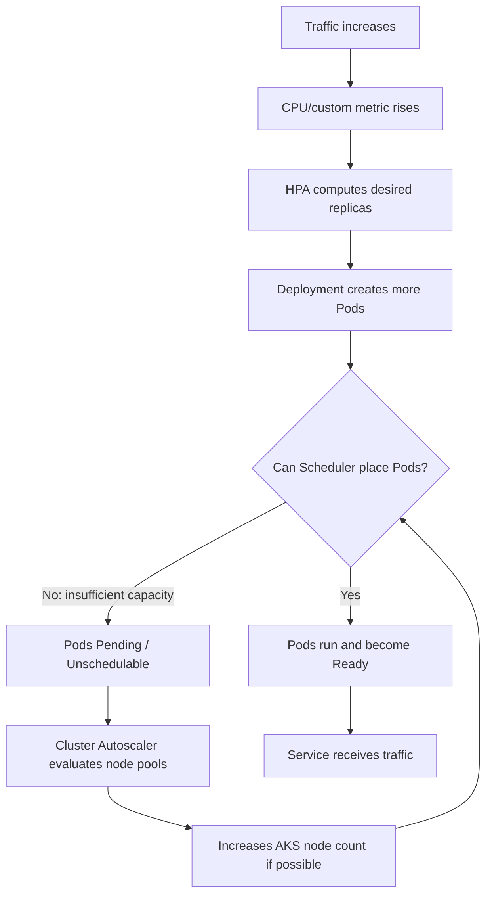
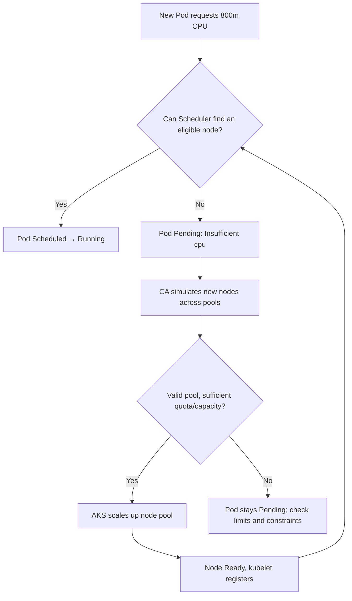
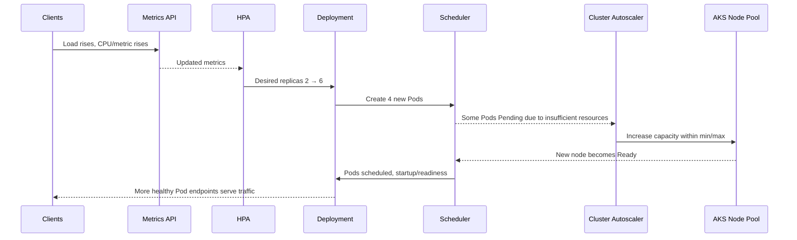
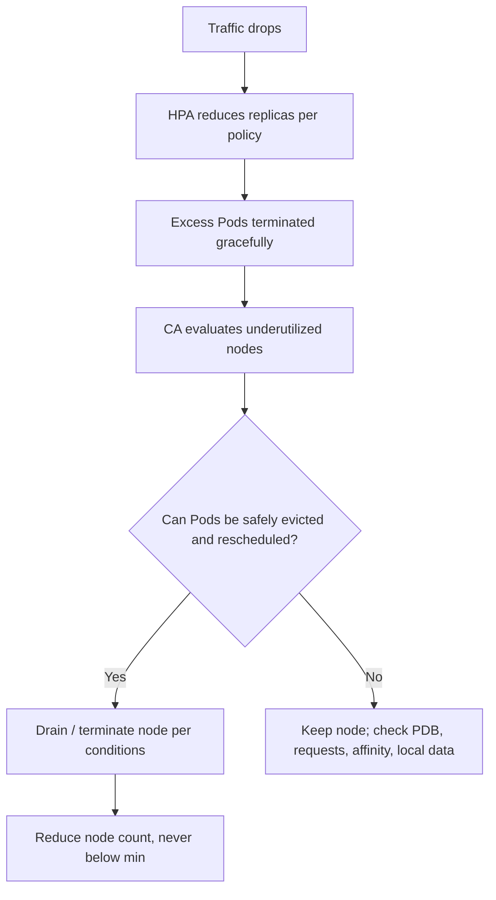
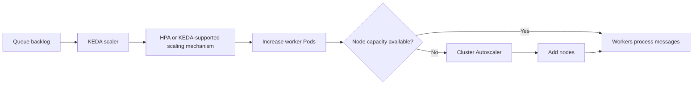
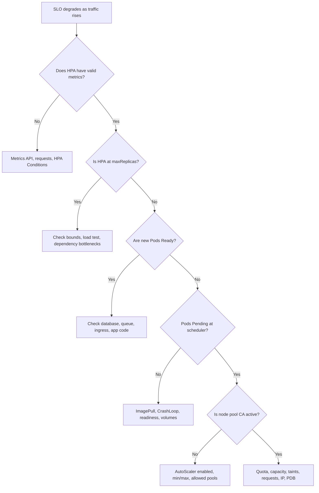

# Horizontal Pod Autoscaler and Cluster Autoscaler

An e-commerce application on **Azure Kubernetes Service (AKS)** may run fine with two Pods at night but need ten Pods when a promotional campaign starts. As Pod counts grow, the Kubernetes cluster may run out of CPU or RAM on existing nodes. At that point, merely adding more Pods does not solve the problem: some Pods will remain in `Pending` state because no node has enough resources to run them. Conversely, only adding more VMs without adjusting application replica counts causes waste.

Two common controllers solve two different parts of the problem:

- **Horizontal Pod Autoscaler (HPA):** scales a workload's **Pod replica count** up or down based on metrics.
- **Cluster Autoscaler (CA):** scales the **node count** up or down in node pools configured for autoscaling, based on Pod scheduling demand and node reclamation eligibility.

This lesson belongs to the **AKS Operations** chapter in the `CLOUD_PROVIDERS_AZURE` module. It is part of the journey to mastering Microsoft Azure: from subscriptions, resource groups, Microsoft Entra ID, and virtual networking to compute, storage, data, deployment, monitoring, security, and cost. The goal is not just knowing how to enable both autoscaling features, but understanding their control signals, interactions, limitations, and safe production operating procedures.

## Learning Objectives

After this lesson, you will be able to:

1. Distinguish HPA from Cluster Autoscaler in terms of **target resource modified**, **metrics/signals**, **latency**, and **scaling actions**.
2. Explain why percentage-based CPU HPA requires declaring **CPU requests**, not just `limits`.
3. Read the desired replica formula and explain the properties of the `HorizontalPodAutoscaler` resource in the `autoscaling/v2` API.
4. Configure HPA for CPU or memory and understand the prerequisites for using custom/external metrics.
5. Enable Cluster Autoscaler on an AKS node pool with `min-count` and `max-count`, and verify its status.
6. Describe the sequence **traffic spike → Pod scale-out → Pending → node addition → Pod Ready**, and the scale-in sequence after load subsides.
7. Analyze scenarios where CA cannot add nodes or cannot scale down due to quotas, affinity, taints, PodDisruptionBudget, local storage, or policies.
8. Design availability, cost boundaries, governance permissions, monitoring, controlled labs, and recovery runbooks.

## 1. Two Autoscaling Loops, Two Different Problems

In Kubernetes, "scaling" is not a single action. HPA manages the replica count of a workload. Cluster Autoscaler manages capacity to run Pods by changing the number of worker nodes.

| Criterion | Horizontal Pod Autoscaler | Cluster Autoscaler on AKS |
|---|---|---|
| Unit modified | **Replicas** of a Deployment/StatefulSet or workload with a supported `scale` subresource | **VM nodes** of AKS node pools with autoscaler enabled |
| Primary signal | Resource metrics, custom metrics, or external metrics as configured | Unschedulable Pods; underutilized nodes eligible for reclamation after considering Pod rescheduling |
| Boundary fields | `minReplicas`, `maxReplicas` | `min-count`, `max-count` per node pool |
| Key prerequisites | Functioning metrics pipeline; CPU requests when scaling on CPU utilization | Scheduler constraints, eligible node pool, sufficient quota/capacity |
| Latency | Metric/controller sync interval, Pod startup, and readiness | Pending Pod evaluation, VM node provisioning, bootstrap, and Pod scheduling |
| Creates new nodes? | **No** | **Yes**, within authorized node pools |
| Changes app replicas? | **Yes** | **Not directly** |
| Increases CPU capacity per Pod? | No; adds more replicas | Not directly; adds nodes with resources for Pods |
| Related concepts | KEDA, custom/external metrics, `behavior` | AKS node pools, VM quota, taints, topology, drain, PDB |

### Collaboration Diagram



**Rule of thumb:** HPA asks *"How many replicas does the application need?"*; CA asks *"How many machines does the cluster need to fit the Pods?"*. CA **does not automatically add nodes just because CPU is at 95%** if there are no Pods that could be scheduled by adding capacity. Likewise, HPA **does not directly request new VMs** when Pods are Pending.

## 2. AKS Node Pools, Pods, and Resource Requests

In AKS:

- **Node pool** is a set of VM nodes configured as supported by AKS, with VM size, OS, labels, taints, autoscaler bounds, and other properties.
- **Node** has `capacity` and `allocatable` resources. The scheduler primarily evaluates remaining **allocatable resources** available for Pods, not the entire physical CPU/RAM of the VM as the Pod budget.
- **Pod** can declare `resources.requests` and `resources.limits` individually per container.
- **Scheduler** places Pods on nodes based on CPU/RAM requests, node selector/affinity, taints/tolerations, topology, volumes, and other conditions.

Example container declaration:

```yaml
resources:
  requests:
    cpu: "250m"
    memory: "256Mi"
  limits:
    cpu: "750m"
    memory: "512Mi"
```

Interpretation:

- `cpu: 250m` equals **0.25 CPU core**; the scheduler uses requests to evaluate Pod placement, and it serves as the denominator for HPA CPU utilization.
- `memory: 256Mi` is the memory request for scheduling; if actual usage exceeds the enforced memory limit, the container may be `OOMKilled`.
- `limits.cpu: 750m` is the runtime/cgroup CPU cap, not the "CPU the Pod asks the scheduler to reserve." Exceeding the CPU limit typically causes throttling.
- Requests lower than actual demand cause the scheduler to overpack Pods onto nodes, risking CPU contention or memory pressure.
- Overly high requests leave Pods Pending and trigger CA to add nodes prematurely, creating unnecessary costs.

### Requests Bridge HPA and Cluster Autoscaler

HPA CPU utilization is based on the ratio:

\[
\text{CPU utilization (\%)} =
\frac{\text{Measured CPU usage}}{\text{CPU request}}\times 100
\]

If a Pod requests `200m` and uses `150m`, its relative utilization is:

\[
\frac{150m}{200m}\times 100 = 75\%.
\]

Meanwhile, the scheduler counts the Pod as needing **200m CPU request** when finding an eligible node. If HPA scales from 2 to 8 Pods, reserved CPU demand by requests increases from `400m` to `1600m` (excluding other containers); CA sees that demand through unschedulable Pods.

**If a container lacks an appropriate CPU request**, CPU-utilization-based HPA may be unable to compute the required metric. Do not just add a CPU limit and expect HPA to work.

## 3. How Does HPA Work?

HPA is a Kubernetes controller that periodically fetches metrics and calculates desired replicas for a target supporting the `scale` subresource, most commonly a `Deployment`.

Basic cycle:

1. Collect metrics from a supported API, such as `metrics.k8s.io` for CPU/memory.
2. Compare the current metric against the HPA target.
3. Compute target replicas using the control formula and tolerance/stabilization thresholds.
4. Apply `minReplicas`/`maxReplicas` bounds and `behavior` policies.
5. Update the target's `spec.replicas` via the `scale` subresource.
6. The Deployment controller creates/deletes Pods; the scheduler and kubelet handle the rest.

### Intuitive Formula

For a single metric:

\[
\text{desiredReplicas} =
\left\lceil
\text{currentReplicas}
\times
\frac{\text{currentMetricValue}}{\text{desiredMetricValue}}
\right\rceil.
\]

For example, with **3 Pods**, each requesting `200m`, measured average CPU is `150m`, equivalent to **75%**. The HPA target is **50%** CPU utilization:

\[
\text{desiredReplicas} = \left\lceil3\times\frac{75}{50}\right\rceil
= \lceil4.5\rceil = 5.
\]

HPA may propose scaling from 3 to 5 replicas. In practice, outcomes are affected by missing metrics, unready Pods, tolerance, stabilization, policies, and configured bounds; the formula above describes the principle and is **not a guarantee that every cycle will scale by that exact number**.

### What Metrics Does HPA Use?

| Metric Type | Example | Requirement |
|---|---|---|
| **Resource metric** | CPU utilization, memory utilization | Metrics API and corresponding requests when using Utilization |
| **Pods custom metric** | Requests/second per Pod | Metrics adapter providing the custom metrics API |
| **Object custom metric** | Request count on an Ingress/object | Custom metrics adapter and proper metric definition |
| **External metric** | Queue depth, pending job count, business event rate | External metrics adapter or integrated controller |

AKS can provide CPU/memory collection via a supported Metrics Server, but you must **verify in practice** rather than assuming `kubectl top` always works. HPA **does not natively read** Application Insights, Azure Monitor, or queues without an appropriate adapter/integration.

## 4. Creating an HPA Using Kubernetes API `autoscaling/v2`

Consider a `sample-web` workload in the `aks-scale-lab` namespace with CPU requests on each container. HPA aims to maintain **60%** average CPU utilization, with a minimum of 2 and maximum of 8 replicas.

```yaml
apiVersion: autoscaling/v2
kind: HorizontalPodAutoscaler
metadata:
  name: sample-web-hpa
  namespace: aks-scale-lab
spec:
  scaleTargetRef:
    apiVersion: apps/v1
    kind: Deployment
    name: sample-web
  minReplicas: 2
  maxReplicas: 8
  metrics:
    - type: Resource
      resource:
        name: cpu
        target:
          type: Utilization
          averageUtilization: 60
  behavior:
    scaleUp:
      stabilizationWindowSeconds: 0
      selectPolicy: Max
      policies:
        - type: Pods
          value: 2
          periodSeconds: 60
        - type: Percent
          value: 100
          periodSeconds: 60
    scaleDown:
      stabilizationWindowSeconds: 300
      selectPolicy: Min
      policies:
        - type: Percent
          value: 50
          periodSeconds: 60
        - type: Pods
          value: 1
          periodSeconds: 60
```

This is an **illustrative Kubernetes API manifest**. Before production use, verify the Kubernetes/AKS version, scaling policy logic, and application SLO requirements.

### Explaining the Manifest

- `scaleTargetRef`: target to scale; name must match an existing Deployment.
- `minReplicas: 2`: lower bound of the autoscaler. This **does not** guarantee two Pods sit on two different nodes/zones.
- `maxReplicas: 8`: upper bound of the autoscaler; even under heavier load, HPA will not exceed 8 unless the policy is changed.
- `Resource/cpu/Utilization`: uses CPU as **% of requests**, not as a fraction of CPU limits.
- `scaleUp`: allows scaling up at the described rate, with `selectPolicy: Max` picking the policy allowing the largest change among configured policies.
- `scaleDown`: retains recommendation history over the stabilization window to avoid shrinking replicas too aggressively; `selectPolicy: Min` picks the policy causing the smallest reduction among configured policies.

**Do not blindly copy a 60% threshold, 2 Pods/60s batching, or 300s downscale to every workload.** The API accepts those numbers, but sound operational settings must be measured against throughput, p95/p99 latency, request duration, startup time, burstiness, and resource limits.

### Why Is `behavior` Needed?

When traffic fluctuates continuously:

```text
At 09:00: 2 replicas, CPU rises
At 09:01: 4 replicas, CPU drops due to added capacity
At 09:02: new requests arrive, CPU rises again
At 09:03: if replicas shrink too quickly, the cluster lacks capacity again
```

HPA can **flap**: scaling up, down, and back up. `behavior.scaleDown.stabilizationWindowSeconds` helps delay scale-in decisions based on past recommendations; it should not be misread as "wait exactly 300 seconds after the last request ends before deleting a Pod."

Default parameters or controller behavior may vary across Kubernetes/AKS versions. When exact values are needed for a cluster, inspect the HPA object and live system.

## 5. Multi-Metric HPA

An application can be overloaded by CPU or by queue backlog. With multiple metrics, HPA calculates proposed replica counts for each metric and uses the **highest recommendation** under supported conditions.

Conceptual example:

| Metric | Proposed Replica Count |
|---|---|
| Average CPU exceeds target | 5 |
| RPS higher than target | 7 |
| Memory utilization near target | 3 |
| Resulting HPA consideration | 7, after applying policies/bounds |

If one metric cannot be retrieved, behavior is not simply ignoring it: **a metric failure can prevent scale-down in certain situations**, while scale-up from a remaining valid metric may still proceed per HPA logic. Therefore, monitor `Conditions` and `Events`, not just the `TARGETS` column.

### CPU Is Not a Good Metric for Every Application

- **CPU-bound Web/API:** CPU utilization can reflect scaling demand fairly accurately.
- **I/O-bound Web/API:** requests wait on database/network, CPU stays low while latency and queues spike; CPU-only HPA may fail to scale out.
- **Queue worker:** queue length, message age, or pending job count may be more appropriate.
- **Applications with bounded connection pools:** adding Pods may not increase throughput if the database runs out of connections.
- **Memory-heavy workloads:** memory utilization may rise and not drop immediately when load subsides, keeping replicas pinned high; evaluate GC/cache characteristics.

A good metric is one that **has a causal relationship with meeting SLOs**, not simply the easiest metric to collect.

## 6. Metrics Server and the HPA Collection Path

CPU/memory resource HPA requires the Kubernetes **Resource Metrics API** to serve data. On an AKS cluster supporting the appropriate metrics pipeline, verify with:

```bash
kubectl get apiservices | grep metrics.k8s.io
kubectl top nodes
kubectl top pods -A
```

On Windows PowerShell, replace `grep` with an appropriate filter or run `kubectl get apiservices` unfiltered.

### Reading the Output

- `kubectl top nodes` shows current CPU/memory from the active metrics pipeline.
- `kubectl top pods` shows Pod consumption.
- These values can **lag slightly** and are not intended to replace long-term monitoring.
- If `Metrics API not available` is returned, inspect Metrics Server/APIService, AKS version, system health, and permissions—do not troubleshoot by deleting the `kube-system` namespace or installing overlapping Metrics Server instances.

**A very common mistake:** omitting `resources.requests.cpu` on a target Pod's containers. In that case, `kubectl top` may show CPU usage, yet HPA cannot compute CPU utilization as a % of request for those Pods.

### Inspecting Existing HPAs

```bash
kubectl -n aks-scale-lab get hpa
kubectl -n aks-scale-lab describe hpa sample-web-hpa
kubectl -n aks-scale-lab get hpa sample-web-hpa -o yaml
```

In `describe`, pay attention to `Metrics`, `Conditions`, `Events`, `AbleToScale`, `ScalingActive`, and `ScalingLimited`. These statuses indicate metric errors, ineligible targets, or replica limits.

## 7. Cluster Autoscaler in AKS: Scaling Node Pools

**Cluster Autoscaler** watches for unschedulable Pods and evaluates whether adding a node to one of the **node pools with autoscaler enabled** allows those Pods to be scheduled. When scaling down, it evaluates underutilized nodes, whether remaining Pods can be moved/evicted, and safety constraints.



### CA Does Not Use Average CPU as Its Primary Scale-Up Signal

Suppose two nodes are both at 95% actual CPU utilization, yet every Pod has already been assigned to a node and no Pod is Pending due to insufficient requests. **CA may not add any nodes**, even though CPU is high.

HPA may increase `replicas`, causing new Pods to request more CPU. Only when the scheduler cannot place those Pods does CA receive the signal to consider scaling out.

### When Can CA Scale Down?

CA periodically checks for nodes that can be reclaimed while keeping Pods running on other nodes under these constraints:

- Pods can be relocated without violating safety and scheduling rules.
- Remaining Pods can find destination nodes with adequate request capacity.
- PodDisruptionBudgets (PDBs) and protection/eviction rules are respected per feature behavior.
- Node utilization thresholds, cooldown periods, and node pool bounds allow scale-down.

Do not treat `low CPU usage` as the sole criterion to assume a node will be removed. A node may host a Pod with high requests, system Pods, local data, or topology constraints blocking reclamation.

## 8. Node Pool Min/Max and Pool Types

In AKS, **Cluster Autoscaler can be enabled per node pool**. Each pool has `min-count` and `max-count` bounds. Values should align with quotas, workloads, and cost strategy.

Example:

| Node Pool | Workload Type | Min Nodes | Max Nodes | Purpose |
|---|---|---:|---:|---|
| `sysnode` | Kubernetes system components | 2 | 3 | Maintains baseline system capacity |
| `webnode` | Web/API using HPA | 2 | 8 | Adds capacity when new Pods need resources |
| `jobsnode` | Workers/ETL | 0 or 1 if supported and permitted by policy | 10 | Elastic scaling for batch demand; consider cold start from 0 |

The numbers in the table are **design examples only**; not every pool type/SKU supports the same bounds. For the **system pool**, always verify minimum node requirements, supportability, and AKS-recommended availability. **Do not set `min-count` to 0 on a system pool just to save money.**

### Why Separate System and User Pools?

- System pools safeguard resources for essential system services.
- User pools can choose VM sizes, OS, taints, and autoscaler bounds tailored to applications.
- GPU, CPU-intensive, or batch workloads can use dedicated pools to manage quotas/costs.
- Protects critical workloads when other workloads scale aggressively.

Scheduling conditions must align: node taints, Pod tolerations, node affinity/selectors, topology spread, and supported VM sizes. **Adding nodes in an ineligible pool will not unblock a Pending Pod.**

## 9. Enabling Cluster Autoscaler on an AKS Node Pool

Example using resource group `rg-aks-scale-lab`, cluster `aks-scale-lab`, and user node pool `webnode`. Only run mutating commands against an authorized sandbox cluster.

### Inspect the Cluster and Node Pools First

```bash
az login --tenant "<tenant-id>"
az account set --subscription "<subscription-id>"

az aks show \
  --resource-group "rg-aks-scale-lab" \
  --name "aks-scale-lab" \
  --query "{name:name,state:provisioningState,version:kubernetesVersion}" \
  --output json

az aks nodepool list \
  --resource-group "rg-aks-scale-lab" \
  --cluster-name "aks-scale-lab" \
  --query "[].{name:name,mode:mode,count:count,vmSize:vmSize,autoscale:enableAutoScaling,min:minCount,max:maxCount}" \
  --output table
```

If the Azure CLI returns different fields or `null` depending on API/version, inspect the full JSON output. Confirm orchestration/feature support, ownership, quotas, and VM SKUs before enabling.

### Enable on an Existing Pool

```bash
az aks nodepool update \
  --resource-group "rg-aks-scale-lab" \
  --cluster-name "aks-scale-lab" \
  --name "webnode" \
  --enable-cluster-autoscaler \
  --min-count 2 \
  --max-count 5
```

This command **modifies the node pool**. In real environments, review the impact on capacity and billing; if the `webnode` pool does not exist yet, the command will fail. Do not arbitrarily pick another production pool just to make the command succeed.

### Create a New User Pool with Autoscaler Enabled

If the lab permits adding a pool:

```bash
az aks nodepool add \
  --resource-group "rg-aks-scale-lab" \
  --cluster-name "aks-scale-lab" \
  --name "webnode" \
  --mode User \
  --node-vm-size "Standard_D2s_v5" \
  --enable-cluster-autoscaler \
  --min-count 2 \
  --max-count 5
```

In practice, run **only one of the two options**: update an existing pool **or** add a new pool. Node pool names must follow AKS naming limits; the VM SKU must have available quota/capacity and match the region. Account for node limits, IP address space, and outbound paths when scaling out.

### Verify After Enabling

```bash
az aks nodepool show \
  --resource-group "rg-aks-scale-lab" \
  --cluster-name "aks-scale-lab" \
  --name "webnode" \
  --query "{name:name,count:count,autoscale:enableAutoScaling,min:minCount,max:maxCount}" \
  --output json

kubectl get nodes -o wide
```

**When CA is managing node count**, avoid routinely overriding `node-count` manually on the same pool. Adjust capacity via bounds and supported APIs per standard procedures; manual scaling and autoscaling can conflict over desired capacity.

### Configuring the Cluster Autoscaler Profile

AKS provides **cluster autoscaler profile** settings to tune behaviors such as scan intervals, scale-down delays, node group balancing, and pool expander policies as supported.

Read the current configuration:

```bash
az aks show \
  --resource-group "rg-aks-scale-lab" \
  --name "aks-scale-lab" \
  --query "autoScalerProfile" \
  --output json
```

Option names may include `scan-interval`, `scale-down-delay-after-add`, `scale-down-unneeded-time`, or `scale-down-utilization-threshold`. **Values, ranges, and update syntax depend on the AKS/CLI version.** When tuning is needed, check `az aks update -h` and documentation for the exact AKS version; do not invent update flags without verifying the schema. The profile typically affects autoscaler behavior cluster-wide, so evaluate its impact across all pools.

## 10. HPA + CA Sequence During a Traffic Surge

Suppose:

- Deployment `checkout-api` starts with **2 Pods**, HPA min=2, max=12.
- Each Pod requests `500m` CPU and can serve a measured amount of load.
- The user node pool has **2 nodes** and can scale up to **5 nodes**.
- Existing nodes have little allocatable CPU remaining; some new Pods cannot be placed immediately.



### Total Latency

From the moment traffic increases until users receive additional capacity, latency can include:

\[
T_{\text{scale-out}} \approx
T_{\text{metrics}} +
T_{\text{HPA}} +
T_{\text{scheduler}} +
T_{\text{node provision}} +
T_{\text{image pull}} +
T_{\text{app ready}}.
\]

This is a **latency breakdown model**, not an SLA formula with fixed additive numbers. Some steps may overlap, and a Pod may land on an existing node without waiting for a new node.

Key operational takeaway: **HPA does not eliminate node startup latency**. If the application must absorb spikes within seconds while provisioning a new node takes longer, maintain **headroom** in the node pool or pre-scale on schedule/forecast and implement queuing/backpressure strategies.

## 11. The Reverse Direction: HPA Scales Down Pods, CA Scales Down Nodes

When the campaign ends, metrics drop and HPA may propose reducing replicas within `behavior.scaleDown` limits. With fewer Pods, some nodes may become underutilized. CA evaluates consolidating Pods onto remaining nodes and reclaiming eligible nodes.



CA is usually **slower than HPA during scale-down** because it requires observation windows and safe workload migration. This is intentional to prevent node flapping or disrupting running applications.

### Why Might a Node Not Be Removed Even When CPU Is Very Low?

- A Pod has a **large CPU request** that prevents it from fitting onto any other node.
- A Pod has **node affinity or selectors** restricting it to a specific set of nodes.
- A Pod faces **taint/toleration constraints** when rescheduling.
- A **PodDisruptionBudget** prevents disrupting another Pod.
- A Pod uses local storage/volumes or has eviction conditions not safely supported.
- The pool is already at `min-count`.
- The node is within a CA cooldown period after a recent scale-up or other event.
- System Pods or high-priority/critical workloads make relocation unsuitable.

**Do not manually delete node VMs inside the node resource group** to "force" a scale-down. Use supported AKS APIs and node pool workflows to avoid configuration drift or data loss.

## 12. Protecting Applications When Autoscalers Change Pods and Nodes

### Readiness, Liveness, and Startup Probes

- **Readiness:** Pods receive traffic only when ready to serve; especially critical for newly created HPA Pods.
- **Liveness:** detects when a process can no longer recover so Kubernetes can act per configuration.
- **Startup:** useful when applications have long boot times so the liveness probe does not kill them prematurely.

HPA can scale replicas quickly, but if the app takes three minutes to boot and readiness remains false, users **do not yet have usable capacity**. Measure **Available Pods**, not just created Pod objects.

### Graceful Termination

When HPA scales down replicas or CA reclaims a node:

1. The controller updates the replica count or the node is scheduled for drain.
2. The Pod receives a termination signal per Kubernetes lifecycle rules.
3. The application should stop accepting new requests/jobs and finish in-flight work or checkpoint state.
4. EndpointSlices/Service membership updates based on readiness/termination state.
5. Kubelet enforces the termination grace period and forcibly terminates if exceeded.

For APIs with long-running requests, configure `terminationGracePeriodSeconds`, `preStop` hooks where appropriate, load balancer/ingress timeouts, and graceful shutdown in application code. Do not treat HPA/CA as automatically handling long-lived connections or uncommitted transactions.

### PodDisruptionBudget (PDB)

A PDB sets constraints on **voluntary disruptions**, such as certain drain/eviction operations; it cannot prevent unexpected failures like physical host loss or container crashes.

Example with 3 replicas requiring at least 2 healthy Pods during voluntary disruptions:

```yaml
apiVersion: policy/v1
kind: PodDisruptionBudget
metadata:
  name: checkout-api-pdb
  namespace: aks-scale-lab
spec:
  minAvailable: 2
  selector:
    matchLabels:
      app: checkout-api
```

Setting a PDB too strictly (e.g., `minAvailable: 3` on a Deployment with only 3 replicas) can block node drains, rolling upgrades, or CA scale-down. Balance availability against operational maintainability.

**A PDB does not replace HPA `minReplicas`.** Both serve different purposes and should be designed alongside the Deployment strategy, topology/zones, and rollout process.

### Distribution Across Nodes and Zones

To avoid HPA creating 5 replicas that all land on the same node or zone, consider:

- `topologySpreadConstraints`.
- Pod anti-affinity where appropriate.
- Actual availability zones and topology labels of AKS node pools.
- Per-zone resource requests and capacity.
- PodDisruptionBudgets and minimum replica counts.

Do not assume two Deployment replicas automatically guarantee availability-zone fault tolerance.

## 13. HPA Lab: Creating a Deployment and CPU HPA

**Goal:** observe HPA scaling replicas up and down using a test workload on an existing AKS cluster, while understanding why metrics and requests matter. This section does not require adding nodes if the cluster already has sufficient capacity.

### Lab Prerequisites

1. An AKS sandbox with `kubectl` permissions in a test namespace and read access to HPA/metrics.
2. Confirmed `kubectl config current-context` points to the intended lab cluster.
3. Working Metrics API (`kubectl top nodes` and `kubectl top pods` succeed without error).
4. Node pool has enough quota/capacity to run at least two test Pods.
5. Budget and cleanup window are defined; workload contains no real data.
6. Registry egress from AKS for the test image is supported.

### Step A. Select Context and Create Namespace

```bash
kubectl config current-context
kubectl cluster-info
kubectl get nodes -o wide
kubectl top nodes

kubectl create namespace aks-scale-lab
```

Do not create the namespace if it already exists and is used by another team: use an isolated namespace per organizational rules.

### Step B. Declare Deployment, Service, and HPA

The following illustrative manifest uses the CPU test container from the Kubernetes HPA example. Public image availability can change; verify registry access, image policies, and pull connectivity before applying. **Do not use this demo image as a production application.**

```yaml
apiVersion: apps/v1
kind: Deployment
metadata:
  name: sample-web
  namespace: aks-scale-lab
spec:
  replicas: 2
  selector:
    matchLabels:
      app: sample-web
  template:
    metadata:
      labels:
        app: sample-web
    spec:
      containers:
        - name: web
          image: registry.k8s.io/hpa-example
          ports:
            - containerPort: 80
          resources:
            requests:
              cpu: "200m"
              memory: "64Mi"
            limits:
              cpu: "500m"
              memory: "128Mi"
          readinessProbe:
            httpGet:
              path: /
              port: 80
            periodSeconds: 10
          livenessProbe:
            httpGet:
              path: /
              port: 80
            initialDelaySeconds: 15
            periodSeconds: 20
---
apiVersion: v1
kind: Service
metadata:
  name: sample-web
  namespace: aks-scale-lab
spec:
  type: ClusterIP
  selector:
    app: sample-web
  ports:
    - port: 80
      targetPort: 80
---
apiVersion: autoscaling/v2
kind: HorizontalPodAutoscaler
metadata:
  name: sample-web-hpa
  namespace: aks-scale-lab
spec:
  scaleTargetRef:
    apiVersion: apps/v1
    kind: Deployment
    name: sample-web
  minReplicas: 2
  maxReplicas: 8
  metrics:
    - type: Resource
      resource:
        name: cpu
        target:
          type: Utilization
          averageUtilization: 60
  behavior:
    scaleUp:
      stabilizationWindowSeconds: 0
    scaleDown:
      stabilizationWindowSeconds: 300
```

Save this content as `aks-hpa-lab.yml` **in your learning environment** if permitted. This lesson only illustrates the commands and does not create that file in the project workspace. Then apply:

```bash
kubectl apply -f aks-hpa-lab.yml

kubectl -n aks-scale-lab rollout status deployment/sample-web
kubectl -n aks-scale-lab get deploy,svc,hpa,pods -o wide
kubectl -n aks-scale-lab describe hpa sample-web-hpa
```

### Step C. Observe Baseline Metrics

```bash
kubectl -n aks-scale-lab top pods
kubectl -n aks-scale-lab get hpa
kubectl -n aks-scale-lab get pods -o wide
```

When the workload has little traffic, HPA generally stays near `minReplicas`. Metrics may take a moment to appear; `TARGETS` temporarily showing `<unknown>` does not mean you should scale replicas manually.

### Step D. Generate Controlled Load

Only inside the **sandbox namespace**, create a Pod sending continuous requests to the ClusterIP Service:

```bash
kubectl -n aks-scale-lab run load-generator \
  --image=busybox:1.36 \
  --restart=Never \
  -- /bin/sh -c 'while true; do wget -q -O- http://sample-web >/dev/null; done'
```

This command sends traffic to the test app, **not** a production endpoint. Actual CPU generated depends on the image, node count, networking, and capacity. If a single load generator does not raise CPU enough, do not launch hundreds of Pods unapproved; only increase load within approved sandbox budgets and limits.

Watch HPA:

```bash
kubectl -n aks-scale-lab get hpa -w
```

In another terminal:

```bash
kubectl -n aks-scale-lab get pods -o wide
kubectl -n aks-scale-lab top pods
kubectl -n aks-scale-lab describe hpa sample-web-hpa
```

**Expected learning outcome:** if CPU utilization exceeds the threshold long enough and metrics are valid, HPA can scale replicas up to its bounds depending on policies and cluster capacity. **There is no guarantee** a single load-generator Pod will push HPA all the way to 8 replicas; measure rather than assume.

### Step E. Stop Load and Observe Scale-Down

```bash
kubectl -n aks-scale-lab delete pod load-generator \
  --ignore-not-found

kubectl -n aks-scale-lab get hpa
kubectl -n aks-scale-lab get pods
```

After load stops, wait for the metrics interval and `scaleDown.stabilizationWindowSeconds`; replica count may not drop immediately. Record timestamps, CPU, current/desired replicas, and scaling reasons from `kubectl describe hpa`.

### Step F. Clean Up the Namespace

When the namespace contains only lab resources you created and you have verified the right context:

```bash
kubectl config current-context
kubectl -n aks-scale-lab get all
kubectl delete namespace aks-scale-lab
```

Do not delete shared namespaces or namespaces containing other people's workloads. Deleting a namespace **does not stop AKS node VMs** and does not eliminate cluster charges.

## 14. Cluster Autoscaler Lab: Observe First, Trigger Pending Pods Second

**Goal:** understand how CA uses `Unschedulable` signals and node pool bounds; there is no need to intentionally overload production just to watch nodes scale up.

### Part A — Non-Destructive Preflight

```bash
kubectl config current-context
kubectl get nodes -o wide
kubectl get pods -A --field-selector=status.phase=Pending

az aks nodepool list \
  --resource-group "rg-aks-scale-lab" \
  --cluster-name "aks-scale-lab" \
  --query "[].{name:name,count:count,autoscaler:enableAutoScaling,min:minCount,max:maxCount}" \
  --output table
```

Compare Kubernetes node count against Azure node pool count. Numbers may temporarily diverge during node bootstrap, drain, or upgrade; do not conclude an error from a single snapshot.

### Part B — Finding the Cause of a Pending Pod

Suppose Pod `cpu-demand-0` reports:

```text
Warning  FailedScheduling  0/2 nodes are available:
2 Insufficient cpu.
```

Inspect:

```bash
kubectl -n aks-scale-lab describe pod cpu-demand-0
kubectl get nodes
kubectl describe node "<node-name>"
```

If the Pod's request can be satisfied by a pool's node type and the pool is below `max-count`, CA can add a node. However, if a Pod requests **16 CPUs** while every pool uses VM types with fewer CPUs, adding more nodes of the same type will not give **a single Pod** 16 CPUs; the scheduler cannot split one Pod across multiple nodes.

### Part C — Controlled Scale-Out Test (Optional in an Approved Sandbox)

If you need to observe CA in action:

1. Select a **user pool** with CA enabled and `max-count` capped within approved budget.
2. Record current node `allocatable` and total `requests`.
3. Create a **separate test workload** with CPU/memory requests large enough that some Pods cannot be scheduled, while each individual Pod still **fits** on one node of an eligible scalable pool.
4. Confirm the event is `FailedScheduling: Insufficient cpu/memory`, not taints/affinity/PVC errors.
5. Watch `az aks nodepool show`, `kubectl get nodes`, and events until the new node becomes `Ready`.
6. Scale down/delete the test workload, wait for CA scale-down under safety rules, and record timings.

**Do not run a script spawning huge numbers of Pods or raise `max-count` to dozens of nodes just for testing.** The goal is understanding the control loop, not generating uncontrolled VM charges.

To avoid conflicting with HPA, use a **separate test Deployment without an HPA** for capacity experiments. If you manually run `kubectl scale deployment/sample-web` while an HPA manages that Deployment, HPA may overwrite your replica count.

### Part D — Results to Record

```text
Cluster: aks-scale-lab
Node pool: webnode
VM size: <supported SKU>
Autoscaler enabled: true/false
Node min/max: <bounds>
Nodes before test: <count>
Pod requests: <CPU/RAM>
Scheduling event: <Pending reason>
Nodes after test: <count>
Node provision time: <measured duration>
Pod Ready time: <measured duration>
Scale-down delay/time: <measured duration>
Issues encountered: <taints/affinity/quota/PDB/...>
Estimated/observed cost: <value>
```

## 15. Limitations That Prevent CA from Adding Nodes

Not every `Pending` Pod is a valid signal to add nodes.

| Scenario | Why Adding Nodes May Not Help | Remediation |
|---|---|---|
| Pod requests more CPU/RAM than any available VM size's allocatable | A single Pod must fit on one node | Choose a larger VM size pool or reduce requests/split workload |
| Pool already reached `max-count` | Autoscaler cannot exceed bounds | Review bounds/quota/budget and update with approval |
| Subscription out of vCPU quota | Azure will not allocate more VMs | Check quota by region/family, pick another region/SKU, or request quota increase |
| Region/zone lacks capacity for the SKU | Nodes cannot be provisioned in that zone/SKU | Evaluate alternative zones and SKUs per architecture |
| Pod has a `nodeSelector` matching no pool | New nodes still lack the required label | Check labels/affinity and pool design |
| Node pool has a taint the Pod does not tolerate | Scheduler will not place the Pod | Review `taints` and `tolerations` |
| Pod requires a zone with no eligible node pool | Simulating nodes in other pools does not satisfy it | Create/adjust supported zone capacity |
| PVC/PV bound to an incompatible zone or storage type | Pod cannot attach the volume on a new node | Check storage class, PV node affinity, and zones |
| Insufficient IPs/subnets/network resources | AKS cannot allocate required node/Pod networking | Plan IP/CNI space, subnets, and NAT/UDR per mode |
| Pod Pending due to image/init after scheduling | Not necessarily a scheduler capacity issue | `describe pod`, registry auth, image pull, startup logs |
| Node pool autoscaler disabled | CA does not manage that pool | Enable on the appropriate pool with bounds |

### Quick Investigation Commands

```bash
kubectl -n "<namespace>" describe pod "<pending-pod>"
kubectl get nodes --show-labels
kubectl describe node "<node-name>"

az aks nodepool show \
  --resource-group "rg-aks-scale-lab" \
  --cluster-name "aks-scale-lab" \
  --name "webnode" \
  --output json
```

Read the Pod's **Events** section. `FailedScheduling: Insufficient cpu` differs from `FailedScheduling: untolerated taint` or `pod has unbound immediate PersistentVolumeClaims`. Increasing `max-count` will not resolve non-capacity errors.

## 16. Limitations That Prevent HPA from Scaling Up or Down

| Symptom | Possible Cause | Check |
|---|---|---|
| HPA `TARGETS: <unknown>/60%` | Metrics API failure or missing CPU request | `kubectl top`, `describe hpa`, `resources.requests` |
| HPA wants more replicas but Deployment stays flat | `ScalingLimited`, API permissions, wrong controller/target, or `maxReplicas` | `kubectl get hpa -o yaml`, `describe`, target name |
| Replicas increase but Pods stay Pending | Cluster lacks node capacity or hits scheduling constraints | `describe pod`, node allocatable, CA node pools |
| CPU very high yet HPA has not scaled | Metrics delay, tolerance, policy, missing metrics, or at max | Inspect HPA Conditions and current metrics |
| Low CPU yet high latency | I/O-bound app or downstream bottleneck | RPS, queues, database metrics, and custom metrics |
| New Pods enter `CrashLoopBackOff` | App/image/config error, overly aggressive probe, inadequate resources | Pod logs/events, readiness/startup probes |
| Load drops yet HPA keeps many replicas | Scale-down stabilization window or another metric remains high | `behavior`, all metrics, HPA history |
| Replicas oscillate up and down rapidly | Noisy metrics, missing stabilization, mis-sized requests | HPA behavior, SLOs, load testing |
| HPA and manual `kubectl scale` conflict | Two controllers writing `spec.replicas` | Stop manual scaling or remove HPA per process |
| HPA scales down and drops active requests | Missing graceful shutdown, readiness, drain/timeout mismatch | App termination logs, ingress/LB timeouts, PDB |

### A Special Note on HPA During New Deployments

When new Pods are not yet Ready or metrics are temporarily missing, HPA does not necessarily treat them identically to healthy Pods with normal metrics. Kubernetes applies safeguards for unready Pods, missing metrics, and tolerances to prevent erratic scaling. Therefore:

- Do not use a single `kubectl top` snapshot as proof that HPA "calculated wrong."
- Check Pod readiness state and elapsed time since Pod creation.
- Check `describe hpa`, events, and controller logs if accessible per permissions.
- Compare state across multiple sync cycles, especially after new deployments or cluster upgrades.

## 17. KEDA, Event-Driven Scaling, and Limits of CPU-Based HPA

**Kubernetes Event-driven Autoscaling (KEDA)** is a project/solution that enables scaling workloads based on events or external metrics such as queue length, Kafka lag, Azure Service Bus messages, and other supported sources.

KEDA often works alongside HPA to drive Deployment replicas from external metrics. Certain KEDA models also support scale-to-zero or creating **ScaledJobs** for independent tasks.

### Why Might a Queue Worker Need KEDA?

Consider a worker application:

```text
Queue has 1000 messages
→ need more workers
→ each worker waits on I/O so CPU is only 20%
→ CPU-only HPA may not scale up
```

With a queue backlog metric, you can define a target ratio such as roughly N messages per worker depending on workload and processing time. Do not assume KEDA can unconditionally scale to 0: check trigger type, scale target, activation threshold, cooldown, and integration support.

### HPA + KEDA + Cluster Autoscaler



For safe operation:

- Do not let **two independent HPAs** manage the same Deployment's `scaleTargetRef` without a supported coordination model.
- Define clear ownership of min/max replicas and metric sources so GitOps/CI/KEDA do not overwrite each other.
- Bound worker concurrency, queue retries, and database connection pools.
- For tasks with external side effects, ensure idempotency/checkpoints to survive scale-in or node failures.
- KEDA does not replace Cluster Autoscaler: after scaling up Pods, you still need enough nodes.

### What Is Node Auto-Provisioning (NAP)?

AKS offers advanced capacity management options such as **Node Auto-Provisioning**, which uses a different node selection and provisioning model than manually defining and enabling CA per pool. Supportability, limits, and coexistence with other autoscaling mechanisms vary by AKS version and cluster configuration.

**Do not enable NAP alongside CA in an unsupported configuration** or treat NAP as another name for HPA. This lesson focuses on **HPA + Cluster Autoscaler on explicitly configured node pools**.

## 18. Tuning for SLOs, Availability, and Workloads

### Do Not Optimize Only Around a CPU Target

Suppose a web API has an SLO of `p95 latency < 250 ms`. When tuning HPA:

- If the CPU target is too high, the application may breach its SLO before HPA adds Pods.
- If the CPU target is too low, the workload may hold excessive replicas and inflate costs.
- If nodes are full, HPA can create Pending Pods, yet usable capacity only arrives after CA provisions nodes and the app becomes Ready.
- If the app boots slowly, keep spare replicas/nodes as a buffer.

**How to pick a target:** run load tests across request rates, measure CPU/RAM, p95/p99 latency, error rate, and startup time; pick a target leaving sufficient headroom to absorb sudden traffic spikes.

### Capacity Sizing Example

Suppose:

- Each Pod requests **500m CPU** and **512Mi** memory.
- Each node can allocate roughly **1500m CPU** to user workloads after subtracting system and overhead reservations.
- HPA can scale up to **12 Pods**.

By CPU requests, 12 Pods require:

\[
12\times 500m = 6000m = 6\ \text{CPU cores}.
\]

Ignoring other constraints, the minimum nodes based on CPU alone is:

\[
\left\lceil\frac{6000m}{1500m}\right\rceil = 4\ \text{nodes}.
\]

**This is a rough capacity calculation, not the exact scheduler/CA algorithm.** In reality, you must also factor in memory allocatable, system Pod CPU requests, node selectors, topology, DaemonSets, Pod overhead, headroom, and other workloads.

If the node pool `max=3`, then HPA `max=12` exceeds intended cluster capacity: some Pods will never run under this sizing. You must **design HPA `maxReplicas` and CA `max-count` together**, not treat them as two independent numbers.

### Keep Headroom or Maximize Savings?

| Strategy | Pros | Trade-offs |
|---|---|---|
| High min nodes and moderate min Pods | Fast burst absorption, less wait for VM boot | Higher baseline cost |
| Low min nodes, scale purely on load | Saves money when idle | Bursts must wait for Pod/Node startup |
| Scheduled pre-scaling before known events | Lower latency for promotions/batch windows | Requires forecasting and bounded automation |
| Queue buffering/backpressure | Absorbs spikes and smooths worker demand | Adds queue latency, requires retries/idempotency |
| Dedicated pools (CPU/GPU/batch) | Right-sized hardware per workload, blast radius isolation | Operational complexity, fragmented capacity cost |

For real-time interactive services, **headroom aligned with SLOs** usually outweighs absolute cost minimization. For batch processing with flexible deadlines, slower scale-out may be acceptable to reduce spend.

## 19. Monitoring and Production Autoscaling Runbooks

### Essential Dashboard Panels

| Scope | Metrics or Signals |
|---|---|
| HPA | Current/desired replicas, current/target metrics, scaling conditions/events |
| Deployments | Desired/Ready/Available replicas, rollout state, Pod restarts |
| Scheduler | Pending Pods, `FailedScheduling` reasons, scheduling latency |
| Nodes | Ready/NotReady, allocatable vs requests, actual CPU/memory usage |
| Cluster Autoscaler | Node count per pool, min/max, scale-up/down events, provisioning failures |
| Application | RPS, p95/p99 latency, HTTP 5xx, transaction failures |
| Queue | Pending jobs, oldest message age, retries/dead-letter |
| Azure | VM quota, SKU capacity, VNet IP utilization, node pool events/Activity Log |
| Costs | Node VM-hours, disks, LB/egress, NAT/Firewall, logs |

Azure Monitor/Container insights, managed Prometheus/Grafana, or equivalent observability stacks can collect signals depending on deployment. **Do not assume every autoscaler metric exists out of the box or shares the same name across AKS versions**; verify data sources and permissions.

### Alerts to Implement

1. `HPA desiredReplicas == maxReplicas` sustained while application SLO degrades.
2. HPA unable to read metrics or `ScalingActive=False`.
3. Pods `Pending/Unschedulable` exceeding a duration threshold.
4. Node pool hitting `max-count` or Azure reporting quota/capacity errors.
5. Nodes frequently `NotReady`, or node provisioning/scale-up timeouts.
6. Abnormal rapid fluctuations in node count or Pod count (flapping).
7. PDB blocking node drains or upgrades for too long.
8. HTTP error rate/latency rising despite replica increases.
9. Queue age growing even while worker capacity is scaling out.
10. VM node costs exceeding budget/forecast.

### Runbook: Traffic Increases Yet Application Remains Slow



Do not respond to incidents by cranking both `maxReplicas` and `max-count` up without limit. Doing so can mask a database bottleneck and trigger runaway costs.

### Runbook: Load Drops Yet Nodes Do Not Scale Down

1. Check whether HPA has reduced Pods or if its stabilization window is still active.
2. Check Pod requests and whether Pods can actually consolidate onto other nodes.
3. Inspect PDBs, taints, affinity, local storage, and system workloads.
4. Confirm the node pool has not hit `min-count` and the scale-down profile is valid.
5. Check whether deployments/DaemonSets/Jobs are keeping the node busy.
6. Observe across multiple cycles and read supported AKS events/diagnostics.
7. Only tune the autoscaler profile with evidence; avoid forcibly deleting nodes.

## 20. Autoscaling, Application Updates, and GitOps

### Rolling Upgrades Can Interact with HPA

When deploying a new image, the Deployment creates new-version Pods and scales down old Pods per `strategy.rollingUpdate`. Meanwhile, HPA may adjust replicas concurrently. Prepare:

- `maxSurge` and `maxUnavailable` suited to current capacity.
- HPA `minReplicas` high enough to maintain minimum availability.
- Node pool headroom for **surge Pods**, or ensure CA can add nodes in time.
- Stable readiness/startup probes so scaling is not driven by incomplete metrics.
- Sensible PDBs that do not lock all evictions/drains.
- Per-version monitoring to catch regressions and roll back.

A new image bumping CPU request from `200m` to `800m` can leave many Pods Pending mid-rollout even when traffic is unchanged. Always review **requests/limits and HPA metric targets** alongside image releases.

### GitOps and Field Ownership

A GitOps controller or deployment pipeline may routinely apply a manifest containing:

```yaml
spec:
  replicas: 2
```

Meanwhile, HPA also mutates `spec.replicas`. If the GitOps tool forces replicas back to 2, HPA and GitOps will fight each other and the application will not scale reliably.

Practical solution: establish that **HPA owns the replica count** for that workload; configure GitOps/IaC to stop overwriting `spec.replicas` using your tool's supported ignore/diff mechanism. Still manage HPA min/max, Deployment templates, images, and resources in reviewed source of truth.

### CA and Node Pool Updates

Upgrading node images or Kubernetes versions can trigger drains/evictions and change available node counts. Before maintenance:

- Check quota/capacity for node surge.
- Ensure PDBs and app readiness permit voluntary disruptions.
- Review CA bounds, topology/zones, and capacity needs.
- Monitor `Pending`, `NotReady`, image pull errors, and disruptions.
- Maintain a recovery plan if a node pool upgrade fails.

HPA/CA do not replace cluster upgrade planning or backup/DR strategies.

## 21. Security, Permissions, and Cost Governance

### Administrative Permissions

To manage autoscaling safely, separate responsibilities:

| Role | Needed Actions | Recommended Scope |
|---|---|---|
| Application team | Configure HPA, requests/limits, Deployments in namespaces | Namespace-scoped Kubernetes RBAC |
| Platform team | Enable CA and adjust node pool bounds | Azure RBAC on AKS/node pools per role |
| Operations team | Read metrics/logs, monitor health, handle incidents | Read access and controlled operational actions |
| CI/CD/GitOps | Apply approved manifests | Short-lived identities with least privilege |
| Finance team | View costs, budgets, alerts, and capacity plans | Read-only at Cost Management scope |

**Kubernetes RBAC and Azure RBAC are two separate permission layers.** Permission to create an HPA in a namespace does not grant permission to raise `max-count` on an AKS node pool; conversely, node pool permissions do not automatically grant Deployment access.

### Protecting Workloads

- Use trusted images, pin versions/digests, scan for vulnerabilities, and patch node images on schedule.
- Do not use `cluster-admin` or admin kubeconfigs for routine autoscaling scripts.
- Use managed identity/Workload Identity for applications accessing Azure resources.
- Secure metrics adapters and external metrics; tampered metrics can trigger abnormal scaling.
- Constrain namespaces with `ResourceQuota`, `LimitRange`, and appropriate admission/policies.
- Never store credentials in HPA/Deployment manifests, args, or load generators.
- Gate RBAC over min/max changes since those parameters affect cost and availability.

### Cost Impact

| Component | Impact on Bill |
|---|---|
| Node pool `min-count` | Baseline compute capacity kept running continuously |
| Node pool `max-count` | Maximum node-count ceiling *for that pool*, excluding other services |
| VM size and zone | Compute pricing and allocation availability |
| Managed disks | OS/data disks and storage may continue incurring charges per lifecycle |
| Network egress/Load Balancer/NAT | Traffic or networking service charges per pricing tier |
| Monitoring/logging | Data ingestion, retention, and metrics/alerts per service |
| Pod replicas | Do not directly add VM charges if room exists, but can trigger CA to add nodes |
| KEDA/metrics pipeline | Cost of running adapters, cluster resources, and monitoring stack |

**HPA `maxReplicas` is not an Azure budget cap.** A Pod with a huge CPU request can force adding an expensive node; multiple node pools or external services also continue accruing charges. Combine **Azure Cost Management budgets/alerts**, quotas, admission policies, and capacity planning.

## 22. Production HPA + CA Deployment Checklist

### Before Enabling

1. [ ] Confirmed cluster, subscription, region, node pool ownership, and permissions.
2. [ ] Measured Pod CPU/RAM usage, resource requests, and throughput under realistic load.
3. [ ] Verified HPA target metric has valid data and correlates with SLOs.
4. [ ] Ensured `minReplicas` meets availability needs and `maxReplicas` fits capacity/budget.
5. [ ] Verified app has readiness/startup/liveness probes and graceful shutdown.
6. [ ] Verified Services, ingress, and databases support expected concurrency.
7. [ ] Enabled CA on user node pools with min/max aligned to VM size/quotas.
8. [ ] Confirmed networking, IP space, subnets, registry egress, and DNS support node scale-out.
9. [ ] Verified node taints/Pod tolerations/affinity/topology allow scheduler placement.
10. [ ] Verified PDBs do not unnecessarily block node drains/upgrades.
11. [ ] Configured alerts for Pending Pods, scale limits, SLOs, and cost anomalies.
12. [ ] Prepared a rollback plan for HPA/nodepool config and tested it in sandbox.

### After Enabling

1. [ ] Observed a controlled load increase and measured end-to-end latency.
2. [ ] Verified HPA creates new Pods and the scheduler places them on expected nodes/pools.
3. [ ] Verified CA adds nodes **when Pods are Pending due to supported capacity shortfalls**.
4. [ ] Tested load reduction and observed HPA stabilization and safe node scale-down.
5. [ ] Cross-checked request rate, latency, errors, queues, and database health.
6. [ ] Reviewed incremental node/disk/monitoring costs and updated budgets.
7. [ ] Documented runbooks, owners, config versions, and test results in operational procedures.

## 23. Real-World Scenario: Peak-Hour API and Nightly Queue Worker

An ordering system runs two workloads on AKS:

**Web/API:** customers visit the site mainly from 08:00 to 22:00. SLOs require `p95 latency < 250 ms` and very low HTTP 5xx rates. API CPU scales with RPS; each Pod requests `400m` and serves steadily at a measured load level.

**Queue worker:** overnight there are 20,000 messages to process, each taking 1–3 seconds; workers mostly wait on I/O rather than CPU. You do not want dozens of worker Pods idling when the queue is empty.

### Recommended Design

| Workload | Application Autoscaling | Node Autoscaling | Rationale |
|---|---|---|---|
| Web/API | CPU HPA (or validated RPS/custom metric), min sized to protect SLO | User pool `webnode` with CA enabled | CPU/RPS rises → HPA adds Pods; CA provisions nodes if needed |
| Queue worker | KEDA/external metrics based on queue depth/age, with concurrency cap | User pool `jobsnode` with appropriate CA | Low CPU does not mean an empty queue; scale on queue metrics |
| System services | Do not manage like arbitrary user apps | System pool min sized for capacity/HA | Protects Kubernetes system workloads |

### Scenarios to Rehearse

1. **Web traffic spike:** HPA increases replicas; verify Ready Pods increase fast enough before latency breaches the SLO.
2. **Node pool capacity exhaustion:** HPA hits `maxReplicas` or Pods stay Pending; check CA bounds/quotas instead of infinitely raising replicas.
3. **Node loss:** Pods are recreated, Service drops unhealthy backends, PDB/affinity minimize disruption within design limits.
4. **Slow database:** Pod CPU may or may not rise; adding Pods will not fix it. Inspect DB pools/transactions.
5. **Large queue backlog:** workers scale out on external metrics and do not duplicate message processing during scale-in.
6. **End of batch run:** HPA/KEDA scales down Pods; CA scales down nodes safely without losing checkpoints.

### Operational Decision Record

```text
Workload: checkout-api
HPA metric: CPU utilization + RPS/SLO verification
CPU request per Pod: 400m
HPA min/max: <measured via load test>
HPA behavior: <scale-up, scale-down stabilization>
AKS node pool: webnode
Node VM size: <SKU>
CA min/max: <budget, quota, availability>
Topology: <zones, anti-affinity/spread>
PDB: <minAvailable or maxUnavailable as needed>
SLO: <p95 latency, HTTP 5xx, availability>
Capacity headroom: <value>
Scale-out delay measured: <duration>
Scale-down delay measured: <duration>
Alerts: <metric failures, Pending, node max, cost>
Owner / rollback plan: <owner / procedure>
```

## 24. Common Misconceptions

**"HPA increases node count when CPU is high."** False. HPA adjusts **Pod replicas**; CA is responsible for adding **nodes** when scheduling capacity is lacking.

**"Cluster Autoscaler adds a node as soon as node CPU hits 90%."** Not under CA's core signal. It primarily watches **unschedulable Pods**, simulates whether a new node allows scheduling them, and reclaims eligible underutilized nodes.

**"Declaring only CPU limits is enough for HPA CPU utilization to work."** False. CPU utilization relies on CPU **requests** and a functioning metrics pipeline.

**"Pending Pods always mean you need more nodes."** False. Pods can be Pending due to affinity/taints/PVCs/config issues that adding ordinary nodes will not solve.

**"Increasing `max-count` guarantees all Pods will run."** False. Node pools are still constrained by quotas, SKUs, network/IP limits, and Pod scheduling constraints.

**"HPA `maxReplicas` 10 means the node pool must have 10 nodes."** False. Each node can host multiple Pods depending on resource requests and scheduling; conversely, a single Pod cannot span multiple nodes.

**"Increasing Pod replicas immediately adds traffic capacity."** False. Pods still must be scheduled, pull images, start up, pass readiness checks, and join Service endpoints.

**"Scaling down immediately when CPU drops is always optimal."** Not necessarily. Scaling down too quickly causes flapping, dropped connections, or latency spikes when traffic rebounds.

**"A very strict PodDisruptionBudget is always better."** False. Overly strict PDBs can block voluntary disruptions, node scale-down, and upgrades.

**"Cluster Autoscaler automatically fixes database bottlenecks."** False. Adding Pods/nodes will not raise throughput if the bottleneck is a fixed DB, queue, or connection pool.

**"KEDA and CPU HPA are unrelated."** KEDA can coordinate with or create an HPA driving the scale target from external metrics. Avoid two controllers writing conflicting replica counts.

**"Adding lots of replicas via `kubectl scale` to test CA is always safe."** Not if the Deployment is managed by HPA or lacks a budget. Use an isolated test workload, cap node max, and monitor costs.

**"Node scale-in does not affect long-running jobs."** False. Without checkpoints/idempotency, drains/evictions can lose progress or cause duplicate processing.

**"Node Auto-Provisioning and Cluster Autoscaler are two names for the same feature."** No. They are related capacity management mechanisms with different support models that must be evaluated separately.

## 25. Self-Check Questions

**Question 1.** How do HPA and Cluster Autoscaler differ in scaling unit?

**Answer:** HPA changes a workload's Pod replicas; CA changes the number of AKS worker nodes in node pools with autoscaling enabled.

**Question 2.** Can CPU-utilization HPA work properly if containers omit CPU requests?

**Answer:** No. HPA needs CPU metrics and corresponding requests to compute utilization percentages; CPU limits alone do not replace requests.

**Question 3.** Three Pods each use 150m CPU against a 200m request, with an HPA CPU target of 50%. Using the basic formula, what is the desired replica count?

**Answer:** CPU utilization is 75%; `ceil(3 × 75/50) = 5` replicas before applying policies, tolerances, metric readiness, and bounds.

**Question 4.** Why does CA not add a node when node CPU is at 95% if there are no Pending Pods?

**Answer:** CA scale-up is primarily driven by Pods that cannot be scheduled due to insufficient eligible capacity, not high CPU usage alone.

**Question 5.** HPA wants 8 Pods, the cluster only schedules 5, and 3 Pods remain Pending with `Insufficient cpu`. Which mechanism can add nodes?

**Answer:** Cluster Autoscaler, provided an eligible node pool has it enabled, is below `max-count`, and has quota/capacity available; otherwise, address those constraints.

**Question 6.** A Pod requests 16 CPUs, while every node in the pool has only 4 allocatable CPUs. Will adding four nodes allow that single Pod to run?

**Answer:** No. A single Pod must fit on a single node; you need a pool with a larger VM size or must change the workload structure/requests.

**Question 7.** When HPA evaluates multiple metrics, which metric drives the proposed replica count?

**Answer:** Under HPA mechanics, the highest recommendation among valid metrics is considered, alongside error handling, scaling behaviors, and min/max bounds.

**Question 8.** Why should you configure `scaleDown.stabilizationWindowSeconds`?

**Answer:** To scale down replicas more gradually and stably when metrics fluctuate, avoiding continuous scale-up/scale-down flapping and SLO degradation.

**Question 9.** When might CA fail to scale down even though actual CPU usage is low?

**Answer:** When the pool is at `min-count`, or due to Pod requests/placement, PDBs, affinity/taints, local data, system Pods, or safety conditions/cooldown timers.

**Question 10.** If someone runs `kubectl scale` to change replicas on a Deployment managed by HPA, what can happen?

**Answer:** HPA may overwrite `spec.replicas` based on metrics; avoid having multiple controllers/operators owning the replica count.

**Question 11.** Why is Pod `Ready` more important than Pod `Running` when measuring scale-out effectiveness?

**Answer:** A Running Pod may still be warming up or unable to serve traffic; readiness determines whether it joins Service endpoints in Kubernetes.

**Question 12.** A queue worker waits on I/O, keeping CPU low while backlog grows. What type of metric should you consider?

**Answer:** Queue depth/message age or an appropriate external metric; you can use KEDA or HPA external metrics while CA provisions nodes if Pods become Pending.

**Question 13.** Why are PDBs needed when CA scales down?

**Answer:** PDBs restrict voluntary disruptions to maintain a minimum number of healthy Pods during node drains/evictions; choose bounds flexible enough for operations.

**Question 14.** HPA creates 6 new Pods, yet no new VMs appear after several cycles. What are the two main lines of investigation?

**Answer:** (1) Are the Pods actually Pending due to insufficient scheduler resources? (2) Is CA enabled on the eligible pool, below min/max, within quota/capacity, and matching taints/affinity/VM size?

**Question 15.** Why shouldn't you simply maximize CA `max-count` to guarantee availability?

**Answer:** High max limits can create uncontrolled costs and do not solve non-compute bottlenecks; size according to SLOs, quotas, limits, and budget.

**Question 16.** Does doubling Pod replicas guarantee doubling request throughput?

**Answer:** No. Throughput also depends on databases, queues, caches, load balancing, networking, locks/serial sections, startup, and overhead.

**Question 17.** A worker Pod processing a long job is evicted during CA scale-down. What mechanisms are needed?

**Answer:** Graceful shutdown, durable checkpoints, idempotency, queue visibility/lock management, retries, and dead-letter handling so work is neither lost nor duplicated.

**Question 18.** What should you measure to prove autoscaling works effectively in production?

**Answer:** Current/desired replicas, Pod Ready counts, Pending duration, node count/min/max, node provisioning time, application latency/errors/throughput, backlog, scale-down behavior, and cost.

## Summary

**Horizontal Pod Autoscaler** and **Cluster Autoscaler** both participate in scaling AKS, yet **they do not do the same job**. HPA controls application replica counts based on metrics and `autoscaling/v2` bounds; Cluster Autoscaler adjusts node counts in node pools when the scheduler lacks eligible capacity or when nodes can be safely reclaimed. Between them, **resource requests**, Pod scheduling, and readiness are the decisive links.

A well-designed elastic AKS architecture selects metrics that truly reflect SLOs, declares accurate CPU/memory requests, aligns HPA min/max with node pool capacity, enables CA with bounds respecting quotas and budgets, protects Pods via readiness, graceful termination, and PDBs, and monitors the full chain from **traffic → replicas → nodes → application success**. Combined with identity, networking, logging, rollback plans, and cost controls, autoscaling keeps applications resilient, safe, and sustainable under changing load.
