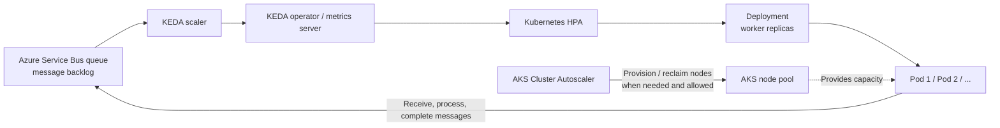
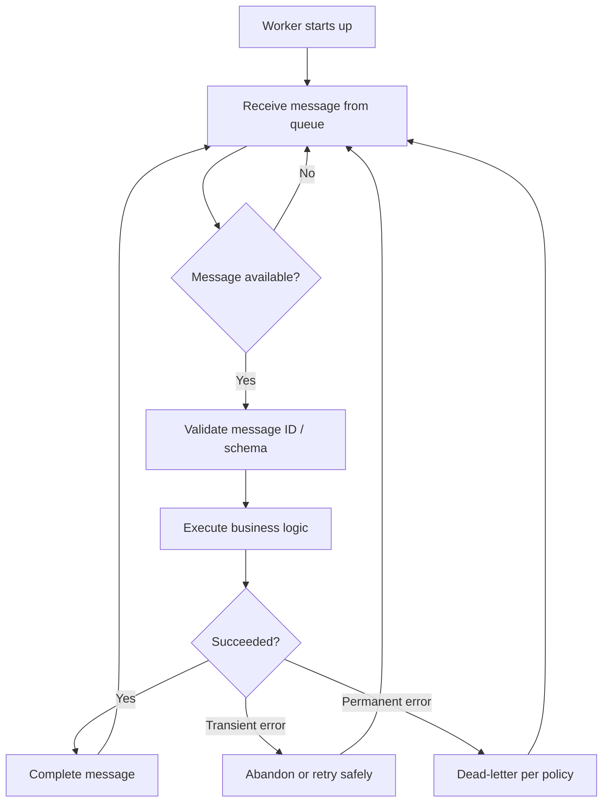
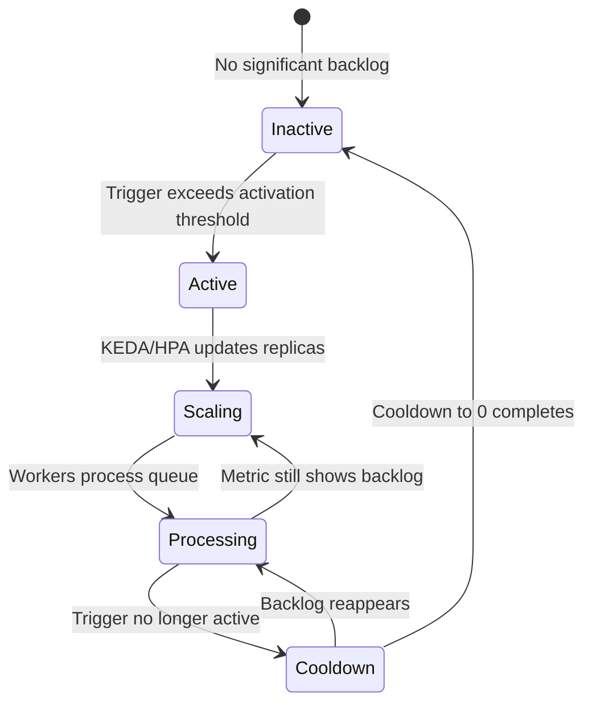
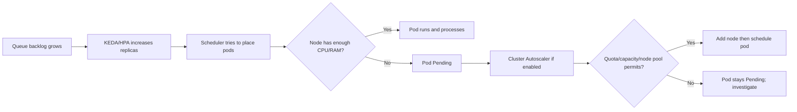

# Event-Driven AKS Workload Scaling with KEDA

An order processing service running on Azure Kubernetes Service (AKS) might receive zero messages for hours and then suddenly need to process thousands of messages in a few minutes. Keeping 20 pods running constantly to wait for work means paying for idle capacity. Conversely, keeping only a single fixed pod causes the queue to grow rapidly during peak hours, leading to slow processing or missed business deadlines. **KEDA (Kubernetes Event-driven Autoscaling)** adjusts workload replica counts based on event sources such as queue depth, message backlog, or other metrics.

In the **CLOUD_PROVIDERS_AZURE** module, you explore Azure from subscriptions, resource groups, and Microsoft Entra ID to virtual networking, compute, storage, data, monitoring, security, and cost control for application architectures. This lesson belongs to the **AKS Operations** chapter and focuses on integrating KEDA with AKS, creating a **ScaledObject** to scale a Deployment from backlog, using **ScaledJob** when appropriate, securing connections to event sources, and monitoring scaling behavior in production.

## 1. Learning Objectives

After this lesson, you will be able to:

- Explain the need for **event-driven autoscaling** and KEDA components in AKS.
- Distinguish **KEDA**, **Horizontal Pod Autoscaler (HPA)**, and **Cluster Autoscaler**.
- Identify `ScaledObject`, `ScaledJob`, `TriggerAuthentication`, and scaler resources.
- Enable or verify the KEDA add-on on AKS and confirm Custom Resource Definitions (CRDs).
- Deploy a workload processing an Azure Service Bus queue with a `ScaledObject` and `messageCount` threshold.
- Explain scaling from 0 to N replicas, polling intervals, cooldown periods, and replica limits.
- Choose an authentication approach for scalers, prioritizing Microsoft Entra Workload Identity where supported.
- Diagnose cases where the queue grows without pods scaling, pods scale without available nodes, or workers process duplicate messages.
- Measure backlog, wait time, throughput, resources, and cost to tune scaling policies.

## 2. When Should You Scale on Events?

Kubernetes HPA typically scales replicas up or down based on CPU, memory, or custom/external metrics. However, **low CPU does not mean the application has no work left**: a worker might be waiting on a queue with zero running pods, in which case there is no meaningful CPU usage to trigger the first pod.

KEDA is especially useful for workloads with an **external backlog** and work that can be distributed across multiple independent workers:

| Workload | Signal Source | Scaling Goal |
|---|---|---|
| Order processing worker | Message count in an Azure Service Bus queue | Add workers when backlog grows |
| Image processing pipeline | RabbitMQ or compatible queue | Increase image processing workers |
| Event stream consumer | Kafka lag or suitable scaler | Narrow lag between producer and consumer |
| Batch processing jobs | Queue/event source with independent work items | Create Kubernetes Jobs on demand |
| Custom-metric workloads | Prometheus or supported scaler | Scale based on business metrics |

**Not every workload should scale down to 0 replicas.** Request-serving APIs with low-latency SLOs may require at least one running pod or a dedicated activation mechanism. For queue workers, scale-to-zero often makes sense if the broker durably holds the backlog and cold-start delay is acceptable.

## 3. What Is KEDA? Roles of the Scaler, Operator, and Metrics Server

**KEDA** is an autoscaling component for Kubernetes. It reads signals from an **event source** via a **scaler**, then coordinates workload replica counts or Job creation. On AKS, you can use the **AKS-managed KEDA add-on** on supported clusters/versions instead of manually installing every component.

Logical components:

1. **Event source:** Azure Service Bus, Kafka, Redis, Prometheus, or another service supported by a scaler.
2. **Scaler:** integration module that fetches metrics from the source, such as queue message count.
3. **KEDA operator:** watches `ScaledObject`/`ScaledJob` resources, manages active/inactive state, and coordinates corresponding scaling resources.
4. **KEDA metrics server:** exposes external metrics to the Kubernetes HPA per KEDA-supported mechanisms.
5. **HPA:** adjusts replicas from active baseline to desired target when using a `ScaledObject`.
6. **Kubernetes scheduler and AKS nodes:** actually schedule pods onto nodes with sufficient resources.



Simplified diagram. KEDA directly coordinates **0 ↔ 1** transitions based on `ScaledObject` activation/cooldown; once replicas are greater than 0, KEDA typically delegates 1-to-N scaling to HPA using external metrics within configured bounds. **KEDA does not create VMs/nodes itself**: if the cluster lacks capacity, you need an appropriate node pool and Cluster Autoscaler strategy.

### Comparing the Three Mechanisms

| Component | Target Scaled | Decision Input | Key Takeaway |
|---|---|---|---|
| **KEDA** | Deployments or supported scalable workloads, and Kubernetes Jobs via `ScaledJob` | Queue backlog, broker metrics, Prometheus, etc. | Supports activation and scale-to-zero in appropriate models |
| **HPA** | Replica count of scalable Kubernetes workloads | CPU, memory, custom/external metrics | Does not directly create new AKS nodes |
| **Cluster Autoscaler** | Number of VMs/nodes in a node pool | Pending pods due to insufficient resources and scale-down eligibility | Takes time to provision VMs; constrained by quotas, max nodes, and capacity |

Do not confuse **more pods** with **more nodes**. For instance, if KEDA tries to scale from 2 to 12 pods while the node pool is out of CPU/memory, new pods may remain `Pending` until nodes are added or resources are adjusted.

## 4. ScaledObject, ScaledJob, and TriggerAuthentication

### ScaledObject

`ScaledObject` is a Custom Resource that manages scaling an existing workload, usually a **Deployment**. It targets the workload via `scaleTargetRef` and specifies **triggers**, min/max replicas, and polling/cooldown rules.

Conceptual example:

```yaml
apiVersion: keda.sh/v1alpha1
kind: ScaledObject
metadata:
  name: queue-worker-scaler
spec:
  scaleTargetRef:
    name: queue-worker
  minReplicaCount: 0
  maxReplicaCount: 10
  pollingInterval: 30
  cooldownPeriod: 300
  triggers:
    - type: azure-servicebus
      metadata:
        queueName: jobs
        messageCount: "5"
      authenticationRef:
        name: queue-trigger-auth
```

This is an **incomplete snippet** because it still needs a Deployment, queue source, authentication config, and real broker. The hands-on sections below present the combined resources.

### ScaledJob

`ScaledJob` is used when each unit of work fits a **Kubernetes Job that runs to completion and exits**. Unlike `ScaledObject`, which adjusts replicas of a long-running Deployment, ScaledJob spawns Jobs from event sources using supported strategies. You must manage max concurrent jobs, execution duration, TTL/cleanup, and duplicate message handling.

### TriggerAuthentication and ClusterTriggerAuthentication

`TriggerAuthentication` defines how a scaler obtains credentials or identities to read metrics from an event source, typically scoped to the same namespace as the ScaledObject/ScaledJob. `ClusterTriggerAuthentication` is cluster-scoped and should only be used after evaluating broader credential sharing.

Common options:

- Referencing a Kubernetes Secret (convenient for demos, but requires strict key lifecycle and access control).
- Microsoft Entra Workload Identity or identity methods supported by the KEDA scaler/version.
- Referencing external secret stores per supported features and architecture.

**TriggerAuthentication only grants KEDA access to read metrics**; worker pods consuming messages usually need **separate** permissions/authentication to perform queue operations. Avoid granting a scaler send/delete permissions if it only needs to read backlog counts.

## 5. Scaling Parameters to Understand Before Deploying

| Parameter | Meaning | Notes |
|---|---|---|
| `scaleTargetRef.name` | Name of target Deployment or scalable workload | Must match exact name and namespace |
| `pollingInterval` | How often KEDA polls the trigger source, in seconds | Lower values increase broker API call frequency |
| `cooldownPeriod` | Delay before KEDA scales down to 0 in supported models | Does not govern all HPA scale-down behavior above 0 |
| `minReplicaCount` | Minimum replica count | `0` fits scale-to-zero scenarios |
| `maxReplicaCount` | Workload replica ceiling | Must align with node capacity and backend limits |
| `messageCount` | Target backlog per replica for the Azure Service Bus scaler | Not a hard cap on maximum messages allowed in the queue |
| `triggers` | One or more metric sources triggering scaling | KEDA/HPA combine metrics per scaler behavior |
| `authenticationRef` | Reference to authentication config for the trigger | Verify namespace, secrets, and principals |

### From Queue Length to Replica Count

Suppose each pod should handle roughly **5 messages** of backlog, and the queue currently holds **42 messages**. A simple estimate when active is:

\[
\text{Target replicas} \approx
\min(\text{maxReplicaCount}, \lceil 42/5\rceil)
= \min(10,9)=9
\]

This is a **directional estimate**, not a promise that Kubernetes will immediately launch exactly 9 pods: HPA also factors in sync intervals, metric freshness, stabilization windows, scaling policies, min/max bounds, and pod readiness.

An important caveat: **queue length measures waiting items, not processing time**. If one message takes 30 seconds in workload A but 20 minutes in workload B, the same `messageCount=5` threshold will not yield the same queue drain time.

For long-running workers or strict deadlines, estimate:

\[
\text{Preliminary worker count} \approx
\left\lceil
\frac{\text{Backlog}\times\text{Average processing time}}
{\text{Target drain deadline}}
\right\rceil
\]

For example, 120 messages averaging 2 minutes per message, needing to drain within 20 minutes: roughly **12 workers** ideally if each worker processes sequentially, excluding scale-out delay, retries, uneven payloads, and per-worker concurrency. Benchmark before finalizing thresholds.

## 6. Preparing AKS and Enabling the KEDA Add-On

This hands-on assumes an existing AKS cluster with at least one node pool, `kubectl` access, and an Azure Service Bus queue for testing. Do not create production resources solely for practice; AKS-modifying commands require administrator approval.

| Component | Illustrative Value | Role |
|---|---|---|
| Resource group | `rg-aks-lab` | Hosts AKS |
| AKS cluster | `aks-processing-lab` | Runs workloads |
| Kubernetes namespace | `batch-demo` | Isolates lab resources |
| Azure Service Bus namespace | `sb-processing-lab` | Queue host |
| Queue | `work-items` | Task queue |
| Deployment | `queue-worker` | Worker fetching and processing messages |
| ScaledObject | `queue-worker-scaler` | Controls replica count |

### Step 1. Connect to the Right Subscription/Cluster

```bash
az login
az account set --subscription "<subscription-id>"

az aks get-credentials \
  --resource-group "rg-aks-lab" \
  --name "aks-processing-lab"

kubectl config current-context
kubectl get nodes
```

Before running any write operations, verify your kubeconfig context to avoid accidentally modifying a production cluster. Having Azure RBAC read permissions on AKS does not automatically grant `kubectl apply` inside Kubernetes; you need Kubernetes RBAC or Azure RBAC for Kubernetes Authorization aligned with the cluster configuration.

### Step 2. Check and Enable the Managed KEDA Add-On

Where supported by AKS/region/version, Azure CLI can enable the KEDA add-on:

```bash
# Check current KEDA add-on configuration
az aks show \
  --resource-group "rg-aks-lab" \
  --name "aks-processing-lab" \
  --query "workloadAutoScalerProfile.keda.enabled" \
  --output tsv

# The following command updates the cluster; run only when approved
az aks update \
  --resource-group "rg-aks-lab" \
  --name "aks-processing-lab" \
  --enable-keda
```

Do not stack multiple KEDA operators/metrics servers on the same cluster without an explicit design. If the cluster already runs self-managed KEDA via Helm or GitOps, evaluate the migration/upgrade path before enabling the managed add-on.

### Step 3. Verify CRDs and Runtime Components

```bash
kubectl get crds | grep keda.sh
kubectl get crd scaledobjects.keda.sh
kubectl get crd scaledjobs.keda.sh
kubectl get crd triggerauthentications.keda.sh

# Locate KEDA-related deployments without assuming a fixed namespace
kubectl get deployments --all-namespaces | grep keda
```

`grep` works in Linux/macOS shells or Azure Cloud Shell; on PowerShell use `Select-String`. Once KEDA is deployed successfully, resource types such as ScaledObject and TriggerAuthentication must appear in the Kubernetes API. Operator deployment names or namespaces can vary depending on installation method and add-on version.

## 7. Preparing the Azure Service Bus Queue and Access Identities

The KEDA Azure Service Bus scaler reads queue state to compute replica counts. **The worker inside the pod is the program that actually receives, processes, and completes messages**. Both activities require appropriate permissions.

Before practicing, ensure the Azure Service Bus namespace and `work-items` queue exist and have retention/lock timeout/dead-letter configured as needed. In an approved lab environment, you can create them via CLI:

```bash
# Run only when the namespace already exists; replace with real names
az servicebus queue create \
  --resource-group "rg-messaging-lab" \
  --namespace-name "sb-processing-lab" \
  --name "work-items"

# Inspect queue properties for reference
az servicebus queue show \
  --resource-group "rg-messaging-lab" \
  --namespace-name "sb-processing-lab" \
  --name "work-items" \
  --output json
```

Verify queue details against the real application: queue name, connection string or identity, message lock settings, retries, and dead-lettering. Azure Service Bus management CLI commands require management-plane permissions; permission to create a queue is separate from the **Data Receiver** permission needed by workers to receive messages.

### Choosing an Authentication Model

| Option | Pros | Considerations |
|---|---|---|
| **Microsoft Entra Workload Identity** | Avoids handing long-lived shared secrets to the scaler when supported | Requires AKS OIDC/workload identity, backend RBAC roles, compatible TriggerAuthentication config, and supported scaler version |
| **Secret containing Service Bus connection string** | Easy to test in a lab | Carries credential exposure risk; requires strict Secret storage, rotation, and RBAC |
| **Supported Key Vault/secret integration** | Reduces manual credential management | Must verify how KEDA/AKS and the app retrieve credentials at runtime |

In production, prefer **Microsoft Entra Workload Identity** when supported by your KEDA and scaler versions. Explicitly identify which identity KEDA uses to query metrics and assign the required role at the proper Service Bus scope—do not assume the worker pod's identity is automatically used by the scaler. Workers can use a separate identity to read/complete messages; apply least privilege on each side.

**The manifests below use a Secret solely to illustrate the integration flow.** Never commit real connection strings to Git. In environments using Workload Identity, replace the `TriggerAuthentication` configuration with the `podIdentity`/identity mechanism supported by your KEDA version and verify identity/ServiceAccount ownership rules.

## 8. Worker Deployment: The Application Must Actually Process Messages

A ScaledObject does not perform business logic. You need a worker container running a loop that receives, processes, completes, or abandons messages according to broker policies.

Simplified flow:



The worker software must include:

- A real Azure Service Bus consumer using a supported SDK or equivalent client code.
- Valid connection/identity, reachable network endpoints, exception handling, and sensible backoff.
- **Idempotency** when receiving duplicate messages.
- Per-worker concurrency limits aligned with CPU/RAM and downstream backends.
- **Graceful shutdown** to finish in-flight work or release message locks when Kubernetes sends SIGTERM.

Do not use a dummy container running `sleep infinity` to evaluate real throughput: pods may scale up while backlog remains untouched, causing replicas to grow without draining work.

### Sample Deployment

The sample below assumes a worker image that processes Service Bus via `SERVICEBUS_CONNECTION` and `SERVICEBUS_QUEUE` environment variables. Image names are **placeholders**—replace them with an image pullable from an authorized registry.

```yaml
apiVersion: apps/v1
kind: Deployment
metadata:
  name: queue-worker
  namespace: batch-demo
spec:
  replicas: 0
  selector:
    matchLabels:
      app: queue-worker
  template:
    metadata:
      labels:
        app: queue-worker
    spec:
      terminationGracePeriodSeconds: 60
      containers:
        - name: worker
          image: "<your-registry>/queue-worker:1.0.0"
          env:
            - name: SERVICEBUS_QUEUE
              value: "work-items"
            - name: SERVICEBUS_CONNECTION
              valueFrom:
                secretKeyRef:
                  name: servicebus-auth
                  key: connectionString
          resources:
            requests:
              cpu: "250m"
              memory: "256Mi"
            limits:
              cpu: "1000m"
              memory: "512Mi"
```

`replicas: 0` is only the initial state; once the ScaledObject is attached, **do not let multiple controllers manage the replica count simultaneously**. Do not configure a separate HPA targeting the same Deployment while KEDA already manages the ScaledObject's HPA.

These requests/limits are a starting point for benchmarking. Too little RAM can trigger `OOMKilled`; too little CPU can stall backlog processing even as pod count grows. Workers still need proper logging, metrics, health handling, and shutdown logic.

## 9. Secret and TriggerAuthentication for the Lab

**Do not place real connection strings in committed YAML.** In an authorized lab, you can create a Kubernetes Secret from a file stored securely on an admin workstation. The file should contain **only a valid connection string** with least-privilege queue permissions:

```bash
kubectl create namespace batch-demo

# Placeholder: file provided by an authorized secret management process.
# Avoid putting connection strings directly in shell history.
kubectl create secret generic servicebus-auth \
  --namespace batch-demo \
  --from-file=connectionString="/secure/path/servicebus-connection-string.txt"
```

The path above is a placeholder; do not create key files if organizational policy prohibits it. Kubernetes Secrets are not automatically encrypted or fully isolated under every cluster configuration; apply Kubernetes RBAC, appropriate encryption at rest, and strict access controls over who can read Secrets or run pods mounting them. A credential used only to read queue status does not need namespace-wide Manage permissions.

`TriggerAuthentication` for KEDA to use the Secret:

```yaml
apiVersion: keda.sh/v1alpha1
kind: TriggerAuthentication
metadata:
  name: servicebus-trigger-auth
  namespace: batch-demo
spec:
  secretTargetRef:
    - parameter: connection
      name: servicebus-auth
      key: connectionString
```

This YAML only configures the **scaler**. In the example, the worker Deployment also reads the Secret to receive messages, though in production you can separate those two identities/credentials for least privilege and security isolation.

## 10. Creating a ScaledObject for Azure Service Bus Backlog

For the `work-items` queue, targeting roughly 5 messages of backlog per replica and up to 10 replicas, create the following ScaledObject:

```yaml
apiVersion: keda.sh/v1alpha1
kind: ScaledObject
metadata:
  name: queue-worker-scaler
  namespace: batch-demo
spec:
  scaleTargetRef:
    name: queue-worker
  pollingInterval: 30
  cooldownPeriod: 300
  minReplicaCount: 0
  maxReplicaCount: 10
  triggers:
    - type: azure-servicebus
      metadata:
        queueName: work-items
        messageCount: "5"
      authenticationRef:
        name: servicebus-trigger-auth
```

**Understand each line accurately:**

1. `scaleTargetRef.name` binds KEDA to the `queue-worker` Deployment **in the same namespace**.
2. `pollingInterval: 30` asks KEDA to poll metrics roughly every 30 seconds under normal conditions. It does not guarantee replicas will scale every exact 30 seconds.
3. `cooldownPeriod: 300` is used by KEDA when deciding to scale back to inactive/0, not the entire HPA scale-down algorithm between 1 and N.
4. `minReplicaCount: 0` enables scale-to-zero if the trigger, ScaledObject, and other conditions allow it.
5. `maxReplicaCount: 10` caps KEDA/HPA at 10 replicas for the workload unless another controller is misconfigured to conflict.
6. `messageCount: "5"` is the target backlog per replica used by the **Azure Service Bus scaler**; it does not mean every message spawns one pod.
7. `authenticationRef` points to the created TriggerAuthentication capable of reading queue metrics.

**If your namespace uses Workload Identity**, do not apply the Secret manifest verbatim. Adapt TriggerAuthentication, ServiceAccount/identity, and Azure role assignments per the documentation for your deployed KEDA/AKS version, then validate against a lab queue.

### Apply and Verify

Save the separate manifests as `worker.yaml`, `trigger-auth.yaml`, and `scaledobject.yaml` on your machine, then run:

```bash
kubectl apply -f worker.yaml
kubectl apply -f trigger-auth.yaml
kubectl apply -f scaledobject.yaml

kubectl get deployment queue-worker -n batch-demo
kubectl get scaledobject queue-worker-scaler -n batch-demo
kubectl describe scaledobject queue-worker-scaler -n batch-demo
kubectl get hpa -n batch-demo
```

The ScaledObject should show conditions such as **Ready/Active** matching the event source state. If the ScaledObject is not Ready, check `kubectl describe`, Kubernetes events, and operator logs before adding pods or raising max replicas.

### Test With and Without Load

1. When the queue is empty, observe `queue-worker` scaling down to 0 after cooldown and applicable HPA/KEDA conditions.
2. Push several **test messages** into the queue using an authorized tool/application; give each message a unique ID and avoid personal data.
3. Monitor queue backlog in the Azure portal / Service Bus metrics alongside HPA, ScaledObject, and Deployment replicas.
4. Watch new pods transition through Pending/ContainerCreating/Running; verify the node pool has enough resources.
5. Wait for workers to process and complete messages; watch the backlog drop.
6. Once the queue returns to inactive, observe replicas scaling down per policy and confirm no messages remain stuck.

Observation commands:

```bash
kubectl get scaledobjects -n batch-demo
kubectl get hpa -n batch-demo
kubectl get deployment queue-worker -n batch-demo
kubectl get pods -n batch-demo -l app=queue-worker
kubectl describe deployment queue-worker -n batch-demo

# Check worker logs if pods are running
kubectl logs deployment/queue-worker -n batch-demo --tail=100
```

**Do not conclude scaling failed just because the Deployment did not scale within a few seconds.** KEDA needs polling/activation time; HPA has sync and stabilization windows; the Kubernetes scheduler may wait on Cluster Autoscaler for a node; and image pulls plus SDK initialization also take time.

## 11. Scaling from 0 and How It Differs from HPA

The **0-replica** state is a key KEDA capability for queue workers. In a standard CPU-based HPA setup, zero pods means no CPU metrics exist to bring pods back up. KEDA can poll the **external event source** and activate the workload from 0.

Logical flow:



In practice, keep these concepts distinct:

- **Activation threshold** determines when the source is considered active; some scalers support a dedicated activation parameter.
- **Scaling target** such as `messageCount` governs desired replicas while active.
- **Polling interval** affects detection latency when the workload is inactive.
- **HPA policies/stabilization** govern scale-up/scale-down speed between 1 and N.
- **Cooldown** governs when KEDA scales back to 0 after triggers become inactive.

Do not collapse all of these into a single "scale time" variable. When SLOs require very fast queue turnaround, measure the full end-to-end time from **message enqueued → metric updated → pod ready → message received**.

### minReplicaCount Trade-Offs

| Mode | Pros | Trade-Off |
|---|---|---|
| `minReplicaCount: 0` | Reduces idle compute; fits delay-tolerant queues | Cold start, polling delay, node capacity dependency |
| `minReplicaCount: 1` | Always keeps at least one replica running per policy | Pays baseline compute, but a worker is immediately ready |
| Min greater than 1 | Lower burst latency, maintains reserve capacity | Higher idle cost |

If the AKS node pool must still keep a minimum number of nodes running, scaling pods to 0 **does not drop your AKS compute bill to 0**. Costs also include node pools, system nodes, disks, networking, the broker, and monitoring.

## 12. Combining with Cluster Autoscaler and Node Pools

Suppose KEDA requests 10 worker pods, each requesting **250m CPU and 256Mi memory**. In theory, the requests of those 10 workers alone require 2.5 vCPUs and 2,560 MiB of RAM, excluding system pods, kubelet, DaemonSets, runtime overhead, and other workloads. If the current node pool only has 1 vCPU free, several pods will stay Pending.

**Cluster Autoscaler** (when properly configured on AKS) can add nodes within min/max bounds, quotas, and capacity. However, that operation is typically slower than HPA increasing replicas because Azure must provision VMs, boot the nodes, join them to the cluster, and pull container images.



For reliable operation:

1. Set worker **requests/limits** from benchmarks; requests are what the scheduler and autoscaler use to place pods.
2. Enable/configure Cluster Autoscaler per AKS policy if nodes must scale elastically; understand node pool min/max bounds.
3. Verify regional/SKU vCPU quotas and VM provisioning capacity, availability zones, image pulls, and networking.
4. Optimize startup time: slim images, proper startup probes, and nearby registry caching when feasible.
5. Align `maxReplicaCount` with CPU/memory ceilings, database connection limits, and backend throughput.
6. Monitor **Pending pods**, node provisioning duration, ready workers, and queue age instead of watching HPA desired replicas alone.

### Infrastructure Observation Commands

```bash
kubectl get nodes -o wide
kubectl get pods -n batch-demo -l app=queue-worker -o wide
kubectl get events -n batch-demo --sort-by=.metadata.creationTimestamp
kubectl describe pod "<pending-pod-name>" -n batch-demo

# Inspect node pool status at the Azure layer
az aks nodepool list \
  --resource-group "rg-aks-lab" \
  --cluster-name "aks-processing-lab" \
  --output table
```

Messages like `Insufficient cpu` or `Insufficient memory` indicate a scheduling capacity issue, **not necessarily a KEDA bug**. If capacity is blocked beyond autoscaler bounds, update requests, node pools, or quotas through approved processes.

## 13. When to Use ScaledJob Instead of ScaledObject?

With **Deployment + ScaledObject**, worker pods are long-lived and process **many messages** in a loop. With **ScaledJob**, KEDA spawns **Kubernetes Jobs** to handle finite units of work, where each Job exits upon completion.

| Criterion | ScaledObject | ScaledJob |
|---|---|---|
| Workload | Deployment / supported scalable workload | Kubernetes Jobs |
| Lifecycle | Worker pods continuously pull multiple messages | Pod/Job runs until finished |
| Scaling unit | Workload replica count | Number of Jobs created from trigger/strategy |
| Observability | HPA, Deployment replicas, logs | Job status, succeeded/failed, history, and cleanup |
| Best fit | Long-lived queue consumers, continuous processing | Finite tasks with distinct start–finish lifecycles |

### Minimal ScaledJob for Structural Reference

```yaml
apiVersion: keda.sh/v1alpha1
kind: ScaledJob
metadata:
  name: report-scaledjob
  namespace: batch-demo
spec:
  jobTargetRef:
    parallelism: 1
    completions: 1
    backoffLimit: 2
    template:
      spec:
        restartPolicy: Never
        containers:
          - name: worker
            image: "<your-registry>/one-shot-worker:1.0.0"
            resources:
              requests:
                cpu: "250m"
                memory: "256Mi"
  pollingInterval: 30
  maxReplicaCount: 10
  triggers:
    - type: azure-servicebus
      metadata:
        queueName: work-items
        messageCount: "1"
      authenticationRef:
        name: servicebus-trigger-auth
```

**Structural example only—it will not execute meaningfully without a real worker image.** Use ScaledJob only when the process genuinely fetches and completes a unit of work and exits with an appropriate exit code. ScaledJob does not inject message payloads into your program automatically. If a job exits 0 without consuming a message, the backlog never drops and KEDA may keep spawning jobs.

Inspect with:

```bash
kubectl get scaledjobs -n batch-demo
kubectl get jobs -n batch-demo
kubectl get pods -n batch-demo
kubectl describe scaledjob report-scaledjob -n batch-demo
```

To prevent runaway costs and oversized Job/log retention, configure max concurrent Jobs, `backoffLimit`, completion deadlines, `ttlSecondsAfterFinished` where appropriate, and failure/dead-letter handling. Do not run **both a ScaledObject and a ScaledJob against the same queue** unintentionally in a lab: competing consumers make measurements confusing.

## 14. Security: Workload Identity, RBAC, and Secrets

KEDA needs authentication to Azure Service Bus merely to read backlog metrics. Workers need authentication to receive and complete messages. **These two permission streams should not be merged indiscriminately.**

### Workload Identity in AKS

**Microsoft Entra Workload Identity** lets Kubernetes workloads use OIDC/federated identity to obtain Azure service tokens without embedding long-lived client secrets. To use it with KEDA, verify:

1. AKS has **OIDC issuer** and **workload identity** enabled per supported configuration.
2. A managed identity or application principal exists with appropriate Azure Service Bus permissions.
3. A **federated identity credential** is configured for the ServiceAccount using that identity.
4. `TriggerAuthentication`/scaler is configured with the **exact pod identity type** supported by your KEDA version.
5. The KEDA operator, metrics path, and worker can use identities under the add-on's supported ownership model.
6. Pod/sidecar/operator networking can reach Microsoft Entra and Service Bus endpoints per your architecture.

Do not blindly copy a Deployment's identity and assume the KEDA operator automatically uses it when reading metrics. Whether the identity is assumed by the operator or workload, and the exact parameters required, depend on **your KEDA version, AKS managed add-on, and scaler**; test directly.

### Azure and Kubernetes Permissions

| Principal | Required Permissions | Avoid Over-Privileging |
|---|---|---|
| KEDA scaler identity | Read queue/metric info required by the scaler; usually appropriate broker data access | Does not need subscription-wide admin |
| Worker identity | Receive, complete/abandon/dead-letter messages scoped to the queue | Do not grant full Service Bus namespace rights unnecessarily |
| Producer identity | Send messages to the queue | Does not need receive/delete rights |
| Manifest deployer | Kubernetes RBAC to create Deployments, ScaledObjects, TriggerAuthentications, and Secrets in the namespace | Do not use `cluster-admin` for every pipeline |
| AKS operator | Read logs/events and perform approved admin actions | Do not share admin kubeconfigs broadly |

For Azure Service Bus, roles like **Azure Service Bus Data Sender** and **Azure Service Bus Data Receiver** have distinct scopes. Permissions needed by the scaler to inspect queue runtime properties should also be verified against the specific backend/SDK and principal. Grant permissions at the narrowest supported scope and **test all operations end-to-end** rather than checking role names alone.

### Secrets and Access Control

- Never commit Service Bus connection strings to YAML, Docker images, or CI logs.
- Use Azure Key Vault / Secret Store CSI or approved secret management tools where appropriate.
- Restrict who can read Kubernetes Secrets or launch pods mounting those Secrets.
- Enable appropriate encryption at rest for Kubernetes secrets/etcd per cluster architecture.
- Maintain a rotation schedule; test both workers and scalers during credential rotation so autoscaling does not break.
- Verify NetworkPolicies, Azure networking, private endpoints, and DNS if traffic isolation is required.

**A Kubernetes namespace is not an absolute security boundary** if ClusterRoles or broad permissions allow cross-namespace access. When sharing AKS across multiple teams, evaluate Kubernetes RBAC, Azure RBAC, identities, and networking under a real multi-tenant model.

## 15. Reliability: Message Locks, Retries, and Idempotency

KEDA can scale the right number of pods, yet **it does not guarantee exactly-once message processing**. Reliability must be engineered into the worker and broker.

### At-Least-Once Processing

With Azure Service Bus **Peek-Lock**, a worker receives a message and holds a lock for a bounded duration. If the worker crashes, is terminated by Kubernetes, or fails to complete the message before expiry, the lock expires and the message is redelivered.

A robust processing flow:

1. Read **MessageId** and business keys; validate schema and check whether it was already processed.
2. Execute work using a stable idempotency key to prevent duplicate records or double charges.
3. Durably commit business results before completing the message.
4. Complete the message on success; abandon/defer/dead-letter per policy on failure.
5. For long tasks, use **lock renewal** compatible with the SDK and broker limits.

### Scale-In and Graceful Termination

When backlog drops, KEDA/HPA scales down pods. Kubernetes sends a termination signal to the container; if the worker is killed mid-flight, the message may be redelivered.

- Trap SIGTERM and stop **accepting new messages** before shutting down.
- Finish in-flight work if feasible within `terminationGracePeriodSeconds`.
- If unable to finish in time, release/abandon cleanly, preserve checkpoints, and allow safe retry.
- Do not assume Kubernetes will wait indefinitely for a 30-minute message.
- For heavy batch jobs, consider splitting messages or using ScaledJob with checkpointing.

### Fast Scaling Overloading Backends

If workers connect to a database capped at 50 connections, scaling to 100 pods with 10 connections each can overwhelm the database. Beyond `maxReplicaCount`, constrain per-worker concurrency, connection pools, external API rate limits, retry/backoff, and concurrent locked messages.

**True optimization increases business throughput, not just pod count.** Measure completed message throughput, wait times, and error rates when tuning replica bounds.

## 16. Monitoring KEDA and Operational Metrics

A dashboard should cover the **queue**, **KEDA/HPA**, **pods/nodes**, and **business outcomes**.

| Layer | Metrics/Logs to Track | Meaning |
|---|---|---|
| Azure Service Bus | Active message count, dead-letter count, message age/processing lag if instrumented | True backlog and business failures |
| KEDA ScaledObject | Ready, Active, scaler errors, polling/metric failures | Whether KEDA can observe the queue |
| Kubernetes HPA | Current/desired replicas, external metrics, conditions | Whether scaling decisions are computed |
| Deployment/pods | Available replicas, Pending, CrashLoopBackOff, OOMKilled, restart count | Whether workers are actually running |
| AKS node pool | Node count, allocatable CPU/memory, autoscaler events | Whether the cluster has sufficient capacity |
| Application | Messages completed/s, p95 processing time, error/retry rate, lock lost | Actual processing effectiveness |
| Cost | Node-hours, broker usage, monitoring ingestion, egress | Cost per completed message |

### Quick Observation Commands

```bash
# KEDA objects and activation conditions
kubectl get scaledobjects -n batch-demo
kubectl describe scaledobject queue-worker-scaler -n batch-demo

# HPA and Deployment
kubectl get hpa -n batch-demo -o wide
kubectl describe hpa -n batch-demo
kubectl get deployment queue-worker -n batch-demo

# Pods, nodes, and events
kubectl get pods -n batch-demo -o wide
kubectl get nodes
kubectl get events -n batch-demo --sort-by=.metadata.creationTimestamp

# Locate KEDA operator/metrics server in this cluster
kubectl get deployments --all-namespaces | grep keda
```

Read logs from the exact deployment/namespace discovered in the last step instead of guessing names:

```bash
kubectl logs deployment/<keda-operator-deployment> \
  --namespace <keda-namespace> \
  --tail=100
```

Values inside `<...>` are placeholders—do not run them literally. The KEDA add-on emits logs/metrics via AKS and Azure Monitor mechanisms depending on configuration; enable appropriate diagnostics and retention. Avoid logging connection strings or sensitive payloads during troubleshooting.

### Recommended Alerts

- Queue backlog or message age persistently exceeding SLO thresholds.
- ScaledObject not Ready or scaler authentication/metric errors.
- HPA desired replicas hitting max while backlog continues growing.
- Pending pods due to insufficient node quota/capacity, image pull, or resources.
- Increasing worker restarts, `OOMKilled`, retry rates, or dead-letter counts.
- Actual queue drain time exceeding business SLAs.

## 17. Common Errors and Remediation Table

| Symptom | Possible Cause | Check |
|---|---|---|
| `kubectl get scaledobjects` says resource unrecognized | KEDA CRDs not installed / add-on unhealthy | Check `az aks show`, CRDs, operator, and AKS version |
| ScaledObject not Ready | Bad trigger metadata, missing TriggerAuthentication, invalid Secret/identity | `kubectl describe scaledobject`, operator logs, namespace/scopes |
| Queue has messages yet Deployment stays at 0 replicas | Scaler cannot see backlog, wrong `queueName`, permissions, polling/activation, or broken component | Check queue metrics, connection, scaler errors, and Active condition |
| HPA desired replicas increase yet pods do not run | Node pool out of resources, quotas, taints/affinity, image pull | `kubectl describe pod`, events, Cluster Autoscaler, requests |
| Replicas increase yet backlog does not drop | Workers not consuming/completing, downstream failures, lock timeouts | Worker logs, Service Bus active/dead-letter counts, business logic |
| Queue empty yet pods do not drop to 0 immediately | Cooldown, HPA stabilization, metric still active, or min replicas | `cooldownPeriod`, HPA behavior, ScaledObject status |
| Workers restarting continuously | `OOMKilled`, crash, missing secret, misconfigured probe | `kubectl describe pod`, `kubectl logs --previous` |
| Scaler previously worked, now fails with 401/403 | Expired/rotated credentials, lost identity role, private endpoint/DNS issue | TriggerAuth, Service Bus RBAC, operator logs, networking |
| Messages processed twice | Lock expired, pod scale-in, retries, or failed message completion | MessageId, idempotency store, lock renewal, and shutdown |
| High node CPU, messages processed slower | Too many pods/concurrency, backend rate limits | CPU throttling, requests/limits, DB/API latency |
| Slow scale-out | Polling, HPA, cold image pull, slow Cluster Autoscaler provisioning | Break down timing: activation → pod ready → message complete |
| HPA behaves erratically with multiple ScaledObjects | Conflicting controllers/metrics or duplicate target | Check HPA owner, target ref, and scaling controllers |

### Recommended Investigation Workflow

1. **Is there real work?** Check queue name and active message count in Service Bus.
2. **Does KEDA see the signal?** Check `ScaledObject Ready/Active`, TriggerAuthentication, and scaler logs.
3. **How many replicas does HPA want?** Read desired/current replicas and conditions.
4. **Can Kubernetes run the pods?** Check scheduling, image pull, requests/limits, and node availability.
5. **Can workers process messages?** Read application logs, completion/dead-letter outcomes, and exceptions.
6. **Does scaling meet SLOs?** Measure queue drain time, then tune thresholds, concurrency, and node capacity.

Do not rush to fix issues by setting `maxReplicaCount: 1000` or granting subscription-wide Owner. A scaler lacking queue read rights, buggy worker code, or an out-of-quota node pool will not be fixed by raising replica limits.

## 18. Real-World Scenario: Burst Image Processing

An e-commerce platform pushes each new product image into a Service Bus queue. Each worker downloads the image from Azure Blob Storage, resizes it into three resolutions, writes outputs, and completes the message. Normally there are 0–5 messages/minute; at the start of a sale, 2,000 messages can arrive in minutes.

**Recommended Design:**

1. Producer uploads the image to Blob Storage, then sends a message containing **blob ID** and **job ID**, never embedding the full image in the queue payload.
2. AKS Deployment `image-worker` uses an identity permitted to read input Blobs, write output Blobs, and receive/complete Service Bus messages.
3. ScaledObject uses the Azure Service Bus scaler with `minReplicaCount: 0` if cold-start latency is acceptable and `maxReplicaCount` aligned with budget.
4. Workers process at a benchmarked concurrency; databases, Blob Storage, and backends stay within connection limits.
5. Cluster Autoscaler manages a suitable node pool to supply CPU/RAM when pods go Pending.
6. Every message carries a stable ID, and outputs use versioned names or conditional writes to prevent duplicates.
7. Track backlog, age, processing time, completions/s, dead-letters, and cost per image.
8. After the sale, when the queue returns to inactive and cooldown expires, workers scale down; verify the node pool scales down per policy.

### Preliminary Capacity Calculation

Suppose each worker processes an average of **4 images/minute**, sudden backlog is **1,200 images**, and you want to drain it within **30 minutes**:

\[
\text{Required workers}\approx \left\lceil
\frac{1200}{4\times30}\right\rceil=10
\]

10 workers is only enough under ideal conditions; add headroom for pod/node provisioning time, retries, large files, and processing variance. If raising concurrency per worker to 4 yields no actual speedup due to disk/CPU saturation, do not linearly multiply expected throughput.

**Comparing two options:** keep 2 workers warm at all times to reduce first-response latency, or scale to 0 to eliminate idle pod reservations. The choice depends on the first-image latency SLO, burst frequency, node pool cost, and measured startup time.

## 19. Cost Optimization When Using KEDA

KEDA can reduce pod counts, yet **cost is not just replica count**:

| Component | Cost/Capacity Type | How to Optimize |
|---|---|---|
| AKS node pools | VM-hours, disks, infrastructure, potential control-plane tier fees | Right-size nodes, autoscaler, min/max nodes, and historical load |
| KEDA add-on/runtime | CPU/RAM of operator, metrics server, and overhead | Do not scale infinitely; monitor system resources |
| Azure Service Bus | Broker tier, requests/message operations, quotas, and throughput | Choose appropriate tier, batching, and retention |
| Worker I/O | Blob reads/writes, egress, database calls | Co-locate compute near data, use appropriate caching/streaming |
| Monitoring | Logs, metrics, traces, and retention | Collect enough to debug without logging huge payloads |
| Retries | Reprocessing messages, I/O, and CPU time | Idempotency, backoff, dead-lettering |

A practical metric:

\[
\text{Cost per valid job} =
\frac{\text{Total compute + broker + storage + network + monitoring cost}}
{\text{Total validly completed jobs}}
\]

If `minReplicaCount` is 0 while the node pool still keeps system nodes running, your bill still includes baseline compute. If `maxReplicaCount` is too high, pressure on Service Bus/databases can increase costs while completing fewer jobs due to errors/throttling. KEDA does not replace **Cost Management**, budgets, and capacity planning.

## 20. Exercises and Self-Check Questions

### Exercise A: Choosing KEDA, HPA, or Cluster Autoscaler

A worker Deployment has 0 pods, and the queue has 100 messages. Which mechanism detects the queue and activates the first pod? When 20 pods are created but many stay Pending due to insufficient node CPU, which mechanism can add nodes?

**Hint:** KEDA/ScaledObject activates on events; HPA adjusts replicas while active; Cluster Autoscaler addresses node capacity shortfalls when enabled and within quota.

### Exercise B: Computing Target Replicas

A queue has **73 messages**, target `messageCount=8`, and `maxReplicaCount=12`. Estimate the replica count from the backlog ratio.

**Hint:** `ceil(73/8)=10`; actual values also depend on KEDA/HPA policies and metric state.

### Exercise C: Debugging a Non-Ready Scaler

A scoped Kubernetes Secret `servicebus-auth` was created in namespace `batch-demo`, but the ScaledObject references a non-existent TriggerAuthentication `auth-prod`. Why doesn't the queue scale up workers?

**Hint:** A TriggerAuthentication with the matching name/namespace and valid secret/identity is required for KEDA to query the broker. Inspect `kubectl describe scaledobject`.

### Exercise D: Worker Terminated Mid-Flight

A worker wrote a database record but received SIGTERM before completing the Service Bus message. The message is redelivered to another pod. How do you prevent double writes?

**Hint:** Use a stable MessageId/job ID, check an idempotency record or unique constraint, and wrap database updates in proper transactions before completing the message.

### Exercise E: Hands-On Lab Checklist

1. Verify the KEDA add-on/CRDs on the lab AKS cluster.
2. Create an isolated namespace, queue, and worker capable of processing real messages.
3. Configure TriggerAuthentication with an authorized identity/secret and create the ScaledObject.
4. With an empty queue, record replica count and ScaledObject status.
5. Send enough sample messages to exceed the threshold; observe Activation → HPA desired replicas → Ready Pods.
6. Monitor workers completing messages, dead-letters, queue age, and CPU/RAM usage.
7. Wait for the backlog to drain and observe scale-down; record timings.
8. Clean up **only the lab resources you created**, checking whether others share the broker/cluster.

## 21. Pre-Production Checklist for KEDA

### Scaling Configuration

- [ ] Workload has a measurable signal suited for event-driven scaling.
- [ ] Managed KEDA add-on or organization-managed KEDA runs a supported version/feature set.
- [ ] ScaledObject/ScaledJob targets the right namespace, workload, trigger, and threshold.
- [ ] Min/max replicas and polling/cooldown align with SLOs.
- [ ] No competing HPAs or ScaledObjects fight over the same workload.
- [ ] Benchmarked message throughput, concurrency, CPU/RAM, and backend rate limits.

### Security and Data Integrity

- [ ] KEDA scaler and workers have least-privilege identities/permissions.
- [ ] Prefer Workload Identity when supported; no secrets stored in Git or logs.
- [ ] Service Bus, private endpoints, DNS, and networking allow metric polling and message consumption.
- [ ] Workers handle messages idempotently with lock renewal and graceful shutdown.
- [ ] Dead-lettering, retry limits, and failed-message recovery procedures are in place.

### Operations and Cost

- [ ] Node pools/Cluster Autoscaler have required quotas, max nodes, and capacity.
- [ ] Alerts exist for backlog/age, scaler failures, desired/current replicas, and Pending pods.
- [ ] Load-tested and simulated node eviction, broker outages, and credential rotation.
- [ ] Dashboards track throughput, errors, CPU/RAM, and valid cost per job/message.
- [ ] Rollback procedure exists for ScaledObject, ensuring scale-in does not lose data.
- [ ] Scheduled reviews of thresholds, quotas, and budgets after workload changes.

## Conclusion

**KEDA** enables AKS to scale workloads on **real-world events** rather than CPU alone. With `ScaledObject`, scalers read backlogs from Azure Service Bus and coordinate replicas through KEDA/HPA, including activating from 0 where supported; with `ScaledJob`, KEDA spawns Kubernetes Jobs for finite tasks. To operate reliably, govern scaler and worker identities and permissions, configure requests/limits and Cluster Autoscaler properly, engineer **retries, idempotency, and graceful shutdown**, and monitor the queue, pods, and nodes together. The ultimate goal is not scaling pods as fast as possible, but **completing work on time, safely, and at reasonable cost**.
