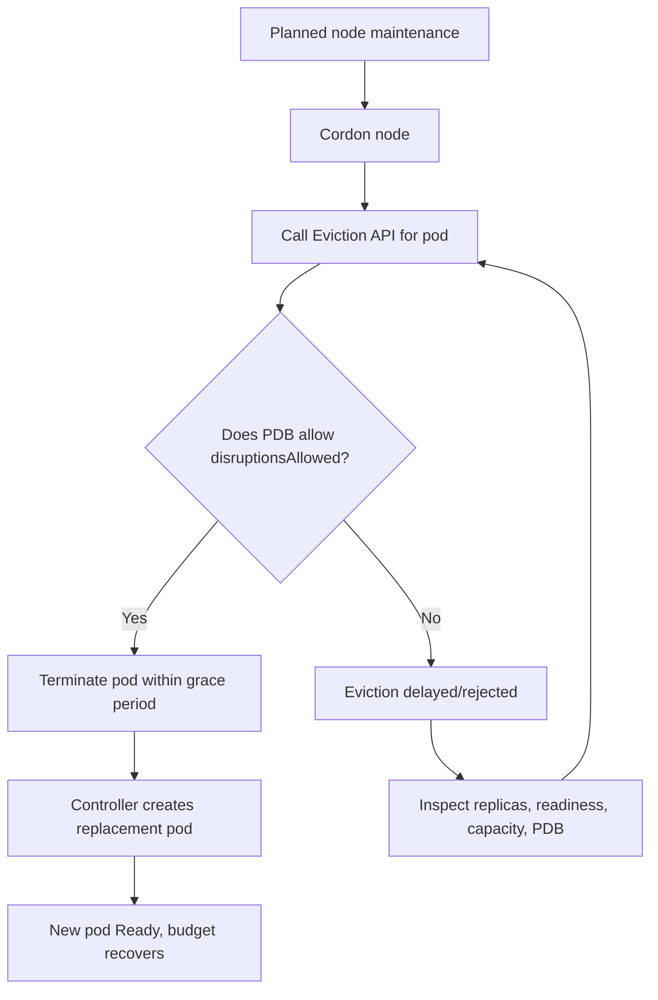

# Pod Disruption Budget and Guarantees During Node Maintenance

An application running on Azure Kubernetes Service (AKS) has three replicas placed across three different nodes and serves users through a Kubernetes Service. When one node requires maintenance, the platform can move pods to another node. However, if multiple pods are stopped simultaneously, the application may lose serving capacity even if Kubernetes eventually recreates all replicas.

A **Pod Disruption Budget (PDB)** is a Kubernetes resource used to declare how many pods of a workload must remain healthy during **voluntary disruptions**, such as a `kubectl drain` operation using the Eviction API to move pods off a node before maintenance. A PDB keeps controlled maintenance within a disruption budget, yet **it does not by itself guarantee zero downtime** and cannot stop a physical host from failing unexpectedly.

This lesson belongs to the **AKS Operations** chapter of the **CLOUD_PROVIDERS_AZURE** module. The content connects concepts of node pools, networking, VM Scale Sets, Availability Zones, Azure Monitor, application deployment, and the operating cost of running Kubernetes on Microsoft Azure.

> Key principle: A PDB limits how many pods can be **evicted via the Eviction API** under permitted conditions; it is not a load balancer, does not replace a readiness probe, does not force Kubernetes to provision new nodes, and is not an absolute guarantee of replica counts during unexpected failures.

## 1. Learning Objectives

Upon completion, you will be able to:

1. Distinguish **voluntary disruption**, **involuntary disruption**, the Eviction API, cordon, and drain.
2. Create a PDB using `minAvailable` or `maxUnavailable` and compute the disruption budget from replica counts.
3. Explain how a PDB uses pod **Ready** status and the `currentHealthy`, `desiredHealthy`, and `disruptionsAllowed` fields.
4. Understand when a PDB protects an AKS maintenance operation and when it does not.
5. Combine PDBs with Deployments/StatefulSets, health probes, topology spread, autoscalers, and reserve capacity.
6. Read PDB details with `kubectl`, execute a safe drain workflow in a lab environment, and analyze blocked evictions.
7. Plan AKS node pool upgrades with surge capacity, quota/IP headroom, zone spread, and rollback procedures.
8. Monitor disruption state alongside application serving quality rather than looking only at Running pod counts.

## 2. Types of Disruptions in Kubernetes

A pod can stop for many reasons. A PDB only intervenes in a specific subset of those scenarios.

| Disruption Type | Example | Can a PDB Prevent Pod Termination? |
|---|---|---|
| **Voluntary, via Eviction API** | `kubectl drain` during maintenance, management components calling the Eviction API | **Yes**, it can delay/reject eviction if it would exceed the budget |
| Voluntary without using the Eviction API | User running `kubectl delete pod`, deleting a Deployment, certain rollout controller actions | **Not** directly blocked by a PDB |
| **Involuntary** | Node failure, power loss, VM crash, zone outage, network partition | **No**, cannot prevent an outage that already happened |
| Application failure | Container crash, OOM, failed readiness probe | PDB cannot fix bugs; healthy pod count drops and may block subsequent evictions |
| Replica change | Scale-down by user or controller | Do not treat a PDB as an absolute cap against all desired controller scale changes |

### What Is a Voluntary Disruption?

It is an action where a component **intentionally** causes a pod to leave a node or stop serving, usually for maintenance or rescheduling. When performed via the Kubernetes Eviction API, the disruption controller checks the PDB before allowing the eviction to proceed.

### What Is an Involuntary Disruption?

It is an incident where a node cannot be asked to wait for a budget, such as a node suddenly going offline. Affected pods may lose Ready immediately or be marked according to Kubernetes failure detection timeouts. **A PDB does not keep a dead node's pods Running**; once healthy pod count drops, the PDB may block maintenance on the remaining healthy pods.

This distinction avoids a common misconception: PDBs are very helpful when AKS gracefully drains nodes for a supported workflow, but surviving node/zone failures also requires **multiple replicas, topology spread, spare capacity, and an HA data architecture**.

## 3. How the Eviction API, Cordon, and Drain Work

The **Eviction API** is the Kubernetes API for requesting pod termination in a way that respects PDBs. If an eviction would violate the budget, the API can temporarily reject it, typically returning **HTTP 429 Too Many Requests**. Clients or drain tools can wait and retry accordingly.

Three easily confused operations:

- **Cordon**: marks a node unschedulable so the scheduler stops placing new pods on it; does not remove existing pods.
- **Drain**: marks a node unschedulable and requests eviction of eligible pods from the node. It handles DaemonSets and special pod cases separately.
- **Uncordon**: allows the scheduler to place new pods onto the node again after maintenance.

This diagram is a logical model and does not capture every internal controller edge case. Replacement pod creation order, endpoint update timing, and PDB progression depend on workload type, replica count, scheduler capacity, probes, and drain configuration.

**Do not use `--disable-eviction` or delete pods directly to bypass a PDB during routine maintenance.** Options that skip the Eviction API can cause disruptions beyond what the application can tolerate.

## 4. Structure of a Pod Disruption Budget

A PDB is a **namespaced** Kubernetes resource in the `policy/v1` API. A basic manifest:

~~~yaml
apiVersion: policy/v1
kind: PodDisruptionBudget
metadata:
  name: api-pdb
  namespace: apps
spec:
  minAvailable: 3
  selector:
    matchLabels:
      app: api
~~~

Meaning:

- **`minAvailable: 3`**: during voluntary API evictions, aim to keep at least three healthy pods matching the selected workload.
- **`selector.matchLabels`**: selects pods labeled `app=api` **inside the `apps` namespace**.
- A PDB **does not create pods**, set replica counts, or configure network traffic rules.

You must specify **either** `minAvailable` or `maxUnavailable` for a PDB—never both at the same time.

### minAvailable

`minAvailable` specifies the **minimum number of healthy pods** that must remain during eligible evictions. It can be an integer or a percentage string.

~~~yaml
spec:
  minAvailable: "75%"
  selector:
    matchLabels:
      app: api
~~~

### maxUnavailable

`maxUnavailable` specifies the **maximum number of pods that can be unavailable** under PDB accounting for a workload with a supported controller. It also accepts integers or percentages.

~~~yaml
spec:
  maxUnavailable: 1
  selector:
    matchLabels:
      app: api
~~~

**Note:** `maxUnavailable` relies on the desired pod count of a controller supporting the `scale` subresource; avoid blindly applying it to bare pods unmanaged by a controller. For standalone or unusual workloads, choose an appropriate budget expression and controller architecture.

## 5. How disruptionsAllowed Is Calculated

Kubernetes computes the budget from expected pods and currently healthy pods. PDB status exposes several key fields:

| Status Field | Practical Meaning |
|---|---|
| `expectedPods` | Total pods expected by the matching controller |
| `desiredHealthy` | Minimum healthy pods required by the PDB policy |
| `currentHealthy` | Matching pods currently considered healthy, usually based on Ready status |
| `disruptionsAllowed` | Additional evictions currently permitted within budget |
| `disruptedPods` | Pods already approved for eviction and tracked by the disruption controller |

For example, a Deployment with **4 replicas** and PDB `minAvailable: 3`:

~~~text
Expected pods:       4
Desired healthy:     3
Current healthy:     4
Disruptions allowed: 1
~~~

Once one pod is evicted and its replacement is not yet Ready:

~~~text
Expected pods:       4
Desired healthy:     3
Current healthy:     3
Disruptions allowed: 0
~~~

If another pod turns NotReady due to an application bug, the PDB cannot undo that failure; `disruptionsAllowed` stays at 0 and draining may block until the application recovers.

### Mental Formula

In a simple scenario, ignoring pods currently mid-disruption and status sync details:

~~~text
disruptionsAllowed is approximately
  max(0, currentHealthy - desiredHealthy)
~~~

The live value is computed and published by the Kubernetes PDB controller; never substitute a hand-calculated formula for `status.disruptionsAllowed` when deciding whether to drain a production node.

### How Are Percentages Rounded?

Kubernetes rounds **up** when converting PDB percentages to integer pod counts, which can sometimes be counterintuitive:

| Desired Replicas | PDB | Effective Threshold |
|---:|---|---|
| 4 | `minAvailable: 75%` | Requires at least 3 healthy |
| 5 | `minAvailable: 60%` | Requires at least 3 healthy |
| 3 | `minAvailable: 50%` | Requires at least 2 healthy |
| 7 | `maxUnavailable: 30%` | Can allow up to 3 pods unavailable due to rounding |
| 1 | `maxUnavailable: 30%` | Can allow 1 pod unavailable — the entire workload! |

For a single-replica app, any non-zero percentage `maxUnavailable` can permit evicting the sole replica. **Never assume "30%" always means less than one pod and rounds down.**

Conversely, `minAvailable: 100%` on a healthy workload usually yields `disruptionsAllowed: 0`, blocking maintenance drains under budget rules.

## 6. Creating a Maintainable Deployment: Complete Example

A PDB is only effective when the application has enough replicas and can replace an instance while continuing to serve. The minimal example below defines a 4-replica Deployment and PDB in the `apps` namespace. The namespace must already exist or be created first in your lab.

~~~yaml
apiVersion: apps/v1
kind: Deployment
metadata:
  name: orders-api
  namespace: apps
spec:
  replicas: 4
  selector:
    matchLabels:
      app: orders-api
  template:
    metadata:
      labels:
        app: orders-api
    spec:
      terminationGracePeriodSeconds: 45
      containers:
        - name: orders-api
          image: registry.example.com/orders-api:1.0.0
          ports:
            - name: http
              containerPort: 8080
          resources:
            requests:
              cpu: "250m"
              memory: "256Mi"
            limits:
              cpu: "1"
              memory: "1Gi"
          readinessProbe:
            httpGet:
              path: /health/ready
              port: http
            periodSeconds: 5
            failureThreshold: 3
          livenessProbe:
            httpGet:
              path: /health/live
              port: http
            periodSeconds: 10
            failureThreshold: 3
---
apiVersion: policy/v1
kind: PodDisruptionBudget
metadata:
  name: orders-api-pdb
  namespace: apps
spec:
  minAvailable: 3
  selector:
    matchLabels:
      app: orders-api
~~~

**Assumptions explained:** `registry.example.com` is an illustrative placeholder and must be replaced with a real image your cluster can pull. The application must genuinely expose `/health/ready` and `/health/live`. This manifest does not yet create a Kubernetes Service, ingress, or authentication. Production environments also require `securityContext`, identity permissions, logging, autoscaling, and security policies.

With all four pods Ready, the PDB allows one eviction. After a pod is evicted, the controller must create a replacement pod and that pod must pass readiness before the budget fully recovers.

**Does not yet guarantee pods sit on different nodes:** The Deployment above lacks anti-affinity or topology spread. If all four pods land on the same node, draining that node may stall on the PDB. Later sections add placement spread principles.

## 7. Choosing PDBs for Different Workload Types

### Stateless Web/API: Minimum Healthy Threshold

With four independent web replicas and adequate spare capacity, `minAvailable: 3` is one way to keep three healthy backends during controlled maintenance.

If traffic is so high that three backends cannot sustain the load, this PDB is **insufficient for your SLO**. Measure backend capacity and ensure autoscaling/headroom before maintenance.

### Queue Workers: Controlling How Many Workers Can Be Lost

A worker processing leased jobs with checkpoints and idempotency can typically tolerate more evictions than a synchronous API. Use `maxUnavailable: 1` or a ratio matched to job completion SLAs.

Even when the PDB permits eviction, the application must still **finish, requeue, or checkpoint** in-flight work within `terminationGracePeriodSeconds`. A PDB does not automatically ack jobs or release message leases.

### Quorum-Based StatefulSet: Protecting Minimum Quorum Members

For example, a three-member distributed system where the application requires at least two active members to keep processing:

~~~yaml
apiVersion: policy/v1
kind: PodDisruptionBudget
metadata:
  name: consensus-pdb
  namespace: databases
spec:
  minAvailable: 2
  selector:
    matchLabels:
      app: consensus
~~~

**Mandatory prerequisites:** the three pods must genuinely represent three compatible data/quorum members; readiness must reflect true cluster usability, and the storage layer must tolerate the corresponding disruption. Never assume three replicas of any database automatically form a 2/3 quorum or that PVs can always move across zones.

### Single Replica: Choosing Between Availability and Maintainability

If a Deployment has only one replica and a PDB with `minAvailable: 1`, the budget is normally 0. This protects the sole pod from eviction during drains, yet it can cause node upgrades to **hang/block**.

The proper solution for services requiring uptime is running multiple replicas with an appropriate data architecture. If a single replica is unavoidable, accept a maintenance downtime window and approved procedure rather than treating a PDB as magic that simultaneously prevents downtime and allows drains.

## 8. Selectors, Namespaces, and Dangerous Configuration Mistakes

A PDB applies to the **set of pods matched by its selector within the same namespace**. Two common mistakes:

1. The PDB matches zero pods due to label mismatch: the policy exists but protects nothing.
2. The PDB matches too many unrelated pods: budgets are wrongly shared or multiple controllers are coupled under one policy.

### Choose Stable, Workload-Specific Labels

Use an appropriate label combination, such as `app.kubernetes.io/name` and `app.kubernetes.io/instance`, if applied consistently. Most importantly, the PDB selector must match the exact pods of the workload you intend to protect.

~~~yaml
spec:
  minAvailable: 2
  selector:
    matchLabels:
      app.kubernetes.io/name: orders-api
      app.kubernetes.io/instance: production
~~~

### Empty Selector Warning

In the **`policy/v1`** API, an empty selector `{}` is interpreted as **matching all pods in the namespace**. An omitted selector has different semantics from an empty selector. Avoid copying PDB snippets with `selector: {}` when you only mean to protect one Deployment.

Do not create PDBs with **overlapping selectors** targeting the same pods: evicting a pod covered by multiple PDBs may be rejected, complicating maintenance. Each workload should have one clear budget without accidental overlap.

### Verify the Selector Before Applying

~~~bash
kubectl get deployment -n apps orders-api --show-labels
kubectl get pods -n apps -l app=orders-api -o wide
kubectl get pdb -n apps
kubectl describe pdb orders-api-pdb -n apps
~~~

If `get pods -l` returns empty or a different set of pods than expected, fix the labels and selector **before maintenance**—do not assume the PDB is right merely because `kubectl apply` succeeded.

## 9. Readiness Determines When a PDB Has Headroom

PDBs typically compute **currentHealthy** from pods with the `Ready` condition. Kubernetes Pod phase `Running` does not equal `Ready`, and a running process does not guarantee successful request handling.

| Pod Status | Condition | Impact on PDB |
|---|---|---|
| Running and Ready | Backend considered able to serve | Typically counts toward `currentHealthy` |
| Running but NotReady | Process exists but is not ready | Typically excluded from `currentHealthy` |
| Pending | Pod not yet scheduled/started | Adds no healthy capacity |
| Terminating | Pod leaving workload | Should not count as new serving capacity |
| CrashLoopBackOff | App failing to start | Reduces workload healthy budget |

### Designing Readiness Probes

A readiness endpoint should return success when the instance **can serve requests within its responsibility**. It may check critical dependencies, but should avoid turning every replica NotReady over an unrelated auxiliary system.

For instance, an API using a cache solely for optimization may not need to go NotReady during a brief cache blip. Conversely, if a payment API cannot commit transactions without mandatory storage, having readiness always return 200 misleads both the PDB and load balancers.

### Startup and Shutdown

- **Startup probe** fits slow-starting apps to prevent premature liveness restarts.
- **Readiness probe** controls when a pod receives traffic.
- **Liveness probe** determines when to restart an unresponsive container.
- **Termination grace period** gives the app time to stop accepting requests and complete or return in-flight work.

If readiness takes 3 minutes after a new pod starts, node drains will wait a long time even after image pull and scheduling finish. Investigate the app or probe configuration rather than immediately deleting the PDB.

## 10. unhealthyPodEvictionPolicy: When NotReady Pods Block Drain

In supported Kubernetes versions, a PDB provides the **`unhealthyPodEvictionPolicy`** field to govern eviction of pods that are Running but not Ready.

Two values to distinguish:

- **`IfHealthyBudget`**: default behavior; evicting unhealthy pods is gated by healthy budget status to avoid worsening disruption when the application is already below safe thresholds.
- **`AlwaysAllow`**: permits evicting Running-but-NotReady pods even when the healthy budget disallows further evictions; this helps unblock node drains stuck on an unhealthy pod.

Intentional example for an appropriate environment:

~~~yaml
apiVersion: policy/v1
kind: PodDisruptionBudget
metadata:
  name: orders-api-pdb
  namespace: apps
spec:
  minAvailable: 3
  unhealthyPodEvictionPolicy: AlwaysAllow
  selector:
    matchLabels:
      app: orders-api
~~~

### When to Use AlwaysAllow?

If a pod is NotReady due to an unrecoverable state on the old node and can only become healthy again when restarted on a new node, this policy prevents maintenance deadlocks.

**Do not interpret `AlwaysAllow` as bypassing the PDB for all pods.** Healthy pods must still obey the budget. Evicting a NotReady pod may still interrupt in-flight application work even though Kubernetes marks it unhealthy; for stateful or worker workloads, evaluate state, graceful termination, and checkpoints.

Verify feature support in your running Kubernetes/AKS version and test in staging before applying to production.

## 11. PDB Does Not Replace Rolling Update Strategy

A PDB is designed for **voluntary evictions via the Eviction API**. It is not the policy that directly governs how the **Deployment controller** executes rolling updates.

When updating a Deployment, key parameters are typically:

~~~yaml
apiVersion: apps/v1
kind: Deployment
metadata:
  name: orders-api
  namespace: apps
spec:
  replicas: 4
  strategy:
    type: RollingUpdate
    rollingUpdate:
      maxSurge: 1
      maxUnavailable: 0
  selector:
    matchLabels:
      app: orders-api
  template:
    metadata:
      labels:
        app: orders-api
    spec:
      containers:
        - name: orders-api
          image: registry.example.com/orders-api:1.0.1
~~~

This manifest **illustrates rollout strategy only** and is not a complete application configuration (it omits probes, resources, ports, and runtime options). Deployment `maxSurge: 1` allows creating up to one extra replica during rollout per controller rules, while `maxUnavailable: 0` instructs it not to reduce availability below desired count within rollout mechanics.

**Do not confuse these:**

| Configuration | Controls |
|---|---|
| PDB `maxUnavailable` / `minAvailable` | Evictions via the Eviction API, typically during drains/maintenance |
| Deployment `strategy.rollingUpdate.maxUnavailable` | Replicas allowed unavailable during a rollout managed by the Deployment controller |
| Deployment `strategy.rollingUpdate.maxSurge` | Temporary extra replicas during a rollout |
| AKS node pool `maxSurge` | Temporary extra nodes added during an AKS node pool upgrade |

These three parameter groups operate at **different scopes**. A Deployment with a sound rollout strategy still needs a PDB if nodes are drained during maintenance. Conversely, a solid PDB does not replace an application's rollout strategy.

## 12. Spreading Pods Across Nodes and Availability Zones

If a Deployment has four replicas but all sit on one node, draining that node may stall because the PDB allows only one eviction. If all sit in one zone, a zone outage renders the PDB powerless.

Design appropriate **topology spread constraints** or pod anti-affinity.

Example pod spec snippet to add to a Deployment, asking the scheduler to distribute pods across zones and nodes:

~~~yaml
spec:
  topologySpreadConstraints:
    - maxSkew: 1
      topologyKey: topology.kubernetes.io/zone
      whenUnsatisfiable: DoNotSchedule
      labelSelector:
        matchLabels:
          app: orders-api
    - maxSkew: 1
      topologyKey: kubernetes.io/hostname
      whenUnsatisfiable: ScheduleAnyway
      labelSelector:
        matchLabels:
          app: orders-api
~~~

Explanation:

- `topology.kubernetes.io/zone`: prefers/enforces distribution across eligible zones as evaluated by the scheduler.
- `kubernetes.io/hostname`: distributes across nodes.
- `maxSkew: 1`: targets a maximum pod count difference of one across eligible domains under active constraints.
- `DoNotSchedule`: refuses to place additional pods if the hard constraint is violated; can leave pods Pending if zones/capacity are insufficient.
- `ScheduleAnyway`: prefers balance while still allowing placement if full balance cannot be met.

This is a **pod spec snippet**, not a standalone manifest; place it under `spec.template.spec` of a Deployment. Labels must match real pods and topology labels provided by nodes.

**PDB + topology spread + node capacity** together form a realistic design: PDB bounds planned disruptions, spread reduces correlated failures, and capacity lets replacement pods schedule. If a node pool spans only one zone or another zone lacks VM capacity, hard spread constraints can leave pods Pending.

## 13. How Does AKS Node Maintenance Work?

AKS manages node pools backed by VM Scale Sets and provides maintenance, Kubernetes upgrade, and node image upgrade workflows per active features and configurations.

During a typical **node pool upgrade**, AKS may:

1. Provision extra surge resources/nodes per the configured surge strategy.
2. Mark nodes slated for replacement as unschedulable.
3. Drain pods using appropriate mechanisms, respecting PDBs when calling the Eviction API.
4. Schedule/start replacement pods on available nodes.
5. Wait for nodes/pods to meet upgrade readiness checks.
6. Proceed through remaining nodes as conditions allow.
7. Handle upgrade failures or timeouts per service behavior.

Exact steps vary by upgrade type, AKS version, node pool settings, surge/unavailable policies, drain timeouts, and special states. Never assume every infrastructure maintenance path uses identical eviction logic or that a PDB shields against all node-level incidents.

### Why Can a PDB Block an Upgrade?

If a two-replica Deployment has `minAvailable: 2` and both pods are Ready, `disruptionsAllowed=0`. AKS cannot evict a healthy pod via the API under that budget. Even after provisioning a new surge node, that node **does not create an extra replica** if the Deployment still desires only two replicas.

Options include **scaling replicas up before maintenance** (if the app supports it), aligning the PDB with SLOs, and ensuring node capacity for replacement pods to start. Do not raise node pool `maxSurge` expecting it to magically turn a PDB from 0 to 1 when the Deployment itself has no replica headroom.

### Maintenance Windows Do Not Guarantee Zero Downtime

Configured AKS maintenance/upgrade windows help coordinate planned change timing per supported features, yet they do not eliminate all unplanned maintenance or node failures. You still need PDBs, readiness, replication, HA networking/data, and monitoring.

## 14. Planning Surge Capacity for Node Pools

During upgrades, AKS may require temporary surge nodes before removing old nodes. These nodes consume:

- VM vCPU quotas, regional/zone capacity, and matching VM SKUs.
- IPs in the node subnet and sometimes pod IPs depending on Azure CNI mode.
- Managed disks, network throughput, and associated infrastructure resources.
- VM/disk billing for the duration the surge nodes run.

A planning example:

~~~text
System node pool:  3 nodes
User node pool:    12 nodes
Planned surge:     2 nodes for system + 3 nodes for user
Extra headroom:    3 nodes

Preliminary node IP demand = 3 + 12 + 2 + 3 + 3 = 23 IPs
~~~

This is an illustrative scenario, not a universal AKS formula for all node pool types. Calculate based on **each pool's surge setting**, sequential vs concurrent upgrades, zone distribution, and IPs used by other resources in the subnet.

With Azure CNI:

- **Overlay:** the node subnet needs enough IPs for VMs; the overlay pod CIDR must have enough blocks for max node count including surge.
- **Pod Subnet:** requires both enough node subnet IPs and enough pod subnet addresses per allocation mechanics.
- **Traditional Node Subnet:** pods and nodes share IPs from the node subnet; factor in both `maxPods` and surge.

If IPs, quotas, or capacity run out, replacement pods fail to schedule and PDBs can keep blocking drains even when the application itself is healthy.

## 15. HPA, Cluster Autoscaler, and PDB

Three controllers solve three different problems:

| Component | Role |
|---|---|
| **HPA (Horizontal Pod Autoscaler)** | Scales replica count based on configured metrics/load |
| **Cluster Autoscaler** | Adjusts node count based on unschedulable pods and scaling rules |
| **PDB** | Bounds planned evictions to preserve healthy pod counts within budget |

For example, an API starts with two replicas and PDB `minAvailable: 2`, allowing 0 evictions. When HPA scales up to four replicas and all pods become Ready, the PDB now allows two evictions under the same `minAvailable: 2`.

However, when traffic drops, HPA scales back down, shrinking the budget again. **Do not design HA assuming HPA will always scale up before maintenance runs.** Set `minReplicas` and PDBs to match minimum serving requirements.

Cluster Autoscaler cannot fix an overly strict PDB by itself. If both the workload and node pool lack headroom, waiting on the autoscaler does not guarantee a drain will complete. Furthermore, verify autoscaler scale-down/drain behavior against your environment's supportability and eviction policies.

### Resource Requests Matter

If a pod requests 1 CPU / 2 GiB RAM yet no node has enough `allocatable` capacity, replacement pods remain Pending even when total VM count looks large. Set realistic requests and reserve **capacity to survive losing a node or a zone**.

## 16. Pre-Maintenance AKS Inspection Workflow

The commands below use `kubectl` and Azure CLI with appropriate read permissions. Run them in an organization-approved environment.

### Verify Cluster and Node Pool

~~~bash
RG="rg-aks-prod"
AKS="aks-app-prod"
POOL="userpool"

az account show --query "{subscription:name,id:id}" -o table

az aks show -g "$RG" -n "$AKS" \
  --query "{name:name,kubernetesVersion:kubernetesVersion,powerState:powerState.code}" \
  -o json

az aks nodepool show \
  --resource-group "$RG" \
  --cluster-name "$AKS" \
  --name "$POOL" \
  --output json
~~~

Names are **placeholders**—do not run them literally against an arbitrary subscription. These commands read state; in the node pool JSON, examine node count, autoscaling, zones, upgrade settings, and relevant limits.

### Check Kubernetes State and Budgets

~~~bash
kubectl get nodes -o wide
kubectl get pods -A -o wide
kubectl get pdb -A
kubectl describe pdb orders-api-pdb -n apps
~~~

Quickly query one PDB:

~~~bash
kubectl get pdb orders-api-pdb -n apps \
  -o jsonpath='{.status.currentHealthy}{" healthy; desired="}{.status.desiredHealthy}{"; allowed="}{.status.disruptionsAllowed}{"\n"}'
~~~

Inspect `currentHealthy`, `desiredHealthy`, and `disruptionsAllowed` alongside the selector and live pods/controllers. **PDB values are a point-in-time snapshot** that can change immediately during rollouts, autoscaling, or readiness shifts.

### Check Pods on the Node Slated for Maintenance

~~~bash
NODE="<NODE_NAME>"

kubectl get pods -A \
  --field-selector spec.nodeName="$NODE" \
  -o wide
~~~

Check which PDBs protect those pods, which DaemonSets run on the node, whether any pods store data in `emptyDir`, or whether stateful apps require special handling.

### Check Ongoing Rollouts

~~~bash
kubectl get deployments,statefulsets -A
kubectl get events -A --sort-by=.lastTimestamp
~~~

Avoid initiating drains during major rollouts, unstable autoscaler activity, or while critical replicas are NotReady. Do not assume that just because one PDB allows 1 eviction, all other apps on that node also have budget headroom.

## 17. Hands-On Safe Cordon, Drain, and Uncordon

**Run only on an authorized lab node.** Draining stops pods, moves workloads, and impacts services; never test on production nodes without a maintenance plan, redundancy, and approval.

### Step 1 — Verify Budgets First

~~~bash
kubectl get pdb -A
kubectl get nodes -o wide
kubectl get pods -A --field-selector spec.nodeName="<LAB_NODE>"
~~~

If `disruptionsAllowed=0` for a workload running on that node, identify the cause first: too few replicas, NotReady pods, wrong selector, insufficient cluster capacity, or another ongoing eviction.

### Step 2 — Cordon

~~~bash
kubectl cordon "<LAB_NODE>"
~~~

The node is now marked unschedulable for normal scheduling. Existing pods are not deleted merely by cordoning.

### Step 3 — Drain Using the Eviction API

~~~bash
kubectl drain "<LAB_NODE>" \
  --ignore-daemonsets \
  --timeout=10m
~~~

By default, drain uses the Eviction API where supported. `--ignore-daemonsets` allows proceeding when DaemonSet pods exist that Kubernetes manages per-node; it does not force-delete DaemonSets.

If a pod on the node uses `emptyDir`, drain may require confirmation regarding local data. `--delete-emptydir-data` **permits losing data in `emptyDir`**; consider it in a lab only after verifying no important data resides there. Avoid using `--force` to bypass safeguards or delete unmanaged pods without assessing impact.

If the command times out waiting on a PDB, treat that as a signal to **inspect readiness, replicas, and capacity** rather than tearing down the PDB.

### Step 4 — Verify Workloads Continue Serving

~~~bash
kubectl get pdb -A
kubectl get pods -A -o wide
kubectl get nodes -o wide
~~~

Verify Service endpoints, ingress, error rates, and application responses. A recreated pod that is still NotReady provides zero serving capacity.

### Step 5 — Restore the Node

After verifying lab maintenance is complete:

~~~bash
kubectl uncordon "<LAB_NODE>"
~~~

Monitor subsequent pod placement and readiness. **Uncordon does not automatically move all pods back to the old node**: the scheduler places future pods based on constraints and capacity.

## 18. AKS Node Pool Upgrade Workflow

Before a production upgrade, identify supported target versions and node pool state. Example read-only commands:

~~~bash
az aks get-upgrades \
  --resource-group "$RG" \
  --name "$AKS" \
  --output table

az aks nodepool list \
  --resource-group "$RG" \
  --cluster-name "$AKS" \
  --output table
~~~

Once approved and supported by the cluster/node pool, a node pool upgrade command typically looks like:

~~~bash
az aks nodepool upgrade \
  --resource-group "$RG" \
  --cluster-name "$AKS" \
  --name "$POOL" \
  --kubernetes-version "<SUPPORTED_TARGET_VERSION>"
~~~

This is an **example of a high-impact mutating command**, not an instruction to run directly on production. Verify control-plane state, compatibility, target version, Azure CLI version, and supported upgrade options. Node image upgrades differ from Kubernetes version upgrades and use different flags; do not substitute them casually.

### Recommended Upgrade Plan

1. Inventory workloads, PDBs, replica counts, resource requests, and PodDisruptionBudget statuses.
2. Check AKS/Kubernetes release compatibility, add-ons, CSI/CNI, and admission webhooks.
3. Verify VM quotas, subnet/CNI capacity, zone capacity, and supported surge/unavailable settings.
4. Confirm enough spare capacity exists for replacement pods when a node is cordoned/drained.
5. Pause/coordinate other rollouts so they do not compete for the same budget.
6. Upgrade staging or a less critical node pool first.
7. Execute the upgrade within an approved maintenance window, monitoring each node pool's progress.
8. Alert if pods stay unready, `disruptionsAllowed=0` persists, or workloads breach SLOs.
9. Validate ingress, job processing, data integrity, DNS, private endpoints, and networking post-upgrade.
10. Document results/incidents and update runbooks for future cycles.

**An upgrade can fail or block to protect a PDB.** Do not promise that setting PDBs guarantees upgrades always finish on schedule; overly strict PDBs can render a system unmaintainable.

## 19. When a PDB Blocks Drain: Investigation and Remediation

Scenario: a node pool upgrade hangs for a long time and pods are not leaving the node. You see this PDB:

~~~text
NAME             MIN AVAILABLE   MAX UNAVAILABLE   ALLOWED DISRUPTIONS
orders-api-pdb   3               N/A               0
~~~

Steps in priority order:

1. **Identify which PDB is blocking:** `kubectl describe pdb`, pod selector, and events.
2. **Compare desired replicas vs Ready pods:** `kubectl get deployment -n apps orders-api` and `kubectl get pods -n apps -l app=orders-api -o wide`.
3. **Investigate NotReady pods:** image pull, startup, liveness/readiness, resource limits, database connectivity, PVCs, quotas, PodScheduling, and network policies.
4. **Verify replacement pods have somewhere to run:** CPU/memory, taints/tolerations, node affinity, topology spread, availability zones, autoscaler, and subnet IPs.
5. **Restore capacity or readiness:** fix app bugs, add nodes, or scale replicas if the workload permits.
6. **Re-evaluate PDB thresholds:** adjust only if SLOs remain protected and approved.
7. **Retry the controlled drain:** monitor budgets, pod readiness, and client error rates.
8. **Never bypass a PDB** to force a production upgrade without explicit acceptance of downtime risk.

### Targeted Scaling Example

A Deployment has 3 replicas and PDB `minAvailable: 3`, leaving zero headroom. If the app is stateless and the backend/data layer supports it, scale temporarily to 4 replicas during the maintenance window, wait until all 4 are Ready, and then drain:

~~~bash
kubectl scale deployment/orders-api \
  --namespace apps \
  --replicas=4

kubectl rollout status deployment/orders-api -n apps
kubectl get pdb orders-api-pdb -n apps
~~~

**Note:** scaling is a live workload change—perform it only when authorized. If HPA manages the replica count, coordinate with HPA; if the node pool lacks capacity, the fourth pod stays Pending and the budget will not increase. After maintenance, scale back only if doing so aligns with SLOs and will not keep blocking future maintenance.

### Pods Stuck NotReady

If a pod stays Running but NotReady indefinitely, check `unhealthyPodEvictionPolicy` and application conditions. `AlwaysAllow` can help evict an unhealthy pod in some scenarios, yet it will not fix whatever is causing replacement pods to also stay NotReady.

## 20. Balancing Availability and Maintainability

A tighter budget restricts voluntary evictions further, yet also makes maintenance harder. Choose PDBs based on **minimum serving capacity** and **pod replacement headroom**, not a rigid one-size-fits-all rule.

Examples:

| Workload | Replicas | Suggested PDB to Evaluate | Conditions |
|---|---:|---|---|
| Stateless Web API | 4 | `minAvailable: 3` | 3 replicas handle peak load, good node spread |
| Idempotent queue worker | 6 | `maxUnavailable: 2` | Safe checkpoints/leases and job retries |
| Quorum service | 3 | `minAvailable: 2` | App truly needs 2 healthy; compatible PV and zone placement |
| Short-lived Jobs | Varies by job | Do not assume PDB is the solution | Evaluate Job controller, restarts/backoff, and checkpoints |
| Singleton API | 1 | `minAvailable: 1` blocks eviction | Accept blocked upgrades or redesign for HA |

These values are **architectural decision examples**, not universal Azure defaults. With HPA, evaluate `minReplicas`; with stateful apps, evaluate quorum, leader election, storage, and read/write semantics.

### Governing PDBs as a Production Policy

Every production PDB should document:

- Owner and protected workload.
- Rationale for `minAvailable`/`maxUnavailable` relative to SLOs.
- Minimum replicas and maximum load on surviving instances.
- Typical readiness/cold-start duration.
- Expected behavior during node/zone loss.
- Approved procedure, approver, and rollback for temporarily adjusting the PDB or replicas before maintenance.
- Alerts when `disruptionsAllowed=0` persists during scheduled maintenance.

Do not create PDBs "just to check a box" with nobody accountable for blocked drains.

## 21. Monitoring PDBs in Azure Monitor and Kubernetes

Observability is not just checking whether a PDB exists, but verifying **whether the workload retains enough serving instances while nodes are replaced**.

### Signals to Collect

| Layer | Data to Inspect |
|---|---|
| Kubernetes PDB | `currentHealthy`, `desiredHealthy`, `disruptionsAllowed`, conditions |
| Controller | `desiredReplicas`, `readyReplicas`, `availableReplicas`, rollout status |
| Node | Ready/NotReady, cordoned, pod count, CPU/memory allocatable, disk pressure |
| Scheduler | Pending pods, `FailedScheduling`, topology spread/affinity/taints |
| AKS | Node pool upgrade status, surge/scale failures, node image updates |
| Ingress/app | Request rate, HTTP 5xx, p95/p99 latency, health probe status |
| Data layer | Connection failures, replication/quorum health, persistent volume attachment |
| Azure Infrastructure | VM quota/capacity, subnet IP headroom, Service Health/Resource Health |

Quick checks:

~~~bash
kubectl get pdb -A
kubectl get deployments -A
kubectl get nodes
kubectl get events -A --sort-by=.lastTimestamp
~~~

### Prometheus/kube-state-metrics

If AKS runs Prometheus and **kube-state-metrics** exports these metrics, you can monitor series such as:

~~~promql
kube_poddisruptionbudget_status_pod_disruptions_allowed
~~~

To find PDBs with zero remaining budget in a watched namespace:

~~~promql
kube_poddisruptionbudget_status_pod_disruptions_allowed{
  namespace="apps"
} == 0
~~~

This is an illustrative **PromQL** query that only works if the cluster runs the corresponding exporter and collector. A PDB at 0 when the app is intentionally sized at its exact healthy threshold is not automatically an emergency; alerts should consider maintenance windows, duration, Ready replicas, and application impact.

With Azure Monitor / Managed Prometheus / Container Insights, verify which metrics/logs are actually ingested—do not assume AKS includes all of these metrics out of the box.

### Measuring SLOs After Maintenance

After every drain, compare:

1. Time pods spent unready and time for replacement pods to become Ready.
2. User error counts and API latency.
3. Job timeouts/retries or queue backlog for workers.
4. Total node pool upgrade duration.
5. Which PDBs repeatedly blocked drains.
6. Incremental costs from surge nodes, buffer replicas, and monitoring.

A maintenance cycle that succeeds at the Kubernetes layer while causing continuous user errors must still be treated as an operational incident.

## 22. Security, Data, and Limitations of PDBs

A PDB does not replace the following protection layers:

- **Kubernetes RBAC:** who can create/edit PDBs, drain nodes, delete pods, or scale Deployments?
- **Azure RBAC:** who can upgrade AKS/node pools and modify subscriptions/resource groups?
- **NetworkPolicy, NSG, and Firewall:** which pods can talk to each other, and which networks can reach the app?
- **Managed identity / workload identity:** does the app access Storage, Key Vault, and databases with least privilege?
- **Backup and replication:** can data recover from node loss, disk corruption, accidental deletion, or regional outage?
- **Container security:** do pods run non-root, drop unnecessary privileges, use scanned images, and keep secrets out of images?

A pod with a zone-pinned Azure Disk PVC cannot immediately reschedule into another zone if the disk type and topology are incompatible. A PDB can only delay eviction; **it does not move or replicate data**, fix CSI errors, or give a singleton database quorum.

For stateful data workloads, validate leader handoff, replication, backups, and PV attach/mount behavior before maintenance.

## 23. Costs and Trade-Offs of Higher Maintainability

To give PDBs headroom, organizations may need more replicas/nodes than average load alone requires. This increases spend while reducing downtime risk during maintenance windows.

Cost components to factor in:

- Running VM/VMSS node pools and temporary **surge nodes**.
- Managed disks, data replication, and storage for stateful pods.
- Load Balancers, NAT Gateways, Azure Firewall, and Private Endpoints where used.
- Cross-Availability-Zone or cross-region traffic depending on architecture.
- Azure Monitor, Prometheus, Log Analytics, and retention.
- Operational effort, upgrade testing, and fallback mechanisms.

Do not shrink PDB budgets or replica counts purely to save VM spend without measuring serving capacity when a node is lost. Conversely, setting `minAvailable: 100%` everywhere can indefinitely delay critical security/patch maintenance, increasing operational risk.

**Right-sized cost must balance SLOs, maintenance deadlines, RTO/RPO, and resilience**, not just average VM count.

## 24. Node Maintenance Troubleshooting Table

| Symptom | Common Possibility | Approach |
|---|---|---|
| `kubectl drain` waits indefinitely | PDB `disruptionsAllowed=0` | `describe pdb`, verify Ready replicas and selector |
| Eviction API returns 429 | Disruption budget disallows eviction | Wait for replacement pod Ready or restore capacity; do not force delete |
| PDB selects zero pods | Selector/namespace mismatch | Check pod labels and PDB selector |
| PDB protects unexpected apps | Selector too broad, `selector: {}` | Narrow the selector, review namespace |
| New pod Pending | Insufficient CPU/memory, affinity/taints, quota, node surge/zone capacity | `describe pod`, scheduler events, and node pools |
| New pod stuck `ContainerCreating` | Image pull, volume attach/mount, CNI, or registry | Pod events, registry auth, PVC/CSI, subnets |
| Pod Running but NotReady | Bad probe, dependency failure, slow startup | Pod logs, readiness endpoint, app telemetry |
| Drain stuck on unhealthy pod | Default PDB policy with NotReady pod | Check `unhealthyPodEvictionPolicy`, fix root cause |
| Drain refuses due to DaemonSet | DaemonSet pods are not drained like normal pods | Use `--ignore-daemonsets` when appropriate |
| Drain warns about `emptyDir` | Local ephemeral data exists | Verify data safety before using `--delete-emptydir-data` |
| AKS upgrade fails scaling surge | Subnet IPs exhausted, VM quota, SKU/zone capacity shortage | Inspect pools, IPAM, quotas, and provisioning errors |
| Many pods lost after single node failure | Replicas concentrated on one node/zone | Topology spread, capacity, and multi-zone |
| API fails even while PDB stays satisfied | Readiness does not reflect real health or surviving capacity is overloaded | End-to-end testing, measure p95, fix probes and sizing |
| Workload fails to recover due to PVC | Volume topology/quorum/CSI blocks migration | Review storage class, PV zones, app failover plan |

### When Should Maintenance Be Halted?

Stop or defer changes if:

1. A critical workload falls below the healthy instance count required by its SLO.
2. Replacement pods repeatedly stay Pending/NotReady without a clear root cause.
3. The cluster is hitting IP, quota, or capacity exhaustion.
4. Ingress/API shows elevated error rates after the first few nodes.
5. Stateful data lacks a verified failover/restore path.
6. Bypassing a PDB is proposed without formal risk review and approval.

Do not push through remaining nodes simply because "it's on the schedule" when telemetry shows application availability degrading.

## 25. Comprehensive Lab Exercise

### Context

An API service runs in AKS with four replicas across two or three nodes. The platform team needs to upgrade the node pool while keeping at least three healthy backends. Pods expose readiness endpoints and run in the `apps` namespace.

**Execute on a lab cluster**—never use production for drain/scale drills.

### Part A — Design and Manifests

1. Diagram at least two nodes, one Kubernetes Service, and four API pods.
2. Create a four-replica Deployment with proper readiness/liveness probes.
3. Write a PDB with `minAvailable: 3` whose selector matches the Deployment's labels.
4. Explain why `disruptionsAllowed` drops to 0 if one pod becomes NotReady.
5. Add topology spread constraints or anti-affinity to reduce the chance all replicas land on one node.
6. Compute the budget when all 4 are Ready, when 3 are Ready, and when 2 are Ready.
7. Explain why the PDB cannot prevent an abrupt physical node failure.
8. Evaluate how to adjust the PDB if the backend only had 2 replicas and the SLO forbids downtime.

### Part B — Lab Observation and Maintenance

1. Apply the manifests in the lab namespace and wait for the Deployment to become Available.
2. Run `kubectl get pdb -n apps` and `describe pdb` to inspect the budget.
3. Verify pod labels, replica counts, topology, and health endpoints.
4. Select an authorized lab node for maintenance; inspect all pods on that node.
5. Run `kubectl cordon`, then `kubectl drain --ignore-daemonsets` once data and PDB allow.
6. Observe the new pod being created and becoming Ready before the next eviction succeeds.
7. Probe the API endpoint through its Service/ingress throughout the drill.
8. Run `kubectl uncordon` when finished and record recovery time.
9. If drain blocks, investigate PDB, readiness, and capacity before altering policy.
10. Clean up lab manifests and return the node to schedulable state per procedure.

### Part C — Node Pool Upgrade Scenario

Assume:

- System pool: 3 nodes.
- User pool: 10 nodes.
- Upgrade config allows 2 temporary surge nodes.
- API has 4 replicas and PDB `minAvailable: 3`.
- Database runs on zone-constrained volumes.

Answer:

1. Do the node subnet and quotas have room for 2 surge nodes and replacement pods?
2. If all four API replicas sit on the same node, what risk does drain face?
3. If new pods take 3 minutes to become Ready, how does the PDB affect upgrade duration?
4. Beyond a PDB, what does the database need to survive a zone failure?
5. Which metrics/alerts should you watch while the upgrade runs?
6. When should you pause the upgrade instead of relaxing the PDB?
7. Should you pass `--disable-eviction` just to hit a deadline? Why or why not?

### Self-Check Questions

**Question 1.** How does a PDB protect voluntary disruptions differently from involuntary disruptions?

**Question 2.** Can `minAvailable` and `maxUnavailable` be declared simultaneously in the same PDB?

**Question 3.** With 7 replicas and `maxUnavailable: "30%"`, up to how many pods unavailable can the budget allow due to rounding?

**Question 4.** Why can a PDB `minAvailable: 1` on a 1-replica Deployment block drains indefinitely?

**Question 5.** Is a pod in `Running` phase whose readiness probe fails counted in `currentHealthy`?

**Question 6.** In `policy/v1`, what does `selector: {}` mean?

**Question 7.** What is the difference between PDB `maxUnavailable`, Deployment `rollingUpdate.maxUnavailable`, and AKS node pool `maxSurge`?

**Question 8.** Why doesn't increasing surge nodes automatically raise `disruptionsAllowed`?

**Question 9.** When is `unhealthyPodEvictionPolicy: AlwaysAllow` helpful, and what risks must you weigh?

**Question 10.** Does a PDB guarantee zero application downtime when all replicas depend on a non-HA database?

**Completion criteria:** the learner accurately distinguishes PDB/Eviction API mechanics, computes disruption budgets, configures selectors and health probes, practices cordon/drain/uncordon in a lab, builds an AKS upgrade checklist covering surge/IP/quotas, and recognizes when to defer maintenance to protect SLOs.

## Conclusion

A **Pod Disruption Budget** is a vital mechanism for coordinating AKS node maintenance with application availability requirements. A PDB bounds how many healthy pods can be **voluntarily evicted via the Kubernetes Eviction API**, allowing drain/upgrade workflows to pause when nearing budget limits. It does not prevent sudden node failures, does not directly govern manual pod deletions or deployment rollouts, and cannot turn a singleton app into HA.

For safe node maintenance, combine **properly sized PDBs, multiple replicas with genuine readiness probes, pod spread across nodes/zones, spare capacity for node pool surge, sufficient IPs/quotas, HA data tiers, continuous monitoring, and blocked-eviction runbooks**. Designed around these principles, AKS can execute controlled infrastructure changes with lower disruption risk while preserving upgradability, security, and sensible operating costs.
