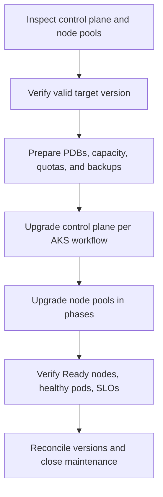
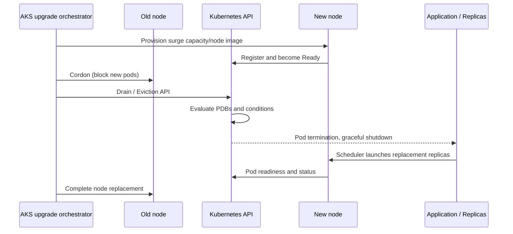
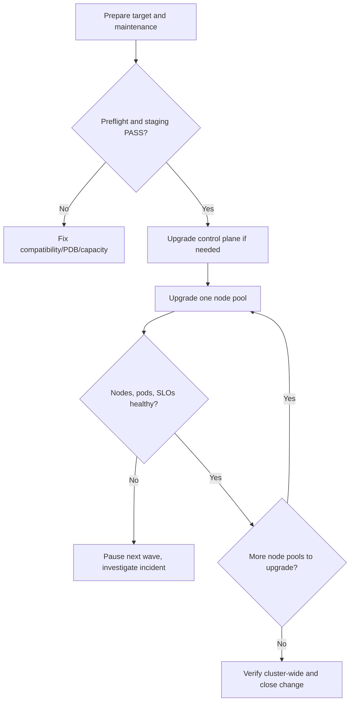

# Upgrading Kubernetes, Node Images, and Coordinating Maintenance

An **Azure Kubernetes Service (AKS)** cluster may run stably today yet gradually accumulate risk: the Kubernetes version nears end of support, node operating systems lack patches, networking add-ons lose compatibility with newer versions, or node replacements disrupt live applications. Therefore, operating AKS is not just running an `upgrade` command; it is a process of **version lifecycle management, spare capacity planning, cross-team coordination, and post-maintenance application verification**.

This lesson belongs to the **AKS Operations** chapter of the **CLOUD_PROVIDERS_AZURE** module. The module explores the Microsoft Azure ecosystem from subscriptions, resource groups, and Microsoft Entra ID to virtual networking, compute, storage, and data, while guiding deployment, monitoring, security, and cost control for Azure application architectures. This lesson focuses on the difference between **Kubernetes upgrades** and **node image updates**, how AKS orchestrates node pools during maintenance, and the prerequisites for keeping applications available.

After this lesson, you will be able to:

- Distinguish **control plane** upgrades, **node pool Kubernetes version** upgrades, **node OS image** updates, and application **container image** releases.
- Inspect current versions, AKS-supported upgrade targets, and individual node pool states.
- Explain cordon, drain, eviction, surge, node creation/replacement, and returning workloads to healthy state.
- Design **PodDisruptionBudgets (PDBs)**, replicas, probes, and availability zone distribution to minimize disruption.
- Choose manual upgrades, auto-upgrade channels, and **planned maintenance windows** aligned with organizational policy.
- Author a runbook covering preflight checks, phased rollout, verification, error handling, and recovery options.
- Monitor risks, temporary capacity costs, quotas, and post-maintenance safety posture.

## 1. Four Frequently Confused Types of Changes

| Category | What Changes? | Typical Impact Scope | How to Control |
|---|---|---|---|
| **Kubernetes control plane upgrade** | Version of AKS-managed control plane Kubernetes components | API server and Kubernetes version behaviors/features | Select a supported AKS target version, verify compatibility |
| **Node pool Kubernetes upgrade** | Version of kubelet/Kubernetes components on worker nodes and node runtime per deployment | Nodes upgraded/replaced, pods may be evicted and rescheduled | Coordinate per pool, surge, drain, PDBs, health checks |
| **Node OS image upgrade** | Node OS image, patches, and bundled platform components | Usually replaces/reimages nodes, causing pod movement | Node image channel, maintenance, and drain planning |
| **Application container image release** | Image of a Deployment/StatefulSet/Job managed by app teams | Application revisions/pods | App rolling updates/canary, readiness, rollback |

**Do not conflate them:** updating `image: my-api:v2` in a Deployment does not upgrade Kubernetes; conversely, updating the node image does not change your application's container image tag.

Example:

```text
AKS control plane:       Kubernetes v1.X
System node pool:        Kubernetes v1.X, node image build A
User node pool:          Kubernetes v1.X, node image build B
Application Deployment:  registry.example/api:2026.11
```

This is an illustrative model: symbols like `v1.X`, `A`, and `B` are not literal versions to enter. In real environments, retrieve **current versions/images and supported targets** from the cluster itself and AKS upgrade listings.

### 1.1. Why Do Node Images Need Updating Even When Kubernetes Version Hasn't Changed?

A Kubernetes patch release does not mean every OS, kernel, container runtime, or agent patch on worker nodes has been applied. **Node image upgrades** let AKS roll out maintained node images on a supported channel, which may include OS patches, base package updates, and node configuration/infrastructure changes.

Conversely, a Kubernetes upgrade may also update node images while replacing node pools, but you should not rely on that to ignore node OS patching policies on their own lifecycle.

### 1.2. Node Pools: System and User

AKS commonly distinguishes:

- **System node pool:** hosts critical cluster system pods, typically with dedicated capacity/taint/label requirements.
- **User node pool:** runs application team workloads; can be segmented by VM size, fault domain, OS, or scaling needs.

Each pool has its own node upgrade lifecycle and orchestration behavior. Never inspect just one node pool and assume the whole cluster is patched. When a system pool lacks capacity, upgrades can impact CoreDNS, metrics, or core orchestration components.

## 2. Kubernetes Version Lifecycle on AKS

AKS supports a curated set of Kubernetes versions per region based on release schedules and service support policies. Newer versions bring features, bug fixes, and API changes; overly old versions may lose security support or standard upgrade paths.

Before every upgrade cycle:

1. Check **current versions of the control plane and every node pool**.
2. Check **available upgrade targets returned by AKS for the cluster** in its current region.
3. Review support lifecycle documentation, especially if long-term support or specific version mandates apply.
4. Inventory deprecated/removed Kubernetes APIs and version-pinned add-ons.
5. Read release notes and breaking-change notices for critical components.

### 2.1. Do Not Arbitrarily Skip Minor Versions

Upgrading directly from a very old minor version to a distant minor version may be **unsupported** by AKS. Retrieve the valid **`upgrades`** list from `az aks get-upgrades` and follow service-supported steps; if a cluster is out of support or blocked, follow appropriate recovery/migration guidance.

Do not type a target version from an old blog post or assume the "latest upstream Kubernetes release" is already supported by AKS in every Azure region.

### 2.2. Control Plane and Node Pools Are Not a Single Monolith

Architecturally, the control plane and worker nodes are separate tiers whose versions may differ within **AKS/Kubernetes-supported version skew limits**. When upgrading, the standard order is **upgrading the control plane to the target version first**, then upgrading node pools according to plan.



AKS may offer whole-cluster upgrades or **control-plane-only** upgrades via supported commands/flags. **Do not let node pools drift beyond supported skew limits** or leave the cluster half-upgraded indefinitely without an approved plan.

## 3. Checking Dependencies Before Upgrading

A Kubernetes minor version can impact:

- **API resources:** deprecated or removed API groups/versions or schema changes.
- **Admission webhooks:** policy engines, cert-manager, or custom admission controllers may reject new pods/Deployments.
- **Ingress/network plugins:** Azure CNI, ingress controllers, Gateway API/Ingress controllers, and CNI integrations have compatibility bounds.
- **CSI drivers/storage:** Azure Disk CSI, Azure Files CSI, snapshot classes, and volume attach/detach during drains.
- **Monitoring/security agents:** DaemonSets, log collectors, OpenTelemetry, Defender/agents, and sidecars.
- **Service mesh:** mTLS, sidecar injection, and version compatibility.
- **Workload controllers:** Helm charts, KEDA/HPA, CRDs, operators, and GitOps controllers.
- **Operating systems:** Windows vs Linux node pools, supported node image SKUs/OS versions, and kernel features.

### 3.1. Inventory APIs Before Changing Versions

For example, a manifest still referencing a removed Kubernetes API will fail after the upgrade; GitOps/Helm may keep trying to reconcile the old resource and get rejected by the API server. You must:

1. Inventory Git repositories, Helm chart templates, and CRDs.
2. Review AKS/Kubernetes API deprecation warnings where available.
3. Test deployments against the target API version on a lab cluster.
4. Upgrade add-ons/operators per vendor compatibility matrices.
5. Enforce linters/policies and CI validation prior to production.

**Upgrading the cluster does not automatically rewrite old manifests to newer APIs.** If admission webhooks or CRDs break, failures can block new pod creation mid-drain and prolong downtime.

### 3.2. Application Data and State

Node upgrades are not meant to delete durable data properly stored in Azure Disk, Azure Files, databases, or object storage. However, apps storing state on **local disks, `emptyDir`, or pod memory** can lose data when nodes are replaced.

Confirm:

- Can Deployments recreate pods on other nodes cleanly?
- Do StatefulSets have safe **quorum/replication** and volume attachment behavior?
- Do long-running jobs support checkpoints or idempotent retries?
- Do databases have tested backups/restores?
- Is `terminationGracePeriodSeconds` long enough to finish transactions or flush data?

Backup/restore must align with the application model; a single disk snapshot alone does not guarantee application consistency.

## 4. How Does AKS Orchestrate Node Replacement?

During a node pool upgrade, AKS may create temporary nodes (*surge nodes*) and move workloads via Kubernetes primitives. General flow:



This diagram shows a typical upgrade flow; exact ordering and concurrency depend on VM SKU, mode, upgrade settings, and live AKS state.

### 4.1. Cordon, Drain, and Eviction

- **Cordon:** marks a node unschedulable for normal newly scheduled pods.
- **Drain:** requests migrating movable pods elsewhere while respecting relevant Kubernetes rules.
- **Eviction API:** controlled disruption request that evaluates **PodDisruptionBudgets** when applicable.
- **Termination grace period:** gives apps time to finish requests, flush state, or handle shutdown signals.
- **Readiness probe:** prevents traffic from hitting new pods before they are ready.

**A successful drain does not guarantee zero user-facing disruption.** A service with only one replica or slow readiness can still experience a serving gap.

### 4.2. Which Pods Can Block a Drain?

Cases to inspect:

- A PDB requires availability that cannot currently be met.
- Pods crash or replacements cannot start due to CPU/RAM/IP shortages.
- Pods use local storage or special workload controllers.
- Stateful apps waiting on volume detach/attach.
- Admission webhooks rejecting new pod creation.
- Taints/tolerations, node affinity, topology spread constraints, or quotas leaving pods Pending.
- DaemonSets or static pods having special drain semantics.

Never make a habit of **force-deleting pods** or disabling PDBs just to "push the upgrade through" without understanding data and business impact. Classify the root cause and remediate safely.

## 5. PodDisruptionBudget: Designing Voluntary Disruption Limits

A **PodDisruptionBudget (PDB)** tells Kubernetes the minimum healthy pods to preserve or maximum pods allowed **voluntarily** disrupted within a selector-matched group. PDBs limit disruptions from drains/evictions, yet **cannot prevent unexpected events** like host power loss or sudden application crashes.

Example of a 3-replica Deployment:

```yaml
apiVersion: apps/v1
kind: Deployment
metadata:
  name: orders-api
  namespace: orders
spec:
  replicas: 3
  selector:
    matchLabels:
      app: orders-api
  template:
    metadata:
      labels:
        app: orders-api
    spec:
      containers:
        - name: api
          image: example.azurecr.io/orders-api:1.0.0
          ports:
            - containerPort: 8080
          readinessProbe:
            httpGet:
              path: /ready
              port: 8080
            initialDelaySeconds: 5
            periodSeconds: 5
          resources:
            requests:
              cpu: "250m"
              memory: "256Mi"
---
apiVersion: policy/v1
kind: PodDisruptionBudget
metadata:
  name: orders-api-pdb
  namespace: orders
spec:
  minAvailable: 2
  selector:
    matchLabels:
      app: orders-api
```

In steady state, all 3 pods are healthy and `minAvailable: 2` permits **1 pod** to be evicted at a time. Once only 2 healthy pods remain, another eviction is blocked until the replacement pod becomes healthy.

| Expected Replicas | Currently Healthy Pods | `minAvailable` | Remaining Allowed Disruptions (Illustrative) |
|---:|---:|---:|---:|
| 3 | 3 | 2 | 1 |
| 3 | 2 | 2 | 0 |
| 3 | 1 | 2 | 0 |

This is a simplified example; how Kubernetes calculates `disruptionsAllowed` also depends on selectors, desired counts, and controller states. Check `kubectl get pdb -A` directly rather than doing mental math alone when multiple controllers or unhealthy pods exist.

### 5.1. Pitfalls of Overly Strict PDBs

If an application has only **1 replica** yet its PDB requires `minAvailable: 1`, drains can block indefinitely until capacity or policy changes. If a 3-replica service has all three pods packed onto a single node due to poor placement, draining that node also introduces higher risk than expected.

For safe operation:

1. Run multiple replicas when uninterrupted availability is required.
2. Set PDBs based on **real quorum/serving needs**, not generic formulas.
3. Add readiness/liveness/startup probes matching true application behavior.
4. Spread pods across nodes/zones appropriately.
5. Ensure **surge capacity** for replacement pods.
6. Test drains in lab/staging and measure actual impact.

### 5.2. PDBs Differ from Rolling Update Policies

`Deployment.spec.strategy.rollingUpdate.maxUnavailable` and `maxSurge` govern **Deployment rolling updates**. A PDB governs **voluntary disruptions via the Eviction API**. The two mechanisms do not replace each other.

Likewise, `AKS node pool maxSurge` is extra node capacity added during node upgrades. It differs from `Deployment maxSurge` (extra pods temporarily created during an app rollout). Design these bounds together—never refer loosely to "25% surge" without specifying which layer.

## 6. Max Surge, Drain Timeout, and Node Soak

AKS provides upgrade orchestration settings depending on feature/API support, such as **`maxSurge`**, **drain timeout**, and **node soak duration**. These affect upgrade speed, risk exposure, and maintenance cost.

### 6.1. `maxSurge`

`maxSurge` specifies the count or percentage of extra nodes AKS may provision during a node pool upgrade. Conceptual example:

```text
Current node pool:  6 nodes
Assumed max surge:  2 nodes
Temporary capacity: up to roughly 8 nodes during the upgrade
```

Actual behavior depends on pool size, percentage rounding, quotas, availability zones, SKU capacity, and Azure execution timing. Larger surge can shorten total duration, yet:

- Requires additional **vCPU quotas and VM capacity**.
- Consumes additional **IP addresses** per CNI configuration.
- Temporarily increases compute/disk/network costs.
- May fail if the region/zone lacks capacity for the requested VM size.
- Does not resolve PDB or application drain blockers.

Smaller surge lowers quota pressure at the expense of longer maintenance duration. Choose based on replica count, SLOs, and available headroom.

### 6.2. Drain Timeout

Drain timeout sets how long AKS waits for pods to evict/terminate within configured bounds. If a PDB blocks eviction or pods fail to migrate, AKS may pause/wait/fail according to orchestration rules and timeout limits.

**Raising the timeout does not fix an impossible PDB.** Before raising it, check:

- Are pods Healthy or in `CrashLoopBackOff`?
- Are replacement replicas Pending due to missing resources or node affinity?
- Is a pod's `terminationGracePeriodSeconds` overly long relative to SLAs?
- Are StatefulSets/volumes waiting on failover, detach, or replication?

### 6.3. Node Soak Duration

Some upgrade configurations support a **soak** interval between node replacements to observe health before proceeding. For sensitive workloads or catching post-migration memory leaks/latency, soak time is valuable—in exchange for longer total maintenance time.

**Note:** supported parameters and bounds for max surge, drain timeout, soak, max unavailable, or node replacement strategies depend on AKS version, pool type, and service lifecycle. Never copy flags from outdated docs straight into production without checking your current Azure CLI/API capabilities.

## 7. Availability Zones and Pod Placement

Surviving node maintenance without outage requires more than a PDB; remaining pods must reside in relatively independent failure domains.

### 7.1. Same Node, Same Zone, Different Zones

| Placement | Risk |
|---|---|
| Three replicas on the same node | Draining one node impacts all three |
| Three replicas on three nodes in the same zone | Survives single node loss, exposed to zone outage |
| Replicas spread across multiple supported nodes/zones | Improves resilience to both node and zone failures, provided dependencies are also resilient |

A node pool spanning availability zones does not automatically guarantee the scheduler places each replica in a different zone; configure topology spread, anti-affinity, or suitable placement rules alongside sufficient per-zone node capacity.

### 7.2. Topology Spread Constraints Example

A `Pod.spec` fragment may use:

```yaml
topologySpreadConstraints:
  - maxSkew: 1
    topologyKey: topology.kubernetes.io/zone
    whenUnsatisfiable: DoNotSchedule
    labelSelector:
      matchLabels:
        app: orders-api
```

This is only a **configuration snippet**—place it under `spec.template.spec` in your Deployment and ensure nodes carry matching zone labels. If only one zone exists or another zone lacks capacity, `DoNotSchedule` can leave pods Pending. Balance strict spread against availability when capacity is tight.

### 7.3. Do Not Overlook Dependencies

Even if API pods remain up in another zone, the application can still fail if:

- Azure SQL/Storage/Redis has only a single non-redundant serving endpoint.
- Load Balancers/Ingress lack proper health checks.
- Secret providers or admission webhooks become unavailable mid-upgrade.
- Azure Disk volumes are pinned to a specific availability zone, preventing StatefulSets from attaching on nodes in another zone.

For stateful storage, design **zone-aware placement** and data-layer failover rather than forcing pods into zones where volumes cannot attach.

## 8. Node Image Upgrades vs Kubernetes Upgrades

A **node image** is the worker node OS image used by AKS, containing OS patches, container runtime/agents, and platform-aligned configurations. Applying a new node image normally replaces or reimages nodes, so **pod disruption and drain must still be managed**.

### 8.1. When Should You Check Node Images First?

- A security advisory affects the node kernel/OS.
- The running node image is significantly behind current releases.
- Container runtime, networking, or storage driver fixes are needed.
- The Kubernetes version is still current, yet OS patches remain unapplied.
- Your organization follows an OS patching cadence separate from Kubernetes minor upgrades.

### 8.2. Distinguishing Node Image Builds and Application Images

```text
Node image:         AKS OS/runtime image build managed by the platform
Container image:    example.azurecr.io/orders-api:2026-11
Kubernetes version: v1.X.Y
```

These three artifacts have separate release schedules and rollback behaviors. Updating a container tag does not patch the node kernel; updating the node image does not fix an app with outdated libraries.

### 8.3. Windows and Linux Node Pools

AKS supports both Linux and Windows node pools per supported versions and SKUs. **Node OS/image channels, reboot behaviors, and compatibility** can differ between the two operating systems. Windows container/HostProcess/antivirus constraints or Linux kernel capabilities must be validated independently.

In mixed-OS clusters, "all nodes Ready" is not enough; verify the updated node image build on **every pool** and test corresponding workloads post-upgrade.

## 9. Auto-Upgrades and Node OS Upgrade Channels

AKS offers automation mechanisms for control plane/Kubernetes upgrades and node OS image updates. Common channels may include:

- **Kubernetes cluster auto-upgrade channel:** chooses automation level such as `none`, `patch`, `stable`, or `rapid` among values supported by your AKS version.
- **Node OS upgrade channel:** governs node OS update strategy, such as `None`, `Unmanaged`, `SecurityPatch`, or `NodeImage` where supported.

**Do not confuse the two mechanisms:** Kubernetes auto-upgrade governs **Kubernetes version** progression; the node OS channel governs **node OS/image** updates. They can interact, but one does not replace the responsibilities of the other.

### 9.1. Comparing Operational Strategies

| Strategy | Pros | Risks / Requirements |
|---|---|---|
| **Manual upgrades** | Full control over target and timing of each wave | Easy to fall behind on patching without clear process/owners |
| **Auto-upgrade patch** | Helps keep patch fixes current within a minor branch per channel support | Still requires PDBs, capacity, and regression checks |
| **Auto-upgrade stable/rapid** | Reduces manual tracking for minor upgrades per supported strategy | Requires proactive API/add-on compatibility prep and change governance |
| **NodeImage channel** | Keeps node images updated on a supported automated cadence | May trigger frequent node replacements/drains per release cadence |
| **SecurityPatch channel** | Focuses on OS security updates per supported mechanism | Does not always replace the entire node image on every update |
| **Unmanaged/None** | Organization orchestrates everything manually for special cases | Assumes full responsibility for patching, monitoring, and compliance |

Do not treat channel names as exact date/hour SLAs, nor assume every channel is valid across all regions, OS types, or cluster modes. When picking a channel, review current Azure documentation for supportability, cost, and interaction with planned maintenance.

### 9.2. Establish an Approved Version Cadence

Example internal policy:

```text
Weekly:
  - Check security advisories, node image availability, and cluster health.

Monthly:
  - Review minor/patch versions, add-on compatibility, and PDB violations.

Pre-maintenance:
  - Upgrade staging, measure SLOs, verify quotas and backups.

During maintenance:
  - Upgrade pool by pool, monitor rollouts, halt if error budget is breached.

Post-maintenance:
  - Verify versions/images, pods, SLOs, and close the change record.
```

This is an example cadence; organizations may also need emergency out-of-band patching and must comply with AKS version support lifecycles.

## 10. Planned Maintenance Windows: Coordinating Timing

**Planned maintenance configurations** in AKS let you define preferred/allowed time windows for certain supported maintenance and upgrade operations. Configurations may apply to:

- Default maintenance schedules for applicable platform tasks.
- **Managed Kubernetes auto-upgrade** schedules.
- **Managed node OS upgrade** schedules.

Supported Azure CLI/API configuration names may include `default`, `aksManagedAutoUpgradeSchedule`, and `aksManagedNodeOSUpgradeSchedule`. Verify exact names/features on your live cluster; do not assume declaring only a `default` schedule automatically governs every upgrade channel.

### 10.1. What Maintenance Windows Can and Cannot Do

| Supported Capability | What Not to Assume |
|---|---|
| Defines days/hours, recurrence, and allowed intervals per service mechanics | Every upgrade will **finish** within the exact minute the window ends |
| Aligns automated rollouts with business schedules | Emergency security fixes or incidents will never occur outside the window |
| Reduces peak-hour collision risk when planned properly | Applications experience zero disruption during node drains |
| Gives clear schedules for alerting, on-call, and change processes | Automatically validates PDBs, capacity, or version compatibility for you |

For critical systems, schedule windows during low-traffic periods **while on-call engineers are available**; do not schedule unattended overnight windows that leave broken rollouts lingering into business hours.

### 10.2. Time Zones and Duration

When configuring recurring schedules, check whether the Azure API/CLI expects **UTC or a specific offset/time zone format** in the active properties. For example, an organization in Vietnam planning to start at **01:00 local time (UTC+7)** corresponds to **18:00 UTC the previous day**. This is an illustrative time conversion; always double-check configuration fields and exact dates before creating a maintenance configuration.

Avoid confusing:

1. **Maintenance window**: allowed window for the service to start/coordinate maintenance.
2. **Drain timeout**: wait limit for pod eviction/termination per node.
3. **Node soak**: observation pause between upgrade waves.
4. **RTO/error budget**: acceptable business disruption threshold.

These intervals interact but do not substitute for one another. A large upgrade can overrun due to quotas or PDBs, so always have a runbook for duration overruns.

## 11. Controlled AKS Upgrade Runbook

### Phase A — Pre-Change Preparation

1. **Define scope:** Kubernetes minor/patch upgrade, node image only, or both? Document security/support rationale.
2. **Verify target:** check `get-upgrades`, support lifecycle, and node image availability.
3. **Health check:** nodes Ready, pods healthy, no abnormal Pending/`CrashLoopBackOff` pods.
4. **PDB check:** live `disruptionsAllowed`, replica counts, and replacement capacity.
5. **Capacity check:** vCPU quotas, zone capacity, IP addresses, disk limits, Cluster Autoscaler, and surge.
6. **Compatibility check:** API removals, CNI/CSI, admission webhooks, ingress, operators, CRDs, service mesh.
7. **Data check:** backups, recovery points, StatefulSets, volume zones, database HA, and restore tests.
8. **Define rollback/recovery:** app rollback, workload placement, spinning up a new pool, or restore; never assume Kubernetes downgrade is supported.
9. **Change notice:** owner, UTC/local times, runbook, dashboards, halt thresholds, and communication channels.
10. **Staging validation:** representative enough of production workloads and data dependencies to catch regressions.

### Phase B — Phased Execution

1. Confirm the **correct subscription, cluster, and context**.
2. For Kubernetes upgrades, follow the AKS-supported control plane → node pool path.
3. Monitor one node pool at a time; avoid upgrading multiple critical pools simultaneously without clear justification.
4. Watch new nodes becoming Ready, replacement pods becoming Ready, app metrics, and errors.
5. Wait through soak/validation before advancing to the next pool.
6. If errors breach thresholds, **halt further rollout expansion** and switch to incident response.

### Phase C — Verification and Closure

1. Verify **control plane version, each pool version, and `nodeImageVersion`**.
2. Check Pending pods, restarts, PDB disruptions, events, and HPA/Cluster Autoscaler.
3. Run synthetic transactions: login, order creation, test checkout, safe data queries.
4. Verify ingress, DNS, TLS, network policies, Storage/SQL/Key Vault, and log collectors.
5. Compare SLOs, p95/p99 latency, error rate, queue backlog, and capacity costs.
6. Document exceptions, any pools left on older versions, follow-up items, and change sign-off.



## 12. Hands-On Azure CLI: Pre-Upgrade Inspection

Commands in this section are **read-only** across Azure resources and Kubernetes state. Sign in to Azure CLI with a principal holding AKS read permissions; use `kubectl` with an organization-authorized identity/context.

### 12.1. View Subscription and Kubernetes Version

```bash
RG="rg-aks-prod"
AKS="aks-orders-prod"

az account show \
  --query "{subscription:name,id:id,tenant:tenantId}" \
  -o table

az aks show \
  --resource-group "$RG" \
  --name "$AKS" \
  --query "{name:name,kubernetesVersion:kubernetesVersion,currentKubernetesVersion:currentKubernetesVersion,provisioningState:provisioningState,autoUpgradeProfile:autoUpgradeProfile}" \
  -o json
```

Inspect the actual returned version fields; `kubernetesVersion` (requested) and `currentKubernetesVersion` (active) can differ during certain deployment states. **Never** rely solely on your local `kubectl` client version to determine what version the cluster runs.

### 12.2. List Node Pools, Images, and Status

```bash
az aks nodepool list \
  --resource-group "$RG" \
  --cluster-name "$AKS" \
  --query "[].{name:name,mode:mode,osType:osType,osSKU:osSKU,kubernetesVersion:orchestratorVersion,nodeImageVersion:nodeImageVersion,count:count,provisioningState:provisioningState}" \
  -o table
```

In multi-pool clusters, capture a snapshot of **every pool**: system/user, Linux/Windows, node image build, availability zones, and scaling settings. Blank fields in a query may reflect API/CLI differences or pool configuration rather than proving a pool was already upgraded.

### 12.3. View Supported Upgrade Targets

```bash
az aks get-upgrades \
  --resource-group "$RG" \
  --name "$AKS" \
  -o table
```

Select `TARGET_VERSION` from this output and organizational policy; never enter an upstream Kubernetes version absent from AKS-supported upgrades. Clusters out of support or crossing multiple minor versions may require staged upgrades.

### 12.4. View Maintenance Configurations

```bash
az aks maintenanceconfiguration list \
  --resource-group "$RG" \
  --cluster-name "$AKS" \
  -o json
```

Compare returned configurations against active auto-upgrade/node OS channels. If no schedule exists, the command returns an empty list; do not assume that means platform maintenance never occurs or Azure will never apply updates.

### 12.5. Check Kubernetes Health

```bash
kubectl config current-context
kubectl get nodes -o wide
kubectl get pods -A -o wide
kubectl get pdb -A
kubectl get deployments,statefulsets,daemonsets -A
kubectl get events -A --sort-by=.lastTimestamp
```

In practice, `kubectl get events -A` can be noisy; filter by namespace or timestamp to focus investigations. Watch for `NotReady` or `SchedulingDisabled` nodes, `Pending` pods, and PDBs showing `ALLOWED DISRUPTIONS = 0` for workloads slated to drain.

### 12.6. Inspect Specific Nodes and PodDisruptionBudgets

```bash
kubectl describe node <node-name>
kubectl describe pdb orders-api-pdb -n orders
kubectl get pods -n orders -l app=orders-api -o wide
```

These commands show resource requests, taints, events, replica counts, PDB selectors, and pod placement across nodes. A PDB with a mismatched label selector silently fails to protect the pods an admin thinks it covers.

## 13. Example Upgrade Commands — Use Only When Approved

Commands in this section **mutate AKS state**, triggering node drains/restarts/reimages and temporary capacity charges. They are shown to illustrate **differences between operations**—**do not execute them** casually during study or directly in production before completing your runbook.

### 13.1. Upgrade Kubernetes Control Plane Only

Example control-plane-only operation where supported by AKS and CLI version:

```bash
TARGET_VERSION="<supported-target-version>"

az aks upgrade \
  --resource-group "$RG" \
  --name "$AKS" \
  --kubernetes-version "$TARGET_VERSION" \
  --control-plane-only
```

Afterward, node pools may remain on the older Kubernetes version within permitted skew limits. **You must continue** with the planned pool-by-pool upgrade; do not stop just because the control plane succeeded.

### 13.2. Upgrade a Single Node Pool to a Target Kubernetes Version

```bash
POOL="userpool1"

az aks nodepool upgrade \
  --resource-group "$RG" \
  --cluster-name "$AKS" \
  --name "$POOL" \
  --kubernetes-version "$TARGET_VERSION"
```

Before running, verify `get-upgrades`, compatibility, max surge/PDBs, and capacity. A pool upgrade can fail due to quotas, NotReady nodes, or undrainable workloads.

### 13.3. Upgrade Node Image Only Without Changing Kubernetes Version

```bash
az aks nodepool upgrade \
  --resource-group "$RG" \
  --cluster-name "$AKS" \
  --name "$POOL" \
  --node-image-only
```

`--node-image-only` updates the node pool to the AKS-provided node image within support boundaries—**it does not mean nodes avoid replacement or pods avoid disruption**. Apply the same drain/PDB/surge precautions where appropriate.

### 13.4. Deliberately Configuring Auto-Upgrade Channels

Conceptual example once the organization has approved channels:

```bash
# MUTATING COMMAND — verify syntax/supportability before applying.
az aks update \
  --resource-group "$RG" \
  --name "$AKS" \
  --auto-upgrade-channel patch \
  --node-os-upgrade-channel NodeImage
```

Enabling auto-upgrade channels **does not replace** application testing, maintenance prep, observability, or change control. If your organization pauses rollouts based on error budgets, establish monitoring and approval gates accordingly.

### 13.5. Adjusting Max Surge After Sizing

Example CLI syntax where supported:

```bash
# MUTATING COMMAND — apply only after calculating quotas, IPs, zones, and SLOs.
az aks nodepool update \
  --resource-group "$RG" \
  --cluster-name "$AKS" \
  --name "$POOL" \
  --max-surge "33%"
```

Effective percentages and bounds depend on rounding rules, AKS limits, and pool size. Do not copy `33%` to every pool; on small pools or single-replica apps, it still does not guarantee zero disruption.

**Never alter maintenance windows with an unreviewed script**; verify configuration names, time zones, and recurrence against your live CLI/API or Azure Portal first.

## 14. Monitoring Maintenance and Stop Criteria

### 14.1. Monitor Across Four Layers

| Layer | Metrics/Signals | Question |
|---|---|---|
| Azure/AKS | Provisioning state, upgrade events, node pool versions/images, Azure Activity Log | Where is the upgrade at, and are there provisioning errors? |
| Kubernetes | Ready nodes, Pending/Restarting pods, PDB allowed disruptions, events, scheduling | Are pods migrating safely? |
| Application | HTTP 5xx, p95 latency, throughput, queue backlog, success rate | Are users experiencing disruption? |
| Dependencies | Database/Storage connectivity, DNS, ingress, Key Vault, ACR, telemetry | Do new nodes have working networking, identity, and drivers? |

Do not watch only `az aks show provisioningState = Succeeded`. An infrastructure-level upgrade can report success while leaving applications broken due to readiness, network policies, CSI mounts, or deprecated APIs.

### 14.2. Conditions to Pause Further Rollout

The thresholds below are **illustrative examples**, not Azure defaults:

```text
Pause upgrading the next pool when:
  - Any node stays NotReady beyond internal threshold.
  - Critical service pods enter Pending/CrashLoopBackOff.
  - A PDB blocks drain with no identified root cause.
  - HTTP 5xx or latency breaches approved error budget.
  - Signs of data inconsistency or volume attach errors appear.
  - Surge quota/capacity runs out.
```

Depending on impact, you may need to halt the change, shed traffic, add capacity, fix PDBs/placement, or roll back application images/manifests.

### 14.3. Rollback Must Be Scoped Realistically

**Kubernetes cluster downgrades are generally not supported as a standard direct rollback in AKS.** When a Kubernetes upgrade causes issues, do not plan around "running a downgrade command" as your primary fallback.

Realistic options to prepare beforehand include:

- Rolling back **application images/manifests/Helm releases** if the bug is in the app.
- Restoring compatible add-ons/CRDs/operators where supported.
- Provisioning a new node pool or AKS-supported workaround to isolate workloads rather than forcing a node downgrade.
- Restoring from backups/DR or failing traffic over to a prepared standby cluster for severe incidents.
- Engaging service support workflows if the cluster is stuck in a failed upgrade state.

A rollback plan is only meaningful if you have tested the return path, data compatibility, and capacity of the fallback environment.

## 15. Scenario A: Kubernetes Minor Upgrade for a Multi-Replica API

**Context:** the cluster has a system pool and a user pool; `orders-api` runs 6 replicas, PDB `minAvailable: 4`, across two availability zones with appropriate pod anti-affinity. The team wants to upgrade one Kubernetes minor version while keeping order placement online.

### 15.1. Plan

1. Verify AKS-supported target version and compatibility of ingress, CSI, autoscalers, and admission webhooks.
2. Run equivalent validation tests on staging.
3. Check the current PDB: with 6 healthy pods, allowed disruptions are 2 under the simple model.
4. Ensure the node pool has surge quota and IP addresses; during node drains, at least 4 replicas remain available to serve.
5. Upgrade the control plane, then each node pool per supported sequence.
6. Verify orders API, ingress, Azure SQL/Storage, metrics, error rates, and data integrity.
7. Proceed only while SLOs remain stable; archive the post-change report.

### 15.2. Risks Not Solved by a PDB

If all 6 replicas connect to an unavailable database, the API still fails despite a perfect PDB. If new pods cannot fetch secrets or pull images, evicting old nodes can still drive healthy pod counts down. Thus, **a PDB never replaces dependency health, capacity, configuration, or application readiness**.

## 16. Scenario B: Security Node Image Patch and Batch Workers

**Context:** a user node pool runs workers reading a Service Bus Queue; each job can run 20 minutes. A new node image is available for security patching, while the Kubernetes version does not need changing.

**Mistake to avoid:** running `--node-image-only` assuming jobs on old pods always finish cleanly before VMs are replaced. If a worker is terminated mid-job, work may be interrupted and messages reprocessed.

Approach:

1. Verify jobs support **idempotency**, lease/visibility timeouts, checkpoints, and retries.
2. Handle graceful shutdown/termination signals so workers stop pulling new jobs before exiting.
3. Size `terminationGracePeriodSeconds` and drain settings to fit the workload profile.
4. Ensure remaining workers can absorb backlog during maintenance.
5. Upgrade in phases, watching for duplicate processing, dead-letter queues, and data consistency.
6. After node replacement, verify the new `nodeImageVersion` across the entire pool and zero Pending workloads.

If business rules cannot tolerate mid-job interruption at all, consider controlled job scheduling, pausing intake before maintenance, or other dedicated mechanisms—do not rely on a PDB as a guarantee that jobs will run indefinitely.

## 17. Scenario C: Maintenance Blocked by StatefulSet and PodDisruptionBudget

**Context:** a database operator runs 3 replicas with a PDB requiring `minAvailable: 3`. AKS drains a node hosting a replica, and eviction blocks.

**Analysis:** all 3 replicas must stay healthy continuously per the PDB, leaving zero voluntary disruption budget. If the cluster operator must move a replica, drain stalls. However, blindly lowering `minAvailable` to 2 **is not automatically safe** if database quorum or replication is unsynchronized.

Remediation workflow:

1. Determine the database's **true quorum and failover mechanics**.
2. Inspect member health and replication lag.
3. Read PDB selectors, status, and which pods are pending eviction.
4. Verify sufficient capacity, volume attach/zone compatibility, and networking.
5. Follow the database vendor's runbook to shift leadership/replicas or adjust the PDB after approval.
6. Validate data integrity before resuming the drain.

Never use force eviction / `kubectl delete pod --force` to kick a database member out without controlling split-brain and data-loss risks.

## 18. Troubleshooting AKS Upgrades

| Symptom | Possible Cause | Evidence and Remediation |
|---|---|---|
| Target Kubernetes version not listed | Region/cluster unsupported, invalid upgrade path, or lifecycle policy | Check `az aks get-upgrades` and version support matrix |
| Control plane upgraded, nodes stay on old version | Ran `--control-plane-only` or node pool upgrades incomplete | Check each pool and finish upgrading within skew limits |
| Node pool stuck draining | PDB, unhealthy pods, volumes, termination, DaemonSet/constraints | `kubectl get pdb`, events, logs, and pod placement |
| Pods Pending after adding surge | CPU/RAM/IP quota, node affinity, taints, topology spread | Node allocatable, requests, free subnet IPs, scheduler events |
| Upgrade fails to provision new VMs | Azure vCPU quota, zone capacity, VM SKU allocation | Activity Log, VMSS/node pool events, quotas, region/zone |
| Workload drops traffic during node swap | Single replica, bad readiness/termination, slow LB drain | Check SLOs, probes, replicas, and ingress/LB |
| CSI volume attach fails post-upgrade | Storage driver compatibility or volume zone mismatch | CSI logs, PersistentVolume, VolumeAttachment, node zone |
| New nodes fail to pull images | ACR permissions, DNS/egress, image architecture | Pod events, kubelet/image pull errors, private endpoints |
| API/Helm deploy fails after minor upgrade | Removed/deprecated APIs, incompatible CRD/webhook | API errors, admission logs, manifest versions |
| `nodeImageVersion` unchanged | Upgrade job not run, no newer image, or failed upgrade | Check pool `nodeImageVersion` and provisioning state |
| Metrics disappear after node swap | Monitoring agent DaemonSet/permissions/config incompatibility | Agent status, Log Analytics/OTel pipeline |
| Maintenance runs unexpectedly | Confused channel, time zone, maintenance config type, or other platform mechanism | Check schedules, Activity Log, and channel settings |
| Sudden cost spike during maintenance | Surge VMs, parallel pools, logs, or overprovisioning | Cost Management, node counts/quotas, duration |
| Data corruption after disabling PDB | Drain disrupted an unprepared stateful workload | Halt change, preserve evidence, run vendor recovery |

### 18.1. Short Investigation Workflow

```text
1. Capture timestamp and exact change operation
2. Identify control plane / pool / node image / application release
3. Inspect AKS status and Activity Log
4. Inspect nodes, pods, PDBs, events, scheduler/CSI logs
5. Cross-check quotas, subnet IPs, capacity, and placement
6. Check application metrics and data integrity
7. Fix the true root cause and re-test on a small scope
8. Document RCA, update runbooks, and prevent recurrence
```

## 19. Cost, Security, and Operational Controls

### 19.1. Cost Components That Rise During Upgrades

- **Surge nodes:** temporary VMs and managed disks during upgrades.
- **Parallel clusters:** staging, blue-green, or DR clusters spun up to reduce risk.
- **Network/IP:** subnet IPs, load balancers/NAT, egress, per-zone capacity.
- **Observability:** elevated logs/events/metrics ingestion during maintenance.
- **Engineering effort:** incident on-call, app testing, and compatibility validation.

Using larger surge or standby clusters costs money, yet can drastically reduce downtime risk. Base decisions on **SLOs, recovery objectives, and TCO**, not VM hourly rate alone.

### 19.2. Upgrade Permissions

Upgrading AKS is a high-privilege infrastructure change. Separate:

- **Azure RBAC control-plane** permissions to update AKS/node pool resources.
- **Kubernetes API** permissions to inspect pods, PDBs, and events.
- **Log Analytics/Monitor** and network/storage read access for investigations.
- **Application manifest/GitOps** permissions owned by development teams.

Apply least privilege, change approvals, Azure Activity Logs, PIM where adopted, and restrict shared admin credentials. Maintenance operators do not need blanket data-plane access to databases or secret stores.

### 19.3. Maintaining Continuous Security Support

Manage Kubernetes patches/minors, node OS images, and applications on relatively independent yet coordinated schedules. Do not delay critical security patches just because "the next Kubernetes minor upgrade isn't scheduled yet"; conversely, do not push an untested minor upgrade into production just because a new node image arrived.

Monitor the support lifecycle of AKS, base OS images, Windows/Linux workers, add-ons, and database/ingress vendors. Assign owners and alerts so you do not keep running indefinitely on end-of-support versions.

## 20. Pre-, During-, and Post-Maintenance Checklist

### Pre-Maintenance

- [ ] Confirmed exact cluster, subscription, environment, and node pools.
- [ ] Target Kubernetes version is AKS-supported; node image target verified.
- [ ] Checked API deprecations and compatibility for add-ons, admission, networking, storage, and operators.
- [ ] Nodes/pods are healthy; PDBs have valid disruption budgets.
- [ ] Verified replicas, readiness, termination grace periods, and pod topology.
- [ ] Verified sufficient VM quotas, IP/subnet space, and per-zone surge capacity.
- [ ] Verified backups/restores for stateful workloads and job handling plans.
- [ ] Completed staging tests, stop/recovery plan, and change approvals.
- [ ] Planned maintenance window, time zone, channels, and team notifications are clear.

### During Maintenance

- [ ] Maintain action/timestamp log; watch pool upgrade status and activity logs.
- [ ] Monitor node Ready state, Pending/Restarting pods, and PDBs.
- [ ] Monitor SLOs, error rates, latency, queue backlogs, and dependency health.
- [ ] Upgrade one pool/wave at a time; halt if stop thresholds are breached.
- [ ] Never force-delete stateful workloads or disable PDBs just to force a drain.

### Post-Maintenance

- [ ] Control plane and every node pool are on expected versions.
- [ ] Node image versions match plan; no unexpected stale nodes remain.
- [ ] Zero prolonged Pending/`CrashLoopBackOff`/`NotReady` states.
- [ ] Synthetic tests and business transactions PASS.
- [ ] Ingress, DNS, storage, Azure SQL/Key Vault/ACR, and telemetry are healthy.
- [ ] Reconciled data integrity, audited surge costs, and closed change record with evidence.

## 21. Self-Check Questions

1. What is the difference between upgrading the Kubernetes control plane, upgrading a node pool's Kubernetes version, and a node image upgrade?
2. Why does a Kubernetes minor upgrade require checking API deprecations even if all pods currently run fine on the old version?
3. What does `az aks get-upgrades` determine? Why shouldn't you type an arbitrary upstream Kubernetes version?
4. With a 3-replica Deployment and PDB `minAvailable: 2`, how many voluntary evictions are permitted when all 3 pods are healthy?
5. Why can a PDB `minAvailable: 1` on a 1-replica application block drains indefinitely?
6. Distinguish `AKS node pool maxSurge` from `Deployment rollingUpdate.maxSurge`.
7. Which VM quota, IP, and cost demands do surge nodes increase?
8. Does a node pool spanning three availability zones automatically guarantee three API pods land in three different zones?
9. During a node image update, why must batch workloads still implement checkpoints and retries?
10. Why does `--node-image-only` not mean applications face zero disruption?
11. Distinguish the Kubernetes auto-upgrade channel from the node OS upgrade channel.
12. Does a maintenance window guarantee every upgrade finishes inside the window or causes zero pod downtime?
13. After a control-plane-only upgrade, what must you still do for node pools?
14. A StatefulSet has PDB `minAvailable: 3` on 3 replicas. Why must you consult quorum/vendor procedures instead of forcing a drain?
15. AKS upgrade reports `Succeeded`, yet the API shows rising HTTP 5xx errors. Which components should you verify?
16. Why should "downgrade Kubernetes" not be treated as the default rollback plan?

## Conclusion

Safe AKS operations require managing **three independent yet connected change lifecycles**: control plane Kubernetes version, node pool Kubernetes version, and **node OS image**, alongside application releases. Upgrades may replace nodes and evict pods, making **PDBs, replicas, readiness, graceful shutdown, surge capacity, zone placement, and durable data** practical prerequisites for keeping services online. Auto-upgrade channels and planned maintenance windows help coordinate schedules, yet never replace version checks, compatibility testing, or SLO monitoring. Standardize the workflow **preflight → phased upgrade → observe → verify → reconcile**, prepare realistic recovery paths rather than banking on downgrades, and let application metrics alongside Azure/Kubernetes state guide whether to proceed or pause maintenance.
